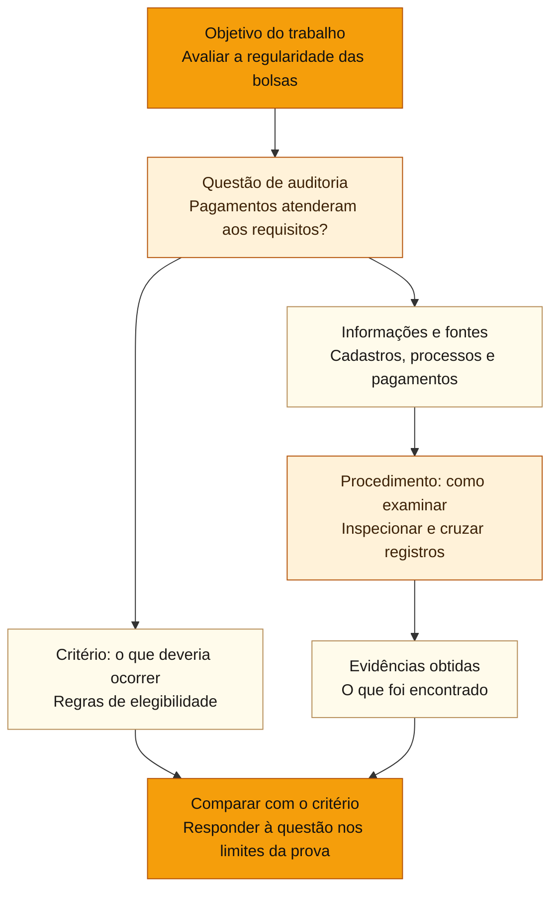
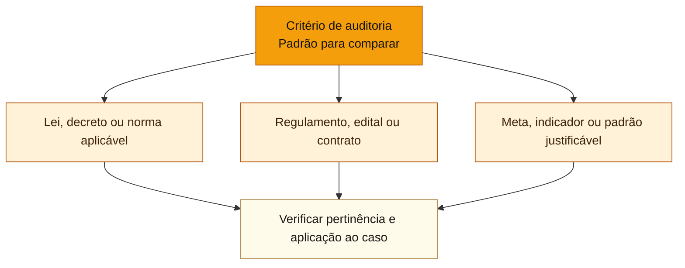

# Planejamento individual de auditoria

Depois de selecionado um trabalho anual, a **Unidade de Auditoria Interna Governamental (UAIG)** precisa definir como examinar aquele objeto. A escolha dos trabalhos pertence ao plano anual; o desenho dos objetivos, escopo, critérios e testes pertence ao planejamento individual.

## Núcleo e preparação do trabalho

**Base normativa:** [IN SFC nº 3/2017, Referencial Técnico, itens 119 a 141 e 157](https://www.gov.br/cgu/pt-br/assuntos/auditoria-e-fiscalizacao/pgmq/arquivos/in-sfc-03-2017-referencial-tecnico.pdf) e [Manual de Orientações Técnicas da CGU, seções 4.2 e 4.3 e Apêndice B](https://wiki.cgu.gov.br/index.php/Manual_de_Orienta%C3%A7%C3%B5es_T%C3%A9cnicas_da_Atividade_de_Auditoria_Interna_Governamental_do_Poder_Executivo_Federal). **Unidade 05 explicada e exercitada em 03/11/2026, com revisão espaçada pendente.**

### Distinção em relação ao PAINT

O PAINT seleciona **quais trabalhos** a UAIG pretende realizar no exercício. O planejamento individual determina **como um trabalho selecionado responderá às questões de auditoria**, com objetivos, limites, métodos, equipe e cronograma. Pelo item 122 do Referencial Técnico, contempla análise preliminar do objeto, definição de objetivos e escopo à luz de riscos e controles, programa de trabalho, alocação da equipe e coordenação. Esses passos podem ser refinados no decorrer da preparação, sem confundir a escolha anual do objeto com o desenho de seus testes.

**Formalização** (MOT, seção 4.2): o trabalho é formalizado internamente, usualmente por **Ordem de Serviço**, com unidade auditada, objeto, objetivo, equipe, responsáveis e prazo. A ordem de serviço pode anteceder o programa de trabalho e **não é sinônimo deste**; nome e forma variam conforme normas internas da UAIG.

### Fronteiras entre os elementos

| Elemento | Pergunta de controle | Exemplo hipotético: assistência estudantil |
| :--- | :--- | :--- |
| **Objeto** | O que será auditado? | Concessão e pagamento de bolsas |
| **Objetivo** | Para que auditar? | Avaliar controles contra pagamento indevido |
| **Escopo** | Até onde o trabalho irá? | Bolsas de determinado exercício, em dois campi |
| **Questão** | O que deve ser respondido com evidências? | Pagamentos tiveram comprovação prévia de elegibilidade? |
| **Subquestão** | Qual parte da questão geral deve ser examinada? | Houve verificação de duplicidades antes de pagar? |
| **Critério** | Qual padrão permite comparar situação real e esperada? | Exigências do regulamento de concessão de bolsas |
| **Informações e fontes** | Quais dados e onde estão? | Cadastro, editais, processos e registros financeiros |
| **Procedimento** | Como obter e avaliar evidências? | Inspeção e cruzamento de cadastros e pagamentos |
| **Possível achado** | Qual desvio poderá ser demonstrado, se encontrado? | Pagamento sem comprovação exigida, sujeito à prova |

**Escopo não é critério:** período e unidades delimitam o exame; regras e padrões são referências para julgar conformidade. **Fonte não é procedimento:** o cadastro contém registros; cruzar ou inspecionar registros é o procedimento. **Risco não é achado:** a possibilidade de pagamento indevido motiva o exame, enquanto a ocorrência precisa ser verificada e documentada.

### Mapas: objetivo, critério e procedimento

O **objetivo** define o que o trabalho pretende avaliar; precisa ser formulado para aquela auditoria e pode se desdobrar em questões e subquestões. O **critério** é o padrão contra o qual se compara a situação encontrada. O **procedimento** é o exame escolhido para obter evidências. O objetivo não possui uma lista universal de técnicas: ele orienta a seleção dos critérios e dos procedimentos adequados.

O **escopo** delimita período, unidades e operações examinadas; não substitui o critério. O exemplo descreve uma auditoria hipotética. A conclusão depende das evidências efetivamente obtidas.

#### De onde podem vir os critérios?

São **exemplos de fontes possíveis**, não uma classificação oficial, fechada ou de aplicação automática. O critério deve ser pertinente ao objetivo e suficientemente claro, confiável e fundamentado para permitir a comparação. Um critério pode ser estabelecido em norma ou derivar de parâmetro razoável e justificável, conforme o caso (MOT, seção 4.3.3). A matriz de planejamento registra a relação entre questão, critério, fontes e procedimentos.

### Matriz, programa e supervisão

A **matriz de planejamento**, exemplificada no **Apêndice B do MOT**, encadeia problema/risco, questão, subquestão, critério, informações necessárias, fontes, procedimentos, limitações, responsável, período e possível achado. Serve para verificar se cada questão pode ser respondida por evidências e se os procedimentos adotados efetivamente permitem comparação com o critério. **Possível achado** na matriz é hipótese, não irregularidade comprovada.

O **programa de trabalho** é documentado e contém procedimentos aptos a responder aos objetivos específicos. Nos serviços de avaliação, prevê questões, critérios, técnicas e **natureza e extensão dos testes** (Referencial, itens 138 e 139). Na escolha da **natureza, época e extensão** dos exames: *natureza* é tipo de procedimento; *época* é quando testar; *extensão* é quanto ou quantos elementos examinar. Nem todo exame requer 100% dos registros.

O programa e eventuais ajustes devem ser **documentados e previamente aprovados pelo supervisor da auditoria** (item 141). Supervisão acompanha desde planejamento até monitoramento e autoriza ajustes pertinentes (item 157). **Conselho/dirigente aprova o PAINT; supervisor aprova programa individual**. Em serviços de consultoria, o programa pode variar na forma e conteúdo conforme a natureza do serviço (item 140).

### Risco do objeto versus risco de auditoria

**Risco do objeto**: possibilidade de evento prejudicar objetivo do processo examinado, como pagamento de bolsa a pessoa inelegível. **Risco de auditoria**: possibilidade de o auditor chegar a conclusão inválida ou opinião equivocada a partir de seu exame (MOT, 4.3.2). Dados incompletos, escopo impróprio e extensão inadequada dos testes podem elevar o risco de auditoria. Uma área pode ter riscos elevados sem que se deva aceitar conclusões frágeis a seu respeito.

**Heurística Cebraspe:** objeto = *o quê*; objetivo = *para quê*; escopo = *até onde*; questão = *o que responder*; critério = *com que padrão*; fonte = *onde estão os dados*; procedimento = *como testar*; supervisor = *quem aprova previamente o programa*. 

**Status (03/11/2026): unidade 05 concluída didaticamente**, após aprendizagem **4/6**, revisão aplicada **6/6** e treino para valer **8/8**, com **um acerto declarado por chute** sobre programa de consultoria. A revisão não apaga os dois erros originais. Retenção espaçada e transferência para novas situações ainda devem ser testadas.

## Refinamento de conceitos próximos

**Escopo × critério:** os campi, as etapas e o período estabelecem os limites do exame. O regulamento de elegibilidade ou um padrão pertinente de desempenho pode funcionar como critério. O **Manual de Orientações Técnicas (MOT)** da Controladoria-Geral da União, seções 4.3.2.2 e 4.3.3, admite padrões razoáveis e atingíveis, desde que justificados, mesmo sem previsão literal em lei. Uma meta institucional pode oferecer critério, mas seu período de referência continua integrando o escopo.

**Aprovação dos ajustes:** a **Instrução Normativa (IN)** da **Secretaria Federal de Controle Interno (SFC)** nº 3/2017, item 141, exige **documentação e aprovação prévia do supervisor** para o programa individual e suas alterações. Conselho ou dirigente aprova o PAINT, não substitui o supervisor do programa. Justificação posterior não supre aprovação prévia.

**Extensão × escopo:** aumentar de 30 para 50 processos dentro das unidades e do período aprovados pode ampliar a extensão dos testes sem alterar o escopo. Incluir outro período ou unidade pode exigir mudança de escopo e ajustes autorizados.

**Avaliação × consultoria:** o item 139 trata do programa em serviços de avaliação. Pelo item 140, o programa de consultoria pode variar na forma e no conteúdo conforme sua natureza. O MOT 1.2.3.1 exige entendimento documentado com a unidade auditada quanto a objetivos, natureza, escopo, prazo e responsabilidades. Flexibilidade não significa ausência de planejamento.

**Risco do objeto × risco de auditoria:** a primeira categoria descreve ameaças ao processo examinado; a segunda, a possibilidade de conclusão inválida do auditor. Bases incompletas, limites mal definidos e testes insuficientes podem afetar esta última.

O histórico da unidade 05 registra erros iniciais em escopo/critério e na autorização do programa, e um acerto por chute sobre consultoria. Esses mecanismos foram retomados, mas a retenção espaçada ainda deve ser verificada. Ver registro individual de estudos mantido no cofre privado.

## Relações com outros temas

[[3 - Materias/Auditoria Governamental/02 - ciclo de auditoria|Ciclo de auditoria]] oferece a visão das quatro etapas. O histórico das respostas e dos erros permanece em registro individual de estudos mantido no cofre privado.
