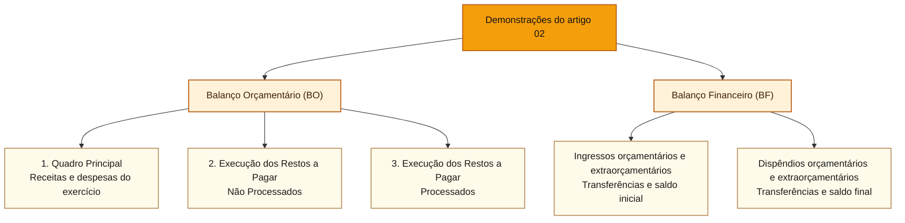

# Balanço Orçamentário e Balanço Financeiro

## Núcleo do conceito

O **Balanço Orçamentário (BO)** confronta autorização, previsão e execução de receitas e despesas. O **Balanço Financeiro (BF)** articula ingressos e dispêndios orçamentários e extraorçamentários, transferências financeiras e saldos de caixa e equivalentes. Ambos são Demonstrações Contábeis Aplicadas ao Setor Público (DCASP), mas não respondem à mesma pergunta.

A Lei nº 4.320/1964 fundamenta o **BO no art. 102** e o **BF no art. 103**. O **Manual de Contabilidade Aplicada ao Setor Público (MCASP), 11ª edição, Parte V**, desenvolve a estrutura, os quadros e a interpretação em conformidade com as Normas Brasileiras de Contabilidade Aplicadas ao Setor Público (NBC TSP). A denominação **resultado financeiro do exercício** no BF não autoriza tratá-lo como **superávit financeiro** apurado no Balanço Patrimonial (BP).

| Demonstração | Pergunta de prova | Elementos de maior utilidade | Erro de inferência |
| :--- | :--- | :--- | :--- |
| BO | O que foi previsto e autorizado, e o que foi arrecadado e executado? | previsão inicial/atualizada, receita realizada, dotação inicial/atualizada, despesa empenhada/liquidada/paga, quadros de RP | supor que despesa empenhada é igual ao valor desembolsado |
| BF | Como se estruturaram ingressos e dispêndios e quanto dinheiro ficou? | receita/despesa orçamentárias, recebimentos/pagamentos extraorçamentários, transferências, caixa inicial/final | confundir saldo de caixa, resultado do exercício e superávit financeiro do BP |

## Finalidade dos demonstrativos e apresentação conjunta

**Balanço Orçamentário (BO): para que serve?** Compara o orçamento autorizado com sua execução. Mostra receitas previstas e arrecadadas, dotações e despesas empenhadas, liquidadas e pagas. Ajuda a analisar a execução do planejamento e o cumprimento das autorizações. Seu resultado orçamentário não corresponde necessariamente ao dinheiro que sobrou no banco.

**Balanço Financeiro (BF): para que serve?** Organiza ingressos e dispêndios orçamentários e extraorçamentários, transferências e saldos de caixa do início e do fim do exercício. Ajuda a explicar a movimentação financeira e a conciliar o caixa com os registros orçamentários. Não é um extrato bancário: inclui compensações contábeis, como a inscrição de restos a pagar.

**Como ler o exemplo:** o BO mostra R$ 100 arrecadados e R$ 60 empenhados, portanto resultado orçamentário de R$ 40. O BF mostra que foram pagos apenas R$ 40 e restaram R$ 60 de caixa real, embora R$ 20 dessa quantia correspondam a uma obrigação ainda não paga. Por isso, os R$ 20 de restos a pagar aparecem também como recebimento extraorçamentário compensatório, sem que representem dinheiro recebido. O saldo real de caixa e a existência de obrigações são informações diferentes.

**Aparecem sempre juntos?** BO e BF integram o conjunto das Demonstrações Contábeis Aplicadas ao Setor Público (DCASP), normalmente apresentado na prestação de contas anual. São demonstrações independentes: podem ser consultadas e analisadas separadamente e não precisam ficar na mesma página. Também não devem ser confundidas com o **Balanço Patrimonial (BP)**, que permite apurar ativo financeiro menos passivo financeiro, nem com a **Demonstração dos Fluxos de Caixa (DFC)**, que evidencia movimentos efetivos de caixa.

**Heurística:** previsão, dotação e empenho: BO; ingressos, pagamentos, inscrição compensatória de restos a pagar e saldo de caixa: BF; situação patrimonial e superávit financeiro por fonte: BP.

## Mapa visual: quais quadros pertencem ao BO e ao BF?

O **Balanço Orçamentário (BO)** possui **três quadros**, e todos pertencem ao próprio BO. O **Balanço Financeiro (BF)** é outra demonstração, estruturada em ingressos, dispêndios e saldos financeiros. Ele **não recebe parte dos quadros do BO**.

**Uma terceira estrutura, em outro artigo:** os **quatro quadros** são do **[[3 - Materias/Contabilidade Publica/03 - balanco patrimonial e demonstracao das variacoes patrimoniais#Estrutura do BP: quatro quadros com critérios diferentes|Balanço Patrimonial (BP)]]**: Principal; Ativos e Passivos Financeiros e Permanentes; Contas de Compensação; e Superávit ou Déficit Financeiro. Eles **não se dividem entre BO e BF**. A Demonstração das Variações Patrimoniais (DVP) também é uma demonstração distinta.

## Comece pela pergunta de cada balanço

Antes das tabelas, imagine que uma universidade arrecade **R$ 100** em tributos, empenhe **R$ 60** para comprar computadores já entregues, mas pague apenas **R$ 40** até 31 de dezembro. Ficam **R$ 20** de obrigação não paga, inscritos regularmente como **restos a pagar processados** porque a despesa já foi liquidada. Não houve outras operações, saldos anteriores nem depreciação. Use esse caso para acompanhar os dois relatórios.

O **Balanço Orçamentário (BO)** pergunta: **quanto do orçamento foi previsto, autorizado e executado?** Ele compara a receita efetivamente arrecadada com a despesa empenhada no exercício. Nesse caso, o resultado orçamentário simplificado é **R$ 100 − R$ 60 = R$ 40**, mesmo que a universidade só tenha desembolsado R$ 40.

O **Balanço Financeiro (BF)** pergunta: **como ingressos, dispêndios e saldos financeiros se relacionam?** O BF considera a **despesa orçamentária empenhada de R$ 60**, mesmo que apenas **R$ 40 tenham sido pagos**. Os **R$ 20 empenhados e não pagos**, inscritos regularmente em **restos a pagar (RP)** no fim do exercício, aparecem no BF como **recebimento extraorçamentário compensatório**. Isso significa um **registro de compensação no demonstrativo**, e não dinheiro que entrou na conta bancária. Neste exemplo, os R$ 20 já foram **liquidados**, portanto são **restos a pagar processados**. A regra do art. 103, parágrafo único, da Lei nº 4.320/1964 também alcança a inscrição regular de **restos a pagar não processados**, ainda pendentes de liquidação: **o critério é ter sido empenhado e não pago, observadas as condições de inscrição**, e não obrigatoriamente ter sido liquidado.

**Por que o BF usa esse registro?** Como os R$ 60 inteiros aparecem entre as despesas orçamentárias, mas somente R$ 40 saíram do caixa, o demonstrativo registra **R$ 20 como ingresso compensatório** para neutralizar a parte sem desembolso. Assim, o BF fecha com **R$ 120 nos ingressos** (R$ 100 arrecadados + R$ 20 compensatórios) e **R$ 120 nos dispêndios e saldo final** (R$ 60 de despesa orçamentária + R$ 60 de caixa remanescente). **A entrada real foi R$ 100 e a saída real, R$ 40.** Quando os RP forem pagos em exercício seguinte, o pagamento será apresentado entre os **pagamentos extraorçamentários** daquele exercício, sem representar novo empenho da mesma despesa.

**Fronteira importante:** *recebimento extraorçamentário* é uma categoria mais ampla. Alguns recebimentos representam **entrada efetiva de dinheiro**, como depósitos de terceiros sujeitos a devolução. O *recebimento extraorçamentário compensatório da inscrição de RP* é um **lançamento sem entrada de caixa**. Portanto, a palavra “recebimento” no BF não prova, por si só, que houve dinheiro novo.

**Vocabulário mínimo na ordem em que aparece:**

| Palavra | O que significa aqui | Cuidado |
| :--- | :--- | :--- |
| **Previsão da receita** | Estimativa aprovada no orçamento | Não é dinheiro arrecadado |
| **Dotação** | Autorização orçamentária para uma despesa | Não prova entrega nem pagamento |
| **Arrecadação** | Momento de realização da receita orçamentária | Não precisa coincidir com uma nova VPA |
| **Empenho** | Ato que compromete parcela da dotação, conforme a lei | Não é desembolso |
| **Liquidação** | Verificação formal do direito do credor, conforme o objeto entregue ou prestado | Pode ocorrer em momento diferente do fato gerador patrimonial |
| **Pagamento** | Quitação com saída de recursos | Não cria automaticamente VPD |
| **Restos a pagar** | Despesas empenhadas e não pagas até o encerramento, se atendidos os requisitos legais | Processados: liquidados; não processados: ainda não liquidados |

**Como ler o restante da nota:** primeiro encontre esses mesmos valores no BO; depois veja por que o BF apresenta o ingresso compensatório e como isso se relaciona com o caixa final. Somente depois compare *resultado orçamentário*, *variação de caixa* e *superávit financeiro do BP*: são três cálculos com bases diferentes. O [[3 - Materias/Contabilidade Publica/03 - balanco patrimonial e demonstracao das variacoes patrimoniais|artigo de BP e DVP]] explica a última classificação, e a [[3 - Materias/Contabilidade Publica/04 - fluxos de caixa notas explicativas e conciliacoes|DFC]] detalha o dinheiro efetivamente movimentado.

## Estrutura do Balanço Orçamentário

O BO evidencia **receitas** por categoria econômica e origem, com **previsão inicial**, **previsão atualizada**, **receita realizada** e **saldo** (excesso ou insuficiência de arrecadação). Para **despesas**, evidencia, entre outros, **dotação inicial**, **dotação atualizada**, **despesas empenhadas**, **liquidadas**, **pagas** e **saldo da dotação**. Conforme o MCASP 11, Parte V, seção 2, o BO contém três quadros: **Quadro Principal**, **Quadro da Execução dos Restos a Pagar Não Processados** e **Quadro da Execução dos Restos a Pagar Processados**.

A diferença entre previsão e arrecadação indica **excesso ou insuficiência de arrecadação**. A diferença entre dotação atualizada e despesa empenhada indica, no enfoque simplificado da coluna de saldo, **parcela da dotação que não foi empenhada**. O **resultado orçamentário do exercício** é calculado, de maneira geral, pelo confronto entre **receitas orçamentárias realizadas e despesas orçamentárias empenhadas**, e não pelo confronto entre arrecadação e pagamentos.

O BO permite observar as colunas de liquidação e pagamento, mas elas **não substituem o empenho** como critério do exercício orçamentário no art. 35 da Lei nº 4.320/1964.

**Fronteira com créditos adicionais:** a utilização de superávit financeiro de exercícios anteriores para abertura de créditos adicionais pode elevar a dotação atualizada sem criar receita orçamentária do exercício. O MCASP explica que esse fenômeno pode produzir desequilíbrio aparente entre **previsão atualizada da receita** e **dotação atualizada**. A reabertura de créditos especiais/extraordinários, nas condições legais, também pode explicar essa diferença. Interpretar o BO exige examinar a coluna de saldos de exercícios anteriores e as notas explicativas; não chamar superávit financeiro anterior de nova receita.

## Estrutura do Balanço Financeiro

O BF mostra, em um mesmo quadro, os seguintes agrupamentos fundamentais:

- **Ingresso orçamentário**: receitas orçamentárias realizadas.
- **Transferências financeiras recebidas** e outras movimentações financeiras recebidas conforme a estrutura aplicável.
- **Recebimentos extraorçamentários**: entradas que não são novas receitas orçamentárias do período, incluindo registros compensatórios específicos.
- **Dispêndio orçamentário**: despesa orçamentária executada.
- **Transferências financeiras concedidas**, demais movimentações e **pagamentos extraorçamentários**.
- **Saldo em espécie do exercício anterior** e **saldo transferido ao exercício seguinte** (caixa e equivalentes, observadas as segregações previstas no MCASP).

O BF evidencia as informações por **fonte ou destinação de recursos**. A apuração do **resultado financeiro do exercício** pode ser entendida como:

**Saldo em espécie para o exercício seguinte − saldo em espécie do exercício anterior.**

Esse resultado expressa a **variação financeira do período na demonstração**. O **superávit/déficit financeiro**, por sua vez, é obtido no **Balanço Patrimonial**, a partir do confronto dos componentes financeiros pertinentes. É incorreto chamar todo crescimento de caixa de superávit financeiro disponível para abrir créditos adicionais.

A leitura literal do art. 103 exige cuidado: o MCASP trata os movimentos orçamentários, extraorçamentários, transferências e a reconciliação dos saldos. **Receita orçamentária exibida no BF** e **recebimento de dinheiro** podem aparecer em agrupamentos diferentes, e uma inscrição de restos a pagar pode entrar como recebimento extraorçamentário **compensatório**, mesmo sem dinheiro novo.

## Restos a pagar: o elo que costuma confundir

O **art. 103, parágrafo único**, determina que **os restos a pagar do exercício sejam computados como receita extraorçamentária para compensar sua inclusão na despesa orçamentária**. Trata-se de **lançamento de compensação para fechar a demonstração**, não de arrecadação nova ou crescimento efetivo de caixa.

A despesa empenhada em 2026, ainda que não paga, integra a despesa orçamentária desse exercício. A **inscrição em restos a pagar (RP)** cria, no BF, o correspondente lançamento compensatório no campo extraorçamentário. Quando RP de exercício anterior for pago posteriormente, o desembolso é **pagamento extraorçamentário** do novo exercício, e não uma nova despesa orçamentária empenhada nesse ano.

**Processados × não processados:** restos a pagar **processados** foram empenhados e liquidados, mas não pagos. Os **não processados** estão pendentes de liquidação. O MCASP distingue, entre estes, **a liquidar** e **em liquidação**, conforme o fato gerador tenha ou não ocorrido. A situação muda o tratamento patrimonial da obrigação, mesmo que a despesa orçamentária tenha sido empenhada. Releia [[3 - Materias/Orcamento Publico/09 - restos a pagar dea e suprimento de fundos|Restos a pagar e estágios]].

## Exemplo comentado: o mesmo equipamento nos dois balanços

**Cenário didático consistente com [[3 - Materias/Contabilidade Publica/01 - patrimonio publico e regimes de reconhecimento|Patrimônio e regimes]]:** uma entidade começa 2026 com caixa zero, arrecada **R$ 100** em tributos, empenha e liquida **R$ 60** na aquisição de equipamento recebido e paga **R$ 40** até o encerramento. Inscreve os **R$ 20** restantes como **restos a pagar processados**. Não há outras operações, transferências ou saldos anteriores.

**Balanço Orçamentário simplificado**

| Campo | Valor | Significado |
| :--- | ---: | :--- |
| Receita orçamentária arrecadada | R$ 100 | receita realizada |
| Despesa empenhada | R$ 60 | despesa do exercício para resultado orçamentário |
| Despesa liquidada | R$ 60 | equipamento recebido e direito do credor verificado |
| Despesa paga | R$ 40 | somente parcela desembolsada |
| Resultado orçamentário | **R$ 40** | 100 − 60 |

**Balanço Financeiro simplificado, com compensação do art. 103**

| Lado dos ingressos | Valor | Lado dos dispêndios | Valor |
| :--- | ---: | :--- | ---: |
| Receita orçamentária realizada | R$ 100 | Despesa orçamentária executada | R$ 60 |
| Recebimento extraorçamentário: inscrição compensatória de RP | R$ 20 | Saldo em espécie para o exercício seguinte | R$ 60 |
| Saldo em espécie anterior | R$ 0 | Outros pagamentos/transferências | R$ 0 |
| **Total** | **R$ 120** | **Total** | **R$ 120** |

O BF fecha em R$ 120 de cada lado, mas a entrada efetiva de dinheiro foi **R$ 100**, e o desembolso foi **R$ 40**. Os R$ 20 registrados como ingresso extraorçamentário **não são dinheiro recebido**: compensam a inclusão dos R$ 20 ainda não pagos no total da despesa orçamentária (R$ 60). O caixa final real é R$ 60. Portanto, é perfeitamente possível, nesse exemplo, haver **resultado orçamentário de R$ 40** e **variação positiva de caixa de R$ 60**.

Do ponto de vista patrimonial, sob as hipóteses da nota anterior, há **caixa R$ 60 + equipamento R$ 60 − obrigação R$ 20 = PL R$ 100**; a aquisição não provocou VPD imediata de R$ 60. Esses três números são compatíveis porque **medem coisas diferentes**.

**Em 2027**, se ocorrer apenas o pagamento dos R$ 20 inscritos em RP, haverá redução do caixa e da obrigação, e pagamento extraorçamentário no BF de 2027. Não se produz novo empenho orçamentário de 2027 apenas porque o RP foi pago nesse ano.

### Refinamento: compensação por inscrição de RPNP em liquidação

No [MCASP 11, Parte V, capítulo 3](https://cdn.tesouro.gov.br/sistemas-internos/apex/producao/sistemas/thot/arquivos/publicacoes/51045_2434252/MCASP%20-%2011%C2%AA%20Edi%C3%A7%C3%A3o.pdf) e no art. 103, parágrafo único, da Lei 4.320, o ingresso compensatório no BF **não se limita a restos a pagar processados**. Imagine **R$ 50 empenhados por serviço já prestado, mas não liquidado administrativamente**: com inscrição regular em **RPNP em liquidação**, o BF inclui **R$ 50 de recebimento extraorçamentário compensatório** para neutralizar os mesmos R$ 50 de despesa orçamentária, **sem entrada efetiva de caixa**.

Se também houve **R$ 70 de receita tributária arrecadada** e nenhum pagamento, o BF apresenta **ingressos de R$ 120 (70 + 50)** e **dispêndios e caixa final de R$ 120 (50 + 70)**. O caixa real é **R$ 70** e o BO apura **resultado +R$ 20 (70 − 50)**. O crédito tributário a receber e a VPD/passivo pelo serviço são tratados pela competência, conforme [[3 - Materias/Contabilidade Publica/04 - fluxos de caixa notas explicativas e conciliacoes#Novo exemplo: competência, RPNP e cinco demonstrações|conciliação de cinco demonstrações]].

## Resultado financeiro do BF × superávit financeiro do BP

A coincidência de palavras é um dos melhores pontos de discriminação conceitual. O **resultado financeiro do BF** acompanha a diferença entre os saldos de caixa no início e no fim, conforme os componentes da demonstração. Já o **superávit financeiro apurado no BP**, para fins orçamentários, considera **ativo financeiro menos passivo financeiro**, observados os ajustes legais pertinentes. Assim, ter caixa maior no fim do ano não assegura superávit financeiro livre ou no mesmo valor.

Exemplo curto: o ente recebe **R$ 50 de depósito de terceiros**, sujeito a devolução. A operação pode aumentar o caixa, mas também cria obrigação de igual valor. É **entrada extraorçamentária**, não receita orçamentária nem VPA por si só. A mera presença de R$ 50 no caixa não constitui ganho de R$ 50 de patrimônio líquido nem justifica afirmar que há superávit financeiro de R$ 50.

### Refinamento: o que o balanço financeiro não resolve sozinho

Considere duas situações independentes, ambas com saldos iniciais nulos, arrecadação de R$ 100, empenho e liquidação de R$ 60 e pagamento de R$ 40. A parcela não paga, R$ 20, foi regularmente inscrita em **restos a pagar processados (RPP)**. A diferença está no objeto adquirido: **equipamento incorporado ao ativo** ou **serviço integralmente consumido**. Sem depreciação, ajustes ou outros fatos:

| Medida (R$) | Equipamento recebido | Serviço consumido |
| :--- | ---: | ---: |
| Balanço Orçamentário: arrecadação menos empenho | 40 | 40 |
| Balanço Financeiro: caixa final (100 − 40 pagos) | 60 | 60 |
| BF: recebimento extraorçamentário compensatório de RPP | 20 | 20 |
| BP, 2º quadro: passivo financeiro não pago | 20 | 20 |
| BP, 4º quadro: superávit financeiro (60 − 20) | 40 | 40 |
| Patrimônio líquido e resultado patrimonial do caso | 100 | 40 |

O registro compensatório no BF **não altera o caixa**. Os R$ 20 **continuam devidos**, mesmo após a liquidação administrativa; a dívida integra o passivo patrimonial quando o bem ou serviço já foi recebido e os critérios de reconhecimento foram satisfeitos. O pagamento posterior reduz caixa e obrigação. A diferença entre os patrimônios líquidos decorre de um fato: **equipamento reconhecido permanece como ativo**, enquanto **serviço consumido gera VPD**. A igualdade numérica ocasional entre resultado orçamentário e superávit financeiro não é identidade conceitual.

A **fonte/destinação** exibida no BF também serve para acompanhar a vinculação e a aplicação dos recursos. Na passagem ao 4º quadro do BP, diferenças financeiras devem ser apuradas **por fonte**, sem concluir que saldo positivo em uma origem possa ser gasto livremente em outra. Veja [[3 - Materias/Contabilidade Publica/03 - balanco patrimonial e demonstracao das variacoes patrimoniais#Quadro do superávit ou déficit financeiro|superávit por fonte no artigo 03]].

## Como a banca pode cobrar

**Treino didático inédito 1 (C/E).** “Ao apurar o resultado orçamentário, a receita arrecadada deve ser confrontada com a despesa paga, pois o art. 35 da Lei nº 4.320/1964 adota o pagamento para vincular despesas ao exercício.” **Errado.** O marco orçamentário é o **empenho**, não o pagamento. A troca de uma coluna do BO por outra altera a resposta.

**Treino didático inédito 2 (C/E).** “A inscrição de restos a pagar do exercício é computada no BF como ingresso extraorçamentário compensatório, sem que isso represente arrecadação nova de recursos.” **Certo.** É a regra do art. 103, parágrafo único; no exemplo, R$ 20 não entraram no caixa.

**Treino didático inédito 3 (C/E).** “O resultado financeiro positivo evidenciado no BF corresponde necessariamente ao superávit financeiro disponível apurado no BP.” **Errado.** A nomenclatura é semelhante, mas o critério é diferente; o BF acompanha fluxos e saldos, enquanto o BP oferece os componentes financeiros de ativos e passivos.

Os três itens são **exercícios didáticos inéditos**, sem alegação de proveniência de caderno real Cebraspe.

## Relações com outros temas

- [[3 - Materias/Contabilidade Publica/01 - patrimonio publico e regimes de reconhecimento|Patrimônio e regimes]]: explica por que BO, BF e resultado patrimonial diferem.
- [[3 - Materias/Orcamento Publico/05 - creditos adicionais e emendas parlamentares|Créditos adicionais]]: superávit financeiro anterior como fonte, não nova receita do exercício.
- [[3 - Materias/Orcamento Publico/08 - despesas publicas e estagios|Estágios da despesa]]: empenho × liquidação × pagamento.
- [[3 - Materias/Orcamento Publico/09 - restos a pagar dea e suprimento de fundos|Restos a pagar]]: quadros e classificação dos saldos.
- [[3 - Materias/Contabilidade Publica/contabilidade-publica|Hub de Contabilidade Pública]]: as próximas notas tratarão de BP, DVP, DFC e conciliações.

## Tensões e pegadinhas

**Despesa empenhada × paga:** BO informa ambas, mas utiliza o empenho para o exercício orçamentário. **Receita orçamentária × ingresso extraorçamentário:** depósito de terceiro e compensação de RP não criam nova receita. **Restos a pagar × nova despesa:** pagamento de RP anterior não gera despesa orçamentária corrente nova. **Saldo positivo de caixa × superávit financeiro:** resultados com bases diferentes. **Superávit financeiro anterior × receita atual:** fonte para crédito adicional não é arrecadação do exercício.

## Heurísticas

Antes de uma conta, **identifique a coluna**: previsão, arrecadação, dotação, empenho, liquidação ou pagamento. Para BO, comece por **arrecadação − empenho**. Para BF, reconcilie **caixa inicial, ingressos efetivos, desembolsos efetivos e caixa final**, sem esquecer os lançamentos **compensatórios** de RP no quadro. Para superávit financeiro, procure os componentes do **BP**, não o resultado do BF.

## Fontes e limites de cobertura

1. [MCASP, 11ª edição, Tesouro Nacional](https://www.gov.br/tesouronacional/pt-br/contabilidade-e-custos/manuais/manual-de-contabilidade-aplicada-ao-setor-publico-mcasp-1), Parte V, capítulo 2 (BO) e capítulo 3 (BF), especialmente páginas impressas 552 e 564–567; consultado em 04/11/2026.
2. [Lei nº 4.320/1964, Planalto](https://www.planalto.gov.br/ccivil_03/leis/l4320.htm), arts. 35, 102 e 103, inclusive parágrafo único deste último.
3. [PCASP, Tesouro Nacional](https://www.gov.br/tesouronacional/pt-br/contabilidade-e-custos/federacao/plano-de-contas-aplicado-ao-setor-publico-pcasp-1), natureza das contas e versão do exercício.

**Cobertura editorial:** desenvolvimento inicial de P3.2.4 para BO/BF; **Balanço Patrimonial (BP), Demonstração das Variações Patrimoniais (DVP), Demonstração dos Fluxos de Caixa (DFC), notas e conciliações** permanecem pendentes de notas próprias. Publicar este artigo não significa estudar ou dominar a unidade.
