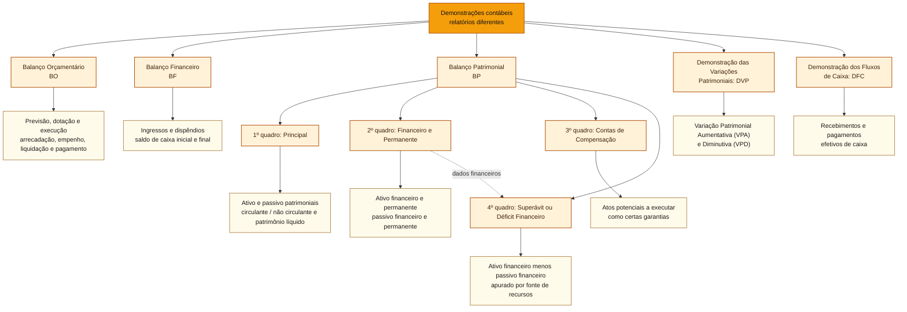

# Balanço Patrimonial e Demonstração das Variações Patrimoniais

## Núcleo do conceito

O **Balanço Patrimonial (BP)** evidencia a posição de ativos, passivos e patrimônio líquido (PL) **em determinada data**. A **Demonstração das Variações Patrimoniais (DVP)** evidencia variações patrimoniais aumentativas (VPA) e diminutivas (VPD) **durante o período**, apurando o resultado patrimonial. A fronteira inicial é **estoque de saldos (BP) × fluxo de variações patrimoniais (DVP)**.

A Lei nº 4.320/1964 (arts. 104 e 105) e o **Manual de Contabilidade Aplicada ao Setor Público (MCASP), 11ª edição, Parte V, capítulos 4 e 5** são as referências. O Quadro Principal do BP utiliza classes **1 (ativo)** e **2 (passivo e patrimônio líquido)** do Plano de Contas Aplicado ao Setor Público (PCASP). A DVP utiliza classes **3 (VPD)** e **4 (VPA)**. **Classes** são grandes grupos de contas contábeis, não etapas de execução. Para compreender a organização das **oito classes** (1 a 4 patrimoniais, 5 e 6 orçamentárias, 7 e 8 de controle), consulte [[3 - Materias/Contabilidade Publica/01 - patrimonio publico e regimes de reconhecimento#Como o PCASP ajuda a separar os registros|a explicação do PCASP no artigo 01]].

| Demonstrativo | Pergunta | Não confundir |
| :--- | :--- | :--- |
| BP | Qual a situação patrimonial na data? | saldo de ativos não é dinheiro de livre utilização |
| DVP | Quais fatos modificaram quantitativamente o PL? | VPA/VPD não equivalem a arrecadação/empenho |
| Balanço Orçamentário (BO) | Qual receita arrecadada e qual despesa empenhada? | resultado orçamentário não é resultado patrimonial |
| Balanço Financeiro (BF) | Quais ingressos/dispêndios e saldos financeiros? | ingresso compensatório de RP não é caixa recebido |
| Demonstração dos Fluxos de Caixa (DFC) | Quais fluxos efetivos de caixa ocorreram? | depreciação não é saída atual de caixa |

## Como começar: balanço, demonstração e quadro

Um **balanço** é uma demonstração contábil organizada para responder a uma pergunta. O **Balanço Patrimonial (BP)** responde **qual é a situação patrimonial em uma data**, como 31 de dezembro; a **Demonstração das Variações Patrimoniais (DVP)** responde **que aumentos e diminuições do patrimônio líquido ocorreram durante um período**. Pense no BP como um retrato e na DVP como a explicação de parte das mudanças entre dois retratos. Ambos usam dados contábeis, mas não medem o mesmo resultado.

Dentro do BP, **quadro** significa uma seção do relatório, com critérios e finalidade próprios. Não significa uma nova demonstração independente. Para não misturar classificações, siga a ordem:

| Ordem | Nome do quadro | Pergunta própria | Critério principal |
| :--- | :--- | :--- | :--- |
| **1º** | Principal | Quais ativos, passivos e patrimônio líquido existem na data? | Reconhecimento patrimonial; **circulante/não circulante** |
| **2º** | Ativos e Passivos Financeiros e Permanentes | Como bens, direitos e compromissos se enquadram nos critérios legais? | **Financeiro/permanente**, com informações patrimoniais e de execução orçamentária |
| **3º** | Contas de Compensação | Que atos potenciais ainda a executar precisam ser acompanhados? | Controles de efeitos futuros possíveis |
| **4º** | Superávit ou Déficit Financeiro | Qual é a diferença entre ativo e passivo financeiros, discriminada por fonte? | Utiliza valores do **2º quadro** |

**Ponto de orientação:** a divisão *circulante/não circulante* pertence ao **1º quadro**. A divisão *financeiro/permanente* pertence ao **2º quadro**. O **3º** é o de compensação, destinado a atos potenciais a executar.

**O que significa “quadro complementar”?** Nesta explicação, a expressão é apenas uma forma genérica de falar dos **três quadros que acompanham o Quadro Principal** do Balanço Patrimonial. Ela **não designa um quinto quadro nem um quadro único com esse nome**. Cada um acrescenta um tipo diferente de informação: o **2º** apresenta ativos e passivos pelos critérios legais de *financeiro/permanente*; o **3º** acompanha atos potenciais, como certas garantias contratuais; e o **4º** evidencia o **superávit ou déficit financeiro por fonte/destinação de recursos**.

**Como eles se relacionam?** O **4º quadro utiliza os componentes financeiros identificados no 2º**. Por exemplo, R$ 100 de ativo financeiro menos R$ 30 de passivo financeiro resultam, em cálculo básico e sem outros ajustes, em R$ 70 de superávit financeiro, cuja distribuição por fonte precisa ser verificada. O **3º quadro não entra nessa subtração**: acompanha situações potenciais que não representam, por si, ativos ou passivos reconhecidos no Quadro Principal. Para questões de prova, identifique sempre o **nome e a finalidade do quadro**, em vez de interpretar “complementar” como uma categoria própria.

### Refinamento: onde cada conceito entra?

Existem **três níveis diferentes**: **demonstração contábil** (o relatório inteiro), **quadro** (uma parte de determinada demonstração) e **classificação ou conta** (a maneira de organizar valores dentro dela). O **Balanço Orçamentário (BO)**, o **Balanço Financeiro (BF)** e o **Balanço Patrimonial (BP)** estão no **mesmo nível**: são relatórios distintos. **Somente o BP se desdobra nos quatro quadros patrimoniais mostrados abaixo.**

**Por que “financeiro” aparece no Balanço Financeiro (BF) e dentro do Balanço Patrimonial (BP)?** O **BF é uma demonstração inteira**, voltada a mostrar como os ingressos e dispêndios orçamentários e extraorçamentários se relacionam com os saldos de recursos financeiros **ao longo do exercício**. Já o **2º quadro do BP** é uma **parte de outra demonstração**: classifica, em uma data, ativos e passivos como **financeiros ou permanentes**, conforme o art. 105 da Lei nº 4.320/1964. Aqui, *financeiro* não é sinônimo de dinheiro que entrou ou saiu naquele ano: também inclui créditos realizáveis e compromissos classificados pelo critério legal. O **4º quadro do BP** usa os componentes financeiros do 2º e apura, **por fonte/destinação de recursos**, a diferença entre ativo e passivo financeiros.

**Mesmo caso, três leituras.** Uma universidade começa o ano sem dinheiro, **arrecada R$ 100 mil**, **empenha R$ 60 mil** por serviços efetivamente prestados e liquidados, mas **paga R$ 40 mil** até 31 de dezembro. Os **R$ 20 mil não pagos** são regularmente inscritos em **restos a pagar processados**; não há outros saldos ou obrigações neste exemplo.

| Onde olhar | O que aparece | O que se aprende |
| :--- | :--- | :--- |
| **Balanço Financeiro (BF)** | Arrecadação de **R$ 100 mil**, despesa orçamentária de **R$ 60 mil**, **recebimento extraorçamentário compensatório de R$ 20 mil** pela inscrição dos restos a pagar e **saldo final de caixa de R$ 60 mil** | Como as operações do ano foram registradas e quanto dinheiro efetivamente restou; os R$ 20 mil compensatórios **não são novo dinheiro** |
| **2º quadro do BP** | **Ativo financeiro de R$ 60 mil** (caixa) e **passivo financeiro de R$ 20 mil** (restos a pagar) | Quais recursos e compromissos existentes **na data** possuem classificação financeira para o art. 105 |
| **4º quadro do BP** | **R$ 60 mil − R$ 20 mil = R$ 40 mil** de diferença financeira positiva, supondo a mesma fonte e ausência de outros ajustes | Quanto resulta da comparação entre ativos e passivos financeiros, **discriminado por fonte**; o valor não é automaticamente livre para gastar |

**Restos a pagar processados continuam sendo dívida:** se o serviço foi efetivamente prestado e liquidado, mas faltam R$ 20 mil de pagamento, esse valor **permanece como passivo patrimonial no Quadro Principal** e também integra o **passivo financeiro do 2º quadro** nas condições do exemplo. A inscrição em restos a pagar não apaga a obrigação nem faz o dinheiro sair automaticamente da conta bancária. Por isso o **caixa final é R$ 60 mil**, mas o **superávit financeiro do 4º quadro é R$ 40 mil (60 − 20)**. Os R$ 40 mil também podem coincidir com o PL deste caso simplificado, porém representam cálculos diferentes e não são necessariamente iguais em outros casos.

**Conferência do caixa:** entraram efetivamente **R$ 100 mil**, saíram **R$ 40 mil** em pagamentos e ficaram **R$ 60 mil**. A apresentação formal do BF inclui a despesa orçamentária empenhada e o recebimento compensatório de restos a pagar: **R$ 100 mil + R$ 20 mil = R$ 60 mil + R$ 60 mil** (despesa orçamentária + saldo final). O **resultado de R$ 40 mil do 4º quadro do BP não é o saldo bancário de R$ 60 mil**. Neste caso simplificado, também coincide numericamente com o resultado orçamentário, mas **essa igualdade não é regra geral**. Para o funcionamento do BF, ver [[3 - Materias/Contabilidade Publica/02 - balanco orcamentario e balanco financeiro#Finalidade dos demonstrativos e apresentação conjunta|o exemplo comentado do artigo 02]].

**A mesma realidade pode aparecer em mais de um quadro:** R$ 100 mil no banco são **ativo patrimonial circulante** no **1º quadro** e **ativo financeiro** no **2º**. Computadores utilizados por vários anos são **ativo patrimonial não circulante** no **1º** e, em regra, **ativo permanente** no **2º**. Já um **empenho por serviço ainda não prestado**, quando regularmente inscrito em restos a pagar não processados, **pode integrar o passivo financeiro do 2º quadro sem criar passivo patrimonial no 1º**. Os quadros não são quatro grupos de dinheiro nem etapas sucessivas: são formas diferentes de apresentar e controlar informações.

**Heurística de leitura:** quando encontrar uma expressão desconhecida, identifique primeiro **a demonstração**; depois, **o quadro**; por último, **qual critério de classificação está sendo usado**. Isso evita equiparar ativo circulante a ativo financeiro ou confundir o BF com o quadro financeiro do BP.

## Estrutura do BP: quatro quadros com critérios diferentes

Conforme o MCASP 11, Parte V, seção 4.1, o Balanço Patrimonial compreende **(1) Quadro Principal, (2) Quadro dos Ativos e Passivos Financeiros e Permanentes, (3) Quadro das Contas de Compensação e (4) Quadro do Superávit ou Déficit Financeiro**.

### Quadro Principal: ativo, passivo e PL

**Primeira leitura, antes de classificar:** uma universidade possui R$ 100 mil no banco e um prédio em uso. Esses elementos são ativos. Se uma empresa já prestou um serviço e a universidade deve pagá-lo, existe uma obrigação patrimonial a avaliar como passivo. O patrimônio líquido é a diferença residual: **ativo − passivo**. A classificação em circulante ou não circulante só ocorre **depois** de identificar o ativo ou o passivo; por isso ela não é uma regra de classificação do segundo quadro.

A igualdade é **Ativo = Passivo + PL**. Ativo é recurso presentemente controlado, decorrente de evento passado, com benefício econômico ou potencial de serviços. Assim, um equipamento usado em serviço gratuito pode constituir ativo público. Passivo é uma obrigação presente conforme os critérios de reconhecimento. O PL representa o valor residual dos ativos após deduzir os passivos.

**O que significam circulante e não circulante?** São classificações dos **ativos e passivos no Quadro Principal do Balanço Patrimonial**. Em termos simples, distinguem recursos cuja realização ou consumo é esperado no curto prazo e obrigações que devem ser liquidadas no curto prazo daqueles que permanecem ou vencem em prazo maior. O critério usual de referência é **até 12 meses após a data do balanço**, mas o **ciclo operacional normal** e outras condições previstas nas normas também precisam ser considerados.

**O que é ciclo operacional normal?** É o tempo habitual entre a aquisição de insumos ou ativos destinados às operações da entidade e sua realização no curso dessas operações (em atividades comerciais, por exemplo, até a venda e a conversão em caixa). No setor público, pense no caminho de materiais comprados para prestar serviços: o hospital adquire medicamentos, mantém estoque e os consome no atendimento. A classificação como circulante considera esse ciclo quando ele puder ser identificado, **mesmo que ultrapasse 12 meses**; se não for claramente identificável, presume-se um ciclo de **12 meses**. Muitas atividades de prestação gratuita de serviços públicos não têm uma etapa de venda que permita medir facilmente esse ciclo. **Ciclo operacional não é sinônimo de exercício financeiro** (ano civil) nem de prazo de pagamento de uma obrigação. Exemplo: medicamentos a consumir nos próximos oito meses são, em regra, **ativo circulante**; um prédio usado continuamente na prestação do serviço é **ativo não circulante**.

| Classificação | Significado | Exemplo numa universidade |
| :--- | :--- | :--- |
| **Ativo circulante** | Dinheiro disponível ou recursos que se espera realizar, vender ou consumir no ciclo operacional normal ou, conforme a hipótese normativa, em até 12 meses | Dinheiro em conta; crédito com recebimento previsto para daqui a seis meses |
| **Ativo não circulante** | Ativos que não atendem aos critérios de circulante, como bens de uso duradouro e créditos de prazo mais longo | Prédio da universidade e computadores usados por vários anos |
| **Passivo circulante** | Obrigações cuja liquidação é esperada no ciclo operacional normal ou exigível em até 12 meses, entre outros critérios | Valor devido a um fornecedor com vencimento no mês seguinte |
| **Passivo não circulante** | Obrigações que não atendem aos critérios do circulante, normalmente com liquidação prevista para além de 12 meses e direito de diferir o pagamento nas condições aplicáveis | Parcela de financiamento cujo vencimento é daqui a quatro anos |

**Voltando ao exemplo:** os R$ 100 mil depositados no banco são, normalmente, **ativo circulante**. O prédio utilizado pela universidade é **ativo não circulante** (imobilizado). Uma obrigação já reconhecida por serviço prestado, com pagamento previsto para o mês seguinte, é **passivo circulante**. Um mesmo financiamento pode ter parcelas circulantes e não circulantes, conforme os vencimentos e as condições contratuais.

**Pegadinha:** o prazo de 12 meses é uma referência importante, mas **não é o único critério**. Dinheiro com restrição de uso que impeça sua utilização para liquidar passivo por pelo menos 12 meses pode ter classificação diferente; o ciclo operacional e o direito de adiar a liquidação também importam. Além disso, **circulante/não circulante** é uma divisão do **1º quadro do BP**, enquanto **financeiro/permanente**, no **2º quadro**, segue a Lei nº 4.320/1964 e critérios de autorização orçamentária. **Um computador é ativo não circulante e, em regra, ativo permanente no quadro legal, mas as expressões não são sinônimas.**

### Quadro financeiro e permanente: art. 105 da Lei nº 4.320/1964

**Segunda leitura, mudando a pergunta:** a mesma universidade tem R$ 100 mil em conta bancária e empenhou R$ 30 mil por um serviço **ainda não prestado**. Suponha que, ao encerrar o exercício, esse compromisso tenha sido regularmente inscrito em **restos a pagar não processados a liquidar** (despesa empenhada cujo objeto ainda não foi entregue ou prestado). Pelo critério patrimonial do **1º quadro**, o empenho isolado ainda não cria passivo desse serviço. No **2º quadro**, o compromisso pode integrar o **passivo financeiro**. O que mudou foi o critério de classificação, não o fato ocorrido.

Se o serviço tivesse sido **prestado e consumido** antes do encerramento, haveria também fato gerador de Variação Patrimonial Diminutiva (VPD) e obrigação patrimonial, mesmo que a liquidação administrativa estivesse pendente. O nome da etapa orçamentária não substitui a análise da entrega ou do consumo. Esse contraste é o motivo de o passivo financeiro do 2º quadro **não poder ser copiado mecanicamente** do passivo do 1º.

A classificação em **ativo financeiro/permanente** e **passivo financeiro/permanente** atende a critérios legais e orçamentários, **distintos** do prazo que define circulante e não circulante.

- **Ativo financeiro:** numerário, créditos e valores realizáveis independentemente de autorização orçamentária.
- **Ativo permanente:** bens, créditos e valores cuja mobilização ou alienação depende de autorização legislativa, nos termos da lei.
- **Passivo financeiro:** obrigações e compromissos exigíveis cujo pagamento independe de autorização orçamentária.
- **Passivo permanente:** dívidas e demais compromissos que dependem de autorização legislativa para amortização ou resgate.

### Comparação direta entre os quatro conceitos

| Classificação | Critério |
| :--- | :--- |
| **Ativo patrimonial** | Recursos controlados e reconhecidos por competência. |
| **Passivo patrimonial** | Obrigações presentes reconhecidas por competência. |
| **Ativo financeiro** | Disponibilidades, créditos e valores realizáveis independentemente de autorização orçamentária. |
| **Passivo financeiro** | Obrigações e compromissos considerados segundo critérios legais e do MCASP, inclusive situações sem passivo patrimonial correspondente no quadro principal. |

A classificação financeira não equivale à divisão circulante/não circulante. Valores do passivo financeiro podem incluir restos a pagar não processados a liquidar, mesmo sem passivo patrimonial correspondente.

**O que é autorização orçamentária e quem a concede?** É a **permissão jurídica para executar uma despesa pública**, com valor e finalidade definidos na programação orçamentária. O **crédito orçamentário** expressa essa autorização; a **dotação** indica o valor atribuído à despesa ou programação na Lei Orçamentária Anual (LOA) ou em créditos adicionais. **Ter caixa não equivale a ter dotação**, e dotação não é dinheiro já pago.

**Quem participa, na União?** O **Poder Executivo elabora e encaminha o Projeto de Lei Orçamentária Anual (PLOA)**; o **Congresso Nacional discute e aprova o projeto**; e ocorre a **sanção presidencial**, com as regras constitucionais aplicáveis. A **LOA aprovada** estabelece as autorizações de despesas. Na execução, o **Poder Executivo e as unidades orçamentárias e administrativas**, dentro das respectivas competências, empenham despesas e realizam os demais atos legais; **não é necessário pedir uma nova aprovação ao Congresso para cada empenho**. Autarquias federais, como o IFMG, integram o orçamento da União: **não aprovam uma LOA própria**.

**E se a dotação não existir ou for insuficiente?** Pode ser preciso um **crédito adicional**: o **suplementar** reforça dotação existente e pode ter autorização prévia na própria LOA; o **especial** cria autorização para despesa sem dotação específica e exige autorização legislativa própria; o **extraordinário** segue regime excepcional para despesas imprevisíveis e urgentes, observadas as condições constitucionais. **Autorizar um crédito e abrir ou executar esse crédito são atos distintos**. Aprofunde em [[3 - Materias/Orcamento Publico/01 - orcamento publico e ciclo orcamentario#Dotação orçamentária: autorização e limite de gasto|crédito e dotação]], [[3 - Materias/Orcamento Publico/02 - ppa ldo e loa#Do projeto de orçamento à lei: onde entra a dotação?|aprovação da LOA]] e [[3 - Materias/Orcamento Publico/05 - creditos adicionais e emendas parlamentares#Autorização × abertura|autorização e abertura de créditos adicionais]].

**Exemplo aplicado:** o IFMG tem **R$ 100 mil depositados no banco**, classificados como ativo financeiro. Isso demonstra a existência do recurso, **mesmo que não haja dotação disponível para comprar computadores**. A compra depende de crédito orçamentário adequado, além dos procedimentos e limites aplicáveis. A classificação contábil do dinheiro e a autorização para uma nova despesa respondem a perguntas diferentes.

**Autorização orçamentária × autorização legislativa (art. 105):** a lei usa expressões diferentes, que devem ser preservadas. No **ativo financeiro**, os créditos e valores podem ser **realizados** (por exemplo, recebidos ou convertidos em dinheiro) independentemente de autorização orçamentária; o numerário já integra essa categoria. Isso **não significa que o dinheiro possa ser gasto sem dotação orçamentária**: a realização do ativo e a execução de uma despesa são atos diferentes. No **ativo permanente**, a lei trata da **autorização legislativa** necessária para mobilizar ou alienar os bens, créditos e valores abrangidos por essa categoria. Para os passivos, o art. 105 também diferencia pagamento sem nova autorização orçamentária e amortização ou resgate dependentes de autorização legislativa. O orçamento é aprovado pelo Legislativo, mas **os termos não são intercambiáveis**. Exemplo: a universidade tem R$ 100 mil no banco, classificados como ativo financeiro, mesmo que não tenha dotação para comprar computadores. A compra ainda dependerá de autorização orçamentária adequada; já a alienação de determinado bem público pode depender da autorização legislativa e dos demais requisitos legais aplicáveis.

**Refinamento: onde entram os conceitos e o que determina cada classificação?** As duas perguntas do Balanço Patrimonial (BP) são independentes: **o que existe no patrimônio?** (1º quadro) e **como o mesmo valor ou compromisso é classificado para fins legais e de superávit financeiro?** (2º quadro).

| Conceito | Critério e momento relevante | Onde aparece | Exemplo |
| :--- | :--- | :--- | :--- |
| **Ativo patrimonial** | Recurso controlado, decorrente de fato passado, com benefícios ou potencial de serviços; não exige dinheiro recebido | **1º quadro do BP**; circulante ou não circulante | Caixa, computadores e crédito tributário já reconhecido |
| **Ativo financeiro** | Numerário e valores ou créditos com **atributo financeiro (F)**, realizáveis sem autorização orçamentária; não depende de existir dotação ou de a fonte ser livre | **2º quadro do BP** | Dinheiro em caixa; **nem todo crédito a receber** recebe atributo F |
| **Ativo permanente (legal)** | Bens, créditos e valores classificados com atributo **P** segundo as regras aplicáveis | **2º quadro do BP** | Computadores de uso e, no exemplo do MCASP, **crédito tributário a receber ainda não arrecadado (P)** |
| **Passivo patrimonial** | Obrigação presente decorrente de fato passado, reconhecida quando ocorre seu **fato gerador**, mesmo antes da liquidação administrativa | **1º quadro do BP**; circulante ou não circulante | Serviço prestado e consumido, mas ainda não liquidado formalmente |
| **Passivo financeiro (legal)** | Obrigações com pagamento independente de nova autorização orçamentária **e compromissos empenhados ainda não pagos**, mesmo se o fato gerador patrimonial não ocorreu; incluem-se certos passivos extraorçamentários | **2º quadro do BP** | Empenho válido por serviço ainda não prestado; fornecedor empenhado e não pago; caução de terceiro a devolver |
| **Passivo permanente (legal)** | Obrigações cuja amortização ou resgate dependem de autorização legislativa; parcelas podem mudar de atributo após o empenho | **2º quadro do BP** | Parcela de empréstimo ainda não empenhada, nas condições descritas pelo MCASP |

**Dois exemplos que desarmam a confusão:**

**1. Tributo lançado de R$ 50 e ainda não arrecadado.** O ente pode reconhecer **crédito tributário a receber como ativo patrimonial**, mesmo sem entrada de caixa. No lançamento exemplificado pelo **MCASP 11, Parte I, seção 3.3, e Parte II, seção 14.6.1**, esse crédito possui atributo **P (permanente)**. Na **arrecadação**, ele é baixado e passa a existir **dinheiro em caixa com atributo F (financeiro)**. Portanto, **crédito tributário a receber não é automaticamente ativo financeiro**, embora seja um ativo patrimonial. A palavra *crédito*, isoladamente, não define o atributo.

**2. Serviço de R$ 30 ainda não prestado, mas regularmente empenhado.** O empenho compromete o orçamento e pode integrar o **passivo financeiro** do 2º quadro; **ainda não há passivo patrimonial por esse serviço** no 1º quadro, pois falta o fato gerador. Quando o serviço é **prestado e consumido**, nasce a obrigação patrimonial, mesmo que a **liquidação administrativa** ainda não esteja concluída. O pagamento posterior extingue a obrigação e reduz o caixa. O PCASP utiliza a fase **“em liquidação”** para identificar que o fato gerador já ocorreu sem confundir esse momento com o ato formal de liquidar nem contar o passivo financeiro duas vezes.

**Três perguntas distintas:** **o direito ou a obrigação já existe?** (patrimonial); **houve empenho ou existe obrigação extraorçamentária sem nova autorização de despesa?** (passivo financeiro legal); **o recurso já foi arrecadado e está em caixa, sujeito a qual fonte/destinação?** (controle financeiro). **Fonte vinculada**, **dotação autorizada** e **atributo F/P** são informações diferentes e podem coexistir. Referências: [MCASP 11, Parte IV, seções 3.3.2 e 3.4, e Parte V, seção 4.5.2](https://cdn.tesouro.gov.br/sistemas-internos/apex/producao/sistemas/thot/arquivos/publicacoes/51045_2434252/MCASP%20-%2011%C2%AA%20Edi%C3%A7%C3%A3o.pdf); Lei nº 4.320/1964, art. 105.

**Atenção:** a divisão financeiro/permanente do art. 105 da Lei nº 4.320/1964 não equivale à divisão circulante/não circulante do quadro principal. Financeiro não significa simplesmente curto prazo, nem se limita ao saldo bancário.

**Exceção decisiva:** o MCASP, seção 4.2.2, inclui nesse quadro informações da **classe 6** (por exemplo, Crédito Empenhado a Liquidar e Restos a Pagar Não Processados a Liquidar) para calcular passivos financeiros **mesmo sem passivo patrimonial correspondente** no Quadro Principal. Uma questão que equipare os dois quadros integralmente está errada. Da mesma forma, **circulante ≠ financeiro** e **não circulante ≠ permanente**.

### Quadro de compensação

**Terceira leitura, sem inventar um ativo:** imagine uma garantia bancária apresentada pelo fornecedor para assegurar a execução do contrato. A universidade precisa acompanhar seu valor e sua validade. A simples apresentação da garantia **não significa entrada de caixa**, nem reconhecimento automático desse valor como ativo no 1º quadro. Enquanto se tratar de ato potencial a executar, o acompanhamento pode aparecer no **3º quadro**.

Evidencia **atos potenciais ativos e passivos a executar** que podem alterar futuramente o patrimônio, como obrigações e garantias contratuais ainda potenciais. O registro de controle **não é reconhecimento automático de ativo/passivo patrimonial**. Atos já executados não pertencem ao grupo de potenciais a executar.

### Quadro do superávit ou déficit financeiro

**Quarta leitura, retomando o segundo quadro:** nas condições simplificadas do exemplo, o ativo financeiro é R$ 100 mil (caixa) e o passivo financeiro é R$ 30 mil (restos a pagar regularmente inscritos). A diferença é **R$ 70 mil**, positiva. O **4º quadro** apresenta essa apuração por fonte/destinação: valor positivo indica superávit financeiro; negativo, déficit. O resultado de R$ 70 mil **não é automaticamente dinheiro livre** para qualquer despesa, pois pode haver vinculação de recursos. Tampouco é o patrimônio líquido do 1º quadro.

**O que é fonte/destinação?** É um identificador que permite acompanhar **de onde vieram os recursos e quais usos são permitidos**. Não é apenas uma etiqueta histórica de origem: recursos vinculados devem respeitar sua finalidade. Exemplo simplificado: fonte A com ativo financeiro de R$ 80 mil e passivo financeiro de R$ 30 mil apresenta **+R$ 50 mil**; fonte B com ativo financeiro de R$ 10 mil e passivo financeiro de R$ 20 mil apresenta **−R$ 10 mil**. A soma é **+R$ 40 mil**, mas não se pode concluir que a diferença positiva da fonte A possa cobrir livremente despesas da fonte B. Primeiro verifique vinculações e condições legais de utilização.

O **superávit financeiro** corresponde, em sua forma básica, à **diferença positiva entre ativo financeiro e passivo financeiro**, discriminada por **fonte/destinação de recursos**. O MCASP utiliza o mecanismo de Disponibilidade por Destinação de Recursos (DDR) e admite fontes superavitárias e deficitárias no mesmo ente. O superávit financeiro de exercício anterior é uma das fontes de créditos adicionais segundo o **art. 43 da Lei nº 4.320/1964**, respeitados ajustes e restrições legais.

Exemplo: ativo financeiro de R$ 200 e passivo financeiro de R$ 160 indicam diferença de R$ 40. **Isso não permite afirmar que todo R$ 40 esteja livre** para financiar qualquer despesa: vínculos de fonte e regras de utilização devem ser conferidos. Superávit financeiro também não é o mesmo que a variação de caixa evidenciada na DFC.

### Refinamento: passivo financeiro e classe 6

O [MCASP 11, Parte V, § 4.2.2, e Parte IV, § 3.5.3.2](https://cdn.tesouro.gov.br/sistemas-internos/apex/producao/sistemas/thot/arquivos/publicacoes/51045_2434252/MCASP%20-%2011%C2%AA%20Edi%C3%A7%C3%A3o.pdf), inclui contas orçamentárias da **classe 6**, como **crédito empenhado a liquidar** e **restos a pagar não processados (RPNP) a liquidar**, na apuração do quadro de **Ativos e Passivos Financeiros e Permanentes**, inclusive quando **não existe passivo patrimonial do mesmo valor no Quadro Principal**. O passivo financeiro não é mera soma dos passivos circulantes.

**Caso independente:** a entidade dispõe de **R$ 100 em caixa**, sem outras restrições ou obrigações, e possui **empenho regular de R$ 30 por serviço ainda não prestado**, com inscrição válida como **RPNP a liquidar**. O Quadro Principal **não reconhece passivo patrimonial de R$ 30 só por esse empenho**; entretanto, o quadro financeiro/permanente inclui **R$ 30 de compromisso orçamentário em passivo financeiro**. Nas hipóteses indicadas, **ativo financeiro 100 − passivo financeiro 30 = superávit financeiro 70**, a ser detalhado por fonte/destinação antes de eventual utilização.

Quando **o serviço tiver sido prestado** e ainda não houver liquidação formal, a classificação passa a ser **RPNP em liquidação**, com análise de VPD/passivo patrimonial pelo fato gerador. **“Não processado” não significa sempre “sem passivo patrimonial”.** Ver [[3 - Materias/Contabilidade Publica/04 - fluxos de caixa notas explicativas e conciliacoes#Novo exemplo: competência, RPNP e cinco demonstrações|caso com BO, BF, BP, DVP e DFC]].

**Item C/E:** “O quadro financeiro do BP não pode incluir compromissos derivados de contas de execução orçamentária que não correspondam a passivos reconhecidos no quadro principal.” **Errado.** O MCASP inclui essas contas da **classe 6** no quadro financeiro/permanente.

## Estrutura da DVP: VPA e VPD

**Volte ao mesmo caso, agora observando o tempo.** Se o serviço de R$ 30 mil for efetivamente prestado e consumido somente em janeiro do ano seguinte, a VPD desse serviço pertence a esse ano seguinte, conforme a competência patrimonial, ainda que o empenho tenha ocorrido no ano anterior. Quando a obrigação for paga, caixa e passivo diminuem juntos; o pagamento não produz **outra** VPD. Logo, a DVP explica a variação quantitativa ocorrida **no período**, enquanto o BP mostra os saldos **na data**.

A DVP registra **variações patrimoniais quantitativas**, isto é, que alteram o PL, e calcula:

**Resultado patrimonial do exercício = VPA − VPD.**

**VPA** pode decorrer do reconhecimento de tributos, ganhos, serviços e transferências, conforme o fato gerador e a norma. **VPD** pode decorrer de consumo de bens e serviços, pessoal, benefícios, transferências concedidas e **depreciação**. O registro patrimonial segue seus critérios de competência: uma arrecadação pode apenas quitar direito anteriormente reconhecido, sem nova VPA; um empenho pode anteceder o fato gerador e não constituir VPD.

**Variação qualitativa ou permutativa** altera a composição de ativos/passivos sem modificar imediatamente o PL: aquisição de equipamento com pagamento ou obrigação, por exemplo. **Variação quantitativa** aumenta/diminui o PL: a depreciação reconhecida depois da incorporação do equipamento pode gerar VPD, embora não haja desembolso por esse fato.

| Evento | Efeito patrimonial | DVP |
| :--- | :--- | :--- |
| Reconhecimento tributário conforme fato gerador | direito a receber e PL aumentam | VPA |
| Arrecadação de crédito tributário já reconhecido | caixa aumenta e crédito diminui | nenhuma VPA nova pelo mero recebimento |
| Recebimento de equipamento comprado a prazo | imobilizado e obrigação aumentam | nenhuma VPD pela mera incorporação |
| Pagamento ao fornecedor do equipamento | caixa e obrigação diminuem | nenhuma VPD nova pelo pagamento |
| Depreciação do equipamento em uso | valor líquido do ativo e PL diminuem | VPD |

O resultado patrimonial **integra o PL do BP**, mas nem toda variação do PL é necessariamente resultado da DVP: integralizações de capital, ajustes e movimentos patrimoniais específicos podem transitar diretamente no PL. Não concluir que **resultado da DVP = PL final − PL inicial** sem examinar outros eventos.

A DVP tem uma função semelhante à Demonstração do Resultado do Exercício (DRE), mas o próprio MCASP assinala que o **resultado patrimonial não representa, isoladamente, desempenho da gestão pública**. O fornecimento de serviços públicos pode produzir VPD relevante sem que isso signifique ineficiência. Resultado contábil, qualidade do serviço e efetividade da política são dimensões distintas.

## Exemplo comentado: continuidade do equipamento

A entidade começa 2026 com caixa, ativos, passivos e PL **zero**. Reconhece e arrecada **R$ 100** em tributos (o fato gerador ocorre em 2026), empenha e liquida **R$ 60** em equipamento recebido, paga **R$ 40** e inscreve **R$ 20** em restos a pagar processados. Como extensão explícita do exemplo dos artigos anteriores, suponha que haja **R$ 6 de depreciação** reconhecida em 2026. Não há outros eventos.

| BP em 31/12/2026 | Valor |
| :--- | ---: |
| Caixa | R$ 60 |
| Equipamento (valor bruto) | R$ 60 |
| (−) Depreciação acumulada | (R$ 6) |
| **Total de ativos líquidos** | **R$ 114** |
| Passivo do fornecedor | R$ 20 |
| **Patrimônio líquido** | **R$ 94** |
| **Passivo + PL** | **R$ 114** |

| DVP do exercício | VPA | VPD |
| :--- | ---: | ---: |
| Tributo reconhecido | 100 | 0 |
| Aquisição do ativo | 0 | 0 |
| Depreciação | 0 | 6 |
| **Totais** | **100** | **6** |

**Resultado patrimonial: R$ 94.** No mesmo exemplo, o **resultado orçamentário** do BO é R$ 40 (100 arrecadados menos 60 empenhados), e a **variação de caixa** é R$ 60 (100 recebidos menos 40 pagos). Os três valores são compatíveis. Os artigos anteriores consideravam **nenhuma depreciação**, produzindo PL de R$ 100; esta extensão acrescenta VPD de R$ 6, sem alterar o resultado orçamentário nem o caixa.

**Contrafactual:** se R$ 60 fossem um **serviço integralmente consumido** em vez de equipamento incorporado, o fato poderia produzir VPD de R$ 60. A natureza patrimonial do gasto, não seu valor empenhado ou pago, altera a DVP.

## Como a Cebraspe pode cobrar: itens didáticos inéditos

**Item 1 (C/E):** “Um passivo circulante no Quadro Principal do BP necessariamente integra o passivo financeiro do quadro legal com os mesmos critérios.” **Errado.** Circulante se baseia em prazo/ciclo e financeiro em exigibilidade e regras orçamentárias.

**Item 2 (C/E):** “Uma aquisição de equipamento pode gerar despesa orçamentária sem VPD equivalente no mesmo momento; a depreciação posterior pode reduzir o resultado patrimonial.” **Certo.** Incorporação de ativo e consumo do potencial de serviços são eventos diferentes.

**Item 3 (C/E):** “O resultado da DVP corresponde obrigatoriamente a toda a diferença entre PL final e inicial, mesmo havendo integralização de capital.” **Errado.** Integralização e outros movimentos diretos de PL não são necessariamente VPA.

Os itens são **exercícios novos**, não questões oficiais do Cebraspe.

## Relações, tensões e heurísticas

- [[3 - Materias/Contabilidade Publica/01 - patrimonio publico e regimes de reconhecimento|Patrimônio e regimes]]: competência e fato permutativo.
- [[3 - Materias/Contabilidade Publica/02 - balanco orcamentario e balanco financeiro|BO e BF]]: empenho, pagamento e compensação de restos a pagar processados (RPP).
- [[3 - Materias/Contabilidade Publica/04 - fluxos de caixa notas explicativas e conciliacoes|DFC, notas e conciliações]]: relaciona os resultados de R$ 40, R$ 60 e R$ 94.
- [[3 - Materias/Orcamento Publico/05 - creditos adicionais e emendas parlamentares|Créditos adicionais]]: superávit financeiro anterior e restrições legais.
- [[3 - Materias/Auditoria Governamental/evidencias-e-documentacao|Evidências]]: comprovação física de ativos.

**Circulante × financeiro; BP × DVP; ativo × dinheiro livre; empenho × VPD; resultado patrimonial × desempenho; PL × resultado.** Heurística de prova: **posição em uma data → BP; variações quantitativas → DVP; receita arrecadada e despesa empenhada → BO; caixa efetivo → DFC**.

## Fontes e limites

- [MCASP, 11ª edição, Parte V, capítulos 4 e 5, Tesouro Nacional](https://cdn.tesouro.gov.br/sistemas-internos/apex/producao/sistemas/thot/arquivos/publicacoes/51045_2434252/MCASP%20-%2011%C2%AA%20Edi%C3%A7%C3%A3o.pdf), páginas impressas **571–588**, conferidas em 04/11/2026.
- [Lei nº 4.320/1964, arts. 43, 104 e 105](https://www.planalto.gov.br/ccivil_03/leis/l4320.htm).
- [Normas NBC TSP do CFC](https://cfc.org.br/tecnica/normas-brasileiras-de-contabilidade/nbc-tsp-do-setor-publico/): requisitos específicos conforme o ente.

**Cobertura:** núcleo de BP/DVP do programa P3.2.4. Mensuração de ativos, provisões e regras societárias ainda exigem artigos próprios. Artigo disponível não demonstra aula ou retenção.
