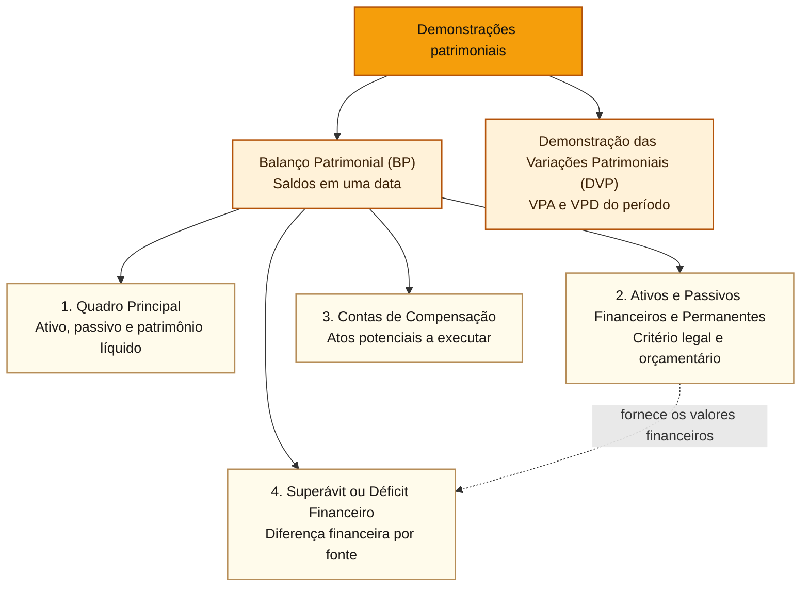

# Balanço Patrimonial e Demonstração das Variações Patrimoniais

## Núcleo do conceito

O **Balanço Patrimonial (BP)** evidencia a posição de ativos, passivos e patrimônio líquido (PL) **em determinada data**. A **Demonstração das Variações Patrimoniais (DVP)** evidencia variações patrimoniais aumentativas (VPA) e diminutivas (VPD) **durante o período**, apurando o resultado patrimonial. A fronteira inicial é **estoque de saldos (BP) × fluxo de variações patrimoniais (DVP)**.

A Lei nº 4.320/1964 (arts. 104 e 105) e o **Manual de Contabilidade Aplicada ao Setor Público (MCASP), 11ª edição, Parte V, capítulos 4 e 5** são as referências. O Quadro Principal do BP utiliza classes **1 (ativo)** e **2 (passivo e PL)** do Plano de Contas Aplicado ao Setor Público (PCASP). A DVP utiliza classes **3 (VPD)** e **4 (VPA)**.

| Demonstrativo | Pergunta | Não confundir |
| :--- | :--- | :--- |
| BP | Qual a situação patrimonial na data? | saldo de ativos não é dinheiro de livre utilização |
| DVP | Quais fatos modificaram quantitativamente o PL? | VPA/VPD não equivalem a arrecadação/empenho |
| Balanço Orçamentário (BO) | Qual receita arrecadada e qual despesa empenhada? | resultado orçamentário não é resultado patrimonial |
| Balanço Financeiro (BF) | Quais ingressos/dispêndios e saldos financeiros? | ingresso compensatório de RP não é caixa recebido |
| Demonstração dos Fluxos de Caixa (DFC) | Quais fluxos efetivos de caixa ocorreram? | depreciação não é saída atual de caixa |

## Como começar: balanço, demonstração e quadro

Um **balanço** é uma demonstração contábil organizada para responder a uma pergunta. O **Balanço Patrimonial (BP)** responde **qual é a situação patrimonial em uma data**, como 31 de dezembro; a **Demonstração das Variações Patrimoniais (DVP)** responde **que aumentos e diminuições do patrimônio líquido ocorreram durante um período**. Pense no BP como um retrato e na DVP como a explicação de parte das mudanças entre dois retratos. Ambos usam dados contábeis, mas não medem o mesmo resultado.

Dentro do BP, **quadro** significa uma seção do relatório, com critérios e finalidade próprios. Não significa uma nova demonstração independente. Para não misturar classificações, siga a ordem:

| Ordem | Nome do quadro | Pergunta própria | Critério principal |
| :--- | :--- | :--- | :--- |
| **1º** | Principal | Quais ativos, passivos e patrimônio líquido existem na data? | Reconhecimento patrimonial; **circulante/não circulante** |
| **2º** | Ativos e Passivos Financeiros e Permanentes | Como bens, direitos e compromissos se enquadram nos critérios legais? | **Financeiro/permanente**, com informações patrimoniais e de execução orçamentária |
| **3º** | Contas de Compensação | Que atos potenciais ainda a executar precisam ser acompanhados? | Controles de efeitos futuros possíveis |
| **4º** | Superávit ou Déficit Financeiro | Qual é a diferença entre ativo e passivo financeiros, discriminada por fonte? | Utiliza valores do **2º quadro** |

**Ponto de orientação:** a divisão *circulante/não circulante* pertence ao **1º quadro**. A divisão *financeiro/permanente* pertence ao **2º quadro**. O **3º** não é o “quadro financeiro”: é o de compensação. A expressão genérica “quadro complementar” pode esconder qual deles está sendo examinado; use sempre o nome e a posição.

**Mapa dos quatro quadros:** todos pertencem ao **Balanço Patrimonial (BP)**. A **Demonstração das Variações Patrimoniais (DVP)** é outra demonstração, que apresenta os efeitos sobre o resultado patrimonial durante o período.

## Estrutura do BP: quatro quadros com critérios diferentes

Conforme o MCASP 11, Parte V, seção 4.1, o Balanço Patrimonial compreende **(1) Quadro Principal, (2) Quadro dos Ativos e Passivos Financeiros e Permanentes, (3) Quadro das Contas de Compensação e (4) Quadro do Superávit ou Déficit Financeiro**.

### Quadro Principal: ativo, passivo e PL

**Primeira leitura, antes de classificar:** uma universidade possui R$ 100 mil no banco e um prédio em uso. Esses elementos são ativos. Se uma empresa já prestou um serviço e a universidade deve pagá-lo, existe uma obrigação patrimonial a avaliar como passivo. O patrimônio líquido é a diferença residual: **ativo − passivo**. A classificação em circulante ou não circulante só ocorre **depois** de identificar o ativo ou o passivo; por isso ela não é uma regra de classificação do segundo quadro.

A igualdade é **Ativo = Passivo + PL**. Ativo é recurso presentemente controlado, decorrente de evento passado, com benefício econômico ou potencial de serviços. Assim, um equipamento usado em serviço gratuito pode constituir ativo público. Passivo é uma obrigação presente conforme os critérios de reconhecimento. O PL representa o valor residual dos ativos após deduzir os passivos.

O quadro distingue **circulante** e **não circulante**, conforme ciclo operacional, prazo de realização/exigibilidade e demais condições normativas. Caixa normalmente é circulante, ressalvadas restrições específicas; bens usados por vários anos tendem a integrar o não circulante. Classificar não é apenas olhar o nome da conta: duração do ciclo, prazo e restrições importam.

### Quadro financeiro e permanente: art. 105 da Lei nº 4.320/1964

**Segunda leitura, mudando a pergunta:** a mesma universidade tem R$ 100 mil em conta bancária e empenhou R$ 30 mil por um serviço **ainda não prestado**. Suponha que, ao encerrar o exercício, esse compromisso tenha sido regularmente inscrito em **restos a pagar não processados a liquidar** (despesa empenhada cujo objeto ainda não foi entregue ou prestado). Pelo critério patrimonial do **1º quadro**, o empenho isolado ainda não cria passivo desse serviço. No **2º quadro**, o compromisso pode integrar o **passivo financeiro**. O que mudou foi o critério de classificação, não o fato ocorrido.

Se o serviço tivesse sido **prestado e consumido** antes do encerramento, haveria também fato gerador de Variação Patrimonial Diminutiva (VPD) e obrigação patrimonial, mesmo que a liquidação administrativa estivesse pendente. O nome da etapa orçamentária não substitui a análise da entrega ou do consumo. Esse contraste é o motivo de o passivo financeiro do 2º quadro **não poder ser copiado mecanicamente** do passivo do 1º.

A classificação em **ativo financeiro/permanente** e **passivo financeiro/permanente** atende a critérios legais e orçamentários, **distintos** do prazo que define circulante e não circulante.

- **Ativo financeiro:** numerário, créditos e valores realizáveis independentemente de autorização orçamentária.
- **Ativo permanente:** bens, créditos e valores cuja mobilização ou alienação depende de autorização legislativa, nos termos da lei.
- **Passivo financeiro:** obrigações e compromissos exigíveis cujo pagamento independe de autorização orçamentária.
- **Passivo permanente:** dívidas e demais compromissos que dependem de autorização legislativa para amortização ou resgate.

**Comparação direta: são duas classificações com perguntas diferentes.**

| Conceito | O que pergunta | Exemplo |
| :--- | :--- | :--- |
| **Ativo patrimonial** | Que recursos a entidade controla e pode utilizar? | Caixa e computadores de uma escola são ativos. |
| **Ativo financeiro** | Que dinheiro e créditos podem ser realizados sem autorização orçamentária? | R$ 100 em caixa integra o ativo financeiro; computadores de uso, em regra, não. |
| **Passivo patrimonial** | Que obrigações presentes já surgiram de eventos ocorridos? | Serviço prestado e ainda não pago pode gerar passivo. |
| **Passivo financeiro** | Que compromissos podem ser pagos sem nova autorização orçamentária? | Empenho de R$ 30 por serviço ainda não prestado pode integrar o passivo financeiro, sem passivo patrimonial correspondente. |

**Atenção:** a divisão financeiro/permanente do art. 105 da Lei nº 4.320/1964 não equivale à divisão circulante/não circulante do quadro principal. Financeiro não significa simplesmente curto prazo, nem se limita ao saldo bancário.

**Exceção decisiva:** o MCASP, seção 4.2.2, inclui nesse quadro informações da **classe 6** (por exemplo, Crédito Empenhado a Liquidar e Restos a Pagar Não Processados a Liquidar) para calcular passivos financeiros **mesmo sem passivo patrimonial correspondente** no Quadro Principal. Uma questão que equipare os dois quadros integralmente está errada. Da mesma forma, **circulante ≠ financeiro** e **não circulante ≠ permanente**.

### Quadro de compensação

**Terceira leitura, sem inventar um ativo:** imagine uma garantia bancária apresentada pelo fornecedor para assegurar a execução do contrato. A universidade precisa acompanhar seu valor e sua validade. A simples apresentação da garantia **não significa entrada de caixa**, nem reconhecimento automático desse valor como ativo no 1º quadro. Enquanto se tratar de ato potencial a executar, o acompanhamento pode aparecer no **3º quadro**.

Evidencia **atos potenciais ativos e passivos a executar** que podem alterar futuramente o patrimônio, como obrigações e garantias contratuais ainda potenciais. O registro de controle **não é reconhecimento automático de ativo/passivo patrimonial**. Atos já executados não pertencem ao grupo de potenciais a executar.

### Quadro do superávit ou déficit financeiro

**Quarta leitura, retomando o segundo quadro:** nas condições simplificadas do exemplo, o ativo financeiro é R$ 100 mil (caixa) e o passivo financeiro é R$ 30 mil (restos a pagar regularmente inscritos). A diferença é **R$ 70 mil**, positiva. O **4º quadro** apresenta essa apuração por fonte/destinação: valor positivo indica superávit financeiro; negativo, déficit. O resultado de R$ 70 mil **não é automaticamente dinheiro livre** para qualquer despesa, pois pode haver vinculação de recursos. Tampouco é o patrimônio líquido do 1º quadro.

O **superávit financeiro** corresponde, em sua forma básica, à **diferença positiva entre ativo financeiro e passivo financeiro**, discriminada por **fonte/destinação de recursos**. O MCASP utiliza o mecanismo de Disponibilidade por Destinação de Recursos (DDR) e admite fontes superavitárias e deficitárias no mesmo ente. O superávit financeiro de exercício anterior é uma das fontes de créditos adicionais segundo o **art. 43 da Lei nº 4.320/1964**, respeitados ajustes e restrições legais.

Exemplo: ativo financeiro de R$ 200 e passivo financeiro de R$ 160 indicam diferença de R$ 40. **Isso não permite afirmar que todo R$ 40 esteja livre** para financiar qualquer despesa: vínculos de fonte e regras de utilização devem ser conferidos. Superávit financeiro também não é o mesmo que a variação de caixa evidenciada na DFC.

### Refinamento: passivo financeiro e classe 6

O [MCASP 11, Parte V, § 4.2.2, e Parte IV, § 3.5.3.2](https://cdn.tesouro.gov.br/sistemas-internos/apex/producao/sistemas/thot/arquivos/publicacoes/51045_2434252/MCASP%20-%2011%C2%AA%20Edi%C3%A7%C3%A3o.pdf), inclui contas orçamentárias da **classe 6**, como **crédito empenhado a liquidar** e **restos a pagar não processados (RPNP) a liquidar**, na apuração do quadro de **Ativos e Passivos Financeiros e Permanentes**, inclusive quando **não existe passivo patrimonial do mesmo valor no Quadro Principal**. O passivo financeiro não é mera soma dos passivos circulantes.

**Caso independente:** a entidade dispõe de **R$ 100 em caixa**, sem outras restrições ou obrigações, e possui **empenho regular de R$ 30 por serviço ainda não prestado**, com inscrição válida como **RPNP a liquidar**. O Quadro Principal **não reconhece passivo patrimonial de R$ 30 só por esse empenho**; entretanto, o quadro financeiro/permanente inclui **R$ 30 de compromisso orçamentário em passivo financeiro**. Nas hipóteses indicadas, **ativo financeiro 100 − passivo financeiro 30 = superávit financeiro 70**, a ser detalhado por fonte/destinação antes de eventual utilização.

Quando **o serviço tiver sido prestado** e ainda não houver liquidação formal, a classificação passa a ser **RPNP em liquidação**, com análise de VPD/passivo patrimonial pelo fato gerador. **“Não processado” não significa sempre “sem passivo patrimonial”.** Ver [[3 - Materias/Contabilidade Publica/04 - fluxos de caixa notas explicativas e conciliacoes#Novo exemplo: competência, RPNP e cinco demonstrações|caso com BO, BF, BP, DVP e DFC]].

**Item C/E:** “O quadro financeiro do BP não pode incluir compromissos derivados de contas de execução orçamentária que não correspondam a passivos reconhecidos no quadro principal.” **Errado.** O MCASP inclui essas contas da **classe 6** no quadro financeiro/permanente.

## Estrutura da DVP: VPA e VPD

**Volte ao mesmo caso, agora observando o tempo.** Se o serviço de R$ 30 mil for efetivamente prestado e consumido somente em janeiro do ano seguinte, a VPD desse serviço pertence a esse ano seguinte, conforme a competência patrimonial, ainda que o empenho tenha ocorrido no ano anterior. Quando a obrigação for paga, caixa e passivo diminuem juntos; o pagamento não produz **outra** VPD. Logo, a DVP explica a variação quantitativa ocorrida **no período**, enquanto o BP mostra os saldos **na data**.

A DVP registra **variações patrimoniais quantitativas**, isto é, que alteram o PL, e calcula:

**Resultado patrimonial do exercício = VPA − VPD.**

**VPA** pode decorrer do reconhecimento de tributos, ganhos, serviços e transferências, conforme o fato gerador e a norma. **VPD** pode decorrer de consumo de bens e serviços, pessoal, benefícios, transferências concedidas e **depreciação**. O registro patrimonial segue seus critérios de competência: uma arrecadação pode apenas quitar direito anteriormente reconhecido, sem nova VPA; um empenho pode anteceder o fato gerador e não constituir VPD.

**Variação qualitativa ou permutativa** altera a composição de ativos/passivos sem modificar imediatamente o PL: aquisição de equipamento com pagamento ou obrigação, por exemplo. **Variação quantitativa** aumenta/diminui o PL: a depreciação reconhecida depois da incorporação do equipamento pode gerar VPD, embora não haja desembolso por esse fato.

| Evento | Efeito patrimonial | DVP |
| :--- | :--- | :--- |
| Reconhecimento tributário conforme fato gerador | direito a receber e PL aumentam | VPA |
| Arrecadação de crédito tributário já reconhecido | caixa aumenta e crédito diminui | nenhuma VPA nova pelo mero recebimento |
| Recebimento de equipamento comprado a prazo | imobilizado e obrigação aumentam | nenhuma VPD pela mera incorporação |
| Pagamento ao fornecedor do equipamento | caixa e obrigação diminuem | nenhuma VPD nova pelo pagamento |
| Depreciação do equipamento em uso | valor líquido do ativo e PL diminuem | VPD |

O resultado patrimonial **integra o PL do BP**, mas nem toda variação do PL é necessariamente resultado da DVP: integralizações de capital, ajustes e movimentos patrimoniais específicos podem transitar diretamente no PL. Não concluir que **resultado da DVP = PL final − PL inicial** sem examinar outros eventos.

A DVP tem uma função semelhante à Demonstração do Resultado do Exercício (DRE), mas o próprio MCASP assinala que o **resultado patrimonial não representa, isoladamente, desempenho da gestão pública**. O fornecimento de serviços públicos pode produzir VPD relevante sem que isso signifique ineficiência. Resultado contábil, qualidade do serviço e efetividade da política são dimensões distintas.

## Exemplo comentado: continuidade do equipamento

A entidade começa 2026 com caixa, ativos, passivos e PL **zero**. Reconhece e arrecada **R$ 100** em tributos (o fato gerador ocorre em 2026), empenha e liquida **R$ 60** em equipamento recebido, paga **R$ 40** e inscreve **R$ 20** em restos a pagar processados. Como extensão explícita do exemplo dos artigos anteriores, suponha que haja **R$ 6 de depreciação** reconhecida em 2026. Não há outros eventos.

| BP em 31/12/2026 | Valor |
| :--- | ---: |
| Caixa | R$ 60 |
| Equipamento (valor bruto) | R$ 60 |
| (−) Depreciação acumulada | (R$ 6) |
| **Total de ativos líquidos** | **R$ 114** |
| Passivo do fornecedor | R$ 20 |
| **Patrimônio líquido** | **R$ 94** |
| **Passivo + PL** | **R$ 114** |

| DVP do exercício | VPA | VPD |
| :--- | ---: | ---: |
| Tributo reconhecido | 100 | 0 |
| Aquisição do ativo | 0 | 0 |
| Depreciação | 0 | 6 |
| **Totais** | **100** | **6** |

**Resultado patrimonial: R$ 94.** No mesmo exemplo, o **resultado orçamentário** do BO é R$ 40 (100 arrecadados menos 60 empenhados), e a **variação de caixa** é R$ 60 (100 recebidos menos 40 pagos). Os três valores são compatíveis. Os artigos anteriores consideravam **nenhuma depreciação**, produzindo PL de R$ 100; esta extensão acrescenta VPD de R$ 6, sem alterar o resultado orçamentário nem o caixa.

**Contrafactual:** se R$ 60 fossem um **serviço integralmente consumido** em vez de equipamento incorporado, o fato poderia produzir VPD de R$ 60. A natureza patrimonial do gasto, não seu valor empenhado ou pago, altera a DVP.

## Como a Cebraspe pode cobrar: itens didáticos inéditos

**Item 1 (C/E):** “Um passivo circulante no Quadro Principal do BP necessariamente integra o passivo financeiro do quadro legal com os mesmos critérios.” **Errado.** Circulante se baseia em prazo/ciclo e financeiro em exigibilidade e regras orçamentárias.

**Item 2 (C/E):** “Uma aquisição de equipamento pode gerar despesa orçamentária sem VPD equivalente no mesmo momento; a depreciação posterior pode reduzir o resultado patrimonial.” **Certo.** Incorporação de ativo e consumo do potencial de serviços são eventos diferentes.

**Item 3 (C/E):** “O resultado da DVP corresponde obrigatoriamente a toda a diferença entre PL final e inicial, mesmo havendo integralização de capital.” **Errado.** Integralização e outros movimentos diretos de PL não são necessariamente VPA.

Os itens são **exercícios novos**, não questões oficiais do Cebraspe.

## Relações, tensões e heurísticas

- [[3 - Materias/Contabilidade Publica/01 - patrimonio publico e regimes de reconhecimento|Patrimônio e regimes]]: competência e fato permutativo.
- [[3 - Materias/Contabilidade Publica/02 - balanco orcamentario e balanco financeiro|BO e BF]]: empenho, pagamento e compensação de restos a pagar processados (RPP).
- [[3 - Materias/Contabilidade Publica/04 - fluxos de caixa notas explicativas e conciliacoes|DFC, notas e conciliações]]: relaciona os resultados de R$ 40, R$ 60 e R$ 94.
- [[3 - Materias/Orcamento Publico/05 - creditos adicionais e emendas parlamentares|Créditos adicionais]]: superávit financeiro anterior e restrições legais.
- [[3 - Materias/Auditoria Governamental/evidencias-e-documentacao|Evidências]]: comprovação física de ativos.

**Circulante × financeiro; BP × DVP; ativo × dinheiro livre; empenho × VPD; resultado patrimonial × desempenho; PL × resultado.** Heurística de prova: **posição em uma data → BP; variações quantitativas → DVP; receita arrecadada e despesa empenhada → BO; caixa efetivo → DFC**.

## Fontes e limites

- [MCASP, 11ª edição, Parte V, capítulos 4 e 5, Tesouro Nacional](https://cdn.tesouro.gov.br/sistemas-internos/apex/producao/sistemas/thot/arquivos/publicacoes/51045_2434252/MCASP%20-%2011%C2%AA%20Edi%C3%A7%C3%A3o.pdf), páginas impressas **571–588**, conferidas em 04/11/2026.
- [Lei nº 4.320/1964, arts. 43, 104 e 105](https://www.planalto.gov.br/ccivil_03/leis/l4320.htm).
- [Normas NBC TSP do CFC](https://cfc.org.br/tecnica/normas-brasileiras-de-contabilidade/nbc-tsp-do-setor-publico/): requisitos específicos conforme o ente.

**Cobertura:** núcleo de BP/DVP do programa P3.2.4. Mensuração de ativos, provisões e regras societárias ainda exigem artigos próprios. Artigo disponível não demonstra aula ou retenção.
