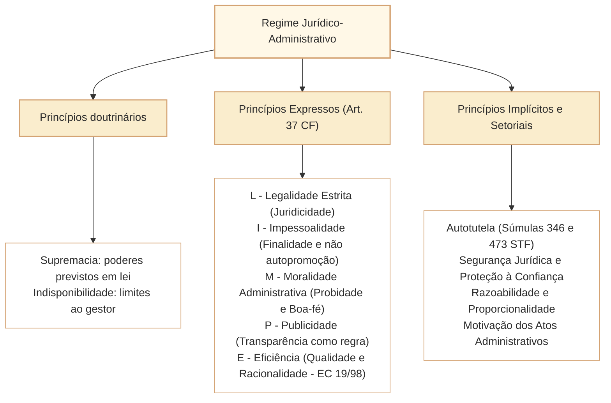

# Princípios Expressos e Implícitos da Administração Pública

Imagine que a Câmara dos Deputados precise contratar uma campanha de informação pública. A equipe deve escolher uma solução permitida em lei, tratar concorrentes sem favorecimento, justificar a contratação, divulgar o que a lei manda e usar os recursos com qualidade. Essas exigências correspondem a princípios que orientam decisões concretas, e não apenas a uma lista para memorizar.

O art. 37, **caput**, da Constituição Federal de 1988 (CF/1988) apresenta cinco princípios expressos: **legalidade, impessoalidade, moralidade, publicidade e eficiência**. A sigla LIMPE ajuda a recordá-los. Outros princípios decorrem da Constituição, de leis e da interpretação jurídica. A **Lei nº 9.784/1999** disciplina o processo administrativo **federal** e a **Lei de Introdução às Normas do Direito Brasileiro (LINDB)** estabelece regras de interpretação e decisão.

Na doutrina, a **supremacia do interesse público** explica certas prerrogativas conferidas por lei ao Estado; a **indisponibilidade do interesse público** significa que o agente não pode tratar bens e poderes públicos como patrimônio próprio. Esses conceitos não autorizam violar direitos fundamentais ou agir sem base legal. Por exemplo, a Administração pode fiscalizar uma atividade nos limites legais, mas não pode aplicar uma sanção apenas porque o gestor a considera conveniente.

---

## 1. Princípios Constitucionais Expressos (Art. 37, *Caput*, da CF/1988)

O art. 37, *caput*, da Constituição Federal submete a administração pública direta e indireta de qualquer dos Poderes da União, dos Estados, do Distrito Federal e dos Municípios aos princípios de **Legalidade, Impessoalidade, Moralidade, Publicidade e Eficiência**:

### 1.1. Legalidade Estrita e o Princípio da Juridicidade
- **Distinção Clássica:** Enquanto para o particular vige o princípio da autonomia da vontade (art. 5º, II, da CF/1988: *ninguém será obrigado a fazer ou deixar de fazer alguma coisa senão em virtude de lei*), permitindo-se tudo o que a lei não proíbe, para a Administração Pública vige o princípio da **legalidade estrita**: o administrador só pode agir quando e como a lei autoriza ou determina (*subordinação estrita à lei*).
- **Evolução para a Juridicidade:** A legalidade contemporânea é concebida como **princípio da juridicidade** (art. 2º, parágrafo único, I, da Lei nº 9.784/1999: *atuação conforme a lei e o Direito*). O administrador vincula-se não apenas à lei em sentido formal estrito, mas a todo o bloco de constitucionalidade, aos princípios gerais do Direito, aos tratados internacionais de direitos humanos e aos precedentes vinculantes.

### 1.2. Impessoalidade: Vertentes e Desdobramentos
O princípio da impessoalidade desdobra-se em quatro facetas complementares:
1. **Princípio da Finalidade:** A atuação administrativa deve buscar unicamente o interesse público primário visado pela norma, sem perseguições a adversários nem favorecimentos a aliados. O desvio de finalidade compromete a validade do ato e pode levar à sua anulação, observado o devido processo.
2. **Igualdade e Isonomia:** Assegura tratamento paritário a todos os administrados em idêntica situação jurídica, orientando a exigência constitucional de concurso público para provimento de cargos (art. 37, II) e de processo licitatório para contratações (art. 37, XXI).
3. **Imputação Volitiva (Teoria do Órgão):** Os atos praticados pelo agente público são imputados à pessoa jurídica estatal (órgão/entidade), e não à pessoa física do servidor. A proteção de terceiros de boa-fé em situações de agente de fato exige análise das circunstâncias; não é uma consequência automática e ilimitada.
4. **Vedação à Promoção Pessoal (Art. 37, § 1º, da CF/1988):** A publicidade dos atos, programas, obras, serviços e campanhas dos órgãos públicos deve ter caráter educativo, informativo ou de orientação social, dela **não podendo constar nomes, símbolos ou imagens que caracterizem promoção pessoal** de autoridades ou servidores públicos. A violação pode tornar a publicidade irregular e, se presentes os requisitos legais específicos, também configurar improbidade administrativa. A Lei nº 8.429/1992 exige análise do tipo legal e do dolo, não bastando presumir improbidade de toda irregularidade.

### 1.3. Moralidade Administrativa e Probidade
- A moralidade administrativa **não se confunde com a moral comum ou privada**, nem com juízos puramente subjetivos do agente. Constitui um **conceito jurídico indeterminado autônomo**, fundado nos deveres de boa-fé objetiva, lealdade, honestidade, probidade e retidão de conduta.
- **Autonomia da Moralidade:** Um ato administrativo pode ser formalmente compatível com a letra da lei, mas ser materialmente nulo por ofensa direta à moralidade administrativa (*imoralidade jurídica*).
- **Súmula Vinculante nº 13 do STF (Antinepotismo):** O STF fixou que a vedação ao nepotismo na Administração Pública direta e indireta decorre **diretamente dos princípios constitucionais da moralidade, impessoalidade e eficiência**, independentemente da existência de lei formal ordinária local que o proíba expressamente.

### 1.4. Publicidade e Transparência
- A publicidade permite conhecimento e controle dos atos públicos. A publicação oficial é condição de eficácia em hipóteses previstas nas normas aplicáveis, mas nem todo ato administrativo depende da mesma forma de divulgação para produzir efeitos.
- **Publicidade como regra e sigilo como exceção:** a **Lei de Acesso à Informação (LAI), Lei nº 12.527/2011**, concretiza o art. 5º, XXXIII, da Constituição. A Administração deve divulgar informações de interesse coletivo ou geral e responder aos pedidos de acesso, ressalvadas as restrições legais, entre elas:
  1. Segurança da sociedade e do Estado;
  2. Proteção da intimidade, vida privada, honra e imagem dos cidadãos (dados pessoais).

### 1.5. Eficiência
- Inserido expressamente no art. 37 pela Emenda Constitucional nº 19/1998 (Reforma Administrativa do Estado).
- Exige do administrador a obtenção do melhor resultado prático com o menor dispêndio de recursos públicos (relação custo-benefício, produtividade, celeridade e qualidade no serviço público prestado).
- **Limites da Eficiência:** A busca pela eficiência **não autoriza a burla à legalidade, à moralidade ou aos direitos e garantias fundamentais** dos cidadãos. Não há eficiência lícita fora do Estado Democrático de Direito.

---

## 2. Princípios Constitucionais e Infraconstitucionais Implícitos

Ao lado dos princípios expressos no art. 37, o ordenamento jurídico alberga princípios implícitos dotados de idêntica força cogente:

| Princípio Implícito | Sede / Fundamento Normativo | Conteúdo e Alcance no Direito Administrativo |
| :--- | :--- | :--- |
| **Autotutela** | Súmulas 346 e 473 do Supremo Tribunal Federal (STF); arts. 53 a 55 da Lei nº 9.784/1999 | A Administração **anula** atos ilegais e pode **revogar** atos válidos por conveniência e oportunidade, respeitando direitos, limites temporais e devido processo. Os efeitos dependem da situação e das regras aplicáveis; não presumir retroatividade irrestrita. |
| **Segurança Jurídica e Proteção à Confiança** | Art. 5º, XXXVI, da CF/1988; art. 2º, parágrafo único, XIII, da Lei nº 9.784/1999; LINDB | A Administração deve considerar estabilidade, boa-fé e confiança legítima. A Lei nº 9.784/1999 veda aplicação retroativa de nova interpretação administrativa, não apenas em processos definitivamente julgados. |
| **Razoabilidade e Proporcionalidade** | Devido processo legal substantivo (art. 5º, LIV, CF); art. 2º da Lei 9.784/1999 | Limitação ao poder discricionário. A proporcionalidade desdobra-se no tríplice teste: **adequação** (meio apto ao fim), **necessidade/exigibilidade** (meio menos gravoso) e **proporcionalidade em sentido estrito** (vantagens superam os ônus). |
| **Motivação** | Princípio republicano e devido processo legal; art. 50 da Lei 9.784/1999 | Obrigação de explicitar os fundamentos de fato e de direito que determinaram a prática do ato administrativo, viabilizando o controle judicial e a aferição da teoria dos motivos determinantes. |
| **Continuidade do Serviço Público** | Art. 175 da CF/1988; Lei nº 8.987/1995 | Os serviços públicos essenciais não podem sofrer interrupções imotivadas ou abruptas, impondo restrições ao direito de greve de servidores e mitigando a exceção do contrato não cumprido contra o Estado. |

---

## 3. O Regime Jurídico da Autotutela e Prazos Decadenciais

A Súmula nº 473 do STF estabelece o clássico enunciado da autotutela:

> *"A administração pode anular seus próprios atos, quando eivados de vícios que os tornam ilegais, porque deles não se originam direitos; ou revogá-los, por motivo de conveniência ou oportunidade, respeitados os direitos adquiridos, e ressalvada, em todos os casos, a apreciação judicial."*

Contudo, nas provas do Cebraspe, a autotutela deve ser compreendida em harmonia com o **princípio da segurança jurídica**:
- **Prazo Decadencial de 5 Anos (Art. 54 da Lei nº 9.784/1999):** O direito da Administração de anular os atos administrativos de que decorram efeitos favoráveis para os destinatários **decai em 5 (cinco) anos**, contados da data em que foram praticados, **salvo comprovada má-fé**.
- **Como contar:** quando o ato gera efeitos patrimoniais contínuos, o art. 54, § 1º, conta o prazo da percepção do primeiro pagamento. O § 2º considera exercício do direito de anular qualquer medida administrativa que importe impugnação à validade do ato. A exceção do caput é a **comprovada má-fé**, e a decadência não deve ser confundida com a convalidação de defeitos sanáveis prevista no art. 55. A regra citada é a do processo administrativo federal; outros entes podem ter disciplina própria.

---

## 4. Questões Comentadas no Estilo Cebraspe

### Questão 1
*(Inédita: estilo Cebraspe / Câmara dos Deputados – Analista Legislativo)*

**Item:** Em decorrência do princípio da juridicidade, a atuação da Administração Pública não se subordina exclusivamente à lei em sentido formal, devendo obediência a todo o bloco de legalidade, incluindo princípios constitucionais implícitos, tratados internacionais e normas infralegais expedidas no âmbito da competência regulamentar.

- ( ) Certo
- ( ) Errado

**Gabarito: Certo**  
**Comentário:** A juridicidade exige respeito à Constituição, à legislação e às demais normas válidas, dentro da hierarquia normativa. A Administração Pública não se vincula apenas à lei formal oriunda do Legislativo, mas a todo o ordenamento jurídico (bloco de constitucionalidade, normas regulamentares e princípios gerais do Direito), tal como expressamente positivado no art. 2º, parágrafo único, I, da Lei nº 9.784/1999 (*atuação conforme a lei e o Direito*).

---

### Questão 2
*(Inédita: estilo Cebraspe / Câmara dos Deputados – Analista Legislativo)*

**Item:** Conforme entendimento sumulado pelo Supremo Tribunal Federal, a vedação ao nepotismo nos órgãos dos Três Poderes da República decorre de expressa exigência legal infraconstitucional, de modo que, na ausência de lei local regulamentadora, é lícita a nomeação de cônjuge ou parente de autoridade para cargo em comissão.

- ( ) Certo
- ( ) Errado

**Gabarito: Errado**  
**Comentário:** Conforme assentado na Súmula Vinculante nº 13 do STF, a vedação ao nepotismo decorre **diretamente dos princípios constitucionais da moralidade, impessoalidade, igualdade e eficiência** (art. 37, *caput*, da CF/1988), possuindo aplicabilidade imediata e **independente de qualquer lei formal ordinária** editada pelo ente federativo.

---

### Questão 3
*(Inédita: estilo Cebraspe / Câmara dos Deputados – Analista Legislativo)*

**Item:** Em virtude do princípio da supremacia do interesse público sobre o privado, o administrador público goza de liberdade para transigir, dispensar garantias ou renunciar a créditos tributários titularizados pelo Estado sempre que julgar politicamente conveniente.

- ( ) Certo
- ( ) Errado

**Gabarito: Errado**  
**Comentário:** O item confunde supremacia com disponibilidade. O interesse público é regido pelo supraprincípio da **indisponibilidade do interesse público**: os bens, direitos e receitas públicas não pertencem à pessoa física do administrador, que é mero gestor do patrimônio coletivo. Renúncia de receita e transações exigem observar os requisitos legais aplicáveis, inclusive os fiscais quando pertinentes. Uma irregularidade não gera automaticamente improbidade: é preciso verificar os requisitos da Lei nº 8.429/1992.

---

### Questão 4
*(Inédita: estilo Cebraspe / Câmara dos Deputados – Analista Legislativo)*

**Item:** O poder de autotutela permite que a Administração Pública anule atos administrativos ilegais de que decorram efeitos favoráveis para os destinatários a qualquer tempo, tendo em vista que atos eivados de vício de legalidade não são alcançados pela decadência ou pela prescrição.

- ( ) Certo
- ( ) Errado

**Gabarito: Errado**  
**Comentário:** A autotutela encontra limite temporal no princípio da segurança jurídica. Nos termos do art. 54 da Lei nº 9.784/1999, o direito da Administração de anular atos administrativos de que decorram efeitos favoráveis para os destinatários **decai em cinco anos**, contados da data em que foram praticados, **salvo comprovada má-fé**. O prazo tem regras específicas para efeitos patrimoniais contínuos e para medidas de impugnação administrativa (art. 54, §§ 1º e 2º). A ressalva legal é a má-fé comprovada.

---

### Questão 5
*(Inédita: estilo Cebraspe / Câmara dos Deputados – Analista Legislativo)*

**Item:** Campanha institucional de utilidade pública veiculada pela Câmara dos Deputados que contenha exclusivamente o nome e a fotografia do parlamentar relator de proposição legislativa de grande repercussão social viola o princípio da impessoalidade, ainda que os recursos orçamentários utilizados na veiculação sejam de origem pública e devidamente autorizados.

- ( ) Certo
- ( ) Errado

**Gabarito: Certo**  
**Comentário:** O art. 37, § 1º, da CF/1988 estabelece categoricamente que a publicidade governamental deve ter caráter estritamente educativo, informativo ou de orientação social, sendo vedada a inclusão de nomes, símbolos ou imagens que caracterizem promoção pessoal de autoridades ou servidores. Na situação descrita, a divulgação centrada na imagem e no nome do parlamentar caracteriza promoção pessoal, vedada pelo art. 37, § 1º. A avaliação jurídica depende do conteúdo e da finalidade concreta da peça.

---

### Questão 6
*(Inédita: estilo Cebraspe / Câmara dos Deputados – Analista Legislativo)*

**Item:** O princípio da continuidade do serviço público constitui óbice absoluto à interrupção do fornecimento de utilidades públicas por inadimplemento do usuário, ainda que precedida de aviso formal e motivada por razões de interesse coletivo.

- ( ) Certo
- ( ) Errado

**Gabarito: Errado**  
**Comentário:** O princípio da continuidade não é absoluto. Nos termos do art. 6º, § 3º, II, da Lei nº 8.987/1995, não se caracteriza como descontinuidade do serviço a sua interrupção em situação de emergência ou, **após prévio aviso**, por inadimplemento do usuário, considerado o interesse da coletividade. O mesmo § 3º também prevê interrupção por razões técnicas ou de segurança das instalações, após aviso, e por emergência, sem a mesma exigência de aviso prévio.

---

## 5. Relações com Outros Artigos e Síntese de Revisão

- **Pré-requisitos e Vínculos Teóricos:**
  - [[3 - Materias/Direito Administrativo/12 - estado governo administracao e funcao administrativa|Estado, Governo, Administração Pública e Função Administrativa]]: Fundamentação da função administrativa e subordinação técnica à legalidade e ao interesse público.
  - [[3 - Materias/Direito Administrativo/02 - organizacao administrativa|Administração Direta e Indireta: Entidades, Vínculos e Regime Jurídico]]: Aplicação dos princípios à Administração Direta e Indireta (descentralização e desconcentração).
  - [[3 - Materias/Direito Administrativo/03 - atos administrativos|Elementos e requisitos de validade do ato administrativo: competência, finalidade, forma, motivo e objeto]]: Controle de validade, motivos determinantes, anulação e revogação pelo exercício da autotutela.
  - [[3 - Materias/Administracao Publica/03 - transparencia acesso a informacao e protecao de dados|Transparência, acesso à informação e proteção de dados pessoais]]: Concretização do princípio da publicidade pela LAI e limites da LGPD.

## Fontes normativas para conferência

- [Constituição Federal](https://www.planalto.gov.br/ccivil_03/constituicao/constituicao.htm): arts. 5º, II, XXXIII, XXXV e LIV; 37, caput e § 1º; 175.
- [Lei nº 9.784/1999](https://www.planalto.gov.br/ccivil_03/leis/l9784.htm): arts. 2º, 50 e 53 a 55, sobre processo administrativo federal, motivação, revisão de atos e decadência.
- [Lei nº 12.527/2011](https://www.planalto.gov.br/ccivil_03/_ato2011-2014/2011/lei/l12527.htm): acesso à informação e hipóteses de restrição.
- [Lei nº 8.987/1995](https://www.planalto.gov.br/ccivil_03/leis/l8987cons.htm): art. 6º, § 3º, sobre continuidade e interrupção do serviço.
- [Lei nº 8.429/1992](https://www.planalto.gov.br/ccivil_03/leis/l8429.htm): tipificação e requisitos dos atos de improbidade.
- [LINDB, Decreto-Lei nº 4.657/1942](https://www.planalto.gov.br/ccivil_03/decreto-lei/del4657compilado.htm): segurança jurídica e consequências práticas da decisão administrativa.

**Distinção de fontes:** os cinco princípios do art. 37 são texto constitucional. Os chamados supraprincípios são categorias doutrinárias. Os prazos e procedimentos citados decorrem de leis específicas; a autotutela também é tratada pelas Súmulas 346 e 473 do STF. A aplicação a um caso concreto exige conferir a redação vigente e a jurisprudência pertinente.
