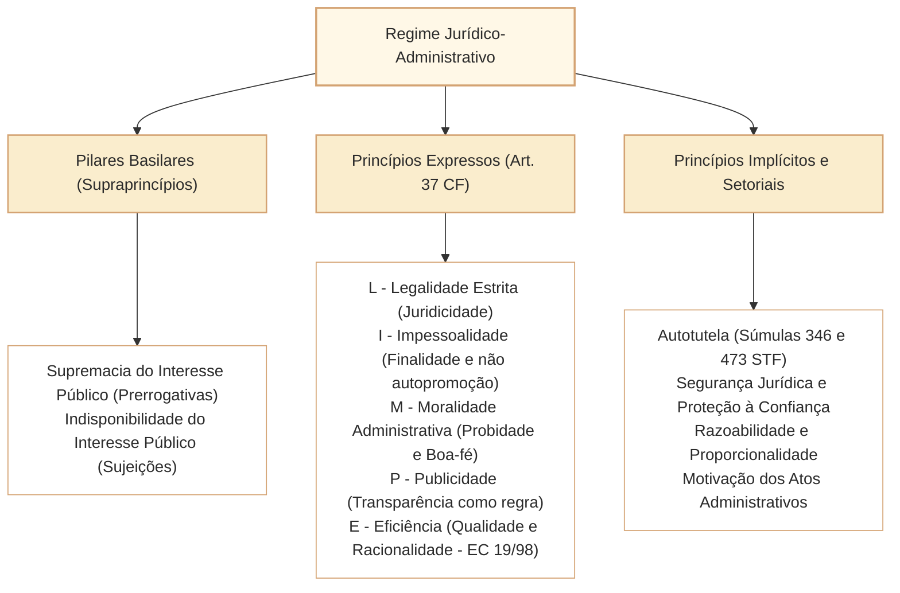

# Princípios Expressos e Implícitos da Administração Pública

No Direito Administrativo brasileiro, o regime jurídico-administrativo estrutura-se a partir de postulados fundamentais que condicionam a validade, a finalidade e os limites de toda atuação estatal. Nas provas elaboradas pelo Cebraspe para carreiras legislativas e de controle (como o cargo de Analista Legislativo da Câmara dos Deputados), a cobrança sobre princípios vai muito além da memorização mecânica do mnemônico constitucional **LIMPE**. A banca exige a precisa delimitação das **fronteiras de colisão entre princípios**, a distinção entre **princípios expressos no texto constitucional** e **princípios reconhecidos implicitamente ou por diplomas infraconstitucionais** (como a Lei nº 9.784/1999 e a LINDB - Decreto-Lei nº 4.657/1942), bem como as repercussões práticas de postulados consagrados pelas súmulas dos tribunais superiores (STF e STJ).

O regime jurídico-administrativo assenta-se sobre o que a doutrina de Celso Antônio Bandeira de Mello consagra como os dois **supraprincípios ou pilares basilares**:
1. **A Supremacia do Interesse Público sobre o Privado:** Confere à Administração Pública as prerrogativas de autoridade necessárias para fazer prevalecer o bem coletivo (poder de império, autoexecutoriedade, cláusulas exorbitantes).
2. **A Indisponibilidade do Interesse Público:** Estabelece as sujeições e amarras impostas ao administrador, que atua como mero gestor de coisa alheia (*res publica*), vedando renúncias, favorecimentos, liberalidades imotivadas ou desvios de finalidade.

---

## 1. Princípios Constitucionais Expressos (Art. 37, *Caput*, da CF/1988)

O art. 37, *caput*, da Constituição Federal submete a administração pública direta e indireta de qualquer dos Poderes da União, dos Estados, do Distrito Federal e dos Municípios aos princípios de **Legalidade, Impessoalidade, Moralidade, Publicidade e Eficiência**:

### 1.1. Legalidade Estrita e o Princípio da Juridicidade
- **Distinção Clássica:** Enquanto para o particular vige o princípio da autonomia da vontade (art. 5º, II, da CF/1988: *ninguém será obrigado a fazer ou deixar de fazer alguma coisa senão em virtude de lei*), permitindo-se tudo o que a lei não proíbe, para a Administração Pública vige o princípio da **legalidade estrita**: o administrador só pode agir quando e como a lei autoriza ou determina (*subordinação estrita à lei*).
- **Evolução para a Juridicidade:** A legalidade contemporânea é concebida como **princípio da juridicidade** (art. 2º, parágrafo único, I, da Lei nº 9.784/1999: *atuação conforme a lei e o Direito*). O administrador vincula-se não apenas à lei em sentido formal estrito, mas a todo o bloco de constitucionalidade, aos princípios gerais do Direito, aos tratados internacionais de direitos humanos e aos precedentes vinculantes.

### 1.2. Impessoalidade: Vertentes e Desdobramentos
O princípio da impessoalidade desdobra-se em quatro facetas complementares:
1. **Princípio da Finalidade:** A atuação administrativa deve buscar unicamente o interesse público primário visado pela norma, sem perseguições a adversários nem favorecimentos a aliados. O desvio de finalidade acarreta a nulidade insanável do ato.
2. **Igualdade e Isonomia:** Assegura tratamento paritário a todos os administrados em idêntica situação jurídica, orientando a exigência constitucional de concurso público para provimento de cargos (art. 37, II) e de processo licitatório para contratações (art. 37, XXI).
3. **Imputação Volitiva (Teoria do Órgão):** Os atos praticados pelo agente público são imputados à pessoa jurídica estatal (órgão/entidade), e não à pessoa física do servidor. Disso decorre a validade dos atos praticados por funcionário de fato perante terceiros de boa-fé.
4. **Vedação à Promoção Pessoal (Art. 37, § 1º, da CF/1988):** A publicidade dos atos, programas, obras, serviços e campanhas dos órgãos públicos deve ter caráter educativo, informativo ou de orientação social, dela **não podendo constar nomes, símbolos ou imagens que caracterizem promoção pessoal** de autoridades ou servidores públicos. A violação configura ato de improbidade administrativa e desvio de finalidade.

### 1.3. Moralidade Administrativa e Probidade
- A moralidade administrativa **não se confunde com a moral comum ou privada**, nem com juízos puramente subjetivos do agente. Constitui um **conceito jurídico indeterminado autônomo**, fundado nos deveres de boa-fé objetiva, lealdade, honestidade, probidade e retidão de conduta.
- **Autonomia da Moralidade:** Um ato administrativo pode ser formalmente compatível com a letra da lei, mas ser materialmente nulo por ofensa direta à moralidade administrativa (*imoralidade jurídica*).
- **Súmula Vinculante nº 13 do STF (Antinepotismo):** O STF fixou que a vedação ao nepotismo na Administração Pública direta e indireta decorre **diretamente dos princípios constitucionais da moralidade, impessoalidade e eficiência**, independentemente da existência de lei formal ordinária local que o proíba expressamente.

### 1.4. Publicidade e Transparência
- A publicidade constitui requisito de eficácia dos atos administrativos de efeitos externos ou que impliquem ônus financeiro, viabilizando o controle social e a prestação de contas (*accountability*).
- **A Publicidade como Regra e o Sigilo como Exceção:** Nos termos do art. 5º, XXXIII, da CF/1988 e da Lei nº 12.527/2011 (LAI), a transparência é o preceito geral; o sigilo só é admitido em hipóteses constitucionais e legais estritas:
  1. Segurança da sociedade e do Estado;
  2. Proteção da intimidade, vida privada, honra e imagem dos cidadãos (dados pessoais).

### 1.5. Eficiência
- Inserido expressamente no art. 37 pela Emenda Constitucional nº 19/1998 (Reforma Administrativa do Estado).
- Exige do administrador a obtenção do melhor resultado prático com o menor dispêndio de recursos públicos (relação custo-benefício, produtividade, celeridade e qualidade no serviço público prestado).
- **Limites da Eficiência:** A busca pela eficiência **não autoriza a burla à legalidade, à moralidade ou aos direitos e garantias fundamentais** dos cidadãos. Não há eficiência lícita fora do Estado Democrático de Direito.

---

## 2. Princípios Constitucionais e Infraconstitucionais Implícitos

Ao lado dos princípios expressos no art. 37, o ordenamento jurídico alberga princípios implícitos dotados de idêntica força cogente:

| Princípio Implícito | Sede / Fundamento Normativo | Conteúdo e Alcance no Direito Administrativo |
| :--- | :--- | :--- |
| **Autotutela** | Súmulas 346 e 473 do STF; art. 53 da Lei nº 9.784/1999 | Poder-dever da Administração de rever seus próprios atos: **anulando** os ilegais (com efeitos *ex tunc*) e **revogando** os inoportunos/inconvenientes (*ex nunc*), respeitados os direitos adquiridos e o devido processo legal. |
| **Segurança Jurídica e Proteção à Confiança** | Art. 5º, XXXVI, da CF/1988; art. 2º, parágrafo único, XIII, da Lei 9.784/1999; LINDB | Estabilidade das relações jurídicas. Veda a aplicação retroativa de nova interpretação normativa da Administração aos processos já definitivamente julgados, protegendo a boa-fé e a confiança legítima do administrado. |
| **Razoabilidade e Proporcionalidade** | Devido processo legal substantivo (art. 5º, LIV, CF); art. 2º da Lei 9.784/1999 | Limitação ao poder discricionário. A proporcionalidade desdobra-se no tríplice teste: **adequação** (meio apto ao fim), **necessidade/exigibilidade** (meio menos gravoso) e **proporcionalidade em sentido estrito** (vantagens superam os ônus). |
| **Motivação** | Princípio republicano e devido processo legal; art. 50 da Lei 9.784/1999 | Obrigação de explicitar os fundamentos de fato e de direito que determinaram a prática do ato administrativo, viabilizando o controle judicial e a aferição da teoria dos motivos determinantes. |
| **Continuidade do Serviço Público** | Art. 175 da CF/1988; Lei nº 8.987/1995 | Os serviços públicos essenciais não podem sofrer interrupções imotivadas ou abruptas, impondo restrições ao direito de greve de servidores e mitigando a exceção do contrato não cumprido contra o Estado. |

---

## 3. O Regime Jurídico da Autotutela e Prazos Decadenciais

A Súmula nº 473 do STF estabelece o clássico enunciado da autotutela:

> *"A administração pode anular seus próprios atos, quando eivados de vícios que os tornam ilegais, porque deles não se originam direitos; ou revogá-los, por motivo de conveniência ou oportunidade, respeitados os direitos adquiridos, e ressalvada, em todos os casos, a apreciação judicial."*

Contudo, nas provas do Cebraspe, a autotutela deve ser compreendida em harmonia com o **princípio da segurança jurídica**:
- **Prazo Decadencial de 5 Anos (Art. 54 da Lei nº 9.784/1999):** O direito da Administração de anular os atos administrativos de que decorram efeitos favoráveis para os destinatários **decai em 5 (cinco) anos**, contados da data em que foram praticados, **salvo comprovada má-fé**.
- Decorrido o prazo quinquenal sem comprovação de dolo ou má-fé do administrado, opera-se a estabilização do ato administrativo (*convalidação pelo decurso do tempo*), prevalecendo a segurança jurídica sobre a legalidade estrita.

---

## 4. Questões Comentadas no Estilo Cebraspe

### Questão 1
*(Inédita: estilo Cebraspe / Câmara dos Deputados – Analista Legislativo)*

**Item:** Em decorrência do princípio da juridicidade, a atuação da Administração Pública não se subordina exclusivamente à lei em sentido formal, devendo obediência a todo o bloco de legalidade, incluindo princípios constitucionais implícitos, tratados internacionais e normas infralegais expedidas no âmbito da competência regulamentar.

- ( ) Certo
- ( ) Errado

**Gabarito: Certo**  
**Comentário:** A assertiva traduz com perfeição a superação da legalidade estrita positivista pelo princípio contemporâneo da juridicidade. A Administração Pública não se vincula apenas à lei formal oriunda do Legislativo, mas a todo o ordenamento jurídico (bloco de constitucionalidade, normas regulamentares e princípios gerais do Direito), tal como expressamente positivado no art. 2º, parágrafo único, I, da Lei nº 9.784/1999 (*atuação conforme a lei e o Direito*).

---

### Questão 2
*(Inédita: estilo Cebraspe / Câmara dos Deputados – Analista Legislativo)*

**Item:** Conforme entendimento sumulado pelo Supremo Tribunal Federal, a vedação ao nepotismo nos órgãos dos Três Poderes da República decorre de expressa exigência legal infraconstitucional, de modo que, na ausência de lei local regulamentadora, é lícita a nomeação de cônjuge ou parente de autoridade para cargo em comissão.

- ( ) Certo
- ( ) Errado

**Gabarito: Errado**  
**Comentário:** Conforme assentado na Súmula Vinculante nº 13 do STF, a vedação ao nepotismo decorre **diretamente dos princípios constitucionais da moralidade, impessoalidade, igualdade e eficiência** (art. 37, *caput*, da CF/1988), possuindo aplicabilidade imediata e **independente de qualquer lei formal ordinária** editada pelo ente federativo.

---

### Questão 3
*(Inédita: estilo Cebraspe / Câmara dos Deputados – Analista Legislativo)*

**Item:** Em virtude do princípio da supremacia do interesse público sobre o privado, o administrador público goza de liberdade para transigir, dispensar garantias ou renunciar a créditos tributários titularizados pelo Estado sempre que julgar politicamente conveniente.

- ( ) Certo
- ( ) Errado

**Gabarito: Errado**  
**Comentário:** O item confunde supremacia com disponibilidade. O interesse público é regido pelo supraprincípio da **indisponibilidade do interesse público**: os bens, direitos e receitas públicas não pertencem à pessoa física do administrador, que é mero gestor do patrimônio coletivo. Qualquer renúncia de receita, transação ou liberalidade exige estrita autorização legal e demonstração formal do interesse público, sob pena de nulidade e responsabilização por improbidade.

---

### Questão 4
*(Inédita: estilo Cebraspe / Câmara dos Deputados – Analista Legislativo)*

**Item:** O poder de autotutela permite que a Administração Pública anule atos administrativos ilegais de que decorram efeitos favoráveis para os destinatários a qualquer tempo, tendo em vista que atos eivados de vício de legalidade não são alcançados pela decadência ou pela prescrição.

- ( ) Certo
- ( ) Errado

**Gabarito: Errado**  
**Comentário:** A autotutela encontra limite temporal no princípio da segurança jurídica. Nos termos do art. 54 da Lei nº 9.784/1999, o direito da Administração de anular atos administrativos de que decorram efeitos favoráveis para os destinatários **decai em cinco anos**, contados da data em que foram praticados, **salvo comprovada má-fé**. Havendo boa-fé do administrado, o decurso do prazo quinquenal consolida a situação fática.

---

### Questão 5
*(Inédita: estilo Cebraspe / Câmara dos Deputados – Analista Legislativo)*

**Item:** Campanha institucional de utilidade pública veiculada pela Câmara dos Deputados que contenha exclusivamente o nome e a fotografia do parlamentar relator de proposição legislativa de grande repercussão social viola o princípio da impessoalidade, ainda que os recursos orçamentários utilizados na veiculação sejam de origem pública e devidamente autorizados.

- ( ) Certo
- ( ) Errado

**Gabarito: Certo**  
**Comentário:** O art. 37, § 1º, da CF/1988 estabelece categoricamente que a publicidade governamental deve ter caráter estritamente educativo, informativo ou de orientação social, sendo vedada a inclusão de nomes, símbolos ou imagens que caracterizem promoção pessoal de autoridades ou servidores. A inclusão do nome e imagem do parlamentar em informe oficial corporifica clássica ofensa à impessoalidade e desvio de finalidade.

---

### Questão 6
*(Inédita: estilo Cebraspe / Câmara dos Deputados – Analista Legislativo)*

**Item:** O princípio da continuidade do serviço público constitui óbice absoluto à interrupção do fornecimento de utilidades públicas por inadimplemento do usuário, ainda que precedida de aviso formal e motivada por razões de interesse coletivo.

- ( ) Certo
- ( ) Errado

**Gabarito: Errado**  
**Comentário:** O princípio da continuidade não é absoluto. Nos termos do art. 6º, § 3º, II, da Lei nº 8.987/1995, não se caracteriza como descontinuidade do serviço a sua interrupção em situação de emergência ou, **após prévio aviso**, por inadimplemento do usuário, considerado o interesse da coletividade (para evitar que os custos dos inadimplentes onerem a tarifa dos demais cidadãos).

---

## 5. Relações com Outros Artigos e Síntese de Revisão

- **Pré-requisitos e Vínculos Teóricos:**
  - [[3 - Materias/Direito Administrativo/12 - estado governo administracao e funcao administrativa|CAM-DAD-001]]: Fundamentação da função administrativa e subordinação técnica à legalidade e ao interesse público.
  - [[3 - Materias/Direito Administrativo/02 - organizacao administrativa|CAM-DAD-003]]: Aplicação dos princípios à Administração Direta e Indireta (descentralização e desconcentração).
  - [[3 - Materias/Direito Administrativo/03 - atos administrativos|CAM-DAD-005 a CAM-DAD-009]]: Controle de validade, motivos determinantes, anulação e revogação pelo exercício da autotutela.
  - [[3 - Materias/Administracao Publica/03 - transparencia acesso a informacao e protecao de dados|CAM-DAD-033 / CAM-DAD-034]]: Concretização do princípio da publicidade pela LAI e limites da LGPD.
