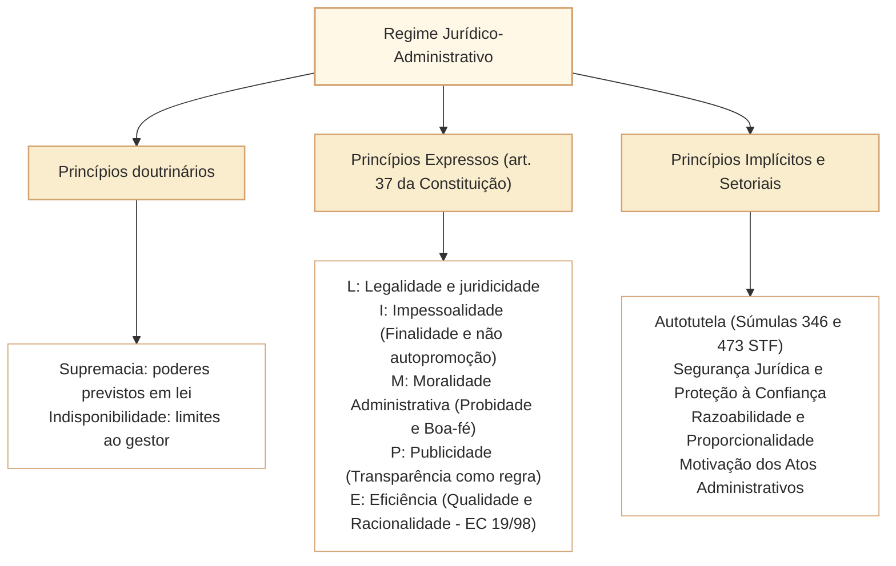

# Princípios da Administração Pública: decisões, limites e controle

Imagine que a Câmara dos Deputados precise divulgar uma campanha de utilidade pública. A contratação deve ter fundamento jurídico, tratar interessados sem favorecimento, respeitar padrões éticos e explicar à sociedade o uso de recursos. O resultado precisa ser útil. Cada uma dessas exigências corresponde a um princípio, ou seja, uma **regra de orientação e limite** que influencia decisões administrativas concretas.

O art. 37, **caput**, da **Constituição Federal de 1988** enumera cinco princípios expressos: **legalidade, impessoalidade, moralidade, publicidade e eficiência**. O acrônimo LIMPE ajuda a memorizá-los. Esses princípios se aplicam à Administração Direta e Indireta dos três Poderes e de todos os entes federativos.

A **Lei nº 9.784/1999**, que regula o processo administrativo no âmbito da Administração Pública Federal, desenvolve esses deveres em seu art. 2º. A **Lei de Introdução às Normas do Direito Brasileiro (LINDB), Decreto-Lei nº 4.657/1942**, orienta a interpretação e a aplicação das normas, inclusive quando uma decisão pública precisa considerar consequências práticas e segurança jurídica (arts. 20 a 24). A Constituição vale em todo o país; as regras procedimentais da Lei nº 9.784/1999 são federais, sem que isso as transforme automaticamente em lei estadual ou municipal.

## Princípios expressos: o que cada um exige

### Legalidade e juridicidade

A **legalidade** significa que o agente público precisa de fundamento jurídico para agir. O cidadão, segundo o art. 5º, II, da Constituição, não pode ser obrigado a fazer ou deixar de fazer algo senão em virtude de lei. Já a autoridade pública exerce competências atribuídas pelo ordenamento: não pode inventar uma multa, dispensar requisitos legais ou criar uma proibição apenas por achar útil.

A **juridicidade** é uma forma mais ampla de explicar essa vinculação: a decisão precisa respeitar a Constituição, as leis, os princípios e as demais normas válidas, observada a hierarquia entre elas. O art. 2º, parágrafo único, I, da Lei nº 9.784/1999 exige atuação conforme **a lei e o Direito**. Um regulamento válido pode orientar o procedimento, mas não pode contrariar uma lei ou a Constituição.

**Exemplo:** um órgão deseja exigir um documento adicional em um serviço digital. Precisa verificar se há competência e fundamento jurídico para impor a exigência. A simples intenção de reduzir fraudes não cria autorização para uma restrição desproporcional.

### Impessoalidade: finalidade, igualdade e comunicação pública

**Impessoalidade** significa atuar para a finalidade pública prevista na norma, com critérios objetivos, sem favorecer amigos nem perseguir adversários. Tem aplicações distintas:

- **Finalidade:** a autoridade recebe uma competência para um fim específico. Remover um servidor de local de trabalho apenas como punição disfarçada, por exemplo, pode configurar **desvio de finalidade**: o poder foi usado para fim diferente daquele permitido.
- **Isonomia:** pessoas em condições equivalentes devem receber tratamento conforme critérios jurídicos equivalentes. Os arts. 37, II e XXI, preveem, respectivamente, concurso público para ingresso em cargo ou emprego, ressalvadas as exceções constitucionais, e licitação nas contratações, observadas as exceções legais.
- **Imputação à pessoa jurídica:** quando um agente atua regularmente em nome do órgão, seu ato é atribuído à pessoa jurídica pública, não à sua pessoa física. Essa explicação é conhecida como *teoria do órgão*. A análise de agentes sem investidura regular exige cautela: eventual proteção a terceiros de boa-fé não vale para toda situação.
- **Comunicação institucional:** o art. 37, § 1º, exige que a publicidade de órgãos públicos tenha caráter **educativo, informativo ou de orientação social** e veda nomes, símbolos e imagens **que caracterizem promoção pessoal** de autoridades ou servidores. Divulgar quem é a autoridade para informar sobre um serviço não equivale necessariamente a promover sua imagem: o conteúdo, a forma e a finalidade da peça importam.

**Exemplo para Divulgação Institucional:** uma campanha pública explica como utilizar um serviço da Câmara, com informações, acesso e identificação institucional. Se a peça passa a associar a entrega do serviço ao mérito pessoal de um parlamentar, pode ultrapassar o limite constitucional.

### Moralidade, probidade e nepotismo

A **moralidade administrativa** é um dever jurídico de conduta correta no exercício da função: envolve boa-fé, lealdade, honestidade e respeito à finalidade do cargo. É diferente de preferências morais privadas. Um ato pode seguir a forma prevista na lei e, ainda assim, ser inválido por violar a moralidade constitucional.

**Probidade** é a exigência de agir honestamente na gestão pública. A **Lei nº 8.429/1992**, Lei de Improbidade Administrativa, estabelece condutas e sanções específicas; uma ilegalidade ou imoralidade não configura automaticamente o ilícito de improbidade. Para aplicar as sanções dessa lei, é preciso identificar a hipótese legal e demonstrar seus requisitos, inclusive o dolo exigido.

**Nepotismo** é o favorecimento de familiares em nomeações e designações públicas. A **Súmula Vinculante nº 13 do Supremo Tribunal Federal (STF)** veda as nomeações de parentes indicadas em seu enunciado para cargos em comissão ou confiança e funções gratificadas, inclusive ajustes recíprocos conhecidos como *nepotismo cruzado*. A proibição decorre diretamente da Constituição e independe de lei local. A jurisprudência examina de modo distinto os **cargos eminentemente políticos** do primeiro escalão do Executivo, como os de ministro ou secretário, sem permitir fraude ou troca de favores. Não tratar todo cargo de livre nomeação como exceção política.

### Publicidade e acesso à informação

**Publicidade** exige tornar os atos e as informações administrativas acessíveis nos termos da legislação. A publicidade é pressuposto de controle público, mas **publicação oficial**, **transparência** e **propaganda institucional** são coisas diferentes. A publicação de um ato pode ser condição para sua eficácia quando a norma assim determinar; divulgar uma campanha não substitui o acesso aos documentos e dados que a lei manda disponibilizar.

A **Lei nº 12.527/2011**, Lei de Acesso à Informação (LAI), concretiza o direito constitucional de obter informações públicas e estabelece a **publicidade como regra e o sigilo como exceção**. Há duas formas básicas:

| Forma de transparência | Como funciona | Exemplo |
| :--- | :--- | :--- |
| **Ativa** | O órgão divulga informações de interesse coletivo ou geral sem esperar pedido (art. 8º da LAI), ressalvadas exceções legais específicas | Publicar dados de despesas e contratos no portal institucional |
| **Passiva** | Uma pessoa solicita informação que não localizou; o órgão analisa e responde ao pedido (arts. 10 e 11 da LAI) | Pedir acesso a um relatório ou conhecer o fundamento de uma decisão |

Na transparência passiva, **qualquer interessado** pode formular pedido com identificação e descrição da informação, sem precisar explicar por que a deseja (art. 10). O acesso deve ser imediato se a informação estiver disponível. Se não for possível, a resposta ocorre em **até 20 dias**, prorrogáveis por **mais 10**, com justificativa expressa (art. 11). A negativa precisa indicar razões e meios de recurso nos casos previstos na lei.

Os limites incluem a proteção da segurança da sociedade e do Estado e o tratamento das **informações pessoais** relativas à intimidade, vida privada, honra e imagem, observadas as hipóteses e exceções legais. A **Lei nº 13.709/2018**, Lei Geral de Proteção de Dados Pessoais (LGPD), também estabelece regras de tratamento de dados pessoais. Uma informação não se torna sigilosa só porque sua divulgação é inconveniente para o órgão. O procedimento de pedidos, recursos e relação LAI × LGPD está no [[3 - Materias/Administracao Publica/03 - transparencia acesso a informacao e protecao de dados|artigo sobre transparência e dados pessoais]].

### Eficiência

A **eficiência** exige prestar serviços e cumprir atribuições com qualidade, rapidez adequada e uso responsável dos recursos. Foi expressamente incorporada ao art. 37 pela **Emenda Constitucional nº 19/1998**, que reformou regras da Administração Pública.

Eficiência envolve resultados e custos, mas **não significa sempre escolher a alternativa mais barata**. Uma solução digital de menor custo que exclua cidadãos sem acesso à internet pode fracassar no atendimento da finalidade pública. Uma alternativa operacionalmente rápida também não pode ignorar deveres de licitação, proteção de dados ou motivação.

## Princípios reconhecidos pela legislação e jurisprudência

Os princípios expressos no art. 37 convivem com outros derivados da Constituição, da legislação e de sua interpretação. Chamar todos eles de “implícitos” simplifica demais: **motivação, razoabilidade, proporcionalidade e segurança jurídica**, por exemplo, aparecem expressamente no art. 2º da Lei nº 9.784/1999 para o processo administrativo federal.

| Princípio | O que orienta | Consequência prática |
| :--- | :--- | :--- |
| **Autotutela** | A Administração controla a legalidade dos próprios atos e pode rever escolhas administrativas nos limites legais (Súmulas 346 e 473 do STF; arts. 53 a 55 da Lei nº 9.784/1999) | Corrigir ato ilegal é diferente de revogar ato válido por conveniência |
| **Segurança jurídica e proteção da confiança** | Proteger estabilidade, boa-fé e expectativas legítimas juridicamente relevantes (Lei nº 9.784/1999; LINDB) | Não invalidar automaticamente situação concluída apenas porque mudou depois a orientação geral |
| **Razoabilidade** | Evitar medidas arbitrárias ou sem justificativa coerente | Uma exigência deve ter relação racional com o problema enfrentado |
| **Proporcionalidade** | Avaliar adequação do meio, necessidade e equilíbrio entre benefícios e restrições | Não impor sanção excessiva quando outra medida legal for suficiente |
| **Motivação** | Explicar fatos e fundamentos jurídicos da decisão nas hipóteses exigidas pelo art. 50 da Lei nº 9.784/1999 | Permitir compreender e controlar por que um pedido foi negado |
| **Continuidade do serviço público** | Assegurar prestação regular dos serviços, observadas interrupções admitidas em lei | Não suspender serviço por inadimplemento fora das condições legais |

**Razoabilidade e proporcionalidade:** ambas controlam excessos. A proporcionalidade costuma ser examinada em três passos: *adequação* (o meio pode atingir o fim?), *necessidade* (existe meio igualmente eficaz menos restritivo?) e *proporcionalidade em sentido estrito* (o benefício justifica o ônus?). Se uma sanção legalmente possível puder ser substituída por providência igualmente eficaz e menos gravosa nas condições do caso, a escolha exige justificativa.

**Motivação** não se confunde com **motivo**: *motivo* é a situação de fato e de direito que sustenta o ato; *motivação* é a explicação desses fundamentos. O art. 50 da Lei nº 9.784/1999 identifica situações em que a decisão deve ser motivada, como negar direitos, impor sanções, decidir recurso ou anular ato. Uma motivação pode remeter a parecer anterior, desde que seus fundamentos integrem efetivamente a decisão e sejam claros, conforme o § 1º.

A **continuidade** também tem limites concretos. A **Lei nº 8.987/1995**, que disciplina concessões e permissões de serviços públicos, admite interrupções em emergência ou, depois de aviso, por razões técnicas e de segurança ou por inadimplemento do usuário, considerado o interesse coletivo (art. 6º, § 3º). A **Lei nº 14.015/2020** acrescentou o § 4º: a interrupção por inadimplemento não pode **começar** na sexta-feira, sábado, domingo, feriado ou no dia anterior a feriado. Essas hipóteses exigem leitura das condições legais, não uma licença geral para cortar qualquer serviço.

## Autotutela, anulação, revogação e decadência

A Administração deve **anular** atos ilegais e pode **revogar** atos válidos por conveniência ou oportunidade, respeitados direitos adquiridos e limites jurídicos. A regra consta do art. 53 da Lei nº 9.784/1999 e das Súmulas 346 e 473 do STF. O Poder Judiciário continua podendo controlar a legalidade quando provocado nas condições processuais cabíveis.

**Anulação** pergunta se o ato tem vício jurídico; **revogação** pergunta se um ato válido ainda é conveniente, quando ele admite esse tipo de juízo. **Convalidação**, prevista no art. 55 da Lei nº 9.784/1999, permite corrigir determinados defeitos sanáveis quando não houver lesão ao interesse público nem prejuízo a terceiros. A análise mais detalhada está no [[3 - Materias/Direito Administrativo/17 - anulacao revogacao convalidacao e extincao de atos administrativos|artigo sobre extinção e correção de atos]].

A autotutela sofre limites temporais. No âmbito federal, pelo **art. 54 da Lei nº 9.784/1999**, o direito administrativo de anular atos que produzam efeitos favoráveis aos destinatários **decai em cinco anos**, contados de sua prática, **salvo comprovada má-fé**. Quando há efeitos patrimoniais contínuos, o prazo começa no primeiro pagamento (§ 1º). Uma medida administrativa que impugne a validade do ato caracteriza exercício do direito de anular (§ 2º). Isso é *decadência*, isto é, perda do poder de agir após o prazo legal, e não uma autorização para conservar qualquer ato irregular em qualquer hipótese.

**Exemplo:** uma vantagem administrativa é paga mensalmente por decisão posteriormente questionada. Se o caso se sujeita ao art. 54, o marco inicial, em regra, é o **primeiro pagamento**, não cada parcela; a má-fé precisa ser comprovada para afastar a regra decadencial. O regime concreto do ato e as garantias procedimentais importam.

A LINDB reforça essa análise: seus **arts. 20 e 21** exigem considerar consequências práticas e, em caso de invalidação, indicar as consequências jurídicas e administrativas; o **art. 23** prevê transição quando indispensável diante de nova interpretação que imponha dever, e o **art. 24** protege situações constituídas segundo orientações gerais da época contra invalidação baseada apenas em mudança posterior de orientação. Não significam autorização para manter qualquer ilegalidade: disciplinam como decidir e justificar.

## Questões comentadas no estilo Cebraspe

### Questão 1

*Item inédito.* A juridicidade exige que a Administração observe a Constituição, as leis e as demais normas válidas, conforme sua hierarquia, não ficando limitada apenas à lei formal produzida pelo Legislativo.

- ( ) Certo
- ( ) Errado

**Gabarito: Certo.** O art. 2º, parágrafo único, I, da Lei nº 9.784/1999 fala em atuação conforme a lei e o Direito. Regulamentos válidos e princípios também importam, mas nenhuma norma inferior pode contrariar a Constituição ou a lei.

### Questão 2

*Item inédito.* A falta de lei municipal específica torna lícita a nomeação, para cargo em comissão administrativo, do cônjuge da autoridade nomeante, ainda que a situação esteja abrangida pela Súmula Vinculante nº 13 do STF.

- ( ) Certo
- ( ) Errado

**Gabarito: Errado.** O nepotismo vedado pela Súmula Vinculante nº 13 viola diretamente os princípios constitucionais. A proibição não depende de lei municipal. O item se refere a cargo em comissão **administrativo**, sem confundi-lo com o debate jurisprudencial próprio de cargos políticos do primeiro escalão.

### Questão 3

*Item inédito.* Pela supremacia do interesse público, uma autoridade pode renunciar a crédito público sem observar os requisitos legais, desde que considere a renúncia politicamente conveniente.

- ( ) Certo
- ( ) Errado

**Gabarito: Errado.** Supremacia do interesse público é categoria doutrinária sobre determinadas prerrogativas legais, não liberdade para dispor de bens e receitas públicas. A renúncia depende das condições e autorizações legais aplicáveis.

### Questão 4

*Item inédito.* No processo administrativo federal, o ato favorável ao destinatário pode sempre ser anulado a qualquer tempo, pois a ilegalidade afasta a decadência prevista no art. 54 da Lei nº 9.784/1999.

- ( ) Certo
- ( ) Errado

**Gabarito: Errado.** A regra legal é o prazo de **cinco anos**, salvo comprovada má-fé, com contagem específica em caso de efeitos patrimoniais contínuos. O enunciado elimina indevidamente o limite temporal da autotutela.

### Questão 5

*Item inédito.* Uma campanha institucional que atribua a um parlamentar, por meio de nome e fotografia usados para enaltecê-lo, o mérito pessoal de serviço prestado pela Câmara viola o art. 37, § 1º, da Constituição, ainda que sua despesa tenha sido autorizada.

- ( ) Certo
- ( ) Errado

**Gabarito: Certo.** O elemento decisivo é a **promoção pessoal** identificada no enunciado. A autorização orçamentária não dispensa o caráter educativo, informativo ou de orientação social exigido para a publicidade institucional. A simples presença factual do nome de uma autoridade, isoladamente, exige avaliação do contexto.

### Questão 6

*Item inédito.* O princípio da continuidade impede absolutamente a interrupção por inadimplemento de usuário, ainda que o serviço concedido esteja submetido às hipóteses legais de aviso e proteção do interesse coletivo.

- ( ) Certo
- ( ) Errado

**Gabarito: Errado.** O art. 6º, § 3º, II, da Lei nº 8.987/1995 admite, nas condições legais, interrupção por inadimplemento após aviso, considerado o interesse coletivo. Pelo § 4º, ela não pode começar na sexta-feira, sábado, domingo, feriado ou dia anterior a feriado.

## Relações com outros artigos

Os princípios se aplicam a órgãos e entidades descritos em [[3 - Materias/Direito Administrativo/02 - organizacao administrativa|Administração Direta e Indireta]]. A diferença entre motivo, finalidade e competência integra [[3 - Materias/Direito Administrativo/03 - atos administrativos|Atos administrativos]]. A revisão dos atos e seus limites é aprofundada em [[3 - Materias/Direito Administrativo/17 - anulacao revogacao convalidacao e extincao de atos administrativos|Anulação, revogação e convalidação]], enquanto [[3 - Materias/Administracao Publica/03 - transparencia acesso a informacao e protecao de dados|Transparência e proteção de dados]] trata dos procedimentos da LAI e da LGPD.

## Fontes jurídicas

- [Constituição Federal de 1988](https://www.planalto.gov.br/ccivil_03/constituicao/constituicao.htm), arts. 5º, II e XXXIII; 37, caput e § 1º; 175.
- [Lei nº 9.784/1999](https://www.planalto.gov.br/ccivil_03/leis/l9784.htm), processo administrativo federal, arts. 2º, 50 e 53 a 55; [Súmulas 346 e 473 do STF](https://portal.stf.jus.br/jurisprudencia/).
- [Súmula Vinculante nº 13 do STF](https://portal.stf.jus.br/jurisprudencia/sumariosumulas.asp?base=26&sumula=1227), nepotismo, enunciado e jurisprudência de cargos políticos.
- [Lei nº 12.527/2011](https://www.planalto.gov.br/ccivil_03/_ato2011-2014/2011/lei/l12527.htm), LAI, arts. 7º, 8º, 10, 11 e 31; [Lei nº 13.709/2018](https://www.planalto.gov.br/ccivil_03/_ato2015-2018/2018/lei/l13709.htm), LGPD.
- [Lei nº 8.987/1995](https://www.planalto.gov.br/ccivil_03/leis/l8987cons.htm), concessões de serviços públicos, art. 6º, §§ 3º e 4º; [Lei nº 14.015/2020](https://www.planalto.gov.br/ccivil_03/_ato2019-2022/2020/lei/l14015.htm), condições de suspensão por inadimplemento.
- [LINDB, Decreto-Lei nº 4.657/1942](https://www.planalto.gov.br/ccivil_03/decreto-lei/del4657compilado.htm), arts. 20 a 24, consequências e segurança jurídica; [Lei nº 8.429/1992](https://www.planalto.gov.br/ccivil_03/leis/l8429.htm), improbidade administrativa e seus requisitos.
