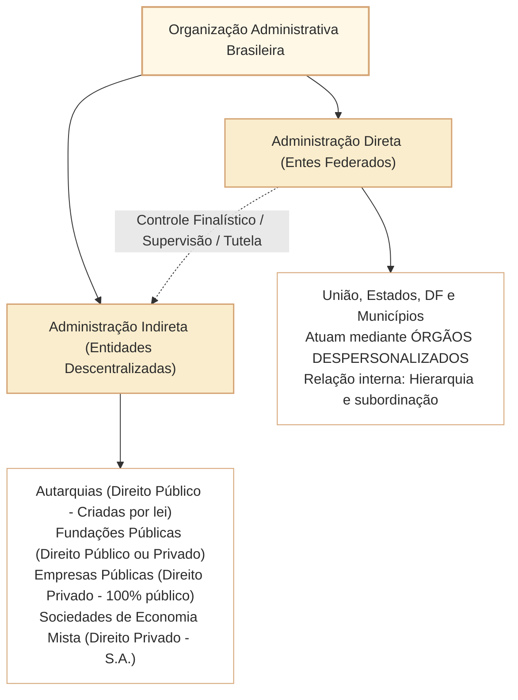
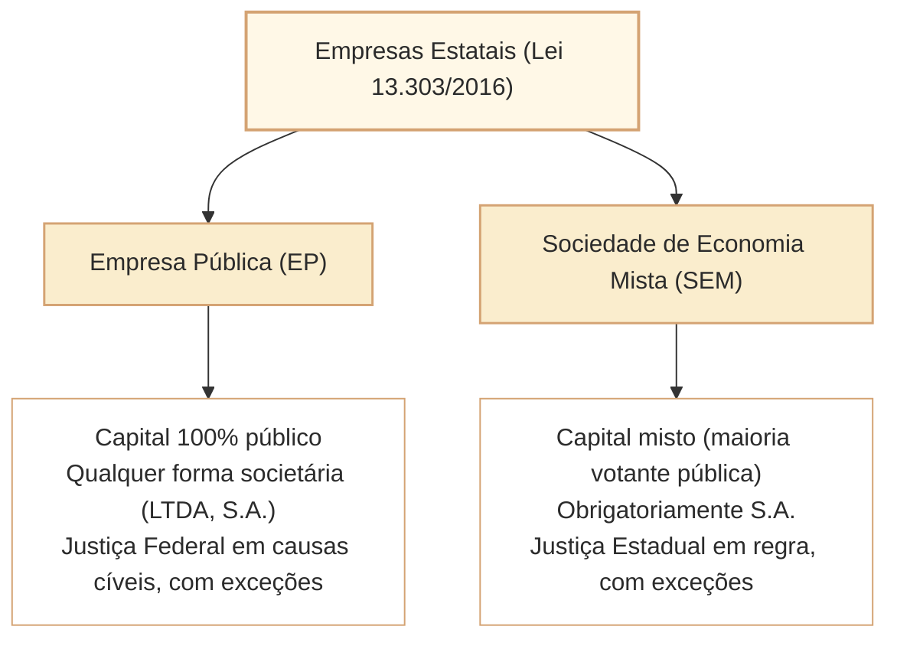

# Administração Direta e Indireta: Entidades, Vínculos e Regime Jurídico

A organização da Administração Pública brasileira estrutura a distribuição das competências estatais entre a **Administração Direta** (os próprios entes federativos federados atuando por seus órgãos despersonalizados) e a **Administração Indireta** (conjunto de pessoas jurídicas instituídas para o desempenho descentralizado de atividades públicas especializadas). Nas provas de nível superior do Cebraspe (especialmente para o cargo de Analista Legislativo da Câmara dos Deputados), esse tema é abordado sob a ótica da **estrita legalidade na criação**, da **natureza da personalidade jurídica**, do **regime jurídico de direito público ou privado** e dos **limites do controle finalístico (*tutela ou supervisão ministerial*)** exercido pelo ente instituidor.

Dois pontos de fronteira doutrinária e jurisprudencial concentram a maior incidência de distratores do Cebraspe:
1. **A ausência de hierarquia ou subordinação entre a Administração Direta e a Indireta:** A relação entre o ministério supervisor e a entidade descentralizada é de **vinculação e controle finalístico**, nos limites legais, e não de hierarquia. A intensidade do controle depende da legislação aplicável; não se presume poder geral de substituir decisões da entidade.
2. **As regras de criação e autorização legislativa do art. 37, XIX, da CF/1988:** A **autarquia e a fundação pública de direito público (autárquica)** são criadas diretamente por lei específica. A instituição de **empresa pública, sociedade de economia mista e fundação pública de direito privado** depende de autorização em lei específica e dos atos constitutivos correspondentes. O art. 37, XIX, também prevê lei complementar para definir áreas de atuação das fundações.

---

## 1. Estrutura Geral da Organização Administrativa

O Estado organiza o desempenho de suas atribuições mediante dois grandes eixos estruturantes:

---

## 2. Quadro Comparativo das Entidades da Administração Indireta

A tabela a seguir sistematiza as quatro espécies de entidades que integram a Administração Indireta (Decreto-Lei nº 200/1967 e art. 37, XIX, da CF/1988):

| Entidade | Personalidade Jurídica | Forma de Criação (Art. 37, XIX) | Objeto / Finalidade Típica | Regime de Pessoal | Foro Processual (Esfera Federal) |
| :--- | :--- | :--- | :--- | :--- | :--- |
| **Autarquia** | **Direito Público** | **Criada diretamente por lei específica** (adquire personalidade com a vigência da lei) | Atividades típicas de Estado, fiscalização, poder de polícia, previdência social | Na União, em regra estatutário (Lei nº 8.112/1990); observar a legislação e a jurisprudência sobre regimes de pessoal | Justiça Federal (art. 109, I, da CF/1988) |
| **Fundação Pública (Autárquica)** | **Direito Público** | **Criada por lei específica** (equiparada a autarquia: *autarquia fundacional*) | Atividades sociais, educacionais, científicas e assistenciais sem fins lucrativos | Na União, em regra estatutário (Lei nº 8.112/1990); observar a legislação aplicável | Justiça Federal (art. 109, I, da CF/1988) |
| **Fundação Pública (Governamental)** | **Direito Privado** | **Instituição autorizada por lei específica** + registro civil dos estatutos (exige LC para área de atuação) | Atividades sociais, de pesquisa e saúde sem fins lucrativos | Regime de pessoal definido na legislação aplicável; não presumir estatuto ou CLT apenas pelo nome da entidade | **Depende da natureza da entidade, do interesse jurídico federal e das regras de competência aplicáveis**; não presumir Justiça Estadual para toda fundação federal |
| **Empresa Pública** | **Direito Privado** | **Instituição autorizada por lei específica** + registro dos atos constitutivos na Junta Comercial | Exploração de atividade econômica ou prestação de serviço público | Celetista (CLT), mediante concurso público | **Justiça Federal nas causas abrangidas pelo art. 109, I, da CF/1988**, ressalvadas as exceções constitucionais |
| **Sociedade de Economia Mista** | **Direito Privado** | **Instituição autorizada por lei específica** + registro comercial | Exploração de atividade econômica ou prestação de serviço público | Celetista (CLT), mediante concurso público | **Justiça estadual nas causas cíveis em regra**, ressalvadas competência trabalhista, eleitoral, falimentar e interesse jurídico da União (art. 109, I; Súmulas 517 e 556 do STF) |

---

**Atenção ao foro das fundações:** a tabela indica uma orientação de estudo, não uma regra universal de competência. O art. 109, I, da Constituição atribui à Justiça Federal, com exceções expressas, as causas envolvendo a União, entidades autárquicas e empresas públicas federais. Fundações públicas de direito público são equiparadas às autarquias. Nas fundações de direito privado instituídas pelo poder público, a definição do foro exige verificar a natureza jurídica reconhecida, a presença de interesse jurídico federal e o entendimento judicial aplicável ao caso. A simples palavra “fundação” não resolve a competência.

---

## 3. O Confronto Crítico: Empresa Pública vs. Sociedade de Economia Mista

Ambas constituem espécies do gênero **empresas estatais**, submetidas ao regime geral da Lei nº 13.303/2016 (Estatuto das Estatais). O Cebraspe testa reiteradamente as três diferenças fundamentais que as discriminam:

1. **Composição do Capital Social:**
   - **Empresa Pública:** Capital **100% público** (integralmente titularizado pela União, Estados, DF, Municípios ou por outras entidades da administração pública direta ou indireta).
   - **Sociedade de Economia Mista:** Capital **misto** (composto por recursos públicos e privados), exigindo-se obrigatoriamente que a **maioria das ações com direito a voto** pertença à entidade pública controladora.
2. **Forma Societária:**
   - **Empresa Pública:** Pode adotar **qualquer forma jurídica admitida em direito** (Sociedade Anônima, Sociedade Limitada, ou modalidade societária unilinear).
   - **Sociedade de Economia Mista:** Deve constituir-se **obrigatoriamente sob a forma de Sociedade Anônima (S.A.)**, submetida às regras da Lei nº 6.404/1976.
3. **Competência Jurisdicional (na Esfera Federal):**
   - **Empresa Pública Federal (e.g., Caixa Econômica Federal, Correios):** Causas cíveis abrangidas pelo art. 109, I, julgadas pela **Justiça Federal**, ressalvadas as exceções constitucionais (como causas trabalhistas).
   - **Sociedade de Economia Mista Federal (e.g., Banco do Brasil, Petrobras):** Causas cíveis, em regra, na **Justiça Estadual**; a presença de interesse jurídico da União pode deslocar a competência para a Justiça Federal, conforme o art. 109, I, e as Súmulas 517 e 556 do STF. Causas trabalhistas seguem a competência própria.

---

## 4. O Vínculo entre Administração Direta e Indireta: Tutela vs. Hierarquia

O Cebraspe explora intensamente a falsa premissa de que o Chefe do Poder Executivo ou os Ministros de Estado exerceriam "poder hierárquico" sobre as entidades da Administração Indireta:

- **Inexistência de Hierarquia:** Não há relação de subordinação hierárquica entre a Administração Direta e a Indireta. A hierarquia pressupõe desconcentração interna (dentro da mesma pessoa jurídica).
- **Controle Finalístico (Supervisão Ministerial ou Tutela Administrativa):** O vínculo existente é de mera **vinculação institucional**, voltada a assegurar que a entidade descentralizada atue em consonância com as finalidades para as quais foi criada pela lei (*princípio da especialidade*).
- **Limites da Tutela:** A supervisão ministerial não autoriza a intervenção discricionária no mérito das decisões técnicas da entidade, dependendo sempre de autorização legal expressa para a prática de atos de controle (princípio da legalidade).
- **Recurso Hierárquico Impróprio:** Em regra, das decisões finais de uma autarquia ou agência reguladora não cabe recurso para o Ministério supervisor, salvo hipótese legal de revisão por autoridade de outra pessoa jurídica (*recurso hierárquico impróprio*). A jurisprudência e a orientação administrativa também exigem examinar o âmbito e os limites da supervisão, sem presumir recurso amplo ao ministro.

---

## 5. Questões Comentadas no Estilo Cebraspe

### Questão 1
*(Inédita: estilo Cebraspe / Câmara dos Deputados – Analista Legislativo)*

**Item:** As autarquias adquirem personalidade jurídica a partir da inscrição de seus atos constitutivos no registro competente, cabendo à lei específica apenas autorizar a sua posterior instituição pelo Poder Executivo.

- ( ) Certo
- ( ) Errado

**Gabarito: Errado**  
**Comentário:** O art. 37, XIX, da CF/1988 estabelece uma distinção rigorosa: a autarquia **é criada diretamente pela lei específica**, adquirindo personalidade jurídica de direito público no momento da entrada em vigor da lei, sem necessidade de registro civil. As demais entidades (empresas públicas, sociedades de economia mista e fundações de direito privado) é que dependem de lei autorizativa cumulada com o registro no órgão competente.

---

### Questão 2
*(Inédita: estilo Cebraspe / Câmara dos Deputados – Analista Legislativo)*

**Item:** Entre um ministério supervisor e uma autarquia federal a ele vinculada inexiste relação de subordinação hierárquica, cabendo ao ministério o controle finalístico nos limites definidos em lei.

- ( ) Certo
- ( ) Errado

**Gabarito: Certo**  
**Comentário:** A descentralização administrativa rompe o vínculo de hierarquia, que só opera no âmbito interno da mesma pessoa jurídica (desconcentração). A vinculação de uma autarquia federal ao ministério supervisor não transforma seus dirigentes em subordinados hierárquicos do ministro. A supervisão segue as competências previstas na legislação; a Câmara dos Deputados não deve ser usada como exemplo genérico de ministério supervisor de autarquia.

---

### Questão 3
*(Inédita: estilo Cebraspe / Câmara dos Deputados – Analista Legislativo)*

**Item:** Uma sociedade de economia mista federal que explore atividade econômica em regime de concorrência pode ser constituída sob a forma de sociedade de responsabilidade limitada, desde que a totalidade de suas cotas pertença a entes públicos.

- ( ) Certo
- ( ) Errado

**Gabarito: Errado**  
**Comentário:** A sociedade de economia mista **deve obrigatoriamente adotar a forma de Sociedade Anônima (S.A.)**, nos termos do art. 5º, III, do Decreto-Lei nº 200/1967 e da Lei nº 13.303/2016. Além disso, no modelo legal de sociedade de economia mista, a sociedade de economia mista possui capital misto (público e privado), não podendo ter 100% de capital público (hipótese que caracterizaria empresa pública).

---

### Questão 4
*(Inédita: estilo Cebraspe / Câmara dos Deputados – Analista Legislativo)*

**Item:** Compete à Justiça Federal processar e julgar as ações cíveis propostas contra a Caixa Econômica Federal, ao passo que as ações promovidas contra o Banco do Brasil S.A., sociedade de economia mista federal, são de competência da Justiça Comum Estadual.

- ( ) Certo
- ( ) Errado

**Gabarito: Certo, considerando a regra geral das causas cíveis e a ausência de exceções no enunciado.**  
**Comentário:** O art. 109, I, da CF/1988 fixa a competência da Justiça Federal para as causas em que a União, entidade autárquica ou **empresa pública federal** (caso da CEF) forem interessadas. As sociedades de economia mista federais (como o Banco do Brasil) não constam do rol taxativo do art. 109, I, sendo suas causas cíveis, em regra, processadas perante a Justiça Estadual (Súmula 556 do STF). A questão não trata das exceções constitucionais nem de participação da União com interesse jurídico (Súmula 517 do STF).

---

### Questão 5
*(Inédita: estilo Cebraspe / Câmara dos Deputados – Analista Legislativo)*

**Item:** As empresas estatais prestadoras de serviços públicos submetem-se ao regime de responsabilidade civil objetiva previsto no art. 37, § 6º, da Constituição Federal, não gozando, contudo, das prerrogativas processuais da Fazenda Pública, como o prazo em dobro para manifestação em juízo.

- ( ) Certo
- ( ) Errado

**Gabarito: Errado, pela generalização da segunda oração.**  
**Comentário:** O art. 37, § 6º, da Constituição prevê responsabilidade objetiva das pessoas jurídicas de direito privado prestadoras de serviços públicos pelos danos que seus agentes causem a terceiros nessa qualidade. Entretanto, não é seguro afirmar categoricamente que nenhuma estatal prestadora de serviço público possui prerrogativas processuais: o Supremo Tribunal Federal reconhece regimes específicos para determinadas entidades, conforme a atividade e as condições jurídicas. A extensão de prerrogativas não decorre automaticamente da personalidade privada nem pode ser negada sem ressalvas. A questão, como redigida, generaliza indevidamente.

---

### Questão 6
*(Inédita: estilo Cebraspe / Câmara dos Deputados – Analista Legislativo)*

**Item:** O princípio da especialidade impede que uma autarquia exerça competências estranhas às finalidades expressamente delimitadas na lei instituidora, sob pena de nulidade do ato praticado por desvio de finalidade.

- ( ) Certo
- ( ) Errado

**Gabarito: Errado, pela classificação automática do vício como desvio de finalidade.**  
**Comentário:** Pelo princípio da especialidade, a entidade descentralizada deve atuar nas finalidades estabelecidas em sua lei instituidora. Um ato fora das atribuições legais pode ser inválido por incompetência ou outra ilegalidade; **desvio de finalidade** exige verificar se o agente perseguiu finalidade diversa da prevista na norma. Esses vícios não são sinônimos.

---

## 6. Relações com Outros Artigos e Síntese de Revisão

- **Pré-requisitos e Vínculos Teóricos:**
  - [[3 - Materias/Direito Administrativo/12 - estado governo administracao e funcao administrativa|Estado, Governo, Administração Pública e Função Administrativa]]: Distinção entre Estado, Governo e o aparelho administrativo técnico.
  - [[3 - Materias/Direito Administrativo/01 - principios e lei de acesso a informacao|Princípios Expressos e Implícitos da Administração Pública]]: Aplicação dos princípios de legalidade estrita, moralidade e eficiência à descentralização.
  - [[3 - Materias/Direito Administrativo/13 - centralizacao descentralizacao concentracao e desconcentracao|Centralização, Descentralização, Concentração e Desconcentração no Direito Administrativo]]: Aprofundamento dos mecanismos operacionais de desconcentração e descentralização por outorga e delegação.
  - [[3 - Materias/Direito Administrativo/05 - agentes publicos|Agentes públicos: espécies, cargos, empregos, funções e regimes de vinculação estatal]]: Regime jurídico de agentes públicos estatutários de autarquias vs. empregados celetistas de estatais.

## Fontes, limites e revisão jurídica (15/11/2026)

Os itens 2, 5 e 6 foram ajustados, inclusive o gabarito do item 6 para retirar, respectivamente, um exemplo institucional inadequado, uma generalização sobre prerrogativas de estatais e a equiparação automática entre incompetência e desvio de finalidade. A revisão posterior também ajustou a distinção entre fundações de direito público e privado, a competência judicial e as ressalvas de regime de pessoal. A certificação integral exige verificar as fontes primárias e a página publicada, além de conferir os vínculos de glossário e flashcards.

Fontes primárias a confrontar na etapa de certificação: [Constituição Federal, arts. 37, XIX, e § 6º, e 109, I](https://www.planalto.gov.br/ccivil_03/constituicao/constituicao.htm); [Decreto-Lei nº 200/1967](https://www.planalto.gov.br/ccivil_03/decreto-lei/del0200.htm); [Lei nº 13.303/2016](https://www.planalto.gov.br/ccivil_03/_ato2015-2018/2016/lei/l13303.htm); jurisprudência oficial do STF sobre estatais prestadoras de serviços públicos. A revisão do glossário e dos flashcards também permanece pendente.
