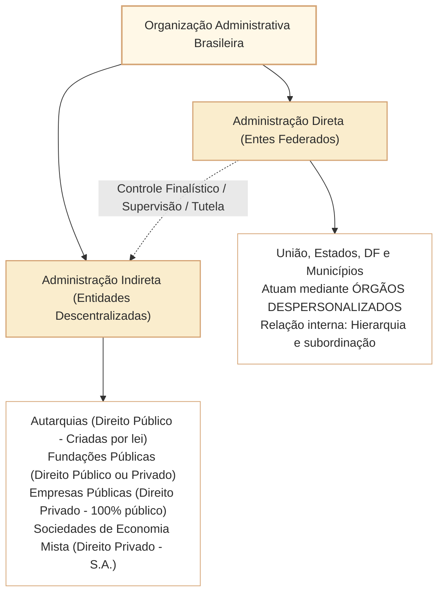
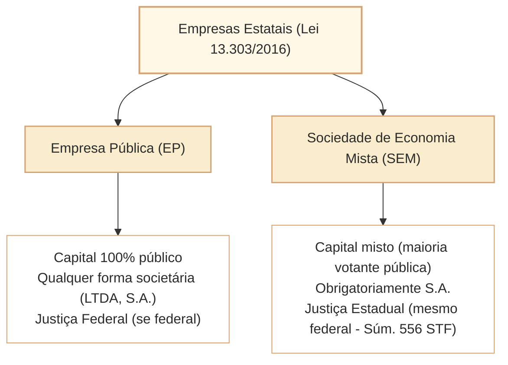

# Administração Direta e Indireta: Entidades, Vínculos e Regime Jurídico

A organização da Administração Pública brasileira estrutura a distribuição das competências estatais entre a **Administração Direta** (os próprios entes federativos federados atuando por seus órgãos despersonalizados) e a **Administração Indireta** (conjunto de pessoas jurídicas instituídas para o desempenho descentralizado de atividades públicas especializadas). Nas provas de nível superior do Cebraspe (especialmente para o cargo de Analista Legislativo da Câmara dos Deputados), esse tema é abordado sob a ótica da **estrita legalidade na criação**, da **natureza da personalidade jurídica**, do **regime jurídico de direito público ou privado** e dos **limites do controle finalístico (*tutela ou supervisão ministerial*)** exercido pelo ente instituidor.

Dois pontos de fronteira doutrinária e jurisprudencial concentram a maior incidência de distratores do Cebraspe:
1. **A ausência de hierarquia ou subordinação entre a Administração Direta e a Indireta:** A relação entre o Ministério supervisor (ou órgão diretivo do Poder) e a entidade descentralizada é exclusivamente de **vinculação e controle finalístico**, sendo vedada a ingerência discricionária em sua autonomia técnica e administrativa, salvo expressa previsão legal.
2. **As regras de criação e autorização legislativa do art. 37, XIX, da CF/1988:** Somente a autarquia é **criada diretamente por lei específica**; as empresas públicas, as sociedades de economia mista e as fundações públicas têm sua **instituição autorizada por lei específica**, exigindo-se, no caso destas últimas, lei complementar para definir suas áreas de atuação.

---

## 1. Estrutura Geral da Organização Administrativa

O Estado organiza o desempenho de suas atribuições mediante dois grandes eixos estruturantes:

---

## 2. Quadro Comparativo das Entidades da Administração Indireta

A tabela a seguir sistematiza as quatro espécies de entidades que integram a Administração Indireta (Decreto-Lei nº 200/1967 e art. 37, XIX, da CF/1988):

| Entidade | Personalidade Jurídica | Forma de Criação (Art. 37, XIX) | Objeto / Finalidade Típica | Regime de Pessoal | Foro Processual (Esfera Federal) |
| :--- | :--- | :--- | :--- | :--- | :--- |
| **Autarquia** | **Direito Público** | **Criada diretamente por lei específica** (adquire personalidade com a vigência da lei) | Atividades típicas de Estado, fiscalização, poder de polícia, previdência social | Estatutário (Regime Jurídico Único - Lei 8.112/1990) | Justiça Federal (art. 109, I, da CF/1988) |
| **Fundação Pública (Autárquica)** | **Direito Público** | **Criada por lei específica** (equiparada a autarquia: *autarquia fundacional*) | Atividades sociais, educacionais, científicas e assistenciais sem fins lucrativos | Estatutário (Lei 8.112/1990) | Justiça Federal (art. 109, I, da CF/1988) |
| **Fundação Pública (Governamental)** | **Direito Privado** | **Instituição autorizada por lei específica** + registro civil dos estatutos (exige LC para área de atuação) | Atividades sociais, de pesquisa e saúde sem fins lucrativos | Emprego Público (CLT) ou estatutário conforme desenho legal | Justiça Comum Estadual (salvo interesse federal específico) |
| **Empresa Pública** | **Direito Privado** | **Instituição autorizada por lei específica** + registro dos atos constitutivos na Junta Comercial | Exploração de atividade econômica ou prestação de serviço público | Celetista (CLT), mediante concurso público | **Justiça Federal** (art. 109, I, da CF/1988) |
| **Sociedade de Economia Mista** | **Direito Privado** | **Instituição autorizada por lei específica** + registro comercial | Exploração de atividade econômica ou prestação de serviço público | Celetista (CLT), mediante concurso público | **Justiça Estadual Comum** (Súmulas 517 e 556 do STF) |

---

## 3. O Confronto Crítico: Empresa Pública vs. Sociedade de Economia Mista

Ambas constituem espécies do gênero **empresas estatais**, submetidas ao regime geral da Lei nº 13.303/2016 (Estatuto das Estatais). O Cebraspe testa reiteradamente as três diferenças fundamentais que as discriminam:

1. **Composição do Capital Social:**
   - **Empresa Pública:** Capital **100% público** (integralmente titularizado pela União, Estados, DF, Municípios ou por outras entidades da administração pública direta ou indireta).
   - **Sociedade de Economia Mista:** Capital **misto** (composto por recursos públicos e privados), exigindo-se obrigatoriamente que a **maioria das ações com direito a voto** pertença à entidade pública controladora.
2. **Forma Societária:**
   - **Empresa Pública:** Pode adotar **qualquer forma jurídica admitida em direito** (Sociedade Anônima, Sociedade Limitada, ou modalidade societária unilinear).
   - **Sociedade de Economia Mista:** Deve constituir-se **obrigatoriamente sob a forma de Sociedade Anônima (S.A.)**, submetida às regras da Lei nº 6.404/1976.
3. **Competência Jurisdicional (na Esfera Federal):**
   - **Empresa Pública Federal (e.g., Caixa Econômica Federal, Correios):** Causas julgadas perante a **Justiça Federal** (art. 109, I, da CF/1988).
   - **Sociedade de Economia Mista Federal (e.g., Banco do Brasil, Petrobras):** Causas julgadas perante a **Justiça Comum Estadual**, salvo quando a União intervir como assistente ou opoente (Súmula 517 do STF e Súmula 556 do STF).

---

## 4. O Vínculo entre Administração Direta e Indireta: Tutela vs. Hierarquia

O Cebraspe explora intensamente a falsa premissa de que o Chefe do Poder Executivo ou os Ministros de Estado exerceriam "poder hierárquico" sobre as entidades da Administração Indireta:

- **Inexistência de Hierarquia:** Não há relação de subordinação hierárquica entre a Administração Direta e a Indireta. A hierarquia pressupõe desconcentração interna (dentro da mesma pessoa jurídica).
- **Controle Finalístico (Supervisão Ministerial ou Tutela Administrativa):** O vínculo existente é de mera **vinculação institucional**, voltada a assegurar que a entidade descentralizada atue em consonância com as finalidades para as quais foi criada pela lei (*princípio da especialidade*).
- **Limites da Tutela:** A supervisão ministerial não autoriza a intervenção discricionária no mérito das decisões técnicas da entidade, dependendo sempre de autorização legal expressa para a prática de atos de controle (princípio da legalidade).
- **Recurso Hierárquico Impróprio:** Em regra, das decisões finais de uma autarquia ou agência reguladora não cabe recurso para o Ministério supervisor, salvo quando a lei expressamente previr essa via extraordinária (*recurso hierárquico impróprio*).

---

## 5. Questões Comentadas no Estilo Cebraspe

### Questão 1
*(Inédita: estilo Cebraspe / Câmara dos Deputados – Analista Legislativo)*

**Item:** As autarquias adquirem personalidade jurídica a partir da inscrição de seus atos constitutivos no registro competente, cabendo à lei específica apenas autorizar a sua posterior instituição pelo Poder Executivo.

- ( ) Certo
- ( ) Errado

**Gabarito: Errado**  
**Comentário:** O art. 37, XIX, da CF/1988 estabelece uma distinção rigorosa: a autarquia **é criada diretamente pela lei específica**, adquirindo personalidade jurídica de direito público no momento da entrada em vigor da lei, sem necessidade de registro civil. As demais entidades (empresas públicas, sociedades de economia mista e fundações de direito privado) é que dependem de lei autorizativa cumulada com o registro no órgão competente.

---

### Questão 2
*(Inédita: estilo Cebraspe / Câmara dos Deputados – Analista Legislativo)*

**Item:** Entre a Presidência da Câmara dos Deputados e uma autarquia federal vinculada inexiste relação de subordinação hierárquica, exercendo o ente central apenas controle finalístico ou tutela administrativa nos estritos limites definidos em lei.

- ( ) Certo
- ( ) Errado

**Gabarito: Certo**  
**Comentário:** A descentralização administrativa rompe o vínculo de hierarquia, que só opera no âmbito interno da mesma pessoa jurídica (desconcentração). A relação entre o ente instituidor/supervisor e a entidade descentralizada é de mera vinculação para fins de controle finalístico e cumprimento do princípio da especialidade.

---

### Questão 3
*(Inédita: estilo Cebraspe / Câmara dos Deputados – Analista Legislativo)*

**Item:** Uma sociedade de economia mista federal que explore atividade econômica em regime de concorrência pode ser constituída sob a forma de sociedade de responsabilidade limitada, desde que a totalidade de suas cotas pertença a entes públicos.

- ( ) Certo
- ( ) Errado

**Gabarito: Errado**  
**Comentário:** A sociedade de economia mista **deve obrigatoriamente adotar a forma de Sociedade Anônima (S.A.)**, nos termos do art. 5º, III, do Decreto-Lei nº 200/1967 e da Lei nº 13.303/2016. Ademais, por definição ontológica, a sociedade de economia mista possui capital misto (público e privado), não podendo ter 100% de capital público (hipótese que caracterizaria empresa pública).

---

### Questão 4
*(Inédita: estilo Cebraspe / Câmara dos Deputados – Analista Legislativo)*

**Item:** Compete à Justiça Federal processar e julgar as ações cíveis propostas contra a Caixa Econômica Federal, ao passo que as ações promovidas contra o Banco do Brasil S.A., sociedade de economia mista federal, são de competência da Justiça Comum Estadual.

- ( ) Certo
- ( ) Errado

**Gabarito: Certo**  
**Comentário:** O art. 109, I, da CF/1988 fixa a competência da Justiça Federal para as causas em que a União, entidade autárquica ou **empresa pública federal** (caso da CEF) forem interessadas. As sociedades de economia mista federais (como o Banco do Brasil) não constam do rol taxativo do art. 109, I, sendo suas causas processadas perante a Justiça Estadual, consoante pacificidade da Súmula 556 do STF.

---

### Questão 5
*(Inédita: estilo Cebraspe / Câmara dos Deputados – Analista Legislativo)*

**Item:** As empresas estatais prestadoras de serviços públicos submetem-se ao regime de responsabilidade civil objetiva previsto no art. 37, § 6º, da Constituição Federal, não gozando, contudo, das prerrogativas processuais da Fazenda Pública, como o prazo em dobro para manifestação em juízo.

- ( ) Certo
- ( ) Errado

**Gabarito: Certo**  
**Comentário:** As pessoas jurídicas de direito privado prestadoras de serviços públicos respondem objetivamente pelos danos causados por seus agentes (art. 37, § 6º, da CF/1988). Todavia, por possuírem personalidade de direito privado, não usufruem do regime processual privilegiado da Fazenda Pública (prazos diferenciados do CPC e precatórios), salvo hipóteses excepcionalíssimas de empresas públicas prestadoras de serviço público em regime de monopólio estrito (jurisprudência consolidada dos Correios/ECT no STF).

---

### Questão 6
*(Inédita: estilo Cebraspe / Câmara dos Deputados – Analista Legislativo)*

**Item:** O princípio da especialidade impede que uma autarquia exerça competências estranhas às finalidades expressamente delimitadas na lei instituidora, sob pena de nulidade do ato praticado por desvio de finalidade.

- ( ) Certo
- ( ) Errado

**Gabarito: Certo**  
**Comentário:** Pelo princípio da especialidade, a entidade descentralizada é criada para um fim determinado e específico. Ela não possui capacidade jurídica genérica e ampla, ficando adstrita aos objetivos fixados na lei instituidora. A prática de ato alheio à sua missão institucional acarreta incompetência e desvio de finalidade.

---

## 6. Relações com Outros Artigos e Síntese de Revisão

- **Pré-requisitos e Vínculos Teóricos:**
  - [[3 - Materias/Direito Administrativo/12 - estado governo administracao e funcao administrativa|Estado, Governo, Administração Pública e Função Administrativa]]: Distinção entre Estado, Governo e o aparelho administrativo técnico.
  - [[3 - Materias/Direito Administrativo/01 - principios e lei de acesso a informacao|Princípios Expressos e Implícitos da Administração Pública]]: Aplicação dos princípios de legalidade estrita, moralidade e eficiência à descentralização.
  - [[3 - Materias/Direito Administrativo/13 - centralizacao descentralizacao concentracao e desconcentracao|Centralização, Descentralização, Concentração e Desconcentração no Direito Administrativo]]: Aprofundamento dos mecanismos operacionais de desconcentração e descentralização por outorga e delegação.
  - [[3 - Materias/Direito Administrativo/05 - agentes publicos|Agentes públicos: espécies, cargos, empregos, funções e regimes de vinculação estatal]]: Regime jurídico de agentes públicos estatutários de autarquias vs. empregados celetistas de estatais.
