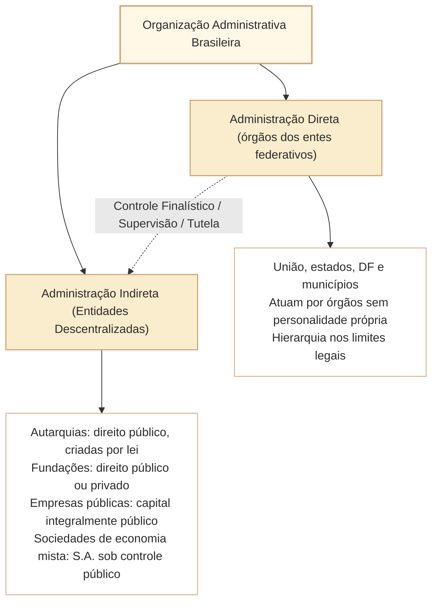
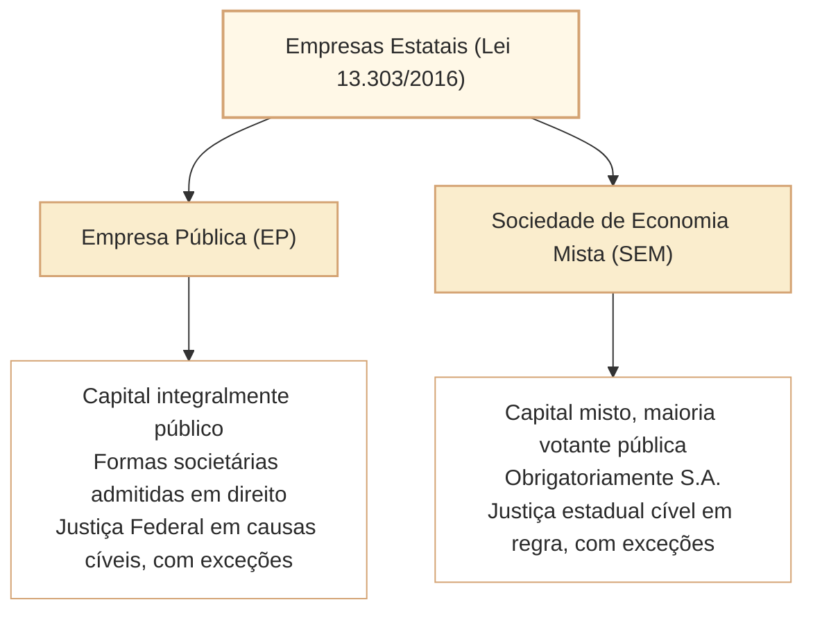

# Administração Direta e Indireta: entidades, vínculos e regime jurídico

Imagine que um ministério precise executar uma política que exige decisões técnicas contínuas. Ele pode agir por seus próprios departamentos ou contar com uma entidade criada para esse fim, como uma autarquia. Em ambos os casos existe Administração Pública, mas **muda quem tem personalidade jurídica, quem decide e como se exerce o controle**. Essas diferenças explicam as regras de criação, de pessoal e de competência judicial cobradas pela banca Cebraspe.

A **Constituição Federal de 1988**, especialmente seu art. 37, XIX, estabelece como surgem as entidades. O **Decreto-Lei nº 200/1967**, norma de organização da Administração Federal e reforma administrativa, distingue Administração Direta e Indireta (arts. 4º e 5º) e disciplina a supervisão ministerial (arts. 19 a 26). O decreto-lei trata da esfera federal; para estados e municípios, é preciso considerar a Constituição e a legislação do ente.

## Estrutura geral: entes, órgãos e entidades

**Ente federativo** é a pessoa política com autonomia prevista na Constituição: União, estados, Distrito Federal e municípios. Cada um pode organizar sua própria Administração. **Órgão público** é uma unidade de competências dentro de uma pessoa jurídica, sem personalidade própria: um ministério, uma secretaria ou um departamento. Isso significa que, em regra, os atos de um ministério são imputados à União, e não a uma pessoa jurídica chamada “ministério”. **Entidade administrativa** é uma pessoa jurídica distinta, com patrimônio e competências próprios, integrante da Administração Indireta.

A **Administração Direta** reúne os órgãos internos de cada ente federativo. Uma secretaria municipal, por exemplo, não se torna pessoa jurídica apenas por ter orçamento e chefia. A **Administração Indireta** reúne autarquias, fundações públicas, empresas públicas e sociedades de economia mista instituídas segundo o regime aplicável. Elas possuem personalidade jurídica própria, mas continuam sujeitas aos deveres constitucionais da Administração.

A criação de órgãos dentro de uma mesma pessoa jurídica é forma de **desconcentração**; a atribuição de atividade a outra pessoa jurídica é forma de **descentralização**. Um ministério que cria internamente uma coordenação desconcentra tarefas. Quando uma lei cria uma autarquia para uma atividade especializada, há descentralização por serviços. A explicação completa das modalidades está no [[3 - Materias/Direito Administrativo/13 - centralizacao descentralizacao concentracao e desconcentracao|artigo sobre centralização e descentralização]].

## Entidades da Administração Indireta e como são constituídas

O art. 37, XIX, da Constituição faz uma distinção decisiva: **a lei específica cria a autarquia**, ao passo que **autoriza a instituição** de empresa pública, sociedade de economia mista e fundação. A jurisprudência reconhece que a **fundação pública de direito público**, também chamada *fundação autárquica*, segue o regime da autarquia e é criada diretamente pela lei. A fundação pública de direito privado depende de autorização e posterior constituição. A Constituição exige lei complementar que defina as áreas de atuação das fundações: esse comando não deve ser confundido com uma lei complementar que crie individualmente cada fundação.

**Lei específica** é uma lei voltada à criação ou à autorização de determinada entidade. Quando a lei apenas autoriza, a pessoa jurídica surge depois dos atos constitutivos e do registro exigido pela sua natureza; a autorização isolada não basta. Para a autarquia e a fundação autárquica, a personalidade nasce da própria lei que as cria, conforme sua vigência.

| Espécie | Personalidade e criação | Atuação característica | Pessoal e justiça, na esfera federal |
| :--- | :--- | :--- | :--- |
| **Autarquia** | Direito público; criada por lei específica | Atividades administrativas especializadas, como regulação, fiscalização e previdência | Cargos efetivos federais em regra sujeitos à Lei nº 8.112/1990; causas do art. 109, I, na Justiça Federal, com exceções constitucionais |
| **Fundação pública de direito público** | Direito público; criada por lei específica, como autarquia fundacional | Pesquisa, ensino, cultura ou outras finalidades públicas definidas na lei | Regime das autarquias; Justiça Federal nas hipóteses do art. 109, I, com exceções |
| **Fundação pública de direito privado** | Direito privado; instituição autorizada por lei e formalizada pelos atos constitutivos | Atividades compatíveis com o regime privado, conforme finalidade e atividades concretas | Pessoal conforme regime legal aplicável; a competência judicial depende da natureza da demanda e do interesse jurídico federal |
| **Empresa pública** | Direito privado; instituição autorizada por lei, com constituição e registro próprios | Serviço público ou atividade econômica | Empregados regidos pela Consolidação das Leis do Trabalho; Justiça Federal nas causas do art. 109, I, com exceções |
| **Sociedade de economia mista** | Direito privado; instituição autorizada por lei; obrigatoriamente sociedade anônima | Serviço público ou atividade econômica | Empregados celetistas; causas cíveis comuns em regra na Justiça estadual, sem prejuízo das competências especiais |

A **Lei nº 8.112/1990** disciplina o regime jurídico dos servidores civis da União, de suas autarquias e fundações públicas. Não se deve transformar essa regra de pessoal federal em regra para todas as esferas ou todas as entidades. Na **ADI 2135**, julgada pelo Supremo Tribunal Federal (STF) em 2024, admitiu-se a flexibilização constitucional do regime jurídico único, com efeitos prospectivos e preservação dos regimes dos atuais servidores. A legislação do cargo e do ente continua necessária para responder a uma questão concreta.

As fundações públicas pedem especial atenção. No **Tema 545 de repercussão geral (RE 716.378)**, o STF esclareceu que o regime público ou privado depende **da lei de criação ou autorização e das atividades efetivamente atribuídas**; o nome “fundação” não resolve o enquadramento. A decisão também afastou a extensão da estabilidade excepcional do art. 19 do Ato das Disposições Constitucionais Transitórias (ADCT) aos empregados de fundações públicas de direito privado. Assim, tanto o regime de pessoal quanto a competência judicial exigem examinar a natureza da fundação e o tipo de causa, sem concluir automaticamente pelo foro federal apenas porque a entidade é chamada de “fundação federal”.

## Empresas públicas e sociedades de economia mista

A **Lei nº 13.303/2016**, chamada Estatuto Jurídico das Empresas Estatais, disciplina aspectos de governança, licitações e contratos de empresas públicas e sociedades de economia mista. Seus arts. 3º e 4º permitem distinguir as duas espécies. A **Lei nº 6.404/1976**, Lei das Sociedades por Ações, é relevante porque a sociedade de economia mista deve assumir a forma de **sociedade anônima (S.A.)**.

Na **empresa pública**, o capital é integralmente público. O art. 3º, parágrafo único, da Lei nº 13.303/2016 permite participação de outras pessoas jurídicas de direito público interno e de entidades da Administração Indireta, desde que a maioria do capital votante permaneça com a União, um estado, o Distrito Federal ou um município. Ela pode assumir as formas jurídicas admitidas em direito. Na **sociedade de economia mista**, há participação de capital público e privado e a maioria das ações com direito a voto deve permanecer sob controle público, conforme o art. 4º. Ela deve ser sociedade anônima.

Uma comparação útil: a **Caixa Econômica Federal** é empresa pública federal; o **Banco do Brasil S.A.** é sociedade de economia mista federal. Ambas integram a Administração Indireta, têm personalidade de direito privado e contratam empregados mediante concurso público para empregos permanentes, mas têm estruturas de capital e regras de competência judicial distintas.

## Vinculação, supervisão e hierarquia

A relação entre o ministério e seus **órgãos internos** é normalmente de **hierarquia**: dentro da mesma pessoa jurídica, a autoridade superior dirige, distribui tarefas e pode rever atos nos limites legais. Entre o ministério e uma autarquia vinculada, há **vinculação**, com **supervisão ministerial ou tutela administrativa**. O ministério acompanha a finalidade institucional, a legalidade e os resultados previstos na legislação, mas não ganha por isso poder hierárquico geral para substituir toda decisão técnica.

Os arts. 19, 25 e 26 do Decreto-Lei nº 200/1967 descrevem a supervisão federal e seus objetivos: observar a legislação, acompanhar a execução de políticas públicas, fiscalizar o uso de recursos e assegurar também a **autonomia administrativa, operacional e financeira** das entidades. **Controle finalístico** significa verificar se a entidade cumpre a finalidade para a qual foi instituída. **Princípio da especialidade** significa que ela só pode atuar nas competências e fins legalmente atribuídos.

Exemplo: um ministério pode acompanhar a execução das metas legais de uma autarquia e adotar medidas de supervisão autorizadas. Isso não o transforma em instância recursal automática de todo processo decidido pela autarquia. **Recurso hierárquico impróprio** é o pedido de revisão dirigido a autoridade situada fora da estrutura hierárquica da pessoa jurídica que decidiu. Seu cabimento e alcance dependem da disciplina específica. No âmbito federal, o **Parecer AGU AC-51/2006**, aprovado pelo Presidente da República, reconhece hipóteses delimitadas de revisão ministerial de decisões de agências reguladoras que ultrapassem competências ou contrariem políticas públicas setoriais, preservando sua autonomia técnica na competência finalística. Uma regra absoluta de “nunca cabe recurso” seria tão imprecisa quanto “o ministro sempre pode rever”.

## Competência judicial, responsabilidade e prerrogativas

O art. 109, I, da Constituição atribui à **Justiça Federal**, com exceções expressas, causas nas quais a União, autarquia federal ou empresa pública federal sejam interessadas na posição processual indicada pela norma. Entre as exceções estão causas de competência da Justiça do Trabalho e da Justiça Eleitoral, além das hipóteses constitucionais específicas. **Competência** é a definição de qual órgão do Judiciário pode processar e julgar a causa.

Uma **sociedade de economia mista federal** não entra automaticamente nesse rol: a regra das causas cíveis comuns é a Justiça estadual (**Súmula 556 do STF**). Pode haver deslocamento quando a União participa como assistente ou opoente, conforme a **Súmula 517 do STF**. Nas fundações, é preciso primeiro definir a natureza jurídica e os elementos da causa. Por isso, a tabela anterior é um roteiro de classificação, e não uma previsão de foro para qualquer processo trabalhista, eleitoral ou outra matéria de competência específica.

O **art. 37, § 6º, da Constituição** impõe **responsabilidade civil objetiva** às pessoas jurídicas de direito público e às pessoas jurídicas de direito privado prestadoras de serviços públicos pelos danos causados por seus agentes, nessa qualidade, a terceiros. “Objetiva” significa que a vítima não precisa provar culpa do agente para responsabilizar a pessoa jurídica, embora deva demonstrar os requisitos do caso, como dano e nexo causal. A possibilidade de a pessoa jurídica exigir ressarcimento do agente depende de dolo ou culpa.

As **prerrogativas da Fazenda Pública**, como certas regras especiais de execução e processo, não são concedidas nem negadas automaticamente a todas as estatais apenas por terem personalidade privada. O STF reconhece tratamentos específicos para entidades como a **Empresa Brasileira de Correios e Telégrafos (ECT)**. É necessário analisar a atividade, a legislação e a jurisprudência; o reconhecimento de uma prerrogativa tributária, por exemplo, não prova que todas as prerrogativas processuais sejam idênticas.

## Questões comentadas: Certo ou Errado

### Questão 1

*Item inédito, estilo Cebraspe.* As autarquias adquirem personalidade jurídica a partir da inscrição de seus atos constitutivos no registro competente, cabendo à lei específica apenas autorizar a sua posterior instituição pelo Poder Executivo.

- ( ) Certo
- ( ) Errado

**Gabarito: Errado.** A autarquia nasce diretamente da lei específica que a cria (art. 37, XIX). Registro e constituição posterior caracterizam entidades cuja instituição é apenas autorizada, como a empresa pública. A fundação autárquica também nasce da lei.

### Questão 2

*Item inédito, estilo Cebraspe.* Entre um ministério supervisor e uma autarquia federal a ele vinculada inexiste relação de subordinação hierárquica, cabendo ao ministério o controle finalístico nos limites definidos em lei.

- ( ) Certo
- ( ) Errado

**Gabarito: Certo.** A autarquia é outra pessoa jurídica. Supervisão ou tutela e hierarquia são vínculos distintos: o ministério não se torna superior hierárquico de todos os seus dirigentes e servidores por força da vinculação.

### Questão 3

*Item inédito, estilo Cebraspe.* Uma sociedade de economia mista federal que explore atividade econômica em regime de concorrência pode ser constituída sob a forma de sociedade limitada, desde que a totalidade de suas cotas pertença a entes públicos.

- ( ) Certo
- ( ) Errado

**Gabarito: Errado.** A sociedade de economia mista deve ser uma **sociedade anônima**, sob controle público da maioria do capital votante, e seu modelo legal admite capital privado. A forma limitada e o capital integralmente público são incompatíveis com a espécie descrita.

### Questão 4

*Item inédito, estilo Cebraspe.* Em causas cíveis comuns, sem exceção constitucional nem intervenção da União, a Caixa Econômica Federal, empresa pública federal, submete-se à Justiça Federal, enquanto o Banco do Brasil S.A., sociedade de economia mista federal, submete-se, em regra, à Justiça estadual.

- ( ) Certo
- ( ) Errado

**Gabarito: Certo.** O art. 109, I, inclui a empresa pública federal, mas não a sociedade de economia mista federal. As Súmulas 517 e 556 do STF explicam a regra e a possível participação da União. A delimitação a causas cíveis comuns evita generalização sobre processos trabalhistas.

### Questão 5

*Item inédito, estilo Cebraspe.* As empresas estatais prestadoras de serviços públicos submetem-se à responsabilidade civil objetiva do art. 37, § 6º, da Constituição, mas nenhuma pode receber prerrogativas processuais próprias da Fazenda Pública.

- ( ) Certo
- ( ) Errado

**Gabarito: Errado.** A primeira parte enuncia a regra de responsabilidade objetiva das prestadoras de serviço público. A palavra **nenhuma** torna a segunda parte falsa: há regimes específicos reconhecidos pelo STF para determinadas estatais, que devem ser examinados conforme sua atividade e a prerrogativa discutida.

### Questão 6

*Item inédito, estilo Cebraspe.* O princípio da especialidade impede que uma autarquia exerça competências estranhas às finalidades da lei instituidora, sob pena de nulidade do ato necessariamente por desvio de finalidade.

- ( ) Certo
- ( ) Errado

**Gabarito: Errado.** A autarquia deve respeitar as competências legais. Entretanto, **incompetência** (ato praticado por quem não tinha atribuição) e **desvio de finalidade** (uso da competência para fim diverso do previsto) são vícios distintos. O enunciado erra ao classificar automaticamente qualquer extrapolação como desvio de finalidade.

## Relações com outros artigos

A distinção inicial entre Estado e Administração é explicada em [[3 - Materias/Direito Administrativo/12 - estado governo administracao e funcao administrativa|Estado, Governo e função administrativa]]. Os mecanismos de desconcentração e descentralização são aprofundados em [[3 - Materias/Direito Administrativo/13 - centralizacao descentralizacao concentracao e desconcentracao|Centralização e descentralização]]. As regras de emprego, cargo e vínculo com o Estado aparecem em [[3 - Materias/Direito Administrativo/05 - agentes publicos|Agentes públicos]]. Para a diferença entre incompetência e desvio de finalidade, consulte [[3 - Materias/Direito Administrativo/03 - atos administrativos|Atos administrativos]].

## Fontes normativas e jurisprudenciais

- [Constituição Federal de 1988](https://www.planalto.gov.br/ccivil_03/constituicao/constituicao.htm): arts. 37, XIX e § 6º; 109, I; 173.
- [Decreto-Lei nº 200/1967](https://www.planalto.gov.br/ccivil_03/decreto-lei/del0200.htm): organização da Administração Federal, arts. 4º, 5º e 19 a 26.
- [Lei nº 13.303/2016](https://www.planalto.gov.br/ccivil_03/_ato2015-2018/2016/lei/l13303.htm): Estatuto das Estatais, arts. 3º e 4º; [Lei nº 6.404/1976](https://www.planalto.gov.br/ccivil_03/leis/l6404consol.htm): sociedades por ações.
- [Lei nº 8.112/1990](https://www.planalto.gov.br/ccivil_03/leis/l8112cons.htm): servidores civis federais; [STF, ADI 2135](https://portal.stf.jus.br/processos/listarProcessos.asp?classe=ADI&numeroProcesso=2135): flexibilização do regime jurídico único, com limites temporais.
- [STF, Tema 545 (RE 716.378)](https://portal.stf.jus.br/jurisprudenciaRepercussao/verAndamentoProcesso.asp?classeProcesso=RE&incidente=4312969&numeroProcesso=716378&numeroTema=545): natureza e pessoal das fundações públicas; [STF, Súmula 517](https://portal.stf.jus.br/jurisprudencia/sumariosumulas.asp?base=30&sumula=2054) e [Súmula 556](https://portal.stf.jus.br/jurisprudencia/sumariosumulas.asp?base=30&sumula=2793): competência judicial.
- [AGU, Parecer AC-51/2006](https://www.gov.br/agu/pt-br/assuntos-1/Publicacoes/cartilhas/ConsolidacaodePareceresVinculantesatualizacao.pdf): limites da supervisão e do recurso hierárquico impróprio nas agências reguladoras.
