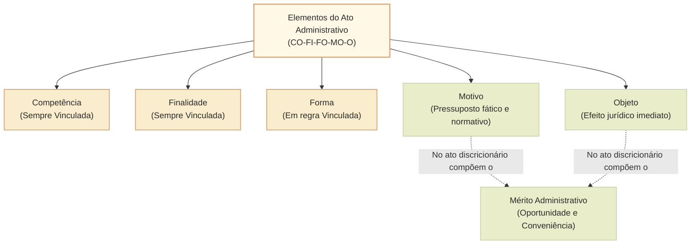
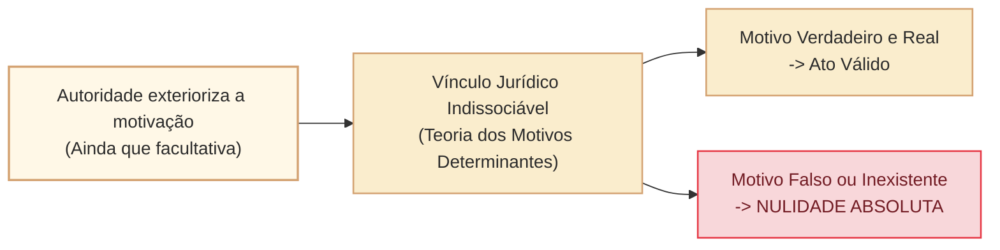

# Elementos e requisitos de validade do ato administrativo: competência, finalidade, forma, motivo e objeto

O ato administrativo é uma espécie de ato jurídico submetida predominantemente ao regime jurídico de direito público. Para que nasça perfeito, válido e plenamente eficaz no ordenamento jurídico, o ato administrativo deve preencher rigorosamente os seus **requisitos de validade** (também denominados pela doutrina tradicional de **elementos** ou **condições de validade**).

A disciplina positiva dos elementos do ato administrativo encontra matriz fundamental no direito brasileiro na **Lei da Ação Popular (Lei nº 4.717/1965, art. 2º)** e na **Lei do Processo Administrativo Federal (Lei nº 9.784/1999, arts. 11 a 15, 50, 53 e 55)**. A doutrina sintetiza os cinco elementos estruturais no mnemônico clássico **CO-FI-FO-MO-O**:
1. **Competência** (sujeito);
2. **Finalidade**;
3. **Forma**;
4. **Motivo**;
5. **Objeto** (conteúdo).

---

## 1. Competência (Sujeito)

### 1.1. Conceito e características
A **competência** é o círculo de atribuições conferido pelo ordenamento jurídico aos órgãos e agentes públicos para o desempenho de funções administrativas. Decorre diretamente do princípio da legalidade administrativa (art. 37, *caput*, da CF/1988), segundo o qual o administrador somente pode agir quando expressamente autorizado pela lei (*princípio da legalidade estrita*).

A competência administrativa possui características dogmáticas intransigíveis:
- **Origem legal:** decorre sempre de previsão legal (ou constitucional). Não existe competência presumida nem criada por vontade unilateral do agente.
- **Irrenunciabilidade e inderrogabilidade:** a competência é conferida em benefício do interesse coletivo (poder-dever), sendo vedado ao agente renunciar a ela ou transferi-la por conveniência privada (art. 11 da Lei nº 9.784/1999).
- **Imprescritibilidade:** o não exercício continuado de uma competência não acarreta sua extinção temporal nem convalida a usurpação.
- **Intransferibilidade:** ressalvadas as hipóteses legalmente admitidas de delegação e avocação, a competência permanece circunscrita ao órgão/cargo instituidor.

### 1.2. Delegação e avocação de competência
A Lei nº 9.784/1999 disciplina os instrumentos temporários de alteração do exercício da competência:
- **Delegação (art. 12):** transferência transitória do *exercício* de parte das atribuições a outro órgão ou agente subordinado ou até mesmo não subordinado (relação horizontal ou vertical), quando conveniente por motivos técnicos, sociais, econômicos, jurídicos ou territoriais. Não se delega a titularidade da competência, mas apenas o seu exercício material. O ato de delegação é revogável a qualquer tempo pela autoridade delegante.
- **Vedação absoluta à delegação (art. 13 da Lei nº 9.784/1999 - mnemônico NO-RE-EX):**
  1. Edição de atos de caráter **normativo**;
  2. Decisão de **recursos** administrativos;
  3. Matérias de competência **exclusiva** do órgão ou autoridade.
- **Avocação (art. 15):** ato de autoridade hierarquicamente superior que chama para si o exercício de competência atribuída originariamente a órgão subordinado. É medida de caráter excepcional, temporária e motivada por razões relevantes devidamente justificadas. Não se admite avocação de competência exclusiva de órgão subordinado.

### 1.3. Vícios de competência e a Lei nº 4.717/1965
Nos termos do art. 2º, parágrafo único, "a", da Lei nº 4.717/1965, o vício de competência configura **incompetência** quando o ato não se incluir nas atribuições legais do agente que o praticou:
- **Usurpação de função pública:** indivíduo que não é agente público assume e pratica ato típico da função estatal (crime tipificado no art. 328 do Código Penal). Trata-se de hipótese doutrinária de **ato inexistente**.
- **Excesso de poder:** agente público regularmente investido atua além dos limites quantitativos, materiais ou territoriais de sua competência legal. É espécie de abuso de poder, acarretando nulidade.
- **Agente de fato (teoria da aparência e da imputação):** funcionário cuja investidura foi irregular ou suspensa, mas perante os administrados de boa-fé aparenta legitimidade. Em prol da segurança jurídica e da confiança legítima, os atos por ele praticados em favor de terceiros de boa-fé são considerados válidos e imputados ao Estado.

---

## 2. Finalidade

### 2.1. Conceito e sentido estrito
A **finalidade** é o objetivo de interesse público tutelado pela norma que outorgou a competência ao administrador público. A doutrina distingue dois alcances:
- **Finalidade mediata (ampla):** a satisfação do interesse coletivo e o bem comum de toda a sociedade. Todo e qualquer ato administrativo que viole o interesse público geral nasce viciado.
- **Finalidade imediata (específica/estrita):** o resultado concreto específico previsto pela lei para aquele ato específico. Não basta visar a um interesse público qualquer; é imperativo atender à exata finalidade fixada pela lei de regência. Por exemplo, a desapropriação visa à utilidade pública ou ao interesse social previsto no decreto expropriatório; a remoção disciplinar de servidor sob o pretexto de "adequação de lotação" atenta contra a finalidade legal estrita.

### 2.2. Desvio de finalidade (desvio de poder)
O desvio de finalidade (art. 2º, parágrafo único, "e", da Lei nº 4.717/1965) ocorre quando o agente pratica o ato visando a fim diverso daquele previsto, explícita ou implicitamente, na lei:
- O agente atua para satisfazer interesse estritamente pessoal, perseguição política, favorecimento ilícito a parente ou correligionário.
- O agente atua visando a um interesse público, mas diverso daquele fixado especificamente pela lei para aquela categoria de ato (desvio de finalidade com interesse público genérico).
- **Consequência jurídica:** o desvio de finalidade é vício **insanável**. O ato é nulo de pleno direito e não admite convalidação, sob pena de perpetuação do abuso de poder.

---

## 3. Forma

### 3.1. Conceito e formalismo moderado
A **forma** é o modo pelo qual a vontade da Administração se exterioriza no mundo jurídico, bem como o conjunto de formalidades e ritos que devem preceder e acompanhar a expedição do ato.
- No direito administrativo vigora o princípio da **solenidade das formas (formalismo moderado)**. Enquanto no direito privado vigora a liberdade de forma (art. 107 do CC), no direito público a forma é a regra de garantia do administrado e da transparência da res publica.
- Em regra, os atos administrativos são **escritos** (incluídos os meios eletrônicos regulamentares da Lei nº 14.129/2021). Excepcionalmente, admitem-se ordens verbais e sinais visuais ou sonoros (ex.: sinais de apito de agentes de trânsito, placas de sinalização viária).

### 3.2. Vício de forma e convalidação
O art. 2º, parágrafo único, "b", da Lei nº 4.717/1965 estabelece que o vício de forma consiste na omissão ou na observância incompleta ou irregular de formalidades indispensáveis à existência ou seriedade do ato.
- **Forma essencial (insanável):** quando a formalidade é indispensável para a validade do ato ou constitui garantia fundamental de ampla defesa do administrado (ex.: ausência de contraditório em processo disciplinar; ausência de parecer vinculante obrigatório). Gera nulidade absoluta.
- **Forma não essencial (sanável):** irregularidades que não causem prejuízo a terceiros nem lesão ao interesse público, permitindo a **convalidação** (art. 55 da Lei nº 9.784/1999).

---

## 4. Motivo e Motivação

### 4.1. Distinção essencial entre motivo e motivação
Para as bancas de concurso público (especialmente o Cebraspe), a distinção entre **motivo** e **motivação** é tema recorrente e decisivo:

| Conceito | Natureza | Pergunta respondida | Existência obrigatória? |
| :--- | :--- | :--- | :--- |
| **Motivo** | Pressuposto fático e normativo que autoriza ou exige a prática do ato. | *O que aconteceu no mundo real e qual norma incide sobre o caso?* | **Sim, indispensável**. Todo ato administrativo possui motivo (se o fato não existiu, o ato é nulo). |
| **Motivação** | Declaração escrita e expressa dos fundamentos fáticos e jurídicos no instrumento do ato. | *Como a autoridade registrou formalmente os fundamentos da sua decisão?* | **Em regra sim**, obrigatória nas hipóteses do art. 50 da Lei nº 9.784/1999. Em casos residuais (ex.: exoneração de cargo em comissão *ad nutum*), a motivação expressa é facultativa. |

### 4.2. Motivação aliunde (por remissão)
A Lei nº 9.784/1999 consagra expressamente a **motivação per relationem** ou **aliunde** em seu art. 50, § 1º:
> *"A motivação deve ser explícita, clara e congruente, podendo consistir em declaração de concordância com fundamentos de anteriores pareceres, informações, decisões ou propostas, que, neste caso, serão parte integrante do ato."*

A jurisprudência consolidada do STF e do STJ admite amplamente a motivação aliunde, desde que as peças remetidas contenham fundamentação fático-jurídica suficiente e estejam formalmente anexadas aos autos.

### 4.3. Teoria dos motivos determinantes
A **Teoria dos Motivos Determinantes** estabelece que a validade do ato administrativo está indissoluvelmente vinculada à veracidade e integridade dos motivos alegados pelo agente público no momento de sua prática.

- **Aplicabilidade a atos discricionários:** mesmo quando a lei não exige motivação expressa (como na exoneração de titular de cargo em comissão *ad nutum*), se a autoridade decidir expressar o motivo (ex.: justificando a exoneração na "necessidade de redução da folha de pagamento por excesso de despesas"), o ato fica estritamente vinculado à veracidade desse fundamento.
- **Consequência:** se ficar demonstrado que o motivo exposto é falso ou inexistente (ex.: no dia seguinte é nomeado novo ocupante para a mesma vaga remunerada com aumento salarial), o ato administrativo de exoneração padece de **nulidade absoluta**, cabendo anulação pelo próprio Poder Público ou intervenção do Poder Judiciário.

---

## 5. Objeto (Conteúdo)

### 5.1. Conceito e pressupostos de validade
O **objeto** (ou conteúdo) é a alteração material ou a consequência jurídica imediata produzida pelo ato administrativo no ordenamento jurídico. Enquanto a finalidade visa ao efeito mediato de interesse público, o objeto define o que o ato dispõe imediatamente (ex.: na demissão, o objeto é a ruptura do vínculo funcional do servidor; na licença para edificar, é o reconhecimento do direito de construir).

Para ser válido, o objeto do ato administrativo deve ser:
- **Lícito:** compatível com a Constituição, leis e regulamentos vigentes;
- **Possível fática e juridicamente:** realizável no plano físico e admitido pelo ordenamento;
- **Determinado ou determinável:** com destinatário, alcance e parâmetros claros;
- **Moral:** em consonância com os padrões éticos e de probidade da Administração Pública.

### 5.2. Vício no objeto
Ocorre quando o resultado prático infringir texto de lei, for materialmente impossível ou tiver natureza ilícita (art. 2º, parágrafo único, "c", da Lei nº 4.717/1965). É vício que gera nulidade insanável.

---

## 6. Vícios Sanáveis versus Vícios Insanáveis e Convalidação

O regime da invalidade dos atos administrativos no direito brasileiro não acarreta a destruição cega de todo ato que apresente irregularidades formais periféricas. A ordem jurídica prestigia a **segurança jurídica**, a **confiança legítima** e a **economicidade administrativa**.

O art. 55 da Lei nº 9.784/1999 estabelece o regime da **convalidação**:
> *"Em decisão na qual se evidencie não acarretarem lesão ao interesse público nem prejuízo a terceiros, os atos que apresentarem defeitos sanáveis poderão ser convalidados pela própria Administração."*

A doutrina e a jurisprudência fixam o quadro de sanabilidade dos elementos:

| Elemento | Vício | Sanabilidade | Requisitos da Convalidação |
| :--- | :--- | :--- | :--- |
| **Competência** | Excesso de poder / usurpação de função | **Insanável** | Inadmissível. |
| **Competência** | Incompetência relativa (em razão da pessoa/matéria não exclusiva) | **Sanável** | Desde que **não se trate de competência exclusiva**, a autoridade originariamente competente pode ratificar o ato com efeitos retroativos (*ex tunc*). |
| **Finalidade** | Desvio de finalidade / desvio de poder | **Insanável** | Inadmissível. Ato nulo de pleno direito. |
| **Forma** | Omissão de formalidade essencial / garantia de defesa | **Insanável** | Inadmissível. Nulidade absoluta. |
| **Forma** | Irregularidade formal secundária | **Sanável** | A Administração pode suprir a formalidade desde que atingida a finalidade legal e ausente prejuízo ao interesse público e a terceiros. |
| **Motivo** | Motivo falso, inexistente ou juridicamente inadequado | **Insanável** | Inadmissível. Impossível inventar fato passado superveniente. |
| **Objeto** | Objeto ilícito, impossível ou indeterminado | **Insanável** | Inadmissível. Nulidade absoluta. |

---

## Questões Comentadas (Estilo Cebraspe)

### Questão 1
*(Inédita: estilo Cebraspe / Câmara dos Deputados – Analista Legislativo)*  
Julgue o item a seguir, referente aos elementos do ato administrativo e ao regime de delegação de competência.

> Considere que o Diretor-Geral da Câmara dos Deputados tenha editado portaria delegando a um Diretor de Departamento a competência originária regimental para julgar recursos administrativos interpostos contra decisões disciplinares de servidores lotados naquele setor. Nessa situação, à luz expressa da Lei nº 9.784/1999, a delegação efetuada é legalmente válida, tendo em vista que a desconcentração administrativa autoriza a distribuição horizontal de atribuições decisórias.

**( ) Certo**  
**( ) Errado**

> **Gabarito: Errado**  
> **Comentário:** A assertiva afronta diretamente o art. 13 da Lei nº 9.784/1999, que veda categoricamente a delegação de três matérias fundamentais (mnemônico NO-RE-EX): I - a edição de atos de caráter normativo; II - a decisão de recursos administrativos; III - as matérias de competência exclusiva do órgão ou autoridade. O julgamento de recurso administrativo não pode ser objeto de delegação funcional, tratando-se de vício de competência.

---

### Questão 2
*(Inédita: estilo Cebraspe / Câmara dos Deputados – Analista Legislativo)*  
Acerca do controle jurisdicional do ato administrativo e da teoria dos motivos determinantes, julgue o item.

> A autoridade administrativa que exonerar servidor ocupante exclusivamente de cargo em comissão não tem o dever legal originário de motivar o ato de dispensa, em razão da precariedade do vínculo; todavia, caso decida motivá-lo e indique expressamente que a exoneração decorreu da necessidade de contingenciamento orçamentário da folha de pagamento, a veracidade desse fundamento fático vinculará a validade do ato, ensejando a sua anulação judicial caso reste comprovada a nomeação imediata de outro servidor para idêntica função comissionada.

**( ) Certo**  
**( ) Errado**

> **Gabarito: Certo**  
> **Comentário:** O item descreve com exatidão a Teoria dos Motivos Determinantes. O ato de exoneração de cargo de provimento em comissão (*ad nutum*) é ato discricionário que independe de motivação para sua validade originária. Contudo, se a autoridade administrativa opta voluntariamente por exteriorizar o motivo determinante (contingenciamento financeiro), a higidez e subsistência do ato passam a depender indissoluvelmente da real existência e veracidade dos fatos articulados. Sendo o motivo falso ou inexistente, o ato é nulo.

---

### Questão 3
*(Inédita: estilo Cebraspe / Câmara dos Deputados – Analista Legislativo)*  
Em relação aos elementos e à convalidação dos atos administrativos, julgue o item a seguir.

> Constatado vício decorrente de desvio de finalidade na edição de ato de remoção de servidor público, praticado com a intenção oculta de punição funcional, a Administração Pública poderá convalidar o ato com efeitos retroativos (*ex tunc*), com base no art. 55 da Lei nº 9.784/1999, caso o órgão destinatário do servidor necessite de reforço urgente de pessoal, evidenciando o atendimento superveniente ao interesse público.

**( ) Certo**  
**( ) Errado**

> **Gabarito: Errado**  
> **Comentário:** O desvio de finalidade constitui vício **insanável** (art. 2º, parágrafo único, "e", da Lei nº 4.717/1965). O art. 55 da Lei nº 9.784/1999 restringe a convalidação estritamente a "defeitos sanáveis", que a doutrina e a jurisprudência pacificaram como sendo certas hipóteses de incompetência (não exclusiva) e de forma (não essencial). O desvio de finalidade traduz abuso de poder e acarreta nulidade absoluta insanável, não se admitindo validação por conveniência pública posterior.

---

### Questão 4
*(Inédita: estilo Cebraspe / Câmara dos Deputados – Analista Legislativo)*  
A respeito da motivação nos atos administrativos federais, julgue o item subsequente.

> Consoante o regime da Lei nº 9.784/1999, padece de nulidade por vício insanável de forma o ato decisório praticado por autoridade ministerial que se limite a declarar sua concordância expressa com os fundamentos de relatório e parecer jurídico emitidos pela consultoria do órgão, por violar a exigência de motivação autônoma e originária dos atos que afetam direitos individuais.

**( ) Certo**  
**( ) Errado**

> **Gabarito: Errado**  
> **Comentário:** O ordenamento jurídico admite expressamente a motivação *per relationem* (ou *aliunde*). O art. 50, § 1º, da Lei nº 9.784/1999 dispõe que *"a motivação deve ser explícita, clara e congruente, podendo consistir em declaração de concordância com fundamentos de anteriores pareceres, informações, decisões ou propostas, que, neste caso, serão parte integrante do ato"*. Não há obrigatoriedade de redação autônoma redundante quando a manifestação técnica antecedente for formalmente adotada e suficiente.

---

### Questão 5
*(Inédita: estilo Cebraspe / Câmara dos Deputados – Analista Legislativo)*  
Julgue o item que se segue, relativo à distinção dogmática entre motivo e objeto do ato administrativo.

> Enquanto o motivo do ato administrativo consubstancia a situação fática e o fundamento jurídico que autorizam ou determinam a intervenção estatal, o objeto representa o resultado prático imediato e a alteração jurídica que o ato produz no ordenamento.

**( ) Certo**  
**( ) Errado**

> **Gabarito: Certo**  
> **Comentário:** A assertiva delineia com precisão conceitual a fronteira entre motivo e objeto. O motivo responde ao *"por quê"* da manifestação administrativa (os fatos do mundo empírico e a norma legal incidente), ao passo que o objeto responde ao *"o quê"* (o conteúdo substancial do provimento, a concessão de licença, a aplicação de sanção pecuniária, a demissão de servidor).

---

### Questão 6
*(Inédita: estilo Cebraspe / Câmara dos Deputados – Analista Legislativo)*  
Acerca dos vícios de competência e do regime do agente de fato, julgue o item.

> Praticado ato administrativo por servidor público investido irregularmente no cargo público em decorrência de erro procedimental da banca examinadora do certame, reconhecido anos depois, os atos por ele praticados que beneficiem administrados de boa-fé são considerados absolutamente inexistentes, uma vez que a incompetência do sujeito contamina reflexamente toda e qualquer manifestação emanada sob tal condição fática.

**( ) Certo**  
**( ) Errado**

> **Gabarito: Errado**  
> **Comentário:** Trata-se da clássica aplicação da **Teoria do Agente de Fato** (vinculada à Teoria da Aparência e ao princípio da proteção da confiança legítima e da segurança jurídica). Os atos praticados por funcionário de fato perante terceiros de boa-fé são mantidos como válidos e imputados à Administração Pública, não se cogitando de inexistência ou nulidade indiscriminada em detrimento dos cidadãos que legitimamente confiaram na regularidade formal do agente público.

---

## Relações com outros temas

- [[3 - Materias/Direito Administrativo/14 - ato administrativo conceito e distincao de fato administrativo|Ato administrativo: conceito e distinção de fato administrativo]]: gênese ontológica e fronteira com fatos materiais.
- [[3 - Materias/Direito Administrativo/04 - poderes administrativos|Poderes administrativos]]: poderes vinculado e discricionário, excesso e desvio de poder.
- [[3 - Materias/Direito Administrativo/09 - processo administrativo federal|Processo administrativo federal]]: regramento dos arts. 11 a 15, 50 e 55 da Lei nº 9.784/1999.
- [[3 - Materias/Direito Administrativo/01 - principios e lei de acesso a informacao|Princípios da Administração Pública]]: legalidade, moralidade, segurança jurídica e autotutela.

## Fontes normativas e jurisprudenciais

- **Lei nº 4.717/1965 (Lei da Ação Popular):** art. 2º (competência, finalidade, forma, motivo e objeto).
- **Lei nº 9.784/1999 (Processo Administrativo Federal):** arts. 11 a 15 (competência, delegação e avocação); art. 50 (dever e formas de motivação); arts. 53 a 55 (autotutela, decadência e convalidação).
- **Supremo Tribunal Federal:** Súmulas 346 e 473 (autotutela administrativa); jurisprudência sobre motivação *per relationem* e teoria dos motivos determinantes.
