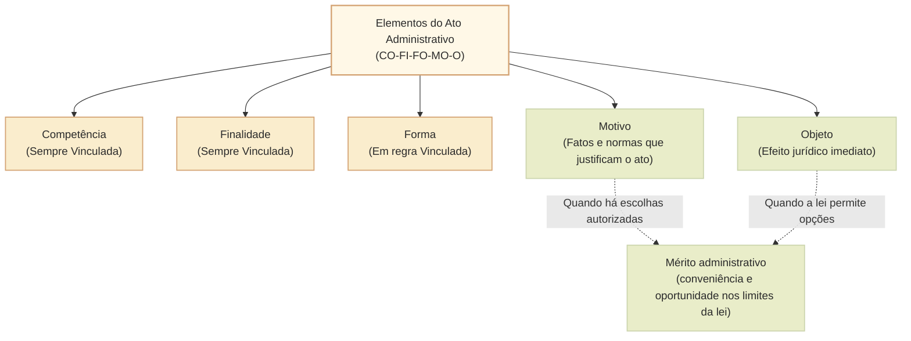
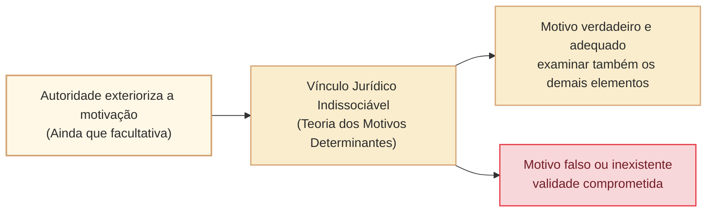

# Elementos e requisitos de validade do ato administrativo: competência, finalidade, forma, motivo e objeto

O ato administrativo é uma espécie de ato jurídico submetida predominantemente ao regime jurídico de direito público. Os requisitos de validade indicam se o ato respeita a ordem jurídica. **Perfeição** é a formação completa do ato; **validade** é sua conformidade jurídica; **eficácia** é a aptidão para produzir efeitos. Essas qualidades não ocorrem necessariamente juntas: um ato já expedido pode depender de publicação para produzir efeitos, e um ato eficaz pode vir a ser anulado por ilegalidade.

A **Lei nº 4.717/1965 (Lei da Ação Popular)** disciplina ação judicial contra atos lesivos aos interesses protegidos por essa lei; seu art. 2º apresenta critérios clássicos para reconhecer vícios nos elementos do ato. A **Lei nº 9.784/1999 (Lei do Processo Administrativo Federal)** disciplina competência, motivação, revisão e convalidação no âmbito federal (arts. 11 a 15, 50, 53 e 55). A doutrina utiliza essas referências para analisar também outros atos, observados seus regimes específicos. A doutrina sintetiza os cinco elementos estruturais no mnemônico clássico **CO-FI-FO-MO-O**:
1. **Competência** (sujeito);
2. **Finalidade**;
3. **Forma**;
4. **Motivo**;
5. **Objeto** (conteúdo).

---

## Competência (Sujeito)

### Conceito e características
A **competência** é o círculo de atribuições conferido pelo ordenamento jurídico aos órgãos e agentes públicos para o desempenho de funções administrativas. Decorre diretamente do princípio da legalidade administrativa (art. 37, *caput*, da CF/1988), segundo o qual o administrador somente pode agir quando expressamente autorizado pela lei (*princípio da legalidade estrita*).

A competência administrativa possui características dogmáticas intransigíveis:
- **Origem legal:** decorre sempre de previsão legal (ou constitucional). Não existe competência presumida nem criada por vontade unilateral do agente.
- **Irrenunciabilidade e inderrogabilidade:** a competência é conferida em benefício do interesse coletivo (poder-dever), sendo vedado ao agente renunciar a ela ou transferi-la por conveniência privada (art. 11 da Lei nº 9.784/1999).
- **Imprescritibilidade:** o não exercício continuado de uma competência não acarreta sua extinção temporal nem convalida a usurpação.
- **Intransferibilidade:** ressalvadas as hipóteses legalmente admitidas de delegação e avocação, a competência permanece circunscrita ao órgão/cargo instituidor.

### Delegação e avocação de competência
A Lei nº 9.784/1999 disciplina os instrumentos temporários de alteração do exercício da competência:
- **Delegação (art. 12):** transferência transitória do *exercício* de parte das atribuições a outro órgão ou agente subordinado ou até mesmo não subordinado (relação horizontal ou vertical), quando conveniente por motivos técnicos, sociais, econômicos, jurídicos ou territoriais. Não se delega a titularidade da competência, mas apenas o seu exercício material. O ato de delegação é revogável a qualquer tempo pela autoridade delegante.
- **Vedação absoluta à delegação (art. 13 da Lei nº 9.784/1999 - mnemônico NO-RE-EX):**
  1. Edição de atos de caráter **normativo**;
  2. Decisão de **recursos** administrativos;
  3. Matérias de competência **exclusiva** do órgão ou autoridade.
- **Avocação (art. 15):** ato de autoridade hierarquicamente superior que chama para si o exercício de competência atribuída originariamente a órgão subordinado. É medida de caráter excepcional, temporária e motivada por razões relevantes devidamente justificadas. Não se admite avocação de competência exclusiva de órgão subordinado.

### Vícios de competência e a Lei nº 4.717/1965
Nos termos do art. 2º, parágrafo único, "a", da Lei nº 4.717/1965, o vício de competência configura **incompetência** quando o ato não se incluir nas atribuições legais do agente que o praticou:
- **Usurpação de função pública:** pessoa sem investidura assume e pratica atos de função estatal. O art. 328 do **Decreto-Lei nº 2.848/1940 (Código Penal)** tipifica a usurpação; o enquadramento da validade dos atos exige avaliação jurídica, e não deve ser confundido automaticamente com a situação do agente de fato.
- **Excesso de poder:** agente investido ultrapassa os limites da competência que possui. É espécie de abuso de poder e pode invalidar o ato, observado o regime do vício; quando a incompetência é não exclusiva, sua convalidação pode ser juridicamente possível.
- **Agente de fato (teoria da aparência):** pessoa que aparentemente exerce função pública legítima, embora sua investidura seja irregular. A proteção da confiança pode preservar efeitos de atos perante terceiros de boa-fé, conforme o caso. Isso não torna todos os atos automaticamente válidos nem elimina a irregularidade de investidura.

---

## Finalidade

### Conceito e sentido estrito
A **finalidade** é o objetivo de interesse público tutelado pela norma que outorgou a competência ao administrador público. A doutrina distingue dois alcances:
- **Finalidade mediata (ampla):** a satisfação do interesse coletivo e o bem comum de toda a sociedade. Todo e qualquer ato administrativo que viole o interesse público geral nasce viciado.
- **Finalidade imediata (específica/estrita):** o resultado concreto específico previsto pela lei para aquele ato específico. Não basta visar a um interesse público qualquer; é imperativo atender à exata finalidade fixada pela lei de regência. Por exemplo, a desapropriação visa à utilidade pública ou ao interesse social previsto no decreto expropriatório; a remoção disciplinar de servidor sob o pretexto de "adequação de lotação" atenta contra a finalidade legal estrita.

### Desvio de finalidade (desvio de poder)
O desvio de finalidade (art. 2º, parágrafo único, "e", da Lei nº 4.717/1965) ocorre quando o agente pratica o ato visando a fim diverso daquele previsto, explícita ou implicitamente, na lei:
- O agente atua para satisfazer interesse estritamente pessoal, perseguição política, favorecimento ilícito a parente ou correligionário.
- O agente atua visando a um interesse público, mas diverso daquele fixado especificamente pela lei para aquela categoria de ato (desvio de finalidade com interesse público genérico).
- **Consequência jurídica:** o desvio de finalidade é vício **insanável**. O ato é nulo de pleno direito e não admite convalidação, sob pena de perpetuação do abuso de poder.

---

## Forma

### Conceito e formalismo moderado
A **forma** é o modo pelo qual a vontade da Administração se exterioriza no mundo jurídico, bem como o conjunto de formalidades e ritos que devem preceder e acompanhar a expedição do ato.
- O **formalismo moderado** exige as formalidades essenciais à segurança e à proteção de direitos, evitando exigências desnecessárias. O art. 2º, parágrafo único, VIII e IX, da Lei nº 9.784/1999 protege formalidades essenciais e recomenda formas simples suficientes à segurança do processo. A liberdade de forma do direito privado (art. 107 do **Código Civil, Lei nº 10.406/2002**) tem pressupostos distintos.
- Em regra, os atos administrativos são **escritos** (incluídos os meios eletrônicos regulamentares da Lei nº 14.129/2021). Excepcionalmente, admitem-se ordens verbais e sinais visuais ou sonoros (ex.: sinais de apito de agentes de trânsito, placas de sinalização viária).

### Vício de forma e convalidação
O art. 2º, parágrafo único, "b", da Lei nº 4.717/1965 estabelece que o vício de forma consiste na omissão ou na observância incompleta ou irregular de formalidades indispensáveis à existência ou seriedade do ato.
- **Forma essencial (insanável):** quando a formalidade é indispensável para a validade do ato ou constitui garantia fundamental de ampla defesa do administrado (ex.: ausência de contraditório em processo disciplinar; ausência de parecer vinculante obrigatório). Gera nulidade absoluta.
- **Forma não essencial (sanável):** irregularidades que não causem prejuízo a terceiros nem lesão ao interesse público, permitindo a **convalidação** (art. 55 da Lei nº 9.784/1999).

---

## Motivo e Motivação

### Distinção essencial entre motivo e motivação
Para as bancas de concurso público (especialmente o Cebraspe), a distinção entre **motivo** e **motivação** é tema recorrente e decisivo:

| Conceito | Natureza | Pergunta respondida | Existência obrigatória? |
| :--- | :--- | :--- | :--- |
| **Motivo** | Pressuposto fático e normativo que autoriza ou exige a prática do ato. | *O que aconteceu no mundo real e qual norma incide sobre o caso?* | **Sim, indispensável**. Todo ato administrativo possui motivo (se o fato não existiu, o ato é nulo). |
| **Motivação** | Exposição dos fundamentos fáticos e jurídicos, inclusive mediante remissão válida a parecer anterior. | *Como a autoridade justificou sua decisão?* | Exigida nas hipóteses legais do art. 50 da Lei nº 9.784/1999 e demais normas aplicáveis; pode não ser exigida expressamente em certas exonerações de cargo em comissão de livre nomeação e exoneração. |

### Motivação aliunde (por remissão)
A Lei nº 9.784/1999 consagra expressamente a **motivação per relationem** ou **aliunde** em seu art. 50, § 1º:
> *"A motivação deve ser explícita, clara e congruente, podendo consistir em declaração de concordância com fundamentos de anteriores pareceres, informações, decisões ou propostas, que, neste caso, serão parte integrante do ato."*

A **Súmula nº 674 do Superior Tribunal de Justiça (STJ)** reconhece que a autoridade pode usar fundamentação *per relationem* no processo administrativo disciplinar. O art. 50, § 1º, da Lei nº 9.784/1999 exige motivação clara e congruente: a remissão precisa identificar e incorporar fundamentos pertinentes à decisão, e não apenas citar parecer sem justificativa.

### Teoria dos motivos determinantes
A **teoria dos motivos determinantes** exige que os motivos expressamente adotados como razão da decisão sejam verdadeiros e juridicamente adequados. Ela não significa que a existência de um motivo verdadeiro, isoladamente, prove a validade de todos os outros elementos do ato.

- **Aplicabilidade a atos discricionários:** mesmo quando a lei não exige motivação expressa (como na exoneração de titular de cargo em comissão *ad nutum*), se a autoridade decidir expressar o motivo (ex.: justificando a exoneração na "necessidade de redução da folha de pagamento por excesso de despesas"), o ato fica estritamente vinculado à veracidade desse fundamento.
- **Consequência:** se ficar comprovado que a justificativa determinante era falsa (por exemplo, a exoneração foi registrada como feita *a pedido*, mas o servidor nunca pediu exoneração), o vício pode levar à anulação do ato pela Administração ou pelo Judiciário, nas condições cabíveis. A nomeação posterior de outra pessoa, **isoladamente**, não prova necessariamente que o motivo declarado era falso.

---

## Objeto (Conteúdo)

### Conceito e pressupostos de validade
O **objeto** (ou conteúdo) é a alteração material ou a consequência jurídica imediata produzida pelo ato administrativo no ordenamento jurídico. Enquanto a finalidade visa ao efeito mediato de interesse público, o objeto define o que o ato dispõe imediatamente (ex.: na demissão, o objeto é a ruptura do vínculo funcional do servidor; na licença para edificar, é o reconhecimento do direito de construir).

Para ser válido, o objeto do ato administrativo deve ser:
- **Lícito:** compatível com a Constituição, leis e regulamentos vigentes;
- **Possível fática e juridicamente:** realizável no plano físico e admitido pelo ordenamento;
- **Determinado ou determinável:** com destinatário, alcance e parâmetros claros;
- **Moral:** em consonância com os padrões éticos e de probidade da Administração Pública.

### Vício no objeto
Ocorre quando o resultado prático infringir texto de lei, for materialmente impossível ou tiver natureza ilícita (art. 2º, parágrafo único, "c", da Lei nº 4.717/1965). É vício que gera nulidade insanável.

---

## Vícios Sanáveis versus Vícios Insanáveis e Convalidação

O regime da invalidade dos atos administrativos no direito brasileiro não acarreta a destruição cega de todo ato que apresente irregularidades formais periféricas. A ordem jurídica prestigia a **segurança jurídica**, a **confiança legítima** e a **economicidade administrativa**.

O art. 55 da Lei nº 9.784/1999 estabelece o regime da **convalidação**:
> *"Em decisão na qual se evidencie não acarretarem lesão ao interesse público nem prejuízo a terceiros, os atos que apresentarem defeitos sanáveis poderão ser convalidados pela própria Administração."*

A doutrina e a jurisprudência fixam o quadro de sanabilidade dos elementos:

| Elemento | Vício | Sanabilidade | Requisitos da Convalidação |
| :--- | :--- | :--- | :--- |
| **Competência** | Usurpação de função ou invasão de competência exclusiva | **Em regra, insanável** | Não se corrige com simples ratificação de autoridade competente. |
| **Competência** | Incompetência não exclusiva | **Pode ser sanável** | Autoridade competente deve verificar condições legais e ausência de lesão ao interesse público ou prejuízo a terceiros (art. 55). |
| **Finalidade** | Desvio de finalidade / desvio de poder | **Insanável** | Inadmissível. Ato nulo de pleno direito. |
| **Forma** | Omissão de formalidade essencial / garantia de defesa | **Insanável** | Inadmissível. Nulidade absoluta. |
| **Forma** | Irregularidade formal secundária | **Sanável** | A Administração pode suprir a formalidade desde que atingida a finalidade legal e ausente prejuízo ao interesse público e a terceiros. |
| **Motivo** | Fato inexistente ou fundamento juridicamente inadequado | **Em regra, insanável** | Não se convalida inventando fato anterior; examinar a situação jurídica concreta. |
| **Objeto** | Conteúdo ilícito ou impossível | **Em regra, insanável** | A correção dependeria de outro ato juridicamente admissível, não de mera ratificação do conteúdo inválido. |

---

## Questões Comentadas (Estilo Cebraspe)

### Questão 1
*(Inédita: estilo Cebraspe / Câmara dos Deputados – Analista Legislativo)*  
Julgue o item a seguir, referente aos elementos do ato administrativo e ao regime de delegação de competência.

> Considere que o Diretor-Geral da Câmara dos Deputados tenha editado portaria delegando a um Diretor de Departamento a competência originária regimental para julgar recursos administrativos interpostos contra decisões disciplinares de servidores lotados naquele setor. Nessa situação, à luz expressa da Lei nº 9.784/1999, a delegação efetuada é legalmente válida, tendo em vista que a desconcentração administrativa autoriza a distribuição horizontal de atribuições decisórias.

**( ) Certo**  
**( ) Errado**

> **Gabarito: Errado**  
> **Comentário:** A assertiva afronta diretamente o art. 13 da Lei nº 9.784/1999, que veda categoricamente a delegação de três matérias fundamentais (mnemônico NO-RE-EX): I - a edição de atos de caráter normativo; II - a decisão de recursos administrativos; III - as matérias de competência exclusiva do órgão ou autoridade. O julgamento de recurso administrativo não pode ser objeto de delegação funcional, tratando-se de vício de competência.

---

### Questão 2
*(Inédita: estilo Cebraspe / Câmara dos Deputados – Analista Legislativo)*  
Acerca do controle jurisdicional do ato administrativo e da teoria dos motivos determinantes, julgue o item.

> Em hipótese de livre exoneração de cargo em comissão, o ato pode dispensar motivação expressa. Contudo, se a autoridade opta por registrar que o desligamento ocorreu a pedido do ocupante e fica comprovado que nenhum pedido foi formulado, o motivo determinante declarado compromete a validade do ato.

**( ) Certo**  
**( ) Errado**

> **Gabarito: Certo**  
> **Comentário:** O item exemplifica a teoria dos motivos determinantes: mesmo quando a motivação expressa não é exigida na exoneração *ad nutum*, o fato alegado como justificativa deve corresponder à realidade. A prova inequívoca da inexistência do pedido compromete a validade do ato. A simples nomeação de substituto, sem outros elementos, não comprovaria falsidade de motivo.

---

### Questão 3
*(Inédita: estilo Cebraspe / Câmara dos Deputados – Analista Legislativo)*  
Em relação aos elementos e à convalidação dos atos administrativos, julgue o item a seguir.

> Constatado vício decorrente de desvio de finalidade na edição de ato de remoção de servidor público, praticado com a intenção oculta de punição funcional, a Administração Pública poderá convalidar o ato com efeitos retroativos (*ex tunc*), com base no art. 55 da Lei nº 9.784/1999, caso o órgão destinatário do servidor necessite de reforço urgente de pessoal, evidenciando o atendimento superveniente ao interesse público.

**( ) Certo**  
**( ) Errado**

> **Gabarito: Errado**  
> **Comentário:** O desvio de finalidade constitui vício **insanável** (art. 2º, parágrafo único, "e", da Lei nº 4.717/1965). O art. 55 da Lei nº 9.784/1999 restringe a convalidação estritamente a "defeitos sanáveis", que a doutrina e a jurisprudência pacificaram como sendo certas hipóteses de incompetência (não exclusiva) e de forma (não essencial). O desvio de finalidade traduz abuso de poder e acarreta nulidade absoluta insanável, não se admitindo validação por conveniência pública posterior.

---

### Questão 4
*(Inédita: estilo Cebraspe / Câmara dos Deputados – Analista Legislativo)*  
A respeito da motivação nos atos administrativos federais, julgue o item subsequente.

> Consoante o regime da Lei nº 9.784/1999, padece de nulidade por vício insanável de forma o ato decisório praticado por autoridade ministerial que se limite a declarar sua concordância expressa com os fundamentos de relatório e parecer jurídico emitidos pela consultoria do órgão, por violar a exigência de motivação autônoma e originária dos atos que afetam direitos individuais.

**( ) Certo**  
**( ) Errado**

> **Gabarito: Errado**  
> **Comentário:** O ordenamento jurídico admite expressamente a motivação *per relationem* (ou *aliunde*). O art. 50, § 1º, da Lei nº 9.784/1999 dispõe que *"a motivação deve ser explícita, clara e congruente, podendo consistir em declaração de concordância com fundamentos de anteriores pareceres, informações, decisões ou propostas, que, neste caso, serão parte integrante do ato"*. Não há obrigatoriedade de redação autônoma redundante quando a manifestação técnica antecedente for formalmente adotada e suficiente.

---

### Questão 5
*(Inédita: estilo Cebraspe / Câmara dos Deputados – Analista Legislativo)*  
Julgue o item que se segue, relativo à distinção dogmática entre motivo e objeto do ato administrativo.

> Enquanto o motivo do ato administrativo consubstancia a situação fática e o fundamento jurídico que autorizam ou determinam a intervenção estatal, o objeto representa o resultado prático imediato e a alteração jurídica que o ato produz no ordenamento.

**( ) Certo**  
**( ) Errado**

> **Gabarito: Certo**  
> **Comentário:** A assertiva distingue corretamente os elementos, sem confundi-los com a **motivação**, que é a exposição dos fundamentos, nem com a **finalidade**, que é o fim público estabelecido na norma. O motivo responde ao *"por quê"* da manifestação administrativa (os fatos do mundo empírico e a norma legal incidente), ao passo que o objeto responde ao *"o quê"* (o conteúdo substancial do provimento, a concessão de licença, a aplicação de sanção pecuniária, a demissão de servidor).

---

### Questão 6
*(Inédita: estilo Cebraspe / Câmara dos Deputados – Analista Legislativo)*  
Acerca dos vícios de competência e do regime do agente de fato, julgue o item.

> Praticado ato administrativo por servidor público investido irregularmente no cargo público em decorrência de erro procedimental da banca examinadora do certame, reconhecido anos depois, os atos por ele praticados que beneficiem administrados de boa-fé são considerados absolutamente inexistentes, uma vez que a incompetência do sujeito contamina reflexamente toda e qualquer manifestação emanada sob tal condição fática.

**( ) Certo**  
**( ) Errado**

> **Gabarito: Errado**  
> **Comentário:** Trata-se da clássica aplicação da **Teoria do Agente de Fato** (vinculada à Teoria da Aparência e ao princípio da proteção da confiança legítima e da segurança jurídica). A teoria da aparência e a proteção da confiança podem resguardar efeitos de atos praticados perante terceiros de boa-fé, conforme o caso. A irregularidade da investidura não impõe automaticamente a inexistência de toda manifestação do agente, e a proteção depende das circunstâncias.

---

## Relações com outros temas

- [[3 - Materias/Direito Administrativo/14 - ato administrativo conceito e distincao de fato administrativo|Ato administrativo: conceito e distinção de fato administrativo]]: gênese ontológica e fronteira com fatos materiais.
- [[3 - Materias/Direito Administrativo/04 - poderes administrativos|Poderes administrativos]]: poderes vinculado e discricionário, excesso e desvio de poder.
- [[3 - Materias/Direito Administrativo/09 - processo administrativo federal|Processo administrativo federal]]: regramento dos arts. 11 a 15, 50 e 55 da Lei nº 9.784/1999.
- [[3 - Materias/Direito Administrativo/01 - principios e lei de acesso a informacao|Princípios da Administração Pública]]: legalidade, moralidade, segurança jurídica e autotutela.

## Fontes normativas e jurisprudenciais

- [**Lei nº 4.717/1965 (Lei da Ação Popular)**](https://www.planalto.gov.br/ccivil_03/leis/l4717.htm): art. 2º (competência, finalidade, forma, motivo e objeto).
- [**Lei nº 9.784/1999 (Processo Administrativo Federal)**](https://www.planalto.gov.br/ccivil_03/leis/l9784.htm): arts. 11 a 15 (competência, delegação e avocação); art. 50 (dever e formas de motivação); arts. 53 a 55 (autotutela, decadência e convalidação).
- **Supremo Tribunal Federal:** Súmulas 346 e 473 (autotutela administrativa); jurisprudência sobre motivação *per relationem* e teoria dos motivos determinantes.

- **Superior Tribunal de Justiça:** [Súmula nº 674](https://www.stj.jus.br/docs_internet/jurisprudencia/tematica/download/SU/RamosDoDireito/SumulasSTJ_Ramos.pdf), sobre motivação por remissão em processos administrativos disciplinares.
