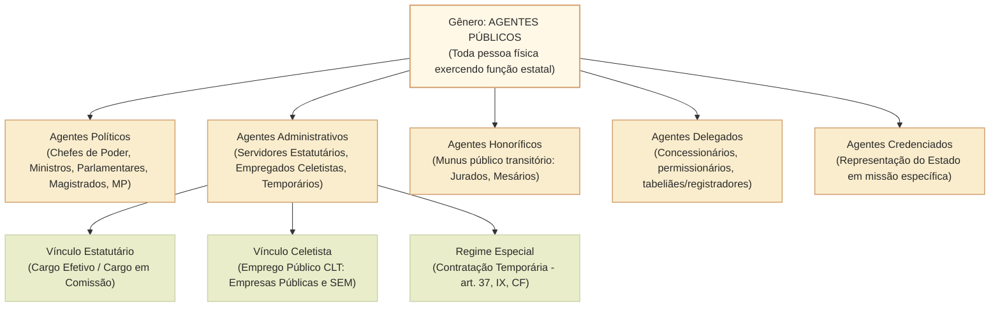
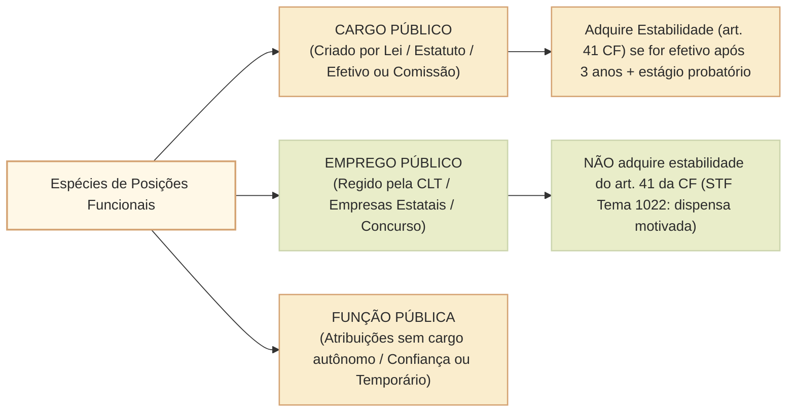

# Agentes públicos: espécies, cargos, empregos, funções e regimes de vinculação estatal

A expressão **agente público** constitui a mais ampla categoria jurídica do direito administrativo para designar toda e qualquer pessoa física que exerça, ainda que transitoriamente ou sem remuneração, por eleição, nomeação, designação, contratação ou qualquer outra forma de investidura ou vínculo, mandato, cargo, emprego ou função nas entidades da Administração Pública direta e indireta ou em órgãos dos Poderes do Estado (conceito positivado expressamente no art. 2º da Lei nº 8.429/1992 e no art. 327 do Código Penal).

Para a compreensão dogmática e o enfrentamento de questões do Cebraspe, é indispensável dominar:
1. As **classificações doutrinárias** consagradas (destacando-se a taxonomia clássica de Hely Lopes Meirelles e a moderna de Maria Sylvia Zanella Di Pietro);
2. A distinção conceitual precisa entre **cargo público**, **emprego público** e **função pública**;
3. As espécies de cargos e funções (cargo efetivo, cargo em comissão e função de confiança - art. 37, V, da CF/1988);
4. O regime dos **servidores temporários** (art. 37, IX, da CF/1988 e Lei nº 8.745/1993);
5. As regras constitucionais de **acesso por concurso público** e o regime de **estabilidade** (art. 41 da CF/1988), contrastado com a dispensa motivada dos empregados públicos de empresas estatais (Tema 1022 do STF).

---

## 1. Classificações Doutrinárias de Agentes Públicos

A doutrina não adota uma classificação única e universal. Nas provas do Cebraspe, a taxonomia de **Hely Lopes Meirelles** é a mais cobrada quando se referem às "cinco espécies", ao passo que a formulação de **Maria Sylvia Zanella Di Pietro** é invocada quando se contrapõem "servidores públicos" a "particulares em colaboração".

### 1.1. Classificação Clássica de Hely Lopes Meirelles
1. **Agentes Políticos:** componentes dos escalões superiores da Administração e dos Poderes do Estado. Não mantêm vínculo profissional/hierárquico comum, mas vínculo de natureza política e constitucional direta:
   - *Titulares de mandato eletivo:* Presidente, Governadores, Prefeitos, Senadores, Deputados e Vereadores.
   - *Auxiliares imediatos do Executivo:* Ministros de Estado e Secretários Estaduais/Municipais.
   - *Membros de órgãos constitucionais autônomos:* Magistrados, membros do Ministério Público (MP), Conselheiros e Ministros dos Tribunais de Contas.
2. **Agentes Administrativos:** pessoas físicas que mantêm relação de trabalho profissional e remunerada com a Administração Pública direta, autárquica e fundacional, ou com entidades paraestatais, sujeitas a hierarquia administrativa e regime jurídico funcional:
   - *Servidores públicos estatutários:* ocupantes de cargos públicos efetivos ou em comissão.
   - *Empregados públicos:* contratados sob o regime da CLT (empresas públicas e sociedades de economia mista).
   - *Servidores temporários:* contratados por prazo determinado sob regime jurídico-administrativo especial (art. 37, IX, CF).
3. **Agentes Honoríficos:** cidadãos convocados, nomeados ou designados para prestar serviços específicos ao Estado em razão de um *munus* público ou dever cívico de colaboração.
   - Não mantêm vínculo profissional permanente nem recebem, como regra geral, retribuição salarial pública ordinária (ex.: jurados do Tribunal do Júri, mesários eleitorais, membros de comissões de juristas honorários).
4. **Agentes Delegados:** particulares que recebem da Administração a incumbência da execução de determinado serviço público ou atividade estatal em nome próprio, por sua conta e risco, sob fiscalização permanente do Poder Concedente:
   - Concessionários e permissionários de serviços públicos (Lei nº 8.987/1995);
   - Titulares de serviços notariais e de registro (cartorários e tabeliães - art. 236 da CF/1988);
   - Leiloeiros públicos e tradutores públicos juramentados.
5. **Agentes Credenciados:** particulares que recebem autorização para representar a Administração Pública em determinado evento, atividade, missão protocolar ou ato internacional específico (ex.: cientista ou diplomata ad hoc credenciado para representar o país em comissão temática no exterior).

### 1.2. Classificação de Maria Sylvia Di Pietro
Di Pietro agrupa os agentes em quatro grandes grupos:
- **Agentes políticos;**
- **Servidores públicos** (divididos em estatutários, empregados públicos e temporários);
- **Militares** (art. 42 e 142 da CF/1988);
- **Particulares em colaboração com o Poder Público** (abrangendo os que colaboram por delegação - concessionários; por requisição/dever cívico - jurados/mesários; por voluntariado; e por credenciamento).

---

## 2. Distinção Estrutural: Cargo Público versus Emprego Público versus Função Pública

Uma das áreas mais férteis para distratores da banca consiste em confundir os conceitos de **cargo**, **emprego** e **função**:

| Categoria | Conceito Dogmático | Regime Jurídico | Natureza do Vínculo | Hipótese de Ocorrência |
| :--- | :--- | :--- | :--- | :--- |
| **Cargo Público** | Lugar instituído na organização do serviço público, **criado por lei**, em número determinado e com denominação própria, com conjunto de atribuições e estipêndio pago pelos cofres públicos. | **Estatutário** (disciplinado por estatuto legal, e.g., Lei nº 8.112/1990). | Vínculo de direito público; não há contrato de trabalho; alteração unilateral de regime por lei. | Administração Direta, Autarquias e Fundações Públicas de direito público. |
| **Emprego Público** | Unidade de atribuições e tarefas desempenhadas por trabalhador sob vínculo contratual regido predominantemente pelo direito do trabalho comum. | **Trabalhista / Celetista** (regido pela CLT - Consolidação das Leis do Trabalho). | Vínculo contratual trabalhista bilateral, com recolhimento obrigatório de FGTS. | Empresas Públicas, Sociedades de Economia Mista e suas subsidiárias (art. 173, § 1º, II, CF). |
| **Função Pública** | Conjunto de atribuições materiais e responsabilidades conferidas ao agente. Toda posição estatal envolve função, mas **pode existir função sem cargo e sem emprego**. | Estatutário ou especial de direito público. | Vínculo especial de chefia transitória ou contratação emergencial. | 1. **Função de Confiança** (art. 37, V); 2. **Contratação Temporária** (art. 37, IX); 3. Funções transitórias de mesa diretora/comissões. |

---

## 3. O Confronto Constitucional: Cargo Efetivo, Cargo em Comissão e Função de Confiança

O art. 37, inciso V, da Constituição Federal estabelece uma distinção rigorosa de enquadramento funcional:
> *"As funções de confiança, exercidas **exclusivamente por servidores ocupantes de cargo efetivo**, e os cargos em comissão, a serem preenchidos por servidores de carreira nos casos, condições e percentuais mínimos previstos em lei, destinam-se **apenas às atribuições de direção, chefia e assessoramento**."*

### 3.1. Quadro Comparativo: Cargo em Comissão versus Função de Confiança

| Critério | Cargo em Comissão | Função de Confiança |
| :--- | :--- | :--- |
| **Destinação material** | **Apenas** direção, chefia e assessoramento. | **Apenas** direção, chefia e assessoramento. |
| **Quem pode ocupar?** | Servidor de carreira **ou pessoa de fora** (sem vínculo efetivo), respeitados os percentuais mínimos de lei para servidores de carreira. | **Exclusivamente servidor titular de cargo efetivo**. |
| **Forma de provimento** | Nomeação para cargo em comissão (livre nomeação e livre exoneração - *ad nutum*). | Designação para função de confiança (dispensa *ad nutum*). |
| **Vínculo previdenciário** | Se não for efetivo: Regime Geral de Previdência Social (RGPS/INSS - art. 40, § 13, CF). | Mantém o Regime Próprio de Previdência Social (RPPS) do cargo efetivo. |
| **Criação de atribuições burocráticas ordinárias** | **Inconstitucional** (vedada pelo STF - Tema 1010 de Repercussão Geral). | **Inconstitucional** se criada para tarefas operacionais cotidianas. |

> [!WARNING]
> **Tese do STF sobre Cargos em Comissão (Tema 1010):** A criação de cargos em comissão somente se justifica para o exercício de funções de direção, chefia e assessoramento, **sendo inconstitucional a criação de cargos comissionados para atividades técnicas, operacionais, burocráticas ou rotineiras**, que devem ser desempenhadas obrigatoriamente por servidores de cargo efetivo aprovados em concurso público.

---

## 4. Servidores Temporários (Art. 37, IX, da CF/1988)

A Constituição autoriza que a lei estabeleça os casos de contratação por tempo determinado para atender a **necessidade temporária de excepcional interesse público**:
- **Regime Jurídico:** trata-se de regime **jurídico-administrativo especial**, e não de relação de emprego regida pela CLT nem de provimento de cargo efetivo estatutário. A competência jurisdicional para dirimir controvérsias decorrentes dessa contratação perante a União é da **Justiça Federal**, e não da Justiça do Trabalho (ADI 3.395/DF do STF).
- **Pressupostos cumulativos de validade (STF - Tema 612):**
  1. Previsão em lei formal das hipóteses taxativas de contratação;
  2. Determinação temporal do contrato (vedada prorrogação indefinida que burle o concurso);
  3. Caráter temporário da necessidade pública;
  4. Excepcionalidade do interesse público (calamidade pública, emergência sanitária, recenseamento demográfico, combate a endemias, etc.);
  5. Indispensabilidade da contratação imediata para a continuidade do serviço.
- **Processo Seletivo Simplificado:** no plano federal, a Lei nº 8.745/1993 exige a realização de **processo seletivo simplificado sujeito a ampla divulgação** (com análise curricular ou provas), dispensando-se o processo seletivo apenas em hipóteses estritas de calamidade pública formalmente decretada ou emergência militar.

---

## 5. Concurso Público e Estabilidade (Art. 37, II, e Art. 41 da CF/1988)

### 5.1. A regra de concurso público
- A investidura originária em **cargo de provimento efetivo** ou em **emprego público** depende obrigatoriamente de prévia aprovação em concurso público de provas ou de provas e títulos.
- **Prazo de validade do concurso:** até **dois anos**, prorrogável uma única vez por igual período (art. 37, III, CF).
- **Direito subjetivo à nomeação:** o candidato aprovado dentro do número de vagas previsto originariamente no edital tem **direito subjetivo à nomeação**, salvo situações excepcionais supervenientes que preencham os requisitos fixados pelo STF no RE 598.099 (superveniência, imprevisibilidade, gravidade e necessidade motivada).

### 5.2. O Regime de Estabilidade Constitucional (Art. 41)
A estabilidade no serviço público é direito outorgado ao servidor público civil estatutário, desde que preenchidos **dois requisitos cumulativos**:
1. **Nomeação para cargo de provimento efetivo em virtude de concurso público;**
2. **Cumprimento de 3 (três) anos de efetivo exercício;**
3. **Aprovação obrigatória em avaliação especial de desempenho** por comissão constituída para essa finalidade (art. 41, § 4º, CF).

O servidor público estável só perderá o cargo nas seguintes hipóteses taxativas:
1. Em virtude de **sentença judicial transitada em julgado**;
2. Mediante **processo administrativo disciplinar (PAD)** no qual lhe seja assegurada ampla defesa;
3. Mediante procedimento de **avaliação periódica de desempenho**, na forma de lei complementar, assegurada ampla defesa;
4. Para **adequação dos limites de gastos com pessoal** (art. 169 da CF/1988), após exoneração prévia de comissionados e redução de 20% das despesas com cargos em comissão.

### 5.3. A Situação dos Empregados Públicos de Empresas Estatais
- Os empregados públicos concursados de empresas públicas e sociedades de economia mista (como Petrobras, Banco do Brasil, Caixa Econômica Federal e Correios) **NÃO gozam da estabilidade do art. 41 da CF/1988** (Súmula 390, II, do TST).
- **A Tese do STF no Tema 1022 (RE 688.267 - fixada em 2024):** As empresas públicas e sociedades de economia mista, mesmo exploradoras de atividade econômica em regime de concorrência, **têm o dever de motivar formalmente o ato de demissão de seus empregados admitidos por concurso público**. Não se exige a instauração prévia de PAD idêntico ao do servidor estável nem justa causa da CLT estrita, mas é vedada a demissão arbitrária e imotivada, exigindo-se fundamentação com base em critérios objetivos de conveniência técnica, financeira, disciplinar ou operacional.

---

## Questões Comentadas (Estilo Cebraspe)

### Questão 1
*(Inédita: estilo Cebraspe / Câmara dos Deputados – Analista Legislativo)*  
Acerca das normas constitucionais incidentes sobre os cargos em comissão e funções de confiança, julgue o item a seguir.

> De acordo com o art. 37, V, da Constituição Federal, as funções de confiança destinam-se exclusivamente às atribuições de direção, chefia e assessoramento, devendo ser exercidas obrigatoriamente por servidores ocupantes de cargo efetivo, ao passo que os cargos em comissão, destinados às mesmas atribuições, podem ser preenchidos por pessoas sem vínculo efetivo com a Administração, observados os percentuais mínimos reservados a servidores de carreira fixados em lei.

**( ) Certo**  
**( ) Errado**

> **Gabarito: Certo**  
> **Comentário:** O item sintetiza perfeitamente o texto e a disciplina do art. 37, V, da CF/1988. Tanto as funções de confiança quanto os cargos em comissão possuem a mesma destinação teleológica constitucional restrita (direção, chefia e assessoramento). A diferença crucial e definidora reside no fato de que a função de confiança exige titularidade prévia de cargo efetivo, enquanto o cargo em comissão admite o provimento de profissionais externos à carreira pública, respeitadas as cotas legais mínimas reservadas aos servidores efetivos.

---

### Questão 2
*(Inédita: estilo Cebraspe / Câmara dos Deputados – Analista Legislativo)*  
No que concerne à classificação doutrinária dos agentes públicos e à categoria dos agentes honoríficos, julgue o item subsequente.

> Os jurados que compõem o Conselho de Sentença do Tribunal do Júri e os cidadãos designados para a função de mesários nas mesas receptoras de votos da Justiça Eleitoral enquadram-se na espécie dos agentes delegados, haja vista que a eles é outorgada temporariamente a execução de atividade estatal típica mediante remuneração indenizatória custeada pelos cofres públicos.

**( ) Certo**  
**( ) Errado**

> **Gabarito: Errado**  
> **Comentário:** Jurados e mesários eleitorais classificam-se dogmaticamente como **agentes honoríficos** (e não agentes delegados). Os agentes honoríficos prestam serviços transitórios ao Estado convocados em virtude de dever cívico ou *munus* público, sem manter relação estatutária profissional ou vínculo remuneratório com a Administração. Os agentes delegados, por outro lado, são particulares que recebem a execução de serviços públicos por concessão, permissão ou delegação notarial/registral para explorá-los por sua conta e risco.

---

### Questão 3
*(Inédita: estilo Cebraspe / Câmara dos Deputados – Analista Legislativo)*  
Julgue o item que se segue, relativo à jurisprudência do Supremo Tribunal Federal sobre a demissão de empregados de empresas públicas e sociedades de economia mista.

> O candidato aprovado em concurso público e contratado sob o regime da CLT por sociedade de economia mista adquire a estabilidade constitucional prevista no art. 41 da Constituição Federal após três anos de efetivo exercício, razão pela qual sua despedida somente pode ocorrer mediante sentença judicial transitada em julgado ou processo administrativo disciplinar formal.

**( ) Certo**  
**( ) Errado**

> **Gabarito: Errado**  
> **Comentário:** A estabilidade assegurada pelo art. 41 da CF/1988 é restrita aos servidores titulares de **cargo de provimento efetivo** da Administração direta, autárquica e fundacional de direito público. Os empregados celetistas de empresas públicas e sociedades de economia mista não gozam dessa garantia constitucional de estabilidade (Súmula 390, II, do TST). Contudo, segundo tese recentemente firmada pelo STF no Tema 1022 (RE 688.267), a despedida do empregado público concursado exige **motivação formal e justificada** em razões objetivas (operacionais, disciplinares ou financeiras), sendo vedada a resilição imotivada arbitrária, sem que isso implique equiparação à estabilidade do art. 41.

---

### Questão 4
*(Inédita: estilo Cebraspe / Câmara dos Deputados – Analista Legislativo)*  
A respeito da contratação de servidores temporários fundada no art. 37, IX, da CF/1988, julgue o item.

> As contratações temporárias voltadas a atender a necessidade transitória de excepcional interesse público submetem-se ao regime da Consolidação das Leis do Trabalho (CLT), competindo com exclusividade à Justiça do Trabalho processar e julgar as demandas decorrentes do inadimplemento de verbas rescisórias devidas pela União a tais contratados.

**( ) Certo**  
**( ) Errado**

> **Gabarito: Errado**  
> **Comentário:** A relação jurídica estabelecida entre o Poder Público e os servidores contratados por tempo determinado com base no art. 37, IX, da CF/1988 e leis específicas (como a Lei nº 8.745/1993) é de natureza **jurídico-administrativa especial**, não se confundindo com o contrato de trabalho celetista. Conforme decisão vinculante proferida pelo STF na ADI 3.395/DF, a competência para processar e julgar causas instauradas entre o Poder Público federal e os servidores temporários é da **Justiça Federal (Justiça Comum)**, e não da Justiça do Trabalho.

---

### Questão 5
*(Inédita: estilo Cebraspe / Câmara dos Deputados – Analista Legislativo)*  
Julgue o item a seguir, relativo à criação de cargos em comissão segundo a jurisprudência vinculante do Supremo Tribunal Federal.

> É constitucionalmente legítima a edição de lei que institua cargos de provimento em comissão voltados ao desempenho exclusivo de funções técnicas de suporte de informática e atividades rotineiras de arquivo, desde que a norma estabeleça que cinquenta por cento dessas vagas sejam ocupadas por servidores concursados.

**( ) Certo**  
**( ) Errado**

> **Gabarito: Errado**  
> **Comentário:** O STF fixou tese de repercussão geral (Tema 1010) declarando expressamente a **inconstitucionalidade da criação de cargos em comissão para o desempenho de atribuições técnicas, operacionais, burocráticas ou rotineiras**. Os cargos em comissão destinam-se exclusivamente às funções de direção, chefia e assessoramento. A mera previsão de reserva percentual para servidores de carreira não supre a inconstitucionalidade material decorrente da violação à exigência constitucional de concurso público para tarefas permanentes de suporte técnico e administrativo.

---

### Questão 6
*(Inédita: estilo Cebraspe / Câmara dos Deputados – Analista Legislativo)*  
No que tange aos requisitos constitucionais da estabilidade no serviço público, julgue o item subsequente.

> O transcurso do prazo de três anos de efetivo exercício assegura ao servidor público nomeado para cargo efetivo em virtude de concurso público a aquisição automática da estabilidade, tornando dispensável a homologação de avaliação especial de desempenho caso a comissão competente não tenha sido instalada pela Administração Pública no período.

**( ) Certo**  
**( ) Errado**

> **Gabarito: Errado**  
> **Comentário:** Consoante preceitua taxativamente o art. 41, § 4º, da Constituição Federal, *"como condição para a aquisição da estabilidade, é **obrigatória** a avaliação especial de desempenho por comissão instituída para essa finalidade"*. A estabilidade não se adquire de modo automático por mera inércia administrativa ou decurso isolado do prazo temporal de 3 anos; a avaliação formal por comissão especial constitui requisito constitucional de eficácia plena e vinculante.

---

## Relações com outros temas

- [[3 - Materias/Direito Administrativo/02 - organizacao administrativa|Organização administrativa]]: Administração Direta, Autarquias, Fundações, Empresas Públicas e Sociedades de Economia Mista e seus regimes de pessoal.
- [[3 - Materias/Direito Administrativo/03 - atos administrativos|Elementos do ato administrativo]]: o agente competente como sujeito de emanação e a Teoria do Órgão.
- [[3 - Materias/Direito Administrativo/06 - responsabilidade civil do estado|Responsabilidade civil do Estado]]: a atuação do agente público e a ação de regresso por dolo ou culpa (art. 37, § 6º, CF).
- [[3 - Materias/Direito Constitucional/02 - direitos e garantias fundamentais|Direitos e garantias fundamentais]]: concurso público, isonomia de acesso e devido processo legal.

## Fontes normativas e jurisprudenciais

- **Constituição Federal de 1988:** art. 37, incisos I, II, V e IX; art. 41 (estabilidade e perda de cargo); art. 173, § 1º, II (regime trabalhista das estatais).
- **Lei nº 8.112/1990:** Regime Jurídico Único dos Servidores Públicos Civis da União.
- **Lei nº 8.745/1993:** Regime de contratação temporária no âmbito da Administração Federal.
- **Supremo Tribunal Federal:**
  - **Tema 1010 de Repercussão Geral:** inconstitucionalidade de cargos em comissão para atividades técnicas e operacionais.
  - **Tema 1022 (RE 688.267):** dever de motivação da dispensa de empregados públicos de empresas estatais admitidos por concurso público.
  - **Tema 612:** requisitos cumulativos da contratação temporária do art. 37, IX, da CF/1988.
  - **ADI 3.395/DF:** competência da Justiça Comum (Federal/Estadual) para causas decorrentes do vínculo estatutário e de contratação temporária.
- **Doutrina:** Hely Lopes Meirelles (*cinco espécies de agentes*); Maria Sylvia Zanella Di Pietro (*particulares em colaboração e servidores públicos*).
