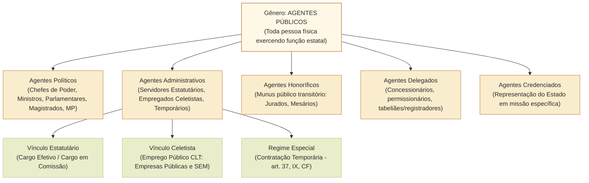
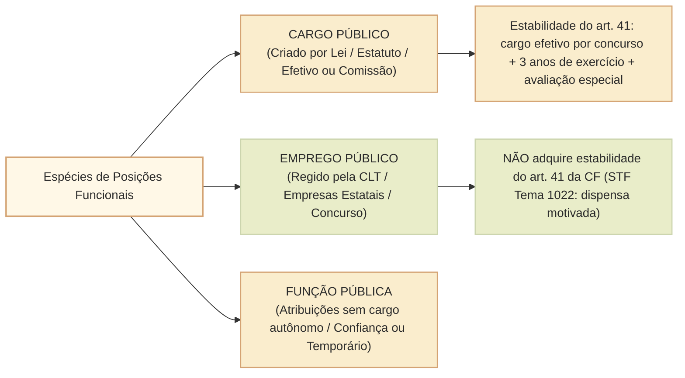

# Agentes públicos: espécies, cargos, empregos, funções e regimes de vinculação estatal

Imagine uma campanha institucional da Câmara: o deputado que define a prioridade política, a servidora concursada que executa o trabalho, a pessoa nomeada para assessoramento e o mesário convocado pela Justiça Eleitoral exercem funções públicas, mas seus vínculos são diferentes. **Agente público** é a categoria ampla que permite estudar essas situações sem confundir vínculo, cargo e função.

A **Lei nº 8.429/1992**, chamada Lei de Improbidade Administrativa, define quem pode responder por atos dolosos de improbidade contra a Administração. Seu art. 2º considera agente público, para os fins dessa lei, quem exerce mandato, cargo, emprego ou função, mesmo temporariamente ou sem remuneração. Já o **Código Penal (Decreto-Lei nº 2.848/1940)**, que define crimes e penas, usa no art. 327 um conceito próprio de funcionário público para identificar quem pode cometer determinados crimes funcionais. Portanto, a mesma pessoa pode ser enquadrada segundo conceitos com finalidades diferentes. Em questões Cebraspe, verifique se a pergunta trata da Constituição, da Lei de Improbidade, do Código Penal ou de uma classificação doutrinária.

Neste artigo, a sequência é: classificação das pessoas que exercem função estatal; diferença entre **cargo**, **emprego** e **função**; regras de comissão e confiança; contratação temporária; concurso e estabilidade. A classificação de Hely Lopes Meirelles em cinco grupos e a de Maria Sylvia Zanella Di Pietro são **doutrinárias**, não listas fechadas impostas pela Constituição.

---

## 1. Classificações Doutrinárias de Agentes Públicos

Uma **classificação doutrinária** é uma maneira de organizar os conceitos proposta por estudiosos do Direito. Ela ajuda a comparar situações, mas não equivale, por si só, a uma lista obrigatória da Constituição ou de uma lei. Neste tópico, o ponto de atenção é identificar **qual autor** a questão adota antes de classificar um agente.

O diagrama acima representa os cinco grupos usados por **Hely Lopes Meirelles**. É uma classificação doutrinária: serve para organizar os diversos modos de atuação em nome do Estado, mas não é uma lista constitucional fechada. **Maria Sylvia Zanella Di Pietro** usa outra organização. Por isso, ao classificar magistrados e membros do Ministério Público como agentes políticos, considere o autor e o critério adotado pela questão.

### 1.1. Classificação Clássica de Hely Lopes Meirelles
1. **Agentes Políticos:** componentes dos escalões superiores da Administração e dos Poderes do Estado. Não mantêm vínculo profissional/hierárquico comum, mas vínculo de natureza política e constitucional direta:
   - *Titulares de mandato eletivo:* Presidente, Governadores, Prefeitos, Senadores, Deputados e Vereadores.
   - *Auxiliares imediatos do Executivo:* Ministros de Estado e Secretários Estaduais/Municipais.
   - *Membros de órgãos constitucionais autônomos:* Magistrados, membros do Ministério Público (MP), Conselheiros e Ministros dos Tribunais de Contas.
2. **Agentes Administrativos:** pessoas físicas que mantêm relação de trabalho profissional e remunerada com a Administração Pública direta, autárquica e fundacional, ou com entidades paraestatais, sujeitas a hierarquia administrativa e regime jurídico funcional:
   - *Servidores públicos estatutários:* ocupantes de cargos públicos efetivos ou em comissão.
   - *Empregados públicos:* contratados sob o regime da CLT (empresas públicas e sociedades de economia mista).
   - *Servidores temporários:* contratados por prazo determinado sob regime jurídico-administrativo especial (art. 37, IX, CF).
3. **Agentes Honoríficos:** cidadãos convocados, nomeados ou designados para prestar serviços específicos ao Estado em razão de um *munus* público ou dever cívico de colaboração.
   - Não mantêm vínculo profissional permanente nem recebem, como regra geral, retribuição salarial pública ordinária (ex.: jurados do Tribunal do Júri, mesários eleitorais, membros de comissões de juristas honorários).
4. **Agentes Delegados:** particulares que recebem da Administração a incumbência da execução de determinado serviço público ou atividade estatal em nome próprio, por sua conta e risco, sob fiscalização permanente do Poder Concedente:
   - Concessionários e permissionários de serviços públicos (Lei nº 8.987/1995);
   - Titulares de serviços notariais e de registro (cartorários e tabeliães - art. 236 da CF/1988);
   - Leiloeiros públicos e tradutores públicos juramentados.
5. **Agentes Credenciados:** particulares que recebem autorização para representar a Administração Pública em determinado evento, atividade, missão protocolar ou ato internacional específico (ex.: cientista ou diplomata ad hoc credenciado para representar o país em comissão temática no exterior).

### 1.2. Classificação de Maria Sylvia Di Pietro
Di Pietro agrupa os agentes em quatro grandes grupos:
- **Agentes políticos;**
- **Servidores públicos** (divididos em estatutários, empregados públicos e temporários);
- **Militares** (art. 42 e 142 da CF/1988);
- **Particulares em colaboração com o Poder Público** (abrangendo os que colaboram por delegação - concessionários; por requisição/dever cívico - jurados/mesários; por voluntariado; e por credenciamento).

---

## 2. Distinção Estrutural: Cargo Público versus Emprego Público versus Função Pública

Considere três pessoas na Câmara e em uma empresa estatal: uma analista concursada ocupa um **cargo efetivo**; uma trabalhadora da estatal contratada pela Consolidação das Leis do Trabalho (CLT) ocupa um **emprego público**; e a analista pode, além do seu cargo, exercer uma **função de confiança** de chefia. A primeira pergunta é qual é o vínculo da pessoa com o Estado; a segunda, quais atribuições ela exerce. São perguntas diferentes.

A **Lei nº 8.112/1990** regula o vínculo estatutário dos servidores civis federais abrangidos por ela. Seu art. 3º define cargo público como um conjunto de atribuições e responsabilidades, criado por lei, com denominação própria e vencimento pago pelos cofres públicos, para provimento efetivo ou em comissão. A CLT, por sua vez, disciplina os contratos de emprego, inclusive os de empregados de empresas estatais. Compare:

| Categoria | Conceito Dogmático | Regime Jurídico | Natureza do Vínculo | Hipótese de Ocorrência |
| :--- | :--- | :--- | :--- | :--- |
| **Cargo Público** | Lugar instituído na organização do serviço público, **criado por lei**, em número determinado e com denominação própria, com conjunto de atribuições e estipêndio pago pelos cofres públicos. | **Estatutário** no regime federal atualmente aplicável aos cargos efetivos (Lei nº 8.112/1990). A Constituição não impede, em abstrato, regimes distintos para vínculos distintos, observadas as leis e a jurisprudência. | Vínculo de direito público; não há contrato de trabalho; alteração unilateral de regime por lei. | Administração Direta, Autarquias e Fundações Públicas de direito público. |
| **Emprego Público** | Unidade de atribuições e tarefas desempenhadas por trabalhador sob vínculo contratual regido predominantemente pelo direito do trabalho comum. | **Trabalhista / Celetista** (regido pela CLT - Consolidação das Leis do Trabalho). | Vínculo contratual trabalhista bilateral, com recolhimento obrigatório de FGTS. | Empresas Públicas, Sociedades de Economia Mista e suas subsidiárias (art. 173, § 1º, II, CF). |
| **Função Pública** | Conjunto de atribuições e responsabilidades exercidas em nome do poder público. **Pode existir função sem cargo efetivo ou emprego público**. | Varia conforme o vínculo: função de confiança exercida por servidor efetivo, contratação temporária sob regime especial ou colaboração transitória. | **Não é, por si só, uma terceira espécie uniforme de vínculo**: é preciso identificar quem exerce a função e sob qual fundamento. | Função de confiança (art. 37, V); contratação temporária (art. 37, IX); atuação transitória de jurados e mesários. |

---

## 3. O Confronto Constitucional: Cargo Efetivo, Cargo em Comissão e Função de Confiança

O art. 37, inciso V, da Constituição Federal permite cargos em comissão e funções de confiança **apenas para direção, chefia e assessoramento**. Imagine a coordenação de uma equipe: ela pode ser exercida por pessoa designada para função de confiança, se já titular de cargo efetivo, ou por pessoa nomeada para cargo em comissão, respeitada a reserva legal aos servidores de carreira. A função de confiança acrescenta atribuições ao cargo efetivo já ocupado; o cargo em comissão é um cargo próprio e pode ser ocupado por pessoa externa. O dispositivo constitucional estabelece:
> *"As funções de confiança, exercidas **exclusivamente por servidores ocupantes de cargo efetivo**, e os cargos em comissão, a serem preenchidos por servidores de carreira nos casos, condições e percentuais mínimos previstos em lei, destinam-se **apenas às atribuições de direção, chefia e assessoramento**."*

### 3.1. Quadro Comparativo: Cargo em Comissão versus Função de Confiança

| Critério | Cargo em Comissão | Função de Confiança |
| :--- | :--- | :--- |
| **Destinação material** | **Apenas** direção, chefia e assessoramento. | **Apenas** direção, chefia e assessoramento. |
| **Quem pode ocupar?** | Servidor de carreira **ou pessoa de fora** (sem vínculo efetivo), respeitados os percentuais mínimos de lei para servidores de carreira. | **Exclusivamente servidor titular de cargo efetivo**. |
| **Forma de provimento** | Nomeação para cargo em comissão (livre nomeação e livre exoneração - *ad nutum*). | Designação para função de confiança (dispensa *ad nutum*). |
| **Vínculo previdenciário** | Se não for efetivo: Regime Geral de Previdência Social (RGPS/INSS - art. 40, § 13, CF). | Mantém o Regime Próprio de Previdência Social (RPPS) do cargo efetivo, quando o titular estiver vinculado a esse regime. |
| **Criação de atribuições burocráticas ordinárias** | **Inconstitucional** (vedada pelo STF - Tema 1010 de Repercussão Geral). | **Inconstitucional** se criada para tarefas operacionais cotidianas. |

> [!WARNING]
> **STF, Tema 1010 (RE 1.041.210):** é inválida a criação de cargos comissionados para tarefas apenas burocráticas, técnicas ou operacionais. A tese também exige **relação real de confiança**, **proporcionalidade** entre quantidade de cargos comissionados, necessidades do órgão e servidores efetivos, além de **atribuições claras na lei que cria os cargos**. Exemplo: chamar de “assessor” um posto dedicado exclusivamente a arquivar documentos não muda sua natureza técnica.

---

## 4. Servidores Temporários (Art. 37, IX, da CF/1988)

Uma epidemia pode exigir profissionais por tempo limitado, antes que a Administração consiga suprir a necessidade pelo quadro permanente. O art. 37, IX, da Constituição permite contratação por prazo determinado quando uma **lei identifica hipóteses de necessidade temporária de excepcional interesse público**. Contrato temporário não equivale a nomeação para cargo efetivo nem assegura, por si, a estabilidade constitucional.

A **Lei nº 8.745/1993** regula essas contratações no âmbito da Administração federal. Seu art. 2º descreve situações legalmente admitidas; o art. 3º estabelece, como regra, **processo seletivo simplificado com ampla divulgação**, dispensando o concurso público tradicional. Seu § 1º dispensa o próprio processo seletivo em hipóteses específicas, como risco iminente à saúde animal, vegetal ou humana, calamidade pública e emergências ambiental, fitossanitária, zoossanitária ou de saúde pública. **Dispensar a seleção não dispensa os requisitos constitucionais nem a fundamentação da necessidade.** A lei federal não regulamenta automaticamente as contratações de estados e municípios, sujeitos às normas próprias e à Constituição.

O STF, no **Tema 612 (RE 658.026)**, exige conjuntamente cinco condições: **hipótese excepcional prevista em lei**, **prazo previamente definido**, **necessidade temporária**, **interesse público excepcional** e **indispensabilidade da contratação**. É vedado usar contratações temporárias para suprir serviços ordinários permanentes que pertençam às contingências normais da Administração. A duração limitada do contrato, sozinha, não transforma uma necessidade permanente em temporária.

O vínculo é **jurídico-administrativo especial**. Em controvérsias decorrentes dessa relação com a União, a competência é, em regra, da Justiça Federal comum, não da Justiça do Trabalho; nos demais entes, é, em regra, da Justiça comum estadual, considerada a natureza da relação discutida (STF, ADI 3.395/DF).

**Teste de fronteira:** contratar uma equipe por prazo determinado para enfrentar uma emergência sanitária efetiva pode atender ao art. 37, IX. Renovar contratos temporários indefinidamente para tarefas normais e permanentes de um órgão tende a contrariar o Tema 612, ainda que cada contrato individual tenha uma data de término.
---

## 5. Concurso Público e Estabilidade (Art. 37, II, e Art. 41 da CF/1988)

### 5.1. A regra de concurso público
- A investidura originária em **cargo de provimento efetivo** ou em **emprego público** depende obrigatoriamente de prévia aprovação em concurso público de provas ou de provas e títulos.
- **Prazo de validade do concurso:** até **dois anos**, prorrogável uma única vez por igual período (art. 37, III, CF).
- **Direito à nomeação:** quem é aprovado **dentro das vagas anunciadas** tem, em regra, direito subjetivo à nomeação durante o prazo de validade do concurso (STF, Tema 161, RE 598.099). Para deixar de nomear, a Administração deve demonstrar situação excepcional superveniente, imprevisível, grave, sem alternativa menos restritiva, e motivar a decisão. A pessoa aprovada fora das vagas tem, em regra, expectativa de direito, mas pode adquirir direito à nomeação em situações reconhecidas pela jurisprudência, como preterição arbitrária e imotivada na ordem de classificação. Não confundir aprovação com posse imediata.

### 5.2. O Regime de Estabilidade Constitucional (Art. 41)
A estabilidade constitucional depende de **três requisitos cumulativos** para o servidor nomeado para cargo efetivo:
1. **Nomeação para cargo de provimento efetivo em virtude de concurso público;**
2. **Cumprimento de 3 (três) anos de efetivo exercício;**
3. **Aprovação obrigatória em avaliação especial de desempenho** por comissão constituída para essa finalidade (art. 41, § 4º, CF).

O servidor público estável só perderá o cargo nas seguintes hipóteses taxativas:
1. Em virtude de **sentença judicial transitada em julgado**;
2. Mediante **processo administrativo disciplinar (PAD)** no qual lhe seja assegurada ampla defesa;
3. Mediante procedimento de **avaliação periódica de desempenho**, na forma de lei complementar, assegurada ampla defesa;
4. Para **adequação aos limites de gastos com pessoal** (art. 169, §§ 3º a 6º, da CF/1988): primeiro, reduzir em pelo menos 20% as despesas com cargos em comissão e funções de confiança e exonerar servidores não estáveis. Se as medidas forem insuficientes, servidor estável poderá perder o cargo mediante ato normativo motivado que especifique a atividade e a unidade atingidas. Há indenização de **um mês de remuneração por ano de serviço**; o cargo é extinto, vedada a criação de cargo, emprego ou função com atribuições iguais ou semelhantes por **quatro anos**.

### 5.3. A Situação dos Empregados Públicos de Empresas Estatais
- Os empregados públicos concursados de empresas públicas e sociedades de economia mista (como Petrobras, Banco do Brasil, Caixa Econômica Federal e Correios) **NÃO gozam da estabilidade do art. 41 da CF/1988** (Súmula 390, II, do TST).
- **STF, Tema 1022 (RE 688.267, tese fixada em 2024):** tanto empresas públicas quanto sociedades de economia mista, mesmo se competem no mercado, devem informar **em ato formal um fundamento razoável** para dispensar empregado admitido por concurso. A tese **não exige processo administrativo prévio** nem enquadramento nas hipóteses de justa causa da CLT. Exemplo: a estatal registra a razão financeira ou operacional da dispensa, que poderá ser controlada judicialmente. A necessidade de motivação **não cria estabilidade** do art. 41.

### Exemplo integrado: qual vínculo existe?

Uma servidora aprovada em concurso e nomeada para cargo efetivo da Câmara pode exercer função de confiança de chefia: conserva seu cargo efetivo e assume atribuições adicionais. Uma pessoa sem cargo efetivo pode ser nomeada para cargo em comissão de assessoramento, respeitados os requisitos legais, mas **não** pode exercer função de confiança reservada a ocupantes de cargo efetivo. Um contratado temporário para necessidade excepcional não se torna titular de cargo efetivo apenas porque exerce uma função pública. O vínculo e a finalidade da contratação, e não o nome informal usado no setor, determinam a regra aplicável.

Os conceitos legais de agente público também podem ser consultados na [Lei nº 8.429/1992, art. 2º](https://www2.camara.leg.br/legin/fed/lei/1992/lei-8429-2-junho-1992-357452-normaatualizada-pl.html) e no [Código Penal, art. 327](https://www.planalto.gov.br/ccivil_03/decreto-lei/del2848compilado.htm). As classificações de autores são doutrinárias; concurso, nomeação e estabilidade dependem da Constituição e das leis específicas.

---

## Questões Comentadas (Estilo Cebraspe)

### Questão 1
*(Inédita: estilo Cebraspe / Câmara dos Deputados – Analista Legislativo)*  
Acerca das normas constitucionais incidentes sobre os cargos em comissão e funções de confiança, julgue o item a seguir.

> De acordo com o art. 37, V, da Constituição Federal, as funções de confiança destinam-se exclusivamente às atribuições de direção, chefia e assessoramento, devendo ser exercidas obrigatoriamente por servidores ocupantes de cargo efetivo, ao passo que os cargos em comissão, destinados às mesmas atribuições, podem ser preenchidos por pessoas sem vínculo efetivo com a Administração, observados os percentuais mínimos reservados a servidores de carreira fixados em lei.

**( ) Certo**  
**( ) Errado**

> **Gabarito: Certo**  
> **Comentário:** O art. 37, V, reserva a função de confiança a titular de cargo efetivo. O cargo em comissão pode ser preenchido por alguém sem cargo efetivo, respeitados os casos, as condições e os percentuais mínimos fixados em lei para servidores de carreira. Ambos só podem servir a direção, chefia e assessoramento.

---

### Questão 2
*(Inédita: estilo Cebraspe / Câmara dos Deputados – Analista Legislativo)*  
No que concerne à classificação doutrinária dos agentes públicos e à categoria dos agentes honoríficos, julgue o item subsequente.

> Os jurados que compõem o Conselho de Sentença do Tribunal do Júri e os cidadãos designados para a função de mesários nas mesas receptoras de votos da Justiça Eleitoral enquadram-se na espécie dos agentes delegados, haja vista que a eles é outorgada temporariamente a execução de atividade estatal típica mediante remuneração indenizatória custeada pelos cofres públicos.

**( ) Certo**  
**( ) Errado**

> **Gabarito: Errado**  
> **Comentário:** Na classificação de Hely Lopes Meirelles, jurados e mesários são **agentes honoríficos**: colaboram temporariamente por dever cívico, sem vínculo profissional permanente. Eventual auxílio ou vantagem legal não transforma essa colaboração em emprego público. Agentes delegados, por sua vez, exercem atividade recebida por delegação, como concessionários de serviços públicos e titulares de serviços notariais.

---

### Questão 3
*(Inédita: estilo Cebraspe / Câmara dos Deputados – Analista Legislativo)*  
Julgue o item que se segue, relativo à jurisprudência do Supremo Tribunal Federal sobre a demissão de empregados de empresas públicas e sociedades de economia mista.

> O candidato aprovado em concurso público e contratado sob o regime da CLT por sociedade de economia mista adquire a estabilidade constitucional prevista no art. 41 da Constituição Federal após três anos de efetivo exercício, razão pela qual sua despedida somente pode ocorrer mediante sentença judicial transitada em julgado ou processo administrativo disciplinar formal.

**( ) Certo**  
**( ) Errado**

> **Gabarito: Errado**  
> **Comentário:** A estabilidade assegurada pelo art. 41 da CF/1988 é restrita aos servidores titulares de **cargo de provimento efetivo** da Administração direta, autárquica e fundacional de direito público. Os empregados celetistas de empresas públicas e sociedades de economia mista não gozam dessa garantia constitucional de estabilidade (Súmula 390, II, do TST). Contudo, segundo tese recentemente firmada pelo STF no Tema 1022 (RE 688.267), a despedida do empregado público concursado exige **motivação formal e justificada** em razões objetivas (operacionais, disciplinares ou financeiras), sendo vedada a resilição imotivada arbitrária, sem que isso implique equiparação à estabilidade do art. 41.

---

### Questão 4
*(Inédita: estilo Cebraspe / Câmara dos Deputados – Analista Legislativo)*  
A respeito da contratação de servidores temporários fundada no art. 37, IX, da CF/1988, julgue o item.

> As contratações temporárias voltadas a atender a necessidade transitória de excepcional interesse público submetem-se ao regime da Consolidação das Leis do Trabalho (CLT), competindo com exclusividade à Justiça do Trabalho processar e julgar as demandas decorrentes do inadimplemento de verbas rescisórias devidas pela União a tais contratados.

**( ) Certo**  
**( ) Errado**

> **Gabarito: Errado**  
> **Comentário:** A relação jurídica estabelecida entre o Poder Público e os servidores contratados por tempo determinado com base no art. 37, IX, da CF/1988 e leis específicas (como a Lei nº 8.745/1993) é de natureza **jurídico-administrativa especial**, não se confundindo com o contrato de trabalho celetista. Conforme decisão vinculante proferida pelo STF na ADI 3.395/DF, a competência para processar e julgar causas instauradas entre o Poder Público federal e os servidores temporários é da **Justiça Federal (Justiça Comum)**, e não da Justiça do Trabalho.

---

### Questão 5
*(Inédita: estilo Cebraspe / Câmara dos Deputados – Analista Legislativo)*  
Julgue o item a seguir, relativo à criação de cargos em comissão segundo a jurisprudência vinculante do Supremo Tribunal Federal.

> É constitucionalmente legítima a edição de lei que institua cargos de provimento em comissão voltados ao desempenho exclusivo de funções técnicas de suporte de informática e atividades rotineiras de arquivo, desde que a norma estabeleça que cinquenta por cento dessas vagas sejam ocupadas por servidores concursados.

**( ) Certo**  
**( ) Errado**

> **Gabarito: Errado**  
> **Comentário:** O STF fixou tese de repercussão geral (Tema 1010) declarando expressamente a **inconstitucionalidade da criação de cargos em comissão para o desempenho de atribuições técnicas, operacionais, burocráticas ou rotineiras**. Os cargos em comissão destinam-se exclusivamente às funções de direção, chefia e assessoramento. A reserva percentual para servidores de carreira não transforma atribuições meramente técnicas ou burocráticas em direção, chefia ou assessoramento. O Tema 1010 também exige atribuições claras na própria lei e proporcionalidade do número de cargos comissionados em relação às necessidades e aos cargos efetivos.

---

### Questão 6
*(Inédita: estilo Cebraspe / Câmara dos Deputados – Analista Legislativo)*  
No que tange aos requisitos constitucionais da estabilidade no serviço público, julgue o item subsequente.

> O transcurso de três anos de efetivo exercício torna dispensável a avaliação especial de desempenho exigida pelo art. 41, § 4º, da Constituição, porque a Administração deixou de instituir a comissão responsável.

**( ) Certo**  
**( ) Errado**

> **Gabarito: Errado**  
> **Comentário:** O art. 41, § 4º, exige **avaliação especial de desempenho por comissão** como condição de estabilidade, além de três anos de exercício e investidura em cargo efetivo após concurso. Se a Administração não realiza a avaliação, surgem questões jurídicas sobre a consequência de sua omissão; isso não autoriza dizer que o requisito constitucional foi dispensado. Por essa afirmação categórica, o item é errado.

---

## Relações com outros temas

- [[3 - Materias/Direito Administrativo/02 - organizacao administrativa|Organização administrativa]]: Administração Direta, Autarquias, Fundações, Empresas Públicas e Sociedades de Economia Mista e seus regimes de pessoal.
- [[3 - Materias/Direito Administrativo/03 - atos administrativos|Elementos do ato administrativo]]: o agente competente como sujeito de emanação e a Teoria do Órgão.
- [[3 - Materias/Direito Administrativo/06 - responsabilidade civil do estado|Responsabilidade civil do Estado]]: a atuação do agente público e a ação de regresso por dolo ou culpa (art. 37, § 6º, CF).
- [[3 - Materias/Direito Constitucional/02 - direitos e garantias fundamentais|Direitos e garantias fundamentais]]: concurso público, isonomia de acesso e devido processo legal.

## Fontes normativas e jurisprudenciais

- **[Constituição Federal de 1988](https://www.planalto.gov.br/ccivil_03/constituicao/constituicao.htm):** art. 37, incisos I, II, III, V e IX; art. 41 (estabilidade e perda de cargo); art. 169, §§ 3º e 4º (limites de despesa com pessoal); art. 173, § 1º, II (regime trabalhista das estatais).
- **[Lei nº 8.112/1990](https://www.planalto.gov.br/ccivil_03/leis/l8112cons.htm):** regime estatutário dos servidores civis da União, autarquias e fundações públicas federais, especialmente arts. 1º a 3º (conceito legal de servidor e cargo).
- **[Lei nº 8.745/1993](https://www.planalto.gov.br/ccivil_03/leis/l8745cons.htm):** contratação temporária federal, especialmente arts. 2º e 3º.
- **Supremo Tribunal Federal:**
  - **[Tema 1010, RE 1.041.210](https://portal.stf.jus.br/jurisprudenciaRepercussao/verAndamentoProcesso.asp?classeProcesso=RE&incidente=5171382&numeroTema=1010):** requisitos para cargos em comissão, incluindo atribuições em lei, proporcionalidade e vínculo de confiança.
  - **[Tema 1022, RE 688.267](https://portal.stf.jus.br/jurisprudenciaRepercussao/tema.asp?num=1022):** ato formal de motivação razoável da dispensa de empregado concursado de estatal, sem exigência de PAD.
  - **[Tema 612, RE 658.026](https://portal.stf.jus.br/jurisprudenciaRepercussao/verAndamentoProcesso.asp?classeProcesso=RE&incidente=4144344&numeroTema=612):** requisitos cumulativos da contratação temporária.
  - **ADI 3.395/DF:** competência da Justiça Comum (Federal/Estadual) para causas decorrentes do vínculo estatutário e de contratação temporária.
- **Doutrina:** Hely Lopes Meirelles (*cinco espécies de agentes*); Maria Sylvia Zanella Di Pietro (*particulares em colaboração e servidores públicos*).
