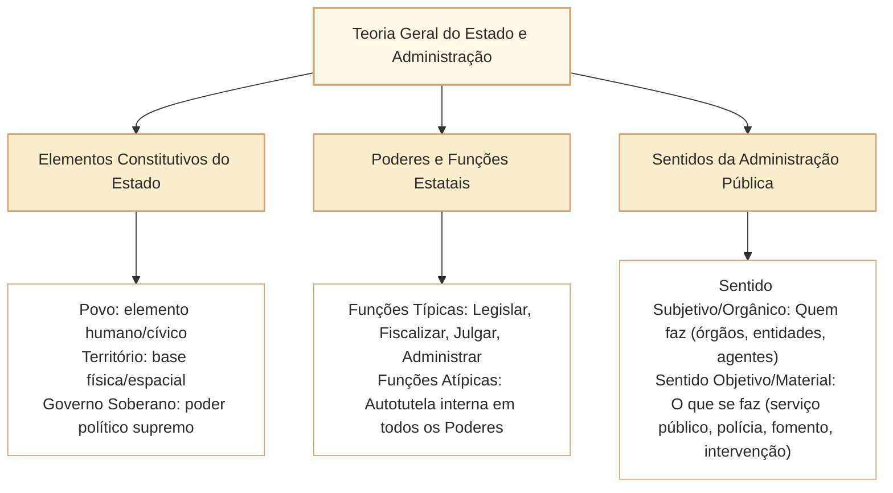

# Estado, Governo, Administração Pública e Função Administrativa

No estudo do Direito Administrativo voltado aos concursos de nível superior elaborados pelo Cebraspe (notadamente para o cargo de Analista Legislativo da Câmara dos Deputados), a compreensão dos conceitos inaugurais de **Estado, Governo, Administração Pública** e o regime jurídico da **Função Administrativa** constitui a pedra angular sobre a qual se erigem todos os demais institutos da disciplina. A banca cebraspeana explora com frequência a distinção entre os sentidos subjetivo (orgânico) e objetivo (material) da Administração, as fronteiras entre atos políticos de governo e atos de execução administrativa, bem como a assimetria das prerrogativas e sujeições que conformam o regime jurídico-administrativo.

Longe de se limitar a noções enciclopédicas abstratas, a cobrança contemporânea do Cebraspe demanda precisão quanto à titularidade e ao exercício das funções estatais típicas e atípicas, à luz do princípio republicano, da separação de poderes (art. 2º da CF/1988) e do papel do Parlamento — que, ao lado de sua função legislativa e fiscalizatória precípua, exerce atividade administrativa atípica de gestão interna de seus órgãos, servidores e recursos públicos.

---

## 1. O Estado e seus Elementos Constitutivos

O Estado moderno constitui uma pessoa jurídica de direito público internacional e interno, soberana, dotada de povo, território e governo soberano, cuja finalidade última é a consecução do bem comum mediante a ordem jurídica:

### 1.1. Elementos Estruturais
1. **Povo:** Elemento humano ou subjetivo do Estado; o conjunto de nacionais vinculados politicamente e juridicamente pelo vínculo da cidadania e da nacionalidade (não se confunde com *população*, que é dado demográfico e numérico que inclui estrangeiros e apátridas, nem com *nação*, que tem caráter sociocultural).
2. **Território:** Base geográfica e espacial sobre a qual o Estado exerce com exclusividade a sua soberania (solo, subsolo, espaço aéreo e mar territorial).
3. **Governo Soberano:** O elemento condutor político, que expressa a soberania interna (supremacia sobre as demais organizações sociais) e internacional (independência e igualdade perante os demais Estados).

---

## 2. Governo vs. Administração Pública: Distinção Ontológica e Funcional

A doutrina administrativista clássica (Hely Lopes Meirelles, Maria Sylvia Zanella Di Pietro, Celso Antônio Bandeira de Mello) delimita com nitidez as esferas de atuação política e executiva:

| Critério de Comparação | Governo (*Atividade Política*) | Administração Pública (*Atividade Técnica e Executiva*) |
| :--- | :--- | :--- |
| **Natureza da Função** | Política, de direção suprema e formulação de diretrizes estratégicas (*policy making*). | Técnica, executória, subordinada e instrumental à realização das metas legais (*policy implementation*). |
| **Vínculo Normativo** | Vinculação direta e imediata à Constituição Federal; ampla discricionariedade política. | Vinculação direta à lei infraconstitucional e à Constituição (princípio da estrita legalidade). |
| **Responsabilidade dos Atos** | Responsabilidade eminentemente política perante o Parlamento e o eleitorado. | Responsabilidade jurídica (administrativa, civil e penal), submetida ao controle de legalidade. |
| **Órgãos Encarregados** | Órgãos constitucionais e agentes políticos (Chefes de Poder, Ministros, Parlamentares). | Conjunto integrado de órgãos, entidades descentralizadas e agentes públicos de carreira. |
| **Permanência** | Transitório, mutável a cada pleito eleitoral ou arranjo partidário. | Permanente, contínua e estável (impessoalidade do aparato burocrático estatal). |

---

## 3. Sentidos da Administração Pública: Critério Subjetivo vs. Objetivo

Uma das pegadinhas mais tradicionais do Cebraspe envolve a inversão entre os sentidos **subjetivo/formal/orgânico** e **objetivo/material/funcional**:

### 3.1. Sentido Subjetivo, Formal ou Orgânico
Responde à pergunta: **"QUEM integra a Administração Pública?"**
- Designa o conjunto de **órgãos públicos, entidades jurídicas e agentes públicos** que integram a estrutura estatal encarregada da execução da função administrativa.
- **Critério Adotado no Brasil:** O Brasil adota o critério formal estrito: somente integra a Administração Pública em sentido subjetivo quem a legislação expressamente qualifica como tal (a Administração Direta e as entidades da Administração Indireta: autarquias, fundações públicas, empresas públicas e sociedades de economia mista).
- Concessionárias de serviço público e entidades do Terceiro Setor (OS, OSCIP) **exercem atividade administrativa em sentido material, mas NÃO integram a Administração Pública em sentido subjetivo/orgânico**.

### 3.2. Sentido Objetivo, Material ou Funcional
Responde à pergunta: **"O QUE É a atividade administrativa?"**
- Designa a própria **atividade ou função administrativa** desempenhada pelo Estado, consubstanciada em quatro campos materiais precípuos:
  1. **Serviço Público:** Atividades de prestação material direta de utilidades e comodidades aos cidadãos (transporte, saúde, educação, saneamento).
  2. **Poder de Polícia Administrativa:** Restrições, condicionamentos e fiscalizações impostas a direitos e liberdades individuais em prol do interesse coletivo (segurança, trânsito, vigilância sanitária).
  3. **Fomento Público:** Estímulo estatal a iniciativas privadas de interesse social (concessão de incentivos fiscais, subvenções, linhas de crédito).
  4. **Intervenção:** Atuação regulatória, normativa e fiscalizatória sobre o domínio econômico e urbanístico.

---

## 4. O Exercício da Função Administrativa nos Três Poderes

A separação dos Poderes (art. 2º da CF/1988) não constitui estanqueidade absoluta, operando mediante o mecanismo de freios e contrapesos (*checks and balances*):

- **Funções Típicas (Precípuas):**
  - **Poder Executivo:** Exercício típico da função administrativa e de governo.
  - **Poder Legislativo:** Exercício típico da função legiferante (elaboração das leis) e da função fiscalizatória/controle externo (com auxílio do Tribunal de Contas).
  - **Poder Judiciário:** Exercício típico da função jurisdicional (dizer o direito com força de coisa julgada material).
- **Funções Atípicas Administrativas nos Poderes Legislativo e Judiciário:**
  - Tanto o Poder Legislativo quanto o Poder Judiciário exercem a **função administrativa atípica** na gestão de sua infraestrutura orgânica:
    - *Exemplos na Câmara dos Deputados:* Abertura de concurso público para provimento de seus cargos; instauração de processos de licitação e celebração de contratos administrativos para serviços de tecnologia e comunicação; concessão de férias e licenças a seus servidores; e aplicação de penalidades disciplinares a seus agentes.
  - Tais atos administrativos praticados pelo Parlamento submetem-se rigorosamente ao mesmo regime jurídico-administrativo, à legalidade estrita e ao controle de constitucionalidade e legalidade pelo Poder Judiciário.

---

## 5. Questões Comentadas no Estilo Cebraspe

### Questão 1
*(Inédita: estilo Cebraspe / Câmara dos Deputados – Analista Legislativo)*

**Item:** Em sentido subjetivo ou formal, a Administração Pública compreende as atividades de polícia administrativa, prestação de serviços públicos e fomento, independentemente da natureza dos órgãos ou das pessoas jurídicas que as desempenham.

- ( ) Certo
- ( ) Errado

**Gabarito: Errado**  
**Comentário:** A assertiva inverteu os conceitos doutrinários consolidados. A polícia administrativa, os serviços públicos e o fomento definem a Administração Pública em **sentido objetivo, material ou funcional** (o que se faz / a atividade em si). Em **sentido subjetivo, formal ou orgânico**, a Administração Pública compreende o complexo de agentes, órgãos e pessoas jurídicas instituídos pelo ordenamento para desempenhar a função administrativa (quem faz).

---

### Questão 2
*(Inédita: estilo Cebraspe / Câmara dos Deputados – Analista Legislativo)*

**Item:** Os atos administrativos praticados pela Mesa Diretora da Câmara dos Deputados na contratação de serviços terceirizados de tecnologia da informação configuram o exercício de função atípica administrativa pelo Poder Legislativo, submetendo-se ao regime jurídico de direito público e ao controle de legalidade exercido pelo Poder Judiciário.

- ( ) Certo
- ( ) Errado

**Gabarito: Certo**  
**Comentário:** O Poder Legislativo exerce a função administrativa de modo atípico ao gerir seu patrimônio, celebrar contratos de prestação de serviços e disciplinar seus agentes. Esses atos revestem-se de natureza puramente administrativa e submetem-se às regras gerais das contratações públicas e ao controle judicial de legalidade e moralidade.

---

### Questão 3
*(Inédita: estilo Cebraspe / Câmara dos Deputados – Analista Legislativo)*

**Item:** As concessionárias privadas de serviços públicos, embora desempenhem atividades de interesse coletivo mediante delegação estatal, não integram a Administração Pública em sentido subjetivo ou formal.

- ( ) Certo
- ( ) Errado

**Gabarito: Certo**  
**Comentário:** O Brasil adota o critério formal de Administração Pública. As delegatárias de serviços públicos (concessionárias e permissionárias privadas) exercem função administrativa em sentido material, mas não integram o quadro orgânico da Administração Pública (sentido subjetivo), o qual se restringe à Administração Direta e Indireta estatal.

---

### Questão 4
*(Inédita: estilo Cebraspe / Câmara dos Deputados – Analista Legislativo)*

**Item:** Os conceitos de Governo e Administração Pública são juridicamente sinônimos no direito constitucional brasileiro, designando ambos a atividade contínua de execução estrita das normas infraconstitucionais pelos órgãos subordinados.

- ( ) Certo
- ( ) Errado

**Gabarito: Errado**  
**Comentário:** Governo e Administração Pública não são sinônimos. O Governo desempenha função política, superior, de formulação de diretrizes estratégicas e comando do Estado, vinculado diretamente à Constituição. A Administração Pública, por sua vez, desempenha função técnica, executória, permanente e estritamente subordinada à lei.

---

### Questão 5
*(Inédita: estilo Cebraspe / Câmara dos Deputados – Analista Legislativo)*

**Item:** O povo, o território e o governo soberano constituem elementos universais e indispensáveis para a configuração estrutural do Estado moderno, sendo a soberania a expressão de um poder político supremo na ordem interna e independente no plano internacional.

- ( ) Certo
- ( ) Errado

**Gabarito: Certo**  
**Comentário:** O item sintetiza a doutrina clássica da Teoria Geral do Estado e do Direito Administrativo: o Estado estrutura-se pela convergência indissolúvel de seus três elementos constitutivos — povo (elemento humano), território (base espacial) e governo soberano (elemento condutor dotado de supremacia interna e independência externa).

---

### Questão 6
*(Inédita: estilo Cebraspe / Câmara dos Deputados – Analista Legislativo)*

**Item:** A função jurisdicional é exercida de forma atípica pelo Poder Executivo quando este decide recursos administrativos no âmbito de processos disciplinares instaurados contra seus servidores, produzindo decisões com autoridade de coisa julgada material.

- ( ) Certo
- ( ) Errado

**Gabarito: Errado**  
**Comentário:** No ordenamento jurídico brasileiro vigora o princípio da inafastabilidade da jurisdição ou do controle jurisdicional único (art. 5º, XXXV, da CF/1988). As decisões da Administração Pública em processos administrativos, ainda que em última instância recursal, consubstanciam o exercício da **função administrativa**, e **nunca produzem coisa julgada material**, podendo sempre ser submetidas à revisão pelo Poder Judiciário.

---

## 6. Relações com Outros Artigos e Síntese de Revisão

- **Pré-requisitos e Vínculos Teóricos:**
  - [[3 - Materias/Direito Administrativo/01 - principios e lei de acesso a informacao|CAM-DAD-002]]: Os princípios expressos e implícitos do regime jurídico-administrativo decorrem da supremacia e indisponibilidade do interesse público.
  - [[3 - Materias/Direito Administrativo/02 - organizacao administrativa|CAM-DAD-003 / CAM-DAD-004]]: A estruturação da Administração Direta e Indireta operacionaliza a separação entre Governo e Administração técnica.
  - [[3 - Materias/Direito Administrativo/03 - atos administrativos|CAM-DAD-005 a CAM-DAD-009]]: A manifestação formal da função administrativa por meio de atos e contratos.
