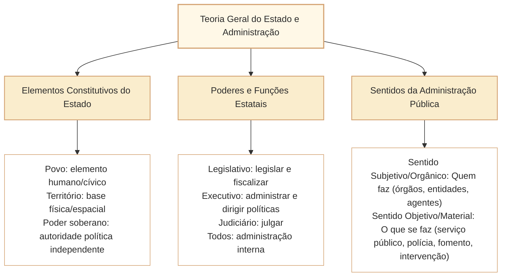

# Estado, Governo, Administração Pública e Função Administrativa

Uma comissão da Câmara dos Deputados discute uma nova política pública. Depois, a Câmara precisa contratar serviços, organizar seus servidores e executar seu orçamento. Essas decisões pertencem ao mesmo Estado, mas envolvem funções diferentes: **governar** significa definir orientações políticas dentro da Constituição; **administrar** significa organizar recursos e executar atividades públicas segundo as normas aplicáveis. A Câmara também administra, embora legislar e fiscalizar sejam suas funções principais.

Este artigo responde a quatro perguntas: o que forma o Estado, como governo e administração se distinguem, quem integra a Administração Pública e por que os três Poderes podem praticar atos administrativos. **Regime jurídico-administrativo** é o conjunto de regras e princípios que impõe deveres à Administração e, em situações previstas em lei, lhe confere poderes para atender ao interesse público. Esses poderes têm limites e estão sujeitos a controle.

---

## O Estado e seus Elementos Constitutivos

Na classificação clássica da **Teoria Geral do Estado**, disciplina que estuda sua origem, estrutura e organização, o Estado reúne **povo**, **território** e **poder político soberano**. Trata-se de uma classificação **doutrinária**, e não de uma enumeração literal da Constituição. No Brasil, a **União** é pessoa jurídica de direito público interno (Código Civil, art. 41, I), assim como os Estados, o Distrito Federal e os Municípios, nos incisos seguintes. A **República Federativa do Brasil** é o Estado soberano formado pela união indissolúvel desses entes (Constituição, art. 1º); não é correto confundir a República Federativa, no plano político, com a pessoa jurídica União, no plano administrativo. A soberania aparece como fundamento constitucional (Constituição, art. 1º, I). **Soberania** é a independência do Estado no plano internacional; **autonomia federativa** é a capacidade constitucional de auto-organização e autogoverno dos entes internos, que não são soberanos individualmente.

### Povo, população e nação

1. **Povo:** conjunto de pessoas com vínculo jurídico de nacionalidade com o Estado, embora nem todas tenham direitos políticos em exercício. **População** é o conjunto de residentes em certo território, inclusive estrangeiros e apátridas. **Nação** é vínculo histórico ou cultural, que pode ultrapassar fronteiras políticas. Assim, povo, população, nação e eleitorado são conjuntos diferentes.
2. **Território:** espaço sobre o qual o Estado exerce sua autoridade, observados tratados e limites do direito internacional, incluindo solo, subsolo, espaço aéreo e mar territorial nas condições jurídicas aplicáveis.
3. **Poder político soberano:** capacidade de estabelecer e aplicar decisões públicas dentro da ordem jurídica, sem subordinação a outro Estado no plano internacional. **Soberania não significa atuação ilimitada:** há Constituição, direitos fundamentais e compromissos internacionais.

---

## 2. Governo vs. Administração Pública: Distinção Ontológica e Funcional

A distinção entre **governo** e **Administração** é sobretudo **funcional**: uma mesma autoridade pode participar de decisões políticas e praticar atos administrativos. Governo orienta prioridades coletivas dentro das competências constitucionais; Administração executa serviços e gere recursos para concretizá-las conforme o Direito. Por exemplo, definir prioridades gerais para uma política é uma decisão de governo; realizar a licitação para executar essa política é atividade administrativa. Ambas devem respeitar a Constituição e o direito aplicável.

| Pergunta | Governo: direção política | Administração: execução e gestão |
| :--- | :--- | :--- |
| **O que decide?** | Objetivos e diretrizes políticas dentro das competências constitucionais. | Como executar serviços, gerir pessoas, contratos e recursos dentro das competências legais. |
| **Qual o limite?** | Constituição, leis aplicáveis e controles políticos e jurídicos. | Constituição, leis, princípios administrativos e controles internos e externos. |
| **Quem atua?** | Autoridades com atribuições políticas, conforme a função exercida. | Órgãos, entidades e agentes que desempenham atividades administrativas, inclusive nos outros Poderes. |
| **Quanto dura?** | Diretrizes podem mudar conforme as decisões políticas legítimas. | A prestação administrativa deve observar continuidade, impessoalidade e as normas vigentes. |

**Discricionariedade** é a margem de escolha que a norma concede a uma autoridade, dentro de limites jurídicos. Ela existe em certas decisões administrativas e políticas, mas não autoriza agir contra a lei. A responsabilidade por um ato pode ser política, administrativa, civil ou penal, conforme a conduta e as regras aplicáveis. Por isso, a divisão entre “governo só responde politicamente” e “administração só responde juridicamente” seria incorreta.

**Contraexemplo:** um ministro pode anunciar uma prioridade política e, em outro momento, decidir uma contratação administrativa. A classificação depende da **função exercida no ato**, e não apenas do cargo de quem decide.

---

## 3. Sentidos da Administração Pública: Critério Subjetivo vs. Objetivo

A diferença entre os sentidos **subjetivo (formal ou orgânico)** e **objetivo (material ou funcional)** aparece com frequência em questões Cebraspe. O primeiro pergunta **quem integra a estrutura administrativa**; o segundo pergunta **qual atividade é desempenhada**. A mesma instituição pode responder à primeira pergunta enquanto executa atividades da segunda categoria.

### Sentido Subjetivo, Formal ou Orgânico
Responde à pergunta: **"Quem integra a estrutura da Administração Pública?"**
- Designa o conjunto de **órgãos públicos, entidades jurídicas e agentes públicos** que integram a estrutura estatal encarregada da execução da função administrativa.
- **Critério Adotado no Brasil:** Para identificar a **estrutura administrativa**, observe os órgãos da Administração direta e as entidades da Administração indireta: autarquias, fundações públicas, empresas públicas e sociedades de economia mista. A Constituição, art. 37, caput, sujeita a administração direta e indireta de todos os Poderes aos princípios administrativos. A lista de entidades da administração indireta aparece também no Decreto-Lei nº 200/1967, art. 4º, II, no âmbito federal. Um órgão não tem personalidade jurídica própria; uma entidade administrativa tem.
- Uma **concessionária privada** presta serviço público por delegação, mas não passa a integrar a Administração direta ou indireta por esse motivo (Constituição, art. 175). Organizações sociais (OS) e organizações da sociedade civil de interesse público (OSCIP) também não se tornam entidades da Administração indireta pela parceria. A natureza da atividade e a posição na estrutura são perguntas distintas.

### Sentido Objetivo, Material ou Funcional
Responde à pergunta: **"Que atividade administrativa é realizada?"**
- Designa a própria **atividade ou função administrativa** desempenhada pelo Estado, consubstanciada em quatro campos materiais precípuos:
  1. **Serviço Público:** Atividades de prestação material direta de utilidades e comodidades aos cidadãos (transporte, saúde, educação, saneamento).
  2. **Poder de Polícia Administrativa:** Restrições, condicionamentos e fiscalizações impostas a direitos e liberdades individuais em prol do interesse coletivo (segurança, trânsito, vigilância sanitária).
  3. **Fomento Público:** Estímulo estatal a iniciativas privadas de interesse social (concessão de incentivos fiscais, subvenções, linhas de crédito).
  4. **Intervenção na atividade econômica:** Atuação estatal nas modalidades e limites constitucionais. **Regulação** (estabelecer regras e fiscalizar, art. 174) não é sinônimo de **exploração direta da atividade econômica** (hipóteses do art. 173).

---

## 4. O Exercício da Função Administrativa nos Três Poderes

O art. 2º da **Constituição Federal de 1988 (CF/1988)** estabelece Poderes independentes e harmônicos. Isso distribui funções principais e permite controles recíprocos, sem impedir que cada Poder administre seus próprios recursos. A distinção entre função típica e atípica descreve a **atividade**, não cria exceção à legalidade. **Função jurisdicional** é a atividade de solucionar conflitos mediante decisões judiciais, com possibilidade de coisa julgada material, ao passo que uma decisão administrativa final não se transforma em sentença judicial:

- **Funções Típicas (Precípuas):**
  - **Poder Executivo:** Exercício típico da função administrativa e de governo.
  - **Poder Legislativo:** Exercício típico da função legiferante (elaboração das leis) e da função fiscalizatória/controle externo (com auxílio do Tribunal de Contas).
  - **Poder Judiciário:** Exercício típico da função jurisdicional (dizer o direito com força de coisa julgada material).
- **Funções Atípicas Administrativas nos Poderes Legislativo e Judiciário:**
  - Tanto o Poder Legislativo quanto o Poder Judiciário exercem a **função administrativa atípica** na gestão de sua infraestrutura orgânica:
    - *Exemplos na Câmara dos Deputados:* Abertura de concurso público para provimento de seus cargos; instauração de processos de licitação e celebração de contratos administrativos para serviços de tecnologia e comunicação; concessão de férias e licenças a seus servidores; e aplicação de penalidades disciplinares a seus agentes.
  - Esses atos devem observar os princípios do art. 37 da Constituição. A contratação pública segue as regras aplicáveis, inclusive a Lei nº 14.133/2021 quando incidente. O Judiciário pode controlar lesão ou ameaça a direito (art. 5º, XXXV), sem substituir automaticamente escolhas administrativas legítimas por suas preferências.

---

## Questões Comentadas no Estilo Cebraspe

### Questão 1
*(Inédita: estilo Cebraspe / Câmara dos Deputados – Analista Legislativo)*

**Item:** Em sentido subjetivo ou formal, a Administração Pública compreende as atividades de polícia administrativa, prestação de serviços públicos e fomento, independentemente da natureza dos órgãos ou das pessoas jurídicas que as desempenham.

- ( ) Certo
- ( ) Errado

**Gabarito: Errado**  
**Comentário:** A assertiva inverteu os conceitos doutrinários consolidados. A polícia administrativa, os serviços públicos e o fomento definem a Administração Pública em **sentido objetivo, material ou funcional** (o que se faz / a atividade em si). Em **sentido subjetivo, formal ou orgânico**, a Administração Pública compreende o complexo de agentes, órgãos e pessoas jurídicas instituídos pelo ordenamento para desempenhar a função administrativa (quem faz).

---

### Questão 2
*(Inédita: estilo Cebraspe / Câmara dos Deputados – Analista Legislativo)*

**Item:** Os atos administrativos praticados pela Mesa Diretora da Câmara dos Deputados na contratação de serviços terceirizados de tecnologia da informação configuram o exercício de função atípica administrativa pelo Poder Legislativo, submetendo-se ao regime jurídico de direito público e ao controle de legalidade exercido pelo Poder Judiciário.

- ( ) Certo
- ( ) Errado

**Gabarito: Certo**  
**Comentário:** A Câmara exerce a função legislativa e a fiscalização política como atividades principais, mas também precisa contratar e gerir serviços. Nessa situação exerce função administrativa. Aplicam-se os princípios do art. 37 da Constituição e as normas de contratação pertinentes; o controle judicial examina a conformidade jurídica do ato, não substitui livremente a decisão administrativa.

---

### Questão 3
*(Inédita: estilo Cebraspe / Câmara dos Deputados – Analista Legislativo)*

**Item:** As concessionárias privadas de serviços públicos, embora desempenhem atividades de interesse coletivo mediante delegação estatal, não integram a Administração Pública em sentido subjetivo ou formal.

- ( ) Certo
- ( ) Errado

**Gabarito: Certo**  
**Comentário:** A concessão delega a prestação de um serviço, nos termos do art. 175 da Constituição, sem transformar a concessionária privada em autarquia, empresa pública ou outro ente da Administração Indireta. Prestar serviço público e integrar a estrutura estatal são critérios diferentes.

---

### Questão 4
*(Inédita: estilo Cebraspe / Câmara dos Deputados – Analista Legislativo)*

**Item:** Os conceitos de Governo e Administração Pública são juridicamente sinônimos no direito constitucional brasileiro, designando ambos a atividade contínua de execução estrita das normas infraconstitucionais pelos órgãos subordinados.

- ( ) Certo
- ( ) Errado

**Gabarito: Errado**  
**Comentário:** Governo designa a direção política; administração, a execução e gestão de atividades públicas. As duas funções respeitam Constituição e leis aplicáveis. A diferença não significa que decisões políticas estejam imunes ao controle jurídico.

---

### Questão 5
*(Inédita: estilo Cebraspe / Câmara dos Deputados – Analista Legislativo)*

**Item:** Segundo a classificação clássica, povo, território e poder político soberano são elementos constitutivos para a configuração estrutural do Estado moderno, sendo a soberania a expressão de um poder político supremo na ordem interna e independente no plano internacional.

- ( ) Certo
- ( ) Errado

**Gabarito: Certo**  
**Comentário:** A classificação doutrinária tradicional identifica povo, território e poder soberano. É uma forma de explicar a estrutura do Estado e não uma lista do art. 1º da Constituição. A soberania é fundamento da República (art. 1º, I), enquanto União, estados, Distrito Federal e municípios possuem graus de autonomia previstos constitucionalmente.

---

### Questão 6
*(Inédita: estilo Cebraspe / Câmara dos Deputados – Analista Legislativo)*

**Item:** A função jurisdicional é exercida de forma atípica pelo Poder Executivo quando este decide recursos administrativos no âmbito de processos disciplinares instaurados contra seus servidores, produzindo decisões com autoridade de coisa julgada material.

- ( ) Certo
- ( ) Errado

**Gabarito: Errado**  
**Comentário:** Decidir recurso administrativo é uma função administrativa, mesmo quando a autoridade examina fatos, provas e argumentos como em um julgamento. A decisão pode tornar-se definitiva **na esfera administrativa**, mas não adquire coisa julgada material judicial. O art. 5º, XXXV, da Constituição impede excluir da apreciação do Judiciário lesão ou ameaça a direito. A revisão judicial depende de provocação e dos requisitos processuais aplicáveis.

---

## Relações com Outros Artigos e Síntese de Revisão

- **Pré-requisitos e Vínculos Teóricos:**
  - [[3 - Materias/Direito Administrativo/01 - principios e lei de acesso a informacao|Princípios Expressos e Implícitos da Administração Pública]]: Os princípios que orientam a administração estão no art. 37 da Constituição, na legislação e na jurisprudência; supremacia e indisponibilidade são categorias doutrinárias, com limites constitucionais.
  - [[3 - Materias/Direito Administrativo/02 - organizacao administrativa|Administração Direta e Indireta: Entidades, Vínculos e Regime Jurídico]]: A estruturação da Administração Direta e Indireta operacionaliza a separação entre Governo e Administração técnica.
  - [[3 - Materias/Direito Administrativo/03 - atos administrativos|Elementos e requisitos de validade do ato administrativo: competência, finalidade, forma, motivo e objeto]]: A manifestação formal da função administrativa por meio de atos e contratos.

## Referências normativas e critério de leitura

- [Constituição Federal de 1988](https://www.planalto.gov.br/ccivil_03/constituicao/constituicao.htm): arts. 1º, I (soberania), 2º (separação dos Poderes), 5º, XXXV (acesso à Justiça), 37, caput (princípios administrativos), 173 a 175 (atividade econômica e serviços públicos).
- [Código Civil, Lei nº 10.406/2002](https://www.planalto.gov.br/ccivil_03/leis/2002/l10406compilada.htm): art. 41, I a III (União, Estados, Distrito Federal e Municípios como pessoas jurídicas de direito público interno).
- [Decreto-Lei nº 200/1967](https://www.planalto.gov.br/ccivil_03/decreto-lei/del0200.htm): art. 4º (estrutura da administração federal).
- [Lei nº 14.133/2021](https://www.planalto.gov.br/ccivil_03/_ato2019-2022/2021/lei/l14133.htm): regime geral de licitações e contratos administrativos, observado seu âmbito de aplicação.

As classificações de Estado, governo e sentidos da Administração são construções **doutrinárias** usadas para interpretar a organização e as funções estatais. As normas acima fundamentam os efeitos jurídicos específicos; não apresentam literalmente todas essas classificações.