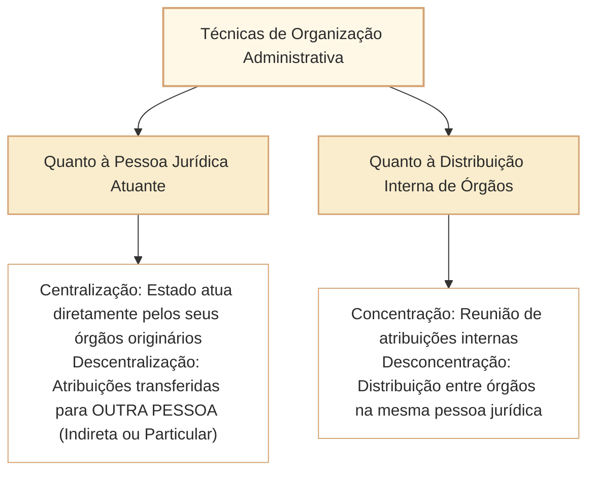

# Centralização, Descentralização, Concentração e Desconcentração no Direito Administrativo

Uma secretaria da Câmara dos Deputados pode distribuir tarefas entre departamentos sem criar uma nova pessoa jurídica. Uma autarquia, em contraste, possui personalidade jurídica própria. Quando um ministério transfere parte das tarefas a uma coordenação interna, há **desconcentração**; quando uma lei cria uma autarquia com atribuições próprias, há **descentralização por serviços**. Essa diferença permite compreender quatro técnicas administrativas: **centralização**, **descentralização**, **concentração** e **desconcentração**. Pergunte primeiro se mudou a **pessoa jurídica responsável** e depois se mudaram os **órgãos internos**. Essa distinção evita confundir entidades da Administração Indireta com departamentos do mesmo órgão.

A **teoria do órgão**, associada à doutrina de Otto Gierke, explica a **imputação**: a atuação funcional de um agente é juridicamente atribuída à pessoa jurídica de que seu órgão faz parte. Assim, em regra, um ato praticado por servidor da Câmara é imputado à União, e não a uma pessoa jurídica chamada “Câmara dos Deputados”. A distinção entre **outorga por serviços** (caso clássico das autarquias: a lei atribui titularidade e execução) e **delegação por colaboração** (concessionárias e permissionárias privadas executam um serviço cuja titularidade permanece pública) será analisada com a legislação de cada modalidade.

---

## 1. As Quatro Técnicas Fundamentais de Organização Administrativa

O quadro a seguir organiza as duas perguntas essenciais. A primeira distingue **quem presta a atividade**; a segunda observa **como se distribuem as tarefas dentro da mesma pessoa jurídica**. As técnicas podem coexistir: uma autarquia é fruto de descentralização e pode desconcentrar suas próprias atribuições entre departamentos.

### Centralização Administrativa
- A atividade pública é executada **diretamente pela pessoa jurídica federada matriz** (União, Estados, Distrito Federal ou Municípios), por intermédio de seus órgãos internos despersonalizados.
- Não há interposição de outras pessoas jurídicas. A União atua "de forma centralizada" quando a Presidência da República ou um Ministério executa diretamente uma política pública.

### Descentralização Administrativa
- A execução ou a titularidade da atividade pública é atribuída a **outra pessoa jurídica**, distinta do ente federado instituidor.
- **Característica Primordial:** Pressupõe sempre a dualidade de pessoas jurídicas (Pessoa A $\rightarrow$ Pessoa B).
- **Controle sem hierarquia entre pessoas jurídicas:** entre ente instituidor e entidade da Administração Indireta há controle de supervisão ou tutela nos limites legais, com atenção à finalidade, à legalidade e aos resultados. Na delegação a particulares, o poder concedente também exerce fiscalização e poderes contratuais/regulatórios; portanto, chamar toda forma de descentralização de mera tutela ministerial seria incorreto.

### Desconcentração Administrativa
- Técnica de simplificação e distribuição interna de atribuições **dentro de uma mesma pessoa jurídica**.
- **Resultado:** a desconcentração pode **criar órgãos internos** ou redistribuir atribuições entre órgãos já existentes. Ela não cria nova pessoa jurídica.
- **Relação de Hierarquia:** quando se distribuem atribuições em departamentos subordinados, existe hierarquia entre as unidades internas, conforme a estrutura legal. A desconcentração não equivale à vinculação entre entidades distintas.
- **Regra de identificação:** desconcentração opera **dentro da mesma pessoa jurídica**; descentralização atribui a outra pessoa jurídica a execução de determinada atividade ou, na outorga, competências próprias previstas em lei. Um contrato comum de compra de materiais não constitui, por si só, descentralização de serviço público: é preciso identificar o objeto e o regime da transferência. A criação de órgão é um exemplo de desconcentração, não sua única forma.

### Concentração Administrativa
- É a reunião de atribuições antes distribuídas entre órgãos de uma mesma pessoa jurídica. Por exemplo, extinguir duas coordenações e concentrar suas tarefas em um departamento é **concentração**, desde que não haja transferência da atividade para outra pessoa jurídica. A reorganização deve respeitar as competências e formas legais de criação e extinção de órgãos.

---

## 2. Modalidades de Descentralização: Outorga vs. Delegação

As modalidades de descentralização se distinguem principalmente por **quem passa a executar a atividade e qual instrumento jurídico permite isso**. Na **outorga por serviços**, uma lei atribui competências próprias a uma entidade administrativa, como uma autarquia. Na **delegação por colaboração**, um particular presta o serviço nas condições previstas pela legislação, sem se tornar parte da Administração Indireta.

A tabela compara essas duas situações. Ao ler cada linha, observe **quem recebe a atribuição**, **qual é o instrumento** e **o que permanece sob responsabilidade do poder público**.

| Critério de Comparação | Descentralização por Serviços / Outorga / Legal | Descentralização por Colaboração / Delegação |
| :--- | :--- | :--- |
| **Destinatário da descentralização** | Exemplo clássico: **autarquia ou fundação pública de direito público**, com competências próprias conferidas por lei. | **Particular delegatário** de serviço público, como concessionária ou permissionária, sem ingresso automático na Administração Indireta. |
| **Instrumento Jurídico** | Atribuições a autarquia ou fundação autárquica são estabelecidas por **lei específica**, que cria a entidade (art. 37, XIX, CF/1988). | **Concessão** por contrato e **permissão de serviço público** por **contrato de adesão**, com precariedade e possibilidade de revogação unilateral (art. 40 da Lei nº 8.987/1995); autorização possui disciplina legal específica. |
| **O que é atribuído** | A lei atribui à entidade competências e execução da atividade em sua esfera própria; na formulação doutrinária clássica, fala-se em **titularidade e execução** por serviços, sem confundir isso com soberania ou competência constitucional do ente político. | Atribui-se a **prestação/execução do serviço** ao delegatário, enquanto o poder público conserva a titularidade e os poderes de regulamentação, fiscalização e controle previstos na lei. |
| **Prazo de Duração** | Em regra, indeterminado enquanto a entidade existir segundo a lei. | **Concessão** por prazo contratual; **permissão** sujeita ao regime de precariedade do art. 40 da Lei nº 8.987/1995. Não aplicar um mesmo prazo a toda modalidade de delegação. |
| **Controle exercido** | Controle finalístico e de legalidade nos termos da lei, sem hierarquia geral entre pessoas jurídicas. | Fiscalização contratual e regulatória pelo poder concedente e, quando houver, órgão ou agência competente. |

> [!WARNING]
> **Pegadinha de Prova do Cebraspe:**
> A concessionária privada de serviço público **não integra automaticamente a Administração Indireta**. A execução é delegada, mas a titularidade do serviço continua pública. E a **permissão de serviço público**, embora precária, **não deve ser descrita somente como ato unilateral**, pois a Lei nº 8.987/1995 exige contrato de adesão (art. 40).

---

## 3. Teoria do Órgão e Classificação dos Órgãos Públicos

Os órgãos públicos não possuem vontade própria nem personalidade jurídica autônoma. Para explicar como a manifestação do agente público vincula o Estado, a doutrina brasileira consagra a **Teoria do Órgão (Teoria da Imputação Volitiva)**, desenvolvida por Otto Gierke:

- **Imputação Volitiva:** A atuação da pessoa física do agente público é considerada juridicamente como a atuação do próprio órgão e, consequentemente, da pessoa jurídica estatal em nome da qual ele atua.
- **Consequência Prática:** a atuação do agente regularmente investido é imputada à pessoa jurídica. Na hipótese de **agente de fato**, com investidura irregular mas aparência de legitimidade, a proteção de terceiros de boa-fé **pode preservar efeitos de atos**, conforme a situação. Não significa validar indiscriminadamente todo ato irregular.

### Capacidade Processual Excepcional dos Órgãos de Cúpula (*Personalidade Judiciária*)
Os órgãos públicos normalmente **não possuem personalidade jurídica própria**, mas certas instituições podem ter **capacidade processual excepcional**, chamada *personalidade judiciária*, para defender suas **prerrogativas institucionais**. A **Súmula 525 do Superior Tribunal de Justiça (STJ)** afirma, sobre câmaras municipais, que elas podem demandar em juízo somente para proteger direitos institucionais. Esse entendimento **não significa** que qualquer órgão possa ajuizar demanda patrimonial comum em nome próprio. A legitimidade e o tipo de ação exigem avaliação da norma e da jurisprudência aplicáveis. A Mesa da Câmara dos Deputados pode atuar na defesa de prerrogativas institucionais nas hipóteses reconhecidas pelo Direito, sem se tornar pessoa jurídica separada da União.

---

## Classificação dos Órgãos Públicos quanto à Posição Estatal

Uma classificação **doutrinária**, associada a Hely Lopes Meirelles, distingue quatro posições na organização estatal. Os exemplos podem variar conforme a estrutura legal; essas categorias não são uma lista constitucional fechada:

1. **Órgãos Independentes:** Previstos no texto constitucional, representam os Poderes do Estado e não possuem qualquer subordinação hierárquica (Presidência da República, Câmara dos Deputados, Senado Federal, Supremo Tribunal Federal, Tribunal de Contas da União).
2. **Órgãos Autônomos:** Situam-se na cúpula da administração, imediatamente abaixo dos independentes. Gozam de ampla autonomia técnica, financeira e administrativa (Ministérios de Estado, Secretarias de Estado, Advocacia-Geral da União).
3. **Órgãos Superiores:** Detêm poder de direção, controle e decisão sobre matérias específicas, mas subordinam-se à orientação dos órgãos autônomos (Departamentos, Coordenadorias, Divisões Gerais).
4. **Órgãos Subalternos:** Meros executores materiais subordinados a escalões superiores, com atribuições rotineiras e reduzido poder decisório (Seções de protocolo, portarias, almoxarifados).

---

## Questões Comentadas no Estilo Cebraspe

### Questão 1
*(Inédita: estilo Cebraspe / Câmara dos Deputados – Analista Legislativo)*

**Item:** A criação de uma nova Secretaria-Geral no âmbito da Mesa Diretora da Câmara dos Deputados para gerir a comunicação institucional constitui exemplo de descentralização administrativa, na medida em que inaugura um novo centro de competências públicas dotado de personalidade jurídica autônoma.

- ( ) Certo
- ( ) Errado

**Gabarito: Errado**  
**Comentário:** A criação de secretarias, diretorias ou departamentos dentro da estrutura interna da Câmara dos Deputados (que integra a União) constitui **desconcentração administrativa**, e não descentralização. A desconcentração distribui competências internas na mesma pessoa jurídica, criando **órgãos públicos despersonalizados**, que não possuem personalidade jurídica própria.

---

### Questão 2
*(Inédita: estilo Cebraspe / Câmara dos Deputados – Analista Legislativo)*

**Item:** Na descentralização por outorga a uma autarquia criada por lei específica, atribuem-se a titularidade e a execução da atividade nos limites da lei, enquanto a delegação de serviço público a concessionária privada transfere a execução, mantendo a titularidade pública.

- ( ) Certo
- ( ) Errado

**Gabarito: Certo**  
**Comentário:** Na **outorga** a autarquia ou fundação autárquica, a lei cria a entidade e lhe atribui a atividade. Na **delegação**, o particular presta o serviço mantendo-se a titularidade no poder concedente. A assertiva foi delimitada à autarquia, evitando pressupor que toda fundação ou estatal nasce da mesma forma.

---

### Questão 3
*(Inédita: estilo Cebraspe / Câmara dos Deputados – Analista Legislativo)*

**Item:** Em decorrência do princípio da impessoalidade e da teoria do órgão, os atos praticados por agente público irregularmente investido em cargo em comissão perante terceiros de boa-fé reputam-se nulos de pleno direito e incapazes de gerar quaisquer efeitos jurídicos válidos.

- ( ) Certo
- ( ) Errado

**Gabarito: Errado**  
**Comentário:** Pela Teoria do Órgão (imputação volitiva), os atos do servidor são imputados à pessoa jurídica estatal, e não ao indivíduo. Em homenagem aos princípios da segurança jurídica, da boa-fé objetiva e da proteção à confiança dos cidadãos, a doutrina e a jurisprudência consagram a **teoria do funcionário de fato**: a teoria da aparência **pode preservar efeitos** dos atos perante terceiros de boa-fé, consideradas as circunstâncias; não se conclui que qualquer ato do agente de fato seja automaticamente válido.

---

### Questão 4
*(Inédita: estilo Cebraspe / Câmara dos Deputados – Analista Legislativo)*

**Item:** Embora desprovida de personalidade jurídica própria, a Mesa da Câmara dos Deputados detém capacidade processual extraordinária para impetrar mandado de segurança em juízo na defesa de suas prerrogativas e competências institucionais.

- ( ) Certo
- ( ) Errado

**Gabarito: Certo**  
**Comentário:** A capacidade processual excepcional, chamada *personalidade judiciária*, é admitida para defesa de prerrogativas institucionais. A **Súmula 525 do STJ**, embora trate expressamente das câmaras municipais, mostra o limite: a ausência de personalidade jurídica não impede toda atuação em juízo, mas a legitimação não se estende indiscriminadamente a demandas patrimoniais.

---

### Questão 5
*(Inédita: estilo Cebraspe / Câmara dos Deputados – Analista Legislativo)*

**Item:** A desconcentração administrativa rompe o poder hierárquico entre as unidades administrativas envolvidas, ensejando relação de mera vinculação e tutela entre o órgão central e o órgão subalterno.

- ( ) Certo
- ( ) Errado

**Gabarito: Errado**  
**Comentário:** É exatamente o oposto: a desconcentração opera **dentro da mesma pessoa jurídica**, sendo regida diretamente pelo **poder hierárquico** (subordinação, comando, delegação e avocação de competências). É na **descentralização** que não há hierarquia, mas apenas controle finalístico (tutela/supervisão ministerial).

---

### Questão 6
*(Inédita: estilo Cebraspe / Câmara dos Deputados – Analista Legislativo)*

**Item:** A celebração de contrato de concessão de serviço público pelo Poder Executivo com uma concessionária privada consubstancia a criação de uma nova entidade integrante da Administração Pública Indireta.

- ( ) Certo
- ( ) Errado

**Gabarito: Errado**  
**Comentário:** As concessionárias privadas de serviços públicos são particulares em colaboração com o Estado; elas **NÃO integram a Administração Pública Indireta** (que é composta exclusivamente por autarquias, fundações públicas, empresas públicas e sociedades de economia mista, nos termos do Decreto-Lei nº 200/1967). Trata-se de descentralização por colaboração delegada a particular.

---

## Relações com Outros Artigos e Síntese de Revisão

- **Para aprofundar os conceitos:**
  - [[3 - Materias/Direito Administrativo/12 - estado governo administracao e funcao administrativa|Estado, Governo, Administração Pública e Função Administrativa]]: O exercício da função administrativa nos sentidos subjetivo e objetivo.
  - [[3 - Materias/Direito Administrativo/01 - principios e lei de acesso a informacao|Princípios Expressos e Implícitos da Administração Pública]]: A impessoalidade e a imputação volitiva da teoria do órgão.
  - [[3 - Materias/Direito Administrativo/02 - organizacao administrativa|Administração Direta e Indireta: Entidades, Vínculos e Regime Jurídico]]: Entidades da Administração Indireta como fruto da descentralização por outorga.
  - [[3 - Materias/Direito Administrativo/04 - poderes administrativos|Poderes administrativos]]: O poder hierárquico como fundamento da desconcentração interna.

- [Lei nº 8.987/1995, Lei de Concessões e Permissões de Serviços Públicos](https://www2.camara.leg.br/legin/fed/lei/1995/lei-8987-13-fevereiro-1995-349810-normaatualizada-pl.html), arts. 2º e 40: definição de poder concedente e permissão de serviço público por contrato de adesão, com precariedade e revogabilidade unilateral.
- [STJ, Súmula 525](https://scon.stj.jus.br/SCON/SearchBRS?b=SUMU&livre=%40NUM%3D525): personalidade judiciária excepcional das câmaras municipais para defesa de direitos institucionais.
- [Constituição Federal de 1988](https://www.planalto.gov.br/ccivil_03/constituicao/constituicao.htm), arts. 37, XIX, e 175: entidades da Administração Indireta e delegação de serviços públicos.
- [Decreto-Lei nº 200/1967](https://www.planalto.gov.br/ccivil_03/decreto-lei/del0200.htm), arts. 4º, 5º e 19 a 26: organização da Administração Federal e supervisão ministerial.
