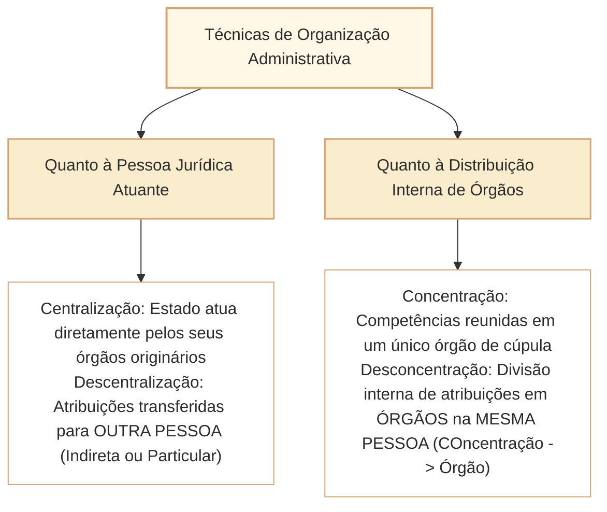

# Centralização, Descentralização, Concentração e Desconcentração no Direito Administrativo

No Direito Administrativo brasileiro, a distribuição funcional e estrutural das competências públicas opera mediante quatro técnicas fundamentais de organização: **centralização**, **descentralização**, **concentração** e **desconcentração**. Nas provas elaboradas pelo Cebraspe para carreiras legislativas de alto nível (notadamente para o cargo de Analista Legislativo da Câmara dos Deputados), a banca explora reiteradamente as fronteiras conceituais entre esses institutos, com ênfase na identificação da **criação de nova pessoa jurídica (*descentralização*)** em contraposição à **distribuição interna de atribuições entre órgãos despersonalizados dentro da mesma pessoa jurídica (*desconcentração*)**.

A compreensão desse tema exige o domínio da **Teoria do Órgão (imputação volitiva)** concebida por Otto Gierke, da classificação dos órgãos públicos e da distinção estrita entre **descentralização por outorga / legal / por serviços** (que transfere a titularidade e a execução a entidades da Administração Indireta) e **descentralização por delegação / colaboração** (que transfere apenas a execução a particulares concessionários ou permissionários).

---

## 1. As Quatro Técnicas Fundamentais de Organização Administrativa

O quadro sinóptico a seguir resume a matriz classificatória de competências:

### 1.1. Centralização Administrativa
- A atividade pública é executada **diretamente pela pessoa jurídica federada matriz** (União, Estados, Distrito Federal ou Municípios), por intermédio de seus órgãos internos despersonalizados.
- Não há interposição de outras pessoas jurídicas. A União atua "de forma centralizada" quando a Presidência da República ou um Ministério executa diretamente uma política pública.

### 1.2. Descentralização Administrativa
- A execução ou a titularidade da atividade pública é atribuída a **outra pessoa jurídica**, distinta do ente federado instituidor.
- **Característica Primordial:** Pressupõe sempre a dualidade de pessoas jurídicas (Pessoa A $\rightarrow$ Pessoa B).
- **Inexistência de Hierarquia:** Não há subordinação hierárquica entre o ente que descentralizou e a pessoa jurídica descentralizada, mas mero controle de legalidade e finalístico (*tutela administrativa / supervisão ministerial*).

### 1.3. Desconcentração Administrativa
- Técnica de simplificação e distribuição interna de atribuições **dentro de uma mesma pessoa jurídica**.
- **Resultado:** A desconcentração **cria órgãos públicos**, os quais são meros centros despersonalizados de competências.
- **Relação de Hierarquia:** A desconcentração é informada pelo **poder hierárquico**, existindo subordinação direta entre os órgãos superiores e os inferiores.
- *Mnemônico clássico de concurso:* Des**CO**ncentração cria órgãos (**CO** = cria órgãos); Des**CE**ntralização cria entidades (**CE** = cria entidades ou transfere a particulares).

### 1.4. Concentração Administrativa
- Processo inverso da desconcentração: consiste na extinção de órgãos intermediários ou na unificação de atribuições em um único órgão de cúpula da pessoa jurídica.

---

## 2. Modalidades de Descentralização: Outorga vs. Delegação

O Cebraspe exige a distinção rigorosa entre as modalidades de descentralização administrativa:

| Critério de Comparação | Descentralização por Serviços / Outorga / Legal | Descentralização por Colaboração / Delegação |
| :--- | :--- | :--- |
| **Destinatário da Descentralização** | Entidades da **Administração Indireta de direito público** (autarquias e fundações autárquicas). | **Particulares** (concessionárias, permissionárias, autorizatárias de serviço público). |
| **Instrumento Jurídico** | Sempre criada ou instituída diretamente mediante **lei específica** (art. 37, XIX, CF/1988). | Realizada mediante **contrato administrativo** (concessão) ou **ato unilateral precário** (permissão/autorização). |
| **Objeto Transferido** | Transfere a **titularidade E a execução** do serviço público. | Transfere **APENAS a execução** material do serviço público (o Estado mantém a titularidade indelegável). |
| **Prazo de Duração** | Em regra, **indeterminado** (instituição permanente). | **Determinado** (fixado contratualmente, como nas concessões de rodovias ou aeroportos). |
| **Controle Exercido** | Supervisão ministerial finalística (tutela administrativa). | Fiscalização estatal regulatória (poder de polícia e fiscalização contratual por agências reguladoras). |

> [!WARNING]
> **Pegadinha de Prova do Cebraspe:**
> A concessão de um serviço público de telecomunicações a uma empresa privada é um exemplo clássico de **descentralização por delegação**. Ela **NÃO cria entidade da Administração Indireta**, nem transfere a titularidade do serviço para o particular. O particular é mero executor temporário do serviço.

---

## 3. Teoria do Órgão e Classificação dos Órgãos Públicos

Os órgãos públicos não possuem vontade própria nem personalidade jurídica autônoma. Para explicar como a manifestação do agente público vincula o Estado, a doutrina brasileira consagra a **Teoria do Órgão (Teoria da Imputação Volitiva)**, desenvolvida por Otto Gierke:

- **Imputação Volitiva:** A atuação da pessoa física do agente público é considerada juridicamente como a atuação do próprio órgão e, consequentemente, da pessoa jurídica estatal em nome da qual ele atua.
- **Consequência Prática:** A validade do ato subsiste perante terceiros de boa-fé mesmo quando o agente que o praticou era um "funcionário de fato" (investidura irregular), em homenagem aos princípios da segurança jurídica e da proteção à confiança legítima.

### 3.1. Capacidade Processual Excepcional dos Órgãos de Cúpula (*Personalidade Judiciária*)
Embora os órgãos públicos sejam, por regra universal, despersonalizados e não possam figurar em juízo como autores ou réus (a citação cabe à pessoa jurídica correspondente: União, Estado, etc.), a jurisprudência pacífica do STF e do STJ admite que **órgãos públicos independentes ou autônomos de cúpula constitucional** (como a Mesa da Câmara dos Deputados, o Senado Federal, Tribunais de Justiça e Tribunais de Contas) possuem **capacidade processual extraordinária (*personalidade judiciária*)** para impetrar **mandado de segurança exclusivamente na defesa de suas prerrogativas institucionais e competências constitucionais**.

---

## 4. Classificação dos Órgãos Públicos quanto à Posição Estatal

A doutrina de Hely Lopes Meirelles classifica os órgãos em quatro categorias de grande incidência em provas:

1. **Órgãos Independentes:** Previstos no texto constitucional, representam os Poderes do Estado e não possuem qualquer subordinação hierárquica (Presidência da República, Câmara dos Deputados, Senado Federal, Supremo Tribunal Federal, Tribunal de Contas da União).
2. **Órgãos Autônomos:** Situam-se na cúpula da administração, imediatamente abaixo dos independentes. Gozam de ampla autonomia técnica, financeira e administrativa (Ministérios de Estado, Secretarias de Estado, Advocacia-Geral da União).
3. **Órgãos Superiores:** Detêm poder de direção, controle e decisão sobre matérias específicas, mas subordinam-se à orientação dos órgãos autônomos (Departamentos, Coordenadorias, Divisões Gerais).
4. **Órgãos Subalternos:** Meros executores materiais subordinados a escalões superiores, com atribuições rotineiras e reduzido poder decisório (Seções de protocolo, portarias, almoxarifados).

---

## 5. Questões Comentadas no Estilo Cebraspe

### Questão 1
*(Inédita: estilo Cebraspe / Câmara dos Deputados – Analista Legislativo)*

**Item:** A criação de uma nova Secretaria-Geral no âmbito da Mesa Diretora da Câmara dos Deputados para gerir a comunicação institucional constitui exemplo de descentralização administrativa, na medida em que inaugura um novo centro de competências públicas dotado de personalidade jurídica autônoma.

- ( ) Certo
- ( ) Errado

**Gabarito: Errado**  
**Comentário:** A criação de secretarias, diretorias ou departamentos dentro da estrutura interna da Câmara dos Deputados (que integra a União) constitui **desconcentração administrativa**, e não descentralização. A desconcentração distribui competências internas na mesma pessoa jurídica, criando **órgãos públicos despersonalizados**, que não possuem personalidade jurídica própria.

---

### Questão 2
*(Inédita: estilo Cebraspe / Câmara dos Deputados – Analista Legislativo)*

**Item:** Na descentralização por outorga, a lei instituidora transfere ao novo ente da Administração Indireta tanto a execução quanto a titularidade do serviço público, ao passo que na descentralização por delegação a particulares transfere-se unicamente a execução material da atividade.

- ( ) Certo
- ( ) Errado

**Gabarito: Certo**  
**Comentário:** A assertiva sintetiza com exatidão a clássica distinção doutrinária: na outorga (típica das autarquias e fundações públicas), transfere-se a titularidade e a execução por lei; na delegação a particulares (concessionárias e permissionárias), o Poder Público preserva para si a titularidade originária indelegável do serviço, transferindo unicamente a sua execução material e temporária.

---

### Questão 3
*(Inédita: estilo Cebraspe / Câmara dos Deputados – Analista Legislativo)*

**Item:** Em decorrência do princípio da impessoalidade e da teoria do órgão, os atos praticados por agente público irregularmente investido em cargo em comissão perante terceiros de boa-fé reputam-se nulos de pleno direito e incapazes de gerar quaisquer efeitos jurídicos válidos.

- ( ) Certo
- ( ) Errado

**Gabarito: Errado**  
**Comentário:** Pela Teoria do Órgão (imputação volitiva), os atos do servidor são imputados à pessoa jurídica estatal, e não ao indivíduo. Em homenagem aos princípios da segurança jurídica, da boa-fé objetiva e da proteção à confiança dos cidadãos, a doutrina e a jurisprudência consagram a **teoria do funcionário de fato**: os atos praticados por agente de fato perante terceiros de boa-fé são considerados válidos e produzem regulares efeitos jurídicos.

---

### Questão 4
*(Inédita: estilo Cebraspe / Câmara dos Deputados – Analista Legislativo)*

**Item:** Embora desprovida de personalidade jurídica própria, a Mesa da Câmara dos Deputados detém capacidade processual extraordinária para impetrar mandado de segurança em juízo na defesa de suas prerrogativas e competências institucionais.

- ( ) Certo
- ( ) Errado

**Gabarito: Certo**  
**Comentário:** O item reflete o entendimento pacificado nos tribunais superiores: os órgãos públicos de cúpula constitucional (órgãos independentes e autônomos) gozam de *personalidade judiciária* ou capacidade processual excepcional para impetrar mandado de segurança visando resguardar suas prerrogativas orgânicas e funcionais perante usurpações de outros órgãos ou Poderes.

---

### Questão 5
*(Inédita: estilo Cebraspe / Câmara dos Deputados – Analista Legislativo)*

**Item:** A desconcentração administrativa rompe o poder hierárquico entre as unidades administrativas envolvidas, ensejando relação de mera vinculação e tutela entre o órgão central e o órgão subalterno.

- ( ) Certo
- ( ) Errado

**Gabarito: Errado**  
**Comentário:** É exatamente o oposto: a desconcentração opera **dentro da mesma pessoa jurídica**, sendo regida diretamente pelo **poder hierárquico** (subordinação, comando, delegação e avocação de competências). É na **descentralização** que não há hierarquia, mas apenas controle finalístico (tutela/supervisão ministerial).

---

### Questão 6
*(Inédita: estilo Cebraspe / Câmara dos Deputados – Analista Legislativo)*

**Item:** A celebração de contrato de concessão de serviço público pelo Poder Executivo com uma concessionária privada consubstancia a criação de uma nova entidade integrante da Administração Pública Indireta.

- ( ) Certo
- ( ) Errado

**Gabarito: Errado**  
**Comentário:** As concessionárias privadas de serviços públicos são particulares em colaboração com o Estado; elas **NÃO integram a Administração Pública Indireta** (que é composta exclusivamente por autarquias, fundações públicas, empresas públicas e sociedades de economia mista, nos termos do Decreto-Lei nº 200/1967). Trata-se de descentralização por colaboração delegada a particular.

---

## 6. Relações com Outros Artigos e Síntese de Revisão

- **Pré-requisitos e Vínculos Teóricos:**
  - [[3 - Materias/Direito Administrativo/12 - estado governo administracao e funcao administrativa|Estado, Governo, Administração Pública e Função Administrativa]]: O exercício da função administrativa nos sentidos subjetivo e objetivo.
  - [[3 - Materias/Direito Administrativo/01 - principios e lei de acesso a informacao|Princípios Expressos e Implícitos da Administração Pública]]: A impessoalidade e a imputação volitiva da teoria do órgão.
  - [[3 - Materias/Direito Administrativo/02 - organizacao administrativa|Administração Direta e Indireta: Entidades, Vínculos e Regime Jurídico]]: Entidades da Administração Indireta como fruto da descentralização por outorga.
  - [[3 - Materias/Direito Administrativo/04 - poderes administrativos|Poderes administrativos]]: O poder hierárquico como fundamento da desconcentração interna.
