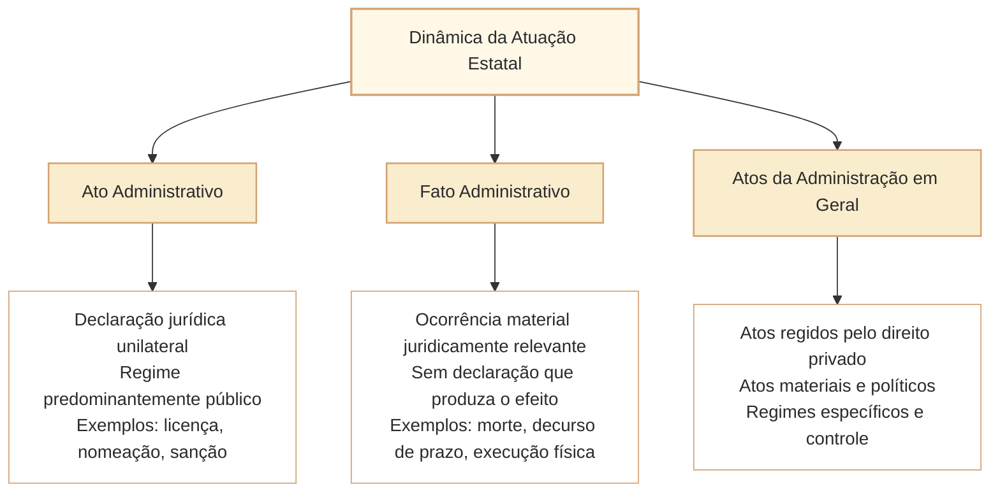

# Ato administrativo, fato administrativo e silêncio da Administração

Imagine que a Câmara dos Deputados publique uma portaria de nomeação. A portaria contém uma **decisão jurídica**. Se o servidor nomeado morre depois de assumir o cargo, seu falecimento é um **acontecimento** que produz consequências previstas em lei. Se a Câmara deixa de responder a um pedido, surge uma terceira situação: **silêncio administrativo**. Os três casos afetam a Administração, mas têm naturezas distintas.

A **Constituição Federal de 1988**, no art. 37, exige que a atividade administrativa observe legalidade, impessoalidade, moralidade, publicidade e eficiência. A **Lei nº 9.784/1999**, que disciplina o processo administrativo federal, impõe o dever de decidir nos arts. 48 e 49. A diferença entre ato e fato é sobretudo uma **classificação doutrinária**, construída para compreender como os efeitos jurídicos surgem e como podem ser controlados. Para classificar uma situação, pergunte primeiro se houve uma **declaração jurídica** (como uma nomeação), um **acontecimento ou execução material** (como a morte do servidor ou a demolição de um muro) ou uma **omissão** diante do dever de decidir.

## 1. Conceito Dogmático de Ato Administrativo

Neste título, **conceito dogmático** significa a definição usada pela doutrina jurídica para identificar e classificar um ato administrativo. A pergunta principal é: **o que torna uma decisão um ato administrativo?**

O **ato administrativo**, em uma definição doutrinária frequente, é uma **declaração jurídica unilateral** do Estado ou de quem exerce função administrativa sob regime predominantemente de direito público, com aptidão para produzir efeitos jurídicos. Ele pode reconhecer, criar, alterar ou extinguir situações jurídicas. Exemplos: conceder licença, nomear servidor, aplicar sanção ou expedir certidão.

**Declaração unilateral** significa que a formação do ato decorre da manifestação da autoridade competente; o destinatário não precisa negociar seus termos como em um contrato. Entretanto, a produção de certos efeitos pode depender de ciência, publicação, aceitação ou de outra condição prevista em lei. **Unilateralidade não significa que o ato possa ignorar os direitos do administrado.**

A doutrina não usa uma única fórmula rígida: algumas classificações incluem atos gerais e de conteúdo declaratório; outras reservam a expressão “ato administrativo em sentido estrito” para determinadas manifestações. Para resolver questões da Cebraspe, é essencial reconhecer o **regime jurídico** e a **função exercida**, além do nome do documento.

Um ato administrativo pode ser praticado pelo **Executivo**, pelo **Legislativo** ou pelo **Judiciário** quando exerce função administrativa. Uma autoridade privada que recebeu atribuição administrativa legalmente delegada também pode praticar atos submetidos a controle de direito público, conforme a competência e o regime específico; a mera existência de contrato com o Estado não concede poderes de autoridade. A Mesa da Câmara, por exemplo, administra pessoal e contratos. Isso é diferente de votar um projeto de lei, atividade legislativa. E a **possibilidade de controle judicial** prevista no art. 5º, XXXV, da Constituição não transforma o Judiciário em substituto livre do mérito administrativo.

A **Lei nº 4.717/1965**, Lei da Ação Popular, indica em seu art. 2º vícios relativos a competência, forma, objeto, motivo e finalidade. Esses elementos e a diferença entre atos perfeitos, válidos e eficazes são tratados em [[3 - Materias/Direito Administrativo/03 - atos administrativos|Elementos e validade do ato administrativo]].

## 2. Ato Administrativo vs. Fato Administrativo

**Fato administrativo** designa, na classificação aqui utilizada, um acontecimento da realidade que interessa à Administração e ao qual o Direito atribui consequências, **sem que esse acontecimento seja uma declaração jurídica de vontade**. A terminologia **varia conforme o autor**: certas doutrinas chamam de *fato administrativo* a própria execução material de uma atividade pública e reservam *fato da Administração* para ocorrências sem efeitos jurídicos específicos. Para a prova, é mais seguro identificar o que aconteceu e quais efeitos jurídicos surgiram do que supor que essas expressões tenham uma única definição. Por exemplo, a **morte de servidor** provoca a vacância prevista na Lei nº 8.112/1990; o **registro do óbito** apenas documenta esse fato; e a **execução física de uma demolição** concretiza uma decisão anterior.

| Situação | Natureza | Efeito jurídico ou prático |
| :--- | :--- | :--- |
| A Câmara expede portaria de nomeação | **Ato administrativo** | Declara a decisão de nomear; efeitos segundo o regime de investidura |
| Um servidor falece | **Fato jurídico com efeito administrativo** | Produz vacância do cargo na esfera federal (Lei nº 8.112/1990, art. 33, IX) |
| A Defesa Civil expede ordem legal de demolição | **Ato administrativo** | Determina a providência prevista nas condições legais |
| Equipe executa fisicamente a demolição | **Atuação material da Administração** | Concretiza a medida; continua sujeita a limites jurídicos |
| Termina prazo legal sem decisão | **Omissão ou silêncio administrativo** | Pode gerar mora e, se houver regra específica, efeitos como aprovação tácita |

**Ato material** é a ação física de execução: varrer a rua, transportar equipamentos, remover um obstáculo ou executar uma demolição. Mesmo quando tem consequências jurídicas, ele **não é a declaração jurídica que o autoriza**. Por isso a demolição física não se “revoga”, embora se possa questionar judicialmente sua legalidade, sua execução e eventuais danos. Uma portaria ilegal, ao contrário, pode ser **anulada** nas condições do Direito.

Nem todo ato administrativo admite **revogação** por conveniência ou **convalidação** de defeito: a primeira pressupõe um ato válido e juridicamente revogável; a segunda exige defeito sanável e ausência de lesão ao interesse público e prejuízo a terceiros, nos termos dos arts. 53 e 55 da Lei nº 9.784/1999. A distinção completa aparece em [[3 - Materias/Direito Administrativo/17 - anulacao revogacao convalidacao e extincao de atos administrativos|Anulação, revogação e convalidação]].

## 3. O Silêncio Administrativo e seus Efeitos Jurídicos

O **silêncio administrativo** ocorre quando a Administração deixa de manifestar uma decisão que deveria tomar. **A regra geral é que o silêncio, por si só, não equivale nem a autorização nem a recusa.** Mesmo depois de vencido o prazo, não se deve presumir que o interessado ganhou ou perdeu o pedido: essa consequência exige norma específica. Uma omissão pode ser questionada para obter uma decisão expressa, respeitados os requisitos do caso. A omissão pode ser ilegal porque a autoridade tem o dever de decidir; o efeito positivo ou negativo do silêncio depende de previsão normativa aplicável.

No **processo administrativo federal**, o art. 48 da **Lei nº 9.784/1999** estabelece que a Administração deve emitir **decisão expressa** em processos, solicitações e reclamações de sua competência. Depois de concluída a instrução, o **art. 49** prevê **até 30 dias para decidir**, prorrogáveis por **igual período**, com motivação expressa. Esse prazo começa **ao final da instrução**, e não automaticamente na data de todo protocolo. Normas especiais podem estabelecer regime distinto.

**Aprovação tácita** ocorre quando a lei atribui à falta de resposta, após determinado prazo, o efeito de aprovação do pedido. A **Lei nº 13.874/2019 (Declaração de Direitos de Liberdade Econômica)** prevê em seu **art. 3º, IX**, para certos **atos públicos de liberação de atividade econômica**, a comunicação de prazo máximo depois da apresentação dos elementos necessários e a aprovação tácita se transcorrido esse prazo sem decisão, **ressalvadas as proibições e condições da própria lei**. Entre as restrições do art. 3º, §§ 6º e 7º, estão questões tributárias ou registro de marcas, decisões que importem compromisso financeiro estatal, objeção expressa em tratado e certas solicitações feitas por agente público ou familiar à autoridade do próprio órgão. O art. 1º, § 5º, estabelece que a regra de aprovação tácita do art. 3º, IX, **não se aplica automaticamente a estados, Distrito Federal e municípios**: há exceção quando o ato decorre de legislação ordinária federal ou quando o ente ou órgão decide aderir validamente ao regime. É necessário verificar também os prazos e as exigências regulamentares. O **Decreto nº 10.178/2019** disciplina sua aplicação em seu âmbito.

Há uma diferença importante: o **art. 3º, I**, da Lei nº 13.874/2019 trata de certas **atividades econômicas de baixo risco dispensadas de atos de liberação**. Já a **aprovação tácita** do inciso IX diz respeito a pedidos de atos de liberação sujeitos ao regime da lei. São hipóteses distintas, portanto não basta mencionar "atividade de baixo risco" para presumir aprovação de pedido.

| Situação | Consequência |
| :--- | :--- |
| A autoridade não responde e não existe regra de efeito tácito | Há omissão; não se presume deferimento ou indeferimento |
| A lei estabelece aprovação tácita, todos os requisitos foram preenchidos e acabou o prazo | Produz-se o efeito previsto, observadas as exceções |
| A autoridade indefere expressamente um pedido | Existe decisão administrativa sujeita às formas cabíveis de recurso |
| O requerimento aguarda decisão além do prazo aplicável | O interessado pode buscar medidas administrativas e, se cabível, controle judicial para que haja decisão |

**Exemplo:** um cidadão requer informação à Câmara. A falta de resposta não transforma automaticamente o documento em informação liberada; aplicam-se o procedimento e os prazos próprios da **Lei nº 12.527/2011**, Lei de Acesso à Informação. Já uma autorização econômica sujeita validamente ao art. 3º, IX, da Lei nº 13.874/2019 pode ter efeito diferente. **O objeto do pedido e a lei incidente determinam a resposta.**

Quando não há efeito tácito previsto, o interessado pode pedir providências administrativas e, conforme os requisitos do caso, recorrer ao Judiciário, inclusive por **mandado de segurança** para combater omissão ilegal. A ordem judicial pode exigir que a autoridade **decida**; ela não representa autorização automática para substituir uma escolha administrativa discricionária válida.

## Atos da Administração que seguem outros regimes

**Atos da Administração**, em sentido amplo, compreendem diversas atividades do Estado, nem todas classificadas como atos administrativos **em sentido estrito**. As categorias devem ser identificadas pelo regime aplicável:

- **Atos de gestão sob regime predominantemente privado:** uma empresa estatal concorrencial realiza operações de sua atividade econômica. A Constituição, art. 173, § 1º, II, e a **Lei nº 13.303/2016**, Estatuto Jurídico das Empresas Estatais, impõem regras próprias, sem transformar cada contrato comercial em ato de autoridade. A estatal permanece sujeita aos deveres públicos aplicáveis.
- **Atos materiais:** execução física de atividade, como limpeza de prédio público ou cumprimento de medida administrativa. Suas consequências podem ser controladas e gerar responsabilidade por dano.
- **Atos políticos ou de governo:** exercício de competências constitucionais políticas, como **sanção ou veto presidencial** de projeto de lei (Constituição, art. 66). Seu conteúdo político não os torna imunes ao controle de constitucionalidade e legalidade nas hipóteses cabíveis.
- **Contratos administrativos:** ajustes com manifestação de vontade de duas ou mais partes, submetidos às regras legais da espécie, como a **Lei nº 14.133/2021** quando aplicável. Não se confundem com a declaração unilateral característica do ato administrativo.

## Questões comentadas no estilo Cebraspe

### Questão 1

*Item inédito.* O ato administrativo em sentido estrito constitui, segundo definição doutrinária usual, uma manifestação jurídica unilateral da função administrativa, sujeita ao regime jurídico aplicável e ao controle de legalidade.

- ( ) Certo
- ( ) Errado

**Gabarito: Certo.** A manifestação é jurídica e unilateral; a função administrativa pode ser exercida por Poderes diferentes. Isso não elimina condições de eficácia nem dispensa controle da legalidade.

### Questão 2

*Item inédito.* O falecimento de servidor público federal é um ato administrativo da autoridade responsável pelo registro de pessoal, pois o ato de registro é a causa jurídica da vacância do cargo.

- ( ) Certo
- ( ) Errado

**Gabarito: Errado.** A **morte** é um fato natural juridicamente relevante que provoca vacância, nos termos do art. 33, IX, da **Lei nº 8.112/1990**. O registro administrativo reconhece e documenta o fato, mas não é sua causa.

### Questão 3

*Item inédito.* No processo administrativo federal regido pela Lei nº 9.784/1999, o silêncio da autoridade após o prazo de decisão produz, como regra geral, deferimento automático de qualquer requerimento, ainda que não haja previsão de efeito tácito.

- ( ) Certo
- ( ) Errado

**Gabarito: Errado.** Os arts. 48 e 49 exigem decisão expressa, com prazo após conclusão da instrução. A aprovação tácita necessita de disciplina normativa específica, como nas hipóteses e limites do art. 3º, IX, da Lei nº 13.874/2019.

### Questão 4

*Item inédito.* A execução física de demolição determinada legalmente pela Defesa Civil constitui atuação material da Administração, distinta da decisão administrativa que ordenou a medida.

- ( ) Certo
- ( ) Errado

**Gabarito: Certo.** A ordem é declaração jurídica; a demolição é sua execução material. Ambas precisam respeitar o regime jurídico aplicável.

### Questão 5

*Item inédito.* Os contratos comerciais de uma sociedade de economia mista que explore atividade econômica em concorrência possuem automaticamente as mesmas prerrogativas de autoridade que os atos administrativos típicos de uma autarquia.

- ( ) Certo
- ( ) Errado

**Gabarito: Errado.** O art. 173, § 1º, II, da Constituição prevê regime próprio das empresas privadas para obrigações civis, comerciais, trabalhistas e tributárias dessas estatais, sem eliminar controles públicos específicos.

### Questão 6

*Item inédito.* Sanção e veto presidenciais a projetos de lei são exemplos de atos de governo, ligados ao exercício de competência constitucional, cuja natureza política não afasta por completo as possibilidades juridicamente cabíveis de controle.

- ( ) Certo
- ( ) Errado

**Gabarito: Certo.** Esses atos decorrem do processo político constitucional; a qualificação política não gera imunidade absoluta ao controle de constitucionalidade ou legalidade.

## Relações com outros artigos

Para reconhecer quem atua na estrutura estatal, veja [[3 - Materias/Direito Administrativo/12 - estado governo administracao e funcao administrativa|Estado, Governo e Administração]]. A distinção entre motivo, finalidade, objeto e demais elementos está em [[3 - Materias/Direito Administrativo/03 - atos administrativos|Elementos do ato administrativo]]. A revisão e extinção de atos é estudada em [[3 - Materias/Direito Administrativo/17 - anulacao revogacao convalidacao e extincao de atos administrativos|Anulação, revogação e convalidação]], e o dever de decidir no processo federal é aprofundado em [[3 - Materias/Direito Administrativo/09 - processo administrativo federal|Processo administrativo federal]].

## Fontes jurídicas

- [Constituição Federal de 1988](https://www.planalto.gov.br/ccivil_03/constituicao/constituicao.htm), arts. 5º, XXXV; 37; 66; 173; [Lei nº 4.717/1965](https://www.planalto.gov.br/ccivil_03/leis/l4717.htm), Lei da Ação Popular, art. 2º.
- [Lei nº 9.784/1999](https://www.planalto.gov.br/ccivil_03/leis/l9784.htm), processo administrativo federal, arts. 48 e 49 (dever e prazo de decisão) e 53 a 55 (anulação e convalidação).
- [Lei nº 13.874/2019](https://www2.camara.leg.br/legin/fed/lei/2019/lei-13874-20-setembro-2019-789149-normaatualizada-pl.html), Declaração de Direitos de Liberdade Econômica, art. 1º, § 5º, e art. 3º, I, IX e §§ 6º a 8º; e [Decreto nº 10.178/2019](https://www.planalto.gov.br/ccivil_03/_ato2019-2022/2019/decreto/d10178.htm), regulamentação de atos públicos de liberação econômica.
- [Lei nº 8.112/1990](https://www.planalto.gov.br/ccivil_03/leis/l8112cons.htm), art. 33, IX, vacância por falecimento; [Lei nº 12.527/2011](https://www.planalto.gov.br/ccivil_03/_ato2011-2014/2011/lei/l12527.htm), acesso à informação.
- [Lei nº 13.303/2016](https://www.planalto.gov.br/ccivil_03/_ato2015-2018/2016/lei/l13303.htm), Estatuto das Empresas Estatais; [Lei nº 14.133/2021](https://www.planalto.gov.br/ccivil_03/_ato2019-2022/2021/lei/l14133.htm), licitações e contratos administrativos.
