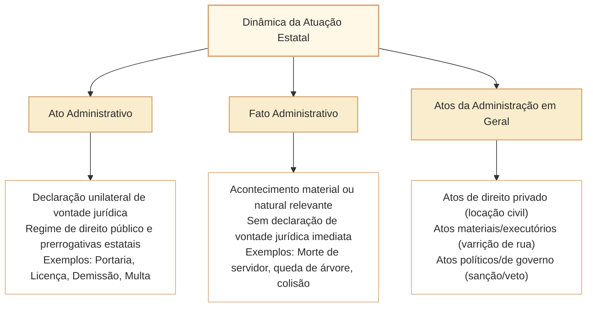

# Ato Administrativo: Conceito, Requisitos e Distinção de Fato Administrativo

No Direito Administrativo brasileiro, a manifestação da vontade estatal materializa-se por intermédio de múltiplos acontecimentos e provimentos jurídicos. Nas provas elaboradas pelo Cebraspe para carreiras legislativas de alto nível (notadamente para o cargo de Analista Legislativo da Câmara dos Deputados), a compreensão dogmática do **ato administrativo**, sua delimitação em face dos **atos da Administração em geral** e a distinção cirúrgica entre **ato administrativo**, **fato administrativo**, **ato material** e o regime do **silêncio administrativo** constituem um dos temas de maior precisão conceitual da disciplina.

A banca exige do candidato a superação de noções vulgares que confundem qualquer atividade executada por um servidor com ato administrativo. O ato administrativo em sentido estrito constitui uma **declaração jurídica unilateral de vontade**, emanada do Estado ou de quem lhe faça as vezes, no exercício de prerrogativas públicas, sob regime de direito público e sujeita a controle jurisdicional.

---

## 1. Conceito Dogmático de Ato Administrativo

A doutrina administrativista clássica (com destaque para Celso Antônio Bandeira de Mello, Hely Lopes Meirelles e Maria Sylvia Zanella Di Pietro) define o ato administrativo a partir de seus traços constitutivos essenciais:

> *"Declaração jurídica do Estado ou de quem lhe faça as vezes, que, no exercício de prerrogativas públicas e sob regime jurídico de direito público, produz efeitos jurídicos imediatos, com observância da lei e sob controle judicial."*

### 1.1. Traços Distintivos Essenciais
1. **Declaração Jurídica Unilateral:** O ato emana exclusivamente da manifestação de vontade do Estado (ou delegatário), independendo da concordância ou anuência prévia do administrado para existir e operar efeitos (distinguindo-se dos *contratos administrativos*, que são negócios jurídicos bilaterais).
2. **Exercício de Função Administrativa:** Pode ser praticado pelo Poder Executivo (função típica) ou pelos Poderes Legislativo e Judiciário (no exercício de suas funções administrativas atípicas de gestão interna de servidores, licitações e patrimônio).
3. **Regime de Direito Público:** Reveste-se das prerrogativas de autoridade (supremacia do interesse público) e sujeições (indisponibilidade e legalidade).
4. **Produção Imediata de Efeitos:** Cria, modifica, extingue ou declara direitos ou deveres concretos perante administrados ou órgãos internos.
5. **Submissão a Controle Jurisdicional:** Por força do art. 5º, XXXV, da CF/1988 (princípio da inafastabilidade da tutela jurisdicional), nenhum ato administrativo pode ser excluído da apreciação do Poder Judiciário quanto aos seus aspectos de legalidade e moralidade.

---

## 2. Ato Administrativo vs. Fato Administrativo

A distinção entre ato e fato constitui uma das armadilhas prediletas do Cebraspe em questões literais e de casos concretos:

| Critério de Comparação | Ato Administrativo | Fato Administrativo |
| :--- | :--- | :--- |
| **Origem e Vontade** | **Declaração formal e voluntária** de vontade da Administração. | **Acontecimento material ou da natureza** que independe de declaração formal. |
| **Finalidade Imediata** | Produzir efeitos jurídicos predeterminados pelo ordenamento. | O efeito jurídico decorre automaticamente da lei em virtude da ocorrência material do fato. |
| **Revogação / Convalidação** | **Passível de anulação, revogação e convalidação**, por se tratar de ato jurídico. | **Não comporta revogação, anulação ou convalidação** (não se "anula" uma tempestade ou uma morte). |
| **Exemplos no Parlamento** | Publicação de portaria de nomeação; aplicação de suspensão disciplinar; concessão de licença. | Morte de servidor (fato natural que gera a vacância do cargo); decurso de prazo decadencial; incêndio no plenário. |

### 2.1. Atos Materiais da Administração (*Fatos da Administração*)
Ao lado dos fatos da natureza, existem os **atos materiais** ou meras atuações físicas de execução (frequentemente chamados pela doutrina de *fatos da Administração voluntários*). Consistem na execução física pura de um ato administrativo prévio:
- *Ato Administrativo:* A ordem de demolição de um prédio em ruínas expedida pela fiscalização de obras.
- *Ato Material / Fato Administrativo:* A marretada ou a demolição mecânica realizada pelos operários da prefeitura.
- *Ato Administrativo:* A ordem de apreensão de mercadoria contrabandeada.
- *Ato Material:* O carregamento físico dos bens apreendidos na viatura fiscal.
- Os atos materiais não corporificam uma declaração jurídica de vontade em si, mas a execução física subordinada a um ato anterior.

---

## 3. O Silêncio Administrativo e seus Efeitos Jurídicos

O Cebraspe questiona frequentemente a natureza jurídica da omissão estatal diante do requerimento de um cidadão: **o silêncio da Administração é ato administrativo?**

> [!IMPORTANT]
> **A Regra Geral no Direito Administrativo:**
> O silêncio administrativo **NÃO é ato administrativo; é um FATO ADMINISTRATIVO (uma omissão material juridicamente relevante)**. Quem cala no Direito Público **não consente nem rejeita**, salvo se houver expressa e inequívoca determinação legal que atribua efeito específico ao transcurso do prazo.

### 3.1. Efeitos do Silêncio e Remédios Jurídicos
1. **Inexistência de Manifestação de Vontade:** O silêncio revela inércia, descumprimento do dever constitucional de prestar informações e decidir (art. 5º, XXXIII e LXXVIII, da CF/1988 e art. 48 da Lei nº 9.784/1999).
2. **Quando a Lei Estabelece Efeito ao Silêncio:**
   - Se a lei expressamente dispuser que o silêncio durante determinado prazo importa em **deferimento tácito** (como ocorre na Lei de Liberdade Econômica - Lei nº 13.874/2019 para liberação de certas atividades econômicas de baixo risco), o transcurso do tempo gera os efeitos jurídicos previstos na norma.
   - Se a lei dispuser que o silêncio importa em **indeferimento tácito**, abre-se para o interessado a via recursal cabível.
3. **Ausência de Previsão Legal sobre o Efeito do Silêncio:**
   - O cidadão não pode presumir deferido nem indeferido o seu pedido. Diante da inércia ilícita da autoridade, o remédio constitucional cabível é o **Mandado de Segurança contra a omissão** ou a **Ação Ordinária de Obrigação de Fazer**, visando obter provimento judicial que **determine que a autoridade aprecie e decida o requerimento**, e não que o juiz profira a decisão discricionária no lugar do administrador.

---

## 4. Atos da Administração em Geral: Categorias Excluídas do Conceito Estrito

Nem todo ato praticado pela Administração Pública constitui ato administrativo em sentido estrito. A doutrina identifica espécies de atos da Administração que se submetem a regimes jurídicos próprios:

1. **Atos de Direito Privado da Administração:** Praticados pela Administração despida de suas prerrogativas de autoridade pública, submetendo-se predominantemente ao direito civil ou comercial (e.g., celebração de contrato de locação de imóvel privado em que o Estado atua como locatário comum; doação civil pura; emissão de cheques por estatais).
2. **Atos Materiais:** Operações técnicas e tarefas físicas de rotina desprovidas de caráter decisório (varrição de vias, digitação de memorandos, condução de veículos oficiais).
3. **Atos Políticos ou de Governo:** Atos que consubstanciam o exercício direto de competências políticas previstas na própria Constituição, marcados por ampla discricionariedade e controle judicial mitigado (e.g., sanção ou veto de projeto de lei pelo Presidente da República; declaração de guerra ou celebração de paz; declaração de estado de defesa ou sítio; indicação de Ministros de Tribunais Superiores).

---

## 5. Questões Comentadas no Estilo Cebraspe

### Questão 1
*(Inédita: estilo Cebraspe / Câmara dos Deputados – Analista Legislativo)*

**Item:** O ato administrativo constitui uma declaração jurídica unilateral emanada do Estado ou de seus delegatários que, sob regime predominantemente de direito público, tem por fim imediato adquirir, resguardar, transferir, modificar, extinguir direitos ou impor obrigações aos administrados ou a si próprio.

- ( ) Certo
- ( ) Errado

**Gabarito: Certo**  
**Comentário:** O item sintetiza a clássica e precisa conceituação dogmática de ato administrativo adotada pelo Cebraspe e consolidada na doutrina (Hely Lopes Meirelles e Celso Antônio Bandeira de Mello), destacando seu caráter unilateral, a submissão ao regime de direito público e a produção imediata de efeitos jurídicos.

---

### Questão 2
*(Inédita: estilo Cebraspe / Câmara dos Deputados – Analista Legislativo)*

**Item:** A morte de um servidor público titular de cargo efetivo da Câmara dos Deputados constitui ato administrativo extintivo da relação funcional, devendo ser objeto de anulação caso seja comprovada irregularidade no laudo pericial cadavérico.

- ( ) Certo
- ( ) Errado

**Gabarito: Errado**  
**Comentário:** A morte é um **fato natural da vida com reflexos jurídicos**, consubstanciando um **fato administrativo**, e não um ato administrativo. O fato administrativo gera automaticamente a vacância do cargo (art. 33, IX, da Lei nº 8.112/1990) por força da lei, não emanando de uma declaração de vontade volitiva da Administração. Fatos não são passíveis de "anulação" ou "revogação" (institutos privativos de atos administrativos). O que a autoridade faz é apenas formalizar a declaração de vacância decorrente do fato da morte.

---

### Questão 3
*(Inédita: estilo Cebraspe / Câmara dos Deputados – Analista Legislativo)*

**Item:** Na omissão da lei quanto aos efeitos do silêncio da autoridade administrativa perante requerimento de licença formulado por cidadão, presume-se a ocorrência de deferimento tácito, em consonância com o princípio da eficiência administrativa.

- ( ) Certo
- ( ) Errado

**Gabarito: Errado**  
**Comentário:** No Direito Administrativo brasileiro, o silêncio administrativo é um **fato omissivo** que não gera presunção de consentimento ou deferimento, salvo expressa e inequívoca previsão legal em contrário. Diante da inércia ilícita da autoridade sem disciplina normativa autorizadora de deferimento tácito, cabe ao interessado socorrer-se das vias judiciais (como o mandado de segurança) para compelir a autoridade a decidir.

---

### Questão 4
*(Inédita: estilo Cebraspe / Câmara dos Deputados – Analista Legislativo)*

**Item:** A demolição física de imóvel condenado pela Defesa Civil, levada a efeito pelos operários municipais com base em prévia ordem da fiscalização de posturas, configura ato material da Administração, correspondendo à execução de um ato administrativo prévio.

- ( ) Certo
- ( ) Errado

**Gabarito: Certo**  
**Comentário:** A demolição física levada a efeito constitui ato material (fato da Administração voluntário), o qual consubstancia a concretização mecânica e fática da ordem jurídica de demolição (que esta sim corporificou o ato administrativo prévio dotado de autoexecutoriedade).

---

### Questão 5
*(Inédita: estilo Cebraspe / Câmara dos Deputados – Analista Legislativo)*

**Item:** Os atos de gestão privada praticados pelas empresas públicas e sociedades de economia mista exploradoras de atividade econômica em concorrência no mercado equiparam-se, para todos os efeitos de validade e controle, aos atos administrativos típicos das autarquias.

- ( ) Certo
- ( ) Errado

**Gabarito: Errado**  
**Comentário:** Conforme o art. 173, § 1º, II, da CF/1988 e a Lei nº 13.303/2016, as empresas estatais exploradoras de atividade econômica submetem-se ao regime jurídico próprio das empresas privadas, inclusive quanto aos direitos e obrigações civis, comerciais, trabalhistas e tributários. Seus atos de comércio e gestão comercial não constituem atos administrativos em sentido estrito dotados de presunção de legitimidade ou imperatividade pública.

---

### Questão 6
*(Inédita: estilo Cebraspe / Câmara dos Deputados – Analista Legislativo)*

**Item:** A fixação de diretrizes de política externa e a sanção ou veto a projetos de lei pelo Chefe do Poder Executivo corporificam atos de governo ou políticos, os quais se distinguem dos atos administrativos ordinários por estarem diretamente vinculados ao texto constitucional e possuírem ampla discricionariedade política.

- ( ) Certo
- ( ) Errado

**Gabarito: Certo**  
**Comentário:** Os atos políticos ou de governo decorrem do exercício da função política de condução suprema do Estado (*policy making*), vinculando-se diretamente à Constituição. Distinguem-se dos atos administrativos comuns, que consubstanciam atividade executória, técnica e subordinada à lei formal.

---

## 6. Relações com Outros Artigos e Síntese de Revisão

- **Pré-requisitos e Vínculos Teóricos:**
  - [[3 - Materias/Direito Administrativo/12 - estado governo administracao e funcao administrativa|CAM-DAD-001]]: Distinção estrutural entre Governo e Administração técnica.
  - [[3 - Materias/Direito Administrativo/01 - principios e lei de acesso a informacao|CAM-DAD-002]]: A submissão dos atos administrativos ao princípio da juridicidade e da moralidade.
  - [[3 - Materias/Direito Administrativo/03 - atos administrativos|CAM-DAD-006 a CAM-DAD-009]]: Os requisitos de validade (CO-FI-FO-MO-O), atributos, classificação e extinção de atos administrativos.
  - [[3 - Materias/Direito Administrativo/09 - processo administrativo federal|CAM-DAD-018 / CAM-DAD-019]]: A formalização do ato administrativo e o dever legal de motivação da Lei nº 9.784/1999.
