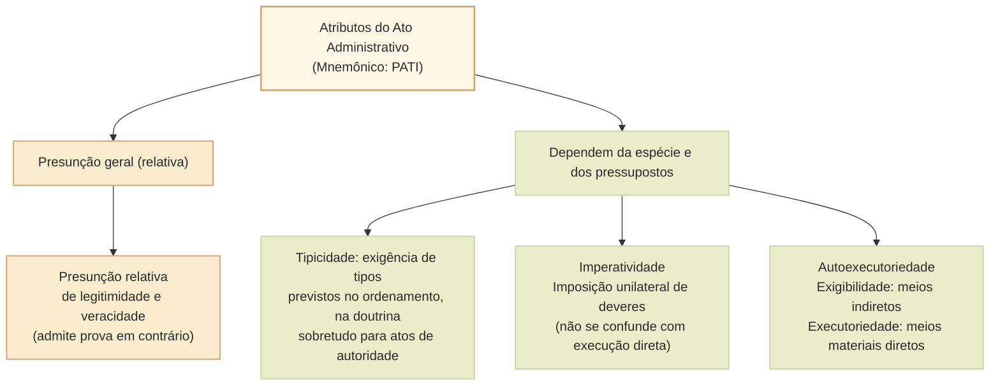
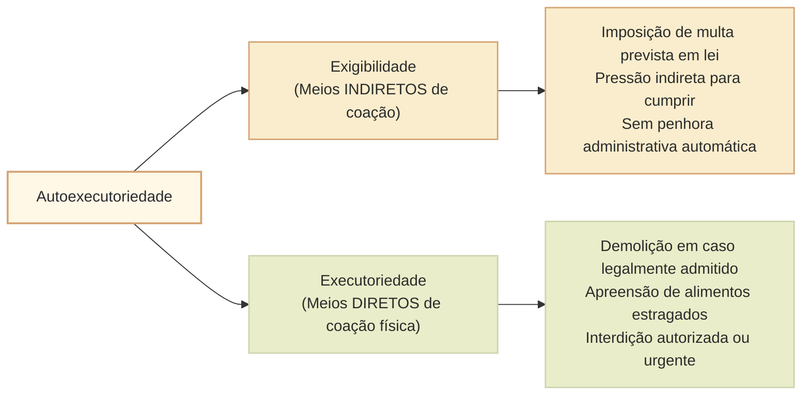

# Atributos do ato administrativo: presunção, imperatividade, autoexecutoriedade e tipicidade

Imagine que um fiscal sanitário interdite um restaurante por risco imediato à saúde. Sua decisão pode impor deveres mesmo sem a concordância do proprietário e, se presentes requisitos legais ou urgência, ser executada sem ordem judicial prévia. Se o fiscal apenas expedir uma certidão, o efeito será diferente. Os **atributos dos atos administrativos** explicam essas distinções.

A doutrina costuma reunir quatro atributos no mnemônico **PATI**: **presunção de legitimidade e veracidade**, **autoexecutoriedade**, **tipicidade** e **imperatividade**. Trata-se de **classificação doutrinária**, cujos efeitos dependem do ato e da lei. Os **elementos de validade** (competência, finalidade, forma, motivo e objeto) são outra classificação, abordada em [[3 - Materias/Direito Administrativo/03 - atos administrativos|Elementos do ato administrativo]].

## 1. Presunção de Legitimidade e de Veracidade

A **presunção de legitimidade** significa que o ato administrativo é considerado, inicialmente, compatível com o Direito. A **presunção de veracidade** diz respeito aos fatos declarados pela autoridade no exercício de suas atribuições. Por exemplo, um auto de fiscalização registra que o fiscal encontrou alimentos vencidos. O registro goza de presunção inicial, mas pode ser contestado com elementos em contrário.

Essas presunções são **relativas**, também chamadas *juris tantum*: admitem prova contrária e não dispensam fundamentação nem procedimento regular. **Presunção** não é prova absoluta de que a autoridade sempre agiu corretamente; documentos, testemunhas e perícias podem demonstrar erro de fato, interpretação ilegal ou vício de procedimento.

A presunção também **não produz inversão automática e irrestrita de todo ônus da prova**. Na esfera judicial, aplicam-se as regras do caso, inclusive o **art. 373 da Lei nº 13.105/2015 (Código de Processo Civil)**: o autor deve provar o fato constitutivo do seu direito, o réu os fatos impeditivos, modificativos ou extintivos, e pode haver distribuição diversa nas situações legais, mediante decisão fundamentada. Na esfera administrativa, persistem deveres de instrução e motivação. A presunção pode influenciar a posição das partes, mas não autoriza exigir do cidadão a prova de fatos impossíveis.

**Efeitos do ato:** a apresentação de uma ação judicial não suspende automaticamente o ato contestado. A suspensão pode decorrer de decisão judicial, administrativa ou de previsão legal, conforme a situação. Além disso, um ato pode depender de publicação, ciência ou condição para produzir seus efeitos; presunção de validade não substitui requisito de eficácia.

## 2. Imperatividade (Poder Extroverso / Coercibilidade)

**Imperatividade** é a capacidade de determinados atos administrativos imporem obrigações ou sujeições a terceiros sem depender da aceitação deles. A expressão *poder extroverso* refere-se à possibilidade de o poder público produzir efeitos jurídicos fora da sua própria estrutura, nos limites do Direito. **Coercibilidade** descreve a possibilidade de exigir o cumprimento de uma determinação legítima, inclusive por meios de coerção autorizados pelo Direito. Essas expressões aparecem associadas na doutrina, mas é preciso distinguir **impor o dever**, **exigir seu cumprimento** e **executar materialmente uma providência**. Uma multa pode ser imposta unilateralmente sem que a Administração possa retirar dinheiro da conta do multado por conta própria.

Uma multa de trânsito ou uma ordem legal de interdição pode ter **imperatividade**. Uma certidão que apenas atesta tempo de serviço não impõe dever novo ao destinatário, assim como uma licença vinculada requerida e concedida ao interessado não precisa desse atributo para produzir seu efeito favorável.

Assim, **nem todo ato unilateral é imperativo**. O fato de uma autoridade assinar um documento não basta para afirmar que ele pode impor obrigação a qualquer pessoa. O fundamento jurídico e o conteúdo da decisão determinam os efeitos.

## 3. Autoexecutoriedade

**Autoexecutoriedade**, em sentido amplo, é a possibilidade de a Administração fazer cumprir determinadas decisões sem obter previamente autorização judicial, quando o ordenamento o permite. Parte da doutrina distingue duas manifestações, que também recebem classificações diferentes conforme o autor: **exigibilidade** e **executoriedade**. Em sentido estrito, a executoriedade corresponde à execução material direta:

**Exigibilidade** é usar meios **indiretos** legalmente permitidos para exigir cumprimento, como impor uma multa administrativa prevista em lei. **Executoriedade** é realizar a medida materialmente, por exemplo apreender alimento impróprio para consumo ou interditar local em situação permitida. Não confundir **aplicar uma multa** com **tomar compulsoriamente dinheiro para cobrá-la**.

### 3.2. Hipóteses em que a autoexecutoriedade é admitida

A execução direta exige **previsão normativa suficiente** ou **urgência real** que justifique agir sem aguardar ordem judicial, com competência, proporcionalidade e respeito às garantias aplicáveis. A **Lei nº 6.437/1977**, em seu art. 2º, prevê sanções como multa, apreensão e inutilização de produtos e interdição parcial ou total de estabelecimentos, observados os requisitos legais. O elenco ajuda a diferenciar a **decisão de aplicar uma sanção** da **execução material de uma medida**: aplicar uma multa não equivale a penhorar dinheiro, enquanto uma apreensão legalmente admitida pode envolver atuação física do fiscal. A urgência deve ser demonstrável: não basta escrever “interesse público” para legitimar qualquer intervenção.

A **cobrança forçada de multa pecuniária** normalmente exige o procedimento judicial cabível. A **Lei nº 6.830/1980 (Lei de Execução Fiscal)** disciplina a cobrança judicial de Dívida Ativa tributária e não tributária da Fazenda Pública. A Administração pode constituir o crédito e tomar providências administrativas previstas em lei, mas **não pode penhorar a conta bancária do multado por ato próprio** sob o pretexto de autoexecutoriedade.

## Tipicidade: poderes e espécies previstos no ordenamento

Na classificação associada a **Maria Sylvia Zanella Di Pietro**, a **tipicidade** exige que atos de autoridade correspondam a figuras e consequências previstas pelo ordenamento. Protege o cidadão contra a criação arbitrária de sanções ou restrições administrativas sem fundamento jurídico.

A tipicidade tem força especial na **atividade sancionadora**: ninguém pode ser punido administrativamente com penalidade inventada pela autoridade. Contudo, a doutrina diverge quanto ao alcance desse atributo em **todos** os atos. Para a Cebraspe, a resposta deve observar o autor ou enunciado de referência e a espécie analisada. Dizer que todas as manifestações públicas, inclusive meros atos opinativos ou de gestão privada, têm tipicidade no mesmo sentido pode ser uma generalização excessiva.

| Atributo | O que permite ou presume | Limite decisivo |
| :--- | :--- | :--- |
| **Presunção de legitimidade e veracidade** | Considerar inicialmente regular o ato e os fatos que declara | É relativa, admite provas contrárias e não elimina requisitos de eficácia |
| **Imperatividade** | Impor obrigação ou sujeição, sem concordância do destinatário | Não se verifica em todo ato, como mera certidão |
| **Autoexecutoriedade** | Executar medida admitida sem ordem judicial prévia | Depende dos pressupostos legais e não autoriza penhora administrativa de multa |
| **Tipicidade** | Respeitar os tipos e limites previstos no Direito, sobretudo nos atos de autoridade | É classificação doutrinária cuja extensão varia conforme o conceito adotado |

## Questões comentadas no estilo Cebraspe

### Questão 1

*Item inédito.* A aplicação de multa sanitária permite à autoridade administrativa penhorar diretamente ativos bancários da empresa para satisfazer o crédito, mesmo sem execução judicial, em razão da autoexecutoriedade.

- ( ) Certo
- ( ) Errado

**Gabarito: Errado.** A **imposição** da multa pode ser imperativa e exigível, mas sua **cobrança forçada**, em regra, segue as vias judiciais previstas, como a Lei nº 6.830/1980 quando aplicável. Autoexecutoriedade não é autorização para penhorar por decisão administrativa própria.

### Questão 2

*Item inédito.* A presunção de veracidade do auto de infração é relativa e admite prova contrária em procedimento administrativo ou judicial.

- ( ) Certo
- ( ) Errado

**Gabarito: Certo.** A expressão *juris tantum* significa presunção que admite demonstração em contrário. A autoridade não está dispensada de respeitar os requisitos legais de instrução e motivação.

### Questão 3

*Item inédito.* O atributo da imperatividade está presente em todos os atos administrativos unilaterais, inclusive nas certidões que simplesmente atestam informações funcionais.

- ( ) Certo
- ( ) Errado

**Gabarito: Errado.** Certidão é ato que declara informação, sem impor necessariamente uma obrigação a terceiro. A imperatividade depende do conteúdo e da espécie do ato.

### Questão 4

*Item inédito.* Nas condições juridicamente admitidas, uma medida urgente de polícia sanitária pode ser executada diretamente pela Administração sem ordem judicial prévia, observados competência e proporcionalidade.

- ( ) Certo
- ( ) Errado

**Gabarito: Certo.** Há situações de urgência ou autorização legal que admitem execução direta. Isso não elimina o controle posterior de legalidade, os deveres de fundamentação ou eventuais responsabilidades.

### Questão 5

*Item inédito.* A tipicidade, na classificação doutrinária dos atos administrativos, permite à Administração criar novas espécies de sanção sem base normativa quando o objetivo declarado seja eficiência.

- ( ) Certo
- ( ) Errado

**Gabarito: Errado.** A tipicidade protege contra criação arbitrária de sanções e restrições. A eficiência não autoriza inovar livremente em deveres ou penalidades.

### Questão 6

*Item inédito.* O ajuizamento de ação anulatória contra ato administrativo suspende automaticamente seus efeitos e elimina a presunção de legitimidade até a decisão final.

- ( ) Certo
- ( ) Errado

**Gabarito: Errado.** A ação, por si só, não gera suspensão automática. É preciso identificar previsão legal ou decisão de autoridade competente, administrativa ou judicial, que suspenda os efeitos.

## Relações com outros artigos

A base dos atributos é explicada em [[3 - Materias/Direito Administrativo/14 - ato administrativo conceito e distincao de fato administrativo|Conceito de ato administrativo]]. A diferença entre requisitos de validade e atributos aparece em [[3 - Materias/Direito Administrativo/03 - atos administrativos|Elementos do ato]]. Os limites de imperatividade e autoexecutoriedade são aplicados em [[3 - Materias/Direito Administrativo/04 - poderes administrativos|Poderes administrativos]].

## Fontes jurídicas e doutrinárias

- [Constituição Federal de 1988](https://www.planalto.gov.br/ccivil_03/constituicao/constituicao.htm), art. 37, princípios e limites dos poderes administrativos.
- [Lei nº 13.105/2015](https://www.planalto.gov.br/ccivil_03/_ato2015-2018/2015/lei/l13105.htm), Código de Processo Civil, art. 373: distribuição do ônus da prova; [Lei nº 9.784/1999](https://www.planalto.gov.br/ccivil_03/leis/l9784.htm), processo administrativo federal, dever de fundamentação.
- [Lei nº 6.830/1980](https://www.planalto.gov.br/ccivil_03/leis/l6830.htm), Execução Fiscal: cobrança judicial de Dívida Ativa; [Lei nº 6.437/1977, art. 2º](https://www2.camara.leg.br/legin/fed/lei/1970-1979/lei-6437-20-agosto-1977-357206-normaatualizada-pl.html), sanções sanitárias federais, incluindo multa, apreensão e interdição.
- **Doutrina:** Maria Sylvia Zanella Di Pietro (tipicidade); Celso Antônio Bandeira de Mello (exigibilidade e executoriedade); Hely Lopes Meirelles (atributos dos atos).
