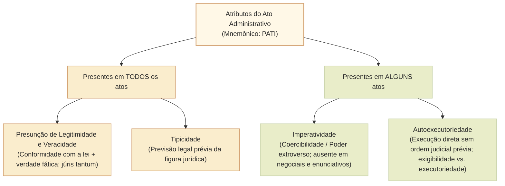
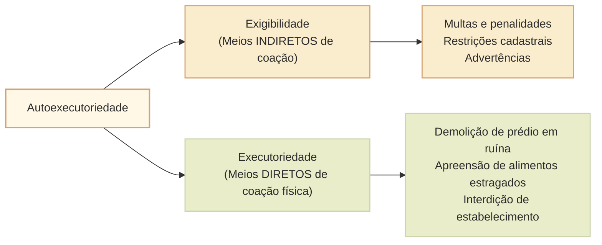

# Atributos do ato administrativo: presunção de legitimidade e veracidade, imperatividade, autoexecutoriedade e tipicidade

Os **atributos** (ou características) do ato administrativo consubstanciam as prerrogativas de direito público que diferenciam os atos da Administração dos atos jurídicos de direito privado. Decorrentes do **regime jurídico-administrativo** e fundamentados na supremacia do interesse público sobre o privado, esses atributos conferem à Administração Pública instrumentos eficazes para a gestão dos serviços coletivos e o exercício do poder de polícia.

Diferentemente dos *requisitos de validade* (elementos estruturais que devem estar presentes em **todo e qualquer** ato administrativo: competência, finalidade, forma, motivo e objeto), os atributos **não estão presentes de modo cumulativo e obrigatório em todas as espécies de atos**. Enquanto a *presunção de legitimidade* e a *tipicidade* estão presentes em todos os atos administrativos, a *imperatividade* e a *autoexecutoriedade* comparecem apenas em determinadas categorias de atos.

A doutrina brasileira consagra o mnemônico clássico **PATI**:
1. **Presunção de legitimidade e veracidade** (P);
2. **Autoexecutoriedade** (A);
3. **Tipicidade** (T);
4. **Imperatividade** (I).

---

## 1. Presunção de Legitimidade e de Veracidade

### 1.1. Duplo desdobramento: legitimidade de direito e veracidade de fato
A presunção que recai sobre o ato administrativo desdobra-se em duas vertentes complementares:
- **Presunção de legitimidade:** conformidade do ato com o ordenamento jurídico. Presume-se que o ato foi editado em estrita observância à lei, à Constituição e aos regulamentos.
- **Presunção de veracidade:** certeza quanto aos fatos alegados pela Administração. Presume-se que os fatos descritos pela autoridade administrativa (ex.: certidões, autos de infração, laudos de fiscalização) realmente ocorreram na forma registrada.

### 1.2. Natureza jurídica: presunção relativa (*juris tantum*)
A presunção de legitimidade e veracidade **não é absoluta (*jure et de jure*)**, mas **relativa (*juris tantum*)**, admitindo prova em contrário em sede administrativa ou judicial.

### 1.3. Consequências práticas e processuais
1. **Inversão do ônus da prova:** cabe ao administrado (ou particular interessado) o ônus de provar cabalmente que a autoridade mentiu, falsificou os fatos ou violou a lei.
2. **Autoaplicabilidade e eficácia imediata:** enquanto não for declarada a nulidade pela própria Administração (autotutela) ou pelo Poder Judiciário, o ato administrativo produz regularmente todos os seus efeitos jurídicos. O ajuizamento de ação judicial, por si só, não suspende a eficácia do ato administrativo, salvo decisão liminar ou concessão de tutela de urgência.

---

## 2. Imperatividade (Poder Extroverso / Coercibilidade)

### 2.1. Conceito e alcance
A **imperatividade** é o atributo pelo qual os atos administrativos se impõem a terceiros de forma cogente e unilateral, independentemente da concordância ou anuência prévia dos administrados atingidos.
- Decorre do chamado **poder extroverso do Estado** (expressão cunhada por Marcello Caetano), que traduz a prerrogativa conferida ao Poder Público de constituir obrigações para terceiros além dos limites internos de sua própria estrutura.
- Cria situações jurídicas novas, deveres e sujeições (ex.: interdição de estabelecimento comercial, desapropriação de imóvel, imposição de multa de trânsito, imposição de quarentena sanitária).

### 2.2. Atos em que a imperatividade NÃO está presente
A imperatividade **não é atributo universal** de todos os atos administrativos:
- **Atos negociais:** dependem da vontade e provocação do administrado para a produção de efeitos (ex.: autorização, permissão, licença, visto, homologação).
- **Atos enunciativos:** limitam-se a atestar uma situação fática pré-existente ou emitir juízo técnico/opinativo, sem impor comando imperativo unilateral (ex.: certidões, atestados, declarações, pareceres jurídicos facultativos).

---

## 3. Autoexecutoriedade

### 3.1. Conceito e distinção: Exigibilidade versus Executoriedade
A **autoexecutoriedade** consiste na prerrogativa conferida à Administração Pública de compelir materialmente o administrado ao cumprimento do ato administrativo e executá-lo diretamente pelo uso da força pública própria, **sem necessidade de intervenção ou autorização prévia do Poder Judiciário**.

A doutrina administrativista clássica (liderada por Celso Antônio Bandeira de Mello e Hely Lopes Meirelles) desmembra o atributo em duas faculdades distintas:
1. **Exigibilidade (meios indiretos de coação):** a Administração compele o administrado a cumprir a determinação legal mediante coação psicológica ou sanções financeiras (ex.: aplicação de multa cominatória diária, impedimento de renovação de licenciamento de veículo por débito de IPVA). Não há invasão patrimonial imediata direta.
2. **Executoriedade (meios diretos de coação material):** a Administração executa diretamente e pela força a providência administrativa, sem passar pelo crivo prévio do juiz (ex.: demolição de obra clandestina com risco iminente de desabamento, apreensão de mercadorias adulteradas, dispersão forçada de aglomeração ilegal).

### 3.2. Hipóteses em que a autoexecutoriedade é admitida
A autoexecutoriedade **não existe em todos os atos** e não pode ser exercida de forma arbitrária. A doutrina e a jurisprudência somente admitem a autoexecutoriedade material direta em duas situações taxativas:
1. **Quando houver expressa previsão em lei:** a norma legal prevê expressamente que a autoridade pode agir compulsoriamente (ex.: apreensão aduaneira, poder de fiscalização sanitária na Lei nº 6.437/1977).
2. **Em situações de urgência inadiável:** quando a demora para obter ordem judicial puder acarretar dano irreparável ao interesse público coletivo, à segurança, à saúde ou à ordem pública (ex.: evacuação e interdição forçada de encosta com risco de desmoronamento).

### 3.3. A grande exceção de prova: a cobrança de multas pecuniárias
A imposição da multa administrativa é imperativa e exigível. No entanto, a **cobrança forçada do valor financeiro da multa NÃO é autoexecutória**.
- A Administração **não pode invadir diretamente a conta bancária ou penhorar bens do devedor por conta própria**.
- Para cobrar compulsoriamente o crédito tributário ou não tributário inadimplido, a Fazenda Pública deve inscrever o débito em Dívida Ativa, expedir a Certidão de Dívida Ativa (CDA) e ajuizar **Ação de Execução Fiscal perante o Poder Judiciário** (Lei nº 6.830/1980). Trata-se de uma das armadilhas mais exploradas pelo Cebraspe.

---

## 4. Tipicidade

### 4.1. Conceito e função garantista
A **tipicidade** (atributo formulado modernamente pela Professora Maria Sylvia Zanella Di Pietro) define que o ato administrativo deve corresponder a figuras jurídicas previamente delineadas e tipificadas pela lei em espécie.
- É a consagração do princípio da legalidade estrita em relação às formas e conteúdos dos atos administrativos.
- **Função garantista:** impede que a Administração Pública crie tipos unilaterais inominados ou invente penalidades e restrições atípicas à liberdade e à propriedade privada sem suporte legal expresso.
- Assim como no Direito Penal vigora o princípio da taxatividade e tipicidade das infrações, no Direito Administrativo o administrado tem a garantia de que as manifestações estatais imperativas seguirão moldes previamente instituídos e tipificados pelo legislador.
- A tipicidade está presente em **todos os atos unilaterais da Administração**.

---

## Quadro Sinótico: Distribuição dos Atributos nas Espécies de Atos

| Atributo | Significado Central | Presente em todos os atos? | Principal Exceção / Limite |
| :--- | :--- | :--- | :--- |
| **Presunção de Legitimidade** | Conformidade com o direito e veracidade fática (*juris tantum*). | **Sim, em todos**. | Não é presunção absoluta; inverte o ônus da prova. |
| **Tipicidade** | Previsão prévia da figura e limites do ato na legislação. | **Sim, em todos os atos unilaterais**. | Veda a criação de atos arbitrários ou inominados restritivos. |
| **Imperatividade** | Obrigatoriedade cogente imposta a terceiros (poder extroverso). | **Não, apenas em certos atos**. | Inexiste em atos **negociais** (licença, autorização) e **enunciativos** (certidão, parecer). |
| **Autoexecutoriedade** | Execução direta sem autorização judicial prévia. | **Não, apenas em certos atos**. | Depende de lei expressa ou urgência; **não se aplica à cobrança forçada de multas pecuniárias** (exige execução fiscal judicial). |

---

## Questões Comentadas (Estilo Cebraspe)

### Questão 1
*(Inédita: estilo Cebraspe / Câmara dos Deputados – Analista Legislativo)*  
Acerca dos atributos dos atos administrativos e das prerrogativas da Fazenda Pública, julgue o item.

> Aplicada validamente penalidade de multa administrativa por órgão de fiscalização a determinada empresa prestadora de serviços, caso o particular se recuse a efetuar o recolhimento voluntário no prazo fixado, a Administração poderá exercer a autoexecutoriedade plena do ato, promovendo a penhora administrativa direta dos ativos financeiros da infratora para quitação do débito.

**( ) Certo**  
**( ) Errado**

> **Gabarito: Errado**  
> **Comentário:** Embora a imposição da multa administrativa seja dotada de imperatividade e exigibilidade, a sua cobrança forçada **não goza de autoexecutoriedade**. A Administração Pública não dispõe de poder para expropriar patrimônio ou penhorar bens e valores bancários por decisão administrativa própria. Para a satisfação compulsória do crédito inadimplido, o Estado deve inscrever o valor em Dívida Ativa e ajuizar a competente Ação de Execução Fiscal perante o Poder Judiciário, sob a disciplina da Lei nº 6.830/1980.

---

### Questão 2
*(Inédita: estilo Cebraspe / Câmara dos Deputados – Analista Legislativo)*  
No que concerne à presunção de legitimidade e de veracidade dos atos administrativos, julgue o item subsequente.

> A presunção de legitimidade do ato administrativo é absoluta em relação aos fatos certificados por agente público no exercício de suas atribuições, gerando presunção *jure et de jure* que impede a produção de contraprova perante o Poder Judiciário, ressalvada a arguição de falsidade criminal devidamente comprovada por sentença transitada em julgado.

**( ) Certo**  
**( ) Errado**

> **Gabarito: Errado**  
> **Comentário:** A presunção de legitimidade e de veracidade dos atos administrativos é de natureza **relativa (*juris tantum*)**, e não absoluta (*jure et de jure*). Admite plenamente prova em contrário produzida pelo interessado, tanto na via administrativa quanto na esfera jurisdicional, transferindo-se ao administrado o ônus probatório de elidir a presunção legal.

---

### Questão 3
*(Inédita: estilo Cebraspe / Câmara dos Deputados – Analista Legislativo)*  
Julgue o item a seguir, referente à imperatividade e às espécies de atos administrativos.

> O atributo da imperatividade manifesta-se no poder extroverso estatal, impondo obrigações unilaterais aos administrados independentemente de sua concordância; por essa razão, tal atributo encontra-se presente em todas as manifestações unilaterais da Administração Pública, inclusive na expedição de certidões funcionais e na concessão de licenças para o exercício de atividade privada.

**( ) Certo**  
**( ) Errado**

> **Gabarito: Errado**  
> **Comentário:** A imperatividade **não é atributo universal** de todos os atos administrativos. Ela não comparece nos atos **negociais** (como a concessão de licença, autorização ou permissão, que decorrem da provocação e interesse do administrado) nem nos atos **enunciativos** (como certidões, atestados e pareceres, que apenas atestam fatos ou emitem juízos opinativos, sem criar obrigações unilaterais cogentes).

---

### Questão 4
*(Inédita: estilo Cebraspe / Câmara dos Deputados – Analista Legislativo)*  
Em relação à autoexecutoriedade e à atuação da fiscalização administrativa, julgue o item.

> A autoexecutoriedade das medidas de polícia administrativa prescinde de autorização judicial prévia quando houver autorização legislativa expressa ou quando se estiver diante de situação fática emergencial que demande intervenção imediata para salvaguardar a saúde e a segurança públicas, a exemplo da interdição de restaurante com alimentos estragados.

**( ) Certo**  
**( ) Errado**

> **Gabarito: Certo**  
> **Comentário:** O item reflete com perfeição as duas hipóteses estritas consagradas pela doutrina e jurisprudência para a deflagração da autoexecutoriedade: 1) expressa previsão legal; ou 2) situação de urgência fática em que a demora decorrente do recurso prévio às vias judiciais acarretaria perigo iminente de dano irreparável ao interesse público (como na fiscalização de vigilância sanitária que apreende alimentos contaminados e interdita o estabelecimento).

---

### Questão 5
*(Inédita: estilo Cebraspe / Câmara dos Deputados – Analista Legislativo)*  
Julgue o item que se segue, a respeito do atributo da tipicidade formulado pela doutrina moderna do direito administrativo.

> O atributo da tipicidade visa coibir a prática de atos arbitrários e inominados pelo Poder Público, impondo que cada provimento unilateral da Administração encontre previsão prévia e específica na ordem jurídica quanto às suas características, contornos e finalidade.

**( ) Certo**  
**( ) Errado**

> **Gabarito: Certo**  
> **Comentário:** A tipicidade, conforme consolidada pela doutrina da Professora Maria Sylvia Zanella Di Pietro, consagra a legalidade em sentido material para a produção dos atos estatais. Representa uma salvaguarda jurídica garantista do administrado contra a criação discricionária de figuras jurídicas inominadas ou sanções extravagantes não delineadas na legislação de regência.

---

### Questão 6
*(Inédita: estilo Cebraspe / Câmara dos Deputados – Analista Legislativo)*  
No que tange aos efeitos do ajuizamento de ação judicial sobre a presunção de legitimidade dos atos administrativos, julgue o item.

> A propositura de ação anulatória de ato administrativo perante o Poder Judiciário opera a suspensão automática da eficácia do ato impugnado, desconstituindo temporariamente a presunção de legitimidade até a prolação da sentença definitiva de mérito.

**( ) Certo**  
**( ) Errado**

> **Gabarito: Errado**  
> **Comentário:** A presunção de legitimidade opera efeitos imediatos plenos. O simples ajuizamento de ação anulatória contra o Poder Público **não suspende a eficácia nem desconstitui a presunção de legitimidade do ato administrativo**. Para obstar os efeitos do ato, é imprescindível que o autor obtenha provimento jurisdicional expresso em caráter liminar ou tutela de urgência antecipada com base nos requisitos do Código de Processo Civil.

---

## Relações com outros temas

- [[3 - Materias/Direito Administrativo/03 - atos administrativos|Elementos e requisitos de validade do ato administrativo]]: os cinco requisitos estruturais (CO-FI-FO-MO-O) dos quais decorrem os atributos.
- [[3 - Materias/Direito Administrativo/14 - ato administrativo conceito e distincao de fato administrativo|Ato administrativo: conceito e distinção de fato administrativo]]: distinção entre manifestações jurídicas e execuções materiais.
- [[3 - Materias/Direito Administrativo/04 - poderes administrativos|Poderes administrativos]]: em especial o poder de polícia (coercibilidade e autoexecutoriedade) e o poder disciplinar.
- [[3 - Materias/Direito Administrativo/01 - principios e lei de acesso a informacao|Princípios da Administração Pública]]: princípio da legalidade, supremacia do interesse público e autotutela.

## Fontes normativas e doutrinárias

- **Lei nº 4.717/1965 (Lei da Ação Popular):** presunção e controle dos atos lesivos ao patrimônio público.
- **Lei nº 6.830/1980 (Lei de Execução Fiscal):** cobrança judicial da dívida ativa e limites da autoexecutoriedade na esfera patrimonial pecuniária.
- **Lei nº 9.784/1999 (Processo Administrativo Federal):** eficácia dos atos e dever de observância às formas legais.
- **Doutrina de referência:** Maria Sylvia Zanella Di Pietro (*Tipicidade e atributos*); Celso Antônio Bandeira de Mello (*Exigibilidade versus Executoriedade*); Hely Lopes Meirelles (*Poder de polícia e presunção de legitimidade*).
