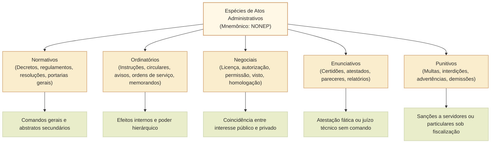
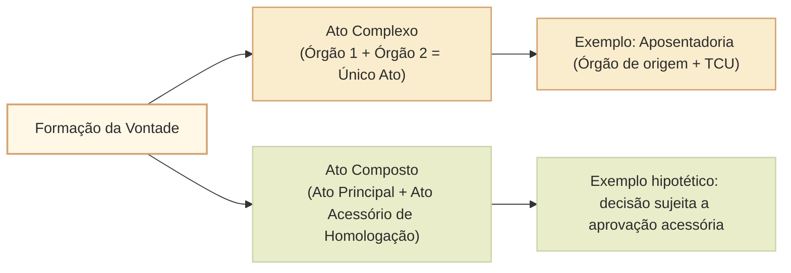
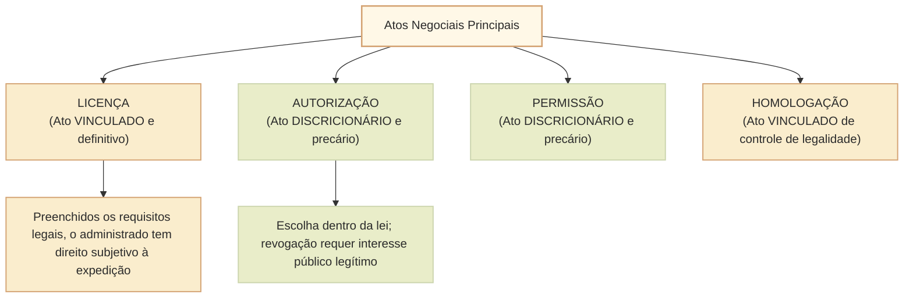

# Classificações e espécies de atos administrativos: critérios, atos normativos, ordinatórios, negociais, enunciativos e punitivos

Uma licença para construir, uma ordem interna de serviço e uma multa administrativa são atos com funções distintas. Primeiro, pergunte **como o ato se forma e produz efeitos**; depois, **qual é seu conteúdo**. Uma licença pode ser, ao mesmo tempo, individual, vinculada e negocial. Esses critérios não se excluem. O nome do documento não determina sozinho seu regime jurídico.

Uma classificação doutrinária tradicional, sujeita a variações entre autores e não fixada taxativamente em lei, reúne cinco **espécies de atos administrativos** no mnemônico **NONEP**:
1. **Atos Normativos** (N);
2. **Atos Ordinatórios** (O);
3. **Atos Negociais** (N);
4. **Atos Enunciativos** (E);
5. **Atos Punitivos** (P).

---

## 1. Critérios Fundamentais de Classificação dos Atos

Antes de examinar as espécies substantivas, é imprescindível dominar os critérios estruturais frequentemente exigidos pelo Cebraspe:

### 1.1. Quanto ao grau de liberdade da autoridade (Vinculados versus Discricionários)
- **Atos Vinculados (regrados):** a lei estabelece de forma exaustiva e objetiva todos os requisitos e a única conduta cabível perante a situação fática. Não há margem de valoração subjetiva para a autoridade. Exemplo: concessão de licença para edificar ou aposentadoria compulsória aos 75 anos.
- **Atos Discricionários:** a lei outorga certa margem de apreciação de conveniência e oportunidade (**mérito administrativo**), permitindo ao administrador escolher o momento, o conteúdo ou a sanção mais adequada dentre as opções juridicamente válidas. Exemplo: concessão de autorização de uso de bem público ou fixação do valor de multa dentro de uma faixa legal graduável.

### 1.2. Quanto aos destinatários (Gerais versus Individuais)
- **Atos Gerais (abstratos ou regulamentares):** não possuem destinatários nominais determinados; dirigem-se a uma coletividade indeterminada em idêntica situação de fato. Sua abrangência não lhes dá, por si só, superioridade hierárquica: esta decorre da competência, da espécie normativa e do ordenamento. Exemplo: regulamento de trânsito ou edital de concurso público.
- **Atos Individuais (concretos):** dirigem-se a indivíduos ou situações jurídicas perfeitamente individualizadas e nominais. Exemplo: decreto de desapropriação de imóvel específico ou portaria de nomeação de servidor.

### 1.3. Quanto à formação da vontade (Simples, Complexos e Compostos)
Trata-se de uma das distinções mais cobradas em provas de concursos federais:

| Categoria | Definição dogmática | Órgãos envolvidos | Exemplo clássico em jurisprudência |
| :--- | :--- | :--- | :--- |
| **Ato Simples** | Resulta da manifestação de vontade de um **único órgão** (seja ele singular ou colegiado). | Um órgão. | Despacho de deferimento de férias por um chefe de setor; deliberação de um Tribunal de Contas reunido em Plenário. |
| **Ato Complexo** | Resulta da conjugação da vontade de **dois ou mais órgãos diferentes**, cujas manifestações se fundem para formar um **único ato perfeito**. | Dois ou mais órgãos distintos fundindo vontades. | **Concessão inicial de aposentadoria submetida a registro no Tribunal de Contas**: classificação tradicional adotada pelo STF, à luz do art. 71, III, da Constituição. |
| **Ato Composto** | Resulta da manifestação de vontade de **um órgão principal**, mas cuja exequibilidade ou eficácia depende da aprovação, homologação ou visto de **outro órgão acessório**. | Um ato principal + um ato acessório instrumental. | Exemplo hipotético: decisão de dirigente cuja eficácia dependa de aprovação acessória exigida por norma específica. |

A classificação como ato **complexo** da concessão inicial de aposentadoria resulta da jurisprudência do STF. A **Súmula Vinculante nº 3** disciplina contraditório e ampla defesa no exame pelo TCU, com ressalva para a concessão inicial: **não é sua fonte classificatória**. O **Tema 445 do STF (RE 636.553)** limita a **cinco anos**, desde a chegada do processo à Corte de Contas, o julgamento de sua legalidade. Não se deve usar, como exemplo atual de ato composto, a antiga fórmula de dispensa de licitação "declarada e ratificada": a **Lei nº 14.133/2021**, Lei de Licitações e Contratos Administrativos, prevê no art. 72, VIII, autorização da autoridade competente para a contratação direta.

### 1.4. Quanto aos efeitos e eficácia (Constitutivos, Declaratórios e Enunciativos)
- **Constitutivos:** criam, modificam ou extinguem uma nova relação jurídica ou direito subjetivo (ex.: demissão, permissão).
- **Declaratórios:** reconhecem situação jurídica preexistente, sem criá-la pelo próprio reconhecimento. **Não existe retroatividade automática para todo ato declaratório**; os efeitos temporais dependem da norma e do instituto. A anulação de ato ilegal segue regime próprio, explicado no artigo sobre extinção dos atos.
- **Enunciativos:** limitam-se a certificar ou atestar um fato constante de registros públicos (ex.: certidão de tempo de contribuição).

---

## 2. Espécies de Atos Administrativos em Espécie (NONEP)

### 2.1. Atos Normativos
Os atos normativos contêm comandos gerais e abstratos expedidos pela Administração Pública com o objetivo de explicitar, fielmente executar ou complementar a lei formal.
- **Decretos e regulamentos:** o art. 84, IV, da **Constituição Federal de 1988** permite ao Presidente expedir decretos para fiel execução das leis. O art. 84, VI, admite decreto autônomo apenas nas hipóteses constitucionais de organização da Administração federal sem aumento de despesa ou criação/extinção de órgãos, ou de extinção de funções ou cargos vagos.
- **Resoluções e Portarias de caráter geral:** expedidas por colegiados administrativos, ministros de Estado ou dirigentes de autarquias e agências reguladoras no âmbito de sua competência setorial.
- **Regimentos internos:** organizam o funcionamento dos órgãos. O Regimento Interno da Câmara dos Deputados é norma do Poder Legislativo com fundamento constitucional e regimental próprio, e não simples regulamento administrativo do Executivo.

### 2.2. Atos Ordinatórios
Os atos ordinatórios fundam-se no **poder hierárquico** e visam a disciplinar o funcionamento interno da Administração e a conduta de seus agentes públicos.
- **Características:** produzem efeitos primordialmente *interna corporis*; não obrigam nem vinculam diretamente os particulares que não mantenham relação funcional com o Estado.
- **Instruções e circulares:** podem orientar servidores subordinados. Uma **instrução normativa** também pode veicular normas gerais dentro da competência legal; o nome do documento, isoladamente, não determina que seja ordinatório.
- **Ordens de serviço:** determinações sobre tarefas específicas. Memorandos, ofícios e avisos podem ser apenas **meios de comunicação**, sem constituir decisão administrativa por si sós.
- **Avisos e Ofícios:** comunicações funcionais formais entre autoridades.

### 2.3. Atos Negociais (Consentimento Estatal)
Os atos negociais são expedidos em situações nas quais a vontade da Administração coincide com a pretensão jurídica manifestada pelo administrado, outorgando-lhe faculdades ou uso de bens públicos.

As distinções mais cobradas entre os atos negociais são:

| Ato Negocial | Natureza Jurídica | Discricionariedade | Estabilidade | Objeto típico |
| :--- | :--- | :--- | :--- | :--- |
| **Licença** | Em regra, **vinculada**: cumpridos os requisitos legais, a concessão é devida. | Sem juízo livre de conveniência no deferimento. | Não se revoga por mera preferência; outras formas legais de extinção permanecem possíveis. | Licença para construir. |
| **Autorização** | No modelo clássico, **discricionária e precária**. | Escolha limitada pela lei e finalidade pública. | Revogação por interesse público legítimo; indenização pode surgir em hipóteses excepcionais. | Autorização de uso transitório de praça pública, se esse for o regime legal. |
| **Permissão** | **De uso de bem:** no regime clássico, discricionária e precária. **De serviço público:** categoria distinta. | Depende da modalidade legal. | A **Lei nº 8.987/1995**, sobre concessões e permissões de serviços públicos, exige licitação e contrato de adesão (arts. 2º, IV, e 40). | Uso de área pública, ou delegação contratual de serviço público. |
| **Aprovação** | Concordância ou controle exigido pela norma. | Pode envolver exame técnico ou margem de escolha. | Efeitos dependem do regime jurídico. | Aprovação de plano por órgão competente. |
| **Homologação** | Confirma procedimento ou resultado conforme o regime. | **Não é chancela automática em toda hipótese.** | Na licitação, o art. 71 da **Lei nº 14.133/2021** permite sanear, anular, revogar nos casos legais, ou adjudicar e homologar. | Homologação de licitação. |
| **Visto** | Ciência ou verificação segundo norma específica. | Depende da finalidade legal. | O nome não demonstra sozinho aprovação acessória. | Visto interno exigido para conferência. |

### 2.4. Atos Enunciativos
São aqueles em que a Administração não cria, modifica ou extingue direitos, nem manifesta vontade própria impositiva, limitando-se a certificar uma situação existente, atestar um fato ou emitir opinião técnica:
- **Certidões:** cópias fiéis de registros públicos existentes em repartições estatais (ex.: certidão negativa de débitos).
- **Atestados:** declarações da autoridade sobre fatos transitórios que constatam pessoalmente (ex.: atestado médico oficial de capacidade física).
- **Pareceres:** análises técnicas ou jurídicas que orientam decisões. Podem ser *facultativos* (consulta opcional), *obrigatórios* (consulta exigida) ou *vinculantes* (efeito definido em lei). Logo, nem todo parecer é juridicamente irrelevante; consultar o artigo [[3 - Materias/Direito Administrativo/18 - parecer administrativo natureza tipos e responsabilidade do parecerista|parecer administrativo]].
- **Apostilas:** averbações feitas em títulos funcionais para atualização de registros cadastrais ou anotações legais sem alteração substancial da situação jurídica.

### 2.5. Atos Punitivos
Os atos punitivos impõem sanções administrativas a agentes públicos (fundados no poder disciplinar) ou a particulares (fundados no poder de polícia ou no vínculo contratual administrativo):
- **Sanções disciplinares internas:** demissão, suspensão, advertência, destituição de cargo em comissão e cassação de aposentadoria (Lei nº 8.112/1990).
- **Sanções a particulares:** multas por infração e, no regime da **Lei nº 14.133/2021**, Lei de Licitações e Contratos Administrativos, sanções tipificadas nos arts. 155 e 156. Interdição ou apreensão podem ser **medidas cautelares preventivas**, conforme finalidade e norma, e não necessariamente punição.
- **Garantias:** a **Constituição Federal de 1988, art. 5º, LIV e LV**, exige devido processo legal, contraditório e ampla defesa; a **Lei nº 9.784/1999**, que regula o processo administrativo federal, exige motivação ao impor sanção (art. 50). Medidas cautelares urgentes legalmente justificadas podem admitir contraditório posterior. Nem todo vício formal acarreta, automaticamente, nulidade insanável.

---

## Questões Comentadas (Estilo Cebraspe)

### Questão 1
*(Inédita: estilo Cebraspe / Câmara dos Deputados – Analista Legislativo)*  
Acerca da classificação dos atos administrativos quanto à formação da vontade, julgue o item a seguir.

> Consoante jurisprudência pacificada do Supremo Tribunal Federal, o ato de concessão inicial de aposentadoria a servidor público é classificado como ato composto, haja vista que a decisão do órgão de origem do servidor é principal e a posterior manifestação do Tribunal de Contas possui natureza instrumental acessória de mera homologação de legalidade.

**( ) Certo**  
**( ) Errado**

> **Gabarito: Errado**  
> **Comentário:** O STF classifica tradicionalmente a concessão inicial de aposentadoria como **ato complexo**, com registro pelo tribunal de contas (Constituição, art. 71, III). A Súmula Vinculante nº 3 versa sobre contraditório e ampla defesa, não sobre essa classificação. O Tema 445 fixa cinco anos desde a chegada do processo à Corte de Contas para julgamento de sua legalidade.

---

### Questão 2
*(Inédita: estilo Cebraspe / Câmara dos Deputados – Analista Legislativo)*  
No que tange aos atos administrativos negociais, julgue o item subsequente.

> Preenchidos todos os requisitos objetivos exigidos pela legislação municipal e pelas normas de ordenamento urbano, a expedição de licença para edificar consubstancia ato administrativo vinculado e declaratório, gerando direito subjetivo ao administrado e impedindo a sua revogação discricionária por mera conveniência administrativa superveniente.

**( ) Certo**  
**( ) Errado**

> **Gabarito: Certo**  
> **Comentário:** A licença é ato clássico **vinculado**: cumpridos os requisitos legais, há direito ao deferimento, afastada revogação por mero juízo de conveniência. Isso não impede anulação por ilegalidade ou outra extinção prevista em lei.

---

### Questão 3
*(Inédita: estilo Cebraspe / Câmara dos Deputados – Analista Legislativo)*  
A respeito das espécies de atos administrativos e do poder hierárquico, julgue o item.

> As instruções normativas e as circulares enquadram-se na categoria dos atos ordinatórios e, por decorrerem diretamente do poder hierárquico da Administração, são dotadas de eficácia ultra partes, vinculando indistintamente os servidores públicos e a generalidade dos administrados particulares sem necessidade de lei formal.

**( ) Certo**  
**( ) Errado**

> **Gabarito: Errado**  
> **Comentário:** A hierarquia produz efeitos sobre subordinados, mas não cria deveres ilimitados para particulares (Constituição, art. 5º, II). Uma instrução normativa pode ter caráter geral conforme seu conteúdo; não é necessariamente ato apenas ordinatório. *Ultra partes* significa alcançar pessoas além dos destinatários imediatos, efeito atribuído incorretamente de forma indiscriminada.

---

### Questão 4
*(Inédita: estilo Cebraspe / Câmara dos Deputados – Analista Legislativo)*  
Julgue o item que se segue, relativo à distinção dogmática entre atos enunciativos e punitivos.

> A certidão funcional emitida por setor de recursos humanos que atesta a contagem de tempo de serviço de servidor para fins previdenciários classifica-se como ato enunciativo, na medida em que a Administração Pública não declara vontade constitutiva, mas tão somente atesta situação fática preexistente constante de seus assentamentos oficiais.

**( ) Certo**  
**( ) Errado**

> **Gabarito: Certo**  
> **Comentário:** A certidão **atesta informação preexistente** em assentamento oficial; não constitui, por si, direito a benefício. A concessão de aposentadoria exige decisão e requisitos legais próprios.

---

### Questão 5
*(Inédita: estilo Cebraspe / Câmara dos Deputados – Analista Legislativo)*  
Acerca dos atos administrativos discricionários e do controle de legalidade, julgue o item.

> Tratando-se de ato administrativo discricionário, o juízo de conveniência e oportunidade formulado pela autoridade competente constitui matéria insuscetível de qualquer tipo de anulação judicial, mesmo nas hipóteses em que a escolha efetuada transborde os limites legais e afronte manifestamente os princípios da razoabilidade e da proporcionalidade.

**( ) Certo**  
**( ) Errado**

> **Gabarito: Errado**  
> **Comentário:** A discricionariedade existe **dentro** da lei. O Judiciário pode anular escolha que viole finalidade, razoabilidade ou proporcionalidade, sem substituir a opção legítima da autoridade por preferência pessoal (Lei nº 9.784/1999, art. 2º).

---

### Questão 6
*(Inédita: estilo Cebraspe / Câmara dos Deputados – Analista Legislativo)*  
Julgue o item a seguir, referente às espécies de atos negociais e suas prerrogativas de revogação.

> Ao contrário da concessão de licença, a autorização administrativa para exploração de atividade econômica em espaço público possui caráter precário e discricionário, permitindo que a Administração a revogue unilateralmente a qualquer tempo por razões supervenientes de interesse público, sem gerar, como regra geral, dever estatal de indenizar.

**( ) Certo**  
**( ) Errado**

> **Gabarito: Certo**  
> **Comentário:** O item descreve a **regra geral da autorização administrativa clássica**, quando essa for a modalidade legal adotada. Sua precariedade permite revogação motivada por interesse público legítimo. A expressão 'como regra geral' preserva exceções: indenização e proteção de situações jurídicas dependem da lei, do caso e de eventuais danos.

---

## Relações com outros temas

- [[3 - Materias/Direito Administrativo/03 - atos administrativos|Elementos e requisitos de validade do ato administrativo]]: o preenchimento de competência, finalidade, forma, motivo e objeto em cada espécie.
- [[3 - Materias/Direito Administrativo/15 - atributos do ato administrativo presuncao imperatividade autoexecutoriedade e tipicidade|Atributos do ato administrativo]]: incidência diferenciada da imperatividade e autoexecutoriedade nas espécies (NONEP).
- [[3 - Materias/Direito Administrativo/04 - poderes administrativos|Poderes administrativos]]: a relação direta dos atos ordinatórios com o poder hierárquico e dos atos punitivos com o poder disciplinar e de polícia.
- [[3 - Materias/Direito Administrativo/09 - processo administrativo federal|Processo administrativo federal]]: contraditório prévio, motivação obrigatória e impugnações.

## Fontes normativas e doutrinárias

- [Constituição Federal de 1988](https://www.planalto.gov.br/ccivil_03/constituicao/constituicao.htm): arts. 5º, II, LIV e LV; 37; 71, III; 84, IV e VI, sobre legalidade, garantias, registro de aposentadorias e decretos.
- [Lei nº 9.784/1999](https://www.planalto.gov.br/ccivil_03/leis/l9784.htm): processo administrativo federal, princípios (art. 2º) e motivação (art. 50).
- [Lei nº 14.133/2021](https://www.planalto.gov.br/ccivil_03/_ato2019-2022/2021/lei/l14133.htm): Lei de Licitações e Contratos Administrativos, arts. 71, 72, VIII, 155 e 156.
- [Lei nº 8.987/1995](https://www.planalto.gov.br/ccivil_03/leis/l8987cons.htm): concessões e permissões de serviços públicos, arts. 2º, IV, e 40.
- [Lei nº 8.112/1990](https://www.planalto.gov.br/ccivil_03/leis/l8112cons.htm): regime dos servidores públicos civis da União, arts. 127 e 128.
- [STF, Súmula Vinculante nº 3](https://portal.stf.jus.br/jurisprudencia/sumariosumulas.asp?base=26&sumula=1184): contraditório no controle pelo TCU.
- [STF, Tema 445, RE 636.553](https://portal.stf.jus.br/jurisprudenciaRepercussao/verAndamentoProcesso.asp?classeProcesso=RE&incidente=4043019&numeroProcesso=636553&numeroTema=445): prazo de cinco anos no exame de concessão inicial.
- **Doutrina:** Hely Lopes Meirelles, Maria Sylvia Zanella Di Pietro e Celso Antônio Bandeira de Mello, cujas classificações devem ser lidas conforme a abordagem de cada autor.
