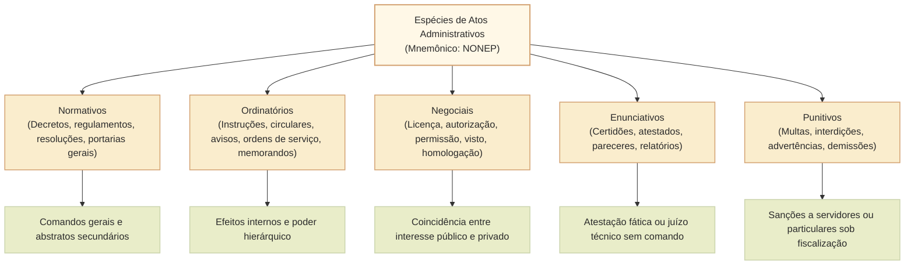
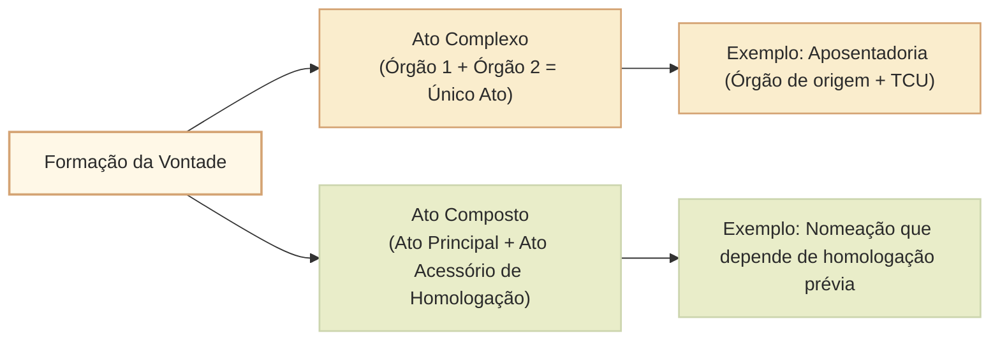
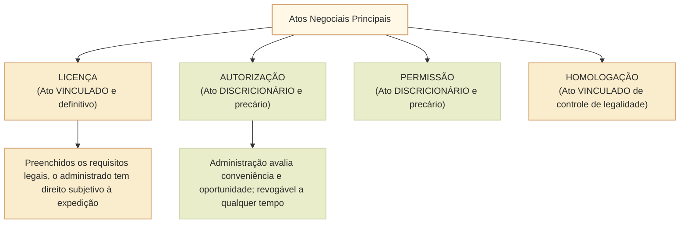

# Classificações e espécies de atos administrativos: critérios, atos normativos, ordinatórios, negociais, enunciativos e punitivos

A diversidade das manifestações da Administração Pública exige uma tipologia dogmática precisa para orientar a aplicação do regime jurídico, a intensidade do controle de legalidade e a identificação das prerrogativas estatais. No direito administrativo brasileiro, os atos administrativos são organizados tanto por **grandes critérios classificatórios estruturais** (vinculação, destinatários, formação da vontade, eficácia e executoriedade) quanto por suas **espécies segundo o conteúdo substantivo**.

A doutrina clássica (notadamente Hely Lopes Meirelles, Maria Sylvia Zanella Di Pietro e Celso Antônio Bandeira de Mello) organiza as **espécies de atos administrativos** em cinco grupos fundamentais, sintetizados pelo mnemônico **NONEP**:
1. **Atos Normativos** (N);
2. **Atos Ordinatórios** (O);
3. **Atos Negociais** (N);
4. **Atos Enunciativos** (E);
5. **Atos Punitivos** (P).

---

## 1. Critérios Fundamentais de Classificação dos Atos

Antes de examinar as espécies substantivas, é imprescindível dominar os critérios estruturais frequentemente exigidos pelo Cebraspe:

### 1.1. Quanto ao grau de liberdade da autoridade (Vinculados versus Discricionários)
- **Atos Vinculados (regrados):** a lei estabelece de forma exaustiva e objetiva todos os requisitos e a única conduta cabível perante a situação fática. Não há margem de valoração subjetiva para a autoridade. Exemplo: concessão de licença para edificar ou aposentadoria compulsória aos 75 anos.
- **Atos Discricionários:** a lei outorga certa margem de apreciação de conveniência e oportunidade (**mérito administrativo**), permitindo ao administrador escolher o momento, o conteúdo ou a sanção mais adequada dentre as opções juridicamente válidas. Exemplo: concessão de autorização de uso de bem público ou fixação do valor de multa dentro de uma faixa legal graduável.

### 1.2. Quanto aos destinatários (Gerais versus Individuais)
- **Atos Gerais (abstratos ou regulamentares):** não possuem destinatários nominais determinados; dirigem-se a uma coletividade indeterminada em idêntica situação de fato. Prevalecem hierarquicamente sobre os atos individuais. Exemplo: regulamento de trânsito ou edital de concurso público.
- **Atos Individuais (concretos):** dirigem-se a indivíduos ou situações jurídicas perfeitamente individualizadas e nominais. Exemplo: decreto de desapropriação de imóvel específico ou portaria de nomeação de servidor.

### 1.3. Quanto à formação da vontade (Simples, Complexos e Compostos)
Trata-se de uma das distinções mais cobradas em provas de concursos federais:

| Categoria | Definição dogmática | Órgãos envolvidos | Exemplo clássico em jurisprudência |
| :--- | :--- | :--- | :--- |
| **Ato Simples** | Resulta da manifestação de vontade de um **único órgão** (seja ele singular ou colegiado). | Um órgão. | Despacho de deferimento de férias por um chefe de setor; deliberação de um Tribunal de Contas reunido em Plenário. |
| **Ato Complexo** | Resulta da conjugação da vontade de **dois ou mais órgãos diferentes**, cujas manifestações se fundem para formar um **único ato perfeito**. | Dois ou mais órgãos distintos fundindo vontades. | **Registro de aposentadoria pelo Tribunal de Contas da União (TCU)** (Súmula Vinculante 3 do STF); investidura de Ministro do STF (escolha pelo Presidente + aprovação pelo Senado Federal). |
| **Ato Composto** | Resulta da manifestação de vontade de **um órgão principal**, mas cuja exequibilidade ou eficácia depende da aprovação, homologação ou visto de **outro órgão acessório**. | Um ato principal + um ato acessório instrumental. | Dispensa de licitação declarada pelo setor competente e ratificada/homologada pela autoridade superior. |

### 1.4. Quanto aos efeitos e eficácia (Constitutivos, Declaratórios e Enunciativos)
- **Constitutivos:** criam, modificam ou extinguem uma nova relação jurídica ou direito subjetivo (ex.: demissão, permissão).
- **Declaratórios:** apenas reconhecem a existência de um direito ou situação pré-constituída pela lei (ex.: licença para dirigir, anulação de ato ilegal). Opera efeitos retroativos (*ex tunc*).
- **Enunciativos:** limitam-se a certificar ou atestar um fato constante de registros públicos (ex.: certidão de tempo de contribuição).

---

## 2. Espécies de Atos Administrativos em Espécie (NONEP)

### 2.1. Atos Normativos
Os atos normativos contêm comandos gerais e abstratos expedidos pela Administração Pública com o objetivo de explicitar, fielmente executar ou complementar a lei formal.
- **Decretos e Regulamentos:** atos de competência privativa dos Chefes do Poder Executivo (art. 84, IV e VI, da CF/1988) destinados a conferir fiel execução às leis ou organizar o funcionamento da Administração (decreto autônomo).
- **Resoluções e Portarias de caráter geral:** expedidas por colegiados administrativos, ministros de Estado ou dirigentes de autarquias e agências reguladoras no âmbito de sua competência setorial.
- **Regimento Interno:** atos normativos que disciplinam o funcionamento interno de órgãos colegiados (ex.: Regimento Interno da Câmara dos Deputados).

### 2.2. Atos Ordinatórios
Os atos ordinatórios fundam-se no **poder hierárquico** e visam a disciplinar o funcionamento interno da Administração e a conduta de seus agentes públicos.
- **Características:** produzem efeitos primordialmente *interna corporis*; não obrigam nem vinculam diretamente os particulares que não mantenham relação funcional com o Estado.
- **Instruções e Circulares:** ordens gerais e uniformes dirigidas aos servidores subordinados para a correta aplicação de normas e padronização de serviços.
- **Ordens de Serviço e Memorandos:** determinações operacionais concretas relativas à execução de tarefas específicas ou comunicação interna entre unidades administrativas.
- **Avisos e Ofícios:** comunicações funcionais formais entre autoridades.

### 2.3. Atos Negociais (Consentimento Estatal)
Os atos negociais são expedidos em situações nas quais a vontade da Administração coincide com a pretensão jurídica manifestada pelo administrado, outorgando-lhe faculdades ou uso de bens públicos.

As distinções mais cobradas entre os atos negociais são:

| Ato Negocial | Natureza Jurídica | Discricionariedade | Estabilidade | Objeto típico |
| :--- | :--- | :--- | :--- | :--- |
| **Licença** | **Vinculado** e declaratório. Preenchidos os requisitos legais, a concessão é um direito subjetivo. | Não há discricionariedade. | Definitivo; não revogável por conveniência simples. | Licença para construir; licença para exercer profissão regulamentada. |
| **Autorização** | **Discricionário** e constitutivo. Atende primordialmente a interesse particular. | Plena discricionariedade. | Precário; revogável a qualquer tempo sem indenização. | Autorização de porte de arma; autorização para uso privativo transitório de praça pública. |
| **Permissão** | **Discricionário** e precário (salvo permissão de serviço público contratualizada pela Lei nº 8.987/1995). | Discricionário. | Precário (revogável sem indenização quando gratuita). | Permissão de uso de bem público (ex.: banca de jornal ou quiosque). |
| **Aprovação** | Discricionário e posterior (ou prévio). | Discricionário. | Variável. | Aprovação de plano de gestão por conselho fiscal. |
| **Homologação** | **Vinculado** e posterior. Controle de estrita legalidade. | Vinculado. | Estável. | Homologação de procedimento licitatório ou concurso público. |
| **Visto** | Vinculado. Atesta a regularidade formal de outro ato. | Vinculado. | Estável. | Visto em passaporte ou em diploma escolar. |

### 2.4. Atos Enunciativos
São aqueles em que a Administração não cria, modifica ou extingue direitos, nem manifesta vontade própria impositiva, limitando-se a certificar uma situação existente, atestar um fato ou emitir opinião técnica:
- **Certidões:** cópias fiéis de registros públicos existentes em repartições estatais (ex.: certidão negativa de débitos).
- **Atestados:** declarações da autoridade sobre fatos transitórios que constatam pessoalmente (ex.: atestado médico oficial de capacidade física).
- **Pareceres:** manifestações opinativas de órgãos técnicos ou jurídicos que orientam a tomada de decisão da autoridade administrativa. Podem ser *facultativos*, *obrigatórios* ou *vinculantes*.
- **Apostilas:** averbações feitas em títulos funcionais para atualização de registros cadastrais ou anotações legais sem alteração substancial da situação jurídica.

### 2.5. Atos Punitivos
Os atos punitivos impõem sanções administrativas a agentes públicos (fundados no poder disciplinar) ou a particulares (fundados no poder de polícia ou no vínculo contratual administrativo):
- **Sanções disciplinares internas:** demissão, suspensão, advertência, destituição de cargo em comissão e cassação de aposentadoria (Lei nº 8.112/1990).
- **Sanções externas a particulares:** multas administrativas, interdição de atividades poluidoras, apreensão de mercadorias deterioradas e declaração de inidoneidade para licitar (Lei nº 14.133/2021).
- **Garantias constitucionais:** todo ato punitivo exige estrita observância ao devido processo legal, ao contraditório e à ampla defesa prévia (art. 5º, LIV e LV, da CF/1988), sob pena de nulidade absoluta insanável.

---

## Questões Comentadas (Estilo Cebraspe)

### Questão 1
*(Inédita: estilo Cebraspe / Câmara dos Deputados – Analista Legislativo)*  
Acerca da classificação dos atos administrativos quanto à formação da vontade, julgue o item a seguir.

> Consoante jurisprudência pacificada do Supremo Tribunal Federal, o ato de concessão inicial de aposentadoria a servidor público é classificado como ato composto, haja vista que a decisão do órgão de origem do servidor é principal e a posterior manifestação do Tribunal de Contas possui natureza instrumental acessória de mera homologação de legalidade.

**( ) Certo**  
**( ) Errado**

> **Gabarito: Errado**  
> **Comentário:** Segundo jurisprudência firme e reiterada do Supremo Tribunal Federal (incluindo o enunciado da Súmula Vinculante nº 3), a concessão inicial de aposentadoria, reforma ou pensão é classificada dogmaticamente como **ato complexo** (e não composto). No ato complexo, as vontades do órgão concedente de origem e da Corte de Contas competente fundem-se para formar um único ato jurídico perfeito; a aposentadoria somente se aperfeiçoa e se torna definitiva com a apreciação e o registro pelo Tribunal de Contas.

---

### Questão 2
*(Inédita: estilo Cebraspe / Câmara dos Deputados – Analista Legislativo)*  
No que tange aos atos administrativos negociais, julgue o item subsequente.

> Preenchidos todos os requisitos objetivos exigidos pela legislação municipal e pelas normas de ordenamento urbano, a expedição de licença para edificar consubstancia ato administrativo vinculado e declaratório, gerando direito subjetivo ao administrado e impedindo a sua revogação discricionária por mera conveniência administrativa superveniente.

**( ) Certo**  
**( ) Errado**

> **Gabarito: Certo**  
> **Comentário:** A assertiva está impecável. A **licença** é o clássico exemplo de ato administrativo vinculado e definitivo. Diferentemente da autorização (que é discricionária e precária), uma vez cumpridas todas as condições legais e regulamentares estabelecidas pelo Poder Público, a Administração não pode recusar o seu deferimento, gerando direito público subjetivo à sua emissão e fruição, o que obsta a revogação discricionária fundada em conveniência e oportunidade.

---

### Questão 3
*(Inédita: estilo Cebraspe / Câmara dos Deputados – Analista Legislativo)*  
A respeito das espécies de atos administrativos e do poder hierárquico, julgue o item.

> As instruções normativas e as circulares enquadram-se na categoria dos atos ordinatórios e, por decorrerem diretamente do poder hierárquico da Administração, são dotadas de eficácia ultra partes, vinculando indistintamente os servidores públicos e a generalidade dos administrados particulares sem necessidade de lei formal.

**( ) Certo**  
**( ) Errado**

> **Gabarito: Errado**  
> **Comentário:** Os atos ordinatórios (como circulares, memorandos e ordens de serviço) decorrem do poder hierárquico e possuem efeitos estritamente **internos (*interna corporis*)**, destinando-se a orientar a conduta e o serviço dos servidores públicos subordinados. Não possuem eficácia jurídica autônoma em relação a terceiros particulares, que não estão sujeitos à hierarquia administrativa e somente devem obrigações fundamentadas em lei formal (art. 5º, II, CF/1988).

---

### Questão 4
*(Inédita: estilo Cebraspe / Câmara dos Deputados – Analista Legislativo)*  
Julgue o item que se segue, relativo à distinção dogmática entre atos enunciativos e punitivos.

> A certidão funcional emitida por setor de recursos humanos que atesta a contagem de tempo de serviço de servidor para fins previdenciários classifica-se como ato enunciativo, na medida em que a Administração Pública não declara vontade constitutiva, mas tão somente atesta situação fática preexistente constante de seus assentamentos oficiais.

**( ) Certo**  
**( ) Errado**

> **Gabarito: Certo**  
> **Comentário:** Os atos enunciativos (como certidões, atestados e pareceres opinativos) caracterizam-se pela ausência de declaração volitiva constitutiva ou coercitiva da Administração. O agente público apenas certifica ou reproduz documentalmente um dado fático já existente nos arquivos e bancos de dados oficiais do Estado.

---

### Questão 5
*(Inédita: estilo Cebraspe / Câmara dos Deputados – Analista Legislativo)*  
Acerca dos atos administrativos discricionários e do controle de legalidade, julgue o item.

> Tratando-se de ato administrativo discricionário, o juízo de conveniência e oportunidade formulado pela autoridade competente constitui matéria insuscetível de qualquer tipo de anulação judicial, mesmo nas hipóteses em que a escolha efetuada transborde os limites legais e afronte manifestamente os princípios da razoabilidade e da proporcionalidade.

**( ) Certo**  
**( ) Errado**

> **Gabarito: Errado**  
> **Comentário:** Embora o mérito administrativo (o núcleo de conveniência e oportunidade legítima) não possa ser substituído pelo julgador em um juízo de mera preferência pessoal, a discricionariedade administrativa encontra balizas inafastáveis nos limites da lei e nos princípios constitucionais da razoabilidade e proporcionalidade. Quando o ato discricionário transborda tais fronteiras, incorre em vício de legalidade/legitimidade, autorizando o Poder Judiciário a declarar sua **anulação**, sem que isso represente invasão indevida no mérito.

---

### Questão 6
*(Inédita: estilo Cebraspe / Câmara dos Deputados – Analista Legislativo)*  
Julgue o item a seguir, referente às espécies de atos negociais e suas prerrogativas de revogação.

> Ao contrário da concessão de licença, a autorização administrativa para exploração de atividade econômica em espaço público possui caráter precário e discricionário, permitindo que a Administração a revogue unilateralmente a qualquer tempo por razões supervenientes de interesse público, sem gerar, como regra geral, dever estatal de indenizar.

**( ) Certo**  
**( ) Errado**

> **Gabarito: Certo**  
> **Comentário:** A **autorização** é ato administrativo discricionário e precário expedido no interesse preponderante do particular. Em virtude de sua precariedade jurídica congênita, o titular não ostenta direito subjetivo à sua permanência definitiva, podendo o Poder Público revogá-la quando a continuidade da autorização se mostrar inconveniente ou inoportuna ao interesse coletivo, inexistindo direito à indenização por perdas e danos.

---

## Relações com outros temas

- [[3 - Materias/Direito Administrativo/03 - atos administrativos|Elementos e requisitos de validade do ato administrativo]]: o preenchimento de competência, finalidade, forma, motivo e objeto em cada espécie.
- [[3 - Materias/Direito Administrativo/15 - atributos do ato administrativo presuncao imperatividade autoexecutoriedade e tipicidade|Atributos do ato administrativo]]: incidência diferenciada da imperatividade e autoexecutoriedade nas espécies (NONEP).
- [[3 - Materias/Direito Administrativo/04 - poderes administrativos|Poderes administrativos]]: a relação direta dos atos ordinatórios com o poder hierárquico e dos atos punitivos com o poder disciplinar e de polícia.
- [[3 - Materias/Direito Administrativo/09 - processo administrativo federal|Processo administrativo federal]]: contraditório prévio, motivação obrigatória e impugnações.

## Fontes normativas e doutrinárias

- **Constituição Federal de 1988:** art. 5º, II, LIV e LV; art. 37, *caput*; art. 84, IV e VI (decretos e regulamentos).
- **Supremo Tribunal Federal:** Súmula Vinculante nº 3 (natureza de ato complexo da concessão inicial de aposentadoria pelo TCU).
- **Doutrina:** Hely Lopes Meirelles (*Direito Administrativo Brasileiro* - classificação NONEP); Maria Sylvia Zanella Di Pietro (*Atos simples, complexos e compostos*); Celso Antônio Bandeira de Mello (*Curso de Direito Administrativo*).
