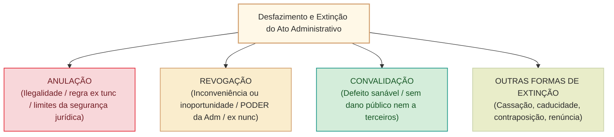
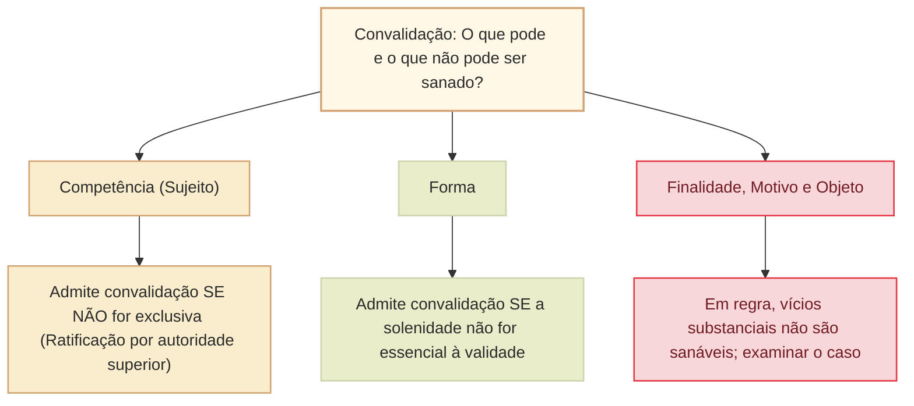

# Anulação, revogação, convalidação e extinção de atos administrativos: autotutela, limites e formas de desfazimento

Uma prefeitura concede licença para uma atividade, mas depois descobre um vício na concessão. Em outra situação, a Administração muda sua política e já não quer manter uma autorização precária. As soluções são diferentes: **anular** trata de ilegalidade; **revogar** trata de conveniência e oportunidade dentro dos limites legais. Há ainda **convalidação**, que corrige defeitos sanáveis, e outras hipóteses de extinção.

**Autotutela** é o poder-dever de a Administração controlar a legalidade de seus próprios atos e reavaliar, nos casos cabíveis, a conveniência de mantê-los. Está prevista nas **Súmulas 346 e 473 do Supremo Tribunal Federal (STF)** e no **art. 53 da Lei nº 9.784/1999**, lei que regula o processo administrativo federal:
> *"A Administração deve anular seus próprios atos, quando eivados de vício de legalidade, e pode revogá-los por motivo de conveniência ou oportunidade, respeitados os direitos adquiridos."* (Lei nº 9.784/1999, art. 53).

O art. 53 deve ser lido com os arts. 54 e 55 da mesma lei: proteger a legalidade exige também considerar **segurança jurídica**, **confiança legítima**, prazo decadencial e possibilidade de sanar o vício. Extinção natural ocorre quando o ato cumpre seus efeitos ou chega ao prazo final. Cassação, caducidade, contraposição e renúncia são outras categorias doutrinárias que dependem do caso e da norma aplicável.

---

## 1. Anulação (Invalidação)

### Fundamento, dever de anular e competência
A **anulação** é a extinção forçada de um ato administrativo em decorrência de **vício originário de legalidade ou legitimidade** (desconformidade com a Constituição, lei ou regulamento no momento de sua edição).
- **Natureza:** a Administração **deve enfrentar a ilegalidade**, mas a solução exige verificar se há convalidação possível (art. 55), decadência (art. 54) e proteção da confiança. O art. 53 não permite ignorar esses limites.
- **Competência para anular:** pode ser efetuada:
  1. Pela **própria Administração Pública** (exercício direto da autotutela, de ofício ou mediante provocação);
  2. Pelo **Poder Judiciário**, quando formalmente provocado mediante ação judicial própria (mandado de segurança, ação civil pública, ação popular, etc.). O Judiciário **nunca anula de ofício** ato administrativo de outro Poder.

### Efeitos da anulação: eficácia retroativa (*ex tunc*)
A declaração de nulidade atinge o ato desde a sua origem fática, operando efeitos retroativos (**efeito *ex tunc***):
- **Regra:** a anulação procura desfazer os efeitos jurídicos desde a origem (*ex tunc*). A expressão não autoriza apagar automaticamente toda consequência já produzida, sobretudo quando há terceiros de boa-fé e situações consolidadas protegidas pelo Direito.
- **Ressalva à retroatividade (proteção de terceiros de boa-fé):** em reverência aos princípios da boa-fé, da confiança legítima e da segurança jurídica, a jurisprudência consolidada do STF e do STJ preserva os efeitos práticos produzidos pelo ato nulo em favor de terceiros que tenham atuado imbuídos de boa-fé (ex.: atos praticados por funcionário de fato ou vencimentos percebidos de boa-fé por servidor nomeado com base em critério posteriormente invalidado).

### Limites à anulação: prazo decadencial de 5 anos (art. 54 da Lei nº 9.784/1999)
A autotutela anulatória não é perpétua nem ilimitada no tempo:
> *"O direito da Administração de anular os atos administrativos de que decorram efeitos favoráveis para os destinatários decai em cinco anos, contados da data em que foram praticados, salvo comprovada má-fé."* (art. 54, *caput*).

- **Efeitos patrimoniais contínuos:** nos atos que geram prestações patrimoniais periódicas (ex.: pensões, vantagens salariais), o prazo de cinco anos conta-se a partir da percepção do **primeiro pagamento** (art. 54, § 1º).
- **Má-fé comprovada:** afasta a decadência quinquenal do art. 54; a simples alegação de má-fé pela autoridade não basta. O § 2º considera exercício do direito de anular qualquer medida administrativa que impugne a validade do ato, aspecto relevante para verificar o prazo.
- **Inconstitucionalidade:** há jurisprudência que afasta a estabilização de certas situações diretamente contrárias à Constituição, mas não se deve afirmar que qualquer irregularidade rotulada como "inconstitucional" elimina automaticamente o art. 54. É indispensável examinar o precedente, o tipo de ato e a segurança jurídica. Para **registro inicial de aposentadorias nos tribunais de contas**, o STF fixou no **Tema 445 (RE 636.553)** prazo próprio de cinco anos desde a chegada do processo à Corte, que não se confunde com o termo inicial ordinário do art. 54.

---

## 2. Revogação

### 2.1. Fundamento, mérito administrativo e competência privativa
A **revogação** consiste na supressão de um ato administrativo **válido, perfeito e eficaz**, motivada por razões supervenientes de **inconveniência ou inoportunidade** sob o prisma do interesse público.
- **Mérito administrativo:** a autoridade reavalia a oportunidade e a conveniência de manter em vigor uma determinada medida estatal discricionária.
- **Competência exclusiva da Administração:** a revogação é prerrogativa privativa do Poder ou órgão que praticou o ato no exercício da função administrativa.
- **Controle judicial:** o Judiciário não substitui o juízo legítimo de conveniência da Administração para **revogar atos administrativos de outro Poder**. Pode invalidá-los por ilegalidade e controlar o respeito aos limites jurídicos da discricionariedade. Quando o próprio Judiciário atua administrativamente, pode rever os seus atos segundo as regras aplicáveis.

### Efeitos temporais: eficácia prospectiva (*ex nunc*)
Como o ato revogado nasceu perfeito e compatível com a ordem jurídica, a sua revogação produz exclusivamente efeitos futuros (**efeito *ex nunc***):
- Os efeitos produzidos durante a vigência do ato permanecem intangíveis e válidos no tempo.
- Não há qualquer retroatividade.

### Atos insuscetíveis de revogação (Atos Irrevogáveis)
A doutrina sintetiza um rol consagrado de atos administrativos que **não admitem revogação**:
1. **Atos vinculados:** como a autoridade não possui margem de conveniência na expedição (preenchidos os requisitos legais, o administrado tem direito subjetivo), não pode revogar por critério discricionário superveniente (ex.: licença para construir).
2. **Atos consumados ou exauridos:** aqueles que já produziram integralmente todos os seus efeitos materiais (ex.: gozo de licença-prêmio já usufruída integralmente pelo servidor).
3. **Atos que geraram direito adquirido:** vedação expressa no art. 53 da Lei nº 9.784/1999 e no art. 5º, XXXVI, da CF/1988 (Súmula 473 do STF).
4. **Atos que integram um procedimento administrativo (preclusão administrativa):** com o avanço das fases procedimentais, os atos das etapas anteriores tornam-se preclusos (ex.: superada a fase de habilitação na licitação, não se pode revogar ato da fase preparatória inicial sem desconstituir o procedimento).
5. **Meros atos administrativos / Atos enunciativos:** atos que apenas atestam fatos ou emitem juízos de valor sem carga volitiva autônoma (ex.: certidões, atestados, pareceres).
6. **Atos complexos (pela manifestação unilateral isolada de apenas um dos órgãos):** um dos órgãos formadores não pode revogar isoladamente ato que depende da fusão de vontades de ambos.

---

## 3. Convalidação (Saneamento ou Ratificação)

### Conceito e pressupostos dogmáticos
A **convalidação** é o ato administrativo pelo qual a autoridade supre vício prévio existente em ato com defeito sanável, confirmando sua validade no ordenamento jurídico.

O art. 55 da Lei nº 9.784/1999 positiva os pressupostos cumulativos:
> *"Em decisão na qual se evidencie não acarretarem lesão ao interesse público nem prejuízo a terceiros, os atos que apresentarem defeitos sanáveis poderão ser convalidados pela própria Administração."*

- **Requisitos cumulativos para convalidar:**
  1. O defeito deve ser **sanável** (vícios de competência não exclusiva ou forma não essencial);
  2. Ausência de **lesão ao interesse público**;
  3. Ausência de **prejuízo a terceiros**;
  4. A autoridade deve verificar o regime, o estágio do procedimento e os direitos envolvidos. **O art. 55 não estabelece, textualmente, vedação universal à convalidação de todo ato já impugnado**; a impugnação pode ser juridicamente relevante conforme o vício e o caso.

### Efeitos da convalidação: eficácia retroativa (*ex tunc*)
A convalidação, em regra, **retroage à edição do ato defeituoso (*ex tunc*)**, aproveitando os efeitos juridicamente admissíveis. Essa retroação não dispensa os requisitos do art. 55: defeito sanável e ausência de lesão ao interesse público ou prejuízo a terceiros.

---

## Quadro Comparativo: Anulação, Revogação e Convalidação

| Critério discriminador | Anulação | Revogação | Convalidação |
| :--- | :--- | :--- | :--- |
| **Motivo gerador** | **Ilegalidade originária** (vício de legalidade/legitimidade). | **Inconveniência ou inoportunidade superveniente** (mérito). | **Defeito sanável originário** (competência não exclusiva / forma não essencial). |
| **Quem pode praticar?** | **Administração Pública** (autotutela) ou **Poder Judiciário** (provocado). | **Exclusivamente a Administração Pública** (vedado ao Judiciário em atos alheios). | **A própria Administração Pública**. |
| **Natureza da atuação** | Dever de corrigir ilegalidade, observado prazo, convalidação e confiança. | Decisão de mérito dentro da competência legal. | Decisão condicionada a defeito sanável e ausência de lesão/prejuízo (art. 55). |
| **Efeitos temporais** | Em regra **ex tunc**, com possíveis limites de segurança jurídica. | Em regra **ex nunc**, preservados efeitos anteriores legítimos. | Em regra **ex tunc**, dentro das condições legais do saneamento. |
| **Prazo e limites** | Regra de **5 anos** para atos favoráveis, salvo má-fé (art. 54), com regimes especiais. | Enquanto juridicamente possível, respeitados direitos adquiridos e atos exauridos. | Art. 55 exige sanabilidade, interesse público e ausência de prejuízo a terceiros; não fixa prazo geral nesses termos. |

---

## 5. Outras Formas de Extinção dos Atos Administrativos

Além da anulação e da revogação, o ato administrativo pode ser extinto pelas seguintes espécies dogmáticas:

### Cassação
Extinção do ato porque o seu **beneficiário descumpriu condição legal obrigatória superveniente** que deveria manter para continuar fruindo daquela situação jurídica (espécie de sanção pelo descumprimento culposo do particular).
- *Exemplo clássico:* cassação da licença/alvará de funcionamento de estabelecimento comercial que passa a operar como ponto de tráfico de drogas, ou cassação da Carteira Nacional de Habilitação (CNH) por reincidência de infrações graves.

### Caducidade (Derrubada por Norma Superveniente)
Na **classificação doutrinária de atos administrativos**, caducidade pode designar extinção por **norma superveniente** que torna incompatível atividade antes permitida. Não confundir com a **caducidade da concessão de serviço público** na **Lei nº 8.987/1995**, que rege concessões e permissões: seu art. 38 disciplina a extinção por inexecução contratual do concessionário, e não por simples lei nova.
- *Exemplo clássico:* permissão concedida para uso de calçada por feirantes que caduca em decorrência de plano diretor municipal superveniente que proíbe qualquer ocupação de vias públicas naquela zona urbana residencial.

### Contraposição (Derrubada)
Extinção que ocorre pela **edição de um novo ato administrativo, fundado em competência diferente, cujos efeitos jurídicos são frontalmente incompatíveis e contraditórios** com o ato anterior, extinguindo-o por absorção.
- *Exemplo clássico:* a edição do ato de **exoneração** extingue por contraposição o ato de **nomeação** anterior daquele mesmo agente público; o ato de **demissão** extingue a relação jurídica constituída pela posse funcional.

### Renúncia
Extinção que decorre da **manifestação expressa de vontade do administrado beneficiário**, declarando perante o Poder Público que abdica voluntariamente da prerrogativa ou faculdade jurídica conferida pelo ato administrativo (aplicável apenas a direitos disponíveis).
- *Exemplo:* o beneficiário renuncia a uma autorização de uso que podia livremente abandonar. A disponibilidade do direito precisa ser verificada; renúncia a aposentadoria para obter benefício novo não é exemplo seguro de aplicação geral.

---

## Questões Comentadas (Estilo Cebraspe)

### Questão 1
*(Inédita: estilo Cebraspe / Câmara dos Deputados – Analista Legislativo)*  
Acerca do controle jurisdicional dos atos administrativos e do princípio da autotutela, julgue o item.

> Constatando a excessiva morosidade e a manifesta inconveniência administrativa na manutenção de determinado contrato de concessão de serviço público outorgado pelo Poder Executivo federal, o Poder Judiciário, mediante provocação formulada em ação civil pública proposta pelo Ministério Público, poderá decretar a revogação judicial do ato administrativo de concessão, com eficácia retroativa (*ex tunc*).

**( ) Certo**  
**( ) Errado**

> **Gabarito: Errado**  
> **Comentário:** Há dois erros. A revogação por conveniência é decisão administrativa, não medida judicial para substituir o mérito legítimo do Executivo. Além disso, a revogação, em regra, atua apenas para o futuro (**ex nunc**). O Judiciário pode invalidar atos ilegais e controlar os limites jurídicos da discricionariedade; contrato de concessão tem ainda formas próprias de extinção regidas pela Lei nº 8.987/1995.

---

### Questão 2
*(Inédita: estilo Cebraspe / Câmara dos Deputados – Analista Legislativo)*  
Julgue o item subsequente, relativo ao prazo decadencial previsto na Lei nº 9.784/1999 para o exercício da autotutela anulatória.

> O direito da Administração Pública federal de anular ato administrativo do qual decorram efeitos favoráveis para determinado servidor público decai no prazo de cinco anos contados da sua prática, prazo este que não incide na hipótese de restar cabalmente comprovada a má-fé do administrado beneficiário.

**( ) Certo**  
**( ) Errado**

> **Gabarito: Certo**  
> **Comentário:** O art. 54, **caput**, da Lei nº 9.784/1999 prevê cinco anos para anular atos com efeitos favoráveis, a partir da prática, salvo má-fé comprovada. O § 1º conta do primeiro pagamento quando houver efeitos patrimoniais contínuos; o § 2º considera exercício do direito de anular medida administrativa que impugne a validade do ato. Regimes especiais exigem atenção.

---

### Questão 3
*(Inédita: estilo Cebraspe / Câmara dos Deputados – Analista Legislativo)*  
No que concerne à convalidação de atos administrativos federais, julgue o item a seguir.

> Identificado vício de forma essencial em ato administrativo disciplinar que culminou na imposição de penalidade de suspensão a servidor público sem abertura do prazo legal para apresentação de **defesa escrita**, assegurado pelo art. 161, § 1º, da Lei nº 8.112/1990, a autoridade julgadora poderá convalidar o ato com base no art. 55 da Lei nº 9.784/1999, caso verifique a inexistência de má-fé da comissão processante.

**( ) Certo**  
**( ) Errado**

> **Gabarito: Errado**  
> **Comentário:** O enunciado passou a referir-se à **defesa escrita prevista no art. 161, § 1º, da Lei nº 8.112/1990**. Suprimir essa oportunidade afeta garantia essencial de defesa. O art. 55 da Lei nº 9.784/1999 permite convalidar apenas defeitos sanáveis, sem lesão ao interesse público nem prejuízo a terceiros; a boa-fé da comissão não supre a defesa do indiciado. Não confundir essa fase legal com suposta exigência universal de alegações finais adicionais em todo PAD.

---

### Questão 4
*(Inédita: estilo Cebraspe / Câmara dos Deputados – Analista Legislativo)*  
Julgue o item a respeito das formas dogmáticas de extinção dos atos administrativos.

> A cassação é a modalidade de desfazimento que atinge o ato administrativo em decorrência de superveniência de lei nova que estabelece regime jurídico proibitivo à manutenção daquela atividade ou benefício outrora outorgado validamente pelo Estado.

**( ) Certo**  
**( ) Errado**

> **Gabarito: Errado**  
> **Comentário:** O item troca **cassação** por **caducidade em sentido doutrinário**. A primeira decorre do descumprimento de condição pelo beneficiário; a segunda, nessa classificação, de incompatibilidade criada por norma posterior. Atenção: na **Lei nº 8.987/1995, art. 38**, a expressão 'caducidade da concessão' possui sentido legal específico ligado a inexecução contratual.

---

### Questão 5
*(Inédita: estilo Cebraspe / Câmara dos Deputados – Analista Legislativo)*  
Acerca dos limites materiais ao poder de revogação da Administração Pública, julgue o item subsequente.

> A concessão de licença ambiental de operação expedida regularmente em conformidade com todas as exigências do órgão de fiscalização constitui ato administrativo discricionário, razão pela qual a autoridade administrativa pode revogá-la unilateralmente por mero critério de conveniência de gestão territorial, independentemente de qualquer irregularidade praticada pelo empreendedor.

**( ) Certo**  
**( ) Errado**

> **Gabarito: Errado**  
> **Comentário:** A licença ambiental está submetida a **regime especial**. A **Lei nº 15.190/2025**, Lei Geral do Licenciamento Ambiental, art. 16, prevê suspensão ou cancelamento **por decisão motivada**, por exemplo, diante de graves riscos supervenientes à saúde pública ou ao meio ambiente. Logo, é incorreta tanto a ideia de que a licença possa ser retirada **por mero gosto da autoridade** como a afirmação de que sua extinção só caberia em caso de infração do empreendedor. Avaliar requisitos e hipóteses legais é essencial.

---

### Questão 6
*(Inédita: estilo Cebraspe / Câmara dos Deputados – Analista Legislativo)*  
Julgue o item a seguir, referente à extinção por contraposição e aos atos administrativos sucessivos.

> A exoneração de servidor público em comissão opera a extinção da relação jurídica funcional anterior por contraposição, visto que o novo ato administrativo, originado de competência legalmente conferida à autoridade nomeante, produz efeitos antagônicos e incompatíveis com a subsistência do provimento originário.

**( ) Certo**  
**( ) Errado**

> **Gabarito: Certo**  
> **Comentário:** A exoneração de ocupante de cargo em comissão encerra os efeitos do ato anterior de nomeação e serve de exemplo doutrinário de **contraposição**. Essa classificação não transforma a exoneração em sanção disciplinar: a exoneração ad nutum do cargo em comissão distingue-se de demissão punitiva.

---

## Relações com outros temas

- [[3 - Materias/Direito Administrativo/03 - atos administrativos|Elementos e requisitos de validade do ato administrativo]]: o regime de vícios e a convalidação do art. 55 da Lei nº 9.784/1999.
- [[3 - Materias/Direito Administrativo/16 - classificacoes e especies de atos administrativos|Classificações e espécies de atos administrativos]]: irrevogabilidade dos atos vinculados (licença) versus revogabilidade dos discricionários precários (autorização).
- [[3 - Materias/Direito Administrativo/01 - principios e lei de acesso a informacao|Princípios da Administração Pública]]: autotutela, legalidade estrita, segurança jurídica e proteção da confiança legítima.
- [[3 - Materias/Direito Administrativo/09 - processo administrativo federal|Processo administrativo federal]]: prazos decadenciais, contraditório e competências recursais.

## Fontes normativas e jurisprudenciais

- [Constituição Federal de 1988](https://www.planalto.gov.br/ccivil_03/constituicao/constituicao.htm): art. 5º, XXXVI e LV, e art. 37, caput; direitos adquiridos, defesa e legalidade.
- [Lei nº 9.784/1999](https://www.planalto.gov.br/ccivil_03/leis/l9784.htm): processo administrativo federal; arts. 53, 54 e 55, sobre autotutela, decadência e convalidação.
- [Lei nº 8.112/1990](https://www.planalto.gov.br/ccivil_03/leis/l8112cons.htm): estatuto dos servidores civis da União; art. 161, § 1º, prazo de defesa escrita no PAD.
- [Lei nº 8.987/1995](https://www.planalto.gov.br/ccivil_03/leis/l8987cons.htm): concessões e permissões de serviços públicos; art. 38, caducidade da concessão por inexecução.
- [Lei nº 15.190/2025, Lei Geral do Licenciamento Ambiental](https://www2.camara.leg.br/legin/fed/lei/2025/lei-15190-8-agosto-2025-797833-normaatualizada-pl.html): art. 16, suspensão/cancelamento motivado de licença ambiental em hipóteses legais.
- [STF, Tema 445, RE 636.553](https://portal.stf.jus.br/jurisprudenciaRepercussao/verAndamentoProcesso.asp?classeProcesso=RE&incidente=4043019&numeroProcesso=636553&numeroTema=445): prazo específico de cinco anos para tribunal de contas examinar concessão inicial.
- **STF, Súmulas 346 e 473:** autotutela administrativa, anulação e revogação, com proteção dos direitos adquiridos.
