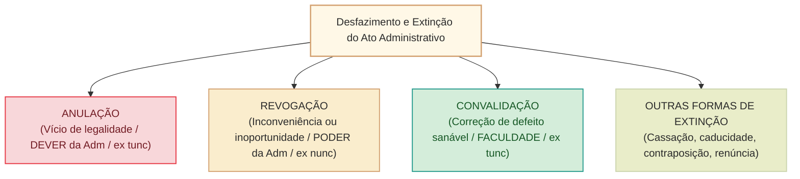
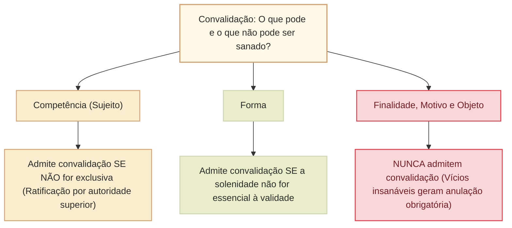

# Anulação, revogação, convalidação e extinção de atos administrativos: autotutela, limites e formas de desfazimento

O encerramento do ciclo de vida do ato administrativo no ordenamento jurídico pode ocorrer por causas naturais (cumprimento dos efeitos, exaurimento material ou advento do termo/condição resolutiva) ou por intervenção voluntária de desfazimento decorrente do exercício do poder de **autotutela** administrativa ou de intervenção jurisdicional.

O direito brasileiro consagra a **autotutela administrativa** nos enunciados das **Súmulas 346 e 473 do Supremo Tribunal Federal (STF)** e no **art. 53 da Lei nº 9.784/1999**:
> *"A Administração deve anular seus próprios atos, quando eivados de vício de legalidade, e pode revogá-los por motivo de conveniência ou oportunidade, respeitados os direitos adquiridos."* (Lei nº 9.784/1999, art. 53).

A dogmática do desfazimento do ato administrativo assenta-se no confronto perene entre os princípios da **legalidade estrita**, da **segurança jurídica**, da **proteção da confiança legítima** e da **economicidade**, desdobrando-se em regimes distintos de anulação, revogação, convalidação e outras formas especiais de extinção (cassação, caducidade, contraposição e renúncia).

---

## 1. Anulação (Invalidação)

### 1.1. Fundamento, dever de anular e competência
A **anulação** é a extinção forçada de um ato administrativo em decorrência de **vício originário de legalidade ou legitimidade** (desconformidade com a Constituição, lei ou regulamento no momento de sua edição).
- **Natureza do ato:** enquanto a revogação é faculdade discricionária (*"pode revogar"*), a anulação consubstancia um **dever de ofício** da Administração (*"deve anular"*), ressalvada a hipótese de convalidação quando juridicamente cabível.
- **Competência para anular:** pode ser efetuada:
  1. Pela **própria Administração Pública** (exercício direto da autotutela, de ofício ou mediante provocação);
  2. Pelo **Poder Judiciário**, quando formalmente provocado mediante ação judicial própria (mandado de segurança, ação civil pública, ação popular, etc.). O Judiciário **nunca anula de ofício** ato administrativo de outro Poder.

### 1.2. Efeitos temporais: eficácia retroativa (*ex tunc*)
A declaração de nulidade atinge o ato desde a sua origem fática, operando efeitos retroativos (**efeito *ex tunc***):
- Como o ato ilegal nunca deveria ter nascido, o reconhecimento da nulidade fulmina o ato e desconstitui todas as suas consequências jurídicas passadas, restaurando o estado anterior de coisas (*status quo ante*).
- **Ressalva à retroatividade (proteção de terceiros de boa-fé):** em reverência aos princípios da boa-fé, da confiança legítima e da segurança jurídica, a jurisprudência consolidada do STF e do STJ preserva os efeitos práticos produzidos pelo ato nulo em favor de terceiros que tenham atuado imbuídos de boa-fé (ex.: atos praticados por funcionário de fato ou vencimentos percebidos de boa-fé por servidor nomeado com base em critério posteriormente invalidado).

### 1.3. Limites à anulação: prazo decadencial de 5 anos (art. 54 da Lei nº 9.784/1999)
A autotutela anulatória não é perpétua nem ilimitada no tempo:
> *"O direito da Administração de anular os atos administrativos de que decorram efeitos favoráveis para os destinatários decai em cinco anos, contados da data em que foram praticados, salvo comprovada má-fé."* (art. 54, *caput*).

- **Efeitos patrimoniais contínuos:** nos atos que geram prestações patrimoniais periódicas (ex.: pensões, vantagens salariais), o prazo de cinco anos conta-se a partir da percepção do **primeiro pagamento** (art. 54, § 1º).
- **Ressalva de má-fé:** se o beneficiário concorreu ou tinha ciência inequívoca da ilegalidade com dolo ou má-fé comprovada, **não incide decadência**, podendo a Administração anular o ato a qualquer tempo.
- **Atos flagrantemente inconstitucionais:** segundo orientação do STF, atos que afrontam de modo frontal e direto o texto constitucional (ex.: provimento derivado de cargo público sem concurso público após a CF/1988) não se convalidam pelo decurso de prazo decadencial ordinário.

---

## 2. Revogação

### 2.1. Fundamento, mérito administrativo e competência privativa
A **revogação** consiste na supressão de um ato administrativo **válido, perfeito e eficaz**, motivada por razões supervenientes de **inconveniência ou inoportunidade** sob o prisma do interesse público.
- **Mérito administrativo:** a autoridade reavalia a oportunidade e a conveniência de manter em vigor uma determinada medida estatal discricionária.
- **Competência exclusiva da Administração:** a revogação é prerrogativa privativa do Poder ou órgão que praticou o ato no exercício da função administrativa.
- **Vedação absoluta ao Poder Judiciário:** o Poder Judiciário **jamais pode revogar ato administrativo praticado pelo Poder Executivo ou pelo Poder Legislativo**. O controle judicial restringe-se estritamente à anulação por ilegalidade/legitimidade. O Judiciário somente revoga seus próprios atos quando atua no exercício atípico de sua função administrativa interna.

### 2.2. Efeitos temporais: eficácia prospectiva (*ex nunc*)
Como o ato revogado nasceu perfeito e compatível com a ordem jurídica, a sua revogação produz exclusivamente efeitos futuros (**efeito *ex nunc***):
- Os efeitos produzidos durante a vigência do ato permanecem intangíveis e válidos no tempo.
- Não há qualquer retroatividade.

### 2.3. Atos insuscetíveis de revogação (Atos Irrevogáveis)
A doutrina sintetiza um rol consagrado de atos administrativos que **não admitem revogação**:
1. **Atos vinculados:** como a autoridade não possui margem de conveniência na expedição (preenchidos os requisitos legais, o administrado tem direito subjetivo), não pode revogar por critério discricionário superveniente (ex.: licença para construir).
2. **Atos consumados ou exauridos:** aqueles que já produziram integralmente todos os seus efeitos materiais (ex.: gozo de licença-prêmio já usufruída integralmente pelo servidor).
3. **Atos que geraram direito adquirido:** vedação expressa no art. 53 da Lei nº 9.784/1999 e no art. 5º, XXXVI, da CF/1988 (Súmula 473 do STF).
4. **Atos que integram um procedimento administrativo (preclusão administrativa):** com o avanço das fases procedimentais, os atos das etapas anteriores tornam-se preclusos (ex.: superada a fase de habilitação na licitação, não se pode revogar ato da fase preparatória inicial sem desconstituir o procedimento).
5. **Meros atos administrativos / Atos enunciativos:** atos que apenas atestam fatos ou emitem juízos de valor sem carga volitiva autônoma (ex.: certidões, atestados, pareceres).
6. **Atos complexos (pela manifestação unilateral isolada de apenas um dos órgãos):** um dos órgãos formadores não pode revogar isoladamente ato que depende da fusão de vontades de ambos.

---

## 3. Convalidação (Saneamento ou Ratificação)

### 3.1. Conceito e pressupostos dogmáticos
A **convalidação** é o ato administrativo pelo qual a autoridade supre vício prévio existente em ato com defeito sanável, confirmando sua validade no ordenamento jurídico.

O art. 55 da Lei nº 9.784/1999 positiva os pressupostos cumulativos:
> *"Em decisão na qual se evidencie não acarretarem lesão ao interesse público nem prejuízo a terceiros, os atos que apresentarem defeitos sanáveis poderão ser convalidados pela própria Administração."*

- **Requisitos cumulativos para convalidar:**
  1. O defeito deve ser **sanável** (vícios de competência não exclusiva ou forma não essencial);
  2. Ausência de **lesão ao interesse público**;
  3. Ausência de **prejuízo a terceiros**;
  4. O ato não deve ter sido previamente impugnado administrativa ou judicialmente pelo interessado.

### 3.2. Efeitos temporais: eficácia retroativa (*ex tunc*)
A convalidação retroage no tempo até o momento em que o ato original defeituoso foi editado (**efeito *ex tunc***), considerando-o perfeito e acabado desde a sua origem.

---

## 4. Quadro Comparativo: Anulação, Revogação e Convalidação

| Critério discriminador | Anulação | Revogação | Convalidação |
| :--- | :--- | :--- | :--- |
| **Motivo gerador** | **Ilegalidade originária** (vício de legalidade/legitimidade). | **Inconveniência ou inoportunidade superveniente** (mérito). | **Defeito sanável originário** (competência não exclusiva / forma não essencial). |
| **Quem pode praticar?** | **Administração Pública** (autotutela) ou **Poder Judiciário** (provocado). | **Exclusivamente a Administração Pública** (vedado ao Judiciário em atos alheios). | **A própria Administração Pública**. |
| **Natureza da atuação** | **Dever de ofício** (vinculado). | **Faculdade / Poder discricionário**. | **Faculdade / Poder-dever discricionário regrado**. |
| **Efeitos temporais** | **Retroativos (*ex tunc*)**, ressalvada boa-fé de terceiros. | **Prospectivos (*ex nunc*)**, preservados direitos adquiridos. | **Retroativos (*ex tunc*)** à data do ato original. |
| **Prazo extintivo** | Decadência em **5 anos** para atos favoráveis, salvo má-fé (art. 54). | A qualquer tempo, desde que antes da consumação ou consolidação de direito adquirido. | Antes da anulação ou de impugnação tempestiva. |

---

## 5. Outras Formas de Extinção dos Atos Administrativos

Além da anulação e da revogação, o ato administrativo pode ser extinto pelas seguintes espécies dogmáticas:

### 5.1. Cassação
Extinção do ato porque o seu **beneficiário descumpriu condição legal obrigatória superveniente** que deveria manter para continuar fruindo daquela situação jurídica (espécie de sanção pelo descumprimento culposo do particular).
- *Exemplo clássico:* cassação da licença/alvará de funcionamento de estabelecimento comercial que passa a operar como ponto de tráfico de drogas, ou cassação da Carteira Nacional de Habilitação (CNH) por reincidência de infrações graves.

### 5.2. Caducidade (Derrubada por Norma Superveniente)
Extinção do ato administrativo decorrente da **superveniência de nova norma jurídica (lei ou regulamento)** que torna incompatível e juridicamente proibida a manutenção daquela situação jurídica anteriormente outorgada de forma válida.
- *Exemplo clássico:* permissão concedida para uso de calçada por feirantes que caduca em decorrência de plano diretor municipal superveniente que proíbe qualquer ocupação de vias públicas naquela zona urbana residencial.

### 5.3. Contraposição (Derrubada)
Extinção que ocorre pela **edição de um novo ato administrativo, fundado em competência diferente, cujos efeitos jurídicos são frontalmente incompatíveis e contraditórios** com o ato anterior, extinguindo-o por absorção.
- *Exemplo clássico:* a edição do ato de **exoneração** extingue por contraposição o ato de **nomeação** anterior daquele mesmo agente público; o ato de **demissão** extingue a relação jurídica constituída pela posse funcional.

### 5.4. Renúncia
Extinção que decorre da **manifestação expressa de vontade do administrado beneficiário**, declarando perante o Poder Público que abdica voluntariamente da prerrogativa ou faculdade jurídica conferida pelo ato administrativo (aplicável apenas a direitos disponíveis).
- *Exemplo clássico:* renúncia formal de servidor aposentado para aproveitamento de tempo de serviço em outro regime previdenciário, ou renúncia a alvará de funcionamento.

---

## Questões Comentadas (Estilo Cebraspe)

### Questão 1
*(Inédita: estilo Cebraspe / Câmara dos Deputados – Analista Legislativo)*  
Acerca do controle jurisdicional dos atos administrativos e do princípio da autotutela, julgue o item.

> Constatando a excessiva morosidade e a manifesta inconveniência administrativa na manutenção de determinado contrato de concessão de serviço público outorgado pelo Poder Executivo federal, o Poder Judiciário, mediante provocação formulada em ação civil pública proposta pelo Ministério Público, poderá decretar a revogação judicial do ato administrativo de concessão, com eficácia retroativa (*ex tunc*).

**( ) Certo**  
**( ) Errado**

> **Gabarito: Errado**  
> **Comentário:** A assertiva apresenta múltiplos erros crônicos: 1) O Poder Judiciário **jamais tem competência para revogar ato administrativo praticado pelo Poder Executivo** ou Legislativo; a revogação por conveniência e oportunidade insere-se no núcleo infenso do mérito administrativo, privativo da autoridade administrativa prolatora. O controle jurisdicional limita-se à **anulação** por vício de legalidade ou legitimidade; 2) Ainda que se tratasse de revogação legítima praticada pela própria Administração, seus efeitos temporais seriam prospectivos (**efeito *ex nunc***), e nunca retroativos (*ex tunc*).

---

### Questão 2
*(Inédita: estilo Cebraspe / Câmara dos Deputados – Analista Legislativo)*  
Julgue o item subsequente, relativo ao prazo decadencial previsto na Lei nº 9.784/1999 para o exercício da autotutela anulatória.

> O direito da Administração Pública federal de anular ato administrativo do qual decorram efeitos favoráveis para determinado servidor público decai no prazo de cinco anos contados da sua prática, prazo este que não incide na hipótese de restar cabalmente comprovada a má-fé do administrado beneficiário.

**( ) Certo**  
**( ) Errado**

> **Gabarito: Certo**  
> **Comentário:** O item reproduz com estrita precisão a redação e a inteligência do art. 54, *caput*, da Lei nº 9.784/1999. A segurança jurídica e a estabilização das relações sociais consagram a decadência quinquenal para a anulação de atos favoráveis aos destinatários. Contudo, a norma legal ressalva expressamente a comprovada má-fé do administrado, situação em que a prerrogativa anulatória da Administração não é obstada pelo decurso do tempo.

---

### Questão 3
*(Inédita: estilo Cebraspe / Câmara dos Deputados – Analista Legislativo)*  
No que concerne à convalidação de atos administrativos federais, julgue o item a seguir.

> Identificado vício de forma essencial em ato administrativo disciplinar que culminou na imposição de penalidade de suspensão a servidor público sem oportunização de prazo legal para apresentação de alegações finais de defesa, a autoridade julgadora poderá convalidar o ato com base no art. 55 da Lei nº 9.784/1999, caso verifique a inexistência de má-fé da comissão processante.

**( ) Certo**  
**( ) Errado**

> **Gabarito: Errado**  
> **Comentário:** A ausência de oportunidade para alegações finais de defesa em processo disciplinar consubstancia vício de **forma essencial** e frontal violação aos princípios constitucionais do contraditório e da ampla defesa (art. 5º, LV, da CF/1988). Trata-se de vício **insanável**, que gera nulidade absoluta do procedimento a partir do momento em que a oportunidade defensiva foi suprimida. A convalidação admitida pelo art. 55 da Lei nº 9.784/1999 restringe-se estritamente a "defeitos sanáveis" (como formalidades periféricas secundárias que não afetem garantias de defesa nem lesionem o interesse público ou terceiros).

---

### Questão 4
*(Inédita: estilo Cebraspe / Câmara dos Deputados – Analista Legislativo)*  
Julgue o item a respeito das formas dogmáticas de extinção dos atos administrativos.

> A cassação é a modalidade de desfazimento que atinge o ato administrativo em decorrência de superveniência de lei nova que estabelece regime jurídico proibitivo à manutenção daquela atividade ou benefício outrora outorgado validamente pelo Estado.

**( ) Certo**  
**( ) Errado**

> **Gabarito: Errado**  
> **Comentário:** O enunciado inverteu os conceitos de cassação e caducidade. A extinção de ato administrativo motivada pela superveniência de lei nova que torna a situação antes permitida juridicamente incompatível com o ordenamento denomina-se **caducidade**. A **cassação**, por sua vez, é a extinção punitiva decorrente do descumprimento superveniente pelo particular das condições legais ou regulamentares que sustentavam a eficácia do ato (ex.: descumprimento de normas sanitárias pelo titular do alvará).

---

### Questão 5
*(Inédita: estilo Cebraspe / Câmara dos Deputados – Analista Legislativo)*  
Acerca dos limites materiais ao poder de revogação da Administração Pública, julgue o item subsequente.

> A concessão de licença ambiental de operação expedida regularmente em conformidade com todas as exigências do órgão de fiscalização constitui ato administrativo discricionário, razão pela qual a autoridade administrativa pode revogá-la unilateralmente por mero critério de conveniência de gestão territorial, independentemente de qualquer irregularidade praticada pelo empreendedor.

**( ) Certo**  
**( ) Errado**

> **Gabarito: Errado**  
> **Comentário:** A **licença** consubstancia ato administrativo **vinculado** e declaratório de direito subjetivo. Uma vez preenchidos todos os pressupostos técnicos e normativos estabelecidos na legislação de regência, a sua manutenção é garantida contra revogações discricionárias motivadas por mera conveniência subjetiva da autoridade. Caso o particular venha a cometer infração ambiental posterior, a medida cabível é a **cassação** (sanção) ou, caso haja vício originário na outorga, a **anulação**, mas jamais revogação simples.

---

### Questão 6
*(Inédita: estilo Cebraspe / Câmara dos Deputados – Analista Legislativo)*  
Julgue o item a seguir, referente à extinção por contraposição e aos atos administrativos sucessivos.

> A exoneração de servidor público em comissão opera a extinção da relação jurídica funcional anterior por contraposição, visto que o novo ato administrativo, originado de competência legalmente conferida à autoridade nomeante, produz efeitos antagônicos e incompatíveis com a subsistência do provimento originário.

**( ) Certo**  
**( ) Errado**

> **Gabarito: Certo**  
> **Comentário:** A assertiva exemplifica com precisão a extinção por **contraposição** (também denominada pela doutrina de derrubada). Ocorre quando a edição de um novo ato administrativo legalmente praticado tem o efeito direto e imediato de desconstituir o ato anterior pelo simples fato de os conteúdos e as finalidades serem reciprocamente excludentes no mundo jurídico, a exemplo da nomeação extinta pelo advento do ato superveniente de exoneração ou demissão.

---

## Relações com outros temas

- [[3 - Materias/Direito Administrativo/03 - atos administrativos|Elementos e requisitos de validade do ato administrativo]]: o regime de vícios e a convalidação do art. 55 da Lei nº 9.784/1999.
- [[3 - Materias/Direito Administrativo/16 - classificacoes e especies de atos administrativos|Classificações e espécies de atos administrativos]]: irrevogabilidade dos atos vinculados (licença) versus revogabilidade dos discricionários precários (autorização).
- [[3 - Materias/Direito Administrativo/01 - principios e lei de acesso a informacao|Princípios da Administração Pública]]: autotutela, legalidade estrita, segurança jurídica e proteção da confiança legítima.
- [[3 - Materias/Direito Administrativo/09 - processo administrativo federal|Processo administrativo federal]]: prazos decadenciais, contraditório e competências recursais.

## Fontes normativas e jurisprudenciais

- **Constituição Federal de 1988:** art. 5º, XXXVI (direito adquirido); art. 37, *caput* (princípios).
- **Lei nº 9.784/1999 (Processo Administrativo Federal):** art. 53 (autotutela: anulação e revogação); art. 54 (decadência quinquenal); art. 55 (convalidação de defeitos sanáveis).
- **Supremo Tribunal Federal:** Súmula 346 e Súmula 473 (autotutela e limites dos direitos adquiridos); jurisprudência consolidada sobre decadência do art. 54 e atos inconstitucionais.
- **Superior Tribunal de Justiça:** proteção à confiança legítima e irrepetibilidade de verbas remuneratórias recebidas de boa-fé pelo administrado.
