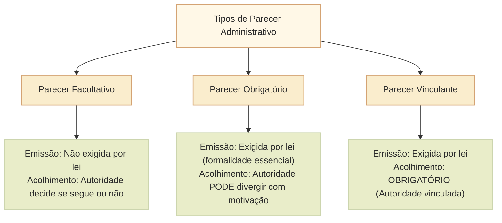
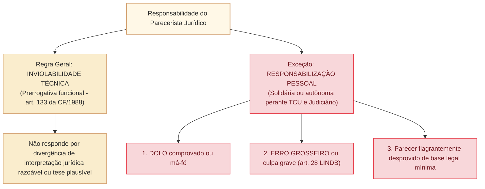

# Parecer administrativo: natureza jurídica, tipologia e responsabilidade civil, disciplinar e financeira do parecerista

O **parecer administrativo** é uma manifestação técnica ou jurídica emitida por órgão especializado (como consultorias jurídicas, procuradorias, assessorias legislativas ou comissões técnicas) que visa a subsidiar e orientar a tomada de decisão da autoridade administrativa competente.

No direito administrativo brasileiro, o parecer enquadra-se originariamente na espécie dos **atos enunciativos**: trata-se de um ato de opinião, juízo ou esclarecimento técnico, e não de um ato administrativo decisório propriamente dito. Contudo, as repercussões práticas e jurídicas do parecer variam drasticamente conforme sua **natureza normativa (facultativo, obrigatório ou vinculante)** e segundo a jurisprudência fixada pelo **Supremo Tribunal Federal (STF)** e pelo **Tribunal de Contas da União (TCU)**, especialmente no tocante à **responsabilização pessoal do parecerista por erro grosseiro ou culpa grave** (art. 28 da LINDB, Dec.-Lei nº 4.657/1942, e Lei nº 14.133/2021).

---

## 1. Natureza Jurídica e Distinção Dogmática

### 1.1. Parecer versus Decisão Administrativa
O parecerista não decide; ele opina e fundamenta. A autoridade competente é quem detém o poder de império e a competência legal originária para praticar o ato decisório:
- O parecer é **ato de apoio instrutório** que integra a motivação do ato definitivo quando expressamente adotado pela autoridade (**motivação *aliunde* ou *per relationem***, art. 50, § 1º, da Lei nº 9.784/1999).
- Enquanto ato meramente opinativo, o parecer **não é passível de impugnação direta por mandado de segurança**, pois não lesa diretamente direito líquido e certo por si só, salvo quando tiver eficácia imediatamente vinculante ou for homologado pela autoridade.

---

## 2. Tipologia dos Pareceres Administrativos

A doutrina administrativista clássica (consagrada por Oswaldo Aranha Bandeira de Mello e acolhida pacificamente pelo STF no histórico **MS 24.631/DF**) classifica os pareceres em três categorias fundamentais:

### 2.1. Parecer facultativo
A consulta é **facultativa** quando a norma não a torna etapa exigida para a decisão. A autoridade solicita o parecer por necessidade técnica e decide, motivadamente, se acolhe suas conclusões.

A natureza facultativa **não cria irresponsabilidade absoluta do parecerista**. A imputação pessoal depende de conduta concreta, elemento subjetivo e nexo com o resultado, considerados o regime aplicável e o art. 28 da LINDB. Divergência interpretativa razoavelmente fundamentada não equivale automaticamente a erro grosseiro.

**Caso:** a chefia consulta uma área técnica sobre formato de comunicação. A recomendação é fundamentada, mas a chefia prefere outra solução por razões documentadas. A simples divergência não implica responsabilização da consultoria. Se houver fraude deliberada na opinião, o exame é outro.

### 2.2. Parecer obrigatório
A consulta integra o procedimento quando norma exige prévia manifestação especializada. **Obrigatoriedade de consulta não significa obrigação geral de adotar a conclusão.** A autoridade pode discordar de parecer não vinculante, com fundamentação adequada; a situação pode exigir **nova consulta quando o ato proposto mudar** em relação ao que foi submetido à análise, como discutido no STF, MS 24.631/DF.

**Licitações:** o art. 53 da Lei nº 14.133/2021 prevê controle jurídico prévio ao final da fase preparatória; o § 4º disciplina outras contratações e instrumentos. O **§ 5º permite dispensar a análise jurídica em hipóteses previamente definidas por ato da autoridade jurídica máxima competente**, considerados baixo valor, baixa complexidade, entrega imediata e instrumentos padronizados. É incorreto afirmar que todo processo de contratação sempre exige um parecer individual.

**Procedimento progressivo:** (1) minuta encaminhada à consultoria; (2) parecer indica risco e propõe ajuste; (3) a autoridade acolhe e corrige a minuta; (4) se pretende adotar solução substancialmente diferente, avalia a necessidade de submeter novamente a proposta à análise jurídica. **Contraexemplo:** supor que bastaria apagar o parecer desfavorável e contratar sem motivação.

A consequência de consulta omitida deve ser examinada pela norma que a exige, pela natureza do vício, pelas possibilidades de saneamento e pelos efeitos no caso. Não há base para afirmar **nulidade absoluta e insanável em toda hipótese**.

Fonte: [Lei 14.133/2021, art. 53](https://normas.leg.br/?urn=urn%3Alex%3Abr%3Afederal%3Alei%3A2021-04-01%3B14133%21art53).

### 2.3. Parecer vinculante
Há eficácia vinculante quando a norma estabelece que a autoridade deve observar o entendimento. O alcance da obrigação depende da **fonte específica** e de suas condições de aprovação e publicação.

**Exemplo AGU:** segundo o art. 40, § 1º, da LC nº 73/1993, o parecer do Advogado-Geral da União **aprovado pelo Presidente da República e publicado com o despacho presidencial** vincula a Administração Federal. Se aprovado, mas **não publicado**, obriga apenas as repartições interessadas a partir da ciência (§ 2º). Pareceres consultivos ou técnicos sem essas condições não adquirem automaticamente alcance geral.

A vinculação orienta o conteúdo da decisão e pode ser relevante para apurar responsabilidades, **mas não estabelece solidariedade automática** entre autor do parecer e autoridade. É necessário identificar condutas, deveres, nexo causal e regime de responsabilização.

Fonte: [LC 73/1993, arts. 40 a 43](https://www2.camara.leg.br/legin/fed/leicom/1993/leicomplementar-73-10-fevereiro-1993-354947-normaatualizada-pl.html).

## 3. A Responsabilidade do Parecerista: STF, TCU e LINDB

A responsabilização do parecerista público (especialmente advogados públicos, procuradores e consultores legislativos) por suas manifestações é um dos temas mais sensíveis e recorrentes em provas de alto nível do Cebraspe.

### 3.1. A baliza do art. 28 da LINDB (Decreto-Lei nº 4.657/1942)
Incluído pela Lei nº 13.655/2018, o art. 28 da Lei de Introdução às Normas do Direito Brasileiro estabelece o regime geral de responsabilização dos agentes públicos:
> *"O agente público responderá pessoalmente por suas decisões ou opiniões técnicas em caso de **dolo ou erro grosseiro**."*

O Decreto nº 9.830/2019 (regulamentador da LINDB) define **erro grosseiro** como aquele manifesto, evidente e inescusável praticado com **culpa grave**, caracterizado por ação ou omissão com elevado grau de negligência, imprudência ou imperícia, violando padrão de conduta exigível de um profissional ordinariamente diligente.

### 3.2. STF: natureza do parecer e apuração de responsabilidade
Os mandados de segurança **MS 24.631/DF** e **MS 24.584/DF** são referências para distinguir emissão de opinião, consulta obrigatória e efeitos de parecer vinculante. A responsabilidade não pode ser inferida somente da classificação do documento.

A análise deve verificar **(1)** se o parecer foi exigido, **(2)** se vinculava o ato, **(3)** o dever concreto do parecerista, **(4)** dolo ou erro grosseiro no regime da LINDB, **(5)** a participação causal no resultado e **(6)** qual órgão possui competência para apurar. Parecer motivado com interpretação jurídica defensável não configura, apenas pela divergência, ilícito imputável ao autor.

O art. 133 da Constituição protege a atuação do **advogado** nos limites da lei, e não confere a qualquer consultor técnico uma imunidade funcional genérica.

### 3.3. Tribunal de Contas da União: fundamento correto e limites
O Tribunal de Contas da União pode examinar condutas de pareceristas no contexto de suas competências de controle, observando responsabilidade pessoal, dever funcional, dolo ou erro grosseiro, nexo e consequências concretas. A mera participação na emissão de parecer não demonstra solidariedade pelo ato de gestão.

**A Súmula 222 do TCU não disciplina responsabilidade de pareceristas.** Seu objeto são decisões do Tribunal relativas à aplicação de normas gerais de licitação que devem ser observadas por administradores dos entes federativos. Para discutir eventual responsabilidade do parecerista, devem ser citados **acórdãos específicos sobre sua conduta**, em conjunto com a LINDB e o regime aplicável, sem atribuir essa tese à Súmula 222.

Fonte primária: [TCU, Súmula 222](https://pesquisa.apps.tcu.gov.br/documento/sumula/%2A/NUMERO%253A222/DTRELEVANCIA%2520desc%252C%2520NUMEROINT%2520desc/0/sinonimos%253Dtrue).

### 3.4. Lei nº 14.133/2021: controle de legalidade e representação
O **art. 53** estabelece o controle prévio de legalidade por assessoramento jurídico, ressalvadas as **hipóteses de dispensa do § 5º**. O parecer deve apreciar elementos indispensáveis e explicitar os pressupostos de fato e direito (art. 53, § 1º, II).

O **art. 10 trata da representação pela advocacia pública de autoridades e servidores participantes dos procedimentos licitatórios e contratuais** quando precisem defender ato praticado **em estrita observância de orientação constante de parecer jurídico** elaborado nos termos do art. 53, § 1º. A representação ocorre **a critério do agente** e não se aplica quando constarem dos autos provas de atos ilícitos dolosos (art. 10, § 1º, II); também alcança quem já deixou a função (§ 2º). **O dispositivo não oferece automaticamente defesa pessoal ao autor de qualquer parecer por todo ato funcional.**

**Exemplo:** gestor observa estritamente orientação jurídica regular e precisa defender essa decisão. As condições do art. 10 devem ser verificadas. Se o gestor decide em desacordo com a orientação, a regra específica do artigo não pode ser presumida.

Fontes: [Lei 14.133, art. 10](https://normas.leg.br/?urn=urn%3Alex%3Abr%3Afederal%3Alei%3A2021-04-01%3B14133%21tit1_cap4) e [art. 53](https://normas.leg.br/?urn=urn%3Alex%3Abr%3Afederal%3Alei%3A2021-04-01%3B14133%21art53).

## Quadro comparativo: consulta, vinculação e responsabilidade

| Tipo | A consulta é exigida? | A conclusão vincula? | Responsabilidade |
| --- | --- | --- | --- |
| Facultativo | Não, salvo norma especial | Em regra, não | Depende de conduta, elemento subjetivo, nexo e regime |
| Obrigatório não vinculante | Sim, salvo hipóteses legais de dispensa | Em regra, não; divergência exige fundamentação e exame de eventual nova consulta | Examinar atuação da autoridade e parecerista, sem solidariedade automática |
| Vinculante | Nos casos e condições previstos na norma | Sim, no âmbito de eficácia fixado pela norma | Dever, causalidade e imputação concretos; vinculação não substitui prova de responsabilidade |

## Questões Comentadas (Estilo Cebraspe)

### Questão 1
*(Inédita: estilo Cebraspe / Câmara dos Deputados – Analista Legislativo)*  
No que concerne ao parecer administrativo facultativo e à responsabilização do parecerista, julgue o item a seguir.

> Caso o dirigente de órgão público federal solicite voluntariamente parecer técnico a consultor legislativo da instituição para dirimir dúvida sobre matéria não sujeita a consulta obrigatória por lei, o parecerista passará a responder solidariamente perante o Tribunal de Contas da União pela decisão adotada pela autoridade, independentemente da demonstração de dolo ou erro grosseiro.

**( ) Certo**  
**( ) Errado**

> **Gabarito: Errado**  
> **Comentário:** No **parecer facultativo**, a consulta é mera faculdade de prudência da autoridade administrativa, não havendo qualquer vinculação obrigatória de seu conteúdo. A decisão cabe à autoridade, mas a responsabilidade de quem emitiu a opinião exige exame de conduta e pressupostos próprios, como dolo ou erro grosseiro no regime do art. 28 da LINDB. O item está errado pela **solidariedade automática e independente de culpa ou dolo**, não porque o parecerista tenha imunidade absoluta.

---

### Questão 2
*(Inédita: estilo Cebraspe / Câmara dos Deputados – Analista Legislativo)*  
Julgue o item subsequente, relativo ao parecer obrigatório nas contratações públicas e aos limites de atuação da autoridade decisória.

> Nos processos de contratação disciplinados pela Lei nº 14.133/2021, a manifestação prévia da assessoria jurídica tem natureza de parecer obrigatório, de modo que a autoridade administrativa competente não pode, em nenhuma hipótese, homologar a licitação ou assinar o contrato em sentido divergente das recomendações do órgão parecerista.

**( ) Certo**  
**( ) Errado**

> **Gabarito: Errado**  
> **Comentário:** O art. 53 prevê análise jurídica prévia **como regra**, ressalvadas as dispensas do § 5º. A opinião não é automaticamente vinculante. Divergência exige motivação e, conforme o caso, **nova submissão do ato alterado** à assessoria. O item está errado pela proibição absoluta de divergir.

---

### Questão 3
*(Inédita: estilo Cebraspe / Câmara dos Deputados – Analista Legislativo)*  
Acerca do conceito de erro grosseiro previsto no art. 28 da LINDB e sua incidência sobre pareceristas públicos, julgue o item.

> Considera-se erro grosseiro, apto a ensejar a responsabilização pessoal do parecerista público perante os órgãos de controle externo, a adoção de tese jurídica minoritária porém defensável na doutrina, ainda que desprovida de intenção de causar dano ao erário.

**( ) Certo**  
**( ) Errado**

> **Gabarito: Errado**  
> **Comentário:** Nos termos do art. 28 da LINDB e do Decreto regulamentador nº 9.830/2019, o **erro grosseiro** consubstancia a **culpa grave**, isto é, aquele erro inescusável decorrente de manifesta negligência, imperícia evidente ou imprudência temerária, que desrespeita jurisprudência pacificada das Cortes de Contas ou ignora texto expresso de lei sem qualquer fundamentação jurídica plausível. A mera adoção de interpretação jurídica controvertida ou tese doutrinária minoritária, quando respaldada em argumentos racionais e consistentes, preserva a inviolabilidade profissional do parecerista e afasta a configuração de erro grosseiro.

---

### Questão 4
*(Inédita: estilo Cebraspe / Câmara dos Deputados – Analista Legislativo)*  
Julgue o item a seguir, referente aos pareceres vinculantes no âmbito federal.

> Os pareceres emanados pela Advocacia-Geral da União que obtenham expressa aprovação do Presidente da República adquirem caráter vinculante para toda a Administração Pública Federal direta e indireta, vinculando compulsoriamente os órgãos subordinados ao seu estrito cumprimento a partir de sua publicação oficial.

**( ) Certo**  
**( ) Errado**

> **Gabarito: Certo**  
> **Comentário:** A assertiva reflete exatamente a disciplina conferida pelo art. 40 da Lei Complementar nº 73/1993 (Lei Orgânica da AGU). Quando o Presidente aprova **e o parecer é publicado juntamente com o despacho presidencial**, o art. 40, § 1º, da LC 73/1993 estabelece vinculação de toda a Administração Federal. O § 2º diferencia parecer aprovado **não publicado**, que obriga apenas repartições interessadas a partir da ciência.

---

### Questão 5
*(Inédita: estilo Cebraspe / Câmara dos Deputados – Analista Legislativo)*  
No que concerne ao cabimento de mandado de segurança contra pareceres administrativos, julgue o item.

> Como regra geral fixada pela jurisprudência, não cabe mandado de segurança impetrado diretamente contra parecer jurídico facultativo ou obrigatório desprovido de eficácia vinculante, uma vez que a opinião técnica nele consubstanciada não ostenta carga decisória capaz de violar por si só direito líquido e certo do administrado.

**( ) Certo**  
**( ) Errado**

> **Gabarito: Certo**  
> **Comentário:** O parecer não vinculante é ato administrativo meramente enunciativo e opinativo, servindo como subsídio instrutório para o futuro ato decisório. Por não possuir coercibilidade imediata nem produzir alteração autônoma na esfera jurídica subjetiva de terceiros, o parecer em si não constitui ato de autoridade coatora passível de mandado de segurança. O remédio constitucional caberá apenas contra o ato decisório posterior da autoridade competente que efetivamente lesionar ou ameaçar o direito do impetrante.

---

### Questão 6
*(Inédita: estilo Cebraspe / Câmara dos Deputados – Analista Legislativo)*  
Julgue o item seguinte, relativo à responsabilidade do gestor público que acolhe parecer jurídico irregular.

> A existência de parecer jurídico favorável emitido por procuradoria de órgão público isenta integral e automaticamente a autoridade gestora de qualquer penalidade perante os órgãos de controle externo, operando como excludente absoluta de responsabilidade administrativa e financeira.

**( ) Certo**  
**( ) Errado**

> **Gabarito: Errado**  
> **Comentário:** É jurisprudência sedimentada e pacífica do Tribunal de Contas da União e do STF que a existência de parecer jurídico favorável **não afasta automaticamente a responsabilidade do administrador público**. O gestor tem o dever de agir com cautela e diligência média; caso o parecer seja teratológico, manifestamente absurdo ou desprovido de respaldo fático elementar, o gestor público responde solidariamente pelas ilegalidades e pelo dano causado, não lhe sendo dado alegar ignorância cega perante irregularidades evidentes.

---

## Relações com outros temas

- [[3 - Materias/Direito Administrativo/03 - atos administrativos|Elementos e requisitos de validade do ato administrativo]]: o parecer como ato preparatório da forma e da motivação (*aliunde* ou *per relationem*, art. 50, § 1º, da Lei nº 9.784/1999).
- [[3 - Materias/Direito Administrativo/16 - classificacoes e especies de atos administrativos|Classificações e espécies de atos administrativos]]: enquadramento do parecer na espécie dos atos enunciativos.
- [[3 - Materias/Direito Administrativo/01 - principios e lei de acesso a informacao|Princípios da Administração Pública]]: legalidade, motivação, publicidade e segurança jurídica.
- [[3 - Materias/Direito Administrativo/09 - processo administrativo federal|Processo administrativo federal]]: instrução processual e pareceres de órgãos consultivos.

## Fontes normativas e jurisprudenciais

- **Constituição Federal de 1988:** art. 37, *caput*; art. 133 (inviolabilidade do advogado).
- **Decreto-Lei nº 4.657/1942 (LINDB):** art. 28 (responsabilização por dolo ou erro grosseiro) e Decreto nº 9.830/2019 (regulamentação de erro grosseiro).
- **Lei Complementar nº 73/1993 (Lei Orgânica da AGU):** arts. 40 e 41 (pareceres vinculantes com aprovação presidencial).
- **Lei nº 14.133/2021 (Nova Lei de Licitações):** arts. 10 e 53 (controle prévio de legalidade e representação judicial do parecerista).
- **Supremo Tribunal Federal:** MS 24.631/DF e MS 24.584/DF (regime de responsabilidade em pareceres facultativos, obrigatórios e vinculantes).
- **Tribunal de Contas da União:** Súmula 222 e jurisprudência consolidada sobre dolo, erro grosseiro e não exuneração automática do gestor.
