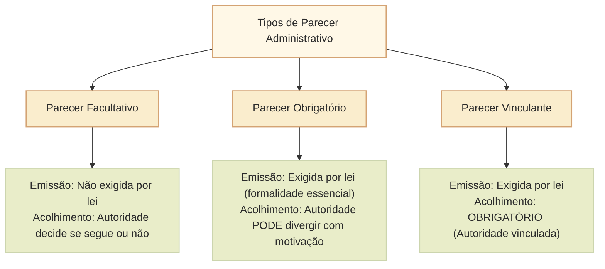
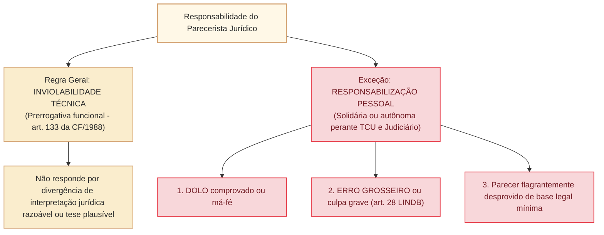

# Parecer administrativo: natureza jurídica, tipologia e responsabilidade civil, disciplinar e financeira do parecerista

O **parecer administrativo** é uma manifestação técnica ou jurídica emitida por órgão especializado (como consultorias jurídicas, procuradorias, assessorias legislativas ou comissões técnicas) que visa a subsidiar e orientar a tomada de decisão da autoridade administrativa competente.

No direito administrativo brasileiro, o parecer enquadra-se originariamente na espécie dos **atos enunciativos**: trata-se de um ato de opinião, juízo ou esclarecimento técnico, e não de um ato administrativo decisório propriamente dito. Contudo, as repercussões práticas e jurídicas do parecer variam drasticamente conforme sua **natureza normativa (facultativo, obrigatório ou vinculante)** e segundo a jurisprudência fixada pelo **Supremo Tribunal Federal (STF)** e pelo **Tribunal de Contas da União (TCU)**, especialmente no tocante à **responsabilização pessoal do parecerista por erro grosseiro ou culpa grave** (art. 28 da LINDB, Dec.-Lei nº 4.657/1942, e Lei nº 14.133/2021).

---

## 1. Natureza Jurídica e Distinção Dogmática

### 1.1. Parecer versus Decisão Administrativa
O parecerista não decide; ele opina e fundamenta. A autoridade competente é quem detém o poder de império e a competência legal originária para praticar o ato decisório:
- O parecer é **ato de apoio instrutório** que integra a motivação do ato definitivo quando expressamente adotado pela autoridade (**motivação *aliunde* ou *per relationem***, art. 50, § 1º, da Lei nº 9.784/1999).
- Enquanto ato meramente opinativo, o parecer **não é passível de impugnação direta por mandado de segurança**, pois não lesa diretamente direito líquido e certo por si só, salvo quando tiver eficácia imediatamente vinculante ou for homologado pela autoridade.

---

## 2. Tipologia dos Pareceres Administrativos

A doutrina administrativista clássica (consagrada por Oswaldo Aranha Bandeira de Mello e acolhida pacificamente pelo STF no histórico **MS 24.631/DF**) classifica os pareceres em três categorias fundamentais:

### 2.1. Parecer Facultativo
- **Definição:** a lei **não exige** a consulta prévia a órgão jurídico ou técnico para a prática do ato. A autoridade solicita o parecer por mera cautela ou prudência administrativa.
- **Efeitos:** a autoridade tem total liberdade para solicitar ou não o parecer e, após emiti-lo, tem plena liberdade para acolhê-lo ou rejeitá-lo, fundamentando a sua decisão.
- **Responsabilidade:** a autoridade administrativa assume **responsabilidade pessoal e exclusiva** pela decisão tomada. O parecerista não responde pelo ato final, exceto se comprovado dolo específico ou conluio fraudulento.

### 2.2. Parecer Obrigatório
- **Definição:** a lei **exige compulsoriamente** que o órgão técnico ou jurídico seja ouvido antes da decisão, constituindo a sua emissão uma **formalidade essencial** de validade do procedimento.
- **Exemplo típico:** parecer jurídico prévio em editais de licitação, contratos administrativos e dispensas/inexigibilidades (art. 53 da Nova Lei de Licitações, Lei nº 14.133/2021).
- **Efeitos quanto ao mérito:** a audiência é obrigatória, mas **a conclusão do parecerista NÃO vincula a autoridade**. A autoridade administrativa pode divergir das conclusões jurídicas do parecerista, desde que o faça de forma **expressamente motivada** e fundamentada, assumindo o risco integral da decisão divergente.
- **Vício procedimental:** a ausência de parecer obrigatório acarreta **nulidade absoluta insanável** do ato decisório subsequente por vício formal essencial.

### 2.3. Parecer Vinculante
- **Definição:** a lei impõe tanto a **obrigatoriedade de sua emissão** quanto a **obrigatoriedade de adoção de suas conclusões** pela autoridade administrativa competente.
- **Exemplo típico:** pareceres da Advocacia-Geral da União (AGU) aprovados pelo Presidente da República, que vinculam compulsoriamente toda a Administração Pública Federal direta e indireta (art. 40 da Lei Complementar nº 73/1993); parecer vinculante da Procuradoria da Fazenda Nacional aprovado pelo Ministro da Fazenda.
- **Efeitos:** a autoridade decisória fica jungida aos exatos limites do parecer. Ela somente pode agir no sentido indicado pelo parecer ou, caso discorde, abster-se de praticar o ato, submetendo a divergência à autoridade de cúpula homologadora.
- **Responsabilidade:** a decisão é compartilhada com o parecerista ou a ele imputada substancialmente, pois o conteúdo dispositivo decorre diretamente de sua manifestação técnica vinculativa.

---

## 3. A Responsabilidade do Parecerista: STF, TCU e LINDB

A responsabilização do parecerista público (especialmente advogados públicos, procuradores e consultores legislativos) por suas manifestações é um dos temas mais sensíveis e recorrentes em provas de alto nível do Cebraspe.

### 3.1. A baliza do art. 28 da LINDB (Decreto-Lei nº 4.657/1942)
Incluído pela Lei nº 13.655/2018, o art. 28 da Lei de Introdução às Normas do Direito Brasileiro estabelece o regime geral de responsabilização dos agentes públicos:
> *"O agente público responderá pessoalmente por suas decisões ou opiniões técnicas em caso de **dolo ou erro grosseiro**."*

O Decreto nº 9.830/2019 (regulamentador da LINDB) define **erro grosseiro** como aquele manifesto, evidente e inescusável praticado com **culpa grave**, caracterizado por ação ou omissão com elevado grau de negligência, imprudência ou imperícia, violando padrão de conduta exigível de um profissional ordinariamente diligente.

### 3.2. A jurisprudência do Supremo Tribunal Federal (MS 24.631/DF e MS 24.584/DF)
O STF pacificou distinções seminais quanto à responsabilização do advogado/consultor parecerista:
1. **No parecer facultativo:** o parecerista opina sem poder vinculante. A autoridade administrativa é a única responsável. O parecerista só responderá se restar cabalmente evidenciado conluio ou dolo com a autoridade para fraudar a lei.
2. **No parecer obrigatório não vinculante:** a autoridade tem o dever de consultar, mas não de seguir. Se a autoridade seguir parecer manifestamente ilegal emitido com erro grosseiro ou negligência indesculpável, o STF e o TCU admitem a **responsabilização solidária do parecerista e da autoridade administradora**. Se o parecer estiver amparado em fundamentação jurídica defensável e tese doutrinária plausível, o parecerista não pode ser responsabilizado, preservando-se sua inviolabilidade técnica (art. 133 da CF/1988).
3. **No parecer vinculante:** como o administrador está obrigado a seguir o parecer, o parecerista assume corresponsabilidade direta pela manifestação emanada, respondendo solidariamente por ilegalidades e danos causados ao erário.

### 3.3. A jurisprudência do Tribunal de Contas da União (TCU)
O TCU possui jurisprudência consolidada (Súmula 222 do TCU e acórdãos reiterados) no sentido de que:
- O parecerista jurídico **pode ser responsabilizado pelo TCU** e sancionado com multa ou condenação em débito solidário quando emite parecer que subsidia contratação direta ilegal, sobrepreço ou superfaturamento, desde que sua conduta decorra de **dolo ou erro grosseiro** (ausência de diligência elementar, ignorância de jurisprudência sumulada pacífica ou omissão de cláusula essencial).
- A mera existência de parecer jurídico favorável **não exime automaticamente o gestor público de responsabilidade**, pois cabe ao administrador agir com prudência e não acatar pareceres com fundamentações teratológicas ou manifestamente absurdas.

### 3.4. O regime na Nova Lei de Licitações (Lei nº 14.133/2021)
O art. 53 da Lei nº 14.133/2021 estabelece a obrigatoriedade de controle prévio de legalidade mediante parecer jurídico na fase preparatória dos processos licitatórios e contratações diretas:
- **Art. 53, § 1º:** o órgão de assessoramento jurídico apreciará a legalidade dos editais e contratos e deverá manifestar-se expressamente sobre as minutas.
- **Defesa judicial do parecerista (art. 10):** se o parecerista for processado judicialmente ou perante os órgãos de controle em decorrência de atos praticados no estrito exercício de suas atribuições funcionais, a advocacia pública assegurará a sua representação judicial e extrajudicial, salvo se restar comprovada prática de ato com dolo ou fraude.

---

## Quadro Sinótico: Comparativo dos Tipos de Parecer

| Categoria | Previsão Legal | Vinculação da Autoridade | Responsabilidade do Parecerista | Responsabilidade do Administrador |
| :--- | :--- | :--- | :--- | :--- |
| **Facultativo** | Facultativa (a critério da autoridade). | Não vincula (autoridade decide livremente). | Não responde, salvo comprovado dolo/conluio. | Responde pessoal e integralmente pela decisão. |
| **Obrigatório** | Obrigatória por lei (formalidade essencial). | Não vincula no conteúdo (admite divergência fundamentada). | Responde por **dolo ou erro grosseiro** (solidariamente se acolhido). | Responde se acolher parecer teratológico ou se divergir sem fundamentação. |
| **Vinculante** | Obrigatória e expressa em lei. | **Vincula compulsoriamente** o acolhimento do conteúdo. | Responde diretamente e solidariamente pelo conteúdo dispositivo. | Fica jungido aos termos do parecer; responde se exorbitar. |

---

## Questões Comentadas (Estilo Cebraspe)

### Questão 1
*(Inédita: estilo Cebraspe / Câmara dos Deputados – Analista Legislativo)*  
No que concerne ao parecer administrativo facultativo e à responsabilização do parecerista, julgue o item a seguir.

> Caso o dirigente de órgão público federal solicite voluntariamente parecer técnico a consultor legislativo da instituição para dirimir dúvida sobre matéria não sujeita a consulta obrigatória por lei, o parecerista passará a responder solidariamente perante o Tribunal de Contas da União pela decisão adotada pela autoridade, independentemente da demonstração de dolo ou erro grosseiro.

**( ) Certo**  
**( ) Errado**

> **Gabarito: Errado**  
> **Comentário:** No **parecer facultativo**, a consulta é mera faculdade de prudência da autoridade administrativa, não havendo qualquer vinculação obrigatória de seu conteúdo. A decisão final e a responsabilidade jurídica cabem com exclusividade à autoridade que decidiu. Conforme jurisprudência pacificada do STF (MS 24.631/DF) e as diretrizes do art. 28 da LINDB, o parecerista somente pode ser responsabilizado na hipótese excepcional de comprovação inequívoca de dolo ou conluio criminoso/fraudulento com o gestor, jamais de forma automática ou objetiva.

---

### Questão 2
*(Inédita: estilo Cebraspe / Câmara dos Deputados – Analista Legislativo)*  
Julgue o item subsequente, relativo ao parecer obrigatório nas contratações públicas e aos limites de atuação da autoridade decisória.

> Nos processos de contratação disciplinados pela Lei nº 14.133/2021, a manifestação prévia da assessoria jurídica tem natureza de parecer obrigatório, de modo que a autoridade administrativa competente não pode, em nenhuma hipótese, homologar a licitação ou assinar o contrato em sentido divergente das recomendações do órgão parecerista.

**( ) Certo**  
**( ) Errado**

> **Gabarito: Errado**  
> **Comentário:** Embora a emissão do parecer jurídico constitua controle prévio obrigatório de legalidade exigido pelo art. 53 da Lei nº 14.133/2021 (parecer obrigatório), ele **não tem eficácia vinculante**. A autoridade administrativa pode discordar das conclusões e recomendações apresentadas pela assessoria jurídica, desde que formule decisão autônoma expressamente motivada e justificada nos autos, assumindo a responsabilidade pessoal pelos fundamentos jurídicos de sua divergência.

---

### Questão 3
*(Inédita: estilo Cebraspe / Câmara dos Deputados – Analista Legislativo)*  
Acerca do conceito de erro grosseiro previsto no art. 28 da LINDB e sua incidência sobre pareceristas públicos, julgue o item.

> Considera-se erro grosseiro, apto a ensejar a responsabilização pessoal do parecerista público perante os órgãos de controle externo, a adoção de tese jurídica minoritária porém defensável na doutrina, ainda que desprovida de intenção de causar dano ao erário.

**( ) Certo**  
**( ) Errado**

> **Gabarito: Errado**  
> **Comentário:** Nos termos do art. 28 da LINDB e do Decreto regulamentador nº 9.830/2019, o **erro grosseiro** consubstancia a **culpa grave**, isto é, aquele erro inescusável decorrente de manifesta negligência, imperícia evidente ou imprudência temerária, que desrespeita jurisprudência pacificada das Cortes de Contas ou ignora texto expresso de lei sem qualquer fundamentação jurídica plausível. A mera adoção de interpretação jurídica controvertida ou tese doutrinária minoritária, quando respaldada em argumentos racionais e consistentes, preserva a inviolabilidade profissional do parecerista e afasta a configuração de erro grosseiro.

---

### Questão 4
*(Inédita: estilo Cebraspe / Câmara dos Deputados – Analista Legislativo)*  
Julgue o item a seguir, referente aos pareceres vinculantes no âmbito federal.

> Os pareceres emanados pela Advocacia-Geral da União que obtenham expressa aprovação do Presidente da República adquirem caráter vinculante para toda a Administração Pública Federal direta e indireta, vinculando compulsoriamente os órgãos subordinados ao seu estrito cumprimento a partir de sua publicação oficial.

**( ) Certo**  
**( ) Errado**

> **Gabarito: Certo**  
> **Comentário:** A assertiva reflete exatamente a disciplina conferida pelo art. 40 da Lei Complementar nº 73/1993 (Lei Orgânica da AGU). Quando o Presidente da República aprova expressamente parecer da AGU, o documento adquire eficácia normativa e **força vinculante** em relação a todos os órgãos e entidades da Administração Pública Federal, os quais ficam obrigados a observar rigorosamente os seus entendimentos jurídicos.

---

### Questão 5
*(Inédita: estilo Cebraspe / Câmara dos Deputados – Analista Legislativo)*  
No que concerne ao cabimento de mandado de segurança contra pareceres administrativos, julgue o item.

> Como regra geral fixada pela jurisprudência, não cabe mandado de segurança impetrado diretamente contra parecer jurídico facultativo ou obrigatório desprovido de eficácia vinculante, uma vez que a opinião técnica nele consubstanciada não ostenta carga decisória capaz de violar por si só direito líquido e certo do administrado.

**( ) Certo**  
**( ) Errado**

> **Gabarito: Certo**  
> **Comentário:** O parecer não vinculante é ato administrativo meramente enunciativo e opinativo, servindo como subsídio instrutório para o futuro ato decisório. Por não possuir coercibilidade imediata nem produzir alteração autônoma na esfera jurídica subjetiva de terceiros, o parecer em si não constitui ato de autoridade coatora passível de mandado de segurança. O remédio constitucional caberá apenas contra o ato decisório posterior da autoridade competente que efetivamente lesionar ou ameaçar o direito do impetrante.

---

### Questão 6
*(Inédita: estilo Cebraspe / Câmara dos Deputados – Analista Legislativo)*  
Julgue o item seguinte, relativo à responsabilidade do gestor público que acolhe parecer jurídico irregular.

> A existência de parecer jurídico favorável emitido por procuradoria de órgão público isenta integral e automaticamente a autoridade gestora de qualquer penalidade perante os órgãos de controle externo, operando como excludente absoluta de responsabilidade administrativa e financeira.

**( ) Certo**  
**( ) Errado**

> **Gabarito: Errado**  
> **Comentário:** É jurisprudência sedimentada e pacífica do Tribunal de Contas da União e do STF que a existência de parecer jurídico favorável **não afasta automaticamente a responsabilidade do administrador público**. O gestor tem o dever de agir com cautela e diligência média; caso o parecer seja teratológico, manifestamente absurdo ou desprovido de respaldo fático elementar, o gestor público responde solidariamente pelas ilegalidades e pelo dano causado, não lhe sendo dado alegar ignorância cega perante irregularidades evidentes.

---

## Relações com outros temas

- [[3 - Materias/Direito Administrativo/03 - atos administrativos|Elementos e requisitos de validade do ato administrativo]]: o parecer como ato preparatório da forma e da motivação (*aliunde* ou *per relationem*, art. 50, § 1º, da Lei nº 9.784/1999).
- [[3 - Materias/Direito Administrativo/16 - classificacoes e especies de atos administrativos|Classificações e espécies de atos administrativos]]: enquadramento do parecer na espécie dos atos enunciativos.
- [[3 - Materias/Direito Administrativo/01 - principios e lei de acesso a informacao|Princípios da Administração Pública]]: legalidade, motivação, publicidade e segurança jurídica.
- [[3 - Materias/Direito Administrativo/09 - processo administrativo federal|Processo administrativo federal]]: instrução processual e pareceres de órgãos consultivos.

## Fontes normativas e jurisprudenciais

- **Constituição Federal de 1988:** art. 37, *caput*; art. 133 (inviolabilidade do advogado).
- **Decreto-Lei nº 4.657/1942 (LINDB):** art. 28 (responsabilização por dolo ou erro grosseiro) e Decreto nº 9.830/2019 (regulamentação de erro grosseiro).
- **Lei Complementar nº 73/1993 (Lei Orgânica da AGU):** arts. 40 e 41 (pareceres vinculantes com aprovação presidencial).
- **Lei nº 14.133/2021 (Nova Lei de Licitações):** arts. 10 e 53 (controle prévio de legalidade e representação judicial do parecerista).
- **Supremo Tribunal Federal:** MS 24.631/DF e MS 24.584/DF (regime de responsabilidade em pareceres facultativos, obrigatórios e vinculantes).
- **Tribunal de Contas da União:** Súmula 222 e jurisprudência consolidada sobre dolo, erro grosseiro e não exuneração automática do gestor.
