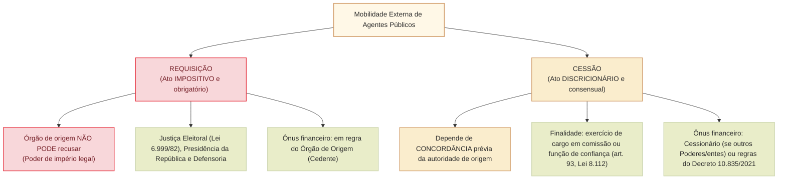

# Requisição, cessão e movimentação de agentes públicos: distinções, ônus financeiro e regime jurídico

A gestão de recursos humanos na Administração Pública contemporânea exige instrumentos flexíveis de cooperação e mobilidade interinstitucional para atender a demandas sazonais, missões extraordinárias, cooperação federativa e funcionamento de órgãos essenciais da República.

No regime jurídico administrativo brasileiro (em especial na **Lei nº 8.112/1990**, no **Decreto nº 10.835/2021** e na legislação eleitoral e parlamentar), a mobilidade funcional externa de servidores públicos desdobra-se em dois institutos dogmáticos de perfis inconfundíveis:
1. **Requisição:** ato unilateral, impositivo e obrigatório, fundamentado em prerrogativa legal extraordinária conferida a determinados órgãos constitucionais;
2. **Cessão:** ato bilateral discricionário fundado no consentimento mútuo entre o órgão cedente e o órgão cessionário.

Para o concurso da Câmara dos Deputados (Cebraspe C/E), o domínio das **diferenças de coercibilidade**, do **ônus da remuneração** e do regime jurídico disciplinar é objeto constante de cobrança minuciosa.

---

## 1. Requisição de Agentes Públicos

### 1.1. Conceito e natureza impositiva
A **requisição** é o ato administrativo pelo qual uma autoridade ou órgão público legalmente investido de poder de império requisitório determina a transferência temporária do exercício funcional de um servidor público de outro órgão ou ente federativo para prestar serviços no órgão requisitante.
- **Caráter irrecusável e cogente:** a autoridade do órgão de origem (lotador original do servidor) **não possui margem de discricionariedade** para indeferir o pedido, avaliar conveniência interna de sua repartição ou condicionar a liberação à reposição de pessoal. A liberação do servidor é um **dever jurídico de estrito cumprimento**.
- **Natureza jurídica:** ato unilateral imperativo derivado de autorização legal expressa vinculada ao interesse público primário.

### 1.2. Principais hipóteses legais de requisição no ordenamento federal
A requisição não é um poder genérico de qualquer repartição; depende de **previsão estrita em lei formal**:
1. **Justiça Eleitoral (Lei nº 6.999/1982 e art. 30 do Código Eleitoral):**
   - Os juízes e tribunais eleitorais têm competência legal para requisitar servidores públicos da União, Estados, DF e Municípios, bem como de suas autarquias, para auxiliar os cartórios eleitorais e as eleições.
   - A requisição tem prazo certo (em regra 1 ano, prorrogável) e o órgão de origem não pode obstar a apresentação do servidor.
2. **Presidência da República e Vice-Presidência (Lei nº 9.007/1995 e Lei nº 14.600/2023):**
   - Prerrogativa legal para requisitar servidores de quaisquer órgãos ou entidades federais para exercício de atribuições nos órgãos da Presidência da República.
3. **Defensoria Pública da União (Lei Complementar nº 80/1994):**
   - Hipóteses extraordinárias de requisição de pessoal para viabilizar a implantação e funcionamento emergencial de núcleos defensoriais.
4. **Poder Judiciário e Ministério Público da União:**
   - Previsões estritas nas respectivas leis orgânicas e regimentais para atendimento de situações específicas e temporárias de assessoria técnica.

### 1.3. Ônus da remuneração e direitos funcionais
- **Regra geral do ônus:** na requisição legal típica (como a da Justiça Eleitoral), o ônus da remuneração do cargo efetivo permanece **a cargo do órgão de origem (órgão cedente)**.
- **Preservação de direitos:** o período de requisição é considerado de **efetivo exercício** para todos os efeitos legais (art. 102 da Lei nº 8.112/1990), incluindo aposentadoria, contagem de tempo de serviço, progressão funcional e licença-prêmio/capacitação.

---

## 2. Cessão de Agentes Públicos (Art. 93 da Lei nº 8.112/1990)

### 2.1. Conceito e natureza consensual
A **cessão** é o ato pelo qual o servidor público estável é colocado temporariamente à disposição de outro órgão ou entidade dos Poderes da União, dos Estados, do Distrito Federal ou dos Municípios.
- **Caráter discricionário:** diferentemente da requisição, a cessão **depende da prévia concordância e autorização discricionária** da autoridade competente do órgão de origem. O dirigente máximo do órgão cedente avalia a oportunidade e conveniência do afastamento com base na necessidade interna do serviço.

### 2.2. Hipóteses legais de cabimento (Art. 93 da Lei nº 8.112/1990)
O servidor público federal regido pela Lei nº 8.112/1990 somente pode ser cedido nas seguintes condições estritas:
1. Para o **exercício de cargo em comissão ou função de confiança** (art. 93, I);
2. Em casos previstos em **leis específicas** (art. 93, II).

> [!IMPORTANT]
> **Vício de desvio na cessão:** É ilegal e nula a cessão de servidor público federal para outro Poder ou ente federativo quando destinada ao desempenho de atribuições técnicas ordinárias sem vinculação a cargo em comissão ou função de confiança (salvo lei autorizativa expressa).

### 2.3. O regime financeiro do reembolso salarial (Quem paga a conta?)
O regime financeiro da cessão de servidores federais foi detalhado pelo art. 93 da Lei nº 8.112/1990 e regulamentado pelo **Decreto nº 10.835/2021**:
- **Cessão no âmbito dos Poderes da União (mesmo ente político):**
  - O ônus da remuneração permanece a cargo do **órgão cedente (órgão de origem)**, salvo estipulação diversa em norma infralegal.
- **Cessão para Estados, Distrito Federal, Municípios ou para o Poder Executivo/Legislativo/Judiciário de outro ente:**
  - O ônus da remuneração cabe ao **órgão cessionário (órgão que recebe o servidor)** mediante **reembolso mensal integral** dos vencimentos e encargos sociais ao órgão de origem.
- **Opção remuneratória:** o servidor cedido para ocupar cargo em comissão pode optar pela remuneração do cargo efetivo acrescida do percentual legal do cargo comissionado ou pela retribuição integral do cargo em comissão.

---

## 3. Movimentação para Compor Força de Trabalho (Decreto nº 10.835/2021)

Modernamente, a Administração Pública Federal instituiu a figura da **movimentação para compor força de trabalho** no âmbito do Poder Executivo federal:
- Trata-se de instrumento de lotação provisória destinado a equalizar déficits crônicos de pessoal entre autarquias, fundações e ministérios, **sem a necessidade de provimento de cargo em comissão ou função de confiança**.
- A movimentação exige justificativa técnica formal da carência de pessoal e concordância entre os órgãos envolvidos, mantendo-se a remuneração integral no órgão de origem.

---

## 4. Quadro Sinótico: Requisição versus Cessão

| Critério discriminador | Requisição | Cessão |
| :--- | :--- | :--- |
| **Natureza do ato** | **Impositivo, unilateral e cogente** (dever legal). | **Discricionário e consensual** (depende de aquiescência do cedente). |
| **Margem de recusa do órgão de origem** | **Inexistente**. O órgão de origem é obrigado a liberar o servidor. | **Total**. O dirigente pode recusar por conveniência e necessidade do serviço. |
| **Finalidade principal** | Atendimento a necessidades urgentes/extraordinárias fixadas em lei (Justiça Eleitoral, Presidência). | Ocupação de **cargo em comissão ou função de confiança** (art. 93 da Lei 8.112). |
| **Ônus financeiro da remuneração** | Em regra, do **órgão de origem** (salvo gratificação eleitoral ou verba indenizatória). | Em regra, do **órgão cessionário** (quando para outro ente federativo via reembolso). |
| **Competência disciplinar** | Falta funcional ligada ao serviço requisitado é apurada pelo órgão requisitante; penalidades graves (demissão) são privativas do órgão de origem. | O órgão cessionário noticia eventuais ilícitos funcionais ao órgão de origem, competente para aplicar o PAD. |

---

## Questões Comentadas (Estilo Cebraspe)

### Questão 1
*(Inédita: estilo Cebraspe / Câmara dos Deputados – Analista Legislativo)*  
Acerca do instituto da requisição de agentes públicos pela Justiça Eleitoral, julgue o item a seguir.

> Em virtude da autonomia administrativa assegurada aos Poderes da República, o dirigente de órgão da Câmara dos Deputados poderá recusar motivadamente a liberação de servidor de seu quadro efetivo requisitado por Tribunal Regional Eleitoral, sob o fundamento de carência crônica e insubstituível de pessoal no setor legislativo de origem.

**( ) Certo**  
**( ) Errado**

> **Gabarito: Errado**  
> **Comentário:** A requisição fundamentada na legislação eleitoral (Lei nº 6.999/1982 e Código Eleitoral) tem natureza jurídica **impositiva e cogente**, não outorgando à autoridade de origem margem discricionária de conveniência para indeferir ou postergar a apresentação do servidor. A prerrogativa legal da Justiça Eleitoral prevalece sobre as conveniências operacionais internas do órgão de origem, constituindo dever funcional estrito a liberação imediata do servidor requisitado.

---

### Questão 2
*(Inédita: estilo Cebraspe / Câmara dos Deputados – Analista Legislativo)*  
No que concerne à cessão de servidores públicos federais disciplinada pela Lei nº 8.112/1990, julgue o item subsequente.

> Como regra geral do regime estatutário federal, o servidor público titular de cargo efetivo somente poderá ser cedido para outro órgão ou entidade fora da estrutura da União com o objetivo estrito de exercer cargo em comissão ou função de confiança, ou em situações amparadas por expressa autorização em lei específica.

**( ) Certo**  
**( ) Errado**

> **Gabarito: Certo**  
> **Comentário:** A assertiva reflete a literalidade e a inteligência do art. 93 da Lei nº 8.112/1990. A cessão de servidor público federal para órgãos de outros entes federativos (Estados, DF e Municípios) ou de outros Poderes possui finalidade vinculada: destina-se imperativamente ao exercício de cargo em comissão ou função de confiança (art. 93, I) ou em casos expressamente delineados em lei específica (art. 93, II). É vedada a cessão graciosa para cumprimento de tarefas burocráticas ordinárias desprovidas de encargo comissionado.

---

### Questão 3
*(Inédita: estilo Cebraspe / Câmara dos Deputados – Analista Legislativo)*  
Julgue o item que se segue, relativo ao ônus remuneratório na cessão de servidores entre entes federativos distintos.

> Cedido servidor público federal para exercer cargo de Secretário Municipal em determinada prefeitura, o ônus da remuneração do cargo efetivo permanecerá compulsoriamente a cargo da União, vedada qualquer cobrança de ressarcimento contra a municipalidade cessionária.

**( ) Certo**  
**( ) Errado**

> **Gabarito: Errado**  
> **Comentário:** Consoante o disposto no art. 93, § 1º, da Lei nº 8.112/1990 e no Decreto nº 10.835/2021, na cessão de servidor federal para Estados, DF ou Municípios, o ônus da remuneração do cargo efetivo é do **órgão ou entidade cessionária**, o qual tem o dever legal de efetuar o **reembolso mensal integral** à União das parcelas remuneratórias e respectivos encargos sociais patronais.

---

### Questão 4
*(Inédita: estilo Cebraspe / Câmara dos Deputados – Analista Legislativo)*  
A respeito da contagem de tempo de serviço do servidor público durante o período de requisição, julgue o item.

> O período em que o servidor público federal permanecer à disposição de órgão do Poder Judiciário em virtude de requisição legal regular não é considerado como tempo de efetivo exercício, gerando a interrupção automática da contagem de prazo para fins de aposentadoria e progressão funcional na carreira originária.

**( ) Certo**  
**( ) Errado**

> **Gabarito: Errado**  
> **Comentário:** Nos exatos termos do art. 102, inciso II, da Lei nº 8.112/1990, o afastamento para prestar serviços a outro órgão em decorrência de requisição regular é expressamente considerado como de **efetivo exercício**. O servidor não sofre prejuízo funcional em sua carreira de origem, preservando integralmente a contagem de tempo para concessão de progressões, promoções, adicionais temporais e aposentadoria estatutária.

---

### Questão 5
*(Inédita: estilo Cebraspe / Câmara dos Deputados – Analista Legislativo)*  
Julgue o item a seguir, referente às diferenças dogmáticas entre requisição e cessão de agentes públicos.

> Enquanto a cessão de servidores constitui ato administrativo bilateral e discricionário que depende do consentimento e da aquiescência do órgão de origem, a requisição opera-se por ato unilateral e cogente, dotado de autoexecutoriedade e fundado em mandamento legal inderrogável.

**( ) Certo**  
**( ) Errado**

> **Gabarito: Certo**  
> **Comentário:** O item traça com rigor doutrinário a linha divisória dos dois institutos. A cessão exige o alinhamento de vontades e a concordância da autoridade de origem (juízo de mérito), ao passo que a requisição decorre de poder de império estatal atribuído por lei a determinados órgãos (como na Justiça Eleitoral), traduzindo comando unilateral de cumprimento obrigatório pelo órgão de lotação originária.

---

### Questão 6
*(Inédita: estilo Cebraspe / Câmara dos Deputados – Analista Legislativo)*  
No que tange ao exercício do poder disciplinar sobre o servidor público cedido, julgue o item subsequente.

> Praticada infração disciplinar grave sujeita à penalidade de demissão por servidor público federal durante o período em que se encontrava cedido a determinado Tribunal de Contas estadual, a autoridade máxima do Tribunal cessionário detém competência para instaurar o processo disciplinar e aplicar diretamente a penalidade de demissão do cargo efetivo federal.

**( ) Certo**  
**( ) Errado**

> **Gabarito: Errado**  
> **Comentário:** O órgão cessionário (que recebe o servidor) pode apurar irregularidades ocorridas em seu âmbito de atuação e aplicar penalidades funcionais brandas restritas à destituição do cargo em comissão exercido na cessionária; todavia, a competência para processar infração funcional grave e aplicar sanção demissória relativa ao cargo público efetivo originário é **privativa da autoridade competente do órgão cedente (órgão de origem do vínculo estatutário federal)**, sob o rito da Lei nº 8.112/1990.

---

## Relações com outros temas

- [[3 - Materias/Direito Administrativo/05 - agentes publicos|Agentes públicos: espécies, cargos, empregos e funções]]: o vínculo estatutário originário e as posições de comissão e confiança.
- [[3 - Materias/Direito Administrativo/04 - poderes administrativos|Poderes administrativos]]: limites do poder hierárquico e disciplinar entre órgãos cedentes e cessionários.
- [[3 - Materias/Direito Administrativo/09 - processo administrativo federal|Processo administrativo federal]]: contraditório e competência para apuração disciplinar de servidores afastados.

## Fontes normativas e doutrinárias

- **Lei nº 8.112/1990 (RJU):** art. 93 (cessão de servidores e reembolso); art. 102, II (contagem como efetivo exercício).
- **Lei nº 6.999/1982:** normas sobre requisição de servidores públicos pela Justiça Eleitoral.
- **Decreto nº 10.835/2021:** regulamentação da cessão e movimentação de pessoal no Poder Executivo Federal.
- **Tribunal Superior Eleitoral (TSE):** resoluções e jurisprudência pacificada sobre o caráter cogente da requisição eleitoral.
- **Doutrina:** Hely Lopes Meirelles (*Requisição e cessão no direito público*); Celso Antônio Bandeira de Mello (*Mobilidade e vínculos funcionais*).
