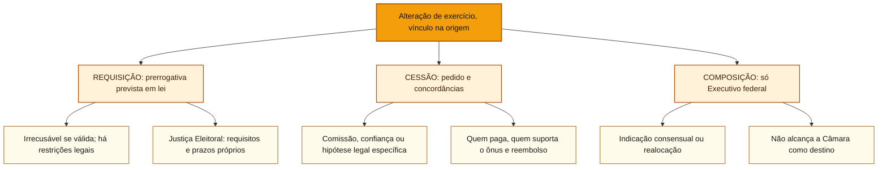

# Requisição, cessão e movimentação de agentes públicos: distinções, ônus financeiro e regime jurídico

**Caso concreto:** um tribunal eleitoral precisa reforçar temporariamente um cartório e requisita servidor de outro órgão. Um ministério pede a uma autarquia que ceda uma servidora para cargo em comissão. Em outra situação, o Executivo federal organiza uma realocação de pessoal. Nos três casos, o vínculo com a origem pode permanecer. **A diferença está em quem pode determinar a mudança, quais concordâncias são necessárias, para onde a pessoa pode ir e quem arca com a remuneração.**

O **Decreto nº 10.835/2021**, aplicável a movimentações em que a Administração federal seja parte, trata a **movimentação** como alteração do exercício sem interromper o vínculo com a origem (art. 2º). Distingue **requisição, cessão e alteração de exercício para composição da força de trabalho**. O **art. 93 da Lei nº 8.112/1990**, estatuto dos servidores civis federais, disciplina a cessão; a **Justiça Eleitoral** possui regras especiais.

**Vínculo** é a relação jurídica com o cargo/emprego de origem; **exercício** é o local de prestação do serviço; **lotação** é a unidade de vinculação administrativa. A composição da força de trabalho **não serve para transferir agentes à Câmara**, pois o decreto a restringe ao **Poder Executivo federal**.

---

## 1. Requisição de Agentes Públicos

### 1.1. Conceito e natureza impositiva

A **requisição** é uma ordem de órgão ou entidade que dispõe de **prerrogativa legal expressa** para obter o exercício temporário do agente. Pelo art. 9º do Decreto nº 10.835/2021, a requisição regular é **irrecusável** e não altera a lotação no órgão de origem.

**Irrecusável não significa sem condições:** precisam estar presentes competência legal, elegibilidade do servidor, finalidade e limites de prazo. A falta de pessoal na origem, por si só, não é motivo para recusar requisição **regular**; uma ordem que viole proibição legal deve ter sua validade examinada.

**Indicação nominal:** no Decreto nº 10.835/2021, a regra é **não indicar nominalmente** o agente; a origem pode selecionar pessoa compatível, exceto nas requisições para **Presidência e Vice-Presidência da República** (art. 9º, §§ 2º e 3º). No regime especial da **Justiça Eleitoral**, a Resolução TSE nº 23.523/2017 admite **requisição nominal** (art. 3º, parágrafo único). Portanto, a indicação depende da norma aplicável.

### 1.2. Principais hipóteses legais de requisição no ordenamento federal

A principal hipótese de prova é a **Justiça Eleitoral**, cuja requisição é disciplinada pela **Lei nº 6.999/1982**, pela **Resolução TSE nº 23.523/2017** e pela **Resolução TSE nº 23.765/2026**. A mudança de 2026 reafirmou a **irrecusabilidade da requisição legalmente válida** e admitiu providências administrativas em caso de descumprimento, sem eliminar requisitos e limites.

**Quem pode ser requisitado:**

- A regra é servidor ocupante de **cargo efetivo**; a resolução veda requisitar quem está em **estágio probatório**, sob **sindicância ou processo administrativo disciplinar**, ou é **contratado temporário** (art. 2º).
- Também restringe **cargos isolados, técnicos ou científicos e magistério**. O § 2º define técnico/científico pelo **conteúdo especializado das tarefas**, independentemente do nome do cargo e do nível escolar. A exceção de nomeação em cargo em comissão precisa ser lida com o **§ 3º acrescido em 2026**, relativo ao TSE.
- A requisição normalmente ocorre na **mesma unidade da Federação**, podendo ser **nominal** (art. 3º). Existem também limites quantitativos vinculados aos cartórios.

**Prazos variam com a hipótese legal:** o **art. 6º** prevê, para cartórios eleitorais, **um ano, prorrogável por até mais quatro anos, em períodos anuais**, com regra especial para fim do prazo máximo em ano eleitoral. O **art. 7º** trata de servidores da administração federal direta, autárquica e fundacional, com **prazo de até três anos ininterruptos** e possível prorrogação excepcional com condições de reembolso. O **art. 8º** prevê requisições extraordinárias para acúmulo ocasional de serviço, com regras próprias. **Não memorizar um único prazo para toda requisição eleitoral.**

**Caso concreto na Câmara:** um servidor de cargo elegível, dentro das condições legais, é requisitado regularmente pelo tribunal eleitoral. O dirigente da origem não pode simplesmente recusar por carência de pessoal. Se o servidor exerce cargo especializado ou está em estágio probatório, a elegibilidade precisa ser examinada antes de afirmar que a ordem é válida.

**Outras hipóteses:** Presidência e Vice-Presidência da República dispõem de prerrogativas próprias, inclusive sob a **Lei nº 9.007/1995**. Para outros órgãos e poderes, exige-se **identificar lei autorizadora específica**: a natureza constitucional do órgão, isoladamente, não cria poder geral de requisitar servidores.

Fontes: [Resolução TSE nº 23.523/2017, texto consolidado](https://www.tse.jus.br/legislacao/compilada/res/2017/resolucao-no-23-523-de-27-de-junho-de-2017), [Resolução TSE nº 23.765/2026](https://www.tse.jus.br/legislacao/compilada/res/2026/resolucao-no-23-765-de-30-de-junho-de-2026) e [Lei nº 6.999/1982](https://www.tse.jus.br/legislacao/codigo-eleitoral/leis-ordinarias/lei-nb0-6.999-de-7-de-junho-de-1982).

### 1.3. Remuneração e direitos durante a requisição

A requisição válida preserva o vínculo funcional de origem. **Quem mantém o pagamento em folha, quem suporta economicamente as parcelas e quem precisa reembolsar são perguntas distintas.** A resposta depende da lei requisitória, do destino e das regras de ressarcimento.

No âmbito do Decreto nº 10.835/2021, o art. 9º, § 4º, protege remuneração ou salário permanente e parcelas nele especificadas; seu § 5º assegura promoção, progressão funcional e participação em concurso de remoção segundo os critérios aplicáveis como se permanecesse na origem. O art. 10 condiciona requisições **que impliquem reembolso** à disponibilidade orçamentária e financeira. Para a requisição pela Justiça Eleitoral, aplicar a legislação especial e verificar as condições próprias.

**Contraexemplo:** presumir que toda requisição obrigatoriamente transfere o pagamento em folha para o órgão requisitante ou que jamais haverá reembolso.

Fonte: [Decreto nº 10.835/2021, arts. 9º, 10 e 17 a 26](https://www2.camara.leg.br/legin/fed/decret/2021/decreto-10835-14-outubro-2021-791864-normaatualizada-pe.html).

## 2. Cessão de Agentes Públicos (Art. 93 da Lei nº 8.112/1990)

### 2.1. Conceito, participantes e anuências

A **cessão** é a alteração do exercício de agente público para outro órgão ou entidade, preservado o vínculo funcional de origem. O conceito do Decreto nº 10.835/2021 **não exige estabilidade como requisito universal**, e o seu art. 1º também abrange determinadas categorias de empregados públicos.

Para a cessão no regime do decreto, o art. 3º, § 2º, exige **três condições cumulativas**: **pedido do órgão cessionário**, **concordância do cedente** e **concordância do próprio agente público**. Como regra, a cessão para cargo em comissão ou função de confiança admite exceções estabelecidas em lei.

**Exemplo:** uma autarquia federal recebe pedido para cessão de servidora a ministério. O interesse do destino, por si só, não supre a anuência da entidade de origem nem a concordância da servidora. Já a requisição legal válida, ou a alteração de exercício por realocação, tem disciplina distinta.

### 2.2. Hipóteses legais de cabimento (Art. 93 da Lei nº 8.112/1990)
O servidor público federal regido pela Lei nº 8.112/1990 somente pode ser cedido nas seguintes condições estritas:
1. Para o **exercício de cargo em comissão ou função de confiança** (art. 93, I);
2. Em casos previstos em **leis específicas** (art. 93, II).

> [!IMPORTANT]
> **Vício de desvio na cessão:** É ilegal e nula a cessão de servidor público federal para outro Poder ou ente federativo quando destinada ao desempenho de atribuições técnicas ordinárias sem vinculação a cargo em comissão ou função de confiança (salvo lei autorizativa expressa).

### 2.3. Ônus econômico, pagamento em folha e reembolso

A **Lei nº 8.112/1990, art. 93, § 1º**, disciplina a cessão para cargo em comissão ou função de confiança: na movimentação para órgãos ou entidades de **Estados, Distrito Federal e Municípios**, o **ônus da remuneração cabe ao cessionário**. Nos demais casos da hipótese, a regra do parágrafo mantém o ônus do cedente, **ressalvadas as previsões legais e regulamentares especiais**. Pelo § 2º, quando o servidor cedido a **empresa pública ou sociedade de economia mista** opta pela remuneração prevista no dispositivo, a entidade cessionária deve reembolsar as despesas feitas pela origem. A cessão depende também das regras de formalização do art. 93, § 3º.

O **Decreto nº 10.835/2021, arts. 17 a 26**, disciplina a **restituição das parcelas efetivamente despendidas** com agentes movimentados em seu âmbito. Ele distingue quando existe obrigação de reembolso, quando não haverá reembolso pela administração pública federal e quais parcelas podem ser incluídas. A expressão “destino suporta o ônus” (art. 21) **não autoriza deduzir que todo movimento exige depósito mensal à origem**, pois a ocorrência de reembolso depende das hipóteses dos arts. 18 a 20.

| Situação de referência | Ônus ou regra de reembolso | Fundamento |
| --- | --- | --- |
| Cessão federal para cargo em comissão em Estado, DF ou Município | Ônus do órgão ou entidade cessionária | Lei 8.112, art. 93, § 1º |
| Cessão federal para cargo em comissão em outros casos da regra geral | Ônus do cedente, observadas normas especiais | Lei 8.112, art. 93, § 1º |
| Cessão de servidor a empresa pública ou sociedade de economia mista, com opção remuneratória do § 2º | Reembolso pela entidade cessionária | Lei 8.112, art. 93, § 2º |
| Movimentação de agente federal para órgão ou entidade de outro ente federativo | Reembolso obrigatório na hipótese prevista | Decreto 10.835, art. 18, I |
| Movimentação de ou para estatal **não dependente** | Reembolso obrigatório no recorte do decreto | Decreto 10.835, art. 18, II |
| Movimentação no âmbito dos Poderes da União e entidades abrangidas pelo art. 19 | **Sem reembolso pela administração pública federal**, nas condições legais | Decreto 10.835, art. 19 |
| Entrada no Executivo federal de agente de outro ente, Poder ou órgão autônomo | Reembolso segue a regra da origem, com limites do decreto | Decreto 10.835, art. 20 |

**Como se operacionaliza quando há reembolso:** o órgão de origem pode continuar pagando em folha e apresentar os valores comprovados ao destino; o art. 24 disciplina pedidos e prazos de ressarcimento. O art. 25 identifica parcelas reembolsáveis e o art. 26 exclui parcelas específicas. Por isso, **“reembolso integral de todos os valores sem exceção”** é uma formulação juridicamente inadequada.

**Caso progressivo:** (1) servidor federal cedido para secretaria municipal em cargo comissionado: o art. 93, § 1º, aponta o cessionário como responsável pelo ônus; (2) servidor federal cedido no âmbito da União: examinar a regra de ônus do art. 93 e a hipótese de ausência de reembolso do decreto, sem tratar conceitos como sinônimos; (3) movimentação para estatal não dependente: verificar obrigação de reembolso e parcelas excluídas. **Contraexemplo:** afirmar que, porque a origem paga a folha, ela necessariamente suporta o ônus final.

Fontes: [Lei nº 8.112/1990 atualizada, art. 93](https://www2.camara.leg.br/legin/fed/lei/1990/lei-8112-11-dezembro-1990-322161-normaatualizada-pl.html); [Decreto nº 10.835/2021 atualizado, arts. 17 a 26](https://www2.camara.leg.br/legin/fed/decret/2021/decreto-10835-14-outubro-2021-791864-normaatualizada-pe.html).

## 3. Alteração de exercício para composição da força de trabalho

A composição de força de trabalho é espécie de movimentação **restrita a órgãos e entidades do Poder Executivo federal**, sem exigir cargo em comissão, nos termos dos arts. 12 e 13 do Decreto nº 10.835/2021. O art. 13 define a alteração de exercício como **irrecusável e independente de anuência prévia do órgão de vínculo**, ressalvada a situação de **empresa estatal não dependente**, que exige anuência prévia (§ 1º). O § 2º exclui movimentações para outros Poderes, órgãos constitucionalmente autônomos e outros entes federativos.

Na regulamentação operacional do MGI, são relevantes **duas modalidades**:

- **Indicação consensual:** exige entendimento entre órgãos e anuências anteriores ao ato, conforme regras da modalidade. A inexistência de anuência pode impedir sua formação, mas isso não transforma todas as alterações de exercício em cessão.
- **Realocação de pessoal:** depende do procedimento seletivo e dos critérios próprios; **dispensa a anuência do órgão de origem**, conforme orientação oficial.

A **irrecusabilidade do art. 13** deve ser lida em conjunto com a modalidade efetivamente adotada e o estágio do procedimento. Também é necessário distinguir **ônus remuneratório**, **pagamento em folha** e **reembolso**. O reembolso na composição de força de trabalho exige distinguir o destino, a natureza de eventual estatal e as condições dos **arts. 18 a 20**. A ausência de reembolso em determinadas movimentações internas à União (art. 19) não equivale a inexistência de remuneração nem dispensa de registro orçamentário.

**Caso progressivo:** (1) dois órgãos do Executivo ajustam indicação consensual antes da portaria: anuências são parte do procedimento; (2) em realocação regular, o órgão de origem não possui veto discricionário geral; (3) se o destino pretendido é a Câmara, esse instrumento do decreto não se aplica. **Contraexemplo:** afirmar que o art. 13 autoriza sempre a Câmara dos Deputados a receber servidores de ministérios por composição de força de trabalho.

Fontes: [Decreto 10.835/2021, arts. 2º, 12 e 13](https://www2.camara.leg.br/legin/fed/decret/2021/decreto-10835-14-outubro-2021-791864-normaatualizada-pe.html) e [MGI, orientações sobre indicação consensual e realocação](https://www.gov.br/servidor/pt-br/acesso-a-informacao/gestao-de-pessoas/movimentacao-de-pessoal/central-de-conteudo-1/perguntas-frequentes/alteracao-de-exercicio-para-composicao-da-forca-de-trabalho).

## 4. Matriz das três modalidades

| Critério | Requisição | Cessão | Composição da força de trabalho |
| --- | --- | --- | --- |
| Fundamento | Prerrogativa legal específica | Lei 8.112, art. 93 e normas de cessão | Decreto 10.835, arts. 12–13 e regras complementares |
| Anuência | Em regra, irrecusável se legalmente válida | Pedido do destino, concordância do cedente e do agente | Indicação consensual exige anuências; realocação as dispensa segundo MGI |
| Destino | Conforme a lei de requisição | Conforme lei e regime do vínculo | **Somente Executivo federal** |
| Finalidade | Necessidade prevista em lei requisitória | Regra de comissão/confiança ou lei específica | Adequação da distribuição da força de trabalho |
| Ônus/reembolso | Lei requisitória e, se cabível, decreto | Art. 93 da Lei 8.112 e arts. 17–26 do decreto: distinguir ônus, folha e restituição | Na composição interna ao Executivo, analisar arts. 18–21; estatal não dependente pode exigir reembolso |
| Apuração disciplinar | Considerar local do fato, vínculo e competência de julgamento | Instauração/instrução pode ocorrer no destino; julgamento/sanção sobre cargo efetivo têm competência própria | Examinar competência e vínculo funcional originário |

### Competência disciplinar no caso de servidor cedido

O **STJ, MS 21.991/DF**, admite separação das fases: a **instauração e a apuração** devem ocorrer preferencialmente no órgão onde se deu a irregularidade; o **julgamento e eventual sanção**, quando encerrada a cessão e retornado o servidor, são da autoridade do órgão de origem à qual se vincula o cargo efetivo. Isso impede tanto a tese de que o órgão de destino nunca pode instaurar PAD quanto a de que pode demitir autonomamente servidor efetivo vinculado a outro ente.

Fonte: [STJ, Informativo 598, MS 21.991/DF](https://processo.stj.jus.br/jurisprudencia/externo/informativo/?livre=%40CNOT%3D016203).

## Questões Comentadas (Estilo Cebraspe)

### Questão 1
*(Inédita: estilo Cebraspe / Câmara dos Deputados – Analista Legislativo)*  
Acerca do instituto da requisição de agentes públicos pela Justiça Eleitoral, julgue o item a seguir.

> Em virtude da autonomia administrativa assegurada aos Poderes da República, o dirigente de órgão da Câmara dos Deputados poderá recusar motivadamente a liberação de servidor de seu quadro efetivo requisitado por Tribunal Regional Eleitoral, sob o fundamento de carência crônica e insubstituível de pessoal no setor legislativo de origem.

**( ) Certo**  
**( ) Errado**

> **Gabarito: Errado**  
> **Comentário:** A requisição fundamentada na legislação eleitoral (Lei nº 6.999/1982 e Código Eleitoral) tem natureza jurídica **impositiva e cogente**, não outorgando à autoridade de origem margem discricionária de conveniência para indeferir ou postergar a apresentação do servidor. A prerrogativa legal da Justiça Eleitoral prevalece sobre as conveniências operacionais internas do órgão de origem, constituindo dever funcional estrito a liberação imediata do servidor requisitado.

---

### Questão 2
*(Inédita: estilo Cebraspe / Câmara dos Deputados – Analista Legislativo)*  
No que concerne à cessão de servidores públicos federais disciplinada pela Lei nº 8.112/1990, julgue o item subsequente.

> Como regra geral do regime estatutário federal, o servidor público titular de cargo efetivo somente poderá ser cedido para outro órgão ou entidade fora da estrutura da União com o objetivo estrito de exercer cargo em comissão ou função de confiança, ou em situações amparadas por expressa autorização em lei específica.

**( ) Certo**  
**( ) Errado**

> **Gabarito: Certo**  
> **Comentário:** A assertiva reflete a literalidade e a inteligência do art. 93 da Lei nº 8.112/1990. A cessão de servidor público federal para órgãos de outros entes federativos (Estados, DF e Municípios) ou de outros Poderes possui finalidade vinculada: destina-se imperativamente ao exercício de cargo em comissão ou função de confiança (art. 93, I) ou em casos expressamente delineados em lei específica (art. 93, II). É vedada a cessão graciosa para cumprimento de tarefas burocráticas ordinárias desprovidas de encargo comissionado.

---

### Questão 3
*(Inédita: estilo Cebraspe / Câmara dos Deputados – Analista Legislativo)*  
Julgue o item que se segue, relativo ao ônus remuneratório na cessão de servidores entre entes federativos distintos.

> Cedido servidor público federal para exercer cargo de Secretário Municipal em determinada prefeitura, o ônus da remuneração do cargo efetivo permanecerá compulsoriamente a cargo da União, vedada qualquer cobrança de ressarcimento contra a municipalidade cessionária.

**( ) Certo**  
**( ) Errado**

> **Gabarito: Errado**  
> **Comentário:** O item está **errado** porque o art. 93, § 1º, da Lei nº 8.112/1990 atribui ao cessionário o **ônus da remuneração** na cessão para cargo em comissão em Estado, DF ou Município; logo, a vedação absoluta de ressarcimento é falsa. Quando houver reembolso, a operacionalização e as parcelas seguem a disciplina aplicável, inclusive os arts. 17 a 26 do Decreto nº 10.835/2021; **nem toda parcela é automaticamente reembolsável**. Deve-se distinguir ônus econômico, pagamento em folha e restituição.

---

### Questão 4
*(Inédita: estilo Cebraspe / Câmara dos Deputados – Analista Legislativo)*  
A respeito da contagem de tempo de serviço do servidor público durante o período de requisição, julgue o item.

> O período em que o servidor público federal permanecer à disposição de órgão do Poder Judiciário em virtude de requisição legal regular não é considerado como tempo de efetivo exercício, gerando a interrupção automática da contagem de prazo para fins de aposentadoria e progressão funcional na carreira originária.

**( ) Certo**  
**( ) Errado**

> **Gabarito: Errado**  
> **Comentário:** A requisição juridicamente regular **não rompe por si só o vínculo funcional** nem gera interrupção automática do tempo de efetivo exercício. O art. 102, II, da Lei nº 8.112/1990 trata especificamente do **exercício de cargo em comissão ou equivalente em outro órgão** e, portanto, **não deve ser citado como se incluísse textualmente qualquer requisição**. Para requisições abrangidas pelo Decreto nº 10.835/2021, o art. 9º, §§ 4º e 5º, protege remuneração, promoção e progressão segundo seus pressupostos. A contagem previdenciária e vantagens particulares dependem do regime aplicável, sem suspensão automática pelo simples deslocamento. O item é **ERRADO** por afirmar interrupção automática.

---

### Questão 5
*(Inédita: estilo Cebraspe / Câmara dos Deputados – Analista Legislativo)*  
Julgue o item a seguir, referente às diferenças dogmáticas entre requisição e cessão de agentes públicos.

> Enquanto a cessão de servidores constitui ato administrativo bilateral e discricionário que depende do consentimento e da aquiescência do órgão de origem, a requisição opera-se por ato unilateral e cogente, dotado de autoexecutoriedade e fundado em mandamento legal inderrogável.

**( ) Certo**  
**( ) Errado**

> **Gabarito: Certo**  
> **Comentário:** O item traça com rigor doutrinário a linha divisória dos dois institutos. A cessão exige o alinhamento de vontades e a concordância da autoridade de origem (juízo de mérito), ao passo que a requisição decorre de poder de império estatal atribuído por lei a determinados órgãos (como na Justiça Eleitoral), traduzindo comando unilateral de cumprimento obrigatório pelo órgão de lotação originária.

---

### Questão 6
*(Inédita: estilo Cebraspe / Câmara dos Deputados – Analista Legislativo)*  
No que tange ao exercício do poder disciplinar sobre o servidor público cedido, julgue o item subsequente.

> Praticada infração disciplinar grave sujeita à penalidade de demissão por servidor público federal durante o período em que se encontrava cedido a determinado Tribunal de Contas estadual, a autoridade máxima do Tribunal cessionário detém competência para instaurar o processo disciplinar e aplicar diretamente a penalidade de demissão do cargo efetivo federal.

**( ) Certo**  
**( ) Errado**

> **Gabarito: Errado**  
> **Comentário:** É possível que o **órgão cessionário instaure e instrua o PAD** sobre fato praticado em seu âmbito, conforme o STJ (MS 21.991/DF), mas a autoridade cessionária não pode, apenas por ser órgão de exercício, **demitir de cargo efetivo federal vinculado a outro ente ou órgão**. No precedente, julgamento e eventual sanção após o retorno do cedido cabem ao órgão de origem. O enunciado é errado pela competência de **demitir diretamente**, não por excluir toda atuação instrutória do destino.

---

## Relações com outros temas

- [[3 - Materias/Direito Administrativo/05 - agentes publicos|Agentes públicos: espécies, cargos, empregos e funções]]: o vínculo estatutário originário e as posições de comissão e confiança.
- [[3 - Materias/Direito Administrativo/04 - poderes administrativos|Poderes administrativos]]: limites do poder hierárquico e disciplinar entre órgãos cedentes e cessionários.
- [[3 - Materias/Direito Administrativo/09 - processo administrativo federal|Processo administrativo federal]]: contraditório e competência para apuração disciplinar de servidores afastados.

## Fontes normativas e doutrinárias

- **Lei nº 8.112/1990 (RJU):** art. 93 (cessão de servidores e reembolso); art. 102, II (**exercício de cargo em comissão ou equivalente**, sem generalizar para toda requisição).
- **Lei nº 6.999/1982:** normas sobre requisição de servidores públicos pela Justiça Eleitoral.
- **Decreto nº 10.835/2021:** regulamentação da cessão e movimentação de pessoal no Poder Executivo Federal.
- **Lei nº 6.999/1982 e regulamentação do TSE:** verificar, em cada requisição eleitoral, competência, elegibilidade do cargo, limites e prazos.
- **STJ, MS 21.991/DF:** delimitação da competência de instauração e instrução de processo disciplinar em cessão.
- **Referência doutrinária:** conceitos gerais de agentes públicos e atos administrativos, sem atribuir títulos autônomos não identificados bibliograficamente a autores.
