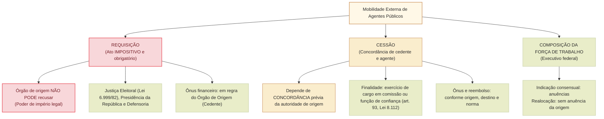

# Requisição, cessão e movimentação de agentes públicos: distinções, ônus financeiro e regime jurídico

A gestão de recursos humanos na Administração Pública contemporânea exige instrumentos flexíveis de cooperação e mobilidade interinstitucional para atender a demandas sazonais, missões extraordinárias, cooperação federativa e funcionamento de órgãos essenciais da República.

No regime federal, a mobilidade pode assumir **três formas distintas**, conforme o art. 2º, parágrafo único, do Decreto nº 10.835/2021: **cessão**, **requisição** e **alteração de exercício para composição da força de trabalho**. Cada instituto tem finalidade, autoridade competente, regras de anuência e consequências financeiras próprias. A mudança de exercício **preserva o vínculo** do agente com o órgão ou entidade de origem.

A expressão **“movimentação” é gênero**, e as três formas são espécies. Para estudar o concurso da Câmara, é essencial distinguir também o âmbito do decreto (Executivo federal) das regras gerais da Lei nº 8.112/1990 e dos regimes especiais aplicáveis a outros Poderes. A composição de força de trabalho prevista no decreto **não permite, por si, transferência ao Legislativo**.

---

## 1. Requisição de Agentes Públicos

### 1.1. Conceito e natureza impositiva
A **requisição** é o ato administrativo pelo qual uma autoridade ou órgão público legalmente investido de poder de império requisitório determina a transferência temporária do exercício funcional de um servidor público de outro órgão ou ente federativo para prestar serviços no órgão requisitante.
- **Caráter irrecusável e cogente:** a autoridade do órgão de origem (lotador original do servidor) **não possui margem de discricionariedade** para indeferir o pedido, avaliar conveniência interna de sua repartição ou condicionar a liberação à reposição de pessoal. A liberação do servidor é um **dever jurídico de estrito cumprimento**.
- **Natureza jurídica:** ato unilateral imperativo derivado de autorização legal expressa vinculada ao interesse público primário.

### 1.2. Principais hipóteses legais de requisição no ordenamento federal
A requisição não é um poder genérico de qualquer repartição; depende de **previsão estrita em lei formal**:
1. **Justiça Eleitoral (Lei nº 6.999/1982 e art. 30 do Código Eleitoral):**
   - Os juízes e tribunais eleitorais têm competência legal para requisitar servidores públicos da União, Estados, DF e Municípios, bem como de suas autarquias, para auxiliar os cartórios eleitorais e as eleições.
   - A requisição tem prazo certo (em regra 1 ano, prorrogável) e o órgão de origem não pode obstar a apresentação do servidor.
2. **Presidência da República e Vice-Presidência (Lei nº 9.007/1995 e Lei nº 14.600/2023):**
   - Prerrogativa legal para requisitar servidores de quaisquer órgãos ou entidades federais para exercício de atribuições nos órgãos da Presidência da República.
3. **Defensoria Pública da União (Lei Complementar nº 80/1994):**
   - Hipóteses extraordinárias de requisição de pessoal para viabilizar a implantação e funcionamento emergencial de núcleos defensoriais.
4. **Poder Judiciário e Ministério Público da União:**
   - Previsões estritas nas respectivas leis orgânicas e regimentais para atendimento de situações específicas e temporárias de assessoria técnica.

### 1.3. Ônus da remuneração e direitos funcionais
- **Regra geral do ônus:** na requisição legal típica (como a da Justiça Eleitoral), o ônus da remuneração do cargo efetivo permanece **a cargo do órgão de origem (órgão cedente)**.
- **Preservação de direitos:** o período de requisição é considerado de **efetivo exercício** para todos os efeitos legais (art. 102 da Lei nº 8.112/1990), incluindo aposentadoria, contagem de tempo de serviço, progressão funcional e licença-prêmio/capacitação.

---

## 2. Cessão de Agentes Públicos (Art. 93 da Lei nº 8.112/1990)

### 2.1. Conceito, participantes e anuências

A **cessão** é a alteração do exercício de agente público para outro órgão ou entidade, preservado o vínculo funcional de origem. O conceito do Decreto nº 10.835/2021 **não exige estabilidade como requisito universal**, e o seu art. 1º também abrange determinadas categorias de empregados públicos.

Para a cessão no regime do decreto, o art. 3º, § 2º, exige **três condições cumulativas**: **pedido do órgão cessionário**, **concordância do cedente** e **concordância do próprio agente público**. Como regra, a cessão para cargo em comissão ou função de confiança admite exceções estabelecidas em lei.

**Exemplo:** uma autarquia federal recebe pedido para cessão de servidora a ministério. O interesse do destino, por si só, não supre a anuência da entidade de origem nem a concordância da servidora. Já a requisição legal válida, ou a alteração de exercício por realocação, tem disciplina distinta.

### 2.2. Hipóteses legais de cabimento (Art. 93 da Lei nº 8.112/1990)
O servidor público federal regido pela Lei nº 8.112/1990 somente pode ser cedido nas seguintes condições estritas:
1. Para o **exercício de cargo em comissão ou função de confiança** (art. 93, I);
2. Em casos previstos em **leis específicas** (art. 93, II).

> [!IMPORTANT]
> **Vício de desvio na cessão:** É ilegal e nula a cessão de servidor público federal para outro Poder ou ente federativo quando destinada ao desempenho de atribuições técnicas ordinárias sem vinculação a cargo em comissão ou função de confiança (salvo lei autorizativa expressa).

### 2.3. O regime financeiro do reembolso salarial (Quem paga a conta?)
O regime financeiro da cessão de servidores federais foi detalhado pelo art. 93 da Lei nº 8.112/1990 e regulamentado pelo **Decreto nº 10.835/2021**:
- **Cessão no âmbito dos Poderes da União (mesmo ente político):**
  - O ônus da remuneração permanece a cargo do **órgão cedente (órgão de origem)**, salvo estipulação diversa em norma infralegal.
- **Cessão para Estados, Distrito Federal, Municípios ou para o Poder Executivo/Legislativo/Judiciário de outro ente:**
  - O ônus da remuneração cabe ao **órgão cessionário (órgão que recebe o servidor)** mediante **reembolso mensal integral** dos vencimentos e encargos sociais ao órgão de origem.
- **Opção remuneratória:** o servidor cedido para ocupar cargo em comissão pode optar pela remuneração do cargo efetivo acrescida do percentual legal do cargo comissionado ou pela retribuição integral do cargo em comissão.

---

## 3. Alteração de exercício para composição da força de trabalho

A composição de força de trabalho é espécie de movimentação **restrita a órgãos e entidades do Poder Executivo federal**, sem exigir cargo em comissão, nos termos dos arts. 12 e 13 do Decreto nº 10.835/2021. O art. 13 define a alteração de exercício como **irrecusável e independente de anuência prévia do órgão de vínculo**, ressalvada a situação de **empresa estatal não dependente**, que exige anuência prévia (§ 1º). O § 2º exclui movimentações para outros Poderes, órgãos constitucionalmente autônomos e outros entes federativos.

Na regulamentação operacional do MGI, são relevantes **duas modalidades**:

- **Indicação consensual:** exige entendimento entre órgãos e anuências anteriores ao ato, conforme regras da modalidade. A inexistência de anuência pode impedir sua formação, mas isso não transforma todas as alterações de exercício em cessão.
- **Realocação de pessoal:** depende do procedimento seletivo e dos critérios próprios; **dispensa a anuência do órgão de origem**, conforme orientação oficial.

A **irrecusabilidade do art. 13** deve ser lida em conjunto com a modalidade efetivamente adotada e o estágio do procedimento. Também é necessário distinguir **ônus remuneratório**, **pagamento em folha** e **reembolso**. O MGI informa que nem toda alteração de exercício requer reembolso, mas há regra específica quando o agente vem de estatal não dependente.

**Caso progressivo:** (1) dois órgãos do Executivo ajustam indicação consensual antes da portaria: anuências são parte do procedimento; (2) em realocação regular, o órgão de origem não possui veto discricionário geral; (3) se o destino pretendido é a Câmara, esse instrumento do decreto não se aplica. **Contraexemplo:** afirmar que o art. 13 autoriza sempre a Câmara dos Deputados a receber servidores de ministérios por composição de força de trabalho.

Fontes: [Decreto 10.835/2021, arts. 2º, 12 e 13](https://www2.camara.leg.br/legin/fed/decret/2021/decreto-10835-14-outubro-2021-791864-normaatualizada-pe.html) e [MGI, orientações sobre indicação consensual e realocação](https://www.gov.br/servidor/pt-br/acesso-a-informacao/gestao-de-pessoas/movimentacao-de-pessoal/central-de-conteudo-1/perguntas-frequentes/alteracao-de-exercicio-para-composicao-da-forca-de-trabalho).

## 4. Matriz das três modalidades

| Critério | Requisição | Cessão | Composição da força de trabalho |
| --- | --- | --- | --- |
| Fundamento | Prerrogativa legal específica | Lei 8.112, art. 93 e normas de cessão | Decreto 10.835, arts. 12–13 e regras complementares |
| Anuência | Em regra, irrecusável se legalmente válida | Pedido do destino, concordância do cedente e do agente | Indicação consensual exige anuências; realocação as dispensa segundo MGI |
| Destino | Conforme a lei de requisição | Conforme lei e regime do vínculo | **Somente Executivo federal** |
| Finalidade | Necessidade prevista em lei requisitória | Regra de comissão/confiança ou lei específica | Adequação da distribuição da força de trabalho |
| Ônus/reembolso | Variável segundo lei de regência | Varia segundo cedente, cessionário e regime financeiro | Regra própria; reembolso em hipóteses específicas, como estatal não dependente |
| Apuração disciplinar | Considerar local do fato, vínculo e competência de julgamento | Instauração/instrução pode ocorrer no destino; julgamento/sanção sobre cargo efetivo têm competência própria | Examinar competência e vínculo funcional originário |

### Competência disciplinar no caso de servidor cedido

O **STJ, MS 21.991/DF**, admite separação das fases: a **instauração e a apuração** devem ocorrer preferencialmente no órgão onde se deu a irregularidade; o **julgamento e eventual sanção**, quando encerrada a cessão e retornado o servidor, são da autoridade do órgão de origem à qual se vincula o cargo efetivo. Isso impede tanto a tese de que o órgão de destino nunca pode instaurar PAD quanto a de que pode demitir autonomamente servidor efetivo vinculado a outro ente.

Fonte: [STJ, Informativo 598, MS 21.991/DF](https://processo.stj.jus.br/jurisprudencia/externo/informativo/?livre=%40CNOT%3D016203).

## Questões Comentadas (Estilo Cebraspe)

### Questão 1
*(Inédita: estilo Cebraspe / Câmara dos Deputados – Analista Legislativo)*  
Acerca do instituto da requisição de agentes públicos pela Justiça Eleitoral, julgue o item a seguir.

> Em virtude da autonomia administrativa assegurada aos Poderes da República, o dirigente de órgão da Câmara dos Deputados poderá recusar motivadamente a liberação de servidor de seu quadro efetivo requisitado por Tribunal Regional Eleitoral, sob o fundamento de carência crônica e insubstituível de pessoal no setor legislativo de origem.

**( ) Certo**  
**( ) Errado**

> **Gabarito: Errado**  
> **Comentário:** A requisição fundamentada na legislação eleitoral (Lei nº 6.999/1982 e Código Eleitoral) tem natureza jurídica **impositiva e cogente**, não outorgando à autoridade de origem margem discricionária de conveniência para indeferir ou postergar a apresentação do servidor. A prerrogativa legal da Justiça Eleitoral prevalece sobre as conveniências operacionais internas do órgão de origem, constituindo dever funcional estrito a liberação imediata do servidor requisitado.

---

### Questão 2
*(Inédita: estilo Cebraspe / Câmara dos Deputados – Analista Legislativo)*  
No que concerne à cessão de servidores públicos federais disciplinada pela Lei nº 8.112/1990, julgue o item subsequente.

> Como regra geral do regime estatutário federal, o servidor público titular de cargo efetivo somente poderá ser cedido para outro órgão ou entidade fora da estrutura da União com o objetivo estrito de exercer cargo em comissão ou função de confiança, ou em situações amparadas por expressa autorização em lei específica.

**( ) Certo**  
**( ) Errado**

> **Gabarito: Certo**  
> **Comentário:** A assertiva reflete a literalidade e a inteligência do art. 93 da Lei nº 8.112/1990. A cessão de servidor público federal para órgãos de outros entes federativos (Estados, DF e Municípios) ou de outros Poderes possui finalidade vinculada: destina-se imperativamente ao exercício de cargo em comissão ou função de confiança (art. 93, I) ou em casos expressamente delineados em lei específica (art. 93, II). É vedada a cessão graciosa para cumprimento de tarefas burocráticas ordinárias desprovidas de encargo comissionado.

---

### Questão 3
*(Inédita: estilo Cebraspe / Câmara dos Deputados – Analista Legislativo)*  
Julgue o item que se segue, relativo ao ônus remuneratório na cessão de servidores entre entes federativos distintos.

> Cedido servidor público federal para exercer cargo de Secretário Municipal em determinada prefeitura, o ônus da remuneração do cargo efetivo permanecerá compulsoriamente a cargo da União, vedada qualquer cobrança de ressarcimento contra a municipalidade cessionária.

**( ) Certo**  
**( ) Errado**

> **Gabarito: Errado**  
> **Comentário:** Consoante o disposto no art. 93, § 1º, da Lei nº 8.112/1990 e no Decreto nº 10.835/2021, na cessão de servidor federal para Estados, DF ou Municípios, o ônus da remuneração do cargo efetivo é do **órgão ou entidade cessionária**, o qual tem o dever legal de efetuar o **reembolso mensal integral** à União das parcelas remuneratórias e respectivos encargos sociais patronais.

---

### Questão 4
*(Inédita: estilo Cebraspe / Câmara dos Deputados – Analista Legislativo)*  
A respeito da contagem de tempo de serviço do servidor público durante o período de requisição, julgue o item.

> O período em que o servidor público federal permanecer à disposição de órgão do Poder Judiciário em virtude de requisição legal regular não é considerado como tempo de efetivo exercício, gerando a interrupção automática da contagem de prazo para fins de aposentadoria e progressão funcional na carreira originária.

**( ) Certo**  
**( ) Errado**

> **Gabarito: Errado**  
> **Comentário:** Nos exatos termos do art. 102, inciso II, da Lei nº 8.112/1990, o afastamento para prestar serviços a outro órgão em decorrência de requisição regular é expressamente considerado como de **efetivo exercício**. O servidor não sofre prejuízo funcional em sua carreira de origem, preservando integralmente a contagem de tempo para concessão de progressões, promoções, adicionais temporais e aposentadoria estatutária.

---

### Questão 5
*(Inédita: estilo Cebraspe / Câmara dos Deputados – Analista Legislativo)*  
Julgue o item a seguir, referente às diferenças dogmáticas entre requisição e cessão de agentes públicos.

> Enquanto a cessão de servidores constitui ato administrativo bilateral e discricionário que depende do consentimento e da aquiescência do órgão de origem, a requisição opera-se por ato unilateral e cogente, dotado de autoexecutoriedade e fundado em mandamento legal inderrogável.

**( ) Certo**  
**( ) Errado**

> **Gabarito: Certo**  
> **Comentário:** O item traça com rigor doutrinário a linha divisória dos dois institutos. A cessão exige o alinhamento de vontades e a concordância da autoridade de origem (juízo de mérito), ao passo que a requisição decorre de poder de império estatal atribuído por lei a determinados órgãos (como na Justiça Eleitoral), traduzindo comando unilateral de cumprimento obrigatório pelo órgão de lotação originária.

---

### Questão 6
*(Inédita: estilo Cebraspe / Câmara dos Deputados – Analista Legislativo)*  
No que tange ao exercício do poder disciplinar sobre o servidor público cedido, julgue o item subsequente.

> Praticada infração disciplinar grave sujeita à penalidade de demissão por servidor público federal durante o período em que se encontrava cedido a determinado Tribunal de Contas estadual, a autoridade máxima do Tribunal cessionário detém competência para instaurar o processo disciplinar e aplicar diretamente a penalidade de demissão do cargo efetivo federal.

**( ) Certo**  
**( ) Errado**

> **Gabarito: Errado**  
> **Comentário:** É possível que o **órgão cessionário instaure e instrua o PAD** sobre fato praticado em seu âmbito, conforme o STJ (MS 21.991/DF), mas a autoridade cessionária não pode, apenas por ser órgão de exercício, **demitir de cargo efetivo federal vinculado a outro ente ou órgão**. No precedente, julgamento e eventual sanção após o retorno do cedido cabem ao órgão de origem. O enunciado é errado pela competência de **demitir diretamente**, não por excluir toda atuação instrutória do destino.

---

## Relações com outros temas

- [[3 - Materias/Direito Administrativo/05 - agentes publicos|Agentes públicos: espécies, cargos, empregos e funções]]: o vínculo estatutário originário e as posições de comissão e confiança.
- [[3 - Materias/Direito Administrativo/04 - poderes administrativos|Poderes administrativos]]: limites do poder hierárquico e disciplinar entre órgãos cedentes e cessionários.
- [[3 - Materias/Direito Administrativo/09 - processo administrativo federal|Processo administrativo federal]]: contraditório e competência para apuração disciplinar de servidores afastados.

## Fontes normativas e doutrinárias

- **Lei nº 8.112/1990 (RJU):** art. 93 (cessão de servidores e reembolso); art. 102, II (contagem como efetivo exercício).
- **Lei nº 6.999/1982:** normas sobre requisição de servidores públicos pela Justiça Eleitoral.
- **Decreto nº 10.835/2021:** regulamentação da cessão e movimentação de pessoal no Poder Executivo Federal.
- **Tribunal Superior Eleitoral (TSE):** resoluções e jurisprudência pacificada sobre o caráter cogente da requisição eleitoral.
- **Doutrina:** Hely Lopes Meirelles (*Requisição e cessão no direito público*); Celso Antônio Bandeira de Mello (*Mobilidade e vínculos funcionais*).
