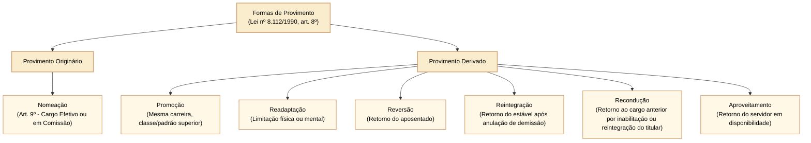
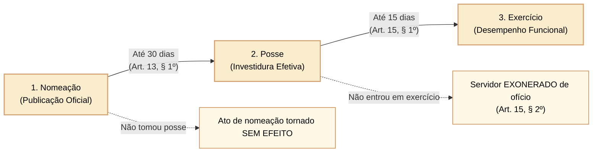
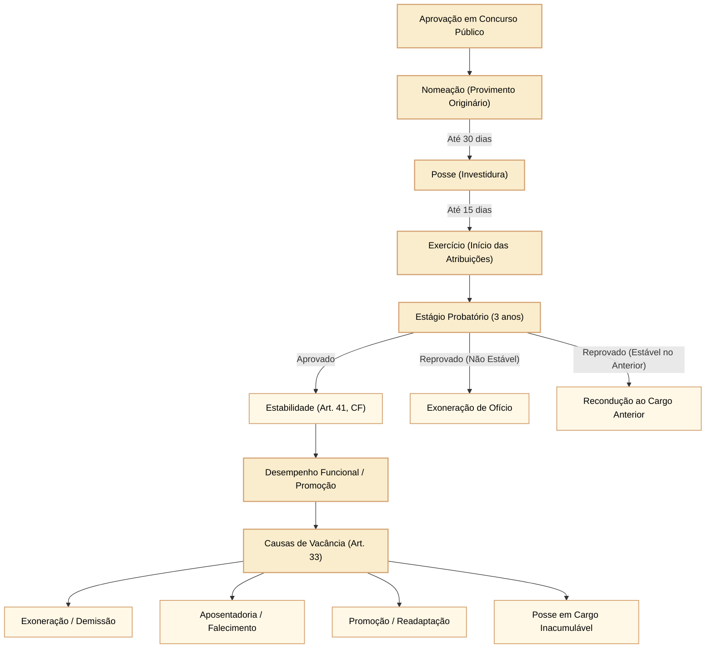

# Lei nº 8.112/1990: provimento, posse, exercício, estágio probatório e vacância de cargos públicos

A investidura e o ciclo funcional no regime jurídico dos servidores públicos civis da União, das autarquias e das fundações públicas federais são disciplinados pela **Lei nº 8.112, de 11 de dezembro de 1990**, em estrita conformidade com os postulados constitucionais do art. 37 da Carta de 1988. Compreender as fases de ingresso, os prazos peremptórios da investidura, o regime do estágio probatório e as causas taxativas de provimento e vacância constitui requisito fundamental para a resolução de questões de alta complexidade da banca Cebraspe, que explora sistematicamente a precisão terminológica, a contagem de prazos, os efeitos de inobservância de formalidades e a jurisprudência sumulada do Supremo Tribunal Federal e do Superior Tribunal de Justiça.

---

## 1. Provimento: conceito, espécies e vedação constitucional de investidura derivada vertical

O **provimento** é o ato administrativo unilateral por meio do qual se preenche um cargo público vago com a designação de um titular específico, vinculando-o ao quadro funcional do Estado.

### 1.1 Provimento originário versus provimento derivado

A doutrina e o estatuto federal classificam as formas de provimento em duas espécies fundamentais:

1. **Provimento originário (ou inicial):** independe de qualquer vínculo jurídico funcional anterior entre o titular e a Administração Pública. A **nomeação** é a única modalidade de provimento originário admitida pelo ordenamento jurídico vigente. Opera tanto para cargos de provimento efetivo (precedida de concurso público de provas ou de provas e títulos) quanto para cargos em comissão (de livre nomeação e exoneração, art. 9º).
2. **Provimento derivado:** decorre de um liame funcional preexistente entre o indivíduo e a Administração Pública, consubstanciando a modificação de sua situação funcional ou o reingresso no exercício de cargo público. Compreende seis modalidades vigentes:
   - **Promoção:** ascensão funcional dentro da mesma carreira, passando de uma classe ou padrão para outro superior, preservando a identidade das atribuições essenciais. É concomitantemente forma de provimento e de vacância;
   - **Readaptação:** investidura do servidor em cargo de atribuições e responsabilidades compatíveis com a limitação que tenha sofrido em sua capacidade física ou mental, verificada em inspeção médica oficial (art. 24);
   - **Reversão:** retorno à atividade de servidor aposentado por invalidez (quando insubsistentes os motivos) ou no interesse da administração (a pedido e com preenchimento cumulativo de requisitos, art. 25);
   - **Reintegração:** reinvestidura do servidor estável no cargo anteriormente ocupado (ou no resultante de sua transformação), quando invalidada a sua demissão por decisão administrativa ou judicial, com ressarcimento integral de todas as vantagens (art. 28);
   - **Recondução:** retorno do servidor estável ao cargo anteriormente ocupado, decorrente de sua inabilitação em estágio probatório relativo a outro cargo público ou da reintegração do anterior ocupante (art. 29);
   - **Aproveitamento:** retorno obrigatório à atividade de servidor que se encontrava em disponibilidade remunerada, em cargo de atribuições e vencimentos compatíveis com o anteriormente ocupado (art. 30).

### 1.2 A vedação da ascensão e da transferência: Súmula Vinculante nº 43 do STF

O texto original da Lei nº 8.112/1990 contemplava nos incisos III e IV do art. 8º as figuras da *ascensão* (passagem de uma carreira para outra superior) e da *transferência* (passagem de um quadro para outro distinto). Essas modalidades foram declaradas inconstitucionais pelo Supremo Tribunal Federal (STF) por violação direta à regra do concurso público (art. 37, II, CF/1988), sendo posteriormente revogadas pela Lei nº 9.527/1997.

> **Súmula Vinculante nº 43 do STF:**  
> *"É inconstitucional toda modalidade de provimento que propicie ao servidor investir-se, sem prévia aprovação em concurso público destinado ao seu provimento, em cargo que não integra a carreira na qual anteriormente investido."*

Em provas da banca Cebraspe, qualquer mecanismo normativo que permita o salto de um cargo ou carreira de nível técnico/médio para um cargo de nível superior dentro do mesmo órgão sem a realização de concurso público aberto constitui burla direta à Súmula Vinculante nº 43.

---

## 2. Prazos da investidura: nomeação, posse e exercício

A formalização da investidura e o início efetivo do desempenho funcional submetem-se a uma sequência cronológica rígida e a prazos preclusivos expressamente estatuídos pelos arts. 13 a 15 da Lei nº 8.112/1990.

### 2.1 Análise detalhada das etapas e consequências

1. **Nomeação:** ato de chamamento formal publicado no Diário Oficial da União. Não investe o servidor no cargo público; constitui mero chamamento que outorga ao candidato aprovado a faculdade de aceitar a investidura.
2. **Posse (Investidura):** é o ato formal solene de aceitação expressa das atribuições, deveres e responsabilidades do cargo público, com o compromisso de bem servir, formalizada pela assinatura do respectivo termo (art. 13).
   - **Momento da investidura:** a investidura em cargo público ocorre **exclusivamente com a posse** (art. 7º c/c art. 13). A nomeação não gera investidura, nem o exercício;
   - **Prazo:** a posse dar-se-á no prazo de **até 30 (trinta) dias** contados da publicação do ato de provimento (art. 13, § 1º);
   - **Procuração específica:** a posse pode ocorrer mediante procuração específica outorgada pelo interessado (art. 13, § 3º);
   - **Requisitos concomitantes:** declaração de bens e valores, declaração sobre o exercício ou não de outro cargo, emprego ou função pública (acumulação constitucional) e prévia inspeção médica oficial que ateste aptidão física e mental;
   - **Consequência do descumprimento do prazo:** se a posse não se der no prazo legal de 30 dias, o ato de nomeação será tornado **sem efeito** (art. 13, § 6º). Atenção: o cidadão **não é exonerado**, pois sequer se tornou servidor público.
3. **Exercício:** é o efetivo desempenho das atribuições do cargo público ou da função de confiança (art. 15).
   - **Prazo:** o prazo para o servidor empossado entrar em exercício é de **até 15 (quinze) dias**, contados da data da posse (art. 15, § 1º);
   - **Consequência do descumprimento do prazo:** o servidor empossado que não entrar em exercício no prazo legal de 15 dias será **exonerado de ofício** (art. 15, § 2º). Se for designado para função de confiança, o ato de designação será tornado sem efeito.

---

## 3. Estágio probatório e aquisição da estabilidade

Ao entrar em exercício, o servidor nomeado para cargo de provimento efetivo fica sujeito a **estágio probatório**, durante o qual a sua aptidão e capacidade serão objeto de avaliação contínua para o desempenho do cargo (art. 20).

### 3.1 Duração do estágio probatório: a harmonização da Lei nº 8.112/1990 com a CF/1988

O art. 20, *caput*, da Lei nº 8.112/1990 menciona o prazo de 24 (vinte e quatro) meses. Todavia, a Emenda Constitucional nº 19/1998 alterou a redação do art. 41 da Constituição Federal, fixando em **3 (três) anos de efetivo exercício** o requisito temporal para a aquisição da estabilidade.

O STF e o STJ pacificaram a matéria: **o prazo do estágio probatório é de 3 (três) anos (36 meses)**, coincidindo necessariamente com o período constitucional exigido para a estabilização funcional. Não existe estabilidade com 2 anos nem estágio probatório inferior ao prazo constitucional de 3 anos para servidores estatutários civis.

### 3.2 Fatores avaliados no estágio probatório

Conforme o art. 20 da Lei nº 8.112/1990, são cinco os fatores taxativos apurados durante a avaliação do estágio probatório (mnemônico clássico: **A-D-I-P-R**):

1. **A**ssiduidade;
2. **D**isciplina;
3. **C**apacidade de iniciativa (ou iniciativa);
4. **P**rodutividade;
5. **R**esponsabilidade.

Quatro meses antes de findo o período do estágio probatório, a avaliação do desempenho do servidor será submetida à homologação da autoridade competente.

### 3.3 Inabilitação no estágio probatório

O servidor que não satisfizer as condições do estágio probatório será submetido a um de dois destinos jurídicos:
- Se for **inabilitado e NÃO for estável no serviço público:** será **exonerado de ofício** (art. 20, § 2º c/c art. 34, parágrafo único, I). A inabilitação gera exoneração, que não possui caráter punitivo, respeitada a ampla defesa e o contraditório;
- Se for **inabilitado, mas JÁ for servidor estável no serviço público federal:** será **reconduzido** ao cargo anteriormente ocupado (art. 20, § 2º c/c art. 29).

---

## 4. Vacância: conceito e hipóteses taxativas

A **vacância** é o evento ou ato administrativo que extingue o vínculo jurídico entre o servidor e determinado cargo público, tornando este formalmente desocupado.

O art. 33 da Lei nº 8.112/1990 enumera as causas taxativas de vacância:

1. **Exoneração:** desfazimento do vínculo funcional sem caráter punitivo. Pode ocorrer a pedido do próprio servidor ou de ofício (por inabilitação no estágio probatório, por não entrar em exercício no prazo legal ou em cargos em comissão);
2. **Demissão:** penalidade disciplinar de caráter expulsivo aplicada por infração disciplinar grave apurada em processo administrativo disciplinar (PAD) com garantia de ampla defesa;
3. **Promoção:** ascensão funcional para classe superior. Constitui ato de natureza híbrida: é simultaneamente provimento (no padrão superior) e vacância (do padrão inferior);
4. **Readaptação:** investidura em cargo compatível com limitações funcionais. Também ostenta natureza híbrida: provimento do novo cargo e vacância do cargo originário;
5. **Aposentadoria:** extinção voluntária, compulsória ou por incapacidade permanente do exercício do cargo, com passagem para a inatividade remunerada;
6. **Posse em outro cargo inacumulável:** desocupação gerada pela investidura do servidor em outro cargo que a Constituição veda acumular (art. 37, XVI). Permite a recondução caso o servidor seja inabilitado no novo cargo durante o estágio probatório;
7. **Falecimento:** evento natural que acarreta a cessação imediata da personalidade e a vacância automática do cargo.

---

## 5. Institutos protetivos e de garantia funcional: reintegração, recondução, reversão e disponibilidade

A Lei nº 8.112/1990 estrutura um sistema articulado de garantias funcionais em benefício do serviço público e da estabilidade do servidor. O quadro analítico a seguir sintetiza os regimes de retorno ao serviço público:

| Instituto | Conceito e Causa Geradora | Beneficiário | Destino do Ocupante Atual do Cargo |
| :--- | :--- | :--- | :--- |
| **Reintegração** (Art. 28) | Anulação da demissão por decisão judicial ou administrativa, com ressarcimento integral de remunerações e direitos. | Servidor **estável**. | Se o cargo estiver ocupado, o eventual ocupante, se estável, será **reconduzido** ao cargo de origem, sem direito a indenização, aproveitado em outro cargo ou posto em disponibilidade. |
| **Recondução** (Art. 29) | Retorno ao cargo de origem decorrente de inabilitação em estágio probatório de outro cargo ou da reintegração do anterior titular. | Servidor **estável**. | Não dá ensejo a indenização. O cargo anterior não pode estar provido de forma irrevogável (se extinto, fica em disponibilidade). |
| **Reversão** (Art. 25) | Retorno do aposentado à atividade: a) por invalidez, quando junta médica oficial atestar a insubsistência dos motivos; b) no interesse da administração (voluntária). | Aposentado (a pedido: exige menos de 70 anos e cargo vago). | O servidor retorna ao cargo efetivo ou ao resultante de transformação. Se não houver vaga, atua como excedente. |
| **Aproveitamento** (Art. 30) | Retorno obrigatório do servidor em disponibilidade remunerada para cargo com atribuições e vencimentos compatíveis. | Servidor **estável** em disponibilidade. | O aproveitamento é obrigatório para a Administração e para o servidor; caso não entre em exercício no prazo, cassa-se a disponibilidade. |

---

## 6. Diagrama síntese: o ciclo de investidura, desempenho e vacância

---

## 7. Questões comentadas

*(Inédita: estilo Cebraspe / Câmara dos Deputados – Analista Legislativo)*  
**1.** A investidura em cargo público federal ocorre no momento da publicação do ato de nomeação no Diário Oficial da União, momento a partir do qual tem início a contagem do prazo improrrogável de trinta dias para a entrada em exercício.

> **Gabarito: ERRADO**  
> **Comentário:** A assertiva comete dois erros técnicos graves: (1) nos termos do art. 7º da Lei nº 8.112/1990, a investidura ocorre com a **posse**, e não com a nomeação; (2) da publicação da nomeação decorre o prazo de até 30 dias para a **posse** (art. 13, § 1º). Uma vez empossado, o servidor disporá de até 15 dias para entrar em **exercício** (art. 15, § 1º).

*(Inédita: estilo Cebraspe / Câmara dos Deputados – Analista Legislativo)*  
**2.** Caso um cidadão devidamente nomeado para o cargo efetivo de Analista Legislativo da Câmara dos Deputados venha a tomar posse regularmente, mas deixe de entrar em exercício no prazo legal de quinze dias, a Administração deverá tornar o ato de provimento sem efeito, haja vista que a ausência de exercício impede a consolidação da investidura.

> **Gabarito: ERRADO**  
> **Comentário:** Se o candidato já tomou posse, a investidura formal já ocorreu e ele adquiriu o estatuto de servidor público. Diante disso, se não entrar em exercício no prazo de 15 dias, a consequência legal prevista no art. 15, § 2º, da Lei nº 8.112/1990 é a **exoneração de ofício**. O ato de nomeação só é tornado **sem efeito** quando o candidato **não toma posse** no prazo legal de 30 dias (art. 13, § 6º).

*(Inédita: estilo Cebraspe / Câmara dos Deputados – Analista Legislativo)*  
**3.** De acordo com a jurisprudência sumulada do Supremo Tribunal Federal, é inconstitucional o provimento derivado de cargo público pertencente a carreira diversa daquela em que o servidor já se encontrava investido, razão pela qual institutos como a ascensão e a transferência foram banidos do ordenamento jurídico brasileiro.

> **Gabarito: CERTO**  
> **Comentário:** Trata-se da aplicação direta da Súmula Vinculante nº 43 do STF ("É inconstitucional toda modalidade de provimento que propicie ao servidor investir-se, sem prévia aprovação em concurso público destinado ao seu provimento, em cargo que não integra a carreira na qual anteriormente investido"). A ascensão e a transferência permitiam a mudança de carreira sem novo concurso, o que viola frontalmente o art. 37, II, da CF/1988.

*(Inédita: estilo Cebraspe / Câmara dos Deputados – Analista Legislativo)*  
**4.** Servidor público federal estável que, aprovado em novo concurso público federal, venha a ser inabilitado no estágio probatório do novo cargo, tem direito a ser reconduzido ao cargo originário por ele anteriormente ocupado, desde que este não tenha sido provido por outro servidor mediante concurso público com nomeação definitiva.

> **Gabarito: ERRADO**  
> **Comentário:** O servidor estável inabilitado em estágio probatório de outro cargo tem direito subjetivo à **recondução** ao cargo de origem (art. 29, I, da Lei nº 8.112/1990). Caso o cargo originário esteja regularmente provido por terceiro, o ocupante eventual deste (se também estável) é que será reconduzido, aproveitado ou posto em disponibilidade, ou, na impossibilidade de desocupação imediata, o servidor reconduzido será aproveitado em outro cargo compatível ou posto em disponibilidade remunerada (art. 29, § 2º c/c art. 30). O provimento regular do cargo originário por terceiro não cassa o direito à recondução nem autoriza a demissão ou exoneração do servidor estável inabilitado.

*(Inédita: estilo Cebraspe / Câmara dos Deputados – Analista Legislativo)*  
**5.** Em harmonia com o preceito do art. 41 da Constituição Federal e a pacífica orientação dos tribunais superiores, o período de estágio probatório do servidor público civil da União é de três anos de efetivo exercício, não obstante a redação originária e literal do art. 20 da Lei nº 8.112/1990 preveja o prazo de vinte e quatro meses.

> **Gabarito: CERTO**  
> **Comentário:** A Emenda Constitucional nº 19/1998 elevou o prazo constitucional de aquisição de estabilidade de 2 para 3 anos de efetivo exercício (art. 41, CF). O STF e o STJ pacificaram a diretriz de que o estágio probatório restou ampliado para 3 anos (36 meses), revogando materialmente o limite de 24 meses previsto no art. 20 da Lei nº 8.112/1990.

*(Inédita: estilo Cebraspe / Câmara dos Deputados – Analista Legislativo)*  
**6.** A promoção e a readaptação configuram hipóteses simultâneas de provimento e de vacância de cargo público no âmbito do regime estatutário federal.

> **Gabarito: CERTO**  
> **Comentário:** A promoção e a readaptação constam expressamente tanto no rol de provimento (art. 8º, incisos II e V) quanto no rol de vacância (art. 33, incisos III e IV) da Lei nº 8.112/1990. Na promoção, há o provimento da classe/padrão superior e a imediata vacância da classe/padrão anterior; na readaptação, há o provimento do novo cargo compatível com a limitação e a vacância do cargo de origem.
