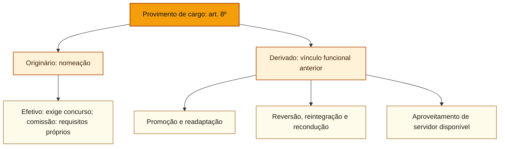
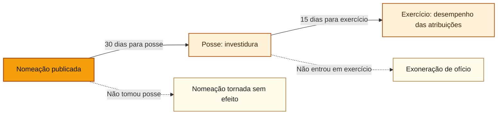
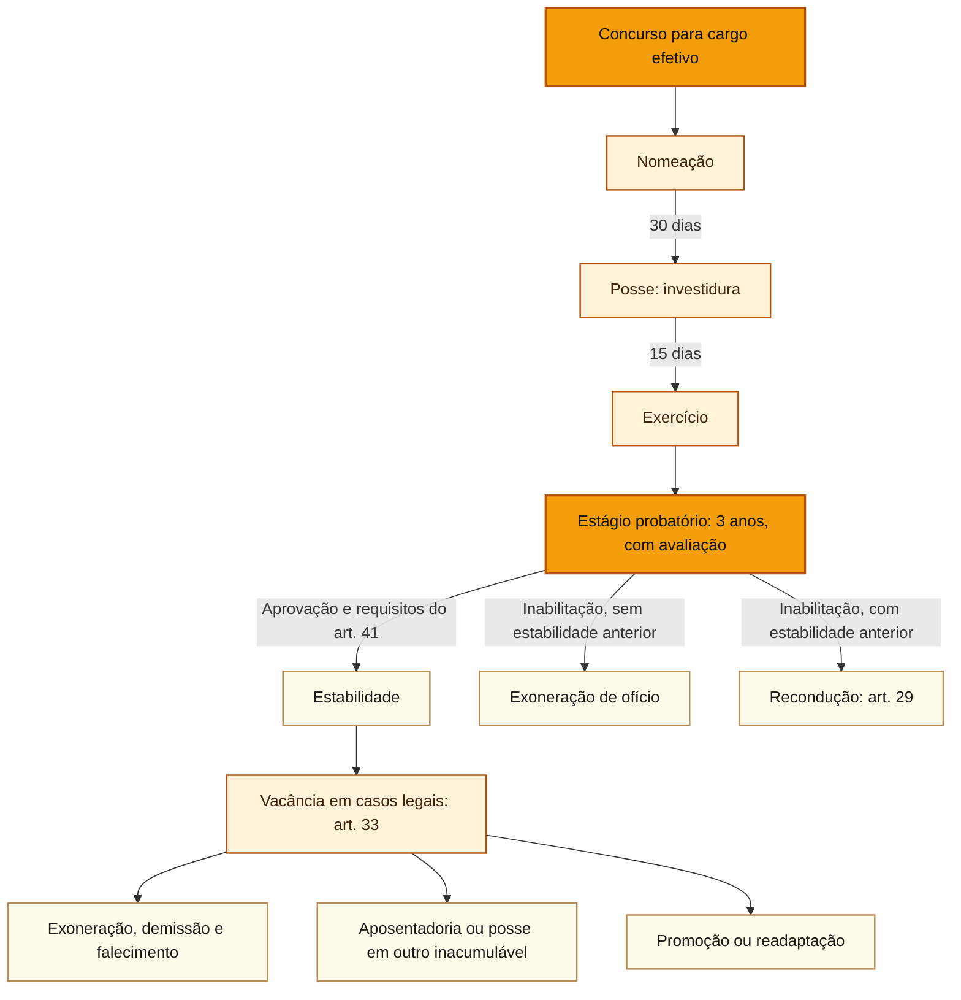

# Lei nº 8.112/1990: provimento, posse, exercício, estágio probatório e vacância de cargos públicos

**Imagine três situações:** uma pessoa foi aprovada em concurso da Câmara dos Deputados e recebeu a nomeação; outra já tomou posse, mas ainda não começou a trabalhar; uma terceira era servidora estável, mudou de cargo por concurso e foi inabilitada no novo estágio probatório. Os efeitos são diferentes: **nomeação não é posse; posse não é exercício; e recondução não é reintegração**.

A **Lei nº 8.112/1990**, que disciplina o regime jurídico dos servidores civis da União, das autarquias e das fundações públicas federais, define esses mecanismos. Ela deve ser lida com o **art. 37, II, da Constituição**, que exige concurso para cargo efetivo, e com o **art. 41**, sobre estabilidade após três anos de efetivo exercício e avaliação especial de desempenho.

**Visão inicial:** **provimento** é o preenchimento jurídico de cargo; **posse** é a investidura, quando há nomeação; **exercício** é o início efetivo das atribuições; **vacância** é a desocupação do cargo, sem significar obrigatoriamente rompimento de todo vínculo funcional com a Administração. Promoção e readaptação são exemplos de institutos que aparecem nos dois lados: provimento e vacância.

## 1. Provimento: conceito, espécies e vedação constitucional de investidura derivada vertical

O **provimento** atribui juridicamente um cargo público a um titular por uma das formas previstas no **art. 8º da Lei nº 8.112/1990**. Nem todo provimento é um primeiro ingresso, nem todo provimento pressupõe cargo atualmente desocupado: a reintegração pode ocorrer com o cargo ocupado, e a readaptação pode colocar o agente em exercício como **excedente** até surgir vaga (art. 24, § 2º).

### 1.1 Provimento originário versus provimento derivado

**Originário: nomeação (art. 9º).** É a modalidade de ingresso que não depende de vínculo funcional anterior. Para **cargo efetivo**, exige aprovação prévia no concurso correspondente, obedecidas classificação e validade (art. 10). Para **cargo em comissão**, a nomeação observa as exigências constitucionais e legais próprias dos cargos de direção, chefia e assessoramento. Uma pessoa que já é servidora pode receber nova nomeação; o ponto é que a nova investidura no cargo não decorre automaticamente do vínculo anterior.

**Derivado: seis formas válidas no art. 8º.** Há relação funcional anterior juridicamente relevante:

- **Promoção (II):** progressão para posicionamento superior **dentro da mesma carreira**, conforme o regime de carreira; também produz vacância da posição anterior. Não permite migrar para carreira diferente sem concurso.
- **Readaptação (V):** passagem para cargo de atribuições compatíveis com limitação física ou mental comprovada em inspeção médica, observadas habilitação, escolaridade e equivalência de vencimentos (art. 24). **Sem vaga, o readaptado exerce como excedente até surgir vaga.** Se a pessoa estiver incapaz para serviço público, a consequência é aposentadoria, nos termos da lei.
- **Reversão (VI):** retorno à atividade de servidor aposentado, seja por cessação da condição de incapacidade comprovada por junta médica, seja **no interesse da Administração**, em condições legais específicas (art. 25).
- **Reintegração (VII):** retorno do servidor **estável** após invalidação de sua **demissão** por decisão administrativa ou judicial, com ressarcimento das vantagens (art. 28).
- **Recondução (IX):** retorno do servidor **estável** ao cargo anterior por inabilitação no estágio probatório de outro cargo ou pela reintegração do antigo ocupante (art. 29).
- **Aproveitamento (VIII):** retorno à atividade de servidor em **disponibilidade**, em cargo com atribuições e vencimentos compatíveis (art. 30). Disponibilidade é uma situação funcional remunerada de servidor estável que está temporariamente sem exercício, por hipótese legal como extinção de cargo.

**Importante:** a ordem de incisos no art. 8º não indica uma sequência de etapas. As formas são alternativas ligadas a fatos diferentes.

### 1.2 A vedação da ascensão e da transferência: Súmula Vinculante nº 43 do STF

Os antigos incisos III e IV do art. 8º, referentes a **ascensão** e **transferência** como formas de provimento, foram revogados pela **Lei nº 9.527/1997**. A **Súmula Vinculante nº 43 do STF** impede entrar em cargo fora da carreira original por modalidade de provimento que dispense o concurso exigido para esse novo cargo.

**Exemplo:** uma servidora aprovada para cargo técnico não passa automaticamente a cargo de analista porque concluiu graduação ou foi promovida. Para uma **nova carreira**, é necessário concurso destinado a ela. Já a promoção **na mesma carreira** continua possível conforme a lei.

**Não confundir:** a **remoção** do art. 36 muda o local de exercício do **servidor** dentro do mesmo quadro; a **redistribuição** do art. 37 desloca o **cargo** entre órgãos ou entidades do mesmo Poder, com seus requisitos próprios. Nenhuma das duas é a antiga modalidade de provimento por “transferência” entre carreiras.

## 2. Prazos da investidura: nomeação, posse e exercício

O ciclo de ingresso por nomeação ocorre em **três momentos** com efeitos diferentes. A lei prevê, como regra, **30 dias para a posse após a publicação do ato de provimento** e **15 dias para entrar em exercício depois da posse** (arts. 13 e 15).

**Cuidado com o marco:** o primeiro prazo corre da **publicação da nomeação**; o segundo, da **data da posse**. A lei não soma todos os prazos em um único limite contado do concurso.

### 2.1 Análise detalhada das etapas e consequências

**Nomeação, art. 9º:** ato de provimento de cargo, geralmente publicado no Diário Oficial. Em cargo efetivo, é precedida de concurso válido e segue a ordem de classificação (art. 10). A nomeação **ainda não transforma a pessoa em ocupante investida no cargo**. O direito à nomeação dos aprovados deve ser analisado conforme edital, vagas, classificação e jurisprudência, sem afirmar que todo aprovado tem nomeação imediata.

**Posse, arts. 7º, 13 e 14:** investidura pela assinatura do termo de posse, que inclui atribuições, deveres, responsabilidades e direitos do cargo. Exige inspeção médica oficial de aptidão e declarações de patrimônio e de eventual acumulação de cargos. Pode ocorrer por **procuração específica**. O art. 13, § 4º, ressalta: **somente há posse nos casos de provimento por nomeação**; não se exige uma nova posse a cada promoção ou readaptação.

Se a posse não ocorrer no prazo legal, o ato de provimento será **tornado sem efeito** (art. 13, § 6º). A consequência **não é exoneração**, pois não houve investidura. O art. 13, § 2º, traz hipótese especial de contagem a partir do fim de determinadas **licenças e afastamentos já existentes na publicação do ato**: não é uma prorrogação geral para qualquer motivo pessoal.

**Exercício, art. 15:** início efetivo do trabalho no cargo. O servidor já empossado dispõe, em regra, de **15 dias** da posse para entrar em exercício. Se não o fizer, é **exonerado de ofício**. Exoneração aqui não é penalidade disciplinar. O art. 15 também prevê regra específica para **função de confiança**: o exercício começa, como regra, na data da publicação da designação, ou no primeiro dia útil após licença ou afastamento legal, dentro do limite do § 4º. **Designação para função de confiança não é nomeação para novo cargo efetivo.**

**Quadro comparativo:**

| Situação | Efeito | Base |
| --- | --- | --- |
| Nomeado não toma posse no prazo | Ato de nomeação tornado **sem efeito** | Art. 13, § 6º |
| Empossado não entra em exercício no prazo | **Exoneração de ofício** do cargo | Art. 15, § 2º; art. 34 |
| Designado para função de confiança não inicia exercício | Designação **sem efeito**, conforme a hipótese | Art. 15, §§ 2º e 4º |
| Servidor é removido/cedido para atuar em **outro município** | Regra especial de **10 a 30 dias para retomada** | Art. 18 |

**Exemplo:** a candidata é nomeada, toma posse no 25º dia após a publicação e comparece para começar a trabalhar dez dias depois. São dois prazos diferentes: posse dentro dos 30 dias, exercício dentro dos 15 dias posteriores à posse.

**Contagem prática:** em geral são **dias corridos**, exclui-se o primeiro dia e inclui-se o do vencimento; o vencimento em dia sem expediente passa ao próximo dia útil, conforme o regime aplicável. O [Manual de Nomeação, Posse e Exercício do MGI](https://www.gov.br/servidor/pt-br/acesso-a-informacao/gestao-de-pessoas/manual-de-procedimentos/manual-de-provimento/nomeacao-posse-e-exercicio-de-cargo-efetivo) confirma essa contagem. Em caso concreto, verificar calendários e regra especial do órgão.

### 2.2 Mudança de sede e retomada do exercício (art. 18)

Há uma **exceção que a banca costuma esconder**: o art. 18 prevê **de 10 a 30 dias** para o servidor que precisa voltar a exercer atribuições **em outro município** por remoção, redistribuição, requisição, cessão ou exercício provisório. Esse período já inclui o deslocamento. Se o servidor estiver em licença ou afastamento legal, o marco se transfere para o fim do impedimento; ele também pode **abrir mão desse intervalo** (§§ 1º e 2º).

**Exemplo:** uma pessoa já é servidora, está em exercício em um órgão federal e é removida para outro município. O prazo do art. 18 diz respeito à **retomada do exercício** após o deslocamento; não substitui os 15 dias que o recém-empossado tem para iniciar exercício no primeiro cargo.

A **promoção** não interrompe tempo de exercício: o art. 17 manda contá-lo no novo posicionamento a partir da publicação do ato.

## 3. Estágio probatório e aquisição da estabilidade

O **estágio probatório** é a avaliação da aptidão para desempenhar o **cargo efetivo específico** em que houve nomeação. **Estabilidade** é a garantia constitucional adquirida, em regra, por servidor efetivo concursado após **três anos de efetivo exercício** e **avaliação especial de desempenho por comissão instituída para isso** (art. 41, caput e § 4º, da Constituição). São conceitos relacionados, mas **não são sinônimos**.

Um servidor **estável no cargo anterior** pode ingressar por novo concurso e precisar passar por **outro estágio probatório** referente às novas atribuições. Se for inabilitado, a proteção da estabilidade anterior permite considerar **recondução** nas condições legais.

### 3.1 Duração do estágio probatório: a harmonização da Lei nº 8.112/1990 com a CF/1988

O art. 20 da Lei nº 8.112/1990 ainda conserva a expressão **24 meses**; porém, a **Emenda Constitucional nº 19/1998** alterou o art. 41 da Constituição para exigir **três anos de efetivo exercício**. A interpretação consolidada dos tribunais aplica **três anos (36 meses)** ao estágio probatório federal.

Essa diferença entre **texto legal antigo e norma constitucional vigente** é uma pegadinha: memorizar literalmente “24 meses” sem levar em conta a Constituição conduz ao erro. **Três anos, sozinhos, também não bastam para estabilidade**: é indispensável a avaliação especial prevista no art. 41, § 4º.

**Suspensão da contagem:** o art. 20, § 5º, lista licenças e afastamentos específicos que **suspendem o estágio probatório** (por exemplo, certas licenças familiares, atividade política nas condições legais, afastamento do cônjuge e curso de formação). O relógio volta a correr após o término do impedimento. **Nem todo afastamento tem automaticamente o mesmo efeito.** Verificar a hipótese e sua base legal.

### 3.2 Fatores avaliados no estágio probatório

O **art. 20, incisos I a V**, determina cinco fatores: **assiduidade** (comparecimento), **disciplina** (respeito aos deveres), **capacidade de iniciativa** (agir diante das tarefas), **produtividade** (entregar resultados) e **responsabilidade** (assumir e cumprir obrigações).

**Exemplo:** uma pessoa comparece regularmente, mas descumpre de modo recorrente deveres funcionais. Assiduidade e disciplina são critérios diferentes; não basta a presença para concluir pela aprovação geral.

Pelo **art. 20, § 1º**, a avaliação realizada por comissão deve ser submetida à homologação **quatro meses antes do fim** do estágio, **sem prejuízo da continuidade de avaliação até o término**. Isso não antecipa a estabilidade para o 32º mês.

**Durante o estágio:** o art. 20, §§ 3º a 5º, disciplina limites para exercer cargos comissionados, **cessão para outro órgão** e concessão de licenças/afastamentos. Não equiparar automaticamente o servidor em probatório ao estável para todos esses efeitos.

### 3.3 Inabilitação no estágio probatório

**Regra do art. 20, § 2º:** quem não é aprovado no estágio será **exonerado**; **se já era estável no serviço público**, poderá ser **reconduzido ao cargo anteriormente ocupado**, observado o art. 29. A inabilitação é diferente de uma punição disciplinar: deve respeitar o procedimento de avaliação e as garantias de defesa, sem ser chamada automaticamente de demissão.

**Caso A:** alguém assume o primeiro cargo efetivo e não é aprovado no estágio. O resultado legal é a exoneração, observadas as garantias aplicáveis.

**Caso B:** servidora federal estável passa em concurso para outro cargo efetivo e não é aprovada no novo estágio. O art. 29, I, prevê **recondução ao cargo anterior**. Se a vaga original já estiver ocupada, **o parágrafo único do art. 29 manda aproveitá-la em outro cargo compatível**. Não se desloca automaticamente a pessoa que ocupa o cargo, pois essa solução pertence a outra hipótese, a reintegração do titular anterior (art. 28, § 2º).

## 4. Vacância: conceito e hipóteses taxativas

**Vacância** é a desocupação jurídica de determinado cargo. **Não significa sempre saída da Administração**: promoção e readaptação aparecem tanto no rol de provimento (art. 8º) quanto no de vacância (art. 33), porque há passagem entre posições ou cargos. Posse em outro cargo inacumulável também pode gerar vacância sem equivaler a demissão.

As **sete hipóteses vigentes do art. 33** são: **exoneração** (sem natureza de penalidade), **demissão** (penalidade disciplinar), **promoção**, **readaptação**, **aposentadoria**, **posse em outro cargo inacumulável** e **falecimento**. Os antigos incisos sobre ascensão e transferência foram revogados.

**Exoneração × demissão:** o art. 34 prevê exoneração de cargo efetivo **a pedido** ou **de ofício** (por não aprovação no probatório ou falta de entrada em exercício no prazo). Demissão é sanção decorrente de infração disciplinar, sujeita ao regime da Lei nº 8.112/1990. Para cargo em comissão e função de confiança, o art. 35 contempla exoneração ou dispensa a juízo da autoridade ou a pedido.

**Posse em outro cargo inacumulável (art. 33, VIII):** um servidor efetivo federal que toma posse em outro cargo com acumulação constitucionalmente proibida pode ter declarada a vacância do primeiro cargo. O efeito sobre eventual **recondução futura** depende da estabilidade e dos requisitos do art. 29; não é garantia automática a todo servidor que muda de emprego.

**Pergunta Cebraspe:** “Promoção não pode ser vacância, pois o servidor continua trabalhando.” **Errado.** A promoção aparece expressamente no art. 33, III.

## 5. Institutos protetivos e de garantia funcional: reintegração, recondução, reversão e disponibilidade

A tabela separa **por que a pessoa retorna** e **o que acontece com a vaga**. O nome parecido dos institutos favorece armadilhas.

| Instituto | Quem retorna e por qual motivo | Se o cargo de destino estiver ocupado |
| --- | --- | --- |
| **Reintegração, art. 28** | Servidor **estável** cuja **demissão foi invalidada**, com ressarcimento das vantagens | O **ocupante eventual do cargo** segue as soluções do § 2º: recondução à origem, aproveitamento em outro cargo ou disponibilidade. Se cargo extinto, o reintegrando fica em disponibilidade (§ 1º). |
| **Recondução, art. 29** | Servidor **estável** não aprovado no probatório de outro cargo, ou deslocado pela reintegração do ocupante anterior | **Se cargo de origem estiver ocupado, aproveitamento em outro cargo** (parágrafo único), observadas as condições legais. |
| **Reversão, arts. 25 e 27** | Aposentado retorna por cessação da incapacidade comprovada ou por solicitação acolhida **no interesse da Administração**, com requisitos específicos | Na reversão por **cessação da incapacidade**, pode exercer como **excedente** até vaga (art. 25, § 3º). A reversão a pedido exige **cargo vago**. |
| **Aproveitamento, arts. 30 a 32** | Servidor estável em **disponibilidade** é chamado para cargo com atribuições e vencimentos compatíveis | O aproveitamento é obrigatório; não entrar em exercício no prazo pode provocar **cassação da disponibilidade**, salvo exceção legal como doença comprovada por junta médica. |

**Reversão no interesse da Administração (art. 25, II):** exige solicitação, aposentadoria voluntária, estabilidade quando em atividade, aposentadoria ocorrida **nos cinco anos anteriores ao pedido** e **cargo vago**. O art. 27 ainda impede reversão do aposentado que já completou **70 anos**. **Atenção:** o limite legal da reversão não deve ser confundido com a idade da aposentadoria compulsória prevista em outras normas.

**Quadro prático da diferença mais importante:**

- Um servidor **demitido ilegalmente** retorna após anulação da demissão: **reintegração**. O ocupante que passou a exercer o cargo pode ser afetado pelas soluções legais do **art. 28, § 2º**.
- Um servidor **estável** tenta outro cargo, reprova no estágio e procura voltar ao cargo antigo: **recondução**. Se a origem estiver ocupada, **art. 29, parágrafo único: aproveitamento em outro cargo**.
- Um aposentado deixa de preencher os requisitos médicos da aposentadoria por incapacidade: **reversão**, inclusive como excedente se cargo ocupado.
- Um servidor estava em **disponibilidade** e surge cargo compatível: **aproveitamento**.

Não deduzir o destino de um ocupante com base apenas na palavra “retorno”. Identifique **qual fato jurídico** provocou esse retorno.

## 6. Diagrama síntese: o ciclo de investidura, desempenho e vacância

**Leitura do mapa:** o caminho inicial por nomeação é apenas um dos cenários. **Reintegração, reversão, recondução e aproveitamento** também são formas de provimento derivado, mas surgem de situações específicas já examinadas, e não obrigatoriamente depois da estabilidade no mesmo cargo.

## 7. Questões comentadas

Todos os itens a seguir são **inéditos didáticos em estilo Cebraspe**, com fundamento legal e comentário na própria nota.

**1.** A investidura em cargo público federal ocorre na publicação da nomeação, data que inicia prazo de trinta dias para entrar em exercício.

> **Gabarito: ERRADO.** A investidura é a **posse** (art. 7º). Da publicação da nomeação contam-se, em regra, **30 dias para a posse** (art. 13, § 1º); os **15 dias para exercício** contam-se da posse (art. 15, § 1º).

**2.** Um cidadão toma posse regularmente em cargo efetivo, mas deixa de entrar em exercício no prazo legal. Nesse caso, o ato de nomeação deverá ser tornado sem efeito porque a investidura ainda não ocorreu.

> **Gabarito: ERRADO.** A investidura **já ocorreu** na posse; a consequência da falta de exercício é **exoneração de ofício** (art. 15, § 2º). **Tornar sem efeito a nomeação** é a consequência da falta de posse (art. 13, § 6º).

**3.** A Súmula Vinculante nº 43 impede uma forma de provimento que, sem concurso específico, leve servidor a cargo não integrante da carreira na qual ingressou originalmente.

> **Gabarito: CERTO.** A vedação constitucional explica a revogação dos antigos institutos de ascensão e transferência entre carreiras. **Promoção na própria carreira** continua válida quando prevista em lei.

**4.** Servidor público federal estável que, após ingressar por concurso em novo cargo efetivo, é inabilitado no estágio probatório, somente poderá ser reconduzido ao cargo anterior se este permanecer desocupado.

> **Gabarito: ERRADO.** O **art. 29, I**, prevê recondução do servidor estável. Se o cargo de origem estiver **provido**, o **parágrafo único do art. 29 determina aproveitamento em outro cargo compatível**. **Não confundir** com a reintegração de titular demitido ilegalmente, em que o art. 28, § 2º, disciplina o destino do eventual ocupante do cargo. O texto anterior deste material misturava essas duas hipóteses.

**5.** O período de estágio probatório do servidor federal efetivo deve ser lido em harmonia com os três anos de efetivo exercício exigidos pelo art. 41 da Constituição, apesar da expressão “24 meses” ainda presente no art. 20 da Lei nº 8.112/1990.

> **Gabarito: CERTO.** Prevalece o prazo de **três anos**. Para adquirir estabilidade também se exige **avaliação especial de desempenho por comissão**, nos termos do art. 41, § 4º.

**6.** Promoção e readaptação figuram simultaneamente entre as formas de provimento e as hipóteses legais de vacância no regime da Lei nº 8.112/1990.

> **Gabarito: CERTO.** Constam do **art. 8º, II e V**, e do **art. 33, III e VI**. Vacância não representa necessariamente rompimento do vínculo com a Administração.

**7.** A posse de servidor federal pode ser realizada mediante procuração específica, mas não se exige nova posse quando ocorrer promoção dentro da carreira.

> **Gabarito: CERTO.** O art. 13, §§ 3º e 4º, admite procuração e limita posse aos **casos de nomeação**.

**8.** Caso o servidor já em exercício tenha de mudar de município por remoção, aplica-se sempre o prazo inicial de quinze dias contado da posse, pois o art. 18 não traz regra própria.

> **Gabarito: ERRADO.** O **art. 18** prevê, para deslocamento de sede nessas condições, prazo de **10 a 30 dias para retomar o exercício**, incluindo deslocamento, com hipóteses próprias de contagem.

**9.** O art. 25 permite reversão no interesse da Administração de aposentado voluntário que preencha os requisitos legais, mesmo sem cargo vago, porque sempre poderá trabalhar como excedente.

> **Gabarito: ERRADO.** A reversão **no interesse da Administração** exige **cargo vago** (art. 25, II, e). A condição de excedente, na ausência de vaga, é prevista para **reversão por cessação da incapacidade** (art. 25, § 3º).

**10.** Servidor estável reconduzido em razão de inabilitação no estágio probatório de outro cargo, encontrando ocupado seu cargo de origem, será aproveitado em outro cargo segundo as regras legais.

> **Gabarito: CERTO.** O **art. 29, parágrafo único**, remete ao **art. 30**, sobre aproveitamento em cargo de atribuições e vencimentos compatíveis.

**Síntese para a prova:** a banca pode mudar **uma palavra** e alterar a solução. “Nomeado” difere de “empossado”; “não tomou posse” difere de “não entrou em exercício”; “recondução” difere de “reintegração”; “reversão por incapacidade” difere de “reversão no interesse da Administração”.

## Fontes normativas e referências

- [Lei nº 8.112/1990, texto atualizado na Câmara dos Deputados](https://www2.camara.leg.br/legin/fed/lei/1990/lei-8112-11-dezembro-1990-322161-normaatualizada-pl.html): arts. 7º a 18, 20, 24 a 35 e 36 a 37.
- [Constituição Federal, arts. 37, II, e 41](https://www2.camara.leg.br/atividade-legislativa/legislacao/constituicao1988): concurso, estabilidade, avaliação especial e hipóteses constitucionais de perda do cargo.
- [Manual do MGI: Nomeação, Posse e Exercício de Cargo Efetivo](https://www.gov.br/servidor/pt-br/acesso-a-informacao/gestao-de-pessoas/manual-de-procedimentos/manual-de-provimento/nomeacao-posse-e-exercicio-de-cargo-efetivo): contagem de prazo, ingresso e consequências do não exercício.
- **Súmula Vinculante nº 43 do STF:** vedação de investidura sem concurso em cargo não integrante da carreira anterior.
- [Lei nº 8.112 anotada, Portal do Servidor: vacância](https://www.gov.br/servidor/pt-br/acesso-a-informacao/gestao-de-pessoas/lei-8112-anotada/titulo-ii-do-provimento-vacancia-remocao-redistribuicao-e-substituicao/capitulo-ii-2013-da-vacancia): enumeração das hipóteses e distinção entre exoneração e demissão.

