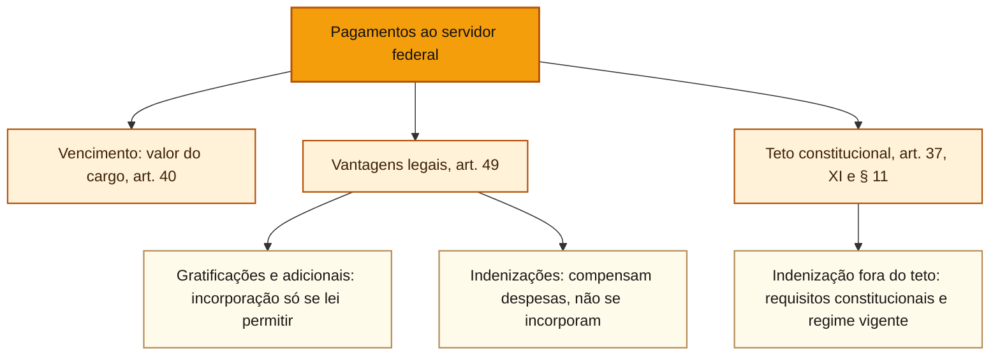
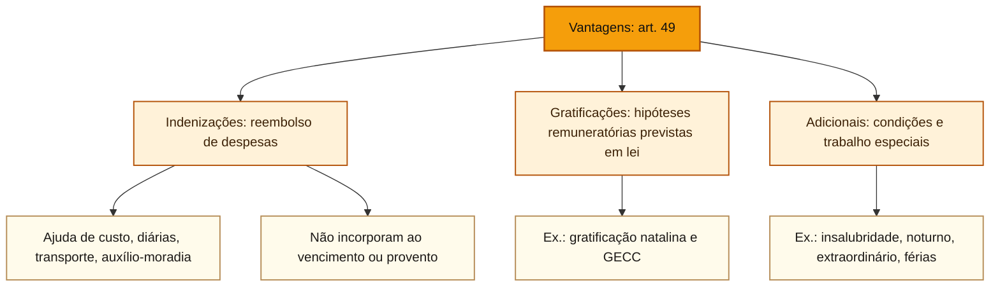
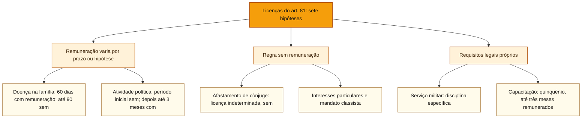

# Lei nº 8.112/1990: direitos, vantagens pecuniárias, deveres funcionais e vedações

**Imagine dois casos:** um servidor recebe seu vencimento básico, uma gratificação e diárias de viagem; outro exerce dois cargos públicos em acumulação autorizada pela Constituição. Quais valores entram na remuneração? Quais parcelas são indenizatórias? Como funciona o teto? E o que muda quando o servidor descumpre um dever?

A **Lei nº 8.112/1990**, estatuto federal dos servidores civis da União, autarquias e fundações públicas federais, disciplina **vencimento, remuneração, vantagens, férias, licenças, deveres e proibições**. O texto deve ser lido junto da **Constituição Federal, art. 37**, especialmente o teto e a acumulação remunerada. A **EC nº 135/2024** alterou o regime constitucional de exclusão de indenizações do teto; a **EC nº 138/2025** ampliou a acumulação de um cargo de professor com outro cargo de qualquer natureza.

Para a Cebraspe, o método mais seguro é identificar **a natureza da parcela**, **o fundamento legal e o marco temporal**. A mesma palavra pode gerar efeitos diferentes: *indenização* não se incorpora por força do art. 49, § 1º, mas a exclusão de parcelas do teto constitucional **depende dos requisitos do art. 37, § 11, e das decisões judiciais aplicáveis**.

---

## 1. Estrutura remuneratória: vencimento, remuneração e o teto constitucional

A estrutura de pagamentos começa com o **vencimento** do cargo e admite acréscimos legais. Saber de onde veio a parcela é mais útil do que decorar que todo pagamento é “salário”.

### 1.1 Vencimento versus remuneração

**Vencimento** é o valor básico fixado em lei para o exercício do cargo (art. 40). **Remuneração**, na definição do art. 41, é **o vencimento do cargo efetivo acrescido de vantagens pecuniárias permanentes previstas em lei**. “Vencimentos” é expressão também empregada para o conjunto de parcelas, mas, na prova, prefira distinguir pela definição legal.

O art. 41, § 3º, protege a **irredutibilidade do vencimento do cargo efetivo e das vantagens permanentes**, observadas as regras constitucionais. O § 5º garante que **nenhum servidor terá remuneração abaixo do salário mínimo**. Conforme a **Súmula Vinculante nº 16**, esse piso se verifica pelo **total da remuneração**, e não apenas pelo vencimento básico isolado.

**Exemplo:** um vencimento básico inferior ao salário mínimo não basta para declarar inconstitucionalidade se a **remuneração total considerada juridicamente** respeitar o piso. Isso não autoriza tratar como vencimento básico uma diária destinada a custear viagem.

### 1.2 Limites, descontos e teto constitucional

O **art. 37, XI, da Constituição** limita a remuneração e o subsídio de agentes públicos. **Na União**, o parâmetro geral é o **subsídio mensal dos ministros do Supremo Tribunal Federal**, observadas as situações e os limites constitucionais próprios.

**Acumulação permitida e teto:** nos **Temas 377 e 384**, o STF estabeleceu, para vínculos constitucionalmente acumuláveis, a incidência do teto **em cada vínculo isoladamente**, e não sobre uma soma automática de todas as remunerações. Primeiro verifica-se se o acúmulo é lícito; só depois se aplica essa regra.

**Indenizações e teto após a EC nº 135/2024:** o art. 37, § 11, passou a excluir do limite apenas parcelas de caráter indenizatório **expressamente previstas em lei ordinária nacional aprovada pelo Congresso**, aplicável aos Poderes e órgãos autônomos. Em **2026**, o STF adotou medidas para impedir classificações artificiais de vantagens remuneratórias como indenizatórias a fim de ultrapassar o teto. Portanto, a frase “qualquer verba chamada indenizatória está fora do teto” está incorreta. A inexistência de incorporação ao provento pelo **art. 49, § 1º**, também é questão distinta da exclusão constitucional do teto.

**Descontos e proteção da remuneração:** pelo art. 45, descontos dependem, em regra, de **imposição legal, ordem judicial ou autorização em hipóteses legais de consignação**. O art. 48 protege vencimento, remuneração e provento contra arresto, sequestro e penhora, **com exceção legal para prestação de alimentos por decisão judicial**. O art. 44 prevê perda remuneratória por falta injustificada e descontos proporcionais, com regras de compensação.

**Caso aplicado:** se o agente recebe diárias por deslocamento e também uma gratificação habitual, não se presume que ambas tenham natureza igual, incorporem-se da mesma forma ou sejam excluídas do teto apenas por estarem na folha.

---

## 2. Tipologia das vantagens pecuniárias: indenizações, gratificações e adicionais

O **art. 49 da Lei nº 8.112/1990** distingue **indenizações, gratificações e adicionais**. A finalidade da parcela determina sua regra, e a concessão deve ter **fundamento legal**. O **art. 50** impede usar vantagens pecuniárias para gerar outros aumentos sucessivos **sob o mesmo título ou fundamento**.

### 2.1 Indenizações: ressarcimento de encargos suportados pelo servidor

As **indenizações** compensam despesas relacionadas ao serviço, em vez de remunerar o trabalho. O **art. 49, § 1º** (e **não art. 51, § 1º**, inexistente na numeração vigente) determina que **não se incorporam ao vencimento ou provento para qualquer efeito**.

As quatro hipóteses enumeradas no **art. 51** são:

- **Ajuda de custo (arts. 53 a 57):** compensa instalação quando, **no interesse do serviço**, há mudança de sede com **mudança permanente de domicílio**. O valor segue o regulamento, limitado a até três meses de remuneração, e não se paga em duplicidade quando cônjuges servidores mudam para a mesma sede. Não cabe nas remoções a pedido previstas no art. 53, § 3º. Há restituição, por exemplo, se a pessoa não se apresentar injustificadamente na nova sede.
- **Diárias (arts. 58 e 59):** custeiam hospedagem, alimentação e locomoção urbana em deslocamento eventual ou transitório a serviço. Se o servidor recebe a diária e **não viaja**, restitui integralmente em **cinco dias**. A regra deve ser cotejada com situações de retorno antecipado e deslocamentos que não geram diária.
- **Transporte (art. 60):** indeniza gastos com uso de meio **próprio** de locomoção em serviços externos exigidos pelas atribuições, nas condições regulamentares. Não equivale ao auxílio-transporte cotidiano do trajeto casa-trabalho.
- **Auxílio-moradia (arts. 60-A a 60-E):** ressarcimento de despesas de moradia ou hospedagem **comprovadas**, para situações legais como determinadas nomeações em comissão em outra localidade, sujeito a condições, impedimentos e limites. A existência de imóvel funcional disponível ou de imóvel próprio pode afetar o direito.

**Dois testes separados:** indenização **não incorpora** pelo art. 49, § 1º; já sua **exclusão do teto** precisa respeitar a redação constitucional atual do art. 37, § 11. Evite afirmar de forma automática que uma parcela não sofre qualquer tributo ou contribuição sem consultar a lei específica e a natureza do valor.

**Exemplo:** servidora viaja por dois dias e retorna antecipadamente. A eventual restituição de diárias não é uma sanção disciplinar por si só: decorre do ressarcimento de despesas que não se realizaram.

### 2.2 Gratificações e adicionais: retribuição por função e condições especiais

Pelo **art. 49, § 2º**, essas vantagens **só se incorporam ao vencimento ou provento nos casos e nas condições definidos em lei**. O art. 61 reúne retribuições, gratificações e adicionais, mas não torna todas as parcelas permanentes.

- **Retribuição por direção, chefia e assessoramento (arts. 61, I, e 62):** decorre do exercício da função/cargo nas hipóteses legais; não significa incorporação automática quando terminar a designação.
- **Gratificação natalina (arts. 63 a 66):** corresponde a **1/12 da remuneração de dezembro por mês de exercício**, sendo mês integral a fração de **quinze dias ou mais**. O pagamento legal ocorre **até 20 de dezembro**.
- **Adicional por tempo de serviço:** o antigo art. 67 foi **revogado**; novas vantagens por tempo não decorrem da redação extinta, ressalvadas situações juridicamente preservadas.
- **Insalubridade e periculosidade (art. 68):** adicionais por condições de risco com base no **vencimento do cargo efetivo**. Quem preencher condições para ambos **deve optar por um**; eliminado o risco, cessa o respectivo direito. Há proteção específica para gestantes e lactantes (art. 69, parágrafo único).
- **Serviço extraordinário (arts. 73 e 74):** hora extra com acréscimo de **50%** sobre a hora normal; serviço extraordinário é autorizado para situações **excepcionais e temporárias**, respeitando o limite máximo de **duas horas por jornada**.
- **Serviço noturno (art. 75):** entre **22h e 5h**, com adicional de **25%** e hora computada como **52 minutos e 30 segundos**. Se o serviço noturno também for extraordinário, aplica-se a regra legal de cálculo.
- **Férias (art. 76):** adicional constitucional de **um terço da remuneração** correspondente ao período, pago na forma legal.
- **Gratificação por Encargo de Curso ou Concurso, GECC (art. 76-A):** atividades especiais de instrução, banca, preparação, logística ou aplicação de exames nas condições legais; **não integra vencimento ou salário para qualquer efeito** e tem limites, não sendo acréscimo livre.

**Situação de prova:** uma pessoa atua em condições insalubres e perigosas ao mesmo tempo. A lei exige escolher **um** adicional. Diferentemente, o adicional noturno pode coexistir com serviço extraordinário quando as hipóteses legais se acumularem.

---

## 3. Direitos: férias e licenças

A Lei nº 8.112/1990 protege períodos de descanso, saúde e afastamento justificado. **Férias** e **licenças** possuem pressupostos distintos. Nem toda licença é remunerada e nem toda licença conta como efetivo exercício para qualquer finalidade.

### 3.1 Regime de férias (arts. 77 a 80)

O servidor tem direito, como regra, a **30 dias por ano**, podendo acumular **até dois períodos** em caso de necessidade do serviço (art. 77). O primeiro período aquisitivo exige **12 meses de exercício**. As férias podem ser divididas em **até três etapas**, a pedido do servidor e conforme interesse da Administração.

A lei assegura adicional de **um terço**, pago nos termos dos arts. 76 e 78, § 5º. O restante das férias interrompidas é gozado **de uma só vez**. O art. 80 permite interrupção apenas em hipóteses legais, como calamidade pública, convocação para júri, serviço militar/eleitoral ou **necessidade de serviço declarada pela autoridade máxima**.

**Exceção de risco ocupacional (art. 79):** quem opera **direta e permanentemente com raios X ou substâncias radioativas** tem **20 dias consecutivos por semestre**, sem possibilidade de acumulação. Esse regime não se soma automaticamente ao de trinta dias anuais.

**Exemplo:** uma unidade enfrenta demanda extraordinária e quer adiar férias de servidor. Necessidade de serviço pode justificar a programação e, em hipóteses legais, a acumulação de períodos; a **interrupção de férias já iniciadas** exige fundamento específico e, na hipótese de necessidade do serviço, declaração da autoridade máxima.

### 3.2 Rol das licenças da Lei nº 8.112/1990 (arts. 81 a 92)

O **art. 81** enumera sete modalidades de licença. É incorreto classificá-las simplesmente como “sempre remuneradas” ou “sempre sem remuneração”, pois algumas **mudam conforme a fase ou o tempo**. A licença para tratamento da **própria saúde**, prevista nos **arts. 202 e seguintes**, é matéria relacionada, mas **não integra os sete incisos do art. 81**.

**Doença em pessoa da família (art. 83):** exige **perícia oficial**, necessidade de assistência direta indispensável e impossibilidade de prestá-la com exercício do cargo ou compensação de horário. Abrange familiares e dependentes previstos na lei. Em cada período de **12 meses**, até **60 dias com remuneração** e até **90 dias adicionais sem remuneração**. É proibido exercer atividade remunerada durante essa licença (art. 81, § 3º). **Não** confundir com afastamento para cuidar da própria saúde.

**Afastamento de cônjuge ou companheiro (art. 84):** pode ser concedido por prazo indeterminado, **sem remuneração**, para acompanhar cônjuge deslocado. O § 2º permite, em certas situações, **exercício provisório em órgão federal** para atividades compatíveis com o cargo, com requisitos distintos da licença sem exercício.

**Serviço militar (art. 85):** licença conforme a **legislação específica**. Depois de concluído o serviço militar, há até **30 dias sem remuneração** para reassumir. Por isso, não se deve pôr toda essa hipótese na categoria “remunerada” sem consultar a disciplina específica.

**Atividade política (art. 86):** da escolha em **convenção partidária** até a **véspera do registro da candidatura**, é **sem remuneração**. A partir do **registro** e até o **décimo dia após a eleição**, a lei assegura os vencimentos do cargo efetivo **somente por três meses**. Há regra particular de afastamento de funções de direção, chefia, assessoramento, arrecadação e fiscalização na localidade da candidatura.

**Capacitação (art. 87):** após **cada cinco anos de efetivo exercício**, pode haver **até três meses de licença remunerada**, no **interesse da Administração**, para curso de capacitação. Não é direito de afastar-se automaticamente nem acumular quinquênios não usados.

**Interesses particulares (art. 91):** a critério da Administração, **até três anos consecutivos, sem remuneração**, para ocupante de cargo efetivo **que não esteja em estágio probatório**. Pode ser interrompida a pedido ou no interesse do serviço.

**Mandato classista (art. 92):** licença, **sem remuneração**, para mandato nas entidades e condições expressamente previstas na lei, conforme limites de quantidade de servidores e duração do mandato.

**Como resolver a questão:** sempre perguntar *qual licença, em que fase, por quanto tempo, com qual remuneração, e quais requisitos*. A palavra isolada “licença” não permite responder sobre pagamento.

---

## 4. Deveres funcionais e vedações disciplinares

Os **deveres (art. 116)** descrevem condutas que a Administração espera do servidor; as **proibições (art. 117)** identificam comportamentos vedados. A sanção depende do enquadramento e dos **arts. 128 a 132**. Não se pode atribuir uma penalidade única a todas as condutas do artigo 117.

### 4.1 Deveres do servidor público (art. 116)

O art. 116 contém **doze incisos**. Os pontos que mais se confundem são:

- **Legalidade e obediência:** observar normas e cumprir ordens superiores, **exceto as manifestamente ilegais** (incisos III e IV). “Manifestamente” significa ilegalidade evidente; não é autorização para descumprir qualquer ordem de que o servidor discorde.
- **Serviço ao público:** atender com presteza e fornecer informações solicitadas, **respeitados os sigilos legais**; expedir certidões para defesa de direito; atender requisições para a defesa da Fazenda Pública (V).
- **Comunicar irregularidades:** levar à autoridade competente a irregularidade conhecida em razão do cargo; se houver suspeita de envolvimento da chefia, comunicar a **outra autoridade competente para apuração** (VI).
- **Representar contra ilegalidade, omissão ou abuso:** o inciso XII e seu parágrafo único disciplinam encaminhamento hierárquico e direito de defesa da pessoa representada. Essa regra convive com o canal alternativo do inciso VI quando a própria chefia for suspeita.
- **Zelo, lealdade institucional, economia de material, guarda do sigilo, moralidade, pontualidade e urbanidade:** são obrigações jurídicas, não sugestões de estilo de trabalho.

**Exemplo de comunicação institucional:** quem publica conteúdo em nome de um órgão deve obedecer às normas, preservar dados pessoais e sigilo legal e separar comunicação pública de promoção pessoal indevida. Obedecer a ordem **manifestamente ilegal** de divulgar informação sigilosa não é dever funcional.

### 4.2 Proibições ao servidor público (art. 117)

Para acertar a correspondência entre conduta e sanção, observe **três grupos legais**, sem esquecer gravidade, reincidência e apuração regular:

| Grupo do art. 117 | Exemplo de conduta | Regra principal de sanção |
| --- | --- | --- |
| **I a VIII e XIX** | Faltar ao expediente sem autorização; retirar documento; recusar fé; coagir subordinados; não atualizar cadastro | **Advertência por escrito** pelo art. 129 se não justificar pena mais grave; reincidência pode levar à suspensão (art. 130) |
| **IX a XVI** | Usar cargo para proveito indevido; gerenciar empresa em situação vedada; intermediar interesse privado na repartição; receber propina; desídia; usar recursos públicos para negócio particular | **Demissão**, nos termos do art. 132, XIII, após apuração e enquadramento |
| **XVII e XVIII** | Atribuir função estranha ao cargo de outro servidor fora de emergência transitória; exercer atividade incompatível com cargo/horário | **Suspensão**, conforme art. 130, se não houver outra infração mais grave |

**Cuidado com a literalidade:**

- **Art. 117, VIII:** proíbe manter sob **chefia imediata**, em cargo ou função de confiança, cônjuge, companheiro ou parente até segundo grau. A questão pode incluir “qualquer parentesco em toda repartição”, ampliando indevidamente o enunciado específico. Outras regras sobre nepotismo podem ser aplicáveis, mas são normas distintas.
- **Art. 117, X:** veda gerência/administrar sociedade privada ou exercer comércio, ressalvadas as condições de participação como **acionista, cotista ou comanditário**, além das exceções do **parágrafo único** (conselhos legalmente previstos e **licença para interesses particulares**, com regras de conflito de interesses).
- **Art. 117, XI:** só admite procurador/intermediário perante repartições para **benefícios previdenciários ou assistenciais** de parentes até segundo grau, cônjuge ou companheiro. A ressalva não libera atuar como procurador privado em qualquer tema.
- **Art. 117, XIII:** o texto legal proíbe aceitar comissão, emprego ou pensão de Estado estrangeiro. Afirmar que o inciso contém ressalva geral de autorização administrativa altera sua redação.

**Diferença de processo:** infrações são apuradas com contraditório e ampla defesa; o art. 128 determina considerar natureza/gravid​ade, danos, circunstâncias e antecedentes. **Nem toda violação do art. 117 causa demissão**, e “suspensão” não deve ser confundida com afastamento cautelar do processo disciplinar.

Para detalhes de tipos de falta, rito e autoridades competentes, ver [[3 - Materias/Direito Administrativo/22 - lei 8112 responsabilidades e penalidades disciplinares|Responsabilidades e penalidades disciplinares]] e [[3 - Materias/Direito Administrativo/24 - sindicancia processo administrativo disciplinar e seus ritos|Sindicância e PAD]].

---

## 5. Acumulação remunerada de cargos públicos

A regra da **Constituição Federal, art. 37, XVI e XVII**, e do **art. 118 da Lei nº 8.112/1990** é a proibição de acumular remuneradamente cargos, empregos e funções públicas, salvo exceções constitucionais e compatibilidade de horários. A regra se estende à Administração indireta e a empregos em empresas estatais, conforme a Constituição.

### 5.1 As exceções constitucionais taxativas (art. 37, XVI, CF/1988)

**A redação de 2026 é essencial.** A **Emenda Constitucional nº 138, promulgada em 19/12/2025 e publicada em 22/12/2025**, alterou a alínea **b**, que deixou de exigir cargo técnico ou científico ao lado do cargo de professor. Atualmente as três hipóteses são:

- **a) Dois cargos de professor.**
- **b) Um cargo de professor com outro de qualquer natureza.**
- **c) Dois cargos ou empregos privativos de profissionais de saúde, com profissões regulamentadas.**

**Exemplo:** uma professora concursada também é aprovada para cargo administrativo de atribuições gerais. Pela redação anterior da Constituição, seria preciso examinar se o segundo cargo era técnico ou científico; pela **redação vigente desde dezembro de 2025**, a alínea b autoriza a acumulação do cargo de professor com **outro de qualquer natureza**, desde que os horários sejam compatíveis e se respeitem os limites constitucionais.

**Não confundir a permissão constitucional com dispensa de deveres.** A ocupação dos dois cargos exige efetivo cumprimento de ambas as jornadas, sem sobreposição indevida, além de observar normas de acumulação e teto aplicáveis. A mudança constitucional **não** libera dois cargos administrativos sem vínculo com magistério.

### 5.2 Limite semanal de jornada e a tese vinculante do STF

O **Tema 1081 do STF** afastou a ideia de limite universal e automático de **60 horas por semana** para os casos em que a Constituição permite acumulação. A compatibilidade deve ser verificada **no caso concreto**, e a existência de norma administrativa com máximo semanal não serve, isoladamente, para negar situação constitucionalmente permitida.

**O que é compatibilidade real?** Horários que permitam cumprir as duas jornadas e funções sem sobreposição, com condições de deslocamento e trabalho efetivo. O STF não reconheceu direito de exigir que um órgão **altere unilateralmente sua escala** para tornar possível um acúmulo que era incompatível; esse ponto também foi reafirmado em julgados posteriores.

**Teto sobre os vínculos:** nos Temas **377 e 384**, o STF determina a análise isolada do teto nas situações de acumulação **constitucionalmente legítima**. Não se usa a regra do teto para justificar acúmulo proibido.

**Duas armadilhas para prova:**

“Professor só pode acumular com outro cargo técnico ou científico.” **Errado para o texto constitucional vigente em 2026** pela EC nº 138/2025.

“Acumular dois cargos constitucionais é sempre ilegal se somar 70 horas semanais.” **Errado:** Tema 1081 exige **compatibilidade concreta**, sem limite fixo automático de 60 horas.

Fontes: [EC nº 138/2025, texto oficial do Senado](https://legis.senado.leg.br/norma/41853798/publicacao/41861303) e [STF, Tema 1081](https://portal.stf.jus.br/jurisprudenciaRepercussao/verAndamentoProcesso.asp?classeProcesso=RE&incidente=5819218&numeroProcesso=1246685&numeroTema=1081).

---

## 6. Questões comentadas

As questões são **inéditas, para treino Cebraspe (C/E)**. Julgue pela Constituição e pelas leis **vigentes em 2026**, sem aplicar redações antigas. Cada gabarito explica o motivo jurídico.

**1.** Servidor que trabalha sob condições de insalubridade e de periculosidade simultaneamente pode receber ambos os adicionais, pois a Constituição proíbe renunciar a direitos remuneratórios adquiridos.

> **Gabarito: ERRADO.** O **art. 68, § 1º**, exige que o servidor **opte por um** dos adicionais. O argumento constitucional genérico não afasta a regra legal específica.

**2.** A ajuda de custo e as diárias incorporam-se aos proventos caso tenham sido percebidas durante cinco anos consecutivos.

> **Gabarito: ERRADO.** O **art. 49, § 1º**, determina que indenizações **não se incorporam ao vencimento ou provento para qualquer efeito**. Percebê-las por tempo prolongado não muda automaticamente sua natureza. A exclusão do **teto remuneratório** depende de requisitos próprios, hoje previstos no **art. 37, § 11, da Constituição**.

**3.** A licença para interesses particulares é vedada durante o estágio probatório e, diferentemente da licença para capacitação, é concedida sem remuneração.

> **Gabarito: CERTO.** Os **arts. 91 e 87** distinguem a licença **discricionária, sem remuneração, e proibida no probatório**, da licença **remunerada para capacitação** após quinquênio de efetivo exercício, conforme interesse da Administração.

**4.** O servidor público federal pode ser acionista ou cotista de sociedade privada e, em qualquer circunstância, também poderá exercer sua gerência, pois a propriedade de cotas afasta a vedação do art. 117, X.

> **Gabarito: ERRADO.** Ser **acionista, cotista ou comanditário** é permitido, em regra, sem exercer gerência. O **art. 117, X**, proíbe administrar sociedade privada ou exercer comércio, ressalvadas as **exceções legais do parágrafo único**, que não autorizam gerência universal.

**5.** O simples fato de dois cargos acumuláveis constitucionalmente somarem mais de sessenta horas semanais torna ilegal a acumulação, mesmo quando a compatibilidade de horários está comprovada.

> **Gabarito: ERRADO.** Pelo **Tema 1081 do STF**, a compatibilidade é examinada **no caso concreto**, e não por limite automático de sessenta horas. A hipótese de acumulação deve estar autorizada pela Constituição.

**6.** A vedação de atuar como procurador ou intermediário em repartições públicas admite exceção para benefícios previdenciários ou assistenciais de parentes até segundo grau, além de cônjuge ou companheiro.

> **Gabarito: CERTO.** O **art. 117, XI**, contém essa ressalva específica; ela **não** autoriza representar terceiros em qualquer processo administrativo ou interesse comercial.

**7.** Desde a Emenda Constitucional nº 138/2025, a acumulação de um cargo de professor com outro cargo público deixou de exigir que o segundo seja técnico ou científico, mas continua condicionada à compatibilidade de horários.

> **Gabarito: CERTO.** A **nova redação do art. 37, XVI, b**, passou a permitir **um cargo de professor com outro de qualquer natureza**. A condição da **compatibilidade** permanece. Essa é uma mudança relevante em relação a materiais anteriores a dezembro de 2025.

**8.** Qualquer parcela rotulada de indenizatória por ato administrativo está excluída do teto constitucional, ainda que não se enquadre na exigência de lei ordinária nacional do art. 37, § 11.

> **Gabarito: ERRADO.** A **EC nº 135/2024** alterou o **§ 11 do art. 37**, que exige lei ordinária nacional aprovada pelo Congresso e aplicável aos Poderes e órgãos autônomos. A denominação dada pelo órgão não basta, e o STF reforçou esse controle em 2026.

**9.** A licença para atividade política prevista no art. 86 é integralmente remunerada desde a escolha do servidor como candidato em convenção partidária até a eleição.

> **Gabarito: ERRADO.** A fase **entre convenção e véspera do registro** é **sem remuneração**. Após o registro, a lei assegura vencimentos do cargo efetivo **por no máximo três meses** no período legal.

**10.** A utilização de recursos públicos em atividades particulares, vedada pelo art. 117, XVI, está entre as infrações ligadas à demissão pelo art. 132, XIII; já exercer atividade incompatível com o cargo ou horário, previsto no inciso XVIII, pode ser punido com suspensão, se não houver outra infração mais grave.

> **Gabarito: CERTO.** O art. **132, XIII**, remete às proibições **IX a XVI**; para **XVII e XVIII**, aplica-se em regra o art. **130**, sem ignorar o enquadramento e a gravidade do caso.

**11.** A licença por motivo de doença em pessoa da família pode alcançar, a cada período de doze meses, até sessenta dias com remuneração e até noventa dias sem remuneração, desde que preenchidos os requisitos legais de assistência e perícia.

> **Gabarito: CERTO.** É a disciplina do **art. 83**, incluindo suas prorrogações. A assistência pessoal precisa ser indispensável e incompatível com o exercício simultâneo ou compensação de horário.

**12.** Para a gratificação natalina, a fração de período trabalhado igual ou superior a quinze dias conta como mês integral, e o pagamento deve ocorrer até vinte de dezembro.

> **Gabarito: CERTO.** Pelos **arts. 63 e 64**, o cálculo é de **1/12 por mês de exercício**, com mês completo a partir de **15 dias**, e o pagamento ocorre até **20 de dezembro**.

**13.** Uma chefia de repartição pode determinar, a qualquer tempo e por simples necessidade cotidiana do serviço, a interrupção unilateral de férias já iniciadas, sem declaração da autoridade máxima do órgão.

> **Gabarito: ERRADO.** O **art. 80** enumera hipóteses de interrupção. Quando fundada em **necessidade do serviço**, a exigência é de **declaração pela autoridade máxima do órgão ou entidade**, não de simples conveniência de uma chefia imediata.

**14.** Servidor em licença para tratar de interesses particulares pode exercer gerência de sociedade privada nas condições legais, desde que observe a legislação sobre conflito de interesses, em razão de exceção expressa à vedação geral do art. 117, X.

> **Gabarito: CERTO.** O **parágrafo único, II, do art. 117** afasta a vedação do inciso X para quem usufrui licença do **art. 91**, respeitadas as normas de conflito de interesses; a licença não elimina automaticamente todos os deveres funcionais.

**Síntese de resolução:** antes de marcar C/E, confronte o **artigo e inciso** usados pelo item com a **data da redação**. Os maiores riscos neste tema são aplicar a acumulação antiga de professor + técnico/científico após a EC nº 138/2025, equiparar não incorporação de indenização a exclusão automática do teto e deslocar a sanção de um inciso do art. 117 para outro.

## Fontes normativas e jurisprudenciais

- [Lei nº 8.112/1990, texto atualizado da Câmara dos Deputados](https://www2.camara.leg.br/legin/fed/lei/1990/lei-8112-11-dezembro-1990-322161-normaatualizada-pl.html): arts. 40 a 92, 116 a 119 e 128 a 132.
- [Constituição da República, texto consolidado no Planalto](https://www.planalto.gov.br/ccivil_03/constituicao/constituicaocompilado.htm): art. 37, incisos XI, XVI e XVII e § 11.
- [Emenda Constitucional nº 135/2024](https://www2.camara.leg.br/legin/fed/emecon/2024/emendaconstitucional-135-20-dezembro-2024-796825-norma-pl.html): nova redação do art. 37, § 11, sobre a exclusão de indenizações do teto.
- [Emenda Constitucional nº 138/2025, texto oficial do Senado](https://legis.senado.leg.br/norma/41853798/publicacao/41861303): substituiu “técnico ou científico” por **“de qualquer natureza”** no art. 37, XVI, b.
- [STF, Tema 1081](https://portal.stf.jus.br/jurisprudenciaRepercussao/verAndamentoProcesso.asp?classeProcesso=RE&incidente=5819218&numeroProcesso=1246685&numeroTema=1081): compatibilidade de horários, sem limite fixo automático de sessenta horas.
- [STF, Informativo 1210/2026](https://www.stf.jus.br/arquivo/informativo/documento/informativo1210.htm): teto constitucional, indenizações e EC nº 135/2024.
- **STF, Súmula Vinculante nº 16:** salário mínimo aferido pela remuneração total; **Temas 377 e 384:** aplicação isolada do teto em acumulações constitucionalmente permitidas.
