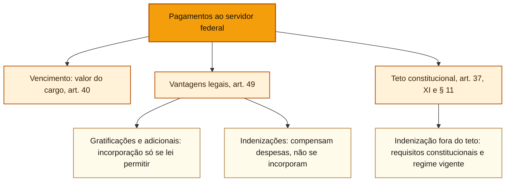
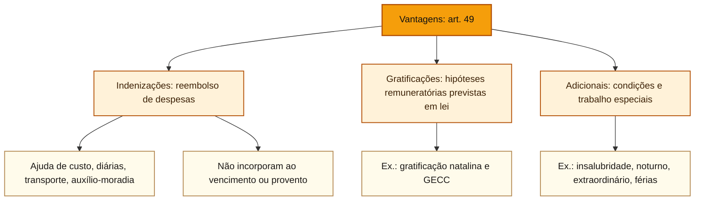
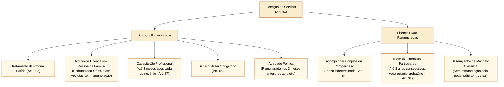

# Lei nº 8.112/1990: direitos, vantagens pecuniárias, deveres funcionais e vedações

**Imagine dois casos:** um servidor recebe seu vencimento básico, uma gratificação e diárias de viagem; outro exerce dois cargos públicos em acumulação autorizada pela Constituição. Quais valores entram na remuneração? Quais parcelas são indenizatórias? Como funciona o teto? E o que muda quando o servidor descumpre um dever?

A **Lei nº 8.112/1990**, estatuto federal dos servidores civis da União, autarquias e fundações públicas federais, disciplina **vencimento, remuneração, vantagens, férias, licenças, deveres e proibições**. O texto deve ser lido junto da **Constituição Federal, art. 37**, especialmente o teto e a acumulação remunerada. A **EC nº 135/2024** alterou o regime constitucional de exclusão de indenizações do teto; a **EC nº 138/2025** ampliou a acumulação de um cargo de professor com outro cargo de qualquer natureza.

Para a Cebraspe, o método mais seguro é identificar **a natureza da parcela**, **o fundamento legal e o marco temporal**. A mesma palavra pode gerar efeitos diferentes: *indenização* não se incorpora por força do art. 49, § 1º, mas a exclusão de parcelas do teto constitucional **depende dos requisitos do art. 37, § 11, e das decisões judiciais aplicáveis**.

---

## 1. Estrutura remuneratória: vencimento, remuneração e o teto constitucional

A estrutura de pagamentos começa com o **vencimento** do cargo e admite acréscimos legais. Saber de onde veio a parcela é mais útil do que decorar que todo pagamento é “salário”.

### 1.1 Vencimento versus remuneração

**Vencimento** é o valor básico fixado em lei para o exercício do cargo (art. 40). **Remuneração**, na definição do art. 41, é **o vencimento do cargo efetivo acrescido de vantagens pecuniárias permanentes previstas em lei**. “Vencimentos” é expressão também empregada para o conjunto de parcelas, mas, na prova, prefira distinguir pela definição legal.

O art. 41, § 3º, protege a **irredutibilidade do vencimento do cargo efetivo e das vantagens permanentes**, observadas as regras constitucionais. O § 5º garante que **nenhum servidor terá remuneração abaixo do salário mínimo**. Conforme a **Súmula Vinculante nº 16**, esse piso se verifica pelo **total da remuneração**, e não apenas pelo vencimento básico isolado.

**Exemplo:** um vencimento básico inferior ao salário mínimo não basta para declarar inconstitucionalidade se a **remuneração total considerada juridicamente** respeitar o piso. Isso não autoriza tratar como vencimento básico uma diária destinada a custear viagem.

### 1.2 Limites, descontos e teto constitucional

O **art. 37, XI, da Constituição** limita a remuneração e o subsídio de agentes públicos. **Na União**, o parâmetro geral é o **subsídio mensal dos ministros do Supremo Tribunal Federal**, observadas as situações e os limites constitucionais próprios.

**Acumulação permitida e teto:** nos **Temas 377 e 384**, o STF estabeleceu, para vínculos constitucionalmente acumuláveis, a incidência do teto **em cada vínculo isoladamente**, e não sobre uma soma automática de todas as remunerações. Primeiro verifica-se se o acúmulo é lícito; só depois se aplica essa regra.

**Indenizações e teto após a EC nº 135/2024:** o art. 37, § 11, passou a excluir do limite apenas parcelas de caráter indenizatório **expressamente previstas em lei ordinária nacional aprovada pelo Congresso**, aplicável aos Poderes e órgãos autônomos. Em **2026**, o STF adotou medidas para impedir classificações artificiais de vantagens remuneratórias como indenizatórias a fim de ultrapassar o teto. Portanto, a frase “qualquer verba chamada indenizatória está fora do teto” está incorreta. A inexistência de incorporação ao provento pelo **art. 49, § 1º**, também é questão distinta da exclusão constitucional do teto.

**Descontos e proteção da remuneração:** pelo art. 45, descontos dependem, em regra, de **imposição legal, ordem judicial ou autorização em hipóteses legais de consignação**. O art. 48 protege vencimento, remuneração e provento contra arresto, sequestro e penhora, **com exceção legal para prestação de alimentos por decisão judicial**. O art. 44 prevê perda remuneratória por falta injustificada e descontos proporcionais, com regras de compensação.

**Caso aplicado:** se o agente recebe diárias por deslocamento e também uma gratificação habitual, não se presume que ambas tenham natureza igual, incorporem-se da mesma forma ou sejam excluídas do teto apenas por estarem na folha.

---

## 2. Tipologia das vantagens pecuniárias: indenizações, gratificações e adicionais

O **art. 49 da Lei nº 8.112/1990** distingue **indenizações, gratificações e adicionais**. A finalidade da parcela determina sua regra, e a concessão deve ter **fundamento legal**. O **art. 50** impede usar vantagens pecuniárias para gerar outros aumentos sucessivos **sob o mesmo título ou fundamento**.

### 2.1 Indenizações: ressarcimento de encargos suportados pelo servidor

As **indenizações** compensam despesas relacionadas ao serviço, em vez de remunerar o trabalho. O **art. 49, § 1º** (e **não art. 51, § 1º**, inexistente na numeração vigente) determina que **não se incorporam ao vencimento ou provento para qualquer efeito**.

As quatro hipóteses enumeradas no **art. 51** são:

- **Ajuda de custo (arts. 53 a 57):** compensa instalação quando, **no interesse do serviço**, há mudança de sede com **mudança permanente de domicílio**. O valor segue o regulamento, limitado a até três meses de remuneração, e não se paga em duplicidade quando cônjuges servidores mudam para a mesma sede. Não cabe nas remoções a pedido previstas no art. 53, § 3º. Há restituição, por exemplo, se a pessoa não se apresentar injustificadamente na nova sede.
- **Diárias (arts. 58 e 59):** custeiam hospedagem, alimentação e locomoção urbana em deslocamento eventual ou transitório a serviço. Se o servidor recebe a diária e **não viaja**, restitui integralmente em **cinco dias**. A regra deve ser cotejada com situações de retorno antecipado e deslocamentos que não geram diária.
- **Transporte (art. 60):** indeniza gastos com uso de meio **próprio** de locomoção em serviços externos exigidos pelas atribuições, nas condições regulamentares. Não equivale ao auxílio-transporte cotidiano do trajeto casa-trabalho.
- **Auxílio-moradia (arts. 60-A a 60-E):** ressarcimento de despesas de moradia ou hospedagem **comprovadas**, para situações legais como determinadas nomeações em comissão em outra localidade, sujeito a condições, impedimentos e limites. A existência de imóvel funcional disponível ou de imóvel próprio pode afetar o direito.

**Dois testes separados:** indenização **não incorpora** pelo art. 49, § 1º; já sua **exclusão do teto** precisa respeitar a redação constitucional atual do art. 37, § 11. Evite afirmar de forma automática que uma parcela não sofre qualquer tributo ou contribuição sem consultar a lei específica e a natureza do valor.

**Exemplo:** servidora viaja por dois dias e retorna antecipadamente. A eventual restituição de diárias não é uma sanção disciplinar por si só: decorre do ressarcimento de despesas que não se realizaram.

### 2.2 Gratificações e adicionais: retribuição por função e condições especiais

Pelo **art. 49, § 2º**, essas vantagens **só se incorporam ao vencimento ou provento nos casos e nas condições definidos em lei**. O art. 61 reúne retribuições, gratificações e adicionais, mas não torna todas as parcelas permanentes.

- **Retribuição por direção, chefia e assessoramento (arts. 61, I, e 62):** decorre do exercício da função/cargo nas hipóteses legais; não significa incorporação automática quando terminar a designação.
- **Gratificação natalina (arts. 63 a 66):** corresponde a **1/12 da remuneração de dezembro por mês de exercício**, sendo mês integral a fração de **quinze dias ou mais**. O pagamento legal ocorre **até 20 de dezembro**.
- **Adicional por tempo de serviço:** o antigo art. 67 foi **revogado**; novas vantagens por tempo não decorrem da redação extinta, ressalvadas situações juridicamente preservadas.
- **Insalubridade e periculosidade (art. 68):** adicionais por condições de risco com base no **vencimento do cargo efetivo**. Quem preencher condições para ambos **deve optar por um**; eliminado o risco, cessa o respectivo direito. Há proteção específica para gestantes e lactantes (art. 69, parágrafo único).
- **Serviço extraordinário (arts. 73 e 74):** hora extra com acréscimo de **50%** sobre a hora normal; serviço extraordinário é autorizado para situações **excepcionais e temporárias**, respeitando o limite máximo de **duas horas por jornada**.
- **Serviço noturno (art. 75):** entre **22h e 5h**, com adicional de **25%** e hora computada como **52 minutos e 30 segundos**. Se o serviço noturno também for extraordinário, aplica-se a regra legal de cálculo.
- **Férias (art. 76):** adicional constitucional de **um terço da remuneração** correspondente ao período, pago na forma legal.
- **Gratificação por Encargo de Curso ou Concurso, GECC (art. 76-A):** atividades especiais de instrução, banca, preparação, logística ou aplicação de exames nas condições legais; **não integra vencimento ou salário para qualquer efeito** e tem limites, não sendo acréscimo livre.

**Situação de prova:** uma pessoa atua em condições insalubres e perigosas ao mesmo tempo. A lei exige escolher **um** adicional. Diferentemente, o adicional noturno pode coexistir com serviço extraordinário quando as hipóteses legais se acumularem.

---

## 3. Direitos: férias e licenças

### 3.1 Regime de férias (arts. 77 a 80)

- O servidor fará jus anualmente a **30 (trinta) dias de férias**, que podem ser acumuladas até o máximo de dois períodos no caso de comprovada necessidade do serviço;
- Para o primeiro período aquisitivo de férias serão exigidos **12 (doze) meses de efetivo exercício**;
- É facultado o parcelamento das férias em **até 3 (três) etapas**, desde que assim requerido pelo servidor e no interesse da administração pública;
- Os servidores que operam direta e permanentemente com raios X ou substâncias radioativas gozarão **obrigatoriamente 20 (vinte) dias consecutivos de férias por semestre**, sendo terminantemente vedada a acumulação (art. 79).

### 3.2 Rol das licenças da Lei nº 8.112/1990 (arts. 81 a 92)

Pontos de alta incidência nas provas Cebraspe:
- **Licença por motivo de doença em pessoa da família (art. 83):** cônjuge ou companheiro, pais, filhos, padrasto/madrasta, enteado ou dependente que viva a expensas do servidor. Exige perícia oficial. Pode ser concedida com remuneração por até 60 dias (consecutivos ou não) e, excedendo esse prazo, por até mais 90 dias **sem remuneração** dentro do período de 12 meses.
- **Licença para tratar de interesses particulares (art. 91):** ato discricionário da Administração; prazo de até 3 anos consecutivos; sem remuneração; **vedada a servidores que não tenham cumprido o estágio probatório**.

---

## 4. Deveres funcionais e vedações disciplinares

Os deveres e proibições estruturam o código ético-funcional do servidor civil federal nos arts. 116 e 117 da Lei nº 8.112/1990.

### 4.1 Deveres do servidor público (art. 116)

São 12 deveres expressos, dentre os quais destacam-se para fins de controle e prova:
- Exercer com zelo e dedicação as atribuições do cargo;
- Ser leal às instituições a que servir;
- Cumprir as ordens superiores, **exceto quando manifestamente ilegais** (art. 116, IV - dever de desobediência a ordens ilegais);
- Atender com presteza ao público, às requisições da defesa judicial do Estado e à expedição de certidões (art. 116, V);
- Levar as irregularidades de que tiver ciência em razão do cargo ao conhecimento da autoridade superior ou, quando houver suspeita de envolvimento desta, a outra autoridade competente para apuração (art. 116, VI e parágrafo único);
- Tratar com urbanidade as pessoas;
- Manter conduta compatível com a moralidade administrativa;
- Guardar sigilo sobre assunto da repartição.

### 4.2 Proibições ao servidor público (art. 117)

O art. 117 traz um rol minucioso de 19 proibições. As infrações a essas vedações graduam-se em penalidades que vão desde a advertência até a demissão:

| Dispositivo Legal | Conduta Vedada | Sanção Aplicável |
| :--- | :--- | :--- |
| **Art. 117, I a VIII e XIX** | Ausentar-se sem autorização; retirar documento sem anuência; recusar fé a documentos públicos; opor resistência injustificada; promover manifestação de apreço/desapreço; delegar competência estranha a subordinado; coagir subordinados para filiação partidária; recusar-se a atualizar dados cadastrais. | **Advertência** (art. 129) ou **Suspensão** em caso de reincidência. |
| **Art. 117, IX** | Valer-se do cargo para lograr proveito pessoal ou de outrem, em detrimento da dignidade da função pública. | **Demissão** (art. 132, XIII). |
| **Art. 117, X** | Participar de gerência ou administração de sociedade privada, personificada ou não, exercer o comércio, exceto na qualidade de **acionista, cotista ou comanditário**. | **Demissão** (art. 132, XIII). *Ressalva:* Lei nº 11.784/2008 autoriza a participação nos conselhos de administração/fiscal de empresas em que a União detenha participação. |
| **Art. 117, XI** | Atuar, como procurador ou intermediário, junto a repartições públicas, salvo quando se tratar de benefícios previdenciários ou assistenciais de **parentes até o segundo grau, e de cônjuge ou companheiro**. | **Demissão** (art. 132, XIII). |
| **Art. 117, XII** | Receber propina, comissão, presente ou vantagem de qualquer espécie, em razão de suas atribuições. | **Demissão** (art. 132, XIII). |
| **Art. 117, XIII** | Aceitar comissão, emprego ou pensão de estado estrangeiro sem autorização. | **Demissão** (art. 132, XIII). |
| **Art. 117, XIV a XVIII** | Praticar usura; proceder de forma desidiosa; cometer a pessoa estranha encargos do cargo; exercer atividades incompatíveis com o cargo e com o horário de trabalho. | **Demissão** (usura, desídia) ou **Suspensão** (conforme a gravidade). |

---

## 5. Acumulação remunerada de cargos públicos

A regra geral do art. 37, XVI, da Constituição Federal e do art. 118 da Lei nº 8.112/1990 é a **vedação à acumulação remunerada** de cargos, empregos e funções públicas na Administração direta, autárquica, fundacional, empresas públicas e sociedades de economia mista da União, dos Estados, do DF e dos Municípios.

### 5.1 As exceções constitucionais taxativas (art. 37, XVI, CF/1988)

A acumulação de dois cargos públicos só é lícita quando houver **compatibilidade de horários** comprovada e recair estritamente sobre:
1. **Dois cargos de professor;**
2. **Um cargo de professor com outro técnico ou científico** (cargo técnico é aquele que exige habilitação profissional específica de nível médio ou superior, não se enquadrando funções meramente burocráticas ou rotineiras de nível fundamental);
3. **Dois cargos ou empregos privativos de profissionais de saúde, com profissões regulamentadas.**

### 5.2 Limite semanal de jornada e a tese vinculante do STF

Por muitos anos a AGU e o TCU aplicaram o limite fixo de 60 horas semanais como barreira absoluta à acumulação, sob o argumento de que jornadas superiores comprometeriam a higidez física e a eficiência do servidor.

> **Tema 1081 da Repercussão Geral do STF:**  
> *"Assegurada a compatibilidade de horários e a ausência de prejuízo às atividades exercidas, é legítima a acumulação remunerada de cargos públicos, ainda que a soma das jornadas de trabalho supere o limite de 60 horas semanais."*

O Cebraspe exige o conhecimento pacificado do STF: **não existe limite apriorístico de 60 horas semanais** para impedir a acumulação legítima, cabendo à Administração apurar no caso concreto se há efetiva compatibilidade de horários e regularidade no cumprimento de cada jornada de trabalho.

---

## 6. Questões comentadas

*(Inédita: estilo Cebraspe / Câmara dos Deputados – Analista Legislativo)*  
**1.** Ao servidor público federal que responder cumulativamente a encargos de insalubridade e de periculosidade é assegurado o direito de perceber conjuntamente ambos os adicionais em seu contracheque, incidindo sobre o total da remuneração percebida.

> **Gabarito: ERRADO**  
> **Comentário:** Conforme o art. 68, § 1º, da Lei nº 8.112/1990, o servidor que fizer jus aos adicionais de insalubridade e de periculosidade **deverá optar por um deles**, sendo expressamente vedada a percepção cumulativa de ambos os adicionais. Ademais, tais adicionais incidem sobre o vencimento do cargo efetivo, e não sobre a remuneração global.

*(Inédita: estilo Cebraspe / Câmara dos Deputados – Analista Legislativo)*  
**2.** As indenizações previstas no estatuto do servidor público civil da União, tais como ajuda de custo, diárias e indenização de transporte, incorporam-se aos proventos de aposentadoria desde que o servidor as tenha recebido de modo contínuo por mais de cinco anos ininterruptos.

> **Gabarito: ERRADO**  
> **Comentário:** Nos termos do art. 51, § 1º, da Lei nº 8.112/1990, as indenizações **não se incorporam ao vencimento ou provento para qualquer efeito**. Trata-se de verbas compensatórias de natureza transitória que visam indenizar custos materiais da função pública, não possuindo natureza remuneratória nem integrando cálculo de proventos.

*(Inédita: estilo Cebraspe / Câmara dos Deputados – Analista Legislativo)*  
**3.** O servidor público civil da União que se encontre no cumprimento do estágio probatório não poderá usufruir da licença para tratar de interesses particulares, embora possa, preenchidos os requisitos legais, obter licença para capacitação profissional após cada quinquênio de efetivo exercício.

> **Gabarito: CERTO**  
> **Comentário:** A licença para tratar de interesses particulares (art. 91 da Lei nº 8.112/1990) é expressamente vedada a servidores que não tenham cumprido o estágio probatório ("A critério da Administração, poderão ser concedidas ao servidor ocupante de cargo efetivo, desde que não esteja em estágio probatório, licenças para o trato de assuntos particulares pelo prazo de até três anos consecutivos"). Por outro lado, a licença para capacitação (art. 87) pressupõe o decurso de 5 anos de exercício, momento em que o servidor já ultrapassou o estágio probatório de 3 anos.

*(Inédita: estilo Cebraspe / Câmara dos Deputados – Analista Legislativo)*  
**4.** É lícita a participação de servidor público federal como acionista, cotista ou comanditário em sociedade empresária mercantil, sendo-lhe, contudo, proibido participar da gerência ou administração de sociedade privada personificada ou não, sob pena de demissão.

> **Gabarito: CERTO**  
> **Comentário:** Assertiva em conformidade com o art. 117, X, da Lei nº 8.112/1990, que veda participar de gerência ou administração de sociedade privada, personificada ou não, mas ressalva expressamente a qualidade de "acionista, cotista ou comanditário". O descumprimento dessa vedação sujeita o infrator à pena capital de **demissão**, nos termos do art. 132, XIII.

*(Inédita: estilo Cebraspe / Câmara dos Deputados – Analista Legislativo)*  
**5.** Segundo o entendimento fixado pelo Supremo Tribunal Federal em regime de repercussão geral, é ilegítima a acumulação remunerada de dois cargos públicos da área da saúde quando a jornada semanal total dos dois vínculos somar mais de sessenta horas, tendo em vista a presunção absoluta de fadiga e prejuízo à qualidade do serviço prestado.

> **Gabarito: ERRADO**  
> **Comentário:** O STF fixou a tese de Repercussão Geral no Tema 1081: "Assegurada a compatibilidade de horários e a ausência de prejuízo às atividades exercidas, é legítima a acumulação remunerada de cargos públicos, ainda que a soma das jornadas de trabalho supere o limite de 60 horas semanais." Não há presunção absoluta baseada em limite fixo; o critério jurídico vinculante é a averiguação concreta da compatibilidade fática de horários.

*(Inédita: estilo Cebraspe / Câmara dos Deputados – Analista Legislativo)*  
**6.** A atuação de servidor público federal como procurador perante repartições públicas é proibida pela Lei nº 8.112/1990, ressalvada a representação legal referente a benefícios previdenciários ou assistenciais de parentes até o segundo grau civil, e de cônjuge ou companheiro.

> **Gabarito: CERTO**  
> **Comentário:** Literalidade do art. 117, XI, da Lei nº 8.112/1990: é proibido "atuar, como procurador ou intermediário, junto a repartições públicas, salvo quando se tratar de benefícios previdenciários ou assistenciais de parentes até o segundo grau, e de cônjuge ou companheiro". A violação fora dessa ressalva legal também enseja demissão (art. 132, XIII).
