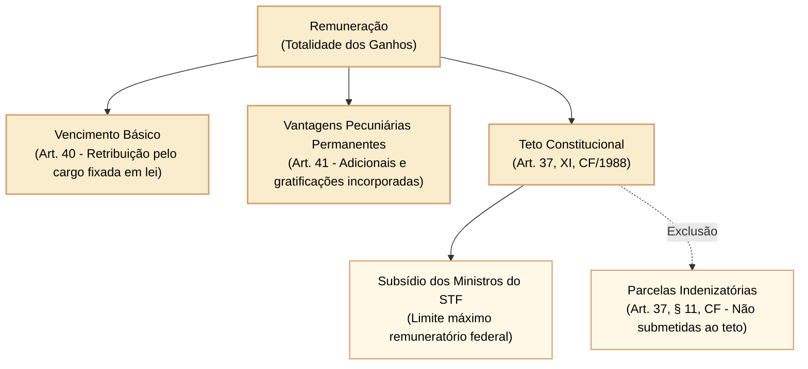
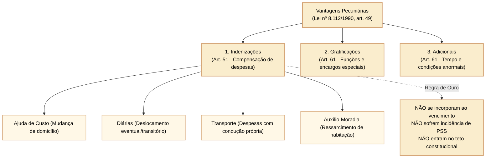
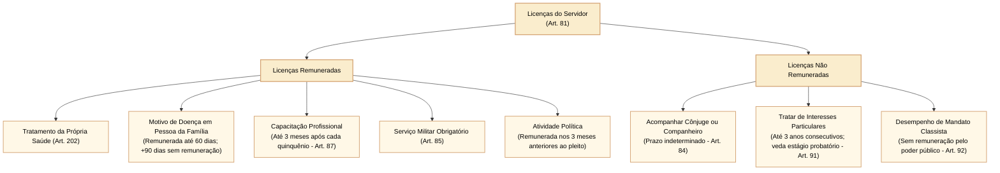

# Lei nº 8.112/1990: direitos, vantagens pecuniárias, deveres funcionais e vedações

O estatuto dos servidores públicos civis da União (Lei nº 8.112/1990) estabelece uma estrutura minuciosa de contraprestações pecuniárias, garantias institucionais, licenças, deveres de conduta e proibições funcionais. Nas provas de concursos públicos formuladas pelo Cebraspe para carreiras legislativas, a distinção entre a natureza jurídica das vantagens (indenizações, gratificações e adicionais), a incidência do teto remuneratório constitucional, as hipóteses restritas de acumulação remunerada e as vedações ético-disciplinares constituem tópicos de alta frequência e com armadilhas recorrentes baseadas na literalidade do texto legal e na jurisprudência vinculante do Supremo Tribunal Federal (STF).

---

## 1. Estrutura remuneratória: vencimento, remuneração e o teto constitucional

A Lei nº 8.112/1990, em seus arts. 40 a 48, estabelece a exata diferenciação dogmática entre as parcelas que compõem os estipêndios dos servidores públicos:

### 1.1 Vencimento versus remuneração

1. **Vencimento (no singular):** é a retribuição pecuniária básica devida ao servidor público pelo efetivo exercício do cargo público, com valor fixado em lei formal (art. 40). É irredutível, respeitado o disposto na Constituição Federal.
2. **Remuneração (ou vencimentos no plural):** é o vencimento do cargo efetivo acrescido das vantagens pecuniárias permanentes estabelecidas em lei (art. 41).
   - O vencimento do cargo efetivo, acrescido das vantagens de caráter permanente, é irredutível (art. 41, § 3º);
   - Nenhum servidor receberá remuneração inferior ao salário mínimo (art. 41, § 5º; Súmula Vinculante nº 16 do STF: a garantia de remuneração não inferior ao salário mínimo diz respeito ao **total da remuneração percebida**, e não exclusivamente ao vencimento básico).

### 1.2 Limites, descontos e teto constitucional

- **Teto remuneratório (art. 37, XI, CF/1988):** a remuneração e o subsídio dos ocupantes de cargos, funções e empregos públicos da administração direta, autárquica e fundacional da União não poderão exceder o subsídio mensal, em espécie, dos **Ministros do Supremo Tribunal Federal**.
- **Acumulação legítima e o teto (Temas 377 e 384 do STF):** nos casos de acumulação constitucionalmente permitida de cargos, empregos ou funções públicas (ex.: dois cargos de professor, ou um de professor com outro técnico/científico, ou dois de profissionais de saúde), o teto remuneratório constitucional deve incidir **isoladamente sobre a remuneração de cada um dos vínculos**, e não sobre a soma dos proventos percebidos pelo servidor.
- **Consignações e descontos:** mediante expressa autorização do servidor, poderá haver consignação em folha de pagamento em favor de terceiros, a critério da administração e respeitada a margem consignável fixada em regulamento (art. 45). O vencimento e a remuneração não estão sujeitos a penhora, sequestro ou arresto, exceto nos casos de **prestação de alimentos resultante de decisão judicial** (art. 48).

---

## 2. Tipologia das vantagens pecuniárias: indenizações, gratificações e adicionais

Além do vencimento básico, o servidor poderá receber vantagens pecuniárias classificadas em três categorias ontológicas distintas (art. 49):

### 2.1 Indenizações: ressarcimento de encargos suportados pelo servidor

As indenizações destinam-se a compensar despesas econômicas suportadas pelo servidor em razão do serviço público. Por expressa disposição do art. 51, § 1º, **as indenizações não se incorporam ao vencimento ou provento para qualquer efeito**, não sofrem incidência de contribuição previdenciária e não estão sujeitas ao abate-teto (art. 37, § 11, CF).

O rol legal taxativo de indenizações compreende:
1. **Ajuda de custo (arts. 53 a 57):** destina-se a compensar as despesas de instalação do servidor que, no interesse do serviço, passar a ter exercício em nova sede, com mudança de domicílio em caráter permanente. É vedado o duplo pagamento caso o cônjuge também seja servidor e passe a ter exercício na mesma sede. Se o servidor não se apresentar na nova sede no prazo legal, deverá restituir a ajuda de custo integralmente;
2. **Diárias (arts. 58 e 59):** devidas ao servidor que, a serviço, afastar-se da sede em caráter eventual ou transitório para outro ponto do território nacional ou para o exterior, destinando-se a cobrir despesas de pousada, alimentação e locomoção urbana.
   - Não são devidas quando o deslocamento constituir exigência permanente do cargo ou quando o deslocamento ocorrer dentro da mesma região metropolitana (salvo pernoite comprovado);
   - O servidor que receber diárias e não se afastar da sede por qualquer motivo é obrigado a restituí-las integralmente no prazo de 5 (cinco) dias;
3. **Indenização de transporte (art. 60):** devida ao servidor que realizar despesas com a utilização de meio próprio de locomoção para a execução de serviços externos por força das atribuições do cargo;
4. **Auxílio-moradia (arts. 60-A a 60-E):** ressarcimento de despesas comprovadamente realizadas pelo servidor com moradia ou hospedagem quando não houver imóvel funcional disponível, observados os rigorosos requisitos legais (não possuir imóvel no local, deslocamento para ocupar cargo em comissão ou função de confiança de nível superior).

### 2.2 Gratificações e adicionais: retribuição por função e condições especiais

Ao contrário das indenizações, as gratificações e os adicionais incorporam-se ao vencimento ou provento apenas **nos casos e condições expressamente indicados em lei** (art. 49, § 2º).

O art. 61 enumera as seguintes modalidades:
- **Retribuição pelo exercício de função de direção, chefia e assessoramento (cargo em comissão ou função comissionada);**
- **Gratificação natalina (13º salário):** devida anualmente no mês de dezembro, correspondente a 1/12 da remuneração a que fizer jus o servidor por mês de exercício no ano correspondente;
- **Adicional por tempo de serviço (antigo quinquênio/anuênio):** revogado na esfera federal pela MP nº 2.225-45/2001, respeitadas as situações consolidadas sob a égide anterior;
- **Adicional pelo exercício de atividades insalubres, perigosas ou penosas (arts. 68 a 72):**
  - O servidor que fizer jus aos adicionais de insalubridade e de periculosidade **deverá optar por um deles** (vedada a percepção cumulativa, art. 68, § 1º);
  - A servidora gestante ou lactante será afastada, enquanto durar a gestação e a lactação, das operações e locais insalubres ou perigosos, exercendo suas atividades em local salubre;
- **Adicional de serviço extraordinário (art. 73):** remuneração superior em, no mínimo, 50% (cinquenta por cento) em relação à hora normal de trabalho, limitada a 2 (duas) horas por jornada, salvo situações excepcionais;
- **Adicional noturno (art. 75):** devido pelo trabalho prestado em horário compreendido entre **22 (vinte e duas) horas de um dia e 5 (cinco) horas do dia seguinte**, com remuneração da hora acrescida de **25% (vinte e cinco por cento)**, computando-se cada hora como de 52 (cinquenta e dois) minutos e 30 (trinta) segundos;
- **Adicional de férias (1/3 constitucional):** pago por ocasião das férias, correspondente a um terço da remuneração do período;
- **Gratificação por Encargo de Curso ou Concurso (GECC - art. 76-A):** devida ao servidor que atuar como instrutor em curso de formação, membro de banca examinadora de concurso, logística ou aplicação de provas, não se incorporando para qualquer efeito e submetida a limites anuais de horas.

---

## 3. Direitos: férias e licenças

### 3.1 Regime de férias (arts. 77 a 80)

- O servidor fará jus anualmente a **30 (trinta) dias de férias**, que podem ser acumuladas até o máximo de dois períodos no caso de comprovada necessidade do serviço;
- Para o primeiro período aquisitivo de férias serão exigidos **12 (doze) meses de efetivo exercício**;
- É facultado o parcelamento das férias em **até 3 (três) etapas**, desde que assim requerido pelo servidor e no interesse da administração pública;
- Os servidores que operam direta e permanentemente com raios X ou substâncias radioativas gozarão **obrigatoriamente 20 (vinte) dias consecutivos de férias por semestre**, sendo terminantemente vedada a acumulação (art. 79).

### 3.2 Rol das licenças da Lei nº 8.112/1990 (arts. 81 a 92)

Pontos de alta incidência nas provas Cebraspe:
- **Licença por motivo de doença em pessoa da família (art. 83):** cônjuge ou companheiro, pais, filhos, padrasto/madrasta, enteado ou dependente que viva a expensas do servidor. Exige perícia oficial. Pode ser concedida com remuneração por até 60 dias (consecutivos ou não) e, excedendo esse prazo, por até mais 90 dias **sem remuneração** dentro do período de 12 meses.
- **Licença para tratar de interesses particulares (art. 91):** ato discricionário da Administração; prazo de até 3 anos consecutivos; sem remuneração; **vedada a servidores que não tenham cumprido o estágio probatório**.

---

## 4. Deveres funcionais e vedações disciplinares

Os deveres e proibições estruturam o código ético-funcional do servidor civil federal nos arts. 116 e 117 da Lei nº 8.112/1990.

### 4.1 Deveres do servidor público (art. 116)

São 12 deveres expressos, dentre os quais destacam-se para fins de controle e prova:
- Exercer com zelo e dedicação as atribuições do cargo;
- Ser leal às instituições a que servir;
- Cumprir as ordens superiores, **exceto quando manifestamente ilegais** (art. 116, IV - dever de desobediência a ordens ilegais);
- Atender com presteza ao público, às requisições da defesa judicial do Estado e à expedição de certidões (art. 116, V);
- Levar as irregularidades de que tiver ciência em razão do cargo ao conhecimento da autoridade superior ou, quando houver suspeita de envolvimento desta, a outra autoridade competente para apuração (art. 116, VI e parágrafo único);
- Tratar com urbanidade as pessoas;
- Manter conduta compatível com a moralidade administrativa;
- Guardar sigilo sobre assunto da repartição.

### 4.2 Proibições ao servidor público (art. 117)

O art. 117 traz um rol minucioso de 19 proibições. As infrações a essas vedações graduam-se em penalidades que vão desde a advertência até a demissão:

| Dispositivo Legal | Conduta Vedada | Sanção Aplicável |
| :--- | :--- | :--- |
| **Art. 117, I a VIII e XIX** | Ausentar-se sem autorização; retirar documento sem anuência; recusar fé a documentos públicos; opor resistência injustificada; promover manifestação de apreço/desapreço; delegar competência estranha a subordinado; coagir subordinados para filiação partidária; recusar-se a atualizar dados cadastrais. | **Advertência** (art. 129) ou **Suspensão** em caso de reincidência. |
| **Art. 117, IX** | Valer-se do cargo para lograr proveito pessoal ou de outrem, em detrimento da dignidade da função pública. | **Demissão** (art. 132, XIII). |
| **Art. 117, X** | Participar de gerência ou administração de sociedade privada, personificada ou não, exercer o comércio, exceto na qualidade de **acionista, cotista ou comanditário**. | **Demissão** (art. 132, XIII). *Ressalva:* Lei nº 11.784/2008 autoriza a participação nos conselhos de administração/fiscal de empresas em que a União detenha participação. |
| **Art. 117, XI** | Atuar, como procurador ou intermediário, junto a repartições públicas, salvo quando se tratar de benefícios previdenciários ou assistenciais de **parentes até o segundo grau, e de cônjuge ou companheiro**. | **Demissão** (art. 132, XIII). |
| **Art. 117, XII** | Receber propina, comissão, presente ou vantagem de qualquer espécie, em razão de suas atribuições. | **Demissão** (art. 132, XIII). |
| **Art. 117, XIII** | Aceitar comissão, emprego ou pensão de estado estrangeiro sem autorização. | **Demissão** (art. 132, XIII). |
| **Art. 117, XIV a XVIII** | Praticar usura; proceder de forma desidiosa; cometer a pessoa estranha encargos do cargo; exercer atividades incompatíveis com o cargo e com o horário de trabalho. | **Demissão** (usura, desídia) ou **Suspensão** (conforme a gravidade). |

---

## 5. Acumulação remunerada de cargos públicos

A regra geral do art. 37, XVI, da Constituição Federal e do art. 118 da Lei nº 8.112/1990 é a **vedação à acumulação remunerada** de cargos, empregos e funções públicas na Administração direta, autárquica, fundacional, empresas públicas e sociedades de economia mista da União, dos Estados, do DF e dos Municípios.

### 5.1 As exceções constitucionais taxativas (art. 37, XVI, CF/1988)

A acumulação de dois cargos públicos só é lícita quando houver **compatibilidade de horários** comprovada e recair estritamente sobre:
1. **Dois cargos de professor;**
2. **Um cargo de professor com outro técnico ou científico** (cargo técnico é aquele que exige habilitação profissional específica de nível médio ou superior, não se enquadrando funções meramente burocráticas ou rotineiras de nível fundamental);
3. **Dois cargos ou empregos privativos de profissionais de saúde, com profissões regulamentadas.**

### 5.2 Limite semanal de jornada e a tese vinculante do STF

Por muitos anos a AGU e o TCU aplicaram o limite fixo de 60 horas semanais como barreira absoluta à acumulação, sob o argumento de que jornadas superiores comprometeriam a higidez física e a eficiência do servidor.

> **Tema 1081 da Repercussão Geral do STF:**  
> *"Assegurada a compatibilidade de horários e a ausência de prejuízo às atividades exercidas, é legítima a acumulação remunerada de cargos públicos, ainda que a soma das jornadas de trabalho supere o limite de 60 horas semanais."*

O Cebraspe exige o conhecimento pacificado do STF: **não existe limite apriorístico de 60 horas semanais** para impedir a acumulação legítima, cabendo à Administração apurar no caso concreto se há efetiva compatibilidade de horários e regularidade no cumprimento de cada jornada de trabalho.

---

## 6. Questões comentadas

*(Inédita: estilo Cebraspe / Câmara dos Deputados – Analista Legislativo)*  
**1.** Ao servidor público federal que responder cumulativamente a encargos de insalubridade e de periculosidade é assegurado o direito de perceber conjuntamente ambos os adicionais em seu contracheque, incidindo sobre o total da remuneração percebida.

> **Gabarito: ERRADO**  
> **Comentário:** Conforme o art. 68, § 1º, da Lei nº 8.112/1990, o servidor que fizer jus aos adicionais de insalubridade e de periculosidade **deverá optar por um deles**, sendo expressamente vedada a percepção cumulativa de ambos os adicionais. Ademais, tais adicionais incidem sobre o vencimento do cargo efetivo, e não sobre a remuneração global.

*(Inédita: estilo Cebraspe / Câmara dos Deputados – Analista Legislativo)*  
**2.** As indenizações previstas no estatuto do servidor público civil da União, tais como ajuda de custo, diárias e indenização de transporte, incorporam-se aos proventos de aposentadoria desde que o servidor as tenha recebido de modo contínuo por mais de cinco anos ininterruptos.

> **Gabarito: ERRADO**  
> **Comentário:** Nos termos do art. 51, § 1º, da Lei nº 8.112/1990, as indenizações **não se incorporam ao vencimento ou provento para qualquer efeito**. Trata-se de verbas compensatórias de natureza transitória que visam indenizar custos materiais da função pública, não possuindo natureza remuneratória nem integrando cálculo de proventos.

*(Inédita: estilo Cebraspe / Câmara dos Deputados – Analista Legislativo)*  
**3.** O servidor público civil da União que se encontre no cumprimento do estágio probatório não poderá usufruir da licença para tratar de interesses particulares, embora possa, preenchidos os requisitos legais, obter licença para capacitação profissional após cada quinquênio de efetivo exercício.

> **Gabarito: CERTO**  
> **Comentário:** A licença para tratar de interesses particulares (art. 91 da Lei nº 8.112/1990) é expressamente vedada a servidores que não tenham cumprido o estágio probatório ("A critério da Administração, poderão ser concedidas ao servidor ocupante de cargo efetivo, desde que não esteja em estágio probatório, licenças para o trato de assuntos particulares pelo prazo de até três anos consecutivos"). Por outro lado, a licença para capacitação (art. 87) pressupõe o decurso de 5 anos de exercício, momento em que o servidor já ultrapassou o estágio probatório de 3 anos.

*(Inédita: estilo Cebraspe / Câmara dos Deputados – Analista Legislativo)*  
**4.** É lícita a participação de servidor público federal como acionista, cotista ou comanditário em sociedade empresária mercantil, sendo-lhe, contudo, proibido participar da gerência ou administração de sociedade privada personificada ou não, sob pena de demissão.

> **Gabarito: CERTO**  
> **Comentário:** Assertiva em conformidade com o art. 117, X, da Lei nº 8.112/1990, que veda participar de gerência ou administração de sociedade privada, personificada ou não, mas ressalva expressamente a qualidade de "acionista, cotista ou comanditário". O descumprimento dessa vedação sujeita o infrator à pena capital de **demissão**, nos termos do art. 132, XIII.

*(Inédita: estilo Cebraspe / Câmara dos Deputados – Analista Legislativo)*  
**5.** Segundo o entendimento fixado pelo Supremo Tribunal Federal em regime de repercussão geral, é ilegítima a acumulação remunerada de dois cargos públicos da área da saúde quando a jornada semanal total dos dois vínculos somar mais de sessenta horas, tendo em vista a presunção absoluta de fadiga e prejuízo à qualidade do serviço prestado.

> **Gabarito: ERRADO**  
> **Comentário:** O STF fixou a tese de Repercussão Geral no Tema 1081: "Assegurada a compatibilidade de horários e a ausência de prejuízo às atividades exercidas, é legítima a acumulação remunerada de cargos públicos, ainda que a soma das jornadas de trabalho supere o limite de 60 horas semanais." Não há presunção absoluta baseada em limite fixo; o critério jurídico vinculante é a averiguação concreta da compatibilidade fática de horários.

*(Inédita: estilo Cebraspe / Câmara dos Deputados – Analista Legislativo)*  
**6.** A atuação de servidor público federal como procurador perante repartições públicas é proibida pela Lei nº 8.112/1990, ressalvada a representação legal referente a benefícios previdenciários ou assistenciais de parentes até o segundo grau civil, e de cônjuge ou companheiro.

> **Gabarito: CERTO**  
> **Comentário:** Literalidade do art. 117, XI, da Lei nº 8.112/1990: é proibido "atuar, como procurador ou intermediário, junto a repartições públicas, salvo quando se tratar de benefícios previdenciários ou assistenciais de parentes até o segundo grau, e de cônjuge ou companheiro". A violação fora dessa ressalva legal também enseja demissão (art. 132, XIII).
