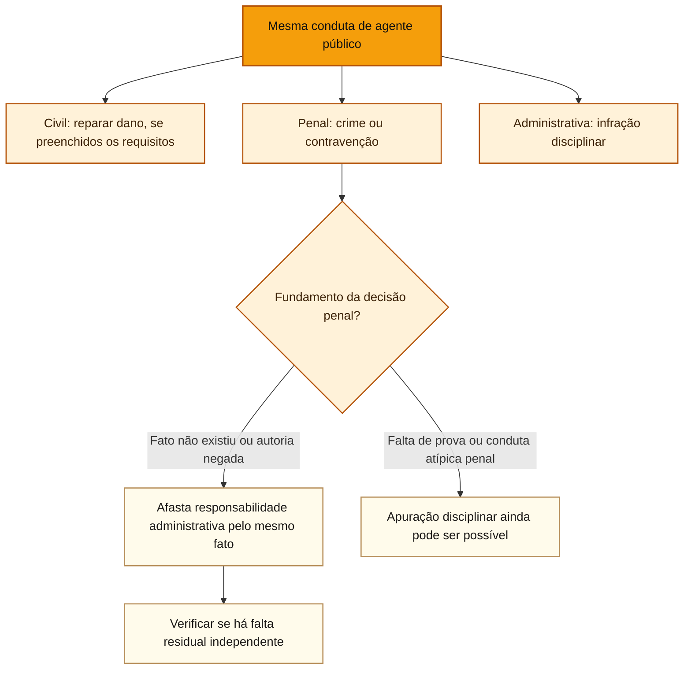
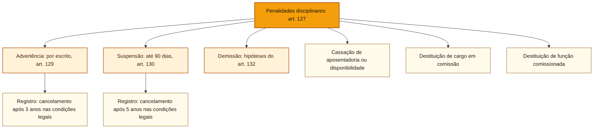
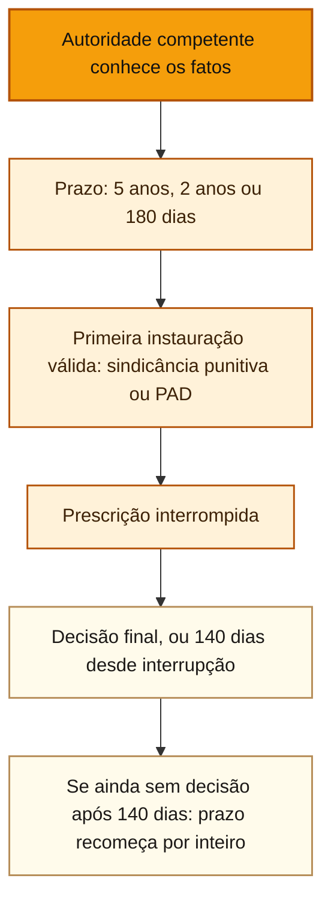

# Lei nº 8.112/1990: responsabilidades e penalidades disciplinares

**Caso para entender o tema:** um servidor usa indevidamente informações de seu órgão. A conduta pode causar **dano financeiro**, constituir **crime** e violar um **dever funcional**. Cada consequência tem requisitos próprios e pode ser examinada em procedimento diferente. Se houver absolvição criminal, é indispensável descobrir **o fundamento** antes de concluir se a Administração pode continuar apurando.

A **Lei nº 8.112/1990**, estatuto dos servidores civis da União, autarquias e fundações públicas federais, distingue as responsabilidades **civil, penal e administrativa** (arts. 121 a 126-A) e estabelece **seis espécies de penalidades disciplinares** (arts. 127 a 142). A **Cebraspe** costuma trocar a causa da absolvição, o prazo de prescrição, a autoridade que decide ou a diferença entre **abandono de cargo e inassiduidade habitual**.

**Roteiro:** identificar o fato e os envolvidos → verificar se há dano, crime e infração estatutária → assegurar procedimento e defesa → escolher a penalidade conforme a lei → conferir competência para aplicação e prescrição. É um **mapa de análise**, não um rito processual único; os ritos de sindicância e processo administrativo disciplinar (PAD) são detalhados no artigo 24.

---

## 1. Responsabilidade tríplice do servidor: independência e comunicabilidade das instâncias

**Três esferas** podem tratar da mesma conduta. O **art. 121** diz que o servidor responde civil, penal e administrativamente pelo exercício irregular de suas atribuições; o **art. 125** permite que as consequências se acumulem, respeitados os pressupostos de cada responsabilidade.

### 1.1 Natureza e características de cada modalidade de responsabilidade

**Civil (art. 122):** surge quando um ato ou omissão **doloso ou culposo** causa prejuízo ao erário ou a terceiro. **Dolo** é intenção juridicamente relevante; **culpa**, em sentido amplo, pode decorrer de negligência, imprudência ou imperícia. É preciso identificar conduta, dano e nexo causal, sem presumir indenização em qualquer erro administrativo.

**Dano ao erário:** o Estado pode buscar o ressarcimento na forma legal. A dívida reparatória pode ser exigida dos **sucessores**, mas somente até o **limite da herança recebida** (art. 122, § 3º). O artigo não torna herdeiros pessoalmente responsáveis por valores superiores à herança.

**Dano a terceiros:** o art. 37, § 6º, da Constituição estabelece a responsabilidade do Estado perante a vítima, com possibilidade de **ação regressiva** contra o agente quando houver dolo ou culpa. No **Tema 940 do STF**, a ação de reparação por dano de agente público nessa qualidade deve ser dirigida contra a pessoa jurídica responsável, não diretamente contra o servidor; a possibilidade de regresso é distinta da ação da vítima.

**Penal (art. 123):** responde por **crimes e contravenções** atribuídos ao agente nessa qualidade, mediante persecução e decisão dos órgãos competentes, segundo regras penais e processuais penais. Uma infração estatutária **não é necessariamente crime**, e um crime pode gerar consequência disciplinar quando previsto.

**Administrativa (art. 124):** exige ato ou omissão ligado ao desempenho do cargo ou função que infrinja norma funcional. É analisada no âmbito disciplinar, com **contraditório e ampla defesa**. Uma investigação penal não substitui o enquadramento e a apuração necessários à sanção administrativa.

**Exemplo:** servidor divulga informação protegida. Poderá haver dever de reparação se houver dano, tipificação penal se preencher a lei criminal e apuração funcional se violar dever de sigilo. Para marcar C/E, não se pode presumir automaticamente as três condenações apenas porque a conduta ocorreu.

### 1.2 Regra de ouro da comunicabilidade das instâncias: o art. 126 da Lei nº 8.112/1990

**Independência das instâncias:** o art. 125 permite que **responsabilidades e sanções coexistam**; não exige aguardar, em todo caso, o fim do processo criminal para iniciar o PAD.

**Exceção do art. 126:** a **absolvição criminal** afasta a responsabilidade administrativa **pelo mesmo fato** quando a decisão penal reconhecer categoricamente **que o fato não existiu** ou **que o servidor não foi o autor**. Não se deve confundir **prova de que a pessoa não praticou o fato** com **ausência de prova suficiente para condená-la**.

| Resultado no processo penal | Efeito típico na esfera disciplinar pelo mesmo fato |
| --- | --- |
| **Reconhecimento de inexistência do fato** | Afasta a imputação administrativa baseada nesse fato |
| **Reconhecimento de negativa de autoria** | Afasta a imputação administrativa àquela pessoa pelo fato |
| **Insuficiência de provas para condenação** | Não afasta automaticamente o PAD, que precisa de provas próprias |
| **Fato não constitui crime (atipicidade penal)** | Pode permanecer infração funcional, se houver previsão e prova |
| **Prescrição penal ou arquivamento de investigação** | Não apaga automaticamente a infração disciplinar; examinar prescrição administrativa e possíveis regras do art. 142, § 2º |

**Falta residual (Súmula 18 do STF):** mesmo diante de absolvição penal, pode existir **outra infração disciplinar independente** que a decisão criminal não examinou nem excluiu. É errado deduzir que toda absolvição impede qualquer sanção ou, no sentido oposto, que a Administração sempre pode desconsiderar a decisão que provou inexistência do fato ou negativa de autoria.

**Exemplo:** servidor é absolvido porque a Justiça reconheceu que **não foi ele quem divulgou** um documento. A Administração não pode puni-lo como autor dessa mesma divulgação. Contudo, se houver uma falta independente, demonstrada em outro comportamento não afastado pela decisão, ela exige apuração própria. Se o servidor foi absolvido apenas por **dúvida**, a apuração disciplinar não se encerra automaticamente.

**Art. 126-A: comunicação de irregularidades.** A Lei nº 8.112 protege o servidor que comunica à chefia ou, quando ela estiver envolvida, a outra autoridade competente a informação sobre **crimes ou improbidade** de que teve conhecimento. A comunicação nos termos legais não gera, por si, responsabilidade civil, penal ou administrativa. **Essa proteção não é autorização para praticar crime, inventar fatos ou divulgar dados sigilosos fora dos canais legais.**

**Consequência funcional de decisão penal:** se uma penalidade administrativa for afastada em razão do art. 126, os efeitos sobre o vínculo devem ser formalizados no procedimento próprio. Caso uma **demissão seja invalidada** e o servidor seja estável, pode haver **reintegração** conforme o **art. 28**; **não se deve desenhar reintegração como efeito automático de toda absolvição penal**.

Fontes: [Lei nº 8.112/1990, arts. 121 a 126-A](https://www2.camara.leg.br/legin/fed/lei/1990/lei-8112-11-dezembro-1990-322161-normaatualizada-pl.html); [Súmula 18 do STF](https://portal.stf.jus.br/jurisprudencia/sumariosumulas.asp?base=30&sumula=2576); [Constituição, art. 37, § 6º](https://www2.camara.leg.br/atividade-legislativa/legislacao/constituicao1988).

---

## 2. Quadro analítico das penalidades disciplinares

O **art. 127** enumera **seis espécies**: **advertência, suspensão, demissão, cassação de aposentadoria ou disponibilidade, destituição de cargo em comissão e destituição de função comissionada**. O **art. 128** exige considerar natureza e gravidade da infração, dano ao serviço, circunstâncias agravantes/atenuantes e antecedentes, mas essa avaliação **não autoriza trocar livremente uma penalidade legalmente vinculada por outra**.

A decisão disciplinar precisa mencionar **a causa e o fundamento jurídico** (art. 128, parágrafo único). **Demissão** é pena; **exoneração** é saída do cargo **sem caráter punitivo**. **Suspensão** é sanção, distinta de **afastamento preventivo** para proteger a investigação (art. 147).

### 2.1 Advertência (art. 129)

A advertência é **sempre escrita**. Incide, como regra, sobre infrações aos **incisos I a VIII e XIX do art. 117** e sobre violação de dever funcional de lei, regulamento ou norma interna que não justifique sanção mais grave.

**Exemplo:** um servidor pratica falta sujeita à advertência, comprovada em procedimento regular. A chefia não pode substituir o processo e a sanção escrita por uma “advertência verbal disciplinar” como se isso tivesse o mesmo efeito legal.

**Cancelamento do registro (art. 131):** após **três anos de efetivo exercício**, sem nova infração disciplinar no período, o registro pode ser cancelado. **O cancelamento vale para o futuro**, não apaga retroativamente a ocorrência nem devolve automaticamente qualquer valor.

### 2.2 Suspensão (art. 130)

A suspensão é prevista para **reincidência de faltas punidas com advertência** e outras infrações que não estejam legalmente sujeitas à demissão. Seu limite é **90 dias**.

**Hipótese especial:** recusar-se **injustificadamente** a realizar inspeção médica determinada por autoridade competente pode gerar suspensão de **até 15 dias**. Os **efeitos da penalidade cessam quando a determinação for cumprida** (art. 130, § 1º). Não é correto afirmar que a sanção de 15 dias deve ser necessariamente executada até o fim.

**Conversão em multa:** se houver conveniência para o serviço, o art. 130, § 2º, permite converter a suspensão em multa equivalente a **50% por dia de vencimento ou remuneração**, **mantendo o servidor trabalhando**. Essa conversão não transforma suspensão em uma nova modalidade de advertência.

**Cancelamento do registro:** pode ocorrer após **cinco anos de efetivo exercício** sem nova infração disciplinar; **não tem efeitos retroativos** (art. 131). O prazo de cancelamento do registro **não é** o prazo prescricional de dois anos para aplicar a sanção.

### 2.3 Demissão (art. 132)

O art. 132 estabelece as hipóteses legais de **demissão**, a pena expulsiva do cargo efetivo, após apuração com defesa. Para fins de prova, é útil ler as treze categorias como grupos de conduta e **associar cada uma ao inciso certo**:

| Inciso do art. 132 | Conduta |
| --- | --- |
| **I** | Crime contra a Administração Pública |
| **II** | Abandono de cargo |
| **III** | Inassiduidade habitual |
| **IV** | Improbidade administrativa |
| **V, VI, VII** | Incontinência pública/conduta escandalosa na repartição; insubordinação grave em serviço; ofensa física em serviço, ressalvada legítima defesa |
| **VIII a XI** | Aplicação irregular de dinheiro público; revelação de segredo obtido pelo cargo; lesão ao erário/dilapidação patrimonial; corrupção |
| **XII** | Acumulação ilegal de cargos, empregos ou funções, observadas **boa-fé e má-fé** do procedimento especial |
| **XIII** | Transgressões dos **incisos IX a XVI do art. 117** |

**Não confundir gravidade com enquadramento.** O art. 117 contém dezenove proibições, mas o **art. 132, XIII**, remete **apenas aos incisos IX a XVI**. Já **I a VIII e XIX** se vinculam, em regra, à advertência (art. 129) e **XVII e XVIII** podem ensejar suspensão (art. 130), conforme os fatos e o enquadramento legal.

**Abandono (arts. 132, II, e 138):** exige **ausência intencional por mais de 30 dias consecutivos**. Não bastam trinta dias exatos; a lei usa a expressão “mais de trinta”. Também é preciso examinar a **intencionalidade** do abandono, e não apenas somar ausências.

**Inassiduidade habitual (arts. 132, III, e 139):** corresponde a **60 dias de faltas injustificadas**, **intercalados**, dentro de **12 meses**. A diferença principal é: abandono exige sequência e intenção; inassiduidade corresponde à soma legal de dias não consecutivos sem justa causa. O **art. 140** prevê procedimento **sumário** para as duas hipóteses, com apuração e defesa.

**Acumulação ilegal (arts. 132, XII, e 133):** identificar dois vínculos aparentemente incompatíveis **não equivale a demitir automaticamente**. A lei exige uma sequência:
1. A autoridade notifica o servidor para **optar em dez dias improrrogáveis** após a ciência.
2. Se não houver opção, instaura-se **procedimento sumário** com comissão de **dois servidores estáveis**, indicando os vínculos e horários.
3. O servidor tem **cinco dias para defesa escrita** após a indiciação.
4. A **opção até o último dia para defesa** configura, nos termos do § 5º, **boa-fé**, com conversão em pedido de exoneração do outro cargo.
5. **Acumulação ilegal e má-fé comprovada** podem levar à demissão, destituição ou cassação na forma do § 6º.

**Exemplo:** servidor percebe que seus cargos não são constitucionalmente acumuláveis e opta durante o prazo de defesa do procedimento sumário. Segundo o art. 133, § 5º, a opção configura **boa-fé**. A banca erra se disser que toda acumulação ilegal necessariamente produz demissão sem oportunidade de escolha.

**Improbidade (inciso IV):** é preciso distinguir a **infração disciplinar** da **ação judicial de improbidade da Lei nº 8.429/1992**. As duas têm procedimentos e exigências próprias; não se deve concluir que todo ato irregular automaticamente configura improbidade judicial ou justificar perda do cargo com base apenas no rótulo.

### 2.4 Efeitos da demissão: incompatibilidade temporária e controle de constitucionalidade

O **art. 137, caput**, prevê **cinco anos de incompatibilidade para nova investidura federal** após demissão ou destituição de cargo em comissão por transgressão do **art. 117, IX ou XI**.

O antigo **parágrafo único** proibia **perpetuamente** o retorno de demitidos por certas faltas graves do **art. 132, I, IV, VIII, X e XI**, como corrupção ou improbidade. O **STF, na ADI 2.975**, declarou essa proibição perpétua **inconstitucional**. Nos embargos de declaração publicados em **2023**, esclareceu que, **até nova lei**, deve ser aplicado **o prazo de cinco anos do caput** também às hipóteses antes mencionadas no parágrafo único.

**Duas consequências diferentes:** a demissão extingue o vínculo; a **incompatibilidade** do art. 137 limita eventual nova investidura federal. Não se pode converter a restrição de cinco anos em “pena de caráter vitalício”, nem supor que o prazo seja perdão automático do motivo da demissão.

**Art. 136:** demissão ou destituição por certas infrações graves (incisos IV, VIII, X e XI do art. 132) pode acarretar **indisponibilidade patrimonial e ressarcimento ao erário**, com exigência de observar competências e procedimento jurídico para efetivação dessas medidas. A Administração **não recebe poder irrestrito de bloquear contas por iniciativa informal** apenas porque abriu um PAD.

Fonte: [STF, ADI 2.975, embargos de declaração, DOU de 26/5/2023](https://www.tst.jus.br/documents/10157/31760431/STF%2B-%2BA%C3%A7%C3%A3o%2BDireta%2Bde%2BInconstitucionalidade%2Bn%C2%BA%2B2.975%2C%2BDOU%2Bde%2B26.5.2023%2B-%2BADI-ED.pdf/ac22d3ef-d140-3138-4577-672bbef9eb4f?download=true&t=1688400959344).

### 2.5 Cassação de aposentadoria ou disponibilidade (art. 134)

O **art. 134** prevê cassação da aposentadoria ou disponibilidade do servidor **inativo** por **falta praticada quando estava em atividade** e que seja legalmente punível com demissão. Isso exige apuração regular; o enquadramento não decorre de qualquer irregularidade menor.

O STF, na **ADPF 418 (2020)**, reconheceu a compatibilidade constitucional dessa penalidade disciplinar. Portanto, afirmar que aposentadoria contributiva impede sempre a cassação disciplinar contraria o precedente, mas não se pode dispensar o exame de fato, autoria, prazo e defesa.

**Não confundir:** aposentar-se durante a apuração não apaga por si só responsabilidade funcional anterior; cometer ato totalmente estranho ao vínculo após a aposentadoria não é automaticamente a hipótese do art. 134.

Fonte: [STF, Informativo 975, ADPF 418](https://www.stf.jus.br/arquivo/informativo/documento/informativo975.htm).

### 2.6 Destituição, competência sancionadora e graduação da sanção

A **destituição de cargo em comissão** integra o rol do art. 127, V. Pelo **art. 135**, quando o cargo em comissão é exercido por pessoa **sem cargo efetivo**, há destituição em infração sujeita a suspensão ou demissão. Se já tiver ocorrido exoneração na hipótese legal, ela é convertida em **destituição** (art. 135, parágrafo único). A **destituição de função comissionada** está prevista separadamente no art. 127, VI; **não confunda cargo em comissão com função de confiança** nem atribua ao art. 135 uma regra indistinta para ambos.

**A autoridade competente é parte da legalidade da pena** (art. 141):

| Penalidade | Quem aplica no regime geral federal |
| --- | --- |
| **Demissão e cassação de aposentadoria/disponibilidade** | Presidente da República, **presidentes das Casas do Legislativo**, presidentes dos Tribunais Federais ou PGR, conforme vínculo institucional |
| **Suspensão acima de 30 dias** | Autoridade **imediatamente inferior** às do art. 141, I |
| **Advertência ou suspensão de até 30 dias** | Chefe da repartição e outras autoridades segundo regimentos/regulamentos |
| **Destituição de cargo em comissão** | Autoridade que realizou a nomeação |

**Exemplo da Câmara:** um servidor do quadro da Casa não pode ser demitido simplesmente por decisão do seu chefe imediato. O art. 141, I, atribui, no regime legal, essa competência ao **presidente da Casa legislativa**, observadas as normas específicas válidas.

**Distinção com o rito:** a autoridade que instaura e a comissão que instrui o PAD **não necessariamente aplicam a pena**. O artigo 24 detalha procedimento, comissão, defesa, julgamento e afastamento preventivo.

---

## 3. Prescrição da ação disciplinar (art. 142)

**Prescrição disciplinar** significa perda, pelo decurso do tempo, da pretensão da Administração de punir uma infração. **Não** deve ser confundida com o **cancelamento do registro de sanção já aplicada** do art. 131 (três ou cinco anos de efetivo exercício sem nova infração).

O **art. 142** apresenta os prazos por **espécie de infração e penalidade prevista**, e a **Súmula 635 do STJ** define quais acontecimentos iniciam, interrompem e fazem retomar a contagem.

### 3.1 Prazos prescricionais básicos (art. 142, I a III)

| Infração punível com | Prazo da ação disciplinar |
| --- | --- |
| **Demissão**, cassação de aposentadoria/disponibilidade ou **destituição de cargo em comissão** | **5 anos** |
| **Suspensão** | **2 anos** |
| **Advertência** | **180 dias** |

**Exemplo:** aplicar o prazo de dois anos a infração tipificada para **demissão** apenas porque o fato parece “leve” é trocar a tipificação por uma avaliação informal. É preciso localizar a conduta e a **sanção que a lei prevê**.

**Exceção:** o art. 142, § 2º, permite prazo da **lei penal** se a mesma infração disciplinar também for legalmente tipificada como **crime**. Esse caso é tratado na seção 3.3.

### 3.2 Termo inicial da contagem prescricional (art. 142, § 1º)

O ponto de partida é a data em que a **autoridade competente para instaurar apuração** toma **conhecimento do fato**, conforme a **Súmula 635 do STJ**. **Não é, por regra, a data em que ocorreu a infração**, nem a simples ciência informal por qualquer outro servidor sem competência para instaurar.

**Caso:** um fato ocorre em janeiro. A autoridade que pode instaurar o procedimento toma conhecimento documentado em março. Na regra disciplinar explicada pela Súmula 635, o prazo começa com a ciência **dessa autoridade competente**, e não necessariamente em janeiro.

**Pergunta de prova:** o conhecimento de um colega de trabalho, por si só, inicia o prazo prescricional? **Não**, segundo a formulação da Súmula 635. Examine quem tem atribuição legal para determinar a instauração.

### 3.3 Infrações que também configuram crime (art. 142, § 2º)

Quando a infração administrativa **também constitui crime em lei**, o **§ 2º do art. 142** manda observar os **prazos prescricionais da lei penal**, conforme o enquadramento do fato. Isso se refere à **natureza da conduta**, não à preferência da Administração por prazo maior.

O **STJ, MS 20.857/DF (2019)**, fixou que **não é necessária a existência de inquérito ou processo criminal** para aplicar esses prazos. A Administração ainda deve identificar de forma fundamentada a possível tipificação penal e seus requisitos; simplesmente denominar a falta “crime” não basta.

**Exemplo:** um servidor comete ato disciplinar que pode corresponder a crime previsto no Código Penal. Mesmo que o Ministério Público ainda não tenha denunciado o agente, a **ausência de ação penal não impede**, por si só, o uso do prazo penal, desde que o fato seja realmente capitulado também como crime. Se não for crime, aplica-se o prazo disciplinar correspondente.

**Não confundir:** absolvição penal por falta de provas (art. 126) e **prazo penal de prescrição aplicável ao PAD** (art. 142, § 2º) respondem a perguntas diferentes. Uma trata de **responsabilidade**; a outra, de **tempo para punir**.

Fonte: [STJ, MS 20.857/DF, Informativo 651](https://scon.stj.jus.br/jurisprudencia/externo/informativo/?acao=pesquisarumaedicao&livre=%270651%27.cod.).

### 3.4 Interrupção da prescrição e reinício do prazo (art. 142, §§ 3º e 4º)

A **Súmula 635 do STJ** esclarece a interrupção prescricional:

- O **primeiro ato de instauração válido** de **sindicância punitiva** ou **processo administrativo disciplinar** interrompe a contagem. **Sindicância meramente investigativa** não deve ser tratada automaticamente como causa interruptiva.
- A interrupção **não é eterna**: se a apuração demora, o prazo volta a correr **por inteiro após 140 dias** contados da interrupção, conforme a súmula.
- A referência de **140 dias** corresponde à sequência usual do **PAD ordinário**: **60 dias de comissão + até 60 dias de prorrogação + 20 dias para julgamento** (arts. 152 e 167). São prazos do procedimento; eles **não substituem** o prazo prescricional de cinco anos, dois anos ou 180 dias.
- **Se houve decisão final antes**, a relação entre interrupção e conclusão deve ser considerada no caso concreto; a súmula descreve o limite de retorno da contagem quando o prazo se exaure **sem decisão final**.

**Exemplo didático:** uma falta punível com advertência tem prazo prescricional de **180 dias**. Um PAD válido é instaurado enquanto o prazo ainda corre. A instauração interrompe o relógio; se **não houver decisão final** e transcorrerem **140 dias**, o prazo de **180 dias recomeça por inteiro**, conforme o regime da Súmula 635. O marco não é “80 dias de sindicância” nem “140 dias como prazo universal para qualquer sanção”.

**Três relógios que a banca mistura:** (1) **prazo prescricional**, que pode ser 180 dias, dois ou cinco anos; (2) **prazo de procedimento**, que pode combinar 60 + 60 + 20 dias; (3) **prazo de cancelamento de registro**, três ou cinco anos **após a sanção**, nas condições do art. 131.

Fonte: [STJ, Súmula nº 635, texto oficial](https://scon.stj.jus.br/SCON/sumstj/doc.jsp?b=SUMU&i=1&l=10&livre=%22635%22.num.&operador=AND&ordenacao=-%40NUM&p=false).

---

## 4. Questões comentadas

*(Inédita: estilo Cebraspe / Câmara dos Deputados – Analista Legislativo)*  
**1.** A absolvição de servidor público federal no juízo penal por ausência ou insuficiência de provas vincula de forma absoluta a esfera administrativa, impedindo que contra ele seja aplicada a penalidade de demissão pelos mesmos fatos.

> **Gabarito: ERRADO**  
> **Comentário:** A regra do ordenamento jurídico brasileiro é a independência e comunicabilidade mitigada das instâncias civil, penal e administrativa (art. 125 da Lei nº 8.112/1990). A sentença penal absolutória só repercute na esfera administrativa se fundar-se expressamente na **inexistência material do fato** ou na **negativa categórica de autoria** (art. 126 c/c Súmula 18 do STF). A absolvição penal por insuficiência de provas (art. 386, VII, CPP) não impede a punição disciplinar administrativa, porquanto o padrão probatório e o bem jurídico tutelado na seara disciplinar são autônomos.

*(Inédita: estilo Cebraspe / Câmara dos Deputados – Analista Legislativo)*  
**2.** A penalidade de demissão decorrente de ato de corrupção ou improbidade administrativa acarreta a proibição perpétua de retorno do ex-servidor ao serviço público federal, não sendo aplicável, nesses casos, o prazo de incompatibilidade de cinco anos reservado para faltas de menor potencial ofensivo.

> **Gabarito: ERRADO**  
> **Comentário:** A ADI 2.975 declarou inconstitucional a vedação perpétua do art. 137, parágrafo único, da Lei nº 8.112/1990. Nos embargos julgados em 2023, o STF esclareceu que a incompatibilidade de **cinco anos**, prevista no caput, também alcança essas hipóteses até nova disciplina legal. Por isso, o enunciado erra ao afirmar proibição perpétua e ao negar a incidência do prazo quinquenal. Fonte: [ADI 2.975, embargos de declaração](https://www.tst.jus.br/documents/10157/31760431/STF%2B-%2BA%C3%A7%C3%A3o%2BDireta%2Bde%2BInconstitucionalidade%2Bn%C2%BA%2B2.975%2C%2BDOU%2Bde%2B26.5.2023%2B-%2BADI-ED.pdf/ac22d3ef-d140-3138-4577-672bbef9eb4f?download=true&t=1688400959344).

*(Inédita: estilo Cebraspe / Câmara dos Deputados – Analista Legislativo)*  
**3.** O prazo de prescrição da ação disciplinar contra servidor público federal começa a correr a partir da data em que a infração foi efetivamente cometida no ambiente de trabalho, interrompendo-se com a portaria de instauração do processo administrativo disciplinar.

> **Gabarito: ERRADO**  
> **Comentário:** Conforme o art. 142, § 1º, da Lei nº 8.112/1990, o prazo prescricional começa a correr não da data do cometimento da falta, mas da **data em que o fato se tornou conhecido pela autoridade competente para a instauração do processo disciplinar**. A data do fato não marca o termo inicial do cômputo prescricional administrativo.

*(Inédita: estilo Cebraspe / Câmara dos Deputados – Analista Legislativo)*  
**4.** A instauração de processo administrativo disciplinar interrompe a prescrição da pretensão punitiva da Administração, voltando o prazo a correr por inteiro após decorridos cento e quarenta dias sem que haja decisão final proferida pela autoridade julgadora.

> **Gabarito: CERTO**  
> **Comentário:** Exata tese consolidada na Súmula nº 635 do STJ e na jurisprudência do STF. A instauração do PAD interrompe o prazo prescricional (art. 142, § 3º). Essa interrupção cessa e o prazo recomeça a fluir por inteiro após o esgotamento do prazo legal para o término regular do procedimento disciplinar (60 dias de prazo ordinário da comissão + 60 dias de prorrogação + 20 dias para decisão da autoridade julgadora = 140 dias).

*(Inédita: estilo Cebraspe / Câmara dos Deputados – Analista Legislativo)*  
**5.** Servidor aposentado que tiver praticado, na atividade, conduta legalmente capitulada como passível de demissão estará sujeito à cassação de sua aposentadoria, instituto cuja constitucionalidade foi chancelada pelo Supremo Tribunal Federal.

> **Gabarito: CERTO**  
> **Comentário:** Assertiva plenamente conforme ao art. 134 da Lei nº 8.112/1990 ("Será cassada a aposentadoria ou a disponibilidade do inativo que houver praticado, na atividade, falta punível com a demissão") e à **ADPF 418**, cujo julgamento de mérito pelo STF, em abril de 2020, reconheceu a constitucionalidade da cassação disciplinar de aposentadoria nos termos da lei. [STF, Informativo 975, ADPF 418](https://www.stf.jus.br/arquivo/informativo/documento/informativo975.htm).

*(Inédita: estilo Cebraspe / Câmara dos Deputados – Analista Legislativo)*  
**6.** A penalidade disciplinar de advertência poderá ser aplicada verbalmente pelo superior hierárquico direto na hipótese de faltas leves de insubordinação, dispensando-se o registro nos assentamentos funcionais caso o servidor apresente retratação imediata.

> **Gabarito: ERRADO**  
> **Comentário:** De acordo com o art. 129 da Lei nº 8.112/1990, a advertência será aplicada **sempre por escrito** e constará do assentamento individual do servidor. Não existe no estatuto federal a figura da advertência verbal tácita, sendo nulo o ato disciplinar punitivo que desatender à forma escrita e à garantia do contraditório e da ampla defesa.
