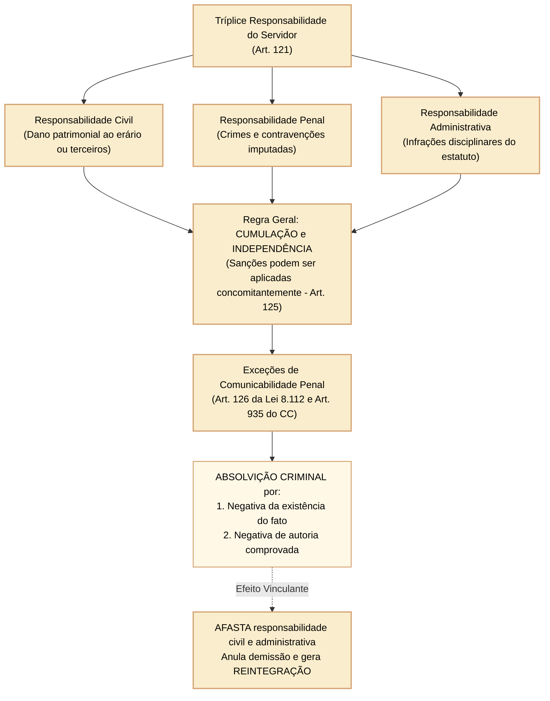
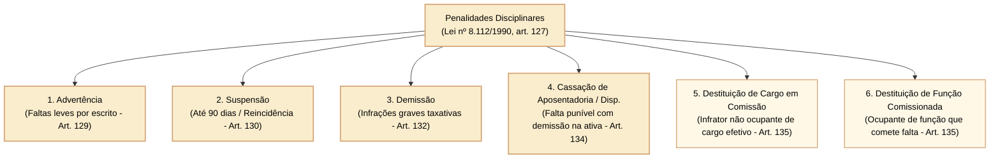
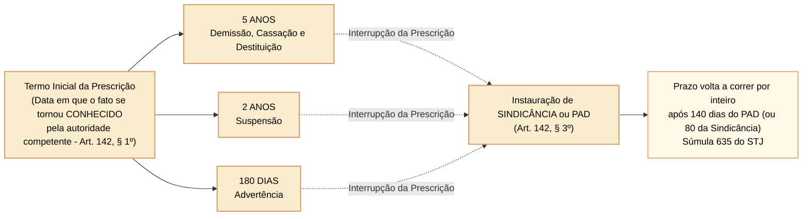

# Lei nº 8.112/1990: responsabilidades e penalidades disciplinares

O regime disciplinar dos servidores públicos civis da União, autarquias e fundações públicas federais é estruturado pelos arts. 121 a 142 da Lei nº 8.112/1990. No âmbito dos concursos públicos organizados pelo Cebraspe para carreiras do Poder Legislativo Federal, a disciplina sancionatória exige do candidato o domínio minucioso de três eixos fundamentais: (1) a independência e comunicabilidade das esferas civil, penal e administrativa, com ênfase nas hipóteses restritas de repercussão da sentença penal absolutória; (2) a tipicidade estrita e as hipóteses legais taxativas de cabimento de cada penalidade funcional; e (3) os prazos de prescrição da pretensão punitiva disciplinar, seus marcos interruptivos e a regra especial de equiparação a crimes contra a administração pública.

---

## 1. Responsabilidade tríplice do servidor: independência e comunicabilidade das instâncias

O servidor público responde civil, penal e administrativamente pelo exercício irregular de suas atribuições (art. 121 da Lei nº 8.112/1990).

### 1.1 Natureza e características de cada modalidade de responsabilidade

1. **Responsabilidade civil (art. 122):** decorre de ato omissivo ou comissivo, doloso ou culposo, que resulte em prejuízo ao erário ou a terceiros.
   - **Prejuízo ao erário:** a obrigação de reparar o dano estende-se aos sucessores e contra eles será executada até o limite do valor do patrimônio transferido (art. 122, § 3º c/c art. 5º, XLV, CF/1988);
   - **Dano a terceiros:** o servidor responderá perante a Fazenda Pública em ação regressiva (art. 122, § 2º c/c art. 37, § 6º, CF/1988; Tema 940 STF: a ação de reparação deve ser ajuizada diretamente contra o Estado, sendo vedado o ajuizamento direto contra o servidor público).
2. **Responsabilidade penal (art. 123):** abrange os crimes e contravenções tipificados no Código Penal e em legislação penal especial cometidos pelo servidor no exercício de suas atribuições ou a pretexto de exercê-las.
3. **Responsabilidade administrativa (art. 124):** resulta de ato omissivo ou comissivo praticado no desempenho do cargo ou função pública que configure descumprimento de dever funcional ou violação de proibições estatutárias.

### 1.2 Regra de ouro da comunicabilidade das instâncias: o art. 126 da Lei nº 8.112/1990

As sanções civis, penais e administrativas **podem cumular-se**, sendo independentes entre si (art. 125). Essa é a regra geral. Todavia, a sentença criminal repercute na esfera administrativa nas hipóteses taxativas delineadas pela lei e pela jurisprudência pacífica dos tribunais superiores:

- **Hipóteses em que a sentença penal VINCULA e AFASTA a sanção administrativa (art. 126):**
  1. Sentença penal absolutória que reconhecer categoricamente a **inexistência material do fato** (art. 386, I, CPP);
  2. Sentença penal absolutória que negar categoricamente a **autoria do crime** pelo servidor imputado (art. 386, IV, CPP).
- **Hipóteses em que a sentença penal NÃO vincula e NÃO afasta a sanção administrativa:**
  - Absolvição penal por **falta ou insuficiência de provas** (art. 386, II, V e VII, CPP);
  - Absolvição penal por **atipicidade da conduta na lei penal** (art. 386, III, CPP) — o fato pode não constituir crime, mas configurar grave ilícito disciplinar autônomo (ex.: quebra de dever ético ou desídia);
  - Extinção da punibilidade pela **prescrição penal** — não impede a punição disciplinar, desde que respeitados os prazos prescricionais administrativos;
  - Decisão de arquivamento de inquérito policial ou não recebimento de denúncia criminal por razões formais.

> **Súmula nº 18 do STF:**  
> *"Pela falta residual, não compreendida na absolvição pelo juízo criminal, é admissível a punição administrativa do servidor público."*

---

## 2. Quadro analítico das penalidades disciplinares

Conforme o art. 127 da Lei nº 8.112/1990, são sanções disciplinares aplicáveis aos servidores civis da União:

### 2.1 Advertência (art. 129)

- **Forma:** aplicada sempre **por escrito** (não existe advertência verbal formal);
- **Hipóteses:** violação de proibição constante do art. 117, incisos I a VIII e XIX, e inobservância de dever funcional previsto em lei, regulamento ou norma interna, que não justifique imposição de penalidade mais grave;
- **Cancelamento do registro funcional:** o registro da advertência será cancelado após o decurso de **3 (três) anos** de efetivo exercício, se o servidor não houver, nesse período, praticado nova infração disciplinar (art. 131). O cancelamento opera efeitos para o futuro e não gera indenização.

### 2.2 Suspensão (art. 130)

- **Duração:** aplicada por até **90 (noventa) dias**;
- **Hipóteses:** reincidência das faltas punidas com advertência e violação das demais proibições que não tipifiquem infração sujeita a demissão;
- **Suspensão especial de 15 dias (art. 130, § 1º):** será punido com suspensão de até 15 dias o servidor que, injustificadamente, recusar-se a ser submetido a inspeção médica determinada pela autoridade competente, cessando os efeitos da penalidade uma vez cumprida a determinação;
- **Conversão em multa (art. 130, § 2º):** quando houver conveniência para o serviço, a penalidade de suspensão poderá ser convertida em multa, na base de **50% (cinquenta por cento) por dia de vencimento ou remuneração**, ficando o servidor obrigado a permanecer em serviço;
- **Cancelamento do registro:** cancela-se após **5 (cinco) anos** de efetivo exercício sem reincidência (art. 131).

### 2.3 Demissão (art. 132)

A demissão é a sanção disciplinar máxima aplicável ao servidor ativo. O art. 132 estabelece rol taxativo de condutas que ensejam demissão obrigatória:

1. Crime contra a administração pública;
2. Abandono de cargo (ausência intencional por mais de 30 dias consecutivos, art. 138);
3. Inassiduidade habitual (falta ao serviço, sem causa justificada, por 60 dias interpoladamente durante o período de 12 meses, art. 139);
4. Improbidade administrativa;
5. Incontinência pública e conduta escandalosa, na repartição;
6. Insubordinação grave em serviço;
7. Ofensa física, em serviço, a servidor ou a particular, salvo em legítima defesa própria ou de outrem;
8. Aplicação irregular de dinheiros públicos;
9. Revelação de segredo do qual se apropriou em razão do cargo;
10. Lesão aos cofres públicos e dilapidação do patrimônio nacional;
11. Corrupção (passiva ou ativa);
12. Acumulação ilegal de cargos, empregos ou funções públicas (se comprovada a má-fé, art. 133, § 6º);
13. Transgressão do art. 117, incisos IX a XVI (valer-se do cargo para proveito pessoal, exercer comércio/gerência mercantil, atuar como procurador perante repartições, receber propina/vantagem, aceitar comissão/pensão de estado estrangeiro, praticar usura e proceder de forma desidiosa).

### 2.4 Efeitos da demissão: incompatibilidade temporária e controle de constitucionalidade

O art. 137 da Lei nº 8.112/1990 estabelece hipóteses de incompatibilidade para nova investidura em cargo público federal. O **caput** prevê prazo de **cinco anos** para demissão ou destituição de cargo em comissão por infração ao art. 117, IX ou XI.

O parágrafo único do art. 137, em sua redação original, previa impedimento definitivo de retorno ao serviço público federal em hipóteses como crime contra a administração, improbidade administrativa, aplicação irregular de recursos, lesão ao erário e corrupção. O **STF declarou inconstitucional essa restrição perpétua na ADI 2.975**. Ao julgar embargos de declaração em 2023, esclareceu que **o prazo de cinco anos do caput também se aplica às hipóteses do parágrafo único até que sobrevenha disciplina legislativa diversa**.

**Caso progressivo:** (1) a demissão por infração ao art. 117, IX, atrai a incompatibilidade de cinco anos prevista no caput; (2) se a demissão decorreu de corrupção, a redação original sugeria restrição perpétua, mas a ADI 2.975 impede aplicá-la; (3) enquanto não houver nova lei, utiliza-se também para o segundo caso o prazo de cinco anos. **Contraexemplo:** afirmar que a gravidade da corrupção autoriza automaticamente impedimento vitalício, apesar da decisão do STF.

Fonte primária: [STF, ADI 2.975, embargos de declaração, publicação de 2023](https://www.tst.jus.br/documents/10157/31760431/STF%2B-%2BA%C3%A7%C3%A3o%2BDireta%2Bde%2BInconstitucionalidade%2Bn%C2%BA%2B2.975%2C%2BDOU%2Bde%2B26.5.2023%2B-%2BADI-ED.pdf/ac22d3ef-d140-3138-4577-672bbef9eb4f?download=true&t=1688400959344). Conferir eventual legislação superveniente antes de aplicar a regra a fatos futuros.

### 2.5 Cassação de aposentadoria ou disponibilidade (art. 134)

Será cassada a aposentadoria ou a disponibilidade do inativo que houver praticado, **na atividade**, falta punível com demissão. Não é punição pela conduta pós-aposentadoria, mas pela descoberta ou apuração regular de falta gravíssima cometida enquanto o agente estava em efetivo exercício. O STF julgou constitucional a cassação de aposentadoria prevista na Lei nº 8.112/1990 (ADI 4.882/DF).

---

## 3. Prescrição da ação disciplinar (art. 142)

O poder sancionador do Estado submete-se a prazos prescricionais peremptórios que visam conferir segurança jurídica às relações administrativas:

### 3.1 Prazos prescricionais básicos (art. 142, I a III)

A ação disciplinar prescreverá em:
- **5 (cinco) anos:** quanto às infrações puníveis com **demissão, cassação de aposentadoria ou disponibilidade e destituição de cargo em comissão**;
- **2 (dois) anos:** quanto às infrações puníveis com **suspensão**;
- **180 (cento e oitenta) dias:** quanto às infrações puníveis com **advertência**.

### 3.2 Termo inicial da contagem prescricional (art. 142, § 1º)

O prazo de prescrição começa a correr da data em que o fato se tornou **conhecido pela autoridade competente para a instauração do processo disciplinar** (e não da data em que a infração foi efetivamente cometida por ato isolado). A autoridade competente é aquela dotada de atribuição legal para deflagrar a apuração (ministro de Estado, dirigente máximo de órgão/entidade ou autoridade delegada).

### 3.3 Infrações que também configuram crime (art. 142, § 2º)

Quando a **infração disciplinar também é tipificada como crime**, aplicam-se os prazos de prescrição previstos na legislação penal, conforme art. 142, § 2º, da Lei nº 8.112/1990. **Não é necessária instauração de inquérito policial, investigação criminal ou ação penal**. Esse entendimento foi firmado pela Primeira Seção do STJ no **MS 20.857/DF**, julgado em 22/05/2019, superando orientação anterior que exigia apuração criminal.

A administração deve demonstrar o enquadramento penal da conduta descrita na apuração disciplinar; mera afirmação sem suporte fático e jurídico não basta. A independência das instâncias permite que a capitulação penal relevante para o prazo seja apreciada no processo disciplinar.

**Exemplo:** um servidor pratica conduta disciplinar também tipificada como crime, mas nenhum inquérito é aberto. A ausência de investigação criminal **não afasta por si** a incidência do prazo penal. Se a conduta não corresponder a infração penal, aplica-se o prazo disciplinar próprio do art. 142.

Fonte: [STJ, MS 20.857/DF, Primeira Seção, DJe 12/06/2019](https://scon.stj.jus.br/SCON/pesquisar.jsp?b=ACOR&fr=veja&i=1&livre=%28%27MS%27+INPATH%28CLAP%29+AND+%2720857%27+INPATH%28NUM%29%29+OR+%28%28%27MS+20857%27%29+INPATH%28SUCE%29%29).

### 3.4 Interrupção da prescrição e reinício do prazo (art. 142, §§ 3º e 4º)

O primeiro ato válido de instauração de **sindicância punitiva** ou de **processo administrativo disciplinar (PAD)** interrompe o prazo prescricional. A Súmula 635 do STJ fixa o momento de conhecimento da infração pela autoridade competente como início da contagem e determina o retorno da fluência **por inteiro após 140 dias desde a interrupção**.

> **Súmula 635 do STJ, texto oficial:** “Os prazos prescricionais previstos no art. 142 da Lei n. 8.112/1990 iniciam-se na data em que a autoridade competente para a abertura do procedimento administrativo toma conhecimento do fato, interrompem-se com o primeiro ato de instauração válido - sindicância de caráter punitivo ou processo disciplinar - e voltam a fluir por inteiro, após decorridos 140 dias desde a interrupção.”

O enunciado **não contém a expressão “80 dias para sindicância”**. Eventuais distinções de prazo feitas em julgados específicos devem ser identificadas e fundamentadas em separado, sem serem atribuídas à redação da súmula. Os **60 dias de duração inicial da comissão, até 60 de prorrogação e 20 dias para julgamento**, que explicam a referência de 140 dias no PAD ordinário, são prazos procedimentais diferentes do prazo prescricional de cinco, dois anos ou 180 dias, conforme a sanção (art. 142). O reinício após a interrupção não deve ser confundido com cessação automática do afastamento preventivo, disciplinado pelo art. 147.

Fonte: [STJ, texto oficial da Súmula 635](https://scon.stj.jus.br/SCON/sumstj/doc.jsp?b=SUMU&i=1&l=10&livre=%22635%22.num.&operador=AND&ordenacao=-%40NUM&p=false).

---

## 4. Questões comentadas

*(Inédita: estilo Cebraspe / Câmara dos Deputados – Analista Legislativo)*  
**1.** A absolvição de servidor público federal no juízo penal por ausência ou insuficiência de provas vincula de forma absoluta a esfera administrativa, impedindo que contra ele seja aplicada a penalidade de demissão pelos mesmos fatos.

> **Gabarito: ERRADO**  
> **Comentário:** A regra do ordenamento jurídico brasileiro é a independência e comunicabilidade mitigada das instâncias civil, penal e administrativa (art. 125 da Lei nº 8.112/1990). A sentença penal absolutória só repercute na esfera administrativa se fundar-se expressamente na **inexistência material do fato** ou na **negativa categórica de autoria** (art. 126 c/c Súmula 18 do STF). A absolvição penal por insuficiência de provas (art. 386, VII, CPP) não impede a punição disciplinar administrativa, porquanto o padrão probatório e o bem jurídico tutelado na seara disciplinar são autônomos.

*(Inédita: estilo Cebraspe / Câmara dos Deputados – Analista Legislativo)*  
**2.** A penalidade de demissão decorrente de ato de corrupção ou improbidade administrativa acarreta a proibição perpétua de retorno do ex-servidor ao serviço público federal, não sendo aplicável, nesses casos, o prazo de incompatibilidade de cinco anos reservado para faltas de menor potencial ofensivo.

> **Gabarito: ERRADO**  
> **Comentário:** A ADI 2.975 declarou inconstitucional a vedação perpétua do art. 137, parágrafo único, da Lei nº 8.112/1990. Nos embargos julgados em 2023, o STF esclareceu que a incompatibilidade de **cinco anos**, prevista no caput, também alcança essas hipóteses até nova disciplina legal. Por isso, o enunciado erra ao afirmar proibição perpétua e ao negar a incidência do prazo quinquenal. Fonte: [ADI 2.975, embargos de declaração](https://www.tst.jus.br/documents/10157/31760431/STF%2B-%2BA%C3%A7%C3%A3o%2BDireta%2Bde%2BInconstitucionalidade%2Bn%C2%BA%2B2.975%2C%2BDOU%2Bde%2B26.5.2023%2B-%2BADI-ED.pdf/ac22d3ef-d140-3138-4577-672bbef9eb4f?download=true&t=1688400959344).

*(Inédita: estilo Cebraspe / Câmara dos Deputados – Analista Legislativo)*  
**3.** O prazo de prescrição da ação disciplinar contra servidor público federal começa a correr a partir da data em que a infração foi efetivamente cometida no ambiente de trabalho, interrompendo-se com a portaria de instauração do processo administrativo disciplinar.

> **Gabarito: ERRADO**  
> **Comentário:** Conforme o art. 142, § 1º, da Lei nº 8.112/1990, o prazo prescricional começa a correr não da data do cometimento da falta, mas da **data em que o fato se tornou conhecido pela autoridade competente para a instauração do processo disciplinar**. A data do fato não marca o termo inicial do cômputo prescricional administrativo.

*(Inédita: estilo Cebraspe / Câmara dos Deputados – Analista Legislativo)*  
**4.** A instauração de processo administrativo disciplinar interrompe a prescrição da pretensão punitiva da Administração, voltando o prazo a correr por inteiro após decorridos cento e quarenta dias sem que haja decisão final proferida pela autoridade julgadora.

> **Gabarito: CERTO**  
> **Comentário:** Exata tese consolidada na Súmula nº 635 do STJ e na jurisprudência do STF. A instauração do PAD interrompe o prazo prescricional (art. 142, § 3º). Essa interrupção cessa e o prazo recomeça a fluir por inteiro após o esgotamento do prazo legal para o término regular do procedimento disciplinar (60 dias de prazo ordinário da comissão + 60 dias de prorrogação + 20 dias para decisão da autoridade julgadora = 140 dias).

*(Inédita: estilo Cebraspe / Câmara dos Deputados – Analista Legislativo)*  
**5.** Servidor aposentado que tiver praticado, na atividade, conduta legalmente capitulada como passível de demissão estará sujeito à cassação de sua aposentadoria, instituto cuja constitucionalidade foi chancelada pelo Supremo Tribunal Federal.

> **Gabarito: CERTO**  
> **Comentário:** Assertiva plenamente conforme ao art. 134 da Lei nº 8.112/1990 ("Será cassada a aposentadoria ou a disponibilidade do inativo que houver praticado, na atividade, falta punível com a demissão") e ao julgamento vinculante da ADI 4.882/DF pelo STF, que declarou a higidez constitucional da cassação de aposentadoria como sanção disciplinar legítima decorrente do regime funcional de direito público.

*(Inédita: estilo Cebraspe / Câmara dos Deputados – Analista Legislativo)*  
**6.** A penalidade disciplinar de advertência poderá ser aplicada verbalmente pelo superior hierárquico direto na hipótese de faltas leves de insubordinação, dispensando-se o registro nos assentamentos funcionais caso o servidor apresente retratação imediata.

> **Gabarito: ERRADO**  
> **Comentário:** De acordo com o art. 129 da Lei nº 8.112/1990, a advertência será aplicada **sempre por escrito** e constará do assentamento individual do servidor. Não existe no estatuto federal a figura da advertência verbal tácita, sendo nulo o ato disciplinar punitivo que desatender à forma escrita e à garantia do contraditório e da ampla defesa.
