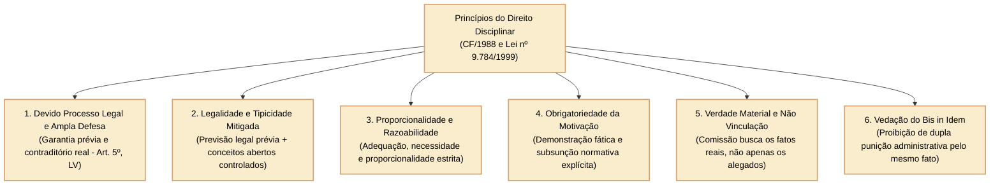
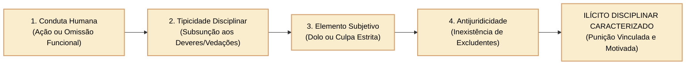

# Direito Administrativo Disciplinar: princípios fundamentais, tipicidade e ilícitos funcionais

O **Direito Administrativo Disciplinar (DAD)** constitui o ramo sancionatório do regime jurídico-administrativo que disciplina o poder punitivo do Estado sobre os seus agentes públicos e sobre aqueles submetidos a uma relação jurídica especial com a Administração. Ao contrário do Direito Penal — que tutela a ordem social geral e opera sob o postulado da tipicidade estrita e fechada —, o direito disciplinar convive com normas abertas e conceitos jurídicos indeterminados, temperados obrigatoriamente pelas garantias constitucionais do devido processo legal, do contraditório, da proporcionalidade e da vedação ao *bis in idem*. 

Para as provas do Cebraspe direcionadas à Câmara dos Deputados, é indispensável dominar a arquitetura dogmática dos princípios reitores do processo disciplinar, a teoria do ilícito administrativo e a jurisprudência vinculante das cortes superiores sobre o alcance da tipicidade e a motivação do ato punitivo.

---

## 1. Princípios reitores do Direito Administrativo Disciplinar

O poder disciplinar não se confunde com arbítrio. Toda pretensão sancionatória estatal submete-se a um arcabouço rígido de postulados constitucionais e infraconstitucionais (art. 5º, LIV e LV, CF/1988 c/c art. 2º da Lei nº 9.784/1999 e Lei nº 8.112/1990):

### 1.1 O devido processo legal, o contraditório e a ampla defesa

Nenhum servidor público, efetivo ou comissionado, pode ser punido disciplinarmente sem a prévia instauração de procedimento regular que assegure o exercício efetivo do contraditório e da ampla defesa (art. 5º, LV, CF/1988). 

- **Contraditório em sentido substancial:** não basta a mera ciência formal dos atos; exige-se a oportunidade concreta de produzir provas, contraditar testemunhas, ter acesso integral aos autos e influenciar a decisão da autoridade julgadora;
- **Defesa técnica por advogado e a Súmula Vinculante nº 5 do STF:** ponto de altíssima cobrança no Cebraspe. Em processos criminais, a ausência de defesa técnica por advogado gera nulidade absoluta. Todavia, no âmbito do processo administrativo disciplinar vigora regra distinta:

> **Súmula Vinculante nº 5 do STF:**  
> *"A falta de defesa técnica por advogado no processo administrativo disciplinar não ofende a Constituição."*

A autodefesa é admitida no PAD. Contudo, se o servidor for declarado revel (citado regularmente e não apresentar defesa no prazo), a autoridade competente designará obrigatoriamente um servidor estável como **defensor dativo** (art. 164, § 2º, Lei nº 8.112/1990) para que a ampla defesa não seja violada.

### 1.2 Tipicidade no direito disciplinar: a mitigação dos tipos abertos

No Direito Penal vigora o princípio da reserva legal absoluta e da taxatividade estrita (*nullum crimen sine lege stricta*). No Direito Administrativo Disciplinar, embora a infração deva estar prevista em lei formal em sentido estrito (princípio da legalidade), **admite-se a tipicidade aberta ou conceitos jurídicos indeterminados**.

- O legislador utiliza expressões como "falta de zelo", "desídia", "incontinência pública", "conduta escandalosa" e "lealdade às instituições";
- Essa abertura não autoriza a discricionariedade arbitrária: cabe à comissão processante e à autoridade julgadora demonstrar, na **motivação do ato**, a subsunção fática rigorosa entre o comportamento concreto do servidor e o núcleo de sentido da norma proibitiva;
- A sanção disciplinar cominada a cada tipo legal (advertência, suspensão ou demissão) é vinculada pela gravidade da conduta prevista em lei. A discricionariedade cinge-se à dosimetria da pena (tempo de suspensão entre 1 e 90 dias, e.g., art. 128 da Lei nº 8.112/1990).

### 1.3 Proporcionalidade, razoabilidade e dosimetria da penalidade

O art. 128 da Lei nº 8.112/1990 estabelece os parâmetros vinculantes da dosimetria disciplinar:
1. A **natureza e a gravidade** da infração cometida;
2. Os **danos que dela provierem** para o serviço público;
3. As **circunstâncias agravantes ou atenuantes**;
4. Os **antecedentes funcionais** do servidor.

O controle jurisdicional do ato disciplinar incide amplamente sobre a razoabilidade e a proporcionalidade da pena. A demissão de um servidor por falta leve ou com justificativa fática plausível configura excesso de poder passível de anulação judicial, com a consequente reintegração do servidor ao cargo.

---

## 2. Estrutura do ilícito administrativo funcional

O **ilícito disciplinar** é a conduta comissiva ou omissiva, imputável ao servidor público a título de dolo ou culpa, que vulnera os deveres ou incorre nas proibições expressas do estatuto funcional.

### 2.1 Requisitos constitutivos do ilícito disciplinar

1. **Conduta comissiva ou omissiva:** comportamento humano imputável ao agente no exercício da função ou em razão dela. Atos praticados na vida privada estritamente particular não configuram ilícito funcional, salvo quando repercutirem diretamente sobre a dignidade da função pública (ex.: conduta escandalosa na repartição ou crime comum infamante);
2. **Tipicidade:** correlação necessária entre a conduta e as proibições/deveres estatutários previstos em lei;
3. **Elemento subjetivo (Dolo ou Culpa):** no Direito Administrativo Disciplinar, **não se admite responsabilidade objetiva**. Para a imposição de qualquer sanção disciplinar (advertência, suspensão ou demissão), é indispensável a comprovação inequívoca de **dolo** (vontade livre e consciente de infringir o dever) ou **culpa** (negligência, imprudência ou imperícia). O mero resultado gravoso sem culpa não autoriza punição funcional;
4. **Antijuridicidade e excludentes:** a conduta típica não será ilícita se estiver amparada por causas excludentes de antijuridicidade, tais como o estrito cumprimento do dever legal e a **legítima defesa própria ou de outrem** (expressamente prevista no art. 132, VII, da Lei nº 8.112/1990 para afastar a demissão por ofensa física em serviço).

---

## 3. Tipologias dos ilícitos funcionais graves na Lei nº 8.112/1990

A banca Cebraspe explora detalhadamente as características dogmáticas das infrações passíveis da penalidade capital de demissão (art. 132 da Lei nº 8.112/1990):

| Ilícito Funcional | Definição Legal e Elementos Constitutivos | Exigência Subjetiva e Particularidades |
| :--- | :--- | :--- |
| **Abandono de Cargo** (Art. 138) | Ausência intencional do servidor ao serviço por mais de **30 (trinta) dias consecutivos**. | Exige a comprovação do *animus abandonandi* (dolo específico de abandonar). Motivos de força maior, saúde mental ou coação irresistível afastam a infração. |
| **Inassiduidade Habitual** (Art. 139) | Falta ao serviço, sem causa justificada, por **60 (sessenta) dias, interpoladamente**, durante o período de **12 (doze) meses**. | Exige a demonstração de injustiça nas faltas. Faltas abonadas ou justificadas por licença médica não contam para a inassiduidade habitual. |
| **Desídia** (Art. 117, XV c/c Art. 132, XIII) | Desempenho negligente, relapso, desatento ou procrastinador reiterado das atribuições funcionais. | Caracteriza-se habitualmente pela reiteração de condutas culposas (desleixo funcional acumulado), demonstrada pelo histórico funcional e advertências/suspensões prévias. |
| **Corrupção** (Art. 132, XI) | Prática de corrupção passiva ou ativa no ambiente funcional. | Independe de condenação penal prévia transitada em julgado; a Administração apura os fatos autonomamente no PAD. |
| **Improbidade Administrativa** (Art. 132, IV) | Conduta ímproba tipificada na Lei nº 8.429/1992 (enriquecimento ilícito, prejuízo ao erário ou violação aos princípios). | Conforme jurisprudência do STJ e STF, a Administração pode demitir o servidor por improbidade administrativa no âmbito do PAD antes ou independentemente do ajuizamento da ação judicial de improbidade pelo Ministério Público. |
| **Incontinência Pública e Conduta Escandalosa** (Art. 132, V) | Comportamento despudorado, grosseiro, indecoroso ou que cause perturbação à ordem interna e à dignidade funcional **na repartição**. | Exige manifestação externa que comprometa o decoro e o respeito no ambiente de trabalho ou perante o público atendido. |

---

## 4. Distinções fundamentais: PAD disciplinar versus processo civil e penal

A tabela a seguir consolida os principais contrastes cobrados em provas de concursos:

| Eixo Comparativo | Processo Penal | Processo Administrativo Disciplinar (PAD) | Ação Civil de Improbidade (LIA) |
| :--- | :--- | :--- | :--- |
| **Natureza da Relação** | Poder de soberania estatal geral (*jus puniendi* comum). | Relação especial de sujeição estatutária funcional. | Sanção civil-política decorrente de tutela da probidade. |
| **Tipicidade** | Estrita e fechada (*reserva legal absoluta*). | Mitigada (admite conceitos jurídicos abertos e normas gerais). | Tipicidade estrita após a Lei nº 14.230/2021 (exige dolo específico). |
| **Defesa Técnica** | Obrigatória por advogado sob pena de nulidade absoluta. | Facultativa (Súmula Vinculante nº 5 do STF; exige defensor dativo se revel). | Obrigatória por advogado constituído ou Defensoria Pública. |
| **Competência Sancionatória** | Exclusiva do Poder Judiciário (Juiz Criminal). | Própria da autoridade administrativa julgadora competente. | Exclusiva do Poder Judiciário (Juiz Cível/Vara de Fazenda Pública). |
| **Grau de Prova Exigido** | Certeza além de qualquer dúvida razoável (*in dubio pro reo*). | Verdade material demonstrada por elementos robustos nos autos. | Prova documental e testemunhal cabal de dolo e lesão/vantagem. |

---

## 5. Questões comentadas

*(Inédita: estilo Cebraspe / Câmara dos Deputados – Analista Legislativo)*  
**1.** A ausência de defesa técnica patrocinada por advogado legalmente constituído no curso de processo administrativo disciplinar conduz à nulidade absoluta do procedimento e da penalidade eventualmente aplicada, tendo em vista o postulado constitucional da ampla defesa e do contraditório.

> **Gabarito: ERRADO**  
> **Comentário:** Assertiva frontalmente contrária ao texto da Súmula Vinculante nº 5 do Supremo Tribunal Federal ("A falta de defesa técnica por advogado no processo administrativo disciplinar não ofende a Constituição"). No PAD, a atuação de advogado é uma faculdade do servidor. A única exigência formal inafastável ocorre se o servidor for declarado revel, hipótese em que a Administração deverá nomear obrigatoriamente um defensor dativo (art. 164, § 2º, Lei 8.112/1990).

*(Inédita: estilo Cebraspe / Câmara dos Deputados – Analista Legislativo)*  
**2.** Diferentemente do que ocorre no âmbito do Direito Penal comum, no Direito Administrativo Disciplinar a legislação estatutária federal admite a cominação de infrações disciplinares por meio de conceitos jurídicos indeterminados e normas de tipicidade aberta, cabendo à autoridade administrativa motivar de forma explícita e circunstanciada a subsunção da conduta do agente ao núcleo da proibição.

> **Gabarito: CERTO**  
> **Comentário:** A tipicidade disciplinar é mitigada em relação à tipicidade penal. O legislador utiliza conceitos abertos como "desídia", "incontinência pública" ou "lealdade às instituições" (arts. 116 e 117 da Lei nº 8.112/1990). Essa abertura é constitucionalmente legítima desde que o ato disciplinar punitivo apresente motivação expressa, congruente e circunstanciada que demonstre a adequação fática à finalidade legal.

*(Inédita: estilo Cebraspe / Câmara dos Deputados – Analista Legislativo)*  
**3.** Para a configuração do ilícito disciplinar de abandono de cargo, punível com a penalidade de demissão, basta a constatação objetiva de que o servidor faltou injustificadamente ao serviço por período superior a trinta dias consecutivos, sendo irrelevante a apuração de seu elemento subjetivo ou intenção deliberada de abandonar a função.

> **Gabarito: ERRADO**  
> **Comentário:** Conforme jurisprudência pacífica e reiterada do STJ e do STF, o abandono de cargo (art. 138 da Lei nº 8.112/1990) exige a presença simultânea de dois elementos: o elemento objetivo (ausência ao serviço por mais de 30 dias consecutivos) e o elemento subjetivo, consubstanciado no *animus abandonandi* (a intenção deliberada de abandonar o cargo). Situações justificadas por força maior, problemas graves de saúde mental ou coação irresistível descaracterizam o abandono de cargo. No regime disciplinar não se admite responsabilidade estritamente objetiva.

*(Inédita: estilo Cebraspe / Câmara dos Deputados – Analista Legislativo)*  
**4.** Na aplicação das penalidades disciplinares pelo órgão competente, a autoridade julgadora dispõe de discricionariedade absoluta para escolher livremente entre advertência, suspensão ou demissão, independentemente da previsão legal cominada para a conduta.

> **Gabarito: ERRADO**  
> **Comentário:** A aplicação das penalidades disciplinares é ato **vinculado** quanto à espécie de penalidade estabelecida em lei para a gravidade da falta praticada (art. 128 c/c art. 132 da Lei nº 8.112/1990). Se o servidor cometeu falta capitulada no art. 132 (como corrupção ou lesão ao patrimônio público), a autoridade julgadora é obrigada a aplicar a demissão, inexistindo margem discricionária para aplicar mera advertência ou suspensão. A discricionariedade mitiga-se à dosimetria do prazo de suspensão (entre 1 e 90 dias).

*(Inédita: estilo Cebraspe / Câmara dos Deputados – Analista Legislativo)*  
**5.** Em consonância com a jurisprudência das cortes superiores, a autoridade administrativa competente tem o poder-dever de aplicar a sanção de demissão fundada em prática de ato de improbidade administrativa apurado regularmente em PAD, prescindindo de anterior condenação judicial transitada em julgado na esfera cível.

> **Gabarito: CERTO**  
> **Comentário:** O art. 132, IV, da Lei nº 8.112/1990 comina expressamente a pena de demissão para a improbidade administrativa. O STJ e o STF pacificaram o entendimento de que a Administração detém competência originária e autônoma para reconhecer administrativamente o ato ímprobo e aplicar a demissão no âmbito de regular PAD, sem necessidade de aguardar o desfecho ou ajuizamento da ação de improbidade civil pelo Ministério Público.

*(Inédita: estilo Cebraspe / Câmara dos Deputados – Analista Legislativo)*  
**6.** A prática de ofensa física em serviço contra outro servidor público acarreta obrigatoriamente a pena de demissão, não sendo admitida no regime estatutário federal qualquer excludente de ilicitude, dado o caráter indisponível da moralidade e da disciplina administrativa.

> **Gabarito: ERRADO**  
> **Comentário:** O art. 132, VII, da Lei nº 8.112/1990 prevê expressamente a demissão por "ofensa física, em serviço, a servidor ou a particular, **salvo em legítima defesa própria ou de outrem**". O estatuto federal contempla explicitamente a excludente da legítima defesa para afastar a ilicitude da conduta e impedir a aplicação da penalidade capital.
