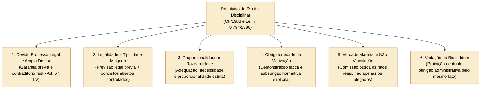
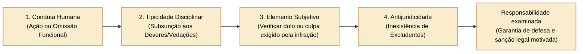

# Direito Administrativo Disciplinar: princípios fundamentais, tipicidade e ilícitos funcionais

Imagine que um servidor deixa de atender repetidamente pedidos que fazem parte de suas atribuições. Antes de puni-lo, a Administração precisa investigar o que aconteceu, verificar se existia justificativa, identificar qual dever foi violado e permitir que ele se defenda. Essa é a função do **Direito Administrativo Disciplinar**: estabelecer quando e como o Estado pode responsabilizar alguém por uma infração funcional.

No serviço público federal, a **Lei nº 8.112/1990** define os deveres, as proibições, as penalidades e o procedimento disciplinar dos servidores estatutários federais. A **Lei nº 9.784/1999** estabelece regras gerais para o processo administrativo na Administração Pública federal e tem aplicação subsidiária aos processos regidos por lei específica (art. 69). A Constituição assegura o devido processo legal, o contraditório e a ampla defesa. Regras próprias podem alcançar outros vínculos funcionais: não se deve presumir que a Lei nº 8.112/1990 se aplica integralmente a todo agente público.

Nas questões da Cebraspe, observe a sequência: **fato comprovado → dever ou proibição aplicável → elemento subjetivo exigido → defesa → penalidade legalmente cabível → decisão motivada**. Conceitos abertos, como desídia, precisam ser concretizados com fatos e provas; não são autorização para punição arbitrária.

---

## 1. Princípios reitores do Direito Administrativo Disciplinar

Aqui, **princípios reitores** são as regras gerais que orientam a investigação e a aplicação de sanções. Para compreender o procedimento, acompanhe três perguntas: como se apuram os fatos, como o servidor se defende e como se justifica uma eventual penalidade.

O poder disciplinar não se confunde com arbítrio. A Constituição (art. 5º, LIV e LV) exige processo regular, contraditório e ampla defesa. A Lei nº 9.784/1999, que rege em geral os processos administrativos federais, explicita princípios como motivação, razoabilidade e proporcionalidade em seu art. 2º. A Lei nº 8.112/1990 disciplina especificamente a responsabilização estatutária. Essas fontes se combinam, observada a especialidade do procedimento disciplinar:

### 1.1 O devido processo legal, o contraditório e a ampla defesa

No regime federal, a imposição de penalidade exige apuração regular, com oportunidade real de conhecer a imputação, contestar provas e apresentar defesa, conforme o procedimento legal cabível (art. 5º, LV, da Constituição; arts. 143 e seguintes da Lei nº 8.112/1990). Um procedimento preliminar meramente investigativo não equivale, por si, ao processo punitivo. 

- **Contraditório em sentido substancial:** não basta a mera ciência formal dos atos; exige-se a oportunidade concreta de produzir provas, contraditar testemunhas, ter acesso integral aos autos e influenciar a decisão da autoridade julgadora;
- **Defesa técnica por advogado e a Súmula Vinculante nº 5 do STF:** ponto de altíssima cobrança no Cebraspe. Em processos criminais, a ausência de defesa técnica por advogado gera nulidade absoluta. Todavia, no âmbito do processo administrativo disciplinar vigora regra distinta:

> **Súmula Vinculante nº 5 do STF:**  
> *"A falta de defesa técnica por advogado no processo administrativo disciplinar não ofende a Constituição."*

A autodefesa é admitida no PAD. Se o indiciado, **regularmente citado**, não apresentar defesa escrita no prazo, será declarado revel e a autoridade instauradora designará **servidor como defensor dativo**, observados os requisitos do art. 164, § 2º, da Lei nº 8.112/1990: ocupante de cargo efetivo superior ou de mesmo nível, ou com escolaridade igual ou superior à do indiciado. A regra não exige que o defensor seja advogado. A ausência de advogado, por si só, não causa nulidade; a falta de oportunidade efetiva de defesa é questão diferente.

### 1.2 Tipicidade no direito disciplinar: a mitigação dos tipos abertos

No Direito Penal vigora o princípio da reserva legal absoluta e da taxatividade estrita (*nullum crimen sine lege stricta*). No Direito Administrativo Disciplinar, embora a infração deva estar prevista em lei formal em sentido estrito (princípio da legalidade), **admite-se a tipicidade aberta ou conceitos jurídicos indeterminados**.

- O legislador utiliza expressões como "falta de zelo", "desídia", "incontinência pública", "conduta escandalosa" e "lealdade às instituições";
- Essa abertura não autoriza a discricionariedade arbitrária: cabe à comissão processante e à autoridade julgadora demonstrar, na **motivação do ato**, a subsunção fática rigorosa entre o comportamento concreto do servidor e o núcleo de sentido da norma proibitiva;
- A penalidade depende do **enquadramento legal demonstrado**. A Lei nº 8.112/1990 distingue advertência (art. 129), suspensão (art. 130, limitada em geral a 90 dias) e hipóteses de demissão (art. 132). Para faltas enquadradas validamente no art. 132, não se pode escolher advertência apenas por conveniência. Nos casos em que a lei permite graduar a sanção, o art. 128 exige considerar gravidade, dano, circunstâncias e antecedentes, sempre com motivação.

**Motivação por referência e alteração do enquadramento:** a autoridade pode adotar os fundamentos de relatório ou parecer anterior, desde que eles sejam identificáveis e suficientes para explicar a decisão. É a chamada *motivação por referência* (*per relationem*), aceita pela **Súmula 674 do STJ**; motivar não significa obrigatoriamente reescrever toda a análise. A **Súmula 672 do STJ** esclarece outra distinção: mudar a capitulação legal da conduta, por si só, não anula o PAD. A defesa precisa conhecer e poder contestar **os fatos imputados**; uma alteração que introduza fatos novos sem oportunidade de defesa exige exame específico do contraditório. Veja [Súmula 672](https://scon.stj.jus.br/SCON/sumstj/doc.jsp?b=SUMU&i=5&l=10&operador=AND&ordenacao=-%40NUM&p=false) e [Súmula 674](https://scon.stj.jus.br/SCON/sumstj/doc.jsp?b=SUMU&h=true&i=1&l=10&ordenacao=MAT&p=false).

### 1.3 Proporcionalidade, razoabilidade e dosimetria da penalidade

O art. 128 da Lei nº 8.112/1990 estabelece os parâmetros vinculantes da dosimetria disciplinar:
1. A **natureza e a gravidade** da infração cometida;
2. Os **danos que dela provierem** para o serviço público;
3. As **circunstâncias agravantes ou atenuantes**;
4. Os **antecedentes funcionais** do servidor.

**Controle judicial:** segundo a Súmula 665 do STJ, o Judiciário controla a regularidade do procedimento e a legalidade do ato à luz do contraditório, da ampla defesa e do devido processo. Em regra, não substitui o juízo administrativo de mérito; pode intervir em casos de flagrante ilegalidade, teratologia ou **manifesta desproporcionalidade** da sanção. Exemplo: uma demissão sem prova da infração legalmente prevista pode ser anulada. A reintegração dependerá do fundamento e dos efeitos da decisão, e não decorre automaticamente de qualquer discordância sobre a gravidade da falta.

---

## 2. Estrutura do ilícito administrativo funcional

O **ilícito disciplinar** surge quando uma conduta relacionada à função viola dever ou proibição aplicável e estão presentes os requisitos necessários à responsabilização. O elemento subjetivo deve ser examinado **conforme a infração concreta**: o abandono de cargo, por exemplo, exige ausência intencional (art. 138); outras infrações podem decorrer de conduta culposa. Resultado prejudicial, isoladamente, não comprova responsabilidade.

### 2.1 Requisitos constitutivos do ilícito disciplinar

1. **Conduta comissiva ou omissiva:** comportamento humano imputável ao agente no exercício da função ou em razão dela. Atos praticados na vida privada estritamente particular não configuram ilícito funcional, salvo quando repercutirem diretamente sobre a dignidade da função pública (ex.: conduta escandalosa na repartição ou crime comum infamante);
2. **Tipicidade:** correlação necessária entre a conduta e as proibições/deveres estatutários previstos em lei;
3. **Elemento subjetivo:** não basta apontar um resultado indesejado e atribuí-lo automaticamente ao servidor. É preciso investigar a conduta e o elemento subjetivo relevante para a hipótese. **Dolo** envolve consciência e vontade da conduta; **culpa** pode se expressar por negligência, imprudência ou imperícia, quando essa forma de responsabilização é juridicamente cabível. Algumas faltas têm exigência própria: no abandono, a lei exige intenção de ausentar-se; não basta o registro de faltas;
4. **Antijuridicidade e excludentes:** a conduta típica não será ilícita se estiver amparada por causas excludentes de antijuridicidade, tais como o estrito cumprimento do dever legal e a **legítima defesa própria ou de outrem** (expressamente prevista no art. 132, VII, da Lei nº 8.112/1990 para afastar a demissão por ofensa física em serviço).

---

## 3. Tipologias dos ilícitos funcionais graves na Lei nº 8.112/1990

A banca Cebraspe explora detalhadamente as características dogmáticas das infrações passíveis da penalidade capital de demissão (art. 132 da Lei nº 8.112/1990):

| Ilícito Funcional | Definição Legal e Elementos Constitutivos | Exigência Subjetiva e Particularidades |
| :--- | :--- | :--- |
| **Abandono de Cargo** (Art. 138) | Ausência intencional do servidor ao serviço por mais de **30 (trinta) dias consecutivos**. | Exige a comprovação do *animus abandonandi* (dolo específico de abandonar). Motivos de força maior, saúde mental ou coação irresistível afastam a infração. |
| **Inassiduidade Habitual** (Art. 139) | Falta ao serviço, sem causa justificada, por **60 (sessenta) dias, interpoladamente**, durante o período de **12 (doze) meses**. | Exige a demonstração de injustiça nas faltas. Faltas abonadas ou justificadas por licença médica não contam para a inassiduidade habitual. |
| **Desídia** (art. 117, XV, combinado com art. 132, XIII) | Atuação reiteradamente negligente ou descuidada nas atribuições do cargo. | A reiteração e as circunstâncias importam para distinguir a desídia de falha isolada. Advertências anteriores podem ser prova contextual, **mas não constituem requisito legal obrigatório** para o enquadramento. |
| **Corrupção** (Art. 132, XI) | Prática de corrupção passiva ou ativa no ambiente funcional. | Independe de condenação penal prévia transitada em julgado; a Administração apura os fatos autonomamente no PAD. |
| **Improbidade administrativa** (art. 132, IV) | A conduta pode ensejar demissão disciplinar e também, quando preenchidos seus requisitos próprios, ação judicial baseada na Lei nº 8.429/1992. | A demissão administrativa pode ser decidida em PAD sem prévia condenação judicial por improbidade. **Não confundir** a sanção estatutária com as sanções judiciais da Lei de Improbidade; cada esfera exige fundamento, prova e procedimento próprios. |
| **Incontinência Pública e Conduta Escandalosa** (Art. 132, V) | Comportamento despudorado, grosseiro, indecoroso ou que cause perturbação à ordem interna e à dignidade funcional **na repartição**. | Exige manifestação externa que comprometa o decoro e o respeito no ambiente de trabalho ou perante o público atendido. |

---

## 4. Distinções fundamentais: PAD disciplinar versus processo civil e penal

A tabela a seguir consolida os principais contrastes cobrados em provas de concursos:

| Eixo Comparativo | Processo Penal | Processo Administrativo Disciplinar (PAD) | Ação Civil de Improbidade (LIA) |
| :--- | :--- | :--- | :--- |
| **Natureza da Relação** | Poder de soberania estatal geral (*jus puniendi* comum). | Relação especial de sujeição estatutária funcional. | Sanção civil-política decorrente de tutela da probidade. |
| **Tipicidade** | Exige prévia definição legal do crime; a interpretação segue exigências próprias do Direito Penal. | A lei pode usar conceitos abertos, cuja aplicação depende de fatos provados e motivação. | A Lei nº 8.429/1992, modificada pela Lei nº 14.230/2021, exige dolo nos termos de seus dispositivos; não se deve igualar automaticamente esse requisito ao de toda infração disciplinar. |
| **Defesa Técnica** | Obrigatória por advogado sob pena de nulidade absoluta. | Facultativa (Súmula Vinculante nº 5 do STF; exige defensor dativo se revel). | Obrigatória por advogado constituído ou Defensoria Pública. |
| **Competência Sancionatória** | Exclusiva do Poder Judiciário (Juiz Criminal). | Própria da autoridade administrativa julgadora competente. | Exclusiva do Poder Judiciário (Juiz Cível/Vara de Fazenda Pública). |
| **Prova e decisão** | Acusação deve demonstrar elementos do crime segundo as garantias penais. | Administração deve produzir prova suficiente dos fatos e motivar enquadramento, culpabilidade exigida e sanção; dúvida relevante não autoriza presunção de culpa. | Autor da ação deve provar os requisitos do ato imputado na forma da lei; nem toda hipótese exige dano ao erário ou vantagem econômica. |

---

## 5. Questões comentadas

*(Inédita: estilo Cebraspe / Câmara dos Deputados – Analista Legislativo)*  
**1.** A ausência de defesa técnica patrocinada por advogado legalmente constituído no curso de processo administrativo disciplinar conduz à nulidade absoluta do procedimento e da penalidade eventualmente aplicada, tendo em vista o postulado constitucional da ampla defesa e do contraditório.

> **Gabarito: ERRADO**  
> **Comentário:** A Súmula Vinculante nº 5 do STF afasta a nulidade automática pela falta de advogado no PAD. A defesa efetiva continua obrigatória. Em caso de revelia do indiciado regularmente citado, a autoridade instauradora deve nomear defensor dativo nos termos do art. 164, § 2º, da Lei nº 8.112/1990; esse defensor não precisa ser advogado.

*(Inédita: estilo Cebraspe / Câmara dos Deputados – Analista Legislativo)*  
**2.** Diferentemente do que ocorre no âmbito do Direito Penal comum, no Direito Administrativo Disciplinar a legislação estatutária federal admite a cominação de infrações disciplinares por meio de conceitos jurídicos indeterminados e normas de tipicidade aberta, cabendo à autoridade administrativa motivar de forma explícita e circunstanciada a subsunção da conduta do agente ao núcleo da proibição.

> **Gabarito: CERTO**  
> **Comentário:** A tipicidade disciplinar é mitigada em relação à tipicidade penal. O legislador utiliza conceitos abertos como "desídia", "incontinência pública" ou "lealdade às instituições" (arts. 116 e 117 da Lei nº 8.112/1990). Essa abertura é constitucionalmente legítima desde que o ato disciplinar punitivo apresente motivação expressa, congruente e circunstanciada que demonstre a adequação fática à finalidade legal.

*(Inédita: estilo Cebraspe / Câmara dos Deputados – Analista Legislativo)*  
**3.** Para a configuração do ilícito disciplinar de abandono de cargo, punível com a penalidade de demissão, basta a constatação objetiva de que o servidor faltou injustificadamente ao serviço por período superior a trinta dias consecutivos, sendo irrelevante a apuração de seu elemento subjetivo ou intenção deliberada de abandonar a função.

> **Gabarito: ERRADO**  
> **Comentário:** O próprio art. 138 da Lei nº 8.112/1990 define abandono como **ausência intencional por mais de 30 dias consecutivos**. O elemento objetivo não dispensa provar a intenção. Problemas de saúde, força maior e outras circunstâncias devem ser apurados conforme a prova do caso; não se presume automaticamente que qualquer alegação afaste a infração.

*(Inédita: estilo Cebraspe / Câmara dos Deputados – Analista Legislativo)*  
**4.** Na aplicação das penalidades disciplinares pelo órgão competente, a autoridade julgadora dispõe de discricionariedade absoluta para escolher livremente entre advertência, suspensão ou demissão, independentemente da previsão legal cominada para a conduta.

> **Gabarito: ERRADO**  
> **Comentário:** O art. 132 da Lei nº 8.112/1990 prevê demissão quando a infração ali descrita estiver comprovada e corretamente enquadrada. Os arts. 129 e 130 preveem advertência e suspensão para outras hipóteses; a suspensão não excede 90 dias, ressalvada a regra específica de até 15 dias do art. 130, § 1º. A aplicação precisa observar o art. 128, sem liberdade absoluta para trocar uma sanção legal por outra.

*(Inédita: estilo Cebraspe / Câmara dos Deputados – Analista Legislativo)*  
**5.** Em consonância com a jurisprudência das cortes superiores, a autoridade administrativa competente tem o poder-dever de aplicar a sanção de demissão fundada em prática de ato de improbidade administrativa apurado regularmente em PAD, prescindindo de anterior condenação judicial transitada em julgado na esfera cível.

> **Gabarito: CERTO**  
> **Comentário:** O art. 132, IV, da Lei nº 8.112/1990 prevê demissão por improbidade administrativa. A apuração disciplinar tem competência própria: a Administração pode aplicar a sanção estatutária com prova e defesa regulares, sem depender de sentença anterior na ação judicial da Lei nº 8.429/1992. A decisão administrativa não substitui nem antecipa as sanções que somente o Judiciário pode aplicar.

*(Inédita: estilo Cebraspe / Câmara dos Deputados – Analista Legislativo)*  
**6.** A prática de ofensa física em serviço contra outro servidor público acarreta obrigatoriamente a pena de demissão, não sendo admitida no regime estatutário federal qualquer excludente de ilicitude, dado o caráter indisponível da moralidade e da disciplina administrativa.

> **Gabarito: ERRADO**  
> **Comentário:** O art. 132, VII, da Lei nº 8.112/1990 prevê expressamente a demissão por "ofensa física, em serviço, a servidor ou a particular, **salvo em legítima defesa própria ou de outrem**". O estatuto federal contempla explicitamente a excludente da legítima defesa para afastar a ilicitude da conduta e impedir a aplicação da penalidade capital.
