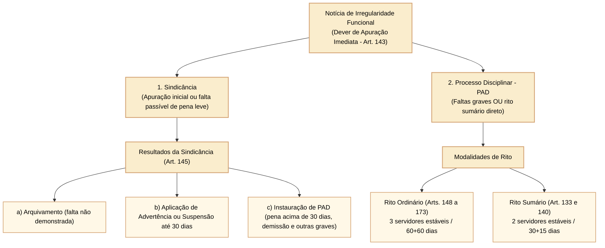
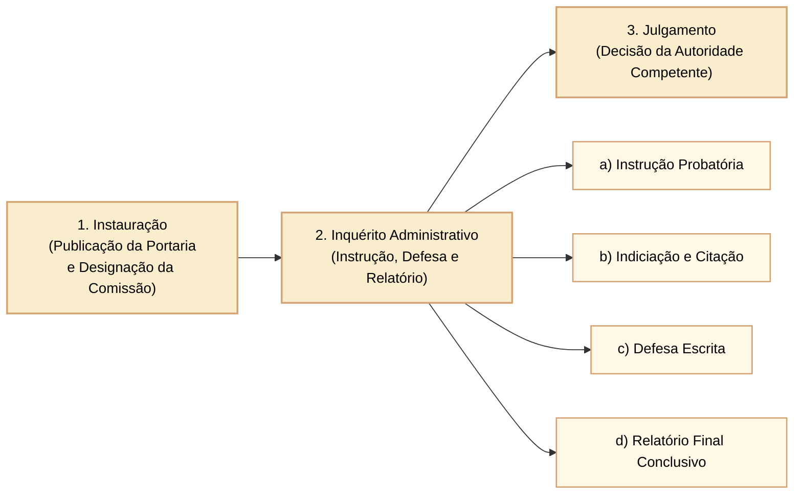
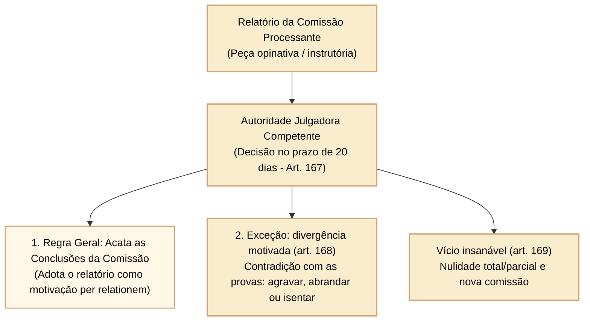

# Sindicância, processo administrativo disciplinar e seus ritos: ordinário e sumário

Imagine que a chefia recebe um relato de que um servidor faltou ao trabalho repetidamente. Primeiro, é preciso conferir as datas e saber se as ausências tinham justificativa. Se houver indícios de falta funcional, a Administração escolhe um procedimento de apuração, reúne provas, permite a defesa e decide se cabe alguma penalidade. **Sindicância** e **processo administrativo disciplinar (PAD)** são instrumentos diferentes para essa apuração.

A **Lei nº 8.112/1990** regula o vínculo estatutário dos servidores públicos civis federais. Seus arts. 143 a 182 tratam da apuração e responsabilização disciplinar. A **Lei nº 9.784/1999** contém regras gerais do processo administrativo federal, aplicáveis subsidiariamente quando houver procedimento específico (art. 69). O rito ordinário é o procedimento disciplinar geral; o rito sumário atende às hipóteses específicas de acumulação ilegal, abandono e inassiduidade habitual.

Para a Cebraspe, cada prazo deve ser associado a uma pergunta: **quem está agindo (comissão ou julgador), em qual rito, a partir de qual marco e com que consequência se houver atraso?** Atraso da comissão, prescrição, prazo de defesa e afastamento cautelar não são a mesma contagem.

---

## 1. O dever de apuração e a escolha do instrumento adequado

A autoridade que toma ciência de uma possível irregularidade funcional deve promover sua apuração, mediante sindicância ou PAD (art. 143 da Lei nº 8.112/1990). A notícia de um fato ainda incerto pode justificar apuração preliminar; uma acusação delimitada, com possível penalidade grave, exige o procedimento disciplinar cabível. O art. 144 diferencia denúncia identificada e fatos que evidentemente não configuram infração disciplinar ou ilícito penal. A conclusão pela inexistência de falta deve decorrer da análise dos elementos disponíveis, sem punição automática.

### 1.1 A sindicância: natureza e resultados possíveis (art. 145)

A **sindicância investigativa** reúne informações para decidir se há elementos para um PAD ou para o arquivamento; por não aplicar sanção, não deve ser confundida com julgamento disciplinar. A **sindicância punitiva** pode resultar em advertência ou suspensão de até 30 dias e precisa assegurar contraditório e ampla defesa. Exemplo: descobrir quem autorizou uma despesa pode exigir apuração preliminar; punir o servidor por conduta já delimitada exige oportunidade de defesa.

Da sindicância instaurada pela autoridade competente poderá resultar exclusivamente:
1. **Arquivamento:** quando não há base para responsabilização disciplinar; o art. 145, I, prevê esse resultado sem exigir que a inexistência material do fato tenha sido definitivamente comprovada;
2. **Aplicação de penalidade de advertência ou de suspensão de até 30 (trinta) dias:** limite sancionatório máximo da sindicância punitiva (art. 145, II);
3. **Instauração de PAD:** a sindicância encaminha a apuração quando a sanção possível ultrapassa sua competência. O art. 146 torna o PAD obrigatório para suspensão superior a 30 dias, demissão, cassação de aposentadoria ou disponibilidade e destituição de cargo em comissão.

- **Prazo da sindicância (art. 145, parágrafo único):** o prazo para conclusão da sindicância não excederá **30 (trinta) dias**, podendo ser prorrogado por igual período, a critério da autoridade superior.

---

## 2. Processo Administrativo Disciplinar ordinário: estrutura e tríplice fase

O PAD ordinário é a via geral de apuração disciplinar, especialmente quando a infração pode levar às penalidades graves do art. 146 e não se enquadra nas hipóteses especiais de rito sumário. O art. 151 divide seu percurso em três fases:

### 2.1 Composição e garantias da comissão processante (art. 149)

- O PAD será conduzido por uma comissão composta por **3 (três) servidores estáveis** designados pela autoridade competente;
- **Presidência da comissão:** o presidente da comissão deverá ser ocupante de cargo efetivo **superior ou de mesmo nível**, ou ter **nível de escolaridade igual ou superior** ao do indiciado (art. 149);
- **Impedimentos e suspeições:** não poderá participar da comissão cônjuge, companheiro ou parente do acusado, consanguíneo ou afim, em linha reta ou colateral, até o **terceiro grau** (art. 149, § 2º).

### 2.2 Prazos do rito ordinário (art. 152)

- O prazo para a conclusão do PAD ordinário é de **até 60 (sessenta) dias**, contados da data de publicação do ato que constituir a comissão;
- Admite-se a **prorrogação por igual prazo (mais 60 dias)**, quando as circunstâncias o exigirem, mediante solicitação motivada da comissão à autoridade instauradora;
- **Excesso de prazo:** a superação do prazo de conclusão **não invalida automaticamente o PAD**. A Súmula 592 do STJ exige demonstração de prejuízo à defesa. A contagem da prescrição e o afastamento preventivo têm marcos próprios, distintos dos 60 + 60 dias da comissão.

**Quatro cronologias distintas:**

| Regime | Base | Prazo ou marco | Efeito |
| --- | --- | --- | --- |
| Trabalho da comissão no PAD ordinário | Lei 8.112, art. 152 | Até 60 dias desde a publicação do ato constitutivo, prorrogáveis por até mais 60 | Prazo procedimental: seu excesso não implica nulidade sem prejuízo |
| Julgamento após o relatório | Lei 8.112, art. 167 | Até 20 dias do recebimento do processo pela autoridade julgadora | Prazo decisório distinto do trabalho da comissão |
| Afastamento preventivo cautelar | Lei 8.112, art. 147 | Até 60 dias, prorrogáveis uma vez por igual período, sem prejuízo remuneratório | Cessa ao fim de seu prazo próprio, mesmo sem conclusão do PAD; não depende de marco de 120 dias da comissão |
| Prescrição disciplinar | Lei 8.112, art. 142, §§ 1º a 4º; Súmula 635/STJ | Primeiro ato de instauração válido interrompe; o prazo volta a fluir **por inteiro após 140 dias desde a interrupção** | Marco de prescrição independente da análise de nulidade do PAD |

**Caso progressivo:** uma comissão conclui em 125 dias. Isso não produz automaticamente nulidade nem prolonga afastamento cautelar: a defesa precisaria demonstrar prejuízo para invalidar o processo, e o afastamento segue os limites do art. 147. O prazo prescricional deve ser examinado com o marco de instauração válido e a Súmula 635, não com a data em que a comissão completou 120 dias.

Fontes: [Lei nº 8.112/1990 atualizada](https://www2.camara.leg.br/legin/fed/lei/1990/lei-8112-11-dezembro-1990-322161-normaatualizada-pl.html), [Súmula 592/STJ](https://scon.stj.jus.br/SCON/sumstj/toc.jsp?sumula=592), [Súmula 635/STJ](https://scon.stj.jus.br/SCON/sumstj/toc.jsp?sumula=635).

---

## 3. A fase do inquérito administrativo: instrução, indiciação, defesa e relatório

O inquérito administrativo obedece ao princípio do contraditório, assegurada ao acusado ampla defesa, com a utilização dos meios e recursos admitidos em direito (art. 153).

### 3.1 Instrução probatória

- A comissão promoverá a tomada de depoimentos, acareações, investigações e perícias cabíveis;
- **Depoimentos de testemunhas:** a comissão intima cada testemunha por mandado expedido por seu presidente; se for servidora pública, comunica imediatamente a convocação à chefia da repartição (art. 157). As testemunhas são ouvidas separadamente (art. 158);
- **Participação da defesa:** o servidor pode acompanhar o processo pessoalmente ou por procurador, arrolar e reinquirir testemunhas, produzir provas e contraprovas e formular quesitos nas perícias (art. 156). O procurador pode assistir ao interrogatório e à inquirição e reinquirir por intermédio do presidente, sem intervir diretamente nas perguntas e respostas (art. 159, § 2º);
- **Interrogatório do acusado:** o acusado será qualificado e interrogado sobre as imputações. O interrogatório é ato personalíssimo, mas o defensor poderá estar presente.

### 3.2 Indiciação, citação e prazo de defesa escrita (art. 161)

Tipificada a infração disciplinar e formulada a indiciação do servidor, com a especificação clara dos fatos a ele imputados e das respectivas provas:
1. O indiciado será **citado pessoalmente** por mandado para apresentar defesa escrita no prazo de **10 (dez) dias**;
2. Havendo **dois ou mais indiciados**, o prazo de defesa será **comum de 20 (vinte) dias** (art. 161, § 1º);
3. Se o indiciado estiver em lugar incerto e não sabido, a citação será por **edital**, publicado no Diário Oficial da União e em jornal de grande circulação na localidade do último domicílio conhecido. O prazo de **15 dias** para defesa começa na **última publicação do edital** (art. 163 e parágrafo único).
4. O prazo ordinário de defesa pode ser **prorrogado pelo dobro** quando forem necessárias diligências indispensáveis (art. 161, § 3º). Se o indiciado recusar assinar o recebimento da citação, aplica-se a regra de certificação com duas testemunhas do § 4º.

### 3.3 Revelia e a nomeação de defensor dativo (art. 164)

- O indiciado regularmente citado que não apresentar defesa escrita no prazo será declarado **revel**, por termo nos autos. O art. 164, § 1º, determina a devolução do prazo para defesa após a declaração de revelia;
- A revelia no processo disciplinar não induz confissão ficta automática em prejuízo do indiciado;
- A autoridade instauradora designará **servidor como defensor dativo**, que precisa ocupar cargo efetivo superior ou de mesmo nível **ou** ter escolaridade igual ou superior à do indiciado (art. 164, § 2º). A lei não exige advogado nem usa a estabilidade como requisito autônomo do defensor; a defesa deve ser efetiva.

### 3.4 Relatório conclusivo da comissão (art. 165)

Apreciada a defesa, a comissão elaborará **relatório minucioso**, onde resumirá as peças principais dos autos e mencionará as provas em que se baseou para formar sua convicção. O relatório será conclusivo sobre inocência ou responsabilidade. Se reconhecer responsabilidade, indicará o dispositivo legal ou regulamentar transgredido e as circunstâncias agravantes ou atenuantes (art. 165, §§ 1º e 2º). Em seguida, o processo é remetido à autoridade que determinou a instauração, para julgamento ou encaminhamento à autoridade competente (arts. 166 e 167).

---

## 4. Fase de julgamento e vícios sanáveis

Recebido o processo disciplinar com o relatório da comissão, a autoridade julgadora proferirá a sua decisão no prazo de **20 (vinte) dias** (art. 167).

- **Relatório e decisão (art. 168):** o julgador deve acolher o relatório, salvo contradição com as provas dos autos. Nesse caso, pode **motivar** agravamento, abrandamento ou isenção de responsabilidade. A fundamentação pode adotar expressamente o relatório da comissão (*per relationem*, Súmula 674/STJ), desde que seja suficiente para explicar a decisão.
- **Vício insanável (art. 169):** a autoridade instauradora ou autoridade hierarquicamente superior declara a nulidade total ou parcial e constitui nova comissão. Esta hipótese é diferente de discordar da proposta de penalidade. O julgamento fora dos 20 dias não produz, por si só, nulidade (§ 1º).
- **Competência sancionadora (art. 141, I):** quando a infração implicar demissão ou cassação de aposentadoria/disponibilidade, julga a autoridade indicada para o respectivo Poder ou órgão: Presidente da República, presidentes das Casas do Poder Legislativo, presidentes dos Tribunais Federais e Procurador-Geral da República. Na Câmara, o presidente da Casa é a referência legal. Suspensões acima de 30 dias seguem o inciso II; advertência e suspensão até 30 dias, o inciso III. No Executivo, verificar eventual delegação válida; não transportar automaticamente tal delegação para o Legislativo.

---

## 5. Rito sumário: hipóteses taxativas e prazos enxutos

O **rito sumário** é o procedimento especial dos arts. 133 e 140 da Lei nº 8.112/1990, utilizado em três hipóteses definidas pela lei. É mais curto porque parte de fatos que podem ser descritos objetivamente, mas **continua exigindo prova e defesa**: no abandono, a comissão deve investigar também a intenção de abandonar o cargo.
1. **Acumulação ilegal de cargos, empregos ou funções públicas (art. 133);**
2. **Abandono de cargo (art. 140);**
3. **Inassiduidade habitual (art. 140).**

| Elemento Procedimental | Rito Ordinário (Geral) | Rito Sumário (Especial) |
| :--- | :--- | :--- |
| **Infrações Abrangidas** | Todas as infrações graves e demissíveis em geral. | Exclusivamente: Acumulação Ilegal, Abandono de Cargo e Inassiduidade Habitual. |
| **Composição da Comissão** | **3 (três) servidores estáveis** (art. 149). | **2 (dois) servidores estáveis** (art. 133, § 2º c/c art. 140, § 1º). |
| **Prazo de Conclusão** | **60 dias**, prorrogáveis por mais **60 dias** (art. 152). | **30 dias**, prorrogáveis por mais **15 dias** (art. 133, § 7º). |
| **Citação e Defesa Escrita** | Indiciação após a instrução; citação para defesa em **10 dias**, ou prazo comum de **20 dias** para múltiplos indiciados (art. 161). | Comissão lavra termo de indiciação em até **3 dias** após a portaria, cita o servidor e concede **5 dias** para defesa (art. 133, § 2º; art. 140). |
| **Prazo para Julgamento** | **20 dias** (art. 167). | **5 dias** a partir do recebimento do processo (art. 133, § 4º). |
| **Opção de Boa-Fé (Acumulação)** | Não é mecanismo próprio do rito ordinário. | **Antes de instaurar** o sumário, o servidor notificado tem **10 dias improrrogáveis** para optar (art. 133, caput). Se houver omissão, instaura-se o procedimento; a opção até o último dia da defesa configura boa-fé e converte-se em pedido de exoneração do outro cargo (§ 5º). A demissão por acumulação ilegal requer má-fé provada (§ 6º). |

---

## 6. Questões comentadas

*(Inédita: estilo Cebraspe / Câmara dos Deputados – Analista Legislativo)*  
**1.** Da conclusão de sindicância administrativa instaurada no âmbito da Câmara dos Deputados poderá resultar diretamente a aplicação da penalidade de suspensão funcional por até noventa dias, dispensando-se a instauração de PAD em face da celeridade procedimental.

> **Gabarito: ERRADO**  
> **Comentário:** Conforme o art. 145, II, da Lei nº 8.112/1990, da sindicância somente poderá resultar a aplicação de penalidade de advertência ou de **suspensão por até trinta dias**. Se a infração apurada justificar a aplicação de suspensão superior a 30 dias ou de demissão, a comissão de sindicância deverá obrigatoriamente propor a instauração de Processo Administrativo Disciplinar (art. 145, III).

*(Inédita: estilo Cebraspe / Câmara dos Deputados – Analista Legislativo)*  
**2.** A comissão responsável pela condução de processo administrativo disciplinar sob o rito sumário para apuração de inassiduidade habitual é composta por dois servidores estáveis, dispondo a comissão do prazo de trinta dias para a conclusão dos trabalhos, admitida a prorrogação por até quinze dias.

> **Gabarito: CERTO**  
> **Comentário:** Assertiva exata em relação ao art. 140, § 1º c/c art. 133, §§ 2º e 7º, da Lei nº 8.112/1990. No rito sumário (aplicável a abandono de cargo, inassiduidade habitual e acumulação ilegal), a comissão é formada por apenas 2 servidores estáveis (ao contrário do rito ordinário, que exige 3 servidores), e o prazo é de 30 dias prorrogável por mais 15 dias.

*(Inédita: estilo Cebraspe / Câmara dos Deputados – Analista Legislativo)*  
**3.** O excesso de prazo para a conclusão de processo administrativo disciplinar conduz à nulidade insanável de todo o procedimento, gerando o arquivamento automático dos autos em benefício do servidor indiciado.

> **Gabarito: ERRADO**  
> **Comentário:** Trata-se de tese sumulada do Superior Tribunal de Justiça: "O excesso de prazo para a conclusão do processo administrativo disciplinar não é causa de nulidade, quando não demonstrado prejuízo à defesa" (Súmula nº 592 do STJ). O enunciado é falso porque a Súmula 592 condiciona a nulidade por excesso de prazo à **demonstração de prejuízo à defesa**. O limite temporal do afastamento preventivo (art. 147) e o reinício do prazo prescricional aos 140 dias desde o primeiro ato válido de interrupção (Súmula 635) seguem critérios próprios. O excesso isolado dos 120 dias da comissão não autoriza deduzir automaticamente nenhum desses efeitos.

*(Inédita: estilo Cebraspe / Câmara dos Deputados – Analista Legislativo)*  
**4.** Na apuração de acumulação ilegal de cargos públicos pelo rito sumário, caso o servidor indiciado comprove que agiu de boa-fé e exerça o direito de opção por um dos vínculos até o último dia do prazo para apresentação da defesa escrita, a sua opção implicará a exoneração do outro cargo e a automática extinção do procedimento sem a aplicação de penalidade disciplinar.

> **Gabarito: CERTO**  
> **Comentário:** A afirmação descreve a consequência prática da opção tempestiva, que configura boa-fé e é convertida em pedido de exoneração do outro vínculo (art. 133, § 5º). A lei distingue a notificação **prévia de 10 dias** (caput) e, se instaurado o sumário, a possibilidade de opção até o último dia da defesa de **5 dias** (§§ 2º e 5º). A demissão por acumulação ilegal depende de prova de má-fé (§ 6º). Não confundir exoneração a pedido com demissão disciplinar.

*(Inédita: estilo Cebraspe / Câmara dos Deputados – Analista Legislativo)*  
**5.** Em observância estrita ao princípio da congruência e à autonomia da comissão processante, a autoridade julgadora é juridicamente obrigada a acatar integralmente a proposta de penalidade veiculada no relatório final do PAD, sendo-lhe defeso agravar a punição sugerida.

> **Gabarito: ERRADO**  
> **Comentário:** Conforme o art. 168 da Lei nº 8.112/1990, a autoridade julgadora acatará o relatório da comissão, **salvo quando contrário às provas dos autos**. Se o relatório contrariar a evidência das provas, a autoridade julgadora poderá, de forma motivada, abrandar a penalidade, isentar o servidor ou até mesmo agravar a punição recomendada pela comissão processante.

*(Inédita: estilo Cebraspe / Câmara dos Deputados – Analista Legislativo)*  
**6.** Não poderá participar como membro de comissão processante de processo administrativo disciplinar o servidor público que for cônjuge, companheiro ou parente consanguíneo ou afim do acusado, em linha reta ou colateral, até o terceiro grau civil.

> **Gabarito: CERTO**  
> **Comentário:** O art. 149, § 2º, da Lei nº 8.112/1990 proíbe a participação de cônjuge, companheiro ou parente do acusado, consanguíneo ou afim, em linha reta ou colateral, até o terceiro grau, tanto em comissão de sindicância quanto em comissão de inquérito. O objetivo é preservar a imparcialidade da apuração.
