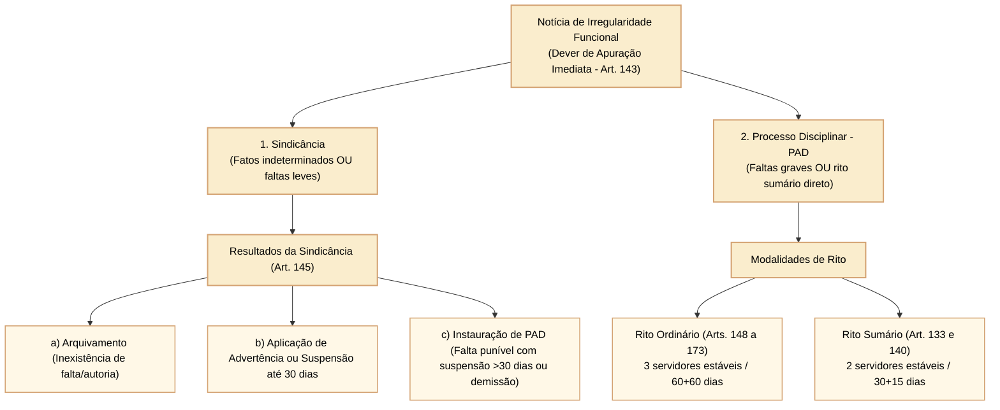
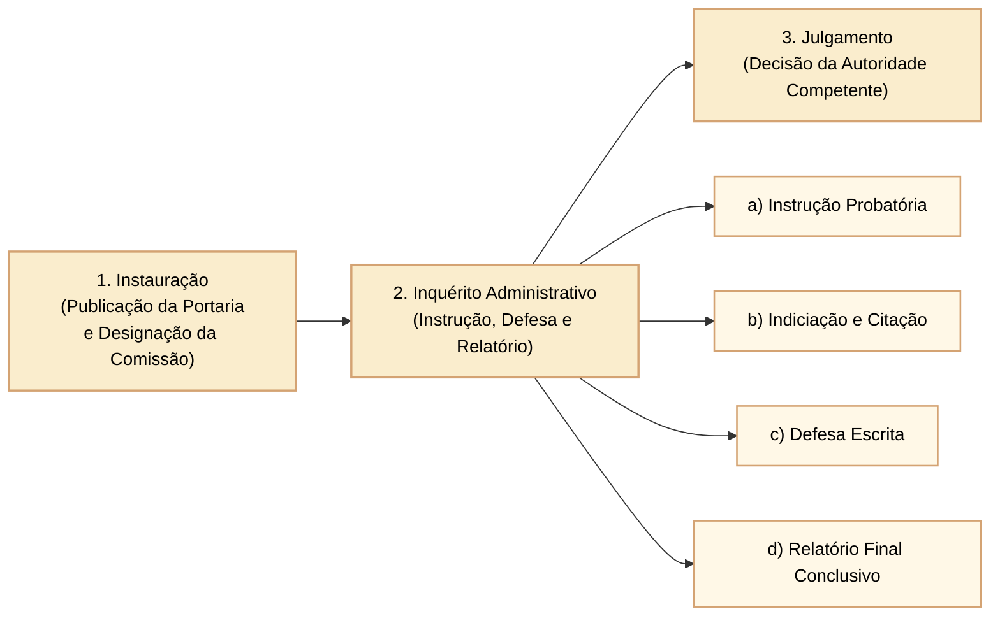
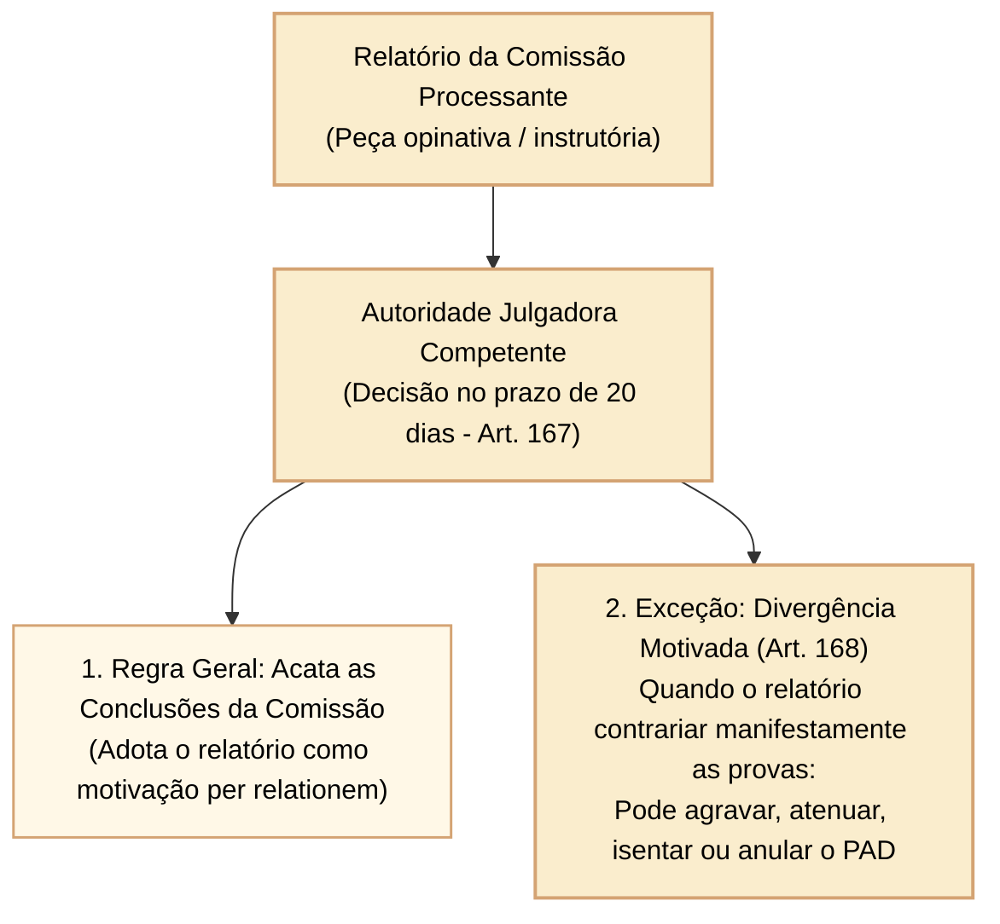

# Sindicância, processo administrativo disciplinar e seus ritos: ordinário e sumário

O procedimento disciplinar constitui a via instrumental indispensável por meio da qual a Administração Pública Federal apura a autoria e a materialidade de faltas funcionais, garantindo a regularidade do serviço público em harmonia com o contraditório e a ampla defesa. A **Lei nº 8.112/1990**, em seus arts. 143 a 182, estrutura dois instrumentos básicos de apuração: a **sindicância** e o **Processo Administrativo Disciplinar (PAD)**, este último desdobrado no **rito ordinário** (regra geral) e no **rito sumário** (rito especial e célere para infrações formais específicas).

Nas provas do Cebraspe para carreiras da Câmara dos Deputados, a distinção minuciosa entre as fases processuais, os prazos de conclusão e prorrogação, a composição da comissão processante, a intimação e citação do indiciado, o regime da revelia e a fase de julgamento constituem pontos de máxima cobrança e alta taxa de distração.

---

## 1. O dever de apuração e a escolha do instrumento adequado

A autoridade que tiver ciência de irregularidade no serviço público é **obrigada a promover a sua apuração imediata**, mediante sindicância ou processo administrativo disciplinar, sob pena de responsabilidade funcional (art. 143).

### 1.1 A sindicância: natureza e resultados possíveis (art. 145)

A sindicância pode ostentar caráter meramente investigatório/preparatório (semelhante ao inquérito policial) ou natureza punitiva formal (quando já delimitada a autoria e assegurado o contraditório).

Da sindicância instaurada pela autoridade competente poderá resultar exclusivamente:
1. **Arquivamento do processo:** quando comprovada a inexistência do fato ou a ausência de indícios mínimos de autoria;
2. **Aplicação de penalidade de advertência ou de suspensão de até 30 (trinta) dias:** limite sancionatório máximo da sindicância punitiva (art. 145, II);
3. **Instauração de processo disciplinar:** obrigatória sempre que a gravidade da conduta revelar infração punível com suspensão por mais de 30 dias, demissão, cassação de aposentadoria/disponibilidade ou destituição de cargo em comissão (art. 145, III).

- **Prazo da sindicância (art. 145, parágrafo único):** o prazo para conclusão da sindicância não excederá **30 (trinta) dias**, podendo ser prorrogado por igual período, a critério da autoridade superior.

---

## 2. Processo Administrativo Disciplinar ordinário: estrutura e tríplice fase

O PAD ordinário é o instrumento obrigatório para apuração de infrações capituladas com as penalidades mais graves do estatuto (art. 146). Desenvolve-se em três fases sucessivas e inconfundíveis (art. 151):

### 2.1 Composição e garantias da comissão processante (art. 149)

- O PAD será conduzido por uma comissão composta por **3 (três) servidores estáveis** designados pela autoridade competente;
- **Presidência da comissão:** o presidente da comissão deverá ser ocupante de cargo efetivo **superior ou de mesmo nível**, ou ter **nível de escolaridade igual ou superior** ao do indiciado (art. 149);
- **Impedimentos e suspeições:** não poderá participar da comissão cônjuge, companheiro ou parente do acusado, consanguíneo ou afim, em linha reta ou colateral, até o **terceiro grau** (art. 149, § 2º).

### 2.2 Prazos do rito ordinário (art. 152)

- O prazo para a conclusão do PAD ordinário é de **até 60 (sessenta) dias**, contados da data de publicação do ato que constituir a comissão;
- Admite-se a **prorrogação por igual prazo (mais 60 dias)**, quando as circunstâncias o exigirem, mediante solicitação motivada da comissão à autoridade instauradora;
- **Excesso de prazo:** a extrapolação do prazo legal de 120 dias pela comissão **não acarreta a nulidade do processo** (Súmula nº 592 do STJ). Apenas cessa a eficácia de eventual afastamento preventivo e faz reiniciar por inteiro a contagem do prazo prescricional (Súmula 635 do STJ).

---

## 3. A fase do inquérito administrativo: instrução, indiciação, defesa e relatório

O inquérito administrativo obedece ao princípio do contraditório, assegurada ao acusado ampla defesa, com a utilização dos meios e recursos admitidos em direito (art. 153).

### 3.1 Instrução probatória

- A comissão promoverá a tomada de depoimentos, acareações, investigações e perícias cabíveis;
- **Depoimentos de testemunhas:** as testemunhas serão intimadas a depor mediante mandado expedido pelo presidente da comissão. Se a testemunha for servidor público, a expedição do mandado será comunicada imediatamente ao chefe da repartição onde serve (art. 157);
- As testemunhas serão ouvidas **separadamente**. O procurador do acusado poderá assistir ao interrogatório e à inquirição das testemunhas, sendo-lhe vedado intervir nas perguntas e respostas, facultando-se-lhe reinquirir a testemunha por intermédio do presidente da comissão (art. 156, § 1º c/c art. 159, § 2º);
- **Interrogatório do acusado:** o acusado será qualificado e interrogado sobre as imputações. O interrogatório é ato personalíssimo, mas o defensor poderá estar presente.

### 3.2 Indiciação, citação e prazo de defesa escrita (art. 161)

Tipificada a infração disciplinar e formulada a indiciação do servidor, com a especificação clara dos fatos a ele imputados e das respectivas provas:
1. O indiciado será **citado pessoalmente** por mandado para apresentar defesa escrita no prazo de **10 (dez) dias**;
2. Havendo **dois ou mais indiciados**, o prazo de defesa será **comum de 20 (vinte) dias** (art. 161, § 1º);
3. Estando o indiciado em lugar incerto e não sabido, será citado por **edital** publicado no Diário Oficial e em jornal de grande circulação, com prazo de **15 (quinze) dias** para defesa a contar da publicação (art. 163).

### 3.3 Revelia e a nomeação de defensor dativo (art. 164)

- Achando-se o indiciado regularmente citado e não comparecendo para apresentar defesa no prazo legal, será declarado **revel** por termo lavrado nos autos;
- A revelia no processo disciplinar não induz confissão ficta automática em prejuízo do indiciado;
- Para defender o indiciado revel, a autoridade instauradora designará obrigatoriamente um servidor estável como **defensor dativo**, que deverá ocupar cargo de nível igual ou superior ao do indiciado.

### 3.4 Relatório conclusivo da comissão (art. 165)

Apreciada a defesa, a comissão elaborará **relatório minucioso**, onde resumirá as peças principais dos autos e mencionará as provas em que se baseou para formar sua convicção. O relatório será conclusivo quanto à inocência ou à responsabilidade do servidor, indicando o dispositivo legal transgredido e as penalidades cabíveis. Concluído o relatório, o processo será remetido à autoridade julgadora competente.

---

## 4. Fase de julgamento e vícios sanáveis

Recebido o processo disciplinar com o relatório da comissão, a autoridade julgadora proferirá a sua decisão no prazo de **20 (vinte) dias** (art. 167).

- **Vinculação ao relatório da comissão (art. 168):** o julgamento acatará o relatório da comissão, **salvo quando contrário às provas dos autos**. Se o relatório contrariar a evidência das provas, a autoridade julgadora poderá, motivadamente, agravar a penalidade proposta, abrandá-la ou isentar o servidor de responsabilidade.
- **Competência para o julgamento da demissão (art. 141):** no âmbito dos Poderes da União, a demissão de servidor efetivo é de competência privativa do **Presidente da República** (admitida delegação aos Ministros de Estado pelo art. 84, parágrafo único, CF), dos **Presidentes das Casas do Congresso Nacional** (Câmara dos Deputados e Senado Federal) e dos **Presidentes dos Tribunais Federais e do STF**.

---

## 5. Rito sumário: hipóteses taxativas e prazos enxutos

O **rito sumário** é o procedimento disciplinar concentrado e simplificado previsto nos arts. 133 e 140 da Lei nº 8.112/1990, reservado para três hipóteses taxativas e de constatação eminentemente documental:
1. **Acumulação ilegal de cargos, empregos ou funções públicas (art. 133);**
2. **Abandono de cargo (art. 140);**
3. **Inassiduidade habitual (art. 140).**

| Elemento Procedimental | Rito Ordinário (Geral) | Rito Sumário (Especial) |
| :--- | :--- | :--- |
| **Infrações Abrangidas** | Todas as infrações graves e demissíveis em geral. | Exclusivamente: Acumulação Ilegal, Abandono de Cargo e Inassiduidade Habitual. |
| **Composição da Comissão** | **3 (três) servidores estáveis** (art. 149). | **2 (dois) servidores estáveis** (art. 133, § 2º c/c art. 140, § 1º). |
| **Prazo de Conclusão** | **60 dias**, prorrogáveis por mais **60 dias** (art. 152). | **30 dias**, prorrogáveis por mais **15 dias** (art. 133, § 7º). |
| **Citação e Defesa Escrita** | Indiciação prévia; citação para defesa em **10 dias** (ou 20 se múltiplos). | Citação formal já acompanhada do termo de indiciamento para defesa em **5 dias** (art. 133, § 3º). |
| **Prazo para Julgamento** | **20 dias** (art. 167). | **5 dias** (art. 133, § 7º). |
| **Opção de Boa-Fé (Acumulação)** | Não aplicável. | O servidor citado tem até o último dia do prazo de defesa para fazer a **opção por um dos cargos**, convertendo-se em exoneração e extinguindo o processo de boa-fé (art. 133, § 5º). |

---

## 6. Questões comentadas

*(Inédita: estilo Cebraspe / Câmara dos Deputados – Analista Legislativo)*  
**1.** Da conclusão de sindicância administrativa instaurada no âmbito da Câmara dos Deputados poderá resultar diretamente a aplicação da penalidade de suspensão funcional por até noventa dias, dispensando-se a instauração de PAD em face da celeridade procedimental.

> **Gabarito: ERRADO**  
> **Comentário:** Conforme o art. 145, II, da Lei nº 8.112/1990, da sindicância somente poderá resultar a aplicação de penalidade de advertência ou de **suspensão por até trinta dias**. Se a infração apurada justificar a aplicação de suspensão superior a 30 dias ou de demissão, a comissão de sindicância deverá obrigatoriamente propor a instauração de Processo Administrativo Disciplinar (art. 145, III).

*(Inédita: estilo Cebraspe / Câmara dos Deputados – Analista Legislativo)*  
**2.** A comissão responsável pela condução de processo administrativo disciplinar sob o rito sumário para apuração de inassiduidade habitual é composta por dois servidores estáveis, dispondo a comissão do prazo de trinta dias para a conclusão dos trabalhos, admitida a prorrogação por até quinze dias.

> **Gabarito: CERTO**  
> **Comentário:** Assertiva exata em relação ao art. 140, § 1º c/c art. 133, §§ 2º e 7º, da Lei nº 8.112/1990. No rito sumário (aplicável a abandono de cargo, inassiduidade habitual e acumulação ilegal), a comissão é formada por apenas 2 servidores estáveis (ao contrário do rito ordinário, que exige 3 servidores), e o prazo é de 30 dias prorrogável por mais 15 dias.

*(Inédita: estilo Cebraspe / Câmara dos Deputados – Analista Legislativo)*  
**3.** O excesso de prazo para a conclusão de processo administrativo disciplinar conduz à nulidade insanável de todo o procedimento, gerando o arquivamento automático dos autos em benefício do servidor indiciado.

> **Gabarito: ERRADO**  
> **Comentário:** Trata-se de tese sumulada do Superior Tribunal de Justiça: "O excesso de prazo para a conclusão do processo administrativo disciplinar não é causa de nulidade, quando não demonstrado prejuízo à defesa" (Súmula nº 592 do STJ). A inobservância do prazo ordinário de 120 dias constitui mera irregularidade formal que não acarreta anulação do processo, produzindo apenas efeitos sobre a cessação do afastamento preventivo e a contagem prescricional.

*(Inédita: estilo Cebraspe / Câmara dos Deputados – Analista Legislativo)*  
**4.** Na apuração de acumulação ilegal de cargos públicos pelo rito sumário, caso o servidor indiciado comprove que agiu de boa-fé e exerça o direito de opção por um dos vínculos até o último dia do prazo para apresentação da defesa escrita, a sua opção implicará a exoneração do outro cargo e a automática extinção do procedimento sem a aplicação de penalidade disciplinar.

> **Gabarito: CERTO**  
> **Comentário:** Conforme preceitua o art. 133, § 5º, da Lei nº 8.112/1990: "A opção pelo servidor até o último dia de prazo para defesa configurará sua boa-fé, hipótese em que se converterá automaticamente em pedido de exoneração do outro cargo". Assim, a opção tempestiva elide a má-fé e extingue o processo sem sanção de demissão.

*(Inédita: estilo Cebraspe / Câmara dos Deputados – Analista Legislativo)*  
**5.** Em observância estrita ao princípio da congruência e à autonomia da comissão processante, a autoridade julgadora é juridicamente obrigada a acatar integralmente a proposta de penalidade veiculada no relatório final do PAD, sendo-lhe defeso agravar a punição sugerida.

> **Gabarito: ERRADO**  
> **Comentário:** Conforme o art. 168 da Lei nº 8.112/1990, a autoridade julgadora acatará o relatório da comissão, **salvo quando contrário às provas dos autos**. Se o relatório contrariar a evidência das provas, a autoridade julgadora poderá, de forma motivada, abrandar a penalidade, isentar o servidor ou até mesmo agravar a punição recomendada pela comissão processante.

*(Inédita: estilo Cebraspe / Câmara dos Deputados – Analista Legislativo)*  
**6.** Não poderá participar como membro de comissão processante de processo administrativo disciplinar o servidor público que for cônjuge, companheiro ou parente consanguíneo ou afim do acusado, em linha reta ou colateral, até o terceiro grau civil.

> **Gabarito: CERTO**  
> **Comentário:** Disposição literal do art. 149, § 2º, da Lei nº 8.112/1990: "Não poderá participar de comissão de sindicância ou de inquérito, cônjuge, companheiro ou parente do acusado, consangüíneo ou afim, em linha reta ou colateral, até o terceiro grau". O impedimento visa salvaguardar a imparcialidade e a moralidade da apuração disciplinar.
