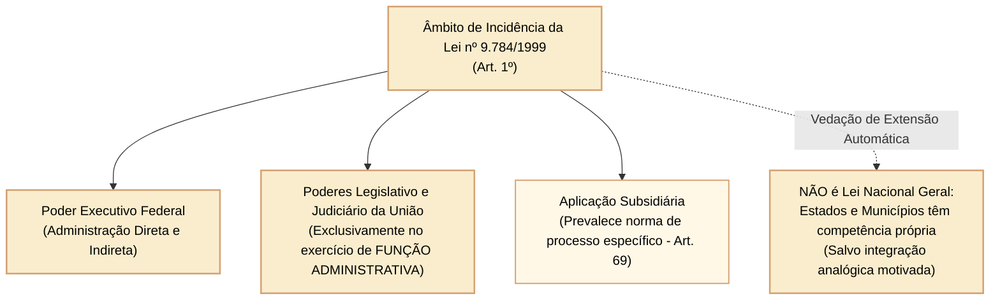
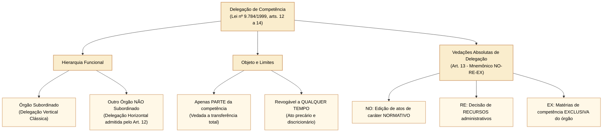
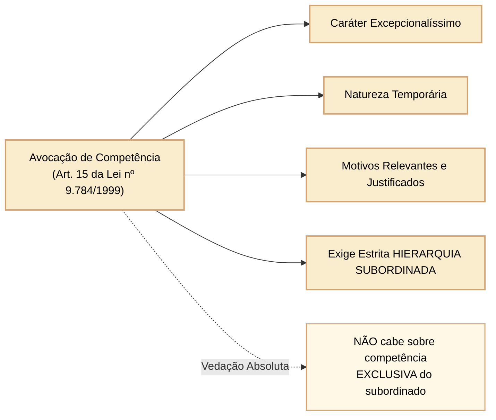

# Lei nº 9.784/1999: processo administrativo federal, competência, delegação e avocação

Imagine que um cidadão pede à Câmara dos Deputados a revisão de uma decisão administrativa. Quem pode decidir o pedido? A autoridade que recebeu o processo pode pedir que outra decida? E um superior pode assumir a decisão? Essas perguntas envolvem **competência administrativa**, isto é, a atribuição dada por norma a um órgão ou agente para praticar determinado ato. A Lei nº 9.784, de 29 de janeiro de 1999, estabelece regras para responder a elas.

A lei se aplica à Administração Pública federal direta e indireta. Também alcança a Câmara e os demais órgãos dos Poderes Legislativo e Judiciário da União **quando exercem função administrativa**, como gerir pessoal ou contratos, e não quando legislam ou julgam processos judiciais (art. 1º, § 1º). Processos federais com lei específica seguem primeiro essa lei especial; a Lei nº 9.784/1999 atua de forma subsidiária no que for compatível (art. 69). Isso não torna a lei automaticamente obrigatória para todos os processos estaduais e municipais.

O ponto decisivo é distinguir **titularidade da competência**, que permanece atribuída pela norma, de **exercício da competência**, que pode mudar temporariamente nas condições legais. A seguir, a regra será aplicada a situações concretas, antes de comparar delegação e avocação.
---

## 1. Âmbito de aplicação e princípios fundamentais do processo administrativo

O art. 1º estabelece que a Lei nº 9.784/1999 visa precipuamente à **proteção dos direitos dos administrados e ao melhor cumprimento dos fins da Administração**.

### 1.1 Princípios expressos e critérios procedimentais (art. 2º)

A Administração Pública obedecerá, dentre outros, aos princípios da **legalidade, finalidade, motivação, razoabilidade, proporcionalidade, moralidade, ampla defesa, contraditório, segurança jurídica, interesse público e eficiência**.

Nos termos do parágrafo único do art. 2º, destacam-se os seguintes critérios norteadores:
- **Atuação conforme a lei e o Direito:** consagração do princípio da juridicidade administrativa (respeito à legalidade e aos princípios constitucionais);
- **Impulsão de ofício:** o processo administrativo pode iniciar-se de ofício ou a pedido do interessado, mas, uma vez instaurado, a sua tramitação e instrução são impulsionadas de ofício pela própria Administração, sem prejuízo da atuação dos interessados (art. 2º, parágrafo único, XII, combinado com o art. 29);
- **Formalismo moderado:** adoção de formas simples, suficientes para propiciar adequado grau de certeza, segurança e respeito aos direitos dos administrados, vedada a exigência de formalidades dispensáveis (art. 2º, parágrafo único, VIII e IX);
- **Proibição de cobrança de despesas processuais:** ressalvadas as previstas em lei expressa (gratuidade do processo administrativo);
- **Vedação de aplicação retroativa de nova interpretação:** a alteração superveniente de orientação interpretativa jurídica da Administração não autoriza a desconstituição de atos pretéritos consolidados sob a orientação anterior, preservando a segurança jurídica e a confiança legítima (art. 2º, parágrafo único, XIII).

---

## 2. Direitos e deveres do administrado e legitimação processual

### 2.1 Direitos do administrado no processo (art. 3º)

O administrado tem perante a Administração os seguintes direitos subjetivos expressos:
1. Ser tratado com respeito pelas autoridades e servidores;
2. Ter ciência da tramitação dos processos administrativos em que tenha a condição de interessado, ter vista dos autos, obter cópias de documentos neles contidos e conhecer as decisões proferidas;
3. Formular alegações e apresentar documentos antes da decisão, os quais serão obrigatoriamente considerados pelo órgão competente na motivação;
4. Fazer-se assistir, facultativamente, por advogado, **salvo quando a representação for obrigatória por força de lei**. A assistência por advogado é facultativa como regra geral nos processos administrativos (consoante Súmula Vinculante nº 5 do Supremo Tribunal Federal (STF)).

### 2.2 Legitimidade para figurar como interessado (art. 9º)

São legitimados como interessados no processo administrativo:
- Pessoas físicas ou jurídicas que o iniciem como titulares de direitos ou interesses individuais, ou no exercício do direito de representação;
- Aqueles que, sem terem iniciado o processo, têm direitos ou interesses que possam ser diretamente afetados pela decisão a ser adotada;
- As organizações e associações representativas, no tocante a **direitos e interesses coletivos**;
- As pessoas ou as associações legalmente constituídas, quanto a **direitos ou interesses difusos**.

---

## 3. Regime da competência administrativa: irrenunciabilidade e características

Uma servidora recebe um pedido de autorização, mas a norma atribui a decisão à chefia. A servidora pode preparar documentos e analisar fatos, porém não pode assumir a decisão final por simples acordo com a chefia. **Competência administrativa** é justamente a atribuição jurídica para praticar o ato; ter acesso ao processo não significa ter poder para decidir.

O art. 11 da Lei nº 9.784/1999 estabelece que a competência é **irrenunciável**: o órgão ou agente não pode abandoná-la por vontade própria. A mesma regra admite duas mudanças legalmente autorizadas no **exercício** dessa competência: delegação e avocação. A titularidade prevista na norma não desaparece por causa delas.

Na **delegação**, quem possui a competência autoriza outro órgão ou agente a exercer uma parte dela, dentro de limites definidos. Na **avocação**, um órgão hierarquicamente superior assume temporariamente uma competência atribuída ao inferior, em situação excepcional e justificada. Assim, a pergunta correta é: *quem tem a atribuição original e qual mecanismo permite que outra autoridade exerça o ato?*

**Contraexemplo:** um chefe não pode transferir a competência apenas porque prefere deixar de responder pelo assunto. É necessário observar as condições e proibições dos arts. 12 a 15. Também não basta que dois órgãos trabalhem no mesmo processo para existir hierarquia entre eles.

---

## 4. Delegação de competência: conceito, pressupostos e limites

A **delegação** é o ato administrativo discricionário por meio do qual uma autoridade ou órgão transfere temporariamente o **exercício** (e não a titularidade definitiva) de parte de suas competências a outro órgão ou autoridade.

### 4.1 Pressupostos e características da delegação (arts. 12 e 14)

Pense em um órgão federal que recebe muitos pedidos técnicos. A autoridade competente pode delegar **parte** das decisões a outra autoridade, inclusive de órgão que não lhe seja subordinado, se não houver impedimento legal e a medida for conveniente por razões técnicas, sociais, econômicas, jurídicas ou territoriais (art. 12). Portanto, **delegar não exige hierarquia**. A norma também admite delegação de competência de órgão colegiado a seu presidente.

O procedimento precisa ser verificável: o ato de delegação deve identificar as matérias e poderes abrangidos, os limites da atuação, a duração, os objetivos e o recurso cabível. Pode reservar à autoridade original o exercício de alguma atribuição. O ato e sua revogação são publicados no meio oficial (art. 14, caput e § 1º). A autoridade delegante pode revogar a delegação a qualquer momento (art. 14, § 2º).

Quem decide concretamente por delegação deve mencionar essa condição no ato. A decisão é considerada editada **pela autoridade delegada**, conforme o art. 14, § 3º. Isso permite identificar quem praticou o ato, em vez de atribuí-lo automaticamente a quem delegou.

### 4.2 As vedações absolutas à delegação: o mnemônico NO-RE-EX (art. 13)

Antes de delegar, é preciso verificar **o tipo de ato**. O art. 13 proíbe a delegação de três matérias:

1. **NO, atos normativos:** editar normas gerais, em vez de decidir um caso individual.
2. **RE, recursos administrativos:** decidir o pedido de reexame de uma decisão administrativa.
3. **EX, competência exclusiva:** exercer atribuição que a norma reservou exclusivamente àquele órgão ou autoridade.

**Exemplo:** uma autoridade pode delegar a decisão sobre pedidos individuais quando a lei permitir, mas não pode delegar a decisão de um recurso administrativo. A diferença está no **objeto da decisão**, não na quantidade de trabalho ou na confiança no delegado. O mnemônico ajuda a lembrar as proibições; é a lista do art. 13 que fundamenta a resposta.

---

## 5. Avocação de competência: excepcionalidade e requisitos cumulativos

A **avocação** é o ato administrativo excepcional por meio do qual uma autoridade superior atrai para si o exercício de competência atribuída originariamente a um órgão ou autoridade inferior subordinada.

### 5.1 Requisitos legais cumulativos da avocação (art. 15)

Imagine que a chefia de uma unidade precise assumir temporariamente uma decisão normalmente atribuída a uma unidade subordinada, porque surgiu um problema relevante que exige atuação direta. O art. 15 permite essa **avocação** somente em caráter excepcional, por motivos relevantes devidamente justificados e por tempo limitado. A unidade cuja competência é avocada deve ser **hierarquicamente inferior** à que assume a decisão.

O raciocínio segue quatro perguntas: há uma relação de hierarquia? A situação é excepcional? O motivo relevante foi explicado? A medida é temporária? Se faltar qualquer uma dessas condições, o art. 15 não autoriza a avocação. A avocação também não serve para afastar uma competência legalmente exclusiva do órgão inferior.

**Comparação prática:** delegação pode ocorrer entre órgãos sem subordinação, dentro dos limites dos arts. 12 a 14; avocação exige superioridade hierárquica e justificativa excepcional, conforme o art. 15. **Contraexemplo:** dois órgãos federais independentes podem participar do mesmo processo, mas um não pode avocar a competência do outro apenas por considerar sua decisão mais importante.

**Autochecagem, estilo Certo/Errado:** “Uma autoridade superior pode avocar permanentemente as competências de um órgão inferior sempre que isso melhorar a eficiência.” **Errado.** O art. 15 exige situação excepcional, motivo relevante justificado e caráter temporário; eficiência isolada não elimina esses requisitos.

---

## 6. O instituto da decisão coordenada (Lei nº 14.210/2021)

A Lei nº 14.210/2021 inseriu os arts. 49-A a 49-G na Lei nº 9.784/1999, disciplinando o mecanismo da **decisão coordenada**.

- **Conceito:** é a articulação formal de órgãos ou entidades da administração pública federal que tenham competências decisórias conexas para deliberar conjuntamente sobre matéria complexa e intersetorial, visando à integração e simplificação do processo decisório (art. 49-A);
- **Vedações absolutas de cabimento (art. 49-A, § 1º):** o instituto da decisão coordenada **não se aplica**:
  1. Aos processos administrativos de **licitação**;
  2. Aos processos relacionados ao poder sancionador da administração (**processos disciplinares ou punitivos**);
  3. Aos processos em que haja discordância que envolva matéria sob competência privativa de órgãos ou poderes com autonomia constitucional.

---

## 7. Questões comentadas

*(Inédita: estilo Cebraspe / Câmara dos Deputados – Analista Legislativo)*  
**1.** No âmbito da Administração Pública Federal, a delegação de competência administrativa pressupõe necessariamente a existência de vínculo de subordinação hierárquica entre a autoridade delegante e a autoridade delegada.

> **Gabarito: ERRADO**  
> **Comentário:** O art. 12 da Lei nº 9.784/1999 autoriza expressamente a delegação entre órgãos ou autoridades "ainda que estes não lhe sejam hierarquicamente subordinados". A delegação pode ser horizontal (entre órgãos no mesmo nível hierárquico ou sem vínculo de tutela/subordinação direta). A exigência de subordinação hierárquica é requisito obrigatório da **avocação** (art. 15), mas não da delegação.

*(Inédita: estilo Cebraspe / Câmara dos Deputados – Analista Legislativo)*  
**2.** É legalmente vedada a delegação da competência para a edição de atos administrativos de caráter normativo, para a decisão de recursos administrativos e para as matérias que a lei reserve como de competência exclusiva do órgão ou autoridade.

> **Gabarito: CERTO**  
> **Comentário:** Trata-se da reprodução estrita das hipóteses taxativas de indelegabilidade absoluta constantes do art. 13 da Lei nº 9.784/1999 (mnemônico NO-RE-EX: edição de atos normativos, decisão de recursos administrativos e matérias de competência exclusiva).

*(Inédita: estilo Cebraspe / Câmara dos Deputados – Analista Legislativo)*  
**3.** Praticado ato administrativo no exercício de competência delegada, eventual mandado de segurança impetrado pelo administrado prejudicado deverá apontar como autoridade coatora a autoridade delegante que outorgou os poderes, tendo em vista a titularidade originária da função pública.

> **Gabarito: ERRADO**  
> **Comentário:** Conforme preceitua o art. 14, § 3º, da Lei nº 9.784/1999, as decisões adotadas por delegação consideram-se praticadas pelo órgão delegado. Ademais, a Súmula nº 510 do Supremo Tribunal Federal estabelece expressamente: "Praticado o ato por autoridade, no exercício de competência delegada, contra ela cabe o mandado de segurança ou a medida judicial". A autoridade coatora é a delegada, não a delegante.

*(Inédita: estilo Cebraspe / Câmara dos Deputados – Analista Legislativo)*  
**4.** A avocação de competência administrativa constitui ato de natureza excepcional e temporária que exige fundamentação expressa em motivos relevantes devidamente justificados, sendo cabível inclusive sobre competências atribuídas em caráter de exclusividade ao órgão subordinado.

> **Gabarito: ERRADO**  
> **Comentário:** A primeira parte da assertiva está correta nos termos do art. 15 da Lei nº 9.784/1999. Todavia, a avocação é terminantemente vedada sobre matérias conferidas por lei como de competência **exclusiva** do órgão ou autoridade subordinada, sob pena de violação direta à reserva legal da competência funcional.

*(Inédita: estilo Cebraspe / Câmara dos Deputados – Analista Legislativo)*  
**5.** Em processo administrativo federal regulado pela Lei nº 9.784/1999, o princípio da impulsão de ofício autoriza a Administração Pública a iniciar e conduzir a instrução processual para tutela do interesse coletivo, não obstante a presença de administrados formalmente habilitados como interessados.

> **Gabarito: CERTO**  
> **Comentário:** De acordo com o art. 2º, parágrafo único, XII, combinado com o art. 29 da Lei nº 9.784/1999, o processo administrativo rege-se pelo princípio da impulsão de ofício, cabendo à Administração promover todos os atos necessários à elucidação dos fatos e à instrução probatória (verdade material), independentemente de provocação ou de requerimento formulado pelos interessados.

*(Inédita: estilo Cebraspe / Câmara dos Deputados – Analista Legislativo)*  
**6.** O instrumento da decisão coordenada, introduzido na Lei nº 9.784/1999 pela Lei nº 14.210/2021 para a deliberação conjunta entre órgãos e entidades sobre matérias complexas, pode ser plenamente utilizado em processos administrativos de licitação pública e em processos de natureza punitivo-disciplinar.

> **Gabarito: ERRADO**  
> **Comentário:** O art. 49-A, § 1º, da Lei nº 9.784/1999 veda expressamente a aplicação da decisão coordenada aos processos administrativos de licitação e àqueles relacionados ao poder sancionador da Administração Pública (como processos disciplinares e punitivos).
