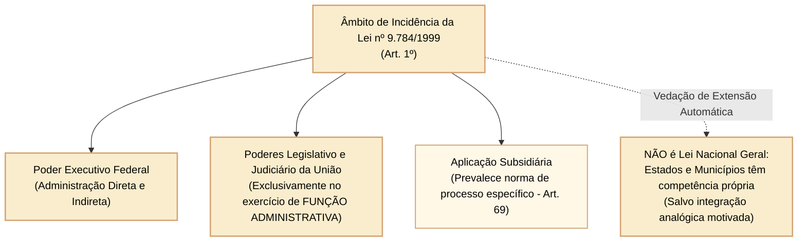
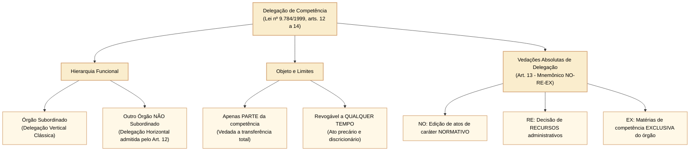
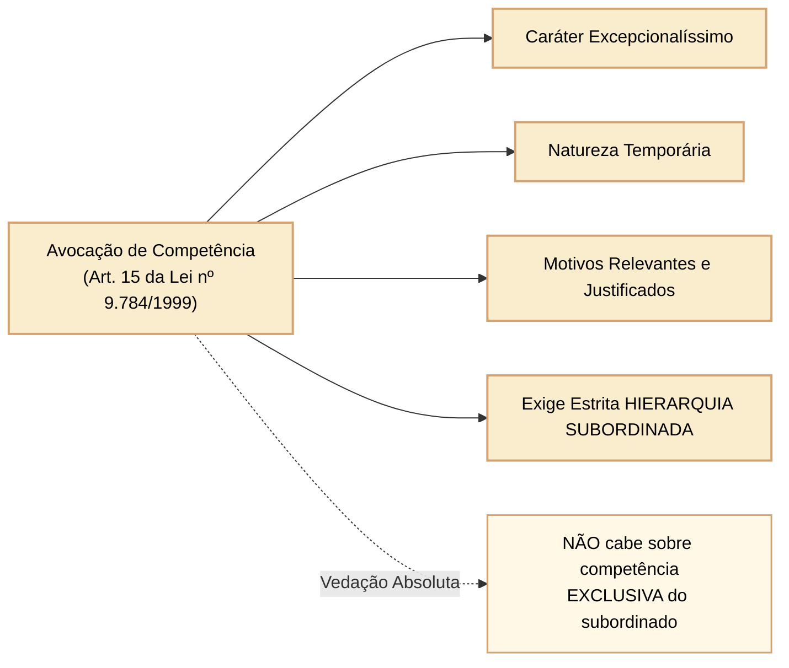

# Lei nº 9.784/1999: processo administrativo federal, competência, delegação e avocação

A **Lei nº 9.784, de 29 de janeiro de 1999**, disciplina o processo administrativo no âmbito da Administração Pública Federal direta e indireta. Longe de constituir um código nacional aplicável indistintamente a Estados e Municípios, a norma federal possui caráter geral na União, incidindo subsidiariamente sobre processos regidos por legislação especial e aplicando-se expressamente aos órgãos dos Poderes Legislativo e Judiciário da União quando no desempenho de **função materialmente administrativa** (art. 1º, § 1º).

Para as provas do Cebraspe direcionadas à Câmara dos Deputados, a exata delimitação do âmbito de incidência da lei, os postulados reitores do processo, o regime jurídico da competência administrativa, os requisitos da delegação e as matérias de indelegabilidade absoluta (mnemônico NO-RE-EX), bem como os pressupostos excepcionais da avocação, constituem pontos centrais de frequente cobrança.

---

## 1. Âmbito de aplicação e princípios fundamentais do processo administrativo

O art. 1º estabelece que a Lei nº 9.784/1999 visa precipuamente à **proteção dos direitos dos administrados e ao melhor cumprimento dos fins da Administração**.

### 1.1 Princípios expressos e critérios procedimentais (art. 2º)

A Administração Pública obedecerá, dentre outros, aos princípios da **legalidade, finalidade, motivação, razoabilidade, proporcionalidade, moralidade, ampla defesa, contraditório, segurança jurídica, interesse público e eficiência**.

Nos termos do parágrafo único do art. 2º, destacam-se os seguintes critérios norteadores:
- **Atuação conforme a lei e o Direito:** consagração do princípio da juridicidade administrativa (respeito à legalidade e aos princípios constitucionais);
- **Impulsão de ofício:** o processo administrativo pode iniciar-se de ofício ou a pedido do interessado, mas, uma vez instaurado, a sua tramitação e instrução são impulsionadas de ofício pela própria Administração, sem prejuízo da atuação dos interessados (art. 2º, parágrafo único, XII c/c art. 29);
- **Formalismo moderado:** adoção de formas simples, suficientes para propiciar adequado grau de certeza, segurança e respeito aos direitos dos administrados, vedada a exigência de formalidades dispensáveis (art. 2º, parágrafo único, VIII e IX);
- **Proibição de cobrança de despesas processuais:** ressalvadas as previstas em lei expressa (gratuidade do processo administrativo);
- **Vedação de aplicação retroativa de nova interpretação:** a alteração superveniente de orientação interpretativa jurídica da Administração não autoriza a desconstituição de atos pretéritos consolidados sob a orientação anterior, preservando a segurança jurídica e a confiança legítima (art. 2º, parágrafo único, XIII).

---

## 2. Direitos e deveres do administrado e legitimação processual

### 2.1 Direitos do administrado no processo (art. 3º)

O administrado tem perante a Administração os seguintes direitos subjetivos expressos:
1. Ser tratado com respeito pelas autoridades e servidores;
2. Ter ciência da tramitação dos processos administrativos em que tenha a condição de interessado, ter vista dos autos, obter cópias de documentos neles contidos e conhecer as decisões proferidas;
3. Formular alegações e apresentar documentos antes da decisão, os quais serão obrigatoriamente considerados pelo órgão competente na motivação;
4. Fazer-se assistir, facultativamente, por advogado, **salvo quando a representação for obrigatória por força de lei**. A assistência por advogado é facultativa como regra geral nos processos administrativos (consoante Súmula Vinculante nº 5 do STF).

### 2.2 Legitimidade para figurar como interessado (art. 9º)

São legitimados como interessados no processo administrativo:
- Pessoas físicas ou jurídicas que o iniciem como titulares de direitos ou interesses individuais, ou no exercício do direito de representação;
- Aqueles que, sem terem iniciado o processo, têm direitos ou interesses que possam ser diretamente afetados pela decisão a ser adotada;
- As organizações e associações representativas, no tocante a **direitos e interesses coletivos**;
- As pessoas ou as associações legalmente constituídas, quanto a **direitos ou interesses difusos**.

---

## 3. Regime da competência administrativa: irrenunciabilidade e características

A competência é a medida do poder público outorgada pela lei a determinado órgão ou agente para a prática de atos administrativos válidos. Conforme o art. 11 da Lei nº 9.784/1999:

> **Art. 11:** *"A competência é irrenunciável e se exerce pelos órgãos administrativos a que foi atribuída como própria, salvo os casos de delegação e avocação legalmente admitidos."*

A competência ostenta as seguintes características dogmáticas:
1. **Origem exclusivamente legal:** decorre sempre de norma expressa (lei formal ou ato normativo primário decorrente da Constituição);
2. **Imodificabilidade pela vontade das partes:** o agente e o particular não podem transigir para alterar a titularidade da competência fixada em lei;
3. **Imprescritibilidade:** o não exercício continuado da competência não acarreta a sua perda pelo transcurso do tempo;
4. **Intransferibilidade:** ressalvada a transferência precária e temporária do seu exercício por meio da delegação e da avocação.

---

## 4. Delegação de competência: conceito, pressupostos e limites

A **delegação** é o ato administrativo discricionário por meio do qual uma autoridade ou órgão transfere temporariamente o **exercício** (e não a titularidade definitiva) de parte de suas competências a outro órgão ou autoridade.

### 4.1 Pressupostos e características da delegação (arts. 12 e 14)

- **Dispensa de hierarquia (delegação horizontal):** um dos pontos de maior incidência no Cebraspe. O art. 12 estabelece expressamente que um órgão administrativo e seu titular poderão delegar parte da sua competência a outros órgãos ou titulares, **ainda que estes não lhe sejam hierarquicamente subordinados**, quando for conveniente, em razão de circunstâncias de índole técnica, social, econômica, jurídica ou territorial. Não é necessária relação de subordinação hierárquica;
- **Caráter parcial e temporário:** é vedada a delegação total ou genérica de atribuições;
- **Ato formal e publicado:** o ato de delegação e sua revogação deverão ser publicados no meio oficial (art. 14);
- **Revogabilidade discricionária:** o ato de delegação é revogável a qualquer tempo pela autoridade delegante (art. 14, § 2º);
- **Imputação e responsabilidade jurídica:** as decisões adotadas por delegação consideram-se praticadas **pelo órgão ou autoridade delegada** (art. 14, § 3º). Portanto, em sede de mandado de segurança, a autoridade coatora é a autoridade **delegada** que praticou o ato concreto, e não a autoridade delegante (Súmula nº 510 do STF).

### 4.2 As vedações absolutas à delegação: o mnemônico NO-RE-EX (art. 13)

O art. 13 da Lei nº 9.784/1999 elenca rol taxativo de matérias que **não podem ser objeto de delegação sob nenhuma hipótese**:

1. **NO:** a edição de atos de caráter **normativo**;
2. **RE:** a decisão de **recursos administrativos**;
3. **EX:** as matérias de competência **exclusiva** do órgão ou autoridade.

> **Regra de Ouro Cebraspe:**  
> A autoridade administrativa jamais poderá delegar a competência para julgar recurso interposto contra suas decisões, tampouco editar decretos regulamentares ou expedir instruções normativas por via delegada. A competência privativa pode ser delegada quando a lei não reservar caráter de exclusividade estrita; a competência exclusiva é insuscetível de delegação.

---

## 5. Avocação de competência: excepcionalidade e requisitos cumulativos

A **avocação** é o ato administrativo excepcional por meio do qual uma autoridade superior atrai para si o exercício de competência atribuída originariamente a um órgão ou autoridade inferior subordinada.

### 5.1 Requisitos legais cumulativos da avocação (art. 15)

Nos termos do art. 15:
> *"Será permitida, em caráter excepcional e por motivos relevantes devidamente justificados, a avocação temporária de competência atribuída a órgão administrativo hierarquicamente inferior."*

Para a validade da avocação, exige-se o concurso obrigatório de quatro requisitos cumulativos:
1. **Caráter excepcional:** a avocação não pode converter-se em rotina administrativa de esvaziamento do subordinado;
2. **Temporariedade:** a autoridade superior avoca a competência para a prática de ato específico ou instrução delimitada no tempo;
3. **Motivação qualificada:** demonstração explícita de motivos relevantes e justificados nos autos;
4. **Subordinação hierárquica indispensável:** diferentemente da delegação (que pode ser horizontal entre órgãos sem hierarquia), **a avocação exige obrigatoriamente relação de hierarquia** entre a autoridade que avoca e o órgão inferior. Não existe avocação entre órgãos desprovidos de vínculo hierárquico.
5. **Vedação:** a autoridade superior não pode avocar competência fixada em lei como exclusiva do subordinado.

---

## 6. O instituto da decisão coordenada (Lei nº 14.210/2021)

A Lei nº 14.210/2021 inseriu os arts. 49-A a 49-G na Lei nº 9.784/1999, disciplinando o mecanismo da **decisão coordenada**.

- **Conceito:** é a articulação formal de órgãos ou entidades da administração pública federal que tenham competências decisórias conexas para deliberar conjuntamente sobre matéria complexa e intersetorial, visando à integração e simplificação do processo decisório (art. 49-A);
- **Vedações absolutas de cabimento (art. 49-A, § 1º):** o instituto da decisão coordenada **não se aplica**:
  1. Aos processos administrativos de **licitação**;
  2. Aos processos relacionados ao poder sancionador da administração (**processos disciplinares ou punitivos**);
  3. Aos processos em que haja discordância que envolva matéria sob competência privativa de órgãos ou poderes com autonomia constitucional.

---

## 7. Questões comentadas

*(Inédita: estilo Cebraspe / Câmara dos Deputados – Analista Legislativo)*  
**1.** No âmbito da Administração Pública Federal, a delegação de competência administrativa pressupõe necessariamente a existência de vínculo de subordinação hierárquica entre a autoridade delegante e a autoridade delegada.

> **Gabarito: ERRADO**  
> **Comentário:** O art. 12 da Lei nº 9.784/1999 autoriza expressamente a delegação entre órgãos ou autoridades "ainda que estes não lhe sejam hierarquicamente subordinados". A delegação pode ser horizontal (entre órgãos no mesmo nível hierárquico ou sem vínculo de tutela/subordinação direta). A exigência de subordinação hierárquica é requisito obrigatório da **avocação** (art. 15), mas não da delegação.

*(Inédita: estilo Cebraspe / Câmara dos Deputados – Analista Legislativo)*  
**2.** É legalmente vedada a delegação da competência para a edição de atos administrativos de caráter normativo, para a decisão de recursos administrativos e para as matérias que a lei reserve como de competência exclusiva do órgão ou autoridade.

> **Gabarito: CERTO**  
> **Comentário:** Trata-se da reprodução estrita das hipóteses taxativas de indelegabilidade absoluta constantes do art. 13 da Lei nº 9.784/1999 (mnemônico NO-RE-EX: edição de atos normativos, decisão de recursos administrativos e matérias de competência exclusiva).

*(Inédita: estilo Cebraspe / Câmara dos Deputados – Analista Legislativo)*  
**3.** Praticado ato administrativo no exercício de competência delegada, eventual mandado de segurança impetrado pelo administrado prejudicado deverá apontar como autoridade coatora a autoridade delegante que outorgou os poderes, tendo em vista a titularidade originária da função pública.

> **Gabarito: ERRADO**  
> **Comentário:** Conforme preceitua o art. 14, § 3º, da Lei nº 9.784/1999, as decisões adotadas por delegação consideram-se praticadas pelo órgão delegado. Ademais, a Súmula nº 510 do Supremo Tribunal Federal estabelece expressamente: "Praticado o ato por autoridade, no exercício de competência delegada, contra ela cabe o mandado de segurança ou a medida judicial". A autoridade coatora é a delegada, não a delegante.

*(Inédita: estilo Cebraspe / Câmara dos Deputados – Analista Legislativo)*  
**4.** A avocação de competência administrativa constitui ato de natureza excepcional e temporária que exige fundamentação expressa em motivos relevantes devidamente justificados, sendo cabível inclusive sobre competências atribuídas em caráter de exclusividade ao órgão subordinado.

> **Gabarito: ERRADO**  
> **Comentário:** A primeira parte da assertiva está correta nos termos do art. 15 da Lei nº 9.784/1999. Todavia, a avocação é terminantemente vedada sobre matérias conferidas por lei como de competência **exclusiva** do órgão ou autoridade subordinada, sob pena de violação direta à reserva legal da competência funcional.

*(Inédita: estilo Cebraspe / Câmara dos Deputados – Analista Legislativo)*  
**5.** Em processo administrativo federal regulado pela Lei nº 9.784/1999, o princípio da impulsão de ofício autoriza a Administração Pública a iniciar e conduzir a instrução processual para tutela do interesse coletivo, não obstante a presença de administrados formalmente habilitados como interessados.

> **Gabarito: CERTO**  
> **Comentário:** De acordo com o art. 2º, parágrafo único, XII c/c art. 29 da Lei nº 9.784/1999, o processo administrativo rege-se pelo princípio da impulsão de ofício, cabendo à Administração promover todos os atos necessários à elucidação dos fatos e à instrução probatória (verdade material), independentemente de provocação ou de requerimento formulado pelos interessados.

*(Inédita: estilo Cebraspe / Câmara dos Deputados – Analista Legislativo)*  
**6.** O instrumento da decisão coordenada, introduzido na Lei nº 9.784/1999 pela Lei nº 14.210/2021 para a deliberação conjunta entre órgãos e entidades sobre matérias complexas, pode ser plenamente utilizado em processos administrativos de licitação pública e em processos de natureza punitivo-disciplinar.

> **Gabarito: ERRADO**  
> **Comentário:** O art. 49-A, § 1º, da Lei nº 9.784/1999 veda expressamente a aplicação da decisão coordenada aos processos administrativos de licitação e àqueles relacionados ao poder sancionador da Administração Pública (como processos disciplinares e punitivos).
