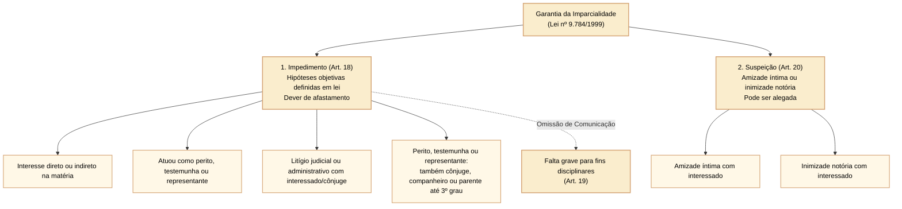
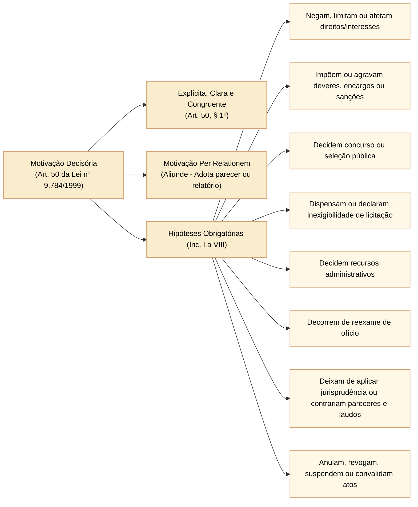
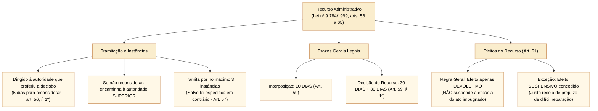
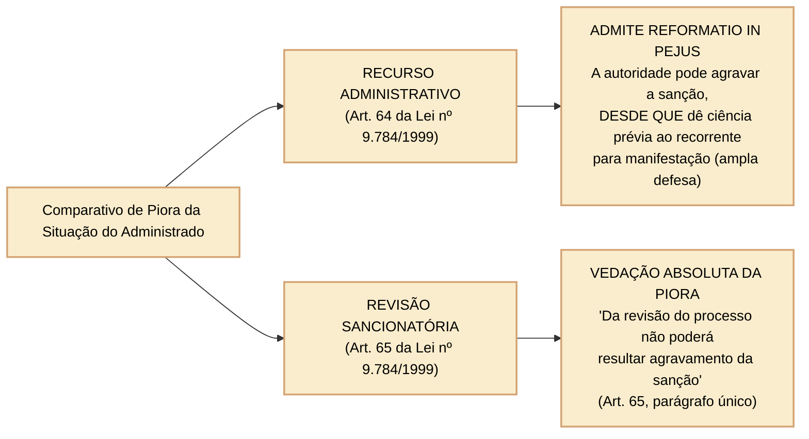

# Lei nº 9.784/1999: impedimento, suspeição, motivação dos atos decisórios e recursos administrativos

Imagine uma pessoa que contesta uma multa aplicada por um órgão federal. Quem pode decidir seu pedido? O responsável precisa explicar por que manteve a multa? E se a pessoa recorrer, a penalidade pode aumentar? A **Lei nº 9.784/1999** estabelece regras gerais para responder a essas perguntas nos processos administrativos federais. Processo administrativo é a sequência de atos usada pela Administração Pública para examinar um pedido, apurar fatos e tomar uma decisão.

A lei também alcança a Câmara dos Deputados e outros órgãos dos Poderes Legislativo e Judiciário da União **quando exercem função administrativa**, como decidir um pedido de servidor ou conduzir uma seleção, conforme o art. 1º, § 1º. Não se trata, nesse caso, do processo de elaboração das leis. O art. 69 preserva os procedimentos específicos previstos em leis próprias e determina aplicação subsidiária da Lei nº 9.784/1999.

Este artigo explica quatro mecanismos: afastamento de quem não deve atuar no processo (arts. 18 a 21), justificativa das decisões (art. 50), recurso contra decisões (arts. 56 a 64) e revisão de sanções quando surgem fatos novos (art. 65). Os exemplos são didáticos, não transcrições da lei. **Fonte primária conferida:** [Lei nº 9.784/1999, texto atualizado da Câmara dos Deputados](https://www2.camara.leg.br/legin/fed/lei/1999/lei-9784-29-janeiro-1999-322239-normaatualizada-pl.html).
---

## 1. Imparcialidade processual: impedimento versus suspeição

Para assegurar a moralidade e a impessoalidade da Administração Pública, a Lei nº 9.784/1999 estabelece hipóteses em que o servidor ou autoridade deve afastar-se da instrução e do julgamento do processo administrativo.

### 1.1 Impedimento (art. 18): presunção absoluta e dever de abstenção

O **impedimento** ocorre quando a lei identifica uma ligação concreta entre quem atua no processo e o assunto ou as pessoas envolvidas. A regra evita que alguém participe de uma decisão na qual tenha interesse próprio ou um vínculo previsto no art. 18. A lei exige o afastamento; não é necessário provar que a pessoa efetivamente favoreceu alguém. A Lei nº 9.784/1999 não afirma, nesses dispositivos, que todo ato praticado por impedido seja automaticamente insanável: as consequências para o ato exigem análise jurídica própria.

É impedido de atuar em processo administrativo o servidor ou autoridade que:
1. Tenha interesse direto ou indireto na matéria;
2. Tenha participado ou venha a participar como perito, testemunha ou representante, ou se tais situações ocorrem quanto ao cônjuge, companheiro ou parentes e afins até o **terceiro grau**;
3. Esteja litigando judicial ou administrativamente com o interessado ou respectivo cônjuge ou companheiro.

- **Dever de comunicação e falta grave (art. 19):** a autoridade ou servidor que incorrer em impedimento deve **comunicar o fato** à autoridade competente, abstendo-se de atuar. A omissão do dever de comunicar o impedimento constitui **falta disciplinar grave**, para efeitos sancionatórios estatutários.

### 1.2 Suspeição (art. 20): presunção relativa e arguição

A **suspeição** permite questionar a imparcialidade quando há amizade íntima ou inimizade notória. Ao contrário do impedimento, o art. 20 usa a expressão **“pode ser arguida”**: o interessado pode apresentar a alegação, que precisa ser examinada. Por exemplo, conhecer uma pessoa apenas por trabalhar no mesmo prédio não prova amizade íntima: é necessário avaliar a natureza do vínculo.
- Pode ser arguida a suspeição de autoridade ou servidor que tenha **amizade íntima** ou **inimizade notória** com algum dos interessados ou com os respectivos cônjuges, companheiros, parentes e afins até o **terceiro grau**;
- O indeferimento da alegação de suspeição poderá ser objeto de recurso administrativo, porém **sem efeito suspensivo** (art. 21).

---

## 2. A motivação dos atos decisórios no processo administrativo (art. 50)

**Motivar uma decisão** é explicar quais fatos foram considerados e qual regra jurídica sustenta o resultado. Se um pedido é negado, a pessoa deve conseguir identificar o motivo e, quando cabível, contestá-lo. A justificativa precisa corresponder ao que realmente foi decidido: citar um número de artigo sem explicar sua relação com o caso não esclarece a decisão.

### 2.1 Hipóteses taxativas de motivação obrigatória (art. 50, *caput*)

Os atos administrativos deverão ser motivados, com indicação dos fatos e dos fundamentos jurídicos, quando:
1. Neguem, limitem ou afetem direitos ou interesses;
2. Imponham ou agravem deveres, encargos ou sanções;
3. Decidam processos administrativos de concurso ou seleção pública;
4. Dispensem ou declarem inexigível um procedimento de licitação (a escolha de contratar sem a disputa usual deve ter fundamento legal);
5. Decidam recursos administrativos;
6. Decorram de reexame de ofício (quando a própria Administração volta a examinar a decisão, sem pedido da pessoa);
7. Deixem de aplicar jurisprudência firmada sobre a questão ou contrariem pareceres, laudos, propostas e relatórios oficiais;
8. Impliquem anulação (retirada por ilegalidade), revogação (retirada por conveniência ou oportunidade), suspensão ou convalidação (correção juridicamente possível de defeito) de ato administrativo.

Essas são as **oito hipóteses do art. 50, incisos I a VIII**. Por exemplo, ao decidir um concurso público, a Administração precisa explicar os fatos e fundamentos jurídicos da decisão, ainda que ninguém tenha recorrido. O § 2º permite reproduzir fundamentos para vários assuntos semelhantes, desde que não prejudique direitos ou garantias; o § 3º exige registro em ata ou termo escrito para decisões colegiadas ou orais.

### 2.2 Modalidades e técnica da motivação: motivação *per relationem* (art. 50, § 1º)

A motivação deve ser expressa, clara e congruente, podendo consistir em declaração de concordância com fundamentos de anteriores pareceres, informações, propostas ou relatórios, que, neste caso, serão parte integrante do ato.

- Essa técnica é conhecida como **motivação por referência**, também chamada *per relationem*: a autoridade indica que concorda com razões já apresentadas em outro documento. Por exemplo, pode adotar os fundamentos de um parecer que explica por que um pedido não atende à regra aplicável;
- Para ser válida, o parecer ou relatório adotado deve constar expressamente dos autos do processo e ser acessível ao administrado.

---

## 3. O sistema recursal administrativo na Lei nº 9.784/1999 (arts. 56 a 65)

O **recurso administrativo** é o pedido para a Administração reexaminar uma decisão. A pessoa pode alegar erro de legalidade (a decisão contrariou uma regra) ou de mérito administrativo (a avaliação de conveniência e oportunidade foi inadequada, quando houver espaço legal para essa escolha). Primeiro, apresenta o recurso à autoridade que decidiu. Ela tem cinco dias para reconsiderar; se não mudar a decisão, encaminha à autoridade superior (art. 56, § 1º).

### 3.1 Prazos e regras gerais de tramitação

- **Prazo de interposição (art. 59):** salvo disposição legal específica, é de **10 (dez) dias** o prazo para a interposição de recurso administrativo, contado a partir da ciência ou divulgação oficial da decisão;
- **Reconsideração prévia (art. 56, § 1º):** o recurso será dirigido à autoridade que proferiu a decisão. Se ela não a reconsiderar no prazo de **5 (cinco) dias**, o encaminhará à autoridade superior;
- **Limite de instâncias recursais (art. 57):** o recurso tramitará no máximo por **3 (três) instâncias administrativas**, salvo disposição legal diversa;
- **Prazo para julgamento (art. 59, §§ 1º e 2º):** quando não houver prazo diferente em lei, o órgão competente tem **até 30 (trinta) dias**, contados do recebimento dos autos, para decidir. Pode prorrogar por mais 30 dias, mas precisa justificar expressamente a prorrogação.

### 3.2 Efeitos do recurso e a garantia da ampla defesa

Imagine que um órgão federal aplique uma multa de R$ 1.000 e a pessoa apresente recurso. Há duas perguntas diferentes: **quem vai reexaminar a decisão?** e **a multa deixa de produzir efeitos enquanto o recurso é analisado?** O recurso provoca uma nova análise administrativa, mas essa análise, por si só, não interrompe os efeitos da decisão. A expressão técnica **efeito devolutivo** indica que a matéria é submetida a reexame pela autoridade competente; não significa devolver dinheiro ou cancelar automaticamente a multa.

O **efeito suspensivo** é outra coisa: significa que a execução dos efeitos da decisão fica suspensa enquanto esse efeito estiver em vigor. Pela regra do art. 61, apresentar recurso não produz essa suspensão automaticamente. Se houver risco concreto de prejuízo de difícil ou incerta reparação, a autoridade que decidiu ou a imediatamente superior pode concedê-la, a pedido ou por iniciativa própria. Por exemplo, o interessado pode explicar e demonstrar por que a execução imediata causaria um prejuízo difícil de reparar. **A mera discordância com a multa não obriga a autoridade a suspender seus efeitos.** A análise depende do risco previsto na lei.

- **Regra geral: efeito meramente devolutivo (art. 61):** salvo disposição legal em contrário, o recurso **não tem efeito suspensivo**. A decisão administrativa impugnada continua produzindo plenos efeitos executórios;
- **Concessão cautelar de efeito suspensivo (art. 61, parágrafo único):** havendo justo receio de prejuízo de difícil ou incerta reparação decorrente da execução, a autoridade recorrida ou a imediatamente superior poderá, de ofício ou a pedido, dar efeito suspensivo ao recurso;
- **Inexigibilidade de depósito prévio de bens ou valores:** ponto pacificado com força vinculante:

> **Súmula Vinculante nº 21 do STF:**  
> *"É inconstitucional a exigência de depósito ou arrolamento prévios de dinheiro ou bens para admissibilidade de recurso administrativo."*

---

## 4. Confronto crucial: *reformatio in pejus* no recurso versus vedação na revisão

A expressão latina ***reformatio in pejus*** significa **mudança da decisão para piorar a situação de quem recorreu**. Imagine uma multa de R$ 1.000: a pessoa pede sua redução, mas a autoridade que julga o recurso identifica fundamento para aumentá-la. O art. 64 permite que o órgão competente modifique a decisão, inclusive com possível agravamento, **desde que a pessoa seja informada desse risco e possa apresentar alegações antes da decisão**. Ser informada não significa que o aumento já foi decidido. A autoridade precisa examinar a manifestação e fundamentar o resultado.

Compare com outro momento: a sanção já foi aplicada e surgem fatos novos ou circunstâncias relevantes que podem demonstrar sua inadequação. O art. 65 admite **revisão do processo sancionador** a qualquer tempo, por pedido ou iniciativa da Administração. Nesse procedimento específico, a lei proíbe agravar a sanção. Portanto, o critério para distinguir as duas situações é **qual procedimento está em curso** e **qual fato permite reabrir a análise**, não simplesmente o nome dado ao pedido.

Considere uma multa que a pessoa contesta logo após receber a decisão. Isso é **recurso**. Agora imagine que, depois de encerrado o processo sancionador, surja um documento novo que mostre que a multa foi inadequada. O art. 65 permite **revisão**, a pedido ou por iniciativa da Administração, a qualquer tempo, se houver fatos novos ou circunstâncias relevantes. A consequência mais importante é diferente:

| Eixo Distintivo | Recurso Administrativo Geral (Art. 64) | Revisão de Processo Sancionador (Art. 65) |
| :--- | :--- | :--- |
| **Finalidade** | Impugnação de decisão administrativa ordinária por inconformismo quanto à legalidade ou ao mérito. | Desconstituição ou abrandamento de penalidade já aplicada, em face de fatos novos ou circunstâncias relevantes. |
| **Prazo** | Em regra, **10 dias** para apresentar o recurso (art. 59). | Pode ser requerida **a qualquer tempo**, de ofício ou a pedido; não há prazo prescricional. |
| **Possibilidade de Piora (*Reformatio in pejus*)** | **É ADMITIDA expressamente pelo art. 64**. Se da decisão puder decorrer gravame à situação do recorrente, este deverá ser cientificado para que formule alegações antes da decisão final. | **É proibida pelo art. 65, parágrafo único**. A revisão não pode aumentar a sanção aplicada. |

---

## 5. Questões comentadas

*(Inédita: estilo Cebraspe / Câmara dos Deputados – Analista Legislativo)*  
**1.** A autoridade administrativa que incorrer em situação de suspeição por inimizade notória com o administrado comete falta disciplinar grave caso deixe de comunicar imediatamente o fato à autoridade superior para fins de abstenção.

> **Gabarito: ERRADO**  
> **Comentário:** Conforme preceitua o art. 19 da Lei nº 9.784/1999, a omissão do dever de comunicar o afastamento constitui falta disciplinar grave exclusivamente na hipótese de **impedimento** (art. 18), no qual a presunção de parcialidade é absoluta. Na **suspeição** (art. 20 - amizade íntima ou inimizade notória), a arguição é faculdade e a omissão de autodeclaração não é capitulada expressamente como falta disciplinar grave.

*(Inédita: estilo Cebraspe / Câmara dos Deputados – Analista Legislativo)*  
**2.** É válida no processo administrativo federal a motivação que declare expressa concordância com os fundamentos de anterior parecer jurídico emitido nos autos, passando o conteúdo da manifestação técnica a constituir parte integrante do ato decisório.

> **Gabarito: CERTO**  
> **Comentário:** Assertiva em consonância literal com o art. 50, § 1º, da Lei nº 9.784/1999, que autoriza a motivação por declaração de concordância com fundamentos de anteriores pareceres, informações, propostas ou relatórios (técnica consagrada na jurisprudência do STF como motivação *per relationem* ou *aliunde*).

*(Inédita: estilo Cebraspe / Câmara dos Deputados – Analista Legislativo)*  
**3.** No regime da Lei nº 9.784/1999, a interposição de recurso administrativo suspende automaticamente a eficácia do ato impugnado até o julgamento definitivo pela autoridade superior competente.

> **Gabarito: ERRADO**  
> **Comentário:** Nos termos do art. 61 da Lei nº 9.784/1999, a regra geral do processo administrativo federal é que o recurso tem efeito **meramente devolutivo**, não possuindo efeito suspensivo. A suspensão dos efeitos do ato só ocorrerá em caráter excepcional, por concessão motivada da autoridade quando houver justo receio de prejuízo de difícil ou incerta reparação (art. 61, parágrafo único).

*(Inédita: estilo Cebraspe / Câmara dos Deputados – Analista Legislativo)*  
**4.** Salvo disposição legal específica em sentido contrário, o prazo para a interposição de recurso administrativo na esfera federal é de dez dias, e o processo tramitará por no máximo três instâncias administrativas.

> **Gabarito: CERTO**  
> **Comentário:** A assertiva reproduz fielmente as regras gerais de contagem e tramitação recursal estabelecidas no art. 59 (*caput*) e no art. 57 da Lei nº 9.784/1999: prazo de interposição de 10 dias e limite de até 3 instâncias recursais administrativas.

*(Inédita: estilo Cebraspe / Câmara dos Deputados – Analista Legislativo)*  
**5.** Em sede de recurso administrativo, é terminantemente vedado à autoridade julgadora agravar a penalidade imposta ao recorrente, vigorando no processo administrativo a proibição absoluta da *reformatio in pejus*.

> **Gabarito: ERRADO**  
> **Comentário:** O art. 64 da Lei nº 9.784/1999 admite expressamente que o órgão competente para decidir o recurso confirme, modifique, anule ou revogue, total ou parcialmente, a decisão recorrida, inclusive agravando a sanção, se for matéria de sua competência. Uma exigência expressa é a ciência prévia do recorrente para manifestar-se antes da decisão de agravamento. A vedação absoluta da *reformatio in pejus* restringe-se ao procedimento de **revisão de processo sancionador** (art. 65, parágrafo único).

*(Inédita: estilo Cebraspe / Câmara dos Deputados – Analista Legislativo)*  
**6.** A exigência de garantia pecuniária prévia ou de arrolamento de bens do administrado como condição indispensável para a admissibilidade de recurso administrativo em processo de fiscalização contraria preceito vinculante fixado pelo Supremo Tribunal Federal.

> **Gabarito: CERTO**  
> **Comentário:** Aplicação direta da Súmula Vinculante nº 21 do STF ("É inconstitucional a exigência de depósito ou arrolamento prévios de dinheiro ou bens para admissibilidade de recurso administrativo"). A gratuidade do duplo grau de julgamento administrativo impede a imposição de barreiras econômicas ao exercício do direito de petição e recurso.

## Fontes oficiais e critério de leitura

- [Lei nº 9.784/1999, texto atualizado da Câmara dos Deputados](https://www2.camara.leg.br/legin/fed/lei/1999/lei-9784-29-janeiro-1999-322239-normaatualizada-pl.html): arts. 1º, 18 a 21, 50 e 56 a 66.
- [Lei nº 9.784/1999, Presidência da República](https://www.planalto.gov.br/ccivil_03/leis/l9784.htm): conferência da redação dos dispositivos.

As explicações e situações apresentadas são paráfrases didáticas. Para resolver uma questão que cobre a redação literal, confira as expressões da lei, especialmente **pode**, **deve**, **salvo disposição legal** e **a qualquer tempo**.
