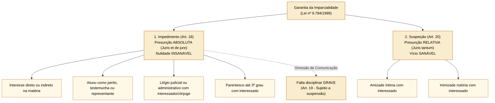
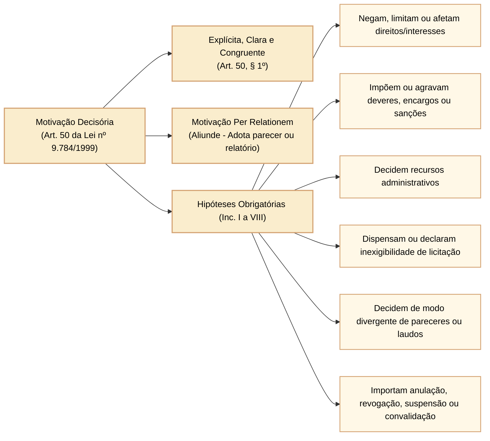
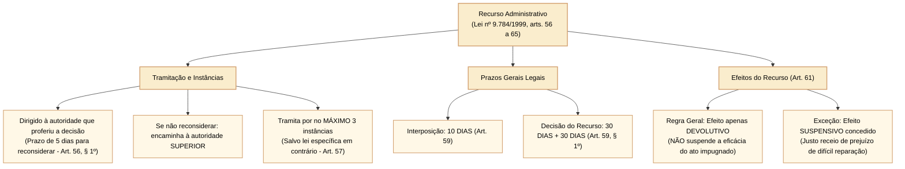
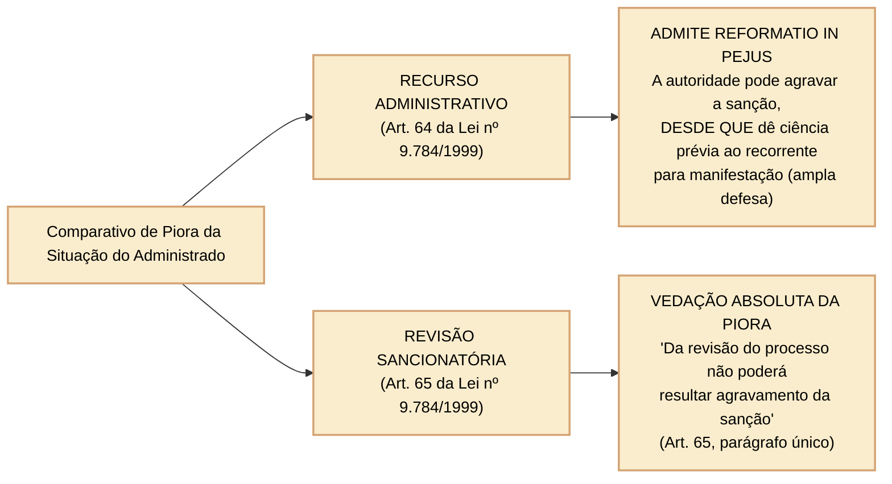

# Lei nº 9.784/1999: impedimento, suspeição, motivação dos atos decisórios e recursos administrativos

A higidez, a imparcialidade e a legitimidade das decisões proferidas no processo administrativo federal dependem da observância rigorosa das normas disciplinadas nos arts. 18 a 21 (impedimentos e suspeição), art. 50 (dever e hipóteses de motivação) e arts. 56 a 65 (sistema recursal e revisão) da **Lei nº 9.784/1999**.

Nas provas formuladas pelo Cebraspe para carreiras legislativas, os examinadores exploram exaustivamente a fronteira técnica entre presunção absoluta de parcialidade (impedimento) e presunção relativa (suspeição), as consequências da omissão do dever de comunicar o impedimento (falta grave), o rol taxativo das hipóteses de motivação obrigatória, os prazos gerais de interposição recursal e a regra de ouro da *reformatio in pejus* em sede de recurso confrontada com a sua vedação absoluta na revisão de processo sancionador.

---

## 1. Imparcialidade processual: impedimento versus suspeição

Para assegurar a moralidade e a impessoalidade da Administração Pública, a Lei nº 9.784/1999 estabelece hipóteses em que o servidor ou autoridade deve afastar-se da instrução e do julgamento do processo administrativo.

### 1.1 Impedimento (art. 18): presunção absoluta e dever de abstenção

O impedimento decorre de circunstâncias objetivas e taxativas expressamente enumeradas na lei, nas quais a parcialidade do agente público é **presumida de forma absoluta (*juris et de jure*)**. O ato praticado por autoridade impedida é **nulo de pleno direito**.

É impedido de atuar em processo administrativo o servidor ou autoridade que:
1. Tenha interesse direto ou indireto na matéria;
2. Tenha participado ou venha a participar como perito, testemunha ou representante, ou se tais situações ocorrem quanto ao cônjuge, companheiro ou parentes e afins até o **terceiro grau**;
3. Esteja litigando judicial ou administrativamente com o interessado ou respectivo cônjuge ou companheiro.

- **Dever de comunicação e falta grave (art. 19):** a autoridade ou servidor que incorrer em impedimento deve **comunicar o fato imediatamente** à autoridade competente, abstendo-se de atuar. A omissão do dever de comunicar o impedimento constitui **falta disciplinar grave**, para efeitos sancionatórios estatutários.

### 1.2 Suspeição (art. 20): presunção relativa e arguição

A suspeição decorre de vínculos de natureza eminentemente anímica e subjetiva, operando presunção relativa (*juris tantum*):
- Pode ser arguida a suspeição de autoridade ou servidor que tenha **amizade íntima** ou **inimizade notória** com algum dos interessados ou com os respectivos cônjuges, companheiros, parentes e afins até o **terceiro grau**;
- O indeferimento da alegação de suspeição poderá ser objeto de recurso administrativo, porém **sem efeito suspensivo** (art. 20, parágrafo único).

---

## 2. A motivação dos atos decisórios no processo administrativo (art. 50)

A motivação é a exteriorização formal e expressa dos pressupostos de fato e dos fundamentos jurídicos que determinaram a prática do ato administrativo. Constitui garantia essencial do Estado Democrático de Direito e viabiliza o controle social e judicial da função administrativa.

### 2.1 Hipóteses taxativas de motivação obrigatória (art. 50, *caput*)

Os atos administrativos deverão ser motivados, com indicação dos fatos e dos fundamentos jurídicos, quando:
1. Neguem, limitem ou afetem direitos ou interesses;
2. Imponham ou agravem deveres, encargos ou sanções;
3. Decidam recursos administrativos;
4. Decorram de reexame de ofício;
5. Deixem de aplicar jurisprudência firmada sobre a questão ou discrepem de pareceres, laudos, propostas e relatórios oficiais;
6. Impliquem anulação, revogação, suspensão ou convalidação de ato administrativo.

### 2.2 Modalidades e técnica da motivação: motivação *per relationem* (art. 50, § 1º)

A motivação deve ser expressa, clara e congruente, podendo consistir em declaração de concordância com fundamentos de anteriores pareceres, informações, propostas ou relatórios, que, neste caso, serão parte integrante do ato.

- Essa técnica de motivação por referência a documento técnico preexistente é denominada pela doutrina e pela jurisprudência do STF como **motivação *per relationem*** ou **motivação *aliunde***;
- Para ser válida, o parecer ou relatório adotado deve constar expressamente dos autos do processo e ser acessível ao administrado.

---

## 3. O sistema recursal administrativo na Lei nº 9.784/1999 (arts. 56 a 65)

O recurso administrativo consubstancia a manifestação de inconformismo do administrado contra decisão proferida pela Administração, submetendo-a a reexame de legalidade e mérito.

### 3.1 Prazos e regras gerais de tramitação

- **Prazo de interposição (art. 59):** salvo disposição legal específica, é de **10 (dez) dias** o prazo para a interposição de recurso administrativo, contado a partir da ciência ou divulgação oficial da decisão;
- **Reconsideração prévia (art. 56, § 1º):** o recurso será dirigido à autoridade que proferiu a decisão. Se ela não a reconsiderar no prazo de **5 (cinco) dias**, o encaminhará à autoridade superior;
- **Limite de instâncias recursais (art. 57):** o recurso tramitará no máximo por **3 (três) instâncias administrativas**, salvo disposição legal diversa;
- **Prazo para julgamento (art. 59, § 1º):** a autoridade competente tem o prazo de **até 30 (trinta) dias** para decidir o recurso, prorrogável motivadamente por igual período.

### 3.2 Efeitos do recurso e a garantia da ampla defesa

- **Regra geral: efeito meramente devolutivo (art. 61):** salvo disposição legal em contrário, o recurso **não tem efeito suspensivo**. A decisão administrativa impugnada continua produzindo plenos efeitos executórios;
- **Concessão cautelar de efeito suspensivo (art. 61, parágrafo único):** havendo justo receio de prejuízo de difícil ou incerta reparação decorrente da execução, a autoridade recorrida ou a imediatamente superior poderá, de ofício ou a pedido, dar efeito suspensivo ao recurso;
- **Inexigibilidade de depósito prévio de bens ou valores:** ponto pacificado com força vinculante:

> **Súmula Vinculante nº 21 do STF:**  
> *"É inconstitucional a exigência de depósito ou arrolamento prévios de dinheiro ou bens para admissibilidade de recurso administrativo."*

---

## 4. Confronto crucial: *reformatio in pejus* no recurso versus vedação na revisão

A distinção entre as consequências do julgamento do **recurso administrativo** e do processo de **revisão de sanção** é um dos temas mais recorrentes nas provas do Cebraspe:

| Eixo Distintivo | Recurso Administrativo Geral (Art. 64) | Revisão de Processo Sancionador (Art. 65) |
| :--- | :--- | :--- |
| **Finalidade** | Impugnação de decisão administrativa ordinária por inconformismo quanto à legalidade ou ao mérito. | Desconstituição ou abrandamento de penalidade já aplicada, em face de fatos novos ou circunstâncias relevantes. |
| **Prazo** | Prazo preclusivo geral de **10 dias** (art. 59). | Pode ser requerida **a qualquer tempo**, de ofício ou a pedido; não há prazo prescricional. |
| **Possibilidade de Piora (*Reformatio in pejus*)** | **É ADMITIDA expressamente pelo art. 64**. Se da decisão puder decorrer gravame à situação do recorrente, este deverá ser cientificado para que formule alegações antes da decisão final. | **É TERMINANTEMENTE PROIBIDA pelo art. 65, parágrafo único**. Da revisão não poderá, sob qualquer hipótese, resultar agravamento da sanção imposta originariamente. |

---

## 5. Questões comentadas

*(Inédita: estilo Cebraspe / Câmara dos Deputados – Analista Legislativo)*  
**1.** A autoridade administrativa que incorrer em situação de suspeição por inimizade notória com o administrado comete falta disciplinar grave caso deixe de comunicar imediatamente o fato à autoridade superior para fins de abstenção.

> **Gabarito: ERRADO**  
> **Comentário:** Conforme preceitua o art. 19 da Lei nº 9.784/1999, a omissão do dever de comunicar o afastamento constitui falta disciplinar grave exclusivamente na hipótese de **impedimento** (art. 18), no qual a presunção de parcialidade é absoluta. Na **suspeição** (art. 20 - amizade íntima ou inimizade notória), a arguição é faculdade e a omissão de autodeclaração não é capitulada expressamente como falta disciplinar grave.

*(Inédita: estilo Cebraspe / Câmara dos Deputados – Analista Legislativo)*  
**2.** É válida no processo administrativo federal a motivação que declare expressa concordância com os fundamentos de anterior parecer jurídico emitido nos autos, passando o conteúdo da manifestação técnica a constituir parte integrante do ato decisório.

> **Gabarito: CERTO**  
> **Comentário:** Assertiva em consonância literal com o art. 50, § 1º, da Lei nº 9.784/1999, que autoriza a motivação por declaração de concordância com fundamentos de anteriores pareceres, informações, propostas ou relatórios (técnica consagrada na jurisprudência do STF como motivação *per relationem* ou *aliunde*).

*(Inédita: estilo Cebraspe / Câmara dos Deputados – Analista Legislativo)*  
**3.** No regime da Lei nº 9.784/1999, a interposição de recurso administrativo suspende automaticamente a eficácia do ato impugnado até o julgamento definitivo pela autoridade superior competente.

> **Gabarito: ERRADO**  
> **Comentário:** Nos termos do art. 61 da Lei nº 9.784/1999, a regra geral do processo administrativo federal é que o recurso tem efeito **meramente devolutivo**, não possuindo efeito suspensivo. A suspensão dos efeitos do ato só ocorrerá em caráter excepcional, por concessão motivada da autoridade quando houver justo receio de prejuízo de difícil ou incerta reparação (art. 61, parágrafo único).

*(Inédita: estilo Cebraspe / Câmara dos Deputados – Analista Legislativo)*  
**4.** Salvo disposição legal específica em sentido contrário, o prazo para a interposição de recurso administrativo na esfera federal é de dez dias, e o processo tramitará por no máximo três instâncias administrativas.

> **Gabarito: CERTO**  
> **Comentário:** A assertiva reproduz fielmente as regras gerais de contagem e tramitação recursal estabelecidas no art. 59 (*caput*) e no art. 57 da Lei nº 9.784/1999: prazo de interposição de 10 dias e limite de até 3 instâncias recursais administrativas.

*(Inédita: estilo Cebraspe / Câmara dos Deputados – Analista Legislativo)*  
**5.** Em sede de recurso administrativo, é terminantemente vedado à autoridade julgadora agravar a penalidade imposta ao recorrente, vigorando no processo administrativo a proibição absoluta da *reformatio in pejus*.

> **Gabarito: ERRADO**  
> **Comentário:** O art. 64 da Lei nº 9.784/1999 admite expressamente que o órgão competente para decidir o recurso confirme, modifique, anule ou revogue, total ou parcialmente, a decisão recorrida, inclusive agravando a sanção, se for matéria de sua competência. A única exigência formal é a intimação prévia do recorrente para manifestar-se antes da decisão de agravamento. A vedação absoluta da *reformatio in pejus* restringe-se ao procedimento de **revisão de processo sancionador** (art. 65, parágrafo único).

*(Inédita: estilo Cebraspe / Câmara dos Deputados – Analista Legislativo)*  
**6.** A exigência de garantia pecuniária prévia ou de arrolamento de bens do administrado como condição indispensável para a admissibilidade de recurso administrativo em processo de fiscalização contraria preceito vinculante fixado pelo Supremo Tribunal Federal.

> **Gabarito: CERTO**  
> **Comentário:** Aplicação direta da Súmula Vinculante nº 21 do STF ("É inconstitucional a exigência de depósito ou arrolamento prévios de dinheiro ou bens para admissibilidade de recurso administrativo"). A gratuidade do duplo grau de julgamento administrativo impede a imposição de barreiras econômicas ao exercício do direito de petição e recurso.
