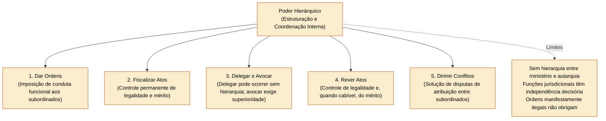
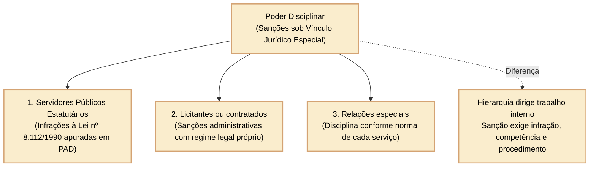

# Poder hierárquico e poder disciplinar: prerrogativas, limites, distinções e controle

Imagine que um diretor distribua tarefas aos servidores de seu departamento e, depois, apure uma infração funcional. No primeiro momento exerce **poder hierárquico**: organiza e dirige o serviço. No segundo, exerce **poder disciplinar**: apura uma falta e, se comprovada, aplica a sanção prevista em lei. Ambos são poderes-deveres destinados à atuação pública e sujeitos a controle.

O critério decisivo é a **relação jurídica e a finalidade**. Organizar trabalho, distribuir tarefas e rever atos de subordinados, quando a lei permite, envolve hierarquia. **Distribuir tarefas internas** não equivale a transferir a titularidade de uma competência: a delegação atribui o seu exercício, com limites, publicidade e possibilidade de revogação (Lei nº 9.784/1999, arts. 11 a 14). Investigar e sancionar infração funcional envolve disciplina. A aplicação de sanções contratuais a empresas, por sua vez, exige atenção ao regime legal próprio e à classificação doutrinária, sem presumir subordinação hierárquica da contratada.

---

## 1. O poder hierárquico: conceito, escopo e manifestações estruturais

O **poder hierárquico** organiza o funcionamento de órgãos e agentes subordinados dentro de uma estrutura administrativa. Inclui distribuir tarefas, orientar, fiscalizar e, nos limites da lei, rever decisões. **Delegação de competência**, porém, também pode ocorrer **sem hierarquia**, enquanto a **avocação** exige vínculo hierárquico e justificativa excepcional, como dispõem os arts. 12 a 15 da **Lei nº 9.784/1999**, que regula o processo administrativo federal.

### As cinco manifestações da organização hierárquica

Entre as manifestações da organização hierárquica estão:
1. **Comando:** a chefia dirige a execução de tarefas legais. Instruções e ordens de serviço podem expressar decisões; um memorando ou ofício pode servir apenas para comunicá-las;
2. **Fiscalização:** o superior acompanha a legalidade e a execução das atribuições, sem dispensar as garantias dos agentes;
3. **Revisão:** quando o ordenamento confere poder para isso, a autoridade pode **anular** ato ilegal ou **revogar** ato válido cuja manutenção não seja mais conveniente. A anulação, em regra, produz efeitos retroativos (*ex tunc*), com limites de segurança jurídica; a revogação, em regra, produz efeitos para o futuro (*ex nunc*), respeitados direitos adquiridos. **Exemplo:** uma chefia pode rever uma autorização precária concedida por subordinado dentro de sua competência de revisão, mas não pode revogar uma licença vinculada apenas por preferência pessoal;
4. **Delegação e avocação:** **delegação** atribui o exercício de parte da competência a outro órgão ou titular, **ainda que não seja subordinado**, quando a lei permitir (Lei nº 9.784/1999, art. 12). O art. 13 proíbe delegar a edição de atos normativos, a decisão de recursos e matérias de competência exclusiva; o art. 14 exige publicação da delegação e de sua revogação, além de delimitação de poderes, duração, objetivos e recurso cabível. As decisões delegadas devem indicar essa condição e são consideradas editadas pelo **delegado** (art. 14, § 3º). **Avocação**, ao contrário, é excepcional, temporária, motivada e recai sobre competência de órgão **hierarquicamente inferior** (art. 15);
5. **Solução de conflitos de atribuição:** quando os órgãos se subordinam à mesma autoridade, esta pode definir a atuação que cabe a cada um conforme a lei. Nem toda controvérsia de competência pode ser resolvida livremente pela chefia.

### Limites dogmáticos do poder hierárquico

**Limites dogmáticos** são os limites jurídicos desse poder, conforme as normas e a interpretação do Direito Administrativo. A regra prática é identificar quem pode dar ordens, a quem elas se dirigem e se existe uma relação de subordinação.

O Cebraspe explora com rigor as situações jurídicas em que o poder hierárquico **não existe ou não opera**:

- **Administração Direta versus Indireta:** um ministério e uma autarquia vinculada são pessoas jurídicas distintas; há **tutela ou supervisão finalística** conforme os poderes previstos em lei, **não comando hierárquico geral**. O **Decreto-Lei nº 200/1967**, que organiza a Administração Federal, trata da supervisão ministerial nos arts. 19 a 26. Supervisão pode conter instrumentos específicos de controle, mas não autoriza avocar competência exclusiva da autarquia como se fosse departamento do ministério;
- **Funções independentes e atividades administrativas:** magistrados têm independência para julgar; integrantes do Ministério Público têm independência funcional em sua atuação constitucional, **mas o Ministério Público não exerce jurisdição**. Há revisão por recursos e competências próprias sem que o tribunal possa dar ordens para um juiz decidir conforme preferência pessoal. **Judiciário, Legislativo e Ministério Público possuem estruturas administrativas**, nas quais podem existir chefias, servidores e hierarquia para tarefas de gestão;
- **Autonomia técnica:** parecerista pode ter dever de justificar sua análise e garantias profissionais específicas. O **art. 133 da Constituição Federal de 1988** protege a atuação do advogado nos limites da lei, **não concede independência funcional genérica a todos os consultores**. Ver [[3 - Materias/Direito Administrativo/18 - parecer administrativo natureza tipos e responsabilidade do parecerista|parecer administrativo]];
- **Ordens manifestamente ilegais:** a **Lei nº 8.112/1990**, regime jurídico dos servidores civis da União, determina no art. 116, IV, que o servidor cumpra ordens superiores **exceto quando manifestamente ilegais**. A simples alegação de ordem superior não torna lícito executar determinação claramente contrária à lei. Eventual responsabilização depende de apuração da conduta, dolo ou culpa conforme o regime aplicável e nexo causal, sem presunção de solidariedade civil, penal e administrativa.

---

## 2. O poder disciplinar: conceito, fundamento e o regime da supremacia especial

O **poder disciplinar** permite investigar faltas funcionais e aplicar, após procedimento adequado, as penalidades que a lei prevê para agentes submetidos a regime funcional. Em sentido doutrinário mais amplo, também se utiliza a expressão para certas sanções a pessoas com **vínculo especial** com o Estado, como contratados, embora a Lei nº 14.133/2021 estabeleça um regime próprio de **sanções administrativas em licitações e contratos** (arts. 155 a 158). Não há relação hierárquica entre Administração e empresa contratada.

### Supremacia especial versus supremacia geral

A distinção doutrinária depende do **vínculo jurídico** e da **fonte legal da obrigação**:

1. **Relação especial de sujeição:** deveres surgem do regime funcional, contratual ou institucional específico. Servidor pode cometer infração disciplinar; licitante ou contratado pode responder pelas infrações tipificadas nos arts. 155 e 156 da **Lei nº 14.133/2021**, que disciplina licitações e contratos administrativos. **O regime e a competência sancionadora dependem da lei específica**; o vínculo não permite criar sanções livremente;
2. **Sujeição geral ao poder de polícia:** o Estado condiciona atividades de particulares para proteger interesses públicos, mesmo sem contrato ou relação funcional com eles. Exemplo: multa de trânsito baseada em infração legal. O **art. 78 do Código Tributário Nacional (Lei nº 5.172/1966)** define poder de polícia como atividade administrativa que limita ou disciplina direitos, interesses e liberdades por razões de interesse público. A finalidade de uma interdição sanitária pode ser preventiva, e não punitiva.

### Vinculação e discricionariedade no poder disciplinar

O poder disciplinar não é puramente vinculado nem amplamente discricionário:
- **Dever de apurar:** o **art. 143 da Lei nº 8.112/1990** obriga a autoridade a promover a apuração imediata de irregularidade de que tome ciência, por sindicância ou processo administrativo disciplinar, conforme a hipótese legal. Isso não impede o exame inicial da consistência de uma notícia, nem significa **instaurar PAD completo diante de alegação manifestamente infundada**. A apuração prévia não pode servir de pretexto para ignorar indícios relevantes. A penalidade exige infração, rito e competência legais; hipóteses de demissão estão no art. 132;
- **Dosimetria regrada:** o **art. 128 da Lei nº 8.112/1990** exige considerar natureza e gravidade da infração, danos, agravantes, atenuantes e antecedentes. A suspensão, limitada pelo art. 130 a **90 dias**, não permite escolher pena ao acaso. O art. 5º, LIV e LV, da Constituição exige devido processo, contraditório e ampla defesa.

---

## Confronto analítico: poder hierárquico versus poder disciplinar

A tabela a seguir sistematiza as fronteiras dogmáticas exigidas em provas:

| Critério de Comparação | Poder Hierárquico | Poder Disciplinar |
| :--- | :--- | :--- |
| **Finalidade essencial** | Organizar e coordenar a atuação interna, distribuir tarefas e revisar atos nos limites legais. | Apurar infrações e, quando comprovadas, aplicar sanções previstas em lei, com o procedimento e as garantias cabíveis. |
| **Destinatários** | Órgãos e agentes sujeitos à subordinação; **delegação pode alcançar não subordinados**, por fundamento legal. | Agentes públicos em regime funcional; em doutrina mais ampla, pessoas sob vínculo especial, com sanções próprias em cada lei. |
| **Existência de Subordinação** | O comando hierárquico pressupõe subordinação. **Delegar competência não a pressupõe** (Lei nº 9.784/1999, art. 12); avocação sim (art. 15). | A apuração disciplinar de servidores decorre de vínculo funcional; sanções contratuais não pressupõem hierarquia sobre a empresa. |
| **Instrumentos de atuação** | Ordens de serviço, fiscalização, revisão e distribuição legal de atribuições; delegação sem hierarquia também é possível. | Sindicância e processo administrativo disciplinar (PAD) no regime funcional; procedimento sancionador específico em licitações e contratos. |
| **Controle e limites** | Revisão de legalidade e de mérito **quando a competência e a natureza do ato permitem**. | Tipicidade legal, motivação, proporcionalidade, contraditório e ampla defesa no processo aplicável. |

---

## Questões comentadas

Os seis itens seguintes são **inéditos**, no estilo Certo/Errado da Cebraspe. O gabarito considera a distinção entre supervisão finalística, hierarquia interna e sanção por infração.

*(Inédita: estilo Cebraspe / Câmara dos Deputados – Analista Legislativo)*  
**1.** A aplicação da sanção de **impedimento de licitar e contratar**, prevista no art. 156, III, da Lei nº 14.133/2021, a empresa contratada que comete infração contratual apurada em processo regular integra a atividade sancionadora ligada ao vínculo contratual com a Administração, distinta da fiscalização geral do poder de polícia.

> **Gabarito: CERTO**  
> **Comentário:** No recorte doutrinário que classifica as sanções de contratados como manifestação do **poder disciplinar em relação especial**, a infração decorre de vínculo contratual anterior. O art. 156 da Lei nº 14.133/2021 emprega a denominação **impedimento de licitar e contratar**, com requisitos e processo próprios. A antiga expressão **suspensão temporária de participação em licitação** pertence ao regime da Lei nº 8.666/1993, cuja aplicação exige identificar a legislação temporal do contrato. A distinção de poderes é didática e não substitui a tipificação da sanção e suas condições.

*(Inédita: estilo Cebraspe / Câmara dos Deputados – Analista Legislativo)*  
**2.** Em virtude do princípio da hierarquia administrativa, as ordens emanadas de superior hierárquico devem ser rigorosamente cumpridas pelo servidor público subordinado, ainda que tais determinações sejam manifestamente contrárias à lei expressa, cabendo-lhe ressalvar sua discordância após a execução do ato.

> **Gabarito: ERRADO**  
> **Comentário:** O ordenamento jurídico brasileiro consagra o dever de desobediência a ordens manifestamente ilegais. Conforme o art. 116, IV, da Lei nº 8.112/1990, é dever funcional cumprir ordens superiores, **exceto quando manifestamente ilegais**. Executar ordem manifestamente ilegal pode gerar responsabilidade **pessoal**, conforme conduta, elemento subjetivo e nexo, mas não há solidariedade automática nas três esferas.

*(Inédita: estilo Cebraspe / Câmara dos Deputados – Analista Legislativo)*  
**3.** O poder hierárquico confere ao Ministério supervisor a prerrogativa de expedir ordens imperativas de natureza finalística aos dirigentes de autarquias a ele vinculadas, inclusive com a possibilidade de avocar competências exclusivas destas.

> **Gabarito: ERRADO**  
> **Comentário:** Entre um ministério e a autarquia a ele vinculada **não existe hierarquia geral**. O ministério pode exercer **supervisão finalística e outros controles especificamente previstos em lei**, sem ganhar a faculdade geral de comandar a entidade como departamento interno. Por isso, o ministério não pode **avocar como superior hierárquico** competências da autarquia. A lei pode atribuir instrumentos próprios de supervisão e controle finalístico, sem converter a entidade em órgão subordinado.

*(Inédita: estilo Cebraspe / Câmara dos Deputados – Analista Legislativo)*  
**4.** Ao tomar conhecimento de suposta irregularidade funcional praticada por servidor subordinado, a autoridade competente dispõe de margem discricionária para decidir pela conveniência ou não da instauração de procedimento apuratório disciplinar.

> **Gabarito: ERRADO**  
> **Comentário:** O art. 143 da Lei nº 8.112/1990 impõe **dever de promover apuração** da irregularidade funcional. A autoridade não pode simplesmente ignorá-la por conveniência, mas deve avaliar a notícia e os indícios para escolher o procedimento legal adequado; não se presume que toda notícia imponha abertura imediata de PAD completo. **A omissão pode ensejar responsabilização conforme seus elementos concretos**, mas a configuração de condescendência criminosa (art. 320 do Código Penal) e de improbidade administrativa depende dos requisitos de cada tipo, incluindo o elemento subjetivo pertinente. A omissão, isoladamente, não comprova automaticamente ambos os ilícitos.

*(Inédita: estilo Cebraspe / Câmara dos Deputados – Analista Legislativo)*  
**5.** Do poder hierárquico decorrem a faculdade de comando, a fiscalização permanente de conduta, a autotutela revisora de mérito e legalidade, bem como os institutos da delegação e da avocação temporária de competências.

> **Gabarito: CERTO**  
> **Comentário:** A questão está correta como enumeração das **faculdades usuais de organização hierárquica**, com a ressalva de que **delegar não exige hierarquia** (Lei nº 9.784/1999, art. 12), enquanto **avocar exige** órgão inferior e motivação excepcional (art. 15). A revisão de atos também depende das competências legais e dos limites da autotutela.

*(Inédita: estilo Cebraspe / Câmara dos Deputados – Analista Legislativo)*  
**6.** A anulação de ato administrativo ilegal praticado por autoridade subordinada fundamenta-se simultaneamente no princípio da autotutela e no exercício do poder disciplinar da Administração.

> **Gabarito: ERRADO**  
> **Comentário:** A anulação ou revogação de atos praticados por subordinados decorre diretamente do **poder hierárquico** (controle e coordenação interna de atos administrativos) conjugado à autotutela (Súmulas 346 e 473 do STF). O **poder disciplinar** rege a apuração de faltas e a imposição de sanções previstas em lei; **anular ato ilegal** é atividade de controle de legalidade/autotutela, e não sanção à pessoa que o praticou.

## Relações e fontes normativas

- [[3 - Materias/Direito Administrativo/02 - organizacao administrativa|Organização administrativa]]: ministério e autarquia possuem vínculo de supervisão, sem hierarquia geral.
- [[3 - Materias/Direito Administrativo/04 - poderes administrativos|Poderes administrativos]]: quadro geral de poderes, sem repetir todos os casos de competência.
- [[3 - Materias/Direito Administrativo/25 - lei 9784 processo administrativo federal competencia delegacao e avocacao|Delegação e avocação]]: regras detalhadas da Lei nº 9.784/1999.
- [[3 - Materias/Direito Administrativo/24 - sindicancia processo administrativo disciplinar e seus ritos|Sindicância e PAD]]: procedimento e defesa.
- [Lei nº 9.784/1999, processo administrativo federal](https://www.planalto.gov.br/ccivil_03/leis/l9784.htm): arts. 12 a 15, delegação, limites, publicação e avocação.
- [Lei nº 8.112/1990, regime dos servidores civis da União](https://www2.camara.leg.br/legin/fed/lei/1990/lei-8112-11-dezembro-1990-322161-normaatualizada-pl.html): arts. 116, IV, 128, 130, 132 e 143, ordens superiores e disciplina.
- [Lei nº 14.133/2021, Licitações e Contratos Administrativos](https://www.planalto.gov.br/ccivil_03/_ato2019-2022/2021/lei/l14133.htm): arts. 155 a 158, sanções a licitantes e contratados.
- [Decreto-Lei nº 200/1967, organização da Administração Federal](https://www.planalto.gov.br/ccivil_03/decreto-lei/del0200.htm): arts. 19 a 26, supervisão ministerial.
- [Lei nº 5.172/1966, Código Tributário Nacional](https://www.planalto.gov.br/ccivil_03/leis/l5172compilado.htm): art. 78, poder de polícia.
- [Constituição Federal de 1988](https://www.planalto.gov.br/ccivil_03/constituicao/constituicao.htm), arts. 5º, LIV e LV, e 133: devido processo, defesa e limites da inviolabilidade do advogado.
