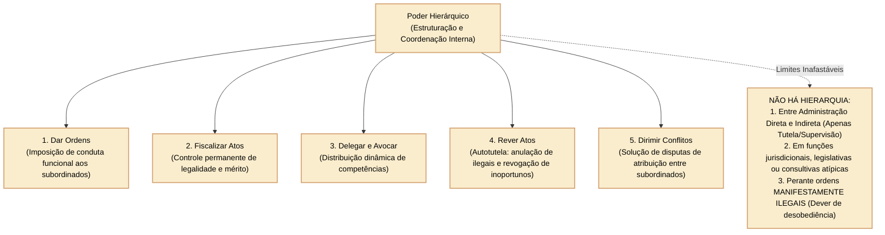
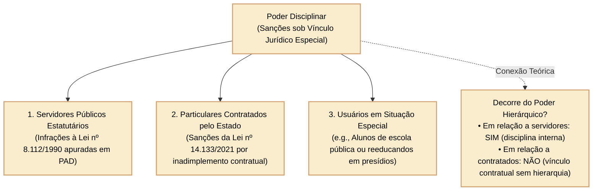

# Poder hierárquico e poder disciplinar: prerrogativas, limites, distinções e controle

Os poderes administrativos são prerrogativas instrumentais conferidas pelo ordenamento jurídico aos agentes públicos para a realização dos fins de interesse coletivo tutelados pelo Estado. Não consubstanciam privilégios pessoais, configurando verdadeiros **poderes-deveres** de agir. Entre essas prerrogativas internas da organização administrativa, destacam-se o **poder hierárquico** e o **poder disciplinar**.

Nas provas formuladas pelo Cebraspe para a Câmara dos Deputados, a distinção dogmática entre as manifestações da hierarquia (dar ordens, fiscalizar, delegar e avocar) e da disciplina (apurar faltas e aplicar sanções), a fronteira crítica entre a supremacia especial (poder disciplinar) e a supremacia geral (poder de polícia), bem como os limites da obediência hierárquica e a inadmissibilidade de hierarquia entre a Administração Direta e a Indireta, representam conteúdos de alta frequência.

---

## 1. O poder hierárquico: conceito, escopo e manifestações estruturais

O **poder hierárquico** é a prerrogativa conferida à Administração Pública para estruturar, organizar, coordenar e escalonar internamente os seus órgãos e a atuação de seus agentes, estabelecendo uma relação jurídica de subordinação e comando.

### 1.1 As cinco faculdades decorrentes do poder hierárquico

Do poder hierárquico decorrem competências administrativas instrumentais vinculantes:
1. **Poder de comando (dar ordens):** faculdade de expedir instruções de serviço, memorandos, circulares e ordens concretas aos subordinados a respeito da execução de suas atribuições;
2. **Poder de fiscalização:** controle contínuo exercido pela autoridade superior sobre a conduta e os atos praticados pelos órgãos e agentes inferiores, velando pelo cumprimento da lei e das metas institucionais;
3. **Poder de revisão (autotutela hierárquica):** competência para anular atos ilegais praticados pelo subordinado (efeito *ex tunc*) ou revogá-los por razões supervenientes de conveniência e oportunidade administrativa (efeito *ex nunc*);
4. **Poder de delegação e avocação:** transferência precária de competência a subordinados (delegação vertical) ou atração excepcional e temporária de competência do subordinado pelo superior (avocação);
5. **Poder de dirimir conflitos de competência:** pacificação de controvérsias de atribuição surgidas entre órgãos ou servidores submetidos ao mesmo comando hierárquico superior.

### 1.2 Limites dogmáticos do poder hierárquico

O Cebraspe explora com rigor as situações jurídicas em que o poder hierárquico **não existe ou não opera**:

- **Inexistência de hierarquia entre a Administração Direta e a Indireta:** entre um Ministério da União e uma autarquia federal (e.g., Anatel, Ibama, INSS) não existe relação de subordinação hierárquica. O vínculo que os une é de **vinculação administrativa** (tutela administrativa ou supervisão ministerial), restrito aos limites expressos de controle finalístico previstos em lei;
- **Inexistência de hierarquia no exercício de funções típicas constitucionais:** os juízes e membros do Ministério Público gozam de independência funcional no exercício da jurisdição. Não há hierarquia jurisdicional entre um juiz de primeira instância e os desembargadores ou ministros dos tribunais superiores (há apenas hierarquia funcional-recursal);
- **Inexistência de hierarquia em órgãos consultivos:** pareceristas jurídicos e órgãos de assessoria técnica exercem manifestação de cunho técnico-científico com autonomia e independência opinativa, não podendo receber ordens superiores sobre o conteúdo de suas convicções jurídicas (art. 133 da CF/1988);
- **O dever de desobediência a ordens manifestamente ilegais:** nos termos do art. 116, IV, da Lei nº 8.112/1990, é dever do servidor público *"cumprir as ordens superiores, exceto quando manifestamente ilegais"*. A ordem manifestamente ilegal não obriga o subordinado, cabendo-lhe recusar o seu cumprimento e representar contra a autoridade determinadora, sob pena de responder solidariamente pelas ilegalidades perpetradas.

---

## 2. O poder disciplinar: conceito, fundamento e o regime da supremacia especial

O **poder disciplinar** é a prerrogativa estatal de apurar infrações funcionais e aplicar as correspondentes sanções administrativas àqueles sujeitos a uma **relação jurídica especial com o Estado**.

### 2.1 Supremacia especial versus supremacia geral

A distinção fundamental para gabaritar questões do Cebraspe reside na natureza do liame que liga o indivíduo ao Poder Público:

1. **Supremacia especial (Poder Disciplinar):** incide exclusivamente sobre indivíduos que possuem um **vínculo jurídico específico, individualizado e prévio com a Administração Pública** (servidores estatutários, empregados públicos, delegatários de serviços, concessionárias e empresas privadas contratadas para obras/serviços públicos). A sanção decorre do inadimplemento desse regime especial de sujeição;
2. **Supremacia geral (Poder de Polícia):** incide sobre a **coletividade indeterminada de particulares**, independentemente de qualquer vínculo jurídico prévio ou voluntário. Toda a sociedade submete-se ao poder de polícia em razão da primazia do interesse público e da soberania estatal (e.g., aplicação de multa de trânsito ou interdição sanitária de um restaurante comercial).

### 2.2 Vinculação e discricionariedade no poder disciplinar

O poder disciplinar não é puramente vinculado nem amplamente discricionário:
- **Aspecto estritamente vinculado:** o **dever de instaurar o processo disciplinar** diante da notícia de falta funcional é imperativo e obrigatório (art. 143 da Lei nº 8.112/1990); a espécie da pena para faltas graves cominadas na lei (e.g., demissão no art. 132) também é vinculada;
- **Aspecto discricionário regulado:** a autoridade dispõe de margem de dosimetria na fixação do prazo de suspensão (entre 1 e 90 dias, art. 130) e na valoração de atenuantes, agravantes, danos causados e antecedentes do servidor (art. 128).

---

## 3. Confronto analítico: poder hierárquico versus poder disciplinar

A tabela a seguir sistematiza as fronteiras dogmáticas exigidas em provas:

| Critério de Comparação | Poder Hierárquico | Poder Disciplinar |
| :--- | :--- | :--- |
| **Finalidade Essencial** | Estruturação, coordenação, divisão de tarefas e comando da máquina administrativa interna. | Punição, apuração e repressão a infrações de agentes e pessoas submetidas a vínculo especial. |
| **Destinatários** | Exclusivamente órgãos e agentes **internos** subordinados na mesma pessoa jurídica. | Agentes públicos e particulares que ostentem **vínculo especial** (contratados, concessionárias). |
| **Existência de Subordinação** | Indispensável: pressupõe necessariamente relação vertical de superior e inferior hierárquico. | Não indispensável: na punição a terceiros contratados (Lei nº 14.133/2021) não há relação hierárquica. |
| **Instrumentos de Atuação** | Ordens de serviço, instruções, delegação, avocação e revisão de decisões. | Abertura de sindicância, PAD, aplicação de advertência, suspensão, demissão e multas contratuais. |
| **Controle de Mérito** | Amplo: o superior hierárquico pode rever legalidade e o mérito (oportunidade e conveniência). | Restrito: o controle do ato punitivo pauta-se pela legalidade, proporcionalidade e devido processo legal. |

---

## 4. Questões comentadas

*(Inédita: estilo Cebraspe / Câmara dos Deputados – Analista Legislativo)*  
**1.** A aplicação de penalidade administrativa de suspensão temporária de participação em licitação imposta a uma empresa fornecedora por descumprimento injustificado de cláusula de contrato administrativo decorre do exercício do poder disciplinar da Administração Pública, e não do poder de polícia.

> **Gabarito: CERTO**  
> **Comentário:** A aplicação de sanções a contratados da Administração Pública fundamenta-se no **poder disciplinar** decorrente da relação jurídica de supremacia especial (vínculo contratual formal e voluntário com o Estado). O poder de polícia destina-se a restringir bens e liberdades de particulares submetidos à supremacia geral do Estado, sem vínculo jurídico específico anterior.

*(Inédita: estilo Cebraspe / Câmara dos Deputados – Analista Legislativo)*  
**2.** Em virtude do princípio da hierarquia administrativa, as ordens emanadas de superior hierárquico devem ser rigorosamente cumpridas pelo servidor público subordinado, ainda que tais determinações sejam manifestamente contrárias à lei expressa, cabendo-lhe ressalvar sua discordância após a execução do ato.

> **Gabarito: ERRADO**  
> **Comentário:** O ordenamento jurídico brasileiro consagra o dever de desobediência a ordens manifestamente ilegais. Conforme o art. 116, IV, da Lei nº 8.112/1990, é dever funcional cumprir ordens superiores, **exceto quando manifestamente ilegais**. O cumprimento de ordem flagrantemente criminosa ou ilícita enseja a responsabilização solidária do subordinado nas esferas administrativa, civil e criminal.

*(Inédita: estilo Cebraspe / Câmara dos Deputados – Analista Legislativo)*  
**3.** O poder hierárquico confere ao Ministério supervisor a prerrogativa de expedir ordens imperativas de natureza finalística aos dirigentes de autarquias a ele vinculadas, inclusive com a possibilidade de avocar competências exclusivas destas.

> **Gabarito: ERRADO**  
> **Comentário:** Entre a Administração Direta (Ministério) e as entidades da Administração Indireta (Autarquias) **não existe relação de hierarquia ou subordinação**. O controle existente é de mera tutela administrativa ou supervisão ministerial, restrito aos limites finalísticos previstos em lei. Por conseguinte, é juridicamente impossível ao Ministério dar ordens hierárquicas ou avocar competências de dirigentes de autarquias.

*(Inédita: estilo Cebraspe / Câmara dos Deputados – Analista Legislativo)*  
**4.** Ao tomar conhecimento de suposta irregularidade funcional praticada por servidor subordinado, a autoridade competente dispõe de margem discricionária para decidir pela conveniência ou não da instauração de procedimento apuratório disciplinar.

> **Gabarito: ERRADO**  
> **Comentário:** O exercício do poder disciplinar quanto à deflagração da apuração é ato **estritamente vinculado**. Nos termos do art. 143 da Lei nº 8.112/1990, a autoridade que tiver ciência de irregularidade no serviço público é **obrigada a promover a sua apuração imediata**, mediante sindicância ou processo administrativo disciplinar, sob pena de incorrer em condescendência criminosa (art. 320 do Código Penal) e improbidade administrativa.

*(Inédita: estilo Cebraspe / Câmara dos Deputados – Analista Legislativo)*  
**5.** Do poder hierárquico decorrem a faculdade de comando, a fiscalização permanente de conduta, a autotutela revisora de mérito e legalidade, bem como os institutos da delegação e da avocação temporária de competências.

> **Gabarito: CERTO**  
> **Comentário:** A assertiva enumera com exatidão as cinco manifestações clássicas do poder hierárquico consagradas pela doutrina de Direito Administrativo: dar ordens, fiscalizar atos, revisar atos por anulação ou revogação, delegar atribuições e avocar competências subordinadas nos termos da lei.

*(Inédita: estilo Cebraspe / Câmara dos Deputados – Analista Legislativo)*  
**6.** A anulação de ato administrativo ilegal praticado por autoridade subordinada fundamenta-se simultaneamente no princípio da autotutela e no exercício do poder disciplinar da Administração.

> **Gabarito: ERRADO**  
> **Comentário:** A anulação ou revogação de atos praticados por subordinados decorre diretamente do **poder hierárquico** (controle e coordenação interna de atos administrativos) conjugado à autotutela (Súmulas 346 e 473 do STF). O **poder disciplinar** tem por finalidade exclusiva a aplicação de sanções punitivas e repressivas a pessoas que cometeram faltas funcionais, não se confundindo com o desfazimento ou anulação de atos administrativos objetivos.
