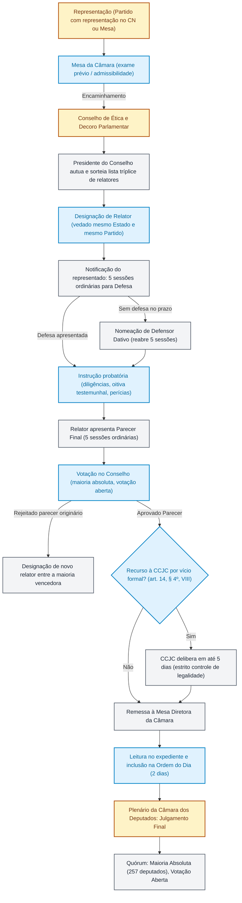

# Código de Ética e Decoro Parlamentar da Câmara dos Deputados: deveres, vedações, Conselho de Ética e processo disciplinar

**Concurso Câmara dos Deputados 2026, cargo 1, Divulgação Institucional, Cebraspe. Unidade CAM-PL-030 conforme arquitetura e inventário editorial.**

## Núcleo do conceito: por que existe um regime disciplinar próprio para deputados?

A atividade parlamentar goza de garantias constitucionais expressivas — como a imunidade material por palavras, opiniões e votos (CF, art. 53, *caput*) e a imunidade formal contra prisões arbitrárias (CF, art. 53, § 2º). Tais prerrogativas existem para resguardar a soberania do mandato popular e o funcionamento independente do Poder Legislativo, e não como privilégio pessoal do indivíduo eleito. Como contrapartida institucional indispensável, a ordem jurídica exige padrões rigorosos de probidade, integridade e dignidade no exercício da representação.

Na Câmara dos Deputados, esse sistema de controle ético-disciplinar está disciplinado no **Código de Ética e Decoro Parlamentar da Câmara dos Deputados (CEDP)**, instituído pela **Resolução nº 25, de 2001**, com redação atualizada por resoluções posteriores (com destaque para a **Resolução nº 2, de 2011**), complementado pelo seu **Regulamento Interno**, pelo **Regimento Interno da Câmara dos Deputados (RICD)** e pela própria **Constituição Federal (arts. 55 e 58)**.

O Código de Ética cumpre tripla função no arranjo institucional da Câmara:
1. **Tipicidade ético-parlamentar:** tipifica os deveres fundamentais do deputado, os atos atentatórios e os atos incompatíveis com o decoro parlamentar, dando densidade material aos conceitos abertos do art. 55, II e § 1º, da CF;
2. **Graduação de sanções e competências punitivas:** estrutura uma escala progressiva de penalidades (censura verbal, censura escrita, suspensão de prerrogativas regimentais, suspensão temporária do exercício do mandato e perda do mandato), distribuindo a competência decisória entre Presidentes, Mesa Diretora e Plenário;
3. **Devido processo legal legislativo:** estabelece o rito procedimental perante o **Conselho de Ética e Decoro Parlamentar (CEDP)**, assegurando ampla defesa, contraditório, instrução probatória com poderes próprios e duplo grau recursal de legalidade junto à Comissão de Constituição e Justiça e de Cidadania (CCJC).

## 1. Princípios e deveres fundamentais do deputado (arts. 1º a 3º)

O Código orienta a conduta de quem esteja no exercício do cargo de Deputado Federal (titular ou suplente em exercício). O art. 2º reforça que *as imunidades, prerrogativas e franquias são institutos destinados à garantia do mandato popular e à defesa do Poder Legislativo*.

O art. 3º estabelece os **deveres fundamentais do Deputado**:
- Promover a defesa do interesse público e da soberania nacional;
- Respeitar e cumprir a Constituição, as leis e as normas internas da Casa e do Congresso Nacional;
- Zelar pelo prestígio, aprimoramento e valorização das instituições democráticas e representativas e pelas prerrogativas do Poder Legislativo;
- Exercer o mandato com dignidade e respeito à coisa pública e à vontade popular, agindo com boa-fé, zelo e probidade;
- Apresentar-se à Câmara durante as sessões legislativas ordinárias e extraordinárias e participar das sessões do Plenário e das reuniões de comissão de que seja membro, além das sessões conjuntas do Congresso;
- Examinar todas as proposições submetidas a sua apreciação e voto sob a ótica do interesse público;
- Tratar com respeito e independência os colegas, autoridades, servidores da Casa e cidadãos, exigindo reciprocidade de tratamento;
- Prestar contas do mandato à sociedade, disponibilizando as informações necessárias ao seu acompanhamento e fiscalização;
- Respeitar as decisões legítimas dos órgãos da Casa.

> **Importante para a prova:** Pela alteração introduzida pela Resolução nº 2/2011, **deixar de observar intencionalmente os deveres fundamentais do art. 3º passou a ser formalmente tipificado como ato atentatório ao decoro parlamentar** (art. 5º, X).

## 2. A gradação das condutas: atos atentatórios × atos incompatíveis com o decoro

O Código de Ética consagra uma distinção ontológica fundamental entre duas categorias de infração disciplinar, diretamente ligada à gravidade e à sanção cominada:

```
Infrações ao Decoro Parlamentar
│
├── Atos Atentatórios ao Decoro (art. 5º)
│   ├── Sanções mais brandas: censura verbal ou escrita
│   └── Sanções intermediárias: suspensão de prerrogativas (até 6 meses) ou suspensão do mandato (até 6 meses)
│
└── Atos Incompatíveis com o Decoro (art. 4º)
    └── Sanção máxima: perda do mandato parlamentar (cassação pelo Plenário)
```

### A. Atos Incompatíveis com o Decoro Parlamentar (art. 4º) — Puníveis com PERDA DO MANDATO

Constituem condutas de gravidade máxima, cuja consequência regimental e constitucional é a perda do mandato (CF, art. 55, II e § 1º):
1. **Abuso das prerrogativas constitucionais:** abusar das prerrogativas asseguradas aos membros do Congresso Nacional (CF, art. 55, § 1º);
2. **Vantagem indevida:** perceber, a qualquer título, em proveito próprio ou de outrem, no exercício da atividade parlamentar, vantagens indevidas (CF, art. 55, § 1º);
3. **Acordo espúrio de suplência:** celebrar acordo que tenha por objeto a posse do suplente, condicionando-a a contraprestação financeira ou à prática de atos contrários aos deveres éticos ou regimentais;
4. **Fraude ao processo deliberativo:** fraudar, por qualquer meio ou forma, o regular andamento dos trabalhos legislativos para alterar o resultado de deliberação;
5. **Falsidade ou omissão em declarações de bens/rendas:** omitir intencionalmente informação relevante ou prestar informação falsa nas declarações obrigatórias de bens, rendas ou impedimentos patrimoniais (art. 18).

### B. Atos Atentatórios ao Decoro Parlamentar (art. 5º) — Puníveis com Censura ou Suspensão

São infrações disciplinares que, embora violem a liturgia e o funcionamento da Casa, não acarretam por si a perda definitiva do mandato (salvo se desaguarem em outra hipótese autônoma do art. 4º ou reincidência qualificada):
1. **Perturbação da ordem:** perturbar a ordem das sessões da Câmara ou das reuniões de comissão (inciso I);
2. **Infração a regras de boa conduta:** praticar atos que infrinjam as regras de boa conduta nas dependências da Casa (inciso II);
3. **Ofensas e desacato:** praticar ofensas físicas ou morais nas dependências da Câmara ou desacatar, por atos ou palavras, outro parlamentar, a Mesa ou comissão, ou os respectivos Presidentes (inciso III);
4. **Aliciamento e constrangimento com abuso de ascendência:** usar os poderes e prerrogativas do cargo para constranger ou aliciar servidor, colega ou qualquer pessoa sob sua ascendência hierárquica, para obter favorecimento de qualquer espécie (inciso IV);
5. **Violação de segredo parlamentar:** revelar conteúdo de debates ou deliberações que a Câmara ou comissão hajam decidido manter secretos (inciso V);
6. **Quebra de reserva documental:** revelar informações e documentos oficiais de caráter reservado conhecidos em razão do mandato (inciso VI);
7. **Desvio de verba de gabinete:** usar verbas de gabinete em desacordo com os princípios do art. 37, *caput*, da CF (inciso VII);
8. **Conflito de interesse por financiamento eleitoral:** relatar matéria submetida à apreciação da Câmara de interesse específico de pessoa física ou jurídica que tenha contribuído para o financiamento de sua campanha eleitoral (inciso VIII);
9. **Fraude de registro de presença:** fraudar, por qualquer meio ou forma, o registro de presença às sessões ou às reuniões de comissão (inciso IX);
10. **Descumprimento intencional de deveres fundamentais:** deixar de observar intencionalmente os deveres do art. 3º (inciso X, inserido pela Resolução 2/2011).

> **Exigência de prova:** O parágrafo único do art. 5º determina expressamente que as condutas puníveis só serão objeto de apreciação **mediante provas concretas**, vedada punição fundada em meras conjecturas ou denúncias anônimas.

> **Alerta de auditoria (11/11/2026):** este artigo contém divergências normativas ainda em correção, especialmente em prazos, competência sancionatória, rito disciplinar, declarações patrimoniais (art. 18) e fluxograma. **Não utilize as tabelas de prazos, o fluxograma ou a seção patrimonial como fonte definitiva de memorização** até a revisão integral. Consulte a [Resolução nº 25/2001 consolidada](https://www2.camara.leg.br/legin/fed/rescad/2001/resolucaodacamaradosdeputados-25-10-outubro-2001-320496-normaatualizada-pl.html). A correção pontual sobre o voto do Corregedor não significa validação das demais seções.

## 3. As quatro penalidades aplicáveis e as autoridades competentes (arts. 10 a 14)

O art. 10 do Código estabelece o rol taxativo das penalidades:
1. **Censura** (verbal ou escrita);
2. **Suspensão de prerrogativas regimentais** (por até seis meses);
3. **Suspensão temporária do exercício do mandato** (por até seis meses);
4. **Perda do mandato**.

Na dosimetria da pena, consideram-se natureza e gravidade da infração, danos à Câmara e ao Congresso, agravantes e atenuantes e antecedentes do infrator (art. 10, § 1º). O Conselho pode propor sanção mais ou menos grave conforme os fatos efetivamente apurados (art. 10, § 2º).

### Matriz comparativa de penalidades, autoridades e infrações

| Penalidade | Autoridade Competente | Hipóteses Típicas do Código | Particularidades Procedimentais e Recursos |
| :--- | :--- | :--- | :--- |
| **Censura Verbal** | **Presidente da Câmara** (em sessão) ou **Presidente de Comissão** (em reunião) | Incisos I e II do art. 5º | Cabe **recurso ao respectivo Plenário em 2 dias úteis** (art. 11, parágrafo único). |
| **Censura Escrita** | **Mesa Diretora da Câmara** | Inciso III do art. 5º, mediante provocação do ofendido, ou reincidência nas hipóteses do art. 11 por solicitação do presidente da Câmara ou da comissão | **Defesa em 5 dias úteis** e **recurso ao Plenário em 2 dias úteis** (art. 12, §§ 1º e 2º). |
| **Suspensão de Prerrogativas Regimentais** | **Plenário da Câmara dos Deputados** (por proposta do Conselho de Ética) | Incisos VI a VIII do art. 5º (revelação de documento reservado, desvio de verba de gabinete, relatoria de doador de campanha) | Prazo máximo de **até 6 meses**. Qualquer cidadão pode provocar a Mesa. Instrução sumária no Conselho em até 30 dias. |
| **Suspensão Temporária do Exercício do Mandato** | **Plenário da Câmara dos Deputados** (após processo no Conselho de Ética) | Incisos IV, V, IX e X do art. 5º (aliciamento/constrangimento hierárquico, quebra de sessão secreta, fraude de presença, descumprimento intencional de deveres fundamentais) | Prazo máximo de **até 6 meses**. Iniciativa de partido com assento no Congresso ou provocação da Mesa. Quórum de maioria absoluta. |
| **Perda do Mandato** | **Plenário da Câmara dos Deputados** (após processo no Conselho de Ética) | Art. 4º (atos incompatíveis: abuso de prerrogativas, vantagem indevida, acordo de suplência, fraude deliberativa, falsidade patrimonial) | **Maioria absoluta dos membros da Câmara, em votação aberta** (conforme EC 76/2013). |

### O rol das prerrogativas parlamentares passíveis de suspensão (art. 13, V)
A penalidade de suspensão de prerrogativas regimentais incide sobre faculdades regimentais do deputado, sem retirá-lo da votação em Plenário nem cassar seu subsídio. Podem ser suspensas, por até seis meses, no todo ou em parte:
- O direito de usar a palavra no horário do Pequeno ou do Grande Expediente;
- O direito de encaminhar discurso para publicação no Diário da Câmara dos Deputados;
- O direito de candidatar-se a, ou permanecer exercendo, cargo de membro da Mesa ou de presidente/vice-presidente de comissão;
- O direito de ser designado relator de proposição em comissão ou no Plenário.

## 4. O Conselho de Ética e Decoro Parlamentar: composição e funcionamento (arts. 6º a 9º)

O Conselho de Ética e Decoro Parlamentar é órgão integrante da estrutura institucional da Câmara dos Deputados, com competência para zelar pela ética, instruir processos disciplinares e responder a consultas sobre decoro.

### Composição e mandato (art. 7º)
- **Número de membros:** compõe-se de **21 membros titulares e igual número de suplentes** (redação dada pela Resolução nº 2/2011; o texto primitivo de 2001 previa 15 membros);
- **Duração do mandato:** mandato de **dois anos**, vedada a recondução no mesmo biênio;
- **Proporcionalidade partidária:** as vagas são distribuídas entre os partidos e blocos parlamentares segundo a proporcionalidade partidária da Casa;
- **Regra especial da Corregedoria:** o partido a que pertencer o Corregedor da Câmara designará, como titular, **um deputado a menos** do que o número a que teria direito pela proporcionalidade, já que o Corregedor possui assento especial;
- **Papel do Corregedor da Câmara (art. 9º):** participa de todas as deliberações do Conselho de Ética **com direito a voz, mas sem voto**, competindo-lhe promover as diligências de sua alçada para esclarecimento dos fatos investigados;
- **Impedimentos para integrar o Conselho (art. 7º, § 2º):** não pode ser membro do Conselho o deputado:
  1. Submetido a processo disciplinar em curso por ato atentatório ou incompatível com o decoro;
  2. Que tenha recebido, na legislatura, penalidade de suspensão de prerrogativas regimentais ou do exercício do mandato, registrada nos anais ou arquivos da Casa;
  3. Que esteja exercendo mandato na condição de suplente convocado em substituição ao titular;
  4. Que tenha condenação criminal por órgão jurisdicional colegiado, ainda que sem trânsito em julgado.
- **Afastamento de membro do Conselho (art. 7º, § 7º):** a instauração de processo disciplinar contra membro do Conselho, com prova inequívoca da acusação, acarreta afastamento imediato da função por decisão de ofício do Presidente do Conselho, até decisão final.

## 5. O procedimento disciplinar no Conselho de Ética e o julgamento em Plenário

O rito depende da penalidade. A censura verbal e a escrita seguem os arts. 11 e 12, sem percorrer automaticamente o processo de sanção grave. A suspensão de prerrogativas segue o art. 13; a suspensão do mandato e a perda do mandato seguem o art. 14. Os prazos do Conselho contam-se em **dias úteis** e ficam suspensos no recesso, salvo convocação extraordinária pertinente (art. 8º, § 3º). O fluxograma abaixo está em revisão e não deve ser usado para memorizar o rito.



### Passo a passo detalhado do procedimento

1. **Iniciativa e Legitimidade ativa:**
   - Para processos que visem à perda do mandato ou à suspensão temporária do mandato, a representação deve ser instaurada por provocação da **Mesa Diretora** ou de **partido político com representação no Congresso Nacional** (CF, art. 55, § 2º; CEDP, art. 14).
   - O cidadão comum e entidades da sociedade civil podem provocar a **Mesa da Câmara**, com descrição dos fatos e provas (Código, art. 9º, §§ 1º e 2º), mas não instauram diretamente processo disciplinar no Conselho. A Mesa tem o dever de conhecê-la motivadamente, emitindo despacho de arquivamento ou de envio ao Conselho.
2. **Distribuição e escolha do Relator:**
   - Recebida a representação, o Presidente do Conselho de Ética instaura o processo e sorteia relator (ou comissão de inquérito de três membros).
   - **Garantias de imparcialidade do relator (Regulamento, art. 7º, § 1º):** o relator **não pode pertencer ao mesmo partido político nem ao mesmo Estado da federação do deputado representado**, nem ter outro processo sob sua relatoria simultânea.
3. **Defesa prévia e defensor dativo:**
   - No rito do **art. 14**, o representado dispõe de **10 dias úteis** para apresentar defesa escrita, documentos e rol de até **8 testemunhas**. Os procedimentos do art. 13 têm regras próprias e não devem ser confundidos com esse rito.
   - A ausência de defesa exige a observância do procedimento de defesa técnica previsto na norma aplicável. A nomeação de defensor dativo e o prazo correspondente devem ser conferidos no rito específico, sem reutilizar a regra antiga de cinco sessões.
4. **Instrução probatória e poderes de investigação:**
   - Na instrução, o Conselho realiza audiências, perícias e oitivas de testemunhas.
   - **Quebra de sigilo bancário, fiscal e telefônico (Regulamento, arts. 14 a 16):** o Conselho de Ética **não possui poderes próprios diretos de quebra de sigilo** (prerrogativa reservada às Comissões Parlamentares de Inquérito — CPIs, nos termos do art. 58, § 3º, da CF). Caso necessite da quebra de sigilo bancário, fiscal ou telefônico do representado, o Conselho deve requerer motivadamente à **Mesa**, para que esta submeta a autorização ao **Plenário da Câmara dos Deputados**, ou solicitar a transferência de sigilos já legitimamente obtidos por CPI encerrada ou em curso.
5. **Parecer, votação no Conselho e substituição de relatoria:**
   - No rito do art. 14, a instrução possui os prazos próprios previstos no Código, e o relator dispõe de **10 dias úteis** para apresentar parecer após a fase instrutória, observadas as hipóteses legais de prorrogação.
   - A deliberação de parecer no Conselho segue **maioria simples, com presença de maioria absoluta** de seus membros, conforme o Acordo de Procedimentos 2025–2027. Não confundir com o quórum da decisão sancionatória final do Plenário.
   - Se rejeitado o parecer do relator, a elaboração do voto vencedor por novo relator observa o **prazo de 5 dias úteis** estabelecido no art. 16, § 4º, quando aplicável.
6. **Recurso à CCJC (art. 14, § 4º, VIII; Regulamento, art. 20):**
   - Da decisão do Conselho de Ética cabe recurso à **Comissão de Constituição e Justiça e de Cidadania (CCJC)**, interposto no prazo de cinco dias úteis.
   - **Natureza estrita do recurso à CCJC:** a CCJC atua com competência jurisdicionaliforme restrita, pronunciando-se **exclusivamente sobre vícios de constitucionalidade, regimentalidade e formalidades do Código de Ética**. É-lhe vedado reexaminar o mérito fático da acusação ou substituir o juízo político-disciplinar do Conselho.
7. **Prazos máximos de tramitação (art. 16):**
   - O art. 16 estabelece limites de **60 ou 90 dias úteis** para os procedimentos sancionatórios nele previstos; **não se aplica automaticamente às censuras verbal e escrita**.
   - A inclusão na Ordem do Dia observa o marco de **duas sessões ordinárias** previsto no art. 16, sem substituição por dois dias corridos. Os marcos iniciais e os detalhes de cada rito precisam ser lidos no dispositivo legal.
8. **Julgamento Soberano em Plenário:**
   - O Plenário aprecia o parecer e o projeto de resolução do Conselho de Ética;
   - É assegurado ao deputado o direito de sustentar sua defesa pessoalmente ou por advogado em todas as fases, inclusive diretamente da tribuna do Plenário;
   - **Quórum e modalidade de votação:** para a declaração de suspensão ou de perda do mandato, a Constituição e o Regimento exigem **maioria absoluta de votos dos membros da Câmara (pelo menos 257 deputados)**;
   - **Votação aberta (EC 76/2013):** historicamente, o art. 14 do Código e o art. 55, § 2º, da CF previam voto secreto. Com o advento da **Emenda Constitucional nº 76, de 2013**, **todo e qualquer julgamento de perda de mandato parlamentar é realizado por votação ostensiva/aberta**. Qualquer referência em questão de prova a escrutínio secreto na perda de mandato parlamentar por quebra de decoro é anacrônica e incorreta.

## 6. Autorização de acesso aos dados fiscais e impedimento patrimonial (art. 18)

O **art. 18 da Resolução nº 25/2001, na redação consolidada**, estabelece:

1. **Autorização de acesso aos dados das Declarações de Ajuste Anual do IRPF e retificações:** apresentada ao assumir o mandato e quando solicitada pelo órgão competente (art. 18, I). Trata-se de autorização de acesso a dados fiscais, e não de obrigação, nesse dispositivo, de entregar uma nova declaração de bens a cada ano.
2. **Declaração de impedimento:** no início da apreciação de matéria que envolva direta e especificamente interesses patrimoniais próprios do deputado (art. 18, II).
3. **Tratamento dos dados:** observar os procedimentos de autuação, remessa ao Tribunal de Contas da União e sigilo previstos nos §§ 1º a 4º do art. 18. Eventuais obrigações adicionais decorrentes de legislação específica devem ser identificadas por fonte própria, sem atribuí-las automaticamente ao Código.
4. **Consequência disciplinar:** omitir intencionalmente informação relevante ou prestar informação falsa nas declarações previstas no art. 18 pode configurar a conduta do art. 4º, V, sujeita à apuração e à sanção cabível.

**Atenção:** as fórmulas antigas de reapresentação 90 dias antes das eleições gerais e envio anual de cópia do IR em 30 dias **não correspondem ao texto vigente do art. 18** e foram retiradas deste resumo.

## 7. Relações com órgãos da Casa: Corregedoria e Procuradoria Parlamentar

É imprescindível não confundir os papéis de três órgãos parlamentares que atuam no perímetro da ética e da integridade da Casa:

| Órgão da Câmara | Base Regimental / Normativa | Composição e Vínculo | Função Essencial e Distinção de Prova |
| :--- | :--- | :--- | :--- |
| **Conselho de Ética e Decoro Parlamentar** | Resolução nº 25/2001 e RICD art. 244 | 21 membros titulares e 21 suplentes eleitos pela proporcionalidade | **Órgão processante:** instrui representações disciplinares, realiza a instrução probatória ampla e propõe penalidades ao Plenário. |
| **Corregedoria Parlamentar** | RICD arts. 17, 20 e 262–273 | Dirigida pelo Corregedor (membro da Mesa) e Corregedores substitutos | **Órgão correcional e de apuração preliminar:** zela pela ordem e disciplina nas dependências da Câmara; realiza investigações preliminares de representações antes do envio ao Conselho; participa das discussões no Conselho, sem direito a voto (Código, art. 9º, § 4º). |
| **Procuradoria Parlamentar** | RICD art. 21 | 11 membros designados pelo Presidente da Câmara | **Órgão de defesa e reparação:** promove a defesa judicial e extrajudicial da Câmara e de seus membros quando ofendidos em razão do mandato; recebe representações consideradas **levianas ou ofensivas** pelo Conselho de Ética para reparação de imagem. |

## 8. Casos progressivos e situações de fronteira

### Caso 1: Ofensa verbal recíproca em Plenário durante debate acalorado
Dois deputados trocam ofensas injuriosas durante a discussão de um projeto de lei no Plenário, gerando tumulto e quebra temporária da ordem dos trabalhos.
- **Enquadramento:** incisos I, II e III do art. 5º (perturbação da ordem e ofensa moral nas dependências da Casa).
- **Competência e Sanção:** o Presidente da Câmara pode aplicar imediatamente **censura verbal** em sessão. Caso haja reincidência ou provocação formal do ofendido, a Mesa Diretora poderá aplicar **censura escrita**.
- **Fronteira com a perda de mandato:** a simples ofensa mútua no calor do debate parlamentar, sem agressão física continuada ou quebra institucional grave, pode justificar censura conforme o quadro concreto; eventual enquadramento mais grave exige apuração de fatos adicionais e fundamento específico, sem conclusão automática sobre a sanção final (art. 10, § 2º).

### Caso 2: Deputado que recebe valores mensais de fornecedor de serviços da Câmara
Deputado federal recebe remuneração oculta de consórcio empresarial contratado por órgãos públicos federais, facilitando a liberação de recursos orçamentários.
- **Enquadramento:** infração ao art. 4º, II, do Código e art. 55, § 1º, da CF (percepção de vantagens indevidas no exercício do mandato parlamentar).
- **Procedimento:** processo disciplinar instaurado no Conselho de Ética por partido político com representação no Congresso Nacional; após instrução e deliberação do parecer no Conselho segundo o quórum próprio do colegiado, o processo segue os trâmites previstos até eventual julgamento do Plenário.
- **Decisão e Quórum:** o Plenário decide pela **perda do mandato em votação aberta**, exigindo-se **maioria absoluta (257 votos)**.

### Caso 3: Cidadão comum protocola denúncia diretamente no Conselho de Ética
Um cidadão apresenta requerimento de cassação de mandato de deputado diretamente na secretaria do Conselho de Ética, alegando uso indevido de passagens aéreas e exigindo imediata abertura de PAD.
- **Solução regimental:** o Conselho de Ética não pode receber a peça diretamente de cidadão particular para instauração imediata de processo por perda de mandato.
- **Procedimento adequado:** representações populares devem ser endereçadas à **Mesa da Câmara** (art. 9º, §§ 1º e 2º), que funcionará como primeiro filtro de admissibilidade e verossimilhança, determinando o arquivamento fundamentado ou o envio formal ao Conselho de Ética.

### Caso 4: Pedido de quebra de sigilo bancário direto pelo Relator do Conselho
Em processo disciplinar grave no Conselho de Ética, o deputado relator profere despacho requisitando ao Banco Central a quebra dos extratos de contas do representado.
- **Ilegalidade:** o Conselho de Ética e seus relatores não ostentam poderes instrutórios próprios de autoridade judicial (diferentemente das CPIs).
- **Rito escorreito:** o Conselho deve aprovar requerimento fundamentado e remetê-lo à **Mesa da Câmara**, a qual submeterá a autorização de quebra de sigilo bancário/fiscal à deliberação do **Plenário da Câmara dos Deputados**.

## 9. Como o Cebraspe cobra o Código de Ética e Decoro Parlamentar

As questões da banca Cebraspe sobre ética parlamentar na Câmara costumam explorar quatro técnicas principais de formulação:

1. **Inversão de autoridade sancionadora:** atribuir à Mesa Diretora a competência para decretar a perda do mandato por quebra de decoro (quando a Mesa apenas declara a perda nas hipóteses objetivas dos incisos III a V do art. 55 da CF, competindo privativamente ao Plenário deliberar sobre perda por conduta incompatível com o decoro, por maioria absoluta).
2. **Confusão entre ato atentatório (art. 5º) e ato incompatível (art. 4º):** afirmar que qualquer perturbação de ordem em sessão de comissão autoriza a cassação definitiva do mandato, desconsiderando a escala estrita de penas do Código.
3. **Anacronismo do escrutínio secreto:** explorar pegadinhas com textos desatualizados que ainda mencionem voto secreto no Plenário para cassação de mandato, ignorando a Emenda Constitucional nº 76/2013 (votação sempre aberta e nominal).
4. **Mistura de papéis entre Corregedoria, Conselho de Ética e CCJC:** sugerir que a CCJC pode absolver o parlamentar no mérito ou reexaminar fatos e provas após a aprovação do parecer no Conselho de Ética, quando o recurso à CCJC limita-se ao exame de vícios formais e de constitucionalidade.

## 10. Questões inéditas comentadas no padrão Cebraspe (Certo ou Errado)

### Questão 1
*(Inédita — Cebraspe / Câmara dos Deputados / Analista Legislativo)*
> Constitui conduta atentatória ao decoro parlamentar fraudar, por qualquer meio ou forma, o regular andamento dos trabalhos legislativos para alterar o resultado de deliberação, sujeitando-se o infrator à penalidade de suspensão de prerrogativas regimentais pelo prazo máximo de trinta dias, a ser deliberada pela Mesa Diretora.

- **Gabarito: ERRADO**
- **Comentário:** O item acumula dois erros substantivos. Primeiro, fraudar o regular andamento dos trabalhos para alterar o resultado de deliberação é tipificado pelo Código de Ética como **ato incompatível com o decoro parlamentar** (art. 4º, IV), e não mero ato atentatório. Segundo, a sanção cominada pelo art. 4º é a **perda do mandato**, cuja competência é privativa do **Plenário da Câmara dos Deputados**, por voto aberto e maioria absoluta, e não penalidade temporária de trinta dias decidida pela Mesa.

---

### Questão 2
*(Inédita — Cebraspe / Câmara dos Deputados / Analista Legislativo)*
> A aplicação da penalidade de censura escrita a deputado que desrespeite verbalmente outro parlamentar nas dependências da Câmara dos Deputados compete à Mesa Diretora, mediante provocação do ofendido.

- **Gabarito: CERTO**
- **Comentário:** Exata dicção do art. 12 do Código de Ética: a censura escrita é aplicada pela Mesa Diretora por provocação do ofendido nas hipóteses de ofensas físicas ou morais cometidas nas dependências da Casa (art. 5º, III) ou, ainda, por solicitação do Presidente da Câmara ou de comissão em caso de reincidência nas condutas sujeitas a censura verbal.

---

### Questão 3
*(Inédita — Cebraspe / Câmara dos Deputados / Analista Legislativo)*
> O Conselho de Ética e Decoro Parlamentar da Câmara dos Deputados é composto por vinte e um membros titulares e igual número de suplentes, sendo expressamente vedado que a relatoria de processo disciplinar recaia sobre parlamentar que pertença ao mesmo partido político ou ao mesmo Estado de origem do deputado representado.

- **Gabarito: CERTO**
- **Comentário:** O Conselho compõe-se de 21 membros titulares e 21 suplentes com mandato de dois anos (art. 7º do Código, na redação da Resolução nº 2/2011). No âmbito procedimental, o art. 7º, § 1º, do Regulamento do Conselho consagra expressa vedação de que o relator seja da mesma legenda partidária ou da mesma bancada estadual do representado, preservando a equidistância e a imparcialidade do juízo disciplinar.

---

### Questão 4
*(Inédita — Cebraspe / Câmara dos Deputados / Analista Legislativo)*
> Em atenção ao princípio da celeridade e da autonomia instrutória dos órgãos correcionais, o relator de processo disciplinar no Conselho de Ética dispõe de competência para decretar diretamente a quebra do sigilo fiscal e telefônico do parlamentar investigado.

- **Gabarito: ERRADO**
- **Comentário:** O Conselho de Ética não possui os poderes instrutórios próprios de autoridades judiciais concedidos pela CF às CPIs (art. 58, § 3º). Nos termos dos arts. 14 a 16 do seu Regulamento, nos casos puníveis com perda ou suspensão de mandato, o Conselho deve formular requerimento justificado à Mesa Diretora para que esta submeta ao **Plenário da Câmara dos Deputados** o pedido de quebra de sigilo bancário, fiscal e telefônico do representado, ou requerer o compartilhamento de sigilo já levantado legitimamente por CPI.

---

### Questão 5
*(Inédita — Cebraspe / Câmara dos Deputados / Analista Legislativo)*
> A deliberação final do Plenário da Câmara dos Deputados sobre a perda do mandato parlamentar decorrente de quebra de decoro deve ocorrer em escrutínio secreto, exigindo-se a anuência de dois terços dos parlamentares que compõem a Casa para a cassação do mandato.

- **Gabarito: ERRADO**
- **Comentário:** Duplo erro: 1) Desde a promulgação da Emenda Constitucional nº 76/2013, o voto secreto foi extinto nos julgamentos de perda de mandato no Congresso Nacional, passando a votação a ser **aberta (ostensiva/nominal)**; 2) O quórum constitucional e regimental exigido é de **maioria absoluta dos membros da Casa (257 deputados)**, e não de dois terços (CF, art. 55, § 2º; CEDP, art. 14).

---

### Questão 6
*(Inédita — Cebraspe / Câmara dos Deputados / Analista Legislativo)*
> Da decisão final do Conselho de Ética e Decoro Parlamentar que concluir pela proposição de perda de mandato, cabe recurso do representado à Comissão de Constituição e Justiça e de Cidadania, à qual compete exercer o reexame integral das provas e do mérito político da representação.

- **Gabarito: ERRADO**
- **Comentário:** Conforme o art. 14, § 4º, VIII, do Código de Ética e art. 20 do Regulamento, da decisão do Conselho cabe recurso à CCJC, mas este órgão técnico pronuncia-se **exclusivamente sobre vícios formais, regimentais ou de constitucionalidade** apontados pelo acusado. A CCJC não pode reexaminar o mérito disciplinar nem rediscutir a valoração soberana das provas já sopesadas pelo Conselho.

## Fontes primárias e controle de vigência

- **Constituição Federal de 1988:** arts. 53 (estatuto dos congressistas e imunidades), 54 (incompatibilidades), 55 (perda de mandato e quórum), 56 (afastamentos e licenças) e 58 (comissões e poderes instrutórios).
- **Emenda Constitucional nº 76, de 2013:** aboliu o voto secreto nas deliberações de perda de mandato parlamentar e vetos presidenciais (CF, art. 55, § 2º).
- **Resolução da Câmara dos Deputados nº 25, de 2001:** instituiu o Código de Ética e Decoro Parlamentar da Câmara dos Deputados e revogou os antigos arts. 245 a 248 do RICD.
- **Resolução da Câmara dos Deputados nº 2, de 2011:** ampliou a composição do Conselho de Ética de 15 para 21 membros titulares e incluiu o art. 5º, X (descumprimento intencional de deveres fundamentais como infração atentatória ao decoro).
- **Regulamento do Conselho de Ética e Decoro Parlamentar da Câmara dos Deputados (aprovado em 31/10/2001):** organiza o procedimento disciplinar, a defesa, a instrução probatória e o rito dos recursos.
- **Regimento Interno da Câmara dos Deputados (RICD):** arts. 17, 21 (Procuradoria Parlamentar), 240, § 3º, e 244 (decoro parlamentar e remissão ao CEDP).
- **Lei nº 8.730, de 10 de novembro de 1993:** estabelece a obrigatoriedade da declaração de bens e rendas para o exercício de cargos públicos e remessa de cópia ao Tribunal de Contas da União.
