# Comissões Parlamentares de Inquérito (CPI e CPMI): criação, poderes instrutórios, limites constitucionais e jurisprudência do STF

**Concurso Câmara dos Deputados 2026, cargo 1, Divulgação Institucional, Cebraspe. Unidade CAM-PL-031 conforme arquitetura e inventário editorial.**

## Núcleo do conceito: a função fiscalizatória por excelência do Parlamento

No Estado Democrático de Direito estruturado sob a separação e harmonia entre os Poderes (CF, art. 2º), o Poder Legislativo não possui apenas a função típica de legislar (inovar na ordem jurídica mediante espécies normativas), mas ostenta de modo indissociável a função precípua de **fiscalizar e controlar** os atos do Poder Executivo, da Administração Pública e a aplicação dos recursos do povo (CF, arts. 70 a 74).

Para dotar o Parlamento de instrumentos de eficácia real diante de desvios, lesões ao erário e abusos de autoridade, a Constituição da República instituiu, em seu **artigo 58, § 3º**, as **Comissões Parlamentares de Inquérito (CPIs)**, aplicáveis no âmbito da Câmara dos Deputados, do Senado Federal ou em sessão conjunta como **Comissão Parlamentar Mista de Inquérito (CPMI)**:

> *"As comissões parlamentares de inquérito, que terão poderes de investigação próprios das autoridades judiciais, além de outros previstos nos regimentos das respectivas Casas, serão criadas pela Câmara dos Deputados e pelo Senado Federal, em conjunto ou separadamente, mediante requerimento de um terço de seus membros, para a apuração de fato determinado e por prazo certo, sendo suas conclusões, se for o caso, encaminhadas ao Ministério Público, para que promova a responsabilidade civil ou criminal dos infratores."* (CF, art. 58, § 3º).

A CPI é, por definição, uma **comissão parlamentar temporária de natureza essencialmente investigatória e instrutória**. Ela não possui competência jurisdicional sancionadora: **a CPI não julga, não condena, não impõe sanções penais nem cassa mandatos**. Seu produto final culmina na elaboração de um relatório circunstanciado com recomendações institucionais, projetos de lei ou no encaminhamento de suas conclusões aos órgãos titulares da persecução penal (Ministério Público) e de responsabilização (Advocacia Pública, Tribunal de Contas da União, Controladorias).

## 1. Requisitos constitucionais de criação: o direito público subjetivo das minorias parlamentares

A abertura de uma CPI subordina-se a **três requisitos constitucionais cumulativos**, estatuídos no art. 58, § 3º, da CF:

```
Requisitos Constitucionais Cumulativos de Criação da CPI
│
├── 1. Quórum de Iniciativa: 1/3 dos membros da Casa (171 Deputados ou 27 Senadores)
│   └── Em CPMI: 1/3 de cada Casa (171 Deputados E 27 Senadores cumulativamente)
│
├── 2. Fato Determinado: acontecimento de relevante interesse público delimitado no tempo/espaço
│   └── Vedação absoluta a investigações genéricas ou prospectivas ("pesca probatória")
│
└── 3. Prazo Certo: período temporal prefixado no requerimento para funcionamento
    └── Na Câmara, até 120 dias, prorrogáveis por até metade mediante deliberação do Plenário (RICD, art. 35, § 3º)
```

### A. Quórum de um terço e o direito subjetivo da minoria (MS 24.831 e MS 26.441)
O Supremo Tribunal Federal firmou tese de repercussão histórica: preenchidos os requisitos constitucionais de criação (um terço de assinaturas, fato determinado e prazo certo), **a instalação da CPI constitui direito público subjetivo das minorias parlamentares**.
- **Omissão da Presidência da Casa:** o Presidente da Câmara ou do Senado **não possui discricionariedade política** para engavetar ou negar a leitura e instalação do requerimento;
- **Vedação de submissão ao Plenário:** a Mesa Diretora **não pode submeter o requerimento de criação da CPI a votação no Plenário**. Se a maioria pudesse votar contra a instalação de uma CPI subscrita pela minoria regimental de um terço, o instituto da investigação parlamentar seria esvaziado pelo governo do momento;
- **Retirada de assinaturas:** a retirada de assinaturas do requerimento de CPI é admitida pela prática parlamentar e pelos regimentos até o encerramento da sessão em que for lido o requerimento no expediente. Após a leitura e formalização regimental, o requerimento adquire estabilidade, não operando efeito a desistência posterior que vise a derrubar o quórum de um terço.

**Controle do requerimento pela Presidência (RICD, art. 35, § 2º):** recebido o pedido, o Presidente manda publicá-lo quando preenchidos os requisitos regimentais. Se os requisitos não forem satisfeitos, devolve o requerimento ao autor. **Da devolução cabe recurso ao Plenário em cinco sessões, ouvida a CCJC.** Esse recurso é diferente de exigir votação plenária para autorizar a instalação de uma CPI cujo requerimento já atende aos requisitos constitucionais.

### B. Fato determinado e o princípio da conexão
O requerimento deve delimitar os acontecimentos que serão objeto de investigação.
- O que é fato determinado: acontecimento ou conjunto de eventos conexos de relevante interesse público para a vida política, social, jurídica ou econômica do País;
- Fatos novos supervenientes: a jurisprudência pacífica do STF admite o aditamento do objeto da CPI no curso dos trabalhos, **desde que os fatos novos guardem estreita pertinência temática e conexão lógica e causal direta** com o fato originariamente investigado. Fatos autônomos ou desvinculados exigem a criação de uma nova CPI com seu próprio requerimento.

### C. Prazo certo e prorrogação regimental
- O requerimento deve estipular termo final certo. Na Câmara dos Deputados, a CPI dispõe de **120 dias para concluir seus trabalhos, prorrogáveis por até metade mediante deliberação do Plenário** (RICD, art. 35, § 3º). A iniciativa de criação por um terço dos deputados (CF, art. 58, § 3º) não se confunde com a competência para deliberar sobre a prorrogação;
- **Limite intransponível da legislatura:** nenhuma comissão temporária, inclusive CPI, pode ultrapassar o término da **legislatura** em que foi criada. Com a dissolução da composição parlamentar e a posse dos novos eleitos, encerram-se formalmente os trabalhos, sendo imperativa a apresentação do relatório final ou o arquivamento.

### D. Regras regimentais específicas da Câmara dos Deputados (RICD, art. 35)
- **Limite de CPIs simultâneas:** quando já funcionarem pelo menos **cinco CPIs** na Câmara, outra CPI somente poderá ser criada mediante **projeto de resolução com o mesmo quórum de apresentação exigido no caput do art. 35**, conforme o § 4º do RICD. Não confundir esse projeto de resolução com o requerimento ordinário de criação;
- **Fila e ordem de protocolo:** o **art. 35, § 4º, do RICD** limita a criação de novas CPIs quando já funcionam cinco, salvo projeto de resolução com o quórum previsto no caput. **Não estabelece literalmente uma obrigação de apreciar todo requerimento em ordem cronológica estrita.** A organização de requerimentos pendentes em fila e o respeito à precedência quando o teto de cinco é alcançado dependem também dos precedentes e da prática da Presidência da Câmara. Registros de questão de ordem de 2025 remetem ao precedente de 2003 e distinguem a ausência de ordem cronológica absoluta para preencher vagas disponíveis da necessidade de evitar preterição indevida dos requerimentos anteriores. Em prova, separar a **regra textual de cinco CPIs** da **disciplina interpretativa da fila**. [RICD oficial, art. 35](https://www2.camara.leg.br/legin/fed/rescad/1989/resolucaodacamaradosdeputados-17-21-setembro-1989-320110-normaatualizada-pl.html); [debate e referência à QO nº 61/2003 em sessão de maio de 2025](https://escriba.camara.leg.br/escriba-servicosweb/html/76459).

## 2. A cláusula constitucional: "Poderes de investigação próprios das autoridades judiciais"

O texto constitucional atribui às CPIs os poderes instrutórios de que desfrutam os magistrados na fase de investigação/instrução processual. Contudo, essa atribuição **não é irrestrita**. O Supremo Tribunal Federal delimitou com rigor quais medidas cautelares e coercitivas podem ser adotadas diretamente pelo colegiado parlamentar e quais permanecem sob a **reserva absoluta de jurisdição**.

```mermaid
flowchart TD
    A["Poderes Instrutórios em CPI (CF, art. 58, § 3º)"] --> B["Poderes Próprios da CPI (Autoexecutáveis)"]
    A --> C["Reserva Constitucional de Jurisdição (Vedados à CPI)"]

    B --> B1["Quebra de Sigilo Bancário, Fiscal e Telefônico (Dados/Registros)"]
    B --> B2["Convocação de depoentes; condução de testemunha faltosa conforme requisitos legais"]
    B --> B3["Requisição de Documentos, Registros e Perícias a Órgãos Públicos"]
    B --> B4["Ouvir Depoimentos sob Compromisso (exceto Investigados)"]
    B --> B5["Prisão em Flagrante Delito (como qualquer autoridade)"]

    C --> C1["Interceptação Telefônica / Escuta Ambiental (Comunicação em Tempo Real)"]
    C --> C2["Busca e Apreensão Domiciliar (CF, art. 5º, XI - Inviolabilidade do Lar)"]
    C --> C3["Decretação de Prisão Preventiva ou Temporária"]
    C --> C4["Apreensão de Passaporte / Proibição de Ausentar-se do País"]
    C --> C5["Indisponibilidade ou Sequestro de Bens"]
    C --> C6["Condução coercitiva de investigado para interrogatório (ADPFs 395 e 444)"]

    classDef raiz fill:#fef3c7,stroke:#b45309,stroke-width:2px,color:#78350f;
    classDef criterio fill:#e0f2fe,stroke:#0284c7,stroke-width:2px,color:#0369a1;
    classDef opcao fill:#f3f4f6,stroke:#4b5563,stroke-width:1.5px,color:#1f2937;
    class A raiz;
    class B,C criterio;
    class B1,B2,B3,B4,B5,C1,C2,C3,C4,C5,C6 opcao;
```



### Quadro sinóptico de competências: o que a CPI PODE × NÃO PODE fazer

| Categoria da Medida | O que a CPI PODE Determinar Diretamente | O que a CPI NÃO PODE (Reserva de Jurisdição / Vedado) | Fundamento e Precedente STF |
| :--- | :--- | :--- | :--- |
| **Sigilos Constitucionais** | Quebra do sigilo de **dados bancários, dados fiscais e registros telefônicos/telemáticos pretéritos** (chamadas pretéritas, duração, números chamados e faturas) | **Interceptação telefônica direta** (escuta em tempo real do conteúdo da conversa) e interceptação de correspondência | STF MS 23.452 e MS 23.639. O conteúdo da comunicação viva depende de ordem judicial fundamentada (CF, art. 5º, XII). |
| **Medidas Domiciliares** | Busca e apreensão de documentos em **repartições públicas, empresas ou locais não residenciais** | **Busca e apreensão domiciliar** em residência do cidadão | CF, art. 5º, XI: a casa é asilo inviolável, só penetrável durante o dia com determinação **judicial**. |
| **Liberdade de Locomoção** | Convocar testemunhas e, em hipóteses legalmente previstas, buscar a condução de testemunha regularmente intimada e injustificadamente ausente, observadas as garantias processuais; diante de crime em flagrante, comunicar e encaminhar a ocorrência à autoridade competente | **Conduzir coercitivamente investigado ou réu para interrogatório**; decretar prisão preventiva ou temporária; reter passaporte ou impor proibição de saída do país por decisão própria | STF, **ADPFs 395 e 444**: condução de investigado ou réu para interrogatório é incompatível com a Constituição. A situação da testemunha faltosa é distinta e exige observância das regras legais. |
| **Patrimônio do Investigado** | Requisitar auditorias ao Tribunal de Contas da União e órgãos de controle financeiro | **Decretar arresto, sequestro ou indisponibilidade cautelar de bens** do investigado | Medidas cautelares patrimoniais reais dependem de pronunciamento jurisdicional motivado. |
| **Inquirição e Prova Oral** | Intimar testemunhas, investigados e servidores públicos; tomar compromisso de dizer a verdade de testemunhas | Obrigar investigado a autoincriminar-se; desrespeitar o direito ao silêncio; violar sigilo profissional de advogado, médico ou ministro religioso | CF, art. 5º, LXIII (*nemo tenetur se detegere*); Estatuto da OAB (Lei 8.906/94); RHC 80.536. |

**Condução de testemunha não se confunde com interrogatório compulsório de investigado.** Nas [ADPFs 395 e 444](https://portal.stf.jus.br/peticaoInicial/verPeticaoInicial.asp?base=ADPF&numProcesso=395), julgadas em 14/6/2018, o STF declarou incompatível com a Constituição a condução coercitiva de investigados ou réus **para interrogatório**. A decisão não equipara automaticamente a situação de testemunha regularmente intimada, com dever legal de comparecimento, à de pessoa investigada que pode exercer o direito ao silêncio. A possibilidade de condução de testemunha faltosa depende dos requisitos legais, inclusive das garantias contra autoincriminação, e não autoriza a CPI a ordenar prisão cautelar ou interrogatório forçado. Em item C/E, a finalidade da condução e a condição processual do depoente são decisivas.

## 3. Requisitos de validade da quebra de sigilo por CPI

A quebra de sigilo bancário, fiscal ou telefônico praticada por CPI não é um cheque em branco. Para ser válida perante o controle jurisdicional do STF, a decisão da comissão deve atender rigorosamente a **quatro pressupostos formais e materiais**:

1. **Deliberação Colegiada:** a medida deve ser votada e aprovada pela **maioria dos membros da comissão**, em sessão formal. É manifestamente nulo o ato de quebra de sigilo determinado monocraticamente pelo Presidente da CPI ou pelo seu Relator;
2. **Fundamentação Concreta e Exaustiva:** a CPI deve motivar explicitamente a imprescindibilidade da medida, apontando indícios de autoria e materialidade que justifiquem a devassa na intimidade do investigado. Não se admitem fundamentações padronizadas, genéricas ou fórmulas prontas ("para melhor esclarecimento dos fatos");
3. **Pertinência Temática com o Fato Determinado:** a conta bancária, o período fiscal ou as linhas telefônicas requisitadas devem guardar vínculo direto com os limites da investigação traçados no requerimento de criação;
4. **Delimitação Temporal e de Objeto:** o período da quebra deve ser estritamente circunscrito à época em que se deram os fatos apurados. É arbitrária a ordem que requisite dados bancários de décadas sem correlação direta com a conduta sob escrutínio.

## 4. Garantias fundamentais da testemunha e do investigado

O Supremo Tribunal Federal consolidou vasta jurisprudência garantista aplicável a todas as oitivas perante comissões parlamentares de inquérito:

### A. A distinção crucial: Testemunha × Investigado
- **Testemunha:** tem o dever jurídico de comparecer, prestar compromisso solene de dizer a verdade e responder às perguntas formuladas. Se mentir ou calar a verdade intencionalmente, incide no crime de falso testemunho (CP, art. 342), sujeitando-se à voz de prisão em flagrante pela CPI. Contudo, se a pergunta puder gerar autoincriminação, a testemunha tem o direito de não responder quanto àquele ponto específico;
- **Investigado (ou suspeito):** goza plenamente do **privilégio contra a autoincriminação (*nemo tenetur se detegere*)** e do **direito ao silêncio** assegurado pelo art. 5º, LXIII, da CF. **Não presta compromisso de dizer a verdade**, não comete crime de falso testemunho e o exercício do silêncio não pode ser interpretado como presunção de culpa ou confissão.

### B. Prerrogativas essenciais asseguradas a investigados e depoentes
- **Assistência de advogado:** direito de fazer-se acompanhar por advogado e de com ele comunicar-se reservada e diretamente durante toda a sessão de depoimento, sendo vedado à CPI impedir a atuação do causídico ou consignar suas intervenções legítimas como desacato;
- **Acesso aos autos (Súmula Vinculante 14):** é direito do defensor, no interesse do representado, ter amplo acesso aos elementos de prova já documentados e formalmente encartados na investigação parlamentar;
- **Vedação de condução coercitiva de investigados (ADPFs 395 e 444):** o STF declarou inconstitucional a condução coercitiva de réus ou investigados para interrogatório sob o art. 260 do CPP. Essa garantia estende-se às CPIs: se o investigado for convocado na condição de suspeito, ele pode se valer de *habeas corpus* preventivo para garantir seu direito ao silêncio e a prerrogativa de não ser compelido a depor. Já a **testemunha regularmente intimada que se recusa a comparecer** pode sofrer condução coercitiva formal.

## 5. Limites federativos e institucionais das CPIs: a separação dos Poderes

O princípio federativo e a harmonia entre os Poderes impõem fronteiras intransponíveis à atuação investigatória:

```
Limites Federativos e Orgânicos das CPIs
│
├── Limite Federativo: CPI Federal (Câmara/Senado/CPMI) NÃO PODE investigar Governadores/Prefeitos
│   └── Súmula e Precedente STF: autonomia dos entes federados (salvo repasses federais diretos)
│
├── Limite Jurisdicional: CPI NÃO PODE rever atos judiciais nem punir magistrados por suas decisões
│   └── Imunidade jurisdicional do juiz e vedação de reexame de mérito de decisões jurisdicionadas
│
└── Limite Orgânico de Convocação: CPI NÃO PODE convocar Chefes de Poder ou Ministros do STF
    └── O Presidente da República e Ministros do STF não podem ser compelidos a depor em CPI
```

### A. Limite Federativo: a fiscalização de Governadores e Prefeitos
- A CPI do Congresso Nacional ou da Câmara dos Deputados **não pode convocar Governadores de Estado ou Prefeitos Municipais para prestar depoimento sobre atos de gestão local**, em virtude do princípio federativo e da autonomia dos entes subnacionais (CF, art. 18);
- **Exceção estrita:** a apuração de desvios em recursos oriundos de **repasses de convênios federais sujeitos à fiscalização do TCU** admite a apuração parlamentar federal, mas ainda assim a convocação direta do Governador para depor sobre a gestão política estadual encontra veto jurisprudencial do STF (ADI 4.298 / ACO 730);
- A fiscalização de atos privativos de Governadores e Prefeitos compete exclusivamente às respectivas Assembleias Legislativas e Câmaras Municipais.

### B. O Poder Judiciário e seus magistrados
- A CPI **não pode converter-se em instância recursal de decisões judiciais**. É vedado instaurar CPI para investigar o conteúdo do ato jurisdicional ou punir magistrados pelas razões e fundamentos de suas decisões (art. 41 da LOMAN);
- **Magistrados perante a CPI:** juízes e Ministros de Tribunais Superiores não podem ser convocados ou constrangidos a depor em CPI sobre atos de seu ofício jurisdicional.

### C. Chefes do Poder Executivo
- Em respeito à harmonia e independência dos Poderes (CF, art. 2º), o **Presidente da República não pode ser convocado por CPI para depor**, nem sofrer condução coercitiva.
- Já os **Ministros de Estado**, por expressa determinação do art. 50 da CF, podem ser convocados pela Câmara, pelo Senado ou por suas comissões permanentes e temporárias, sujeitando-se a crime de responsabilidade em caso de recusa injustificada.

## 6. O relatório final e seus desdobramentos jurídicos

Encerrada a instrução probatória, o relator da CPI elabora o **Relatório Final**, que é submetido à discussão e votação do colegiado:
1. **Aprovação do Relatório:** considera-se aprovado se obtiver a maioria de votos dos membros presentes, em reunião pública. Caso rejeitado, o Presidente designa novo relator para redigir o voto vencedor;
2. **Encaminhamento ao Ministério Público (CF, art. 58, § 3º):** a conclusão que apontar a prática de ilícitos é remetida ao Ministério Público da União ou dos Estados, titular exclusivo da ação penal pública (CF, art. 129, I). **O relatório da CPI não tem efeito vinculante sobre o Ministério Público:** o Promotor ou Procurador de Justiça/República pode oferecer denúncia imediata, requisitar diligências complementares ou, motivadamente, requerer o arquivamento judicial caso entenda não haver justa causa;
3. **Encaminhamento à Advocacia-Geral da União (AGU) ou Procuradorias Estaduais:** para adoção de medidas civis de ressarcimento ao erário, bloqueio de bens em juízo e propositura de ações de improbidade administrativa;
4. **Encaminhamento ao Tribunal de Contas da União (TCU):** para a instauração de tomada de contas especial ou aplicação de multas administrativas de sua alçada;
5. **Iniciativa legislativa:** o relatório da CPI pode propor a apresentação de projetos de lei ordinária, de lei complementar ou de emenda constitucional originários da própria comissão para sanar lacunas legislativas identificadas durante os trabalhos.

**Destinos e prazos do relatório na Câmara (RICD, art. 37):** o relatório circunstanciado deve ser publicado no Diário da Câmara. Conforme a conclusão, é encaminhado à **Mesa**, podendo oferecer projeto de lei, projeto de decreto legislativo, projeto de resolução ou indicação, com inclusão na Ordem do Dia em até **cinco sessões**; ao **Ministério Público ou à AGU**; ao **Poder Executivo** para providências saneadoras; à **comissão permanente pertinente** para acompanhar essas providências; e à **comissão mista do art. 166, § 1º, da CF e ao TCU**. Nos casos dos incisos II, III e V, a remessa compete ao **Presidente da Câmara**, no prazo de **cinco sessões**. O encaminhamento ao MP não o obriga a oferecer denúncia.

## 7. CPMI: particularidades da Comissão Parlamentar Mista de Inquérito

A CPMI é disciplinada conjuntamente pelo art. 58, § 3º, da CF e pelos arts. 9º a 21 do Regimento Comum do Congresso Nacional (RCCN - Resolução nº 1/1970-CN):
- **Criação simultânea:** requerimento subscrito por **pelo menos um terço dos Deputados (171) E um terço dos Senadores (27)**;
- **Composição paritária:** composta por igual número de Deputados e Senadores (com igual número de suplentes), observada a representação proporcional partidária em cada Casa;
- **Direção alternada:** tradicionalmente, se a Presidência da CPMI couber a uma das Casas (ex.: Senado), a Relatoria é atribuída a membro da outra Casa (Câmara), assegurando equilíbrio federativo;
- **Deliberação:** para a aprovação das matérias e decisões da CPMI, aplicam-se as normas regimentais do Congresso Nacional, funcionando o colegiado com quórum próprio.

## 8. Casos progressivos e situações práticas em prova

### Caso 1: Testemunha xinga deputados e é presa em flagrante
Durante sessão pública da CPI, uma testemunha regularmente compromissada profere desacato contra os parlamentares e, em seguida, declara expressamente fatos falsos comprovados de plano por documentos.
- **Competência da CPI:** a CPI **pode dar voz de prisão em flagrante por desacato ou por falso testemunho** (CP, art. 342). Essa prerrogativa decorre do art. 301 do Código de Processo Penal, que autoriza qualquer autoridade (e qualquer do povo) a prender quem esteja em flagrante delito.
- **Ressalva:** a prisão em flagrante deve ser imediatamente comunicada e encaminhada ao juiz competente para homologação ou concessão de liberdade provisória. A CPI **não pode converter o flagrante em prisão preventiva**.

### Caso 2: CPI requisita direto às operadoras o conteúdo gravado das conversas telefônicas
A comissão aprova requerimento determinando às empresas de telefonia que interceptem e gravem, nos 15 dias subsequentes, as ligações telefônicas de um empresário suspeito.
- **Ilegalidade:** a ordem é flagrantemente inconstitucional e nula. A interceptação de comunicações telefônicas em tempo real está submetida à **cláusula de reserva de jurisdição** (CF, art. 5º, XII, e Lei 9.296/96), sendo privativa de magistrado togada. A CPI só pode quebrar o sigilo dos **registros telefônicos pretéritos** (dados cadastrais, data, horário e histórico de chamadas).

### Caso 3: Mandado de busca e apreensão na casa de investigado determinado pelo Presidente da CPI
O Presidente da CPI assina mandado de busca e apreensão ordenando que policiais legislativos adentrem a residência de investigado durante o dia para arrecadar computadores pessoais.
- **Ilegalidade:** violação direta da garantia constitucional de inviolabilidade domiciliar (CF, art. 5º, XI). Somente o juiz de direito pode expedir mandado de busca e apreensão domiciliar. A CPI não pode suprir a autorização judicial em residência particular, ainda que durante o dia.

### Caso 4: Prefeito de capital intimado a depor sob ameaça de condução coercitiva
A CPI do Senado Federal sobre combustíveis intima o Prefeito de um município para prestar depoimento sobre a cobrança de tributos municipais sob pena de condução coercitiva.
- **Inconstitucionalidade:** violação do princípio federativo. Prefeitos e Governadores não podem ser chamados perante CPI federal para prestar esclarecimentos sobre atos de gestão municipal/estadual não relacionados a convênios e verbas diretas da União. O prefeito tem direito a *habeas corpus* para não comparecer.

## 9. Como o Cebraspe explora as CPIs em concursos

A banca Cebraspe possui padrões consolidados de formulação em Direito Constitucional e Processo Legislativo sobre CPI:

1. **A pegadinha da prisão preventiva:** a banca afirma que a CPI, por ter poderes de autoridade judicial, pode decretar a prisão preventiva do investigado caso haja perigo de fuga. **Item Errado:** diante de crime em flagrante, pode haver **voz de prisão em flagrante e encaminhamento à autoridade competente**, com controle judicial posterior; isso não equivale a a CPI **decretar prisão preventiva ou temporária**, medidas reservadas à autoridade judiciária.
2. **A pegadinha do quórum de Plenário para criação:** afirmar que o requerimento de CPI subscrito por um terço dos membros deve ser submetido à aprovação da maioria absoluta da Casa para ser instalado. **Item Errado:** é direito subjetivo da minoria; preenchidos os três requisitos constitucionais, a comissão deve ser instalada de ofício, vedada votação no Plenário.
3. **A distinção entre escuta telefônica e dados telefônicos:** o examinador troca "registros telefônicos" por "escuta telefônica", dizendo que a CPI pode realizar escutas em tempo real. **Item Errado:** somente quebra de dados/registros pretéritos.
4. **O papel do Ministério Público:** sugerir que o relatório final da CPI vincula a atuação do Ministério Público, que fica obrigado a oferecer a denúncia criminal. **Item Errado:** o Ministério Público mantém plena independência funcional para denunciar, pedir diligências ou promover o arquivamento.

## 10. Questões inéditas comentadas no padrão Cebraspe (Certo ou Errado)

### Questão 1
*(Inédita — Cebraspe / Câmara dos Deputados / Analista Legislativo)*
> As comissões parlamentares de inquérito, criadas mediante requerimento de um terço dos membros da Casa para apuração de fato determinado por prazo certo, possuem poderes para decretar diretamente a busca e apreensão de documentos no domicílio de investigado, desde que a diligência seja cumprida durante o dia e devidamente fundamentada por deliberação do colegiado.

- **Gabarito: ERRADO**
- **Comentário:** A busca e apreensão domiciliar está sujeita à cláusula de **reserva absoluta de jurisdição** consagrada no art. 5º, XI, da Constituição Federal, segundo a qual a casa é asilo inviolável, nela ninguém podendo penetrar sem consentimento do morador, salvo em flagrante delito, desastre, socorro ou, durante o dia, por determinação **judicial**. As CPIs, a despeito de deterem poderes investigatórios próprios de autoridades judiciais, não possuem competência para autorizar ingresso forçado em residências.

---

### Questão 2
*(Inédita — Cebraspe / Câmara dos Deputados / Analista Legislativo)*
> Conforme jurisprudência pacífica do Supremo Tribunal Federal, preenchidos os requisitos constitucionais para a criação de comissão parlamentar de inquérito na Câmara dos Deputados, a sua instalação consubstancia direito público subjetivo das minorias parlamentares, sendo vedado à Mesa Diretora submeter o requerimento à deliberação ou aprovação do Plenário da Casa.

- **Gabarito: CERTO**
- **Comentário:** Tese firmada pelo STF no histórico julgamento do MS 24.831 (e reafirmada no MS 26.441 e MS 37.760). A criação de CPI subscrita por um terço dos congressistas, com fato determinado e prazo certo, não depende de juízo de conveniência política do Presidente da Casa nem pode ser obstada pela maioria parlamentar por votação em Plenário, garantindo a efetividade da função fiscalizadora da oposição.

---

### Questão 3
*(Inédita — Cebraspe / Câmara dos Deputados / Analista Legislativo)*
> Em face do princípio da separação dos Poderes e da garantia da ampla defesa, a pessoa convocada a depor perante CPI na condição de investigada tem o direito público subjetivo de ser assistida por advogado e de manter-se em silêncio para não se autoincriminar, não prestando compromisso de dizer a verdade.

- **Gabarito: CERTO**
- **Comentário:** Perfeita aplicação das garantias constitucionais do art. 5º, LXIII (privilégio contra a autoincriminação / *nemo tenetur se detegere*) e do Estatuto da Advocacia. O investigado não presta o compromisso legal de dizer a verdade (reservado às testemunhas) e seu silêncio não pode gerar presunção de veracidade contra si nem justificar ameaça de prisão por desacato.

---

### Questão 4
*(Inédita — Cebraspe / Câmara dos Deputados / Analista Legislativo)*
> Para a quebra de sigilo bancário e fiscal de investigado em comissão parlamentar de inquérito, reputa-se válida a decisão monocrática lavrada exclusivamente pelo deputado relator, desde que apresentada em despacho fundamentado e justificada pela urgência probatória.

- **Gabarito: ERRADO**
- **Comentário:** A jurisprudência uniforme do STF (ex.: MS 23.452) exige que toda e qualquer quebra de sigilo constitucional praticada por CPI seja deliberada e aprovada pelo **órgão colegiado** (maioria dos membros da comissão). O relator ou o presidente não possuem poderes individuais para ordenar a medida por despacho monocrático.

---

### Questão 5
*(Inédita — Cebraspe / Câmara dos Deputados / Analista Legislativo)*
> É vedado a comissão parlamentar de inquérito em funcionamento no âmbito do Congresso Nacional determinar a condução coercitiva de Governador de Estado para prestar depoimento sobre a aplicação de receitas tributárias estaduais, em respeito à autonomia político-administrativa dos entes federados.

- **Gabarito: CERTO**
- **Comentário:** O pacto federativo (CF, art. 1º e 18) impede que o Congresso Nacional fiscalize, por meio de CPI, atos típicos de administração privativa dos Chefes do Poder Executivo estadual ou municipal. A fiscalização de tais autoridades cabe às Assembleias Legislativas e Câmaras Municipais respectivas (STF, ADI 4.298 e ACO 730).

---

### Questão 6
*(Inédita — Cebraspe / Câmara dos Deputados / Analista Legislativo)*
> As conclusões de comissão parlamentar de inquérito encaminhadas ao Ministério Público para a apuração de responsabilidades cíveis e criminais vinculam a atuação do órgão ministerial, que deverá propor de imediato a correspondente ação penal pública incondicionada perante o Poder Judiciário.

- **Gabarito: ERRADO**
- **Comentário:** O art. 58, § 3º, da CF dispõe que as conclusões da CPI serão encaminhadas ao Ministério Público *para que este promova a responsabilidade civil ou criminal*. Todavia, o Ministério Público detém independência funcional e autonomia técnica constitucional (CF, art. 127, § 1º, e art. 129, I). Seus membros não atuam como meros executores da CPI, cabendo-lhes examinar de forma autônoma a presença de justa causa, podendo oferecer denúncia, requisitar novas investigações ou postular o arquivamento fundamentado perante o juízo competente.

### Dois testes adicionais de distinção (itens inéditos, não oficiais)

**C/E complementar A:** Uma CPI pode determinar a condução coercitiva de parlamentar investigado para interrogatório, mesmo que ele manifeste a intenção de permanecer em silêncio, porque o art. 58, § 3º, da Constituição lhe atribui poderes próprios das autoridades judiciais.

**Gabarito: ERRADO.** O STF, nas **ADPFs 395 e 444**, considerou inconstitucional a condução coercitiva de investigados ou réus **para interrogatório**. Os poderes investigatórios das CPIs não eliminam as garantias contra autoincriminação. Uma testemunha regularmente intimada e sem justificativa para faltar constitui hipótese juridicamente diferente.

**C/E complementar B:** Se o Presidente da Câmara devolver o requerimento de criação de CPI por entender ausentes requisitos regimentais, o autor poderá recorrer da decisão ao Plenário no prazo de cinco sessões, após ouvir-se a CCJC.

**Gabarito: CERTO.** Essa é a regra do **art. 35, § 2º, do RICD**. Não se deve confundi-la com a necessidade de aprovação política pelo Plenário de um requerimento que já preencha o quórum de um terço, a indicação de fato determinado e o prazo certo. [RICD consolidado](https://www2.camara.leg.br/legin/fed/rescad/1989/resolucaodacamaradosdeputados-17-21-setembro-1989-320110-normaatualizada-pl.html).

## Fontes primárias e jurisprudência canônica

- **Constituição Federal de 1988:** art. 58, § 3º (disciplina das Comissões Parlamentares de Inquérito); art. 50 (convocação de Ministros de Estado); art. 5º, X, XI, XII e LXIII (direitos fundamentais à intimidade, domicílio, sigilo e não autoincriminação); art. 129, I (titularidade da ação penal pública).
- **Lei nº 1.579, de 18 de março de 1952:** dispõe sobre as Comissões Parlamentares de Inquérito e seus poderes de instrução, oitiva de testemunhas e encaminhamento de relatórios.
- **Regimento Interno da Câmara dos Deputados (RICD):** art. 35 (requisitos, limites de cinco CPIs simultâneas, prazo de 120 dias, prorrogação e tramitação).
- **Regimento Comum do Congresso Nacional (RCCN - Resolução nº 1/1970-CN):** arts. 9º a 21 (CPMI, comissões mistas e paridade entre deputados e senadores).
- **Jurisprudência do Supremo Tribunal Federal:**
  - **MS 24.831/DF e MS 26.441/DF:** direito subjetivo da minoria à instalação da CPI e vedação de deliberação prévia em Plenário;
  - **MS 23.452/RJ e MS 23.639/DF:** competência da CPI para quebra de dados bancários, fiscais e telefônicos, com exigência de motivação fática colegiada; vedação absoluta à interceptação telefônica (escuta) e busca domiciliar;
  - **HC 79.812/SP e RHC 80.536/DF:** direito ao silêncio e à não autoincriminação (*nemo tenetur se detegere*) garantido ao investigado perante CPI;
  - **Súmula Vinculante nº 14:** direito do defensor ao acesso amplo aos elementos de prova documentados.
